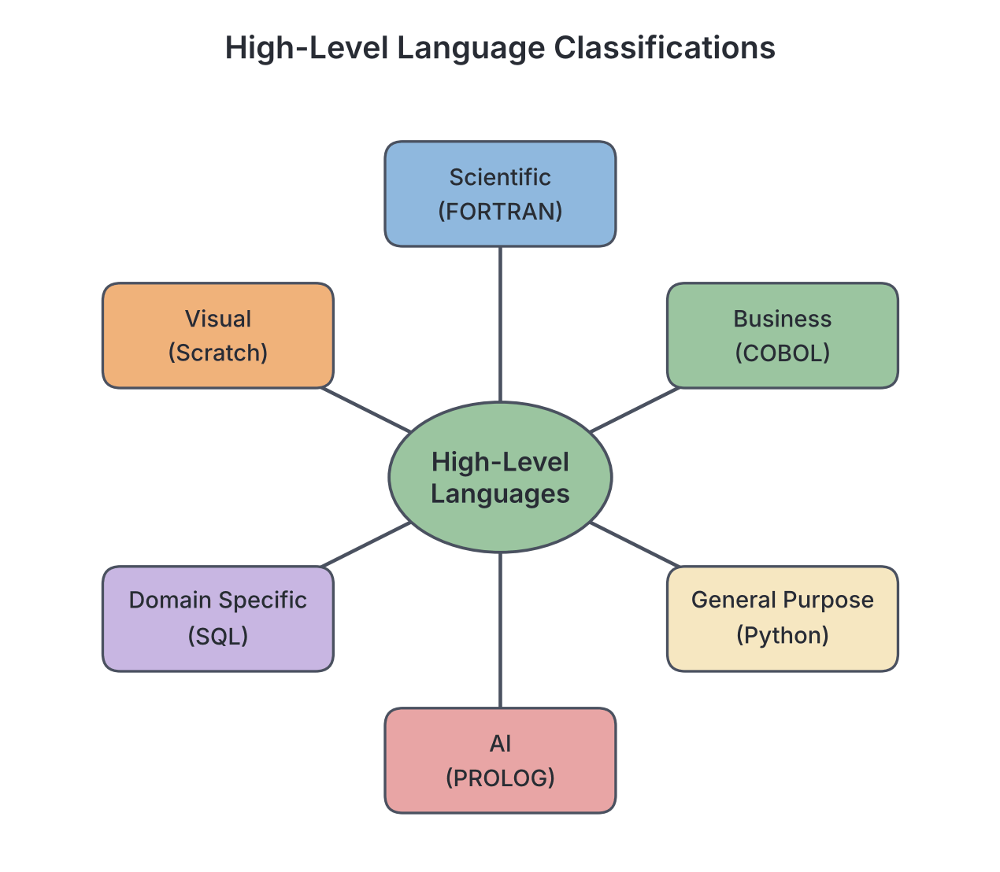
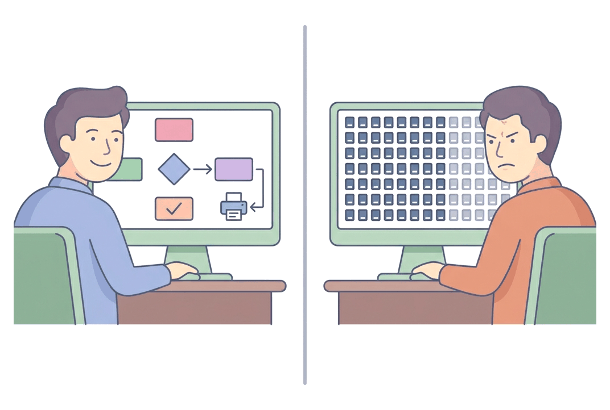
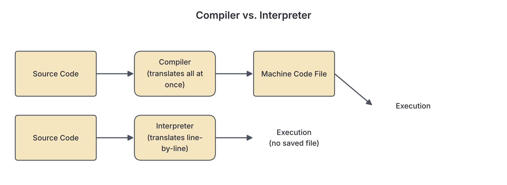

# JAMB Computer Studies Notes: High Level Languages (HLL)

## What JAMB expects

This file covers Section G, Topic 2 of the JAMB Computer Studies syllabus: High Level Languages (HLL). It covers the following content items:

* (a) Classifications of HLL
* (b) Characteristics of HLL
* (c) Translators

By the end of these notes, you should be able to:

1. Classify High-Level programming Languages into: Scientific, General Purpose, Business, Object oriented, Procedural, Artificial Intelligence, String processing, Domain Specific, Scripting, Systems, Visual, Esoteric etc.
2. Explain the characteristics of High-Level Programming Languages (such as requiring translation, portability, English-like commands, and built-in constructs).
3. Define translators and its two basic types: Interpreters and Compilers.

**Note on the syllabus wording:** The syllabus asks you to classify languages into several groups (like Scientific, Business, etc.). It is important to know that these categories often overlap. For example, Python can be classified as General Purpose, Object-oriented, and Scripting all at once. The classifications describe the *primary use* or *design style* of a language. 

## Classifications of High-Level Languages

**Objective i: Classify High-Level programming Languages.**

A high-level language (HLL) is a programming language that uses English-like words and mathematical symbols, making it easy for humans to read, write, and understand. Because different real-world problems require different tools, HLLs are classified based on the application areas they are best suited for or the programming style (paradigm) they use.

According to the JAMB syllabus, high-level languages are classified into the following groups:

### 1. Scientific
These languages are designed to handle complex mathematical formulas, scientific calculations, statistical analysis, and engineering problems. They handle numbers and arrays of data very efficiently.
*   *Examples:* **FORTRAN** (Formula Translation, one of the oldest scientific languages), APL, ALGOL.

### 2. General Purpose
These languages are flexible and not limited to one specific field. They can be used to build almost any type of software, from desktop applications and database interfaces to web servers and mobile games.
*   *Examples:* **Python**, C, Java, BASIC (Beginner's All-purpose Symbolic Instruction Code), Pascal.

### 3. Business
These languages are built to process large amounts of business data, such as bank accounts, payrolls, and inventory files. They focus on reading and writing large records and generating detailed reports.
*   *Example:* **COBOL** (Common Business Oriented Language). Even today, many banks around the world, including some in Nigeria, rely on older COBOL systems to process millions of transactions.

### 4. Object-oriented
These languages organise software design around "objects" rather than just a list of steps. An object contains both the data (attributes) and the actions that can be performed on that data (methods). This makes it easier to manage large, complex programs by breaking them down into real-world modules.
*   *Examples:* **Java**, C++, C#, Python.

### 5. Procedural
These languages follow a strict top-down sequence of commands, steps, or "procedures" to solve a problem. The program executes line by line, or it jumps to specific blocks of code called subroutines or functions.
*   *Examples:* **C**, Pascal, BASIC, FORTRAN.

### 6. Artificial Intelligence (AI)
Languages designed for machine learning, logical reasoning, and natural language processing (teaching computers to understand human language). They are built to handle complex decision-making and pattern recognition.
*   *Examples:* **LISP** (List Processing), **PROLOG** (Programming in Logic). (Note: Today, Python is also heavily used in AI, but LISP and PROLOG were historically created explicitly for it).

### 7. String processing
Languages that are exceptionally good at searching, matching, formatting, and manipulating text (strings of characters). They are highly useful for extracting data from documents.
*   *Examples:* **SNOBOL** (String Oriented and Symbolic Language), **Perl**.

### 8. Domain Specific
Languages created for one specific application area or task, rather than for writing general software. You cannot use them to write a whole desktop application, only the specific task they were designed for.
*   *Examples:* **SQL** (Structured Query Language, used only for querying and managing databases), HTML (HyperText Markup Language, used only for structuring web pages).

### 9. Scripting
Languages often used to automate small tasks, connect different software components, or add interactive features to web pages. They are usually interpreted rather than compiled, meaning they run on the fly.
*   *Examples:* **JavaScript** (used heavily in web browsers), PHP, Ruby, Python.

### 10. Systems
Languages used to write system software, like operating systems (e.g., Windows or Linux) and hardware drivers. They provide high-level features but still allow the programmer to control the computer's memory and hardware directly, making them very fast.
*   *Examples:* **C**, C++.

### 11. Visual
Languages that allow programmers to build programs by dragging and dropping graphical blocks, buttons, or menus on a screen instead of typing all the code as text.
*   *Examples:* **Visual Basic**, Scratch (widely used in schools to teach beginners), Delphi.

### 12. Esoteric
Languages created as jokes, experiments, or to be deliberately confusing and difficult to use. They test the limits of programming language design but have no practical real-world software applications.
*   *Examples:* **Brainfuck**, INTERCAL, Malbolge.



## Characteristics of High-Level Languages

**Objective ii: Explain the characteristics of High-Level Programming Languages.**

High-level languages were created to solve the problems of writing in low-level machine code (binary) and assembly language. They share several key characteristics:

### 1. Requires translation into machine language
The CPU only understands machine language (1s and 0s). A computer cannot run an HLL program directly. The HLL code (called **source code**) must first be translated into machine code by special system software (a translator) before the processor can execute it.

### 2. Portable (Machine-independent)
HLLs are portable. A program written in an HLL on a Windows computer with an Intel processor can usually be run on a Mac or a Linux computer with a different processor with little to no modification, as long as the right translator is available for that operating system. Low-level languages, by contrast, are tied to one specific family of processors (machine-dependent).

### 3. Easier to read, write and maintain as commands are similar to English
HLLs use familiar words and standard mathematical symbols (e.g., `READ`, `PRINT`, `+`, `<`). This makes the program look like a set of logical instructions that a human can easily follow and update later.

### 4. Use data types, data structures, selection statements and repetition/iteration constructs
HLLs provide powerful built-in ways to organise data and control the flow of the program:
*   **Data types:** Tell the computer what kind of data is stored (e.g., integers for whole numbers, strings for text, booleans for True/False).
*   **Data structures:** Allow the programmer to group related data, such as an array (a list of items).
*   **Selection statements:** Allow the program to make decisions and choose different paths using `if`, `else`, or `switch` statements.
*   **Repetition/iteration constructs:** Allow the program to loop or repeat actions using `for`, `while`, or `repeat...until` commands until a condition is met.

Here is a short example in Python showing some of these constructs:

```python
# A simple High-Level Language program
score = 75                      # Data type (integer)

if score >= 50:                 # Selection statement
    print("You passed!")        # English-like command
else:
    print("You failed.")

# Repetition/iteration construct
for i in range(3):
    print("Well done!")
```

### 5. Use logic operators and functions that are built into the language
HLLs provide logic operators like `AND`, `OR`, and `NOT` for combining multiple conditions easily. They also come with libraries of built-in functions (for example, finding a square root, getting the current time, or calculating an average) so the programmer does not have to write basic mathematics from scratch.

### 6. Programmers friendly
The language handles complex hardware details behind the scenes. The programmer does not need to know how the CPU registers work, how to move bits across buses, or exactly where data is stored in the computer's memory. They can focus purely on solving the logical problem.

### 7. Easy to code, debug and maintain
Because the code is shorter, structured, and readable, a programmer can write a program much faster than in assembly language. When errors (bugs) occur, they are much easier to spot and fix (debug), and the code can easily be updated by another programmer years later (maintain).



## Translators

**Objective iii: Define translators and its two basic types: Interpreters, Compilers.**

A **translator** is a type of system software that converts source code (the program written by a human in a programming language) into object code or machine language (the binary 1s and 0s that the computer's CPU can execute). 

Without a translator, a computer cannot understand a high-level language. The JAMB syllabus identifies two basic types of translators used for high-level languages: **Interpreters** and **Compilers**. 

*(Note: A third type of translator, the Assembler, is used only for translating low-level Assembly language into machine code, not high-level languages).*

### 1. Interpreters

An **interpreter** translates and executes the source code **line by line** (or statement by statement).
*   **How it works:** It reads the first instruction, translates it into machine code, executes it immediately, and then moves to the next instruction.
*   **Error handling:** If it finds a syntax error on line 10, it will successfully execute lines 1 to 9, print an error message, and stop immediately at line 10.
*   **Advantage:** It is excellent for testing and debugging because the programmer can see errors as they happen and fix them quickly.
*   **Disadvantage:** Execution is slower because the translation process must be repeated every single time the program is run. It does not save a permanent machine-code file.
*   **Examples of interpreted languages:** Python, JavaScript, PHP, and older versions of BASIC.

### 2. Compilers

A **compiler** translates the **entire source code** into machine language all at once, before any part of the program is executed.
*   **How it works:** It reads the whole program and produces a separate, saved file of machine code (often called an executable object file, like a `.exe` file on Windows).
*   **Error handling:** If there are errors in the code, the compiler will not produce an executable file. Instead, it generates a list of all the errors at the end of the compilation process.
*   **Advantage:** Execution is very fast because the program is fully translated beforehand. You do not need the compiler software again just to run the finished program. You can give the `.exe` file to a friend, and they can run it without having the compiler.
*   **Disadvantage:** Debugging can be more difficult because you have to wait for the whole compilation to finish to see the errors, and one small mistake (like a missing semicolon) can cause the compiler to report dozens of confusing errors.
*   **Examples of compiled languages:** C, C++, COBOL, FORTRAN.

### Comparison: Compiler vs. Interpreter

| Feature | Compiler | Interpreter |
| :--- | :--- | :--- |
| **Translation method** | Translates the whole program at once | Translates line by line |
| **Execution speed** | Fast execution (already translated) | Slower execution (translated on the fly) |
| **Object code** | Produces a saved executable file (object code) | Does not save object code |
| **Error detection** | Reports all errors at the end of translation | Stops and reports the first error it finds |
| **Best used for** | Finished programs ready to be distributed to users | Developing, testing, and debugging programs |

*Note: Some modern languages, such as Java, use a combination of both. The Java compiler translates the source code into an intermediate code called "bytecode". Then, a Java interpreter (the Java Virtual Machine) translates the bytecode into machine language line by line when the program is run.*



## Key terms

| Term | Meaning |
| --- | --- |
| High-Level Language (HLL) | A programming language using English-like words, designed to be easy for humans to read and write. |
| Translator | System software that converts source code into machine language. |
| Compiler | A translator that converts the entire source code into object code all at once. |
| Interpreter | A translator that translates and executes source code line by line. |
| Source code | The original code written in a programming language by a human. |
| Object code | The machine language code produced by a compiler, which the CPU can execute. |
| Portability | The ability of a program to run on different types of computer architectures without being rewritten. |
| Selection statement | A programming construct (like `if-else`) used to make decisions in code. |
| Iteration/Repetition | A programming construct (like a `for` or `while` loop) used to repeat a block of code. |

## Exam tips and common mistakes

*   **Do not confuse compilers and interpreters:** Both translate high-level languages, but a compiler does the whole program at once, while an interpreter works line by line.
*   **Assembler is for low-level language:** The syllabus asks for the two basic types of translators for *high-level languages* (interpreters and compilers). Do not select "assembler" as a high-level translator.
*   **Portability means machine-independent:** In programming, "portable" does not mean you can carry the software on a flash drive; it means the code is not tied to one specific CPU architecture and can run on multiple platforms.
*   **Learn the full meaning of common language names:** Knowing that COBOL stands for Common Business Oriented Language will help you instantly remember its classification.
*   **Esoteric vs Domain Specific:** Domain-specific languages (like SQL) are built for serious, specialised tasks. Esoteric languages (like Brainfuck) are built as jokes or puzzles and have no practical use.

## Quick summary

1. High-level languages (HLLs) use English-like commands, making them programmer-friendly and easier to write, read, and debug than machine code.
2. HLLs are portable, meaning a program written on one type of computer can usually run on another.
3. HLLs are classified by their purpose, including Scientific (FORTRAN), Business (COBOL), Artificial Intelligence (PROLOG), Object-oriented (Java), Visual (Scratch), and Domain-Specific (SQL).
4. Characteristics of HLLs include the use of data structures, built-in logic operators, selection statements (like `if`), and repetition constructs (like `while`).
5. A computer cannot run an HLL directly; it requires a translator to convert the source code into machine language (binary).
6. An interpreter translates and executes code line by line, making it slower to run but easier for finding and fixing errors quickly.
7. A compiler translates the entire program at once, producing a fast executable file (object code) but only reporting errors at the end of the process.

## Practice questions

**1. Which of the following high-level languages is primarily classified as a business language?**

- A. FORTRAN
- B. COBOL
- C. PROLOG
- D. HTML

**Answer: B.** COBOL stands for Common Business Oriented Language and is designed specifically for business data processing. FORTRAN (Option A) is a scientific language, and PROLOG (Option C) is for artificial intelligence.

**2. A key characteristic of high-level languages is that they are portable. What does this mean?**

- A. They can be stored on a flash drive
- B. They can run on different types of computers with little or no modification
- C. They do not require translation to machine language
- D. They execute faster than assembly language

**Answer: B.** Portability in programming means the source code is machine-independent and can run on different processor architectures. Option A comes from confusing software portability with physical hardware portability (like a portable flash drive).

**3. Which type of programming language uses dragging and dropping of graphical blocks instead of typing text?**

- A. String processing languages
- B. Scripting languages
- C. Visual languages
- D. Esoteric languages

**Answer: C.** Visual languages (like Visual Basic or Scratch) allow programmers to build interfaces and logic using graphical blocks. Option D (Esoteric) might tempt a student who does not know the meaning of the word, but esoteric languages are joke languages designed to be difficult.

**4. The translator that reads and executes source code line by line is called:**

- A. a compiler
- B. an interpreter
- C. an assembler
- D. a debugger

**Answer: B.** An interpreter translates and executes code statement by statement. A compiler (Option A) is the most tempting wrong answer, but it translates the entire program at once before execution.

**5. Which of the following is NOT a characteristic of high-level programming languages?**

- A. They are machine dependent
- B. They use English-like commands
- C. They require translation into machine language
- D. They are easy to code and debug

**Answer: A.** High-level languages are machine-independent (portable), not machine-dependent. Machine dependency is a characteristic of low-level languages (like assembly or machine code). The other options are true characteristics of high-level languages.

**6. LISP and PROLOG are languages best classified under:**

- A. Scientific
- B. Artificial Intelligence
- C. Systems programming
- D. Esoteric

**Answer: B.** LISP and PROLOG were designed for machine learning, logical reasoning, and natural language processing, making them Artificial Intelligence languages. Option A (Scientific) is wrong because scientific languages like FORTRAN are for mathematical calculations, not logic reasoning.

**7. What is the main advantage of a compiled program over an interpreted one?**

- A. It is easier to debug
- B. It stops executing at the first error
- C. It executes faster because it is already fully translated
- D. It does not require any memory

**Answer: C.** Once a program is compiled, it becomes a standalone machine code file that executes very quickly without needing the translator again. Option A is the main advantage of an interpreter, not a compiler.

**8. In a high-level language, `if-else` commands are examples of:**

- A. Data structures
- B. Logic operators
- C. Selection statements
- D. Repetition constructs

**Answer: C.** `if-else` statements make decisions, meaning they select which block of code to run, so they are selection statements. Option D (Repetition) is the most tempting wrong option because it is another control construct, but repetition refers to loops like `while` or `for`.

**9. A programming language designed specifically for managing databases, such as SQL, is classified as:**

- A. General Purpose
- B. Domain Specific
- C. Object-oriented
- D. Procedural

**Answer: B.** Domain-specific languages are created for one specific task or environment. SQL is specifically for databases. Option A (General Purpose) is tempting because SQL is widely used, but it cannot be used to write general software like a web browser or a game.

**10. A compiler differs from an interpreter because it:**

- A. Translates assembly language only
- B. Translates the entire source code at once to produce object code
- C. Cannot detect errors in a program
- D. Executes code slower than an interpreter

**Answer: B.** A compiler translates the entire source code in one go, generating a saved object code file. Option D is tempting if a student confuses the two, but an interpreter executes slower because it translates on the fly, while a compiled program runs faster.

<!-- COVERAGE
obj i | Classifications of High-Level Languages
obj ii | Characteristics of High-Level Languages
obj iii | Translators
item a | Classifications of High-Level Languages
item b | Characteristics of High-Level Languages
item c | Translators
-->
