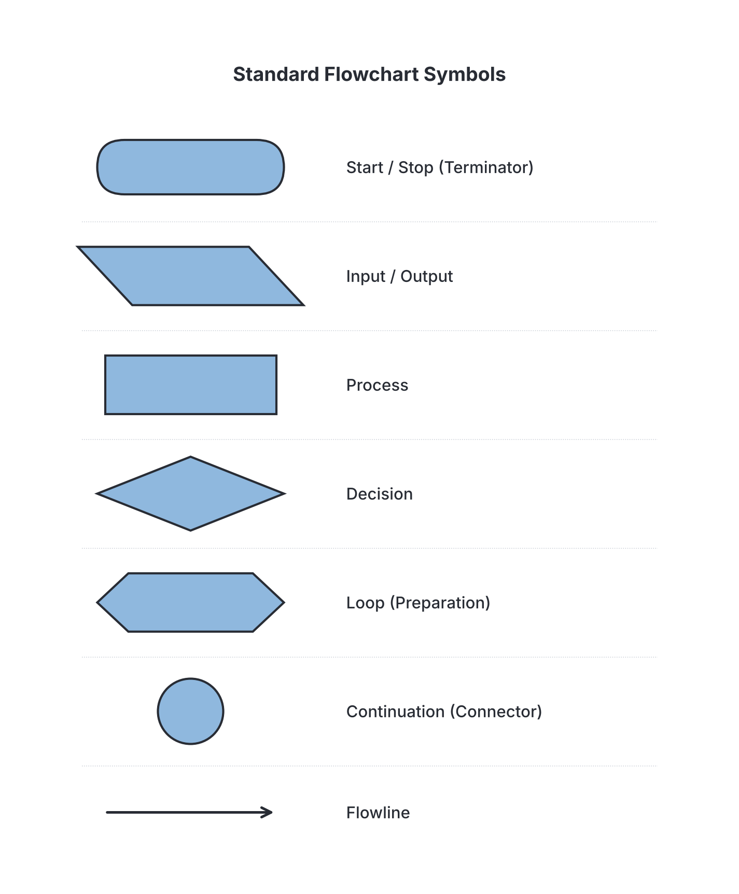
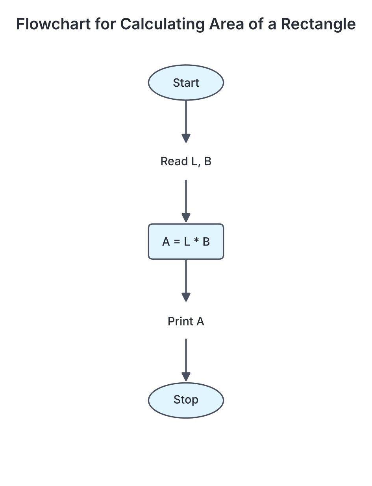
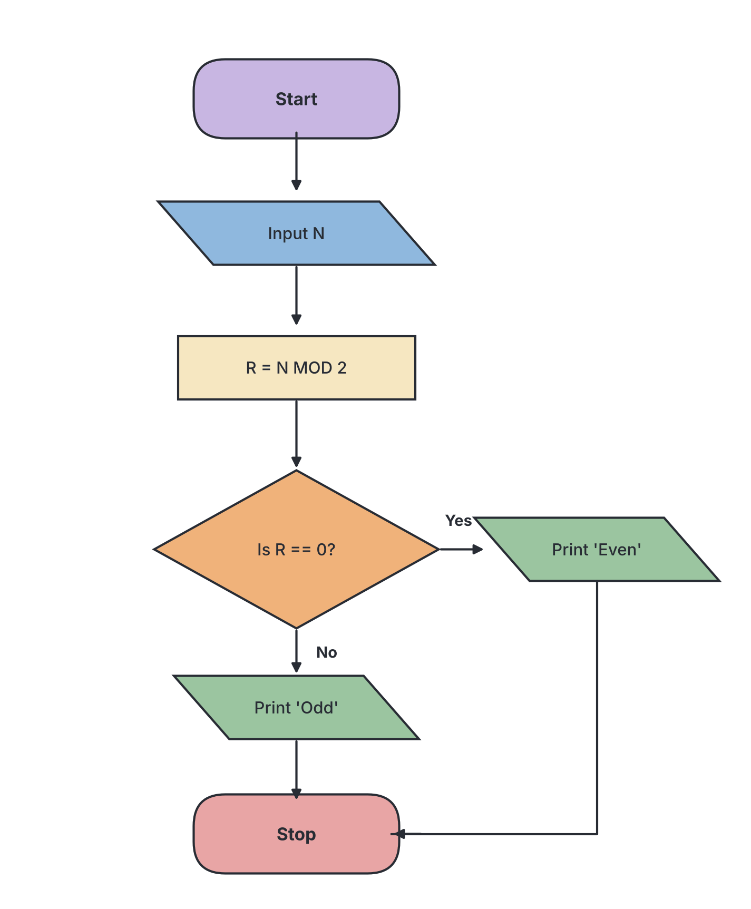

# JAMB Computer Studies Notes: Algorithm and Flowcharts

## What JAMB expects

This topic is Section G, Topic 3 of the JAMB Computer Studies syllabus: Algorithm and Flowcharts. It covers the foundations of problem-solving before writing actual computer programs.

The syllabus includes the following content items:
- (a) Definitions
- (b) Functions of Algorithm
- (c) Properties of Algorithm
- (d) Flowchart symbols

By the end of these notes, you should be able to:
1. Define Algorithm and Flowchart (objective i).
2. State functions of algorithms: They are used to perform Calculations, Data Processing, Automated reasoning etc. (objective ii).
3. State and explain the properties of Algorithm: Input specified, Output specified, Definiteness, Effectiveness, Finiteness etc. (objective iii).
4. Identify Flowchart symbols: Start, Input/Output, Process, Decision, Stop, loop, Continuation etc. (objective iv).
5. Draw Flowchart of a given programming problem (objective v).

**Note on the syllabus wording:** The syllabus lists "loop" and "Continuation" under flowchart symbols. In most standard textbooks, "continuation" is called a "connector" (represented by a circle), and a "loop" is not always a single symbol but a combination of a decision diamond and a flow arrow pointing back. Some books do use a hexagon for specific loops (like a FOR loop). We will explain these variations below so you are prepared for however JAMB presents them.

## Definitions

**Objective i: Define Algorithm and Flowchart; Content a: Definitions**

Before a programmer writes code in a programming language like Python or Java, they must first plan how to solve the problem. This planning stage involves creating algorithms and flowcharts.

### What is an Algorithm?

An **algorithm** is a step-by-step sequence of instructions or rules designed to solve a specific problem or perform a task. 

You can think of an algorithm like a recipe. For example, if you want to cook Indomie noodles, your algorithm might look like this:
1. Boil a pot of water.
2. Open the noodle packet and add the noodles to the boiling water.
3. Wait for 2 minutes.
4. Add the seasoning.
5. Stir well and serve.

In computing, an algorithm takes a set of inputs, processes them step-by-step, and produces the desired output. Algorithms are written in human languages or **pseudocode** (a mixture of everyday language and programming structure), making them independent of any specific programming language. 

### What is a Flowchart?

A **flowchart** is a graphical or pictorial representation of an algorithm. 

While an algorithm uses text to describe the steps, a flowchart uses standard geometric shapes (like ovals, rectangles, and diamonds) connected by arrows to show the flow of control. Flowcharts make it easier to see the logic of a program at a glance, especially when decisions (like "Is the number greater than 10?") or repetitions (loops) are involved.

## Functions of Algorithms

**Objective ii: State functions of algorithms; Content b: Functions of Algorithm**

Algorithms are the engine behind every computer program. The JAMB syllabus specifically states that algorithms are used to perform the following core functions:

1. **Calculations:** 
   Algorithms perform mathematical operations. For example, an algorithm can be written to calculate the area of a circle, compute the compound interest on a bank loan, or determine a student's total JAMB score by adding the scores of four subjects.
   
2. **Data Processing:** 
   Algorithms organise, filter, sort, and transform data into useful information. For example, when thousands of students register for the UTME, an algorithm processes this data to assign each candidate to a specific CBT centre, ensuring no two students are booked for the same seat at the same time. Searching for a name in a phone book and sorting a list of numbers from highest to lowest are classic data processing algorithms.
   
3. **Automated Reasoning:** 
   Algorithms allow computers to make logical decisions based on rules, mimicking human reasoning. This is heavily used in Artificial Intelligence (AI). For example, a chess-playing program uses algorithms to evaluate millions of possible moves and choose the best one. Similarly, an ATM uses automated reasoning to decide: "If the requested withdrawal amount is less than the account balance, dispense cash; otherwise, display 'Insufficient funds'."

## Properties of an Algorithm

**Objective iii: State and explain the properties of Algorithm; Content c: Properties of Algorithm**

A set of steps is only considered a good algorithm if it meets certain mathematical criteria. The computer scientist Donald Knuth defined the standard properties of an algorithm, which are outlined in the syllabus:

1. **Input specified:** 
   An algorithm must have zero or more well-defined inputs. These are the data items given to the algorithm before it begins. For example, an algorithm to calculate the sum of two numbers requires exactly two inputs (the two numbers).
   
2. **Output specified:** 
   An algorithm must produce at least one output (the result). If an algorithm does not produce an output, it is useless because there is no way to know if it solved the problem. The output is the relationship matched to the input.
   
3. **Definiteness:** 
   Every step in the algorithm must be absolutely clear and unambiguous. A computer cannot guess what you mean. If a step says "Add a little salt" or "Choose a large number," it lacks definiteness. It should say "Add 5 grams of salt" or "Choose a number greater than 100."
   
4. **Effectiveness:** 
   Every step must be basic enough that it can, in principle, be carried out by a person using a pencil and paper in a finite amount of time. The operations must be achievable and not impossible (for example, a step that asks to "divide by zero" is not effective because division by zero is undefined).
   
5. **Finiteness:** 
   An algorithm must eventually stop. It must terminate after a finite number of steps. If a sequence of steps loops forever (an "infinite loop"), it is not a valid algorithm.

## Flowchart Symbols

**Objective iv: Identify Flowchart symbols; Content d: Flowchart symbols**

To draw a flowchart, you must use the correct standard shapes. Each shape represents a different type of action. Below are the flowchart symbols specified in the syllabus:

| Symbol Name | Shape | Description and Use |
| :--- | :--- | :--- |
| **Start / Stop (Terminator)** | Oval (or Pill shape) | Marks the beginning (Start) and the end (Stop) of a flowchart. Every flowchart must have one Start and at least one Stop. |
| **Input / Output** | Parallelogram | Used for receiving data (Input) or displaying results (Output). Example: `Read A, B` or `Print Sum`. |
| **Process** | Rectangle | Used for calculations, assigning values, and data manipulation. Example: `Sum = A + B` or `Count = Count + 1`. |
| **Decision** | Diamond | Used when a choice must be made. It asks a question that has a "Yes" or "No" (True or False) answer. The flow splits into two paths depending on the answer. Example: `Is A > B?`. |
| **Loop** | Hexagon (or loop-back arrows) | **Textbook variation:** The syllabus lists "loop". Many textbooks represent a loop simply by drawing an arrow from a decision diamond back to an earlier step. However, some formal flowcharts use a **Hexagon** (Preparation symbol) specifically to show the start of a counting loop (like a FOR loop). |
| **Continuation (Connector)** | Circle | Used to connect different parts of a flowchart without drawing long, confusing lines across the page. An **On-page connector** is a circle with a letter inside. An **Off-page connector** (for continuing on a new page) is usually a pentagon shape, though the syllabus just names "Continuation". |
| **Flowlines** | Arrows | Lines with arrowheads that connect the symbols, showing the exact direction or sequence the steps must be followed. |



## Drawing Flowcharts for Given Problems

**Objective v: Draw Flowchart of a given programming problem**

To understand how these symbols work together, let's look at how to design algorithms and draw flowcharts for common programming problems. 

### Example 1: Calculating the Area of a Rectangle
**Problem:** We need to find the area of a rectangle. The formula is `Area = Length × Breadth`.

**Algorithm (Pseudocode style):**
```text
1. Start
2. Input Length (L)
3. Input Breadth (B)
4. Calculate Area (A) = L * B
5. Print A
6. Stop
```

**Flowchart Description:**
1. Draw an **Oval** and write "Start" inside it. Draw an arrow pointing down.
2. Draw a **Parallelogram** (Input). Write "Read L, B" inside. Draw an arrow pointing down.
3. Draw a **Rectangle** (Process). Write "A = L * B" inside. Draw an arrow pointing down.
4. Draw a **Parallelogram** (Output). Write "Print A" inside. Draw an arrow pointing down.
5. Draw an **Oval** and write "Stop" inside.



### Example 2: Checking if a number is Even or Odd (Using a Decision)
**Problem:** A user enters a number. The program must output "Even" if the number is even, or "Odd" if it is not. 
*(Hint: A number is even if dividing it by 2 leaves a remainder of 0. In programming, the modulo operator, often written as `MOD` or `%`, finds the remainder).*

**Algorithm:**
```text
1. Start
2. Input Number (N)
3. Calculate Remainder (R) = N MOD 2
4. If R equals 0, then:
       Print "Even"
   Else:
       Print "Odd"
5. Stop
```

**Flowchart Description:**
1. **Oval**: "Start". Arrow pointing to...
2. **Parallelogram**: "Input N". Arrow pointing to...
3. **Rectangle**: "R = N MOD 2". Arrow pointing to...
4. **Diamond**: "Is R == 0?". 
   - Draw an arrow to the right labelled "Yes", leading to a **Parallelogram**: "Print 'Even'".
   - Draw an arrow down labelled "No", leading to a **Parallelogram**: "Print 'Odd'".
5. Draw arrows from both Parallelograms to a single **Oval**: "Stop".



### Example 3: Finding the Sum of the First N Natural Numbers (Using a Loop)
**Problem:** Given a number N (e.g., 3), add up all numbers from 1 to N (1 + 2 + 3 = 6).

**Algorithm:**
```text
1. Start
2. Input N
3. Set Sum = 0
4. Set Count = 1
5. If Count > N, go to step 9 (Decision / Loop condition)
6. Sum = Sum + Count (Process)
7. Count = Count + 1 (Process)
8. Go back to step 5 (Loop back)
9. Print Sum
10. Stop
```

**Trace Table for N = 3:**
Tracing an algorithm by hand is an essential skill to verify that your logic is correct.

| Step | Count | Count > 3? | Sum (Sum + Count) | Next Step |
| :--- | :--- | :--- | :--- | :--- |
| Initial Setup | 1 | - | 0 | Enter loop |
| Loop 1 | 1 | No | 0 + 1 = 1 | Count becomes 2, loop back |
| Loop 2 | 2 | No | 1 + 2 = 3 | Count becomes 3, loop back |
| Loop 3 | 3 | No | 3 + 3 = 6 | Count becomes 4, loop back |
| Loop 4 | 4 | Yes | (no change) | Exit loop |

Output: 6. 

**Flowchart Description:**
This flowchart involves a flowline going *backwards* to create a cycle (a loop).
1. **Oval**: "Start".
2. **Parallelogram**: "Input N".
3. **Rectangle**: "Sum = 0, Count = 1".
4. **Diamond**: "Is Count > N?".
   - **Yes branch**: points to a **Parallelogram** "Print Sum", then to **Oval** "Stop".
   - **No branch**: points to a **Rectangle** "Sum = Sum + Count", then to another **Rectangle** "Count = Count + 1". 
5. From the "Count = Count + 1" rectangle, draw an **arrow pointing backwards and upwards**, connecting to the flowline just *before* the Diamond. This arrow represents the **loop**.

## Key terms

| Term | Meaning |
| :--- | :--- |
| **Algorithm** | A step-by-step sequence of instructions designed to solve a problem. |
| **Flowchart** | A pictorial or graphical representation of an algorithm using standard shapes. |
| **Pseudocode** | A way of writing algorithms using a mix of everyday English and programming structures. |
| **Definiteness** | The property stating that each step of an algorithm must be clear and unambiguous. |
| **Finiteness** | The property stating that an algorithm must eventually stop (terminate) after a finite number of steps. |
| **Effectiveness** | The property stating that every step must be basic enough to be carried out practically. |
| **Terminator** | The oval symbol used to represent the Start and Stop of a flowchart. |
| **Connector** | A circle symbol (referred to as "Continuation" in the syllabus) used to link parts of a flowchart without drawing long lines. |
| **Loop** | A sequence of instructions that repeats until a certain condition is met. |

## Exam tips and common mistakes

*   **Algorithm vs. Flowchart:** A common exam question asks you to distinguish the two. Remember: *Algorithm* = step-by-step text/instructions. *Flowchart* = graphical/pictorial representation.
*   **Definiteness vs. Effectiveness:** Don't mix these up. Definiteness is about being *clear and exact* (no ambiguity). Effectiveness is about being *doable/computable* (can actually be executed).
*   **Parallelogram vs. Rectangle:** Always remember that Input (e.g., Read, Enter) and Output (e.g., Print, Display) go in the Parallelogram. Processes (e.g., math calculations, assigning values) go in the Rectangle. Using a rectangle for input is a very common student mistake.
*   **The Diamond Shape:** Only use the diamond for decisions. There must always be at least two arrows coming *out* of a diamond (usually labeled True/False or Yes/No).
*   **Finiteness is mandatory:** If an option suggests an algorithm can run forever, it is incorrect. Finiteness means it *must* stop.

## Quick summary

1. An algorithm is a clear, step-by-step procedure used to solve a specific problem or perform a task.
2. A flowchart is a graphical representation of an algorithm using standardized geometric shapes connected by arrows.
3. Algorithms are primarily used for calculations, data processing, and automated reasoning.
4. The key properties of an algorithm are: it must take defined inputs, produce outputs, be definite (clear), be effective (doable), and be finite (must terminate).
5. The Oval represents Start/Stop, the Parallelogram represents Input/Output, and the Rectangle represents processing/calculations.
6. The Diamond represents decisions (Yes/No questions), and split paths in the flowchart.
7. The syllabus identifies "Continuation" (often drawn as a circle connector) and "Loop" (often drawn with flowlines looping back or a hexagon) as standard flowchart symbols.
8. Tracing an algorithm by hand involves tracking the values of variables step-by-step to predict the final output.

## Practice questions

**1. A step-by-step procedure used for solving a specific problem is known as an:**
- A. Operating system
- B. Algorithm
- C. Flowchart
- D. Interpreter

**Answer: B.** An algorithm is a step-by-step sequence of instructions designed to solve a problem. A flowchart is its graphical representation.

**2. Which flowchart symbol is used to represent a decision-making step?**
- A. Rectangle
- B. Parallelogram
- C. Diamond
- D. Oval

**Answer: C.** The diamond shape is used for decisions, where a Yes/No or True/False question is asked and the flow splits accordingly.

**3. In algorithm design, the property which states that every instruction must be clear and unambiguous is called:**
- A. Finiteness
- B. Definiteness
- C. Effectiveness
- D. Automation

**Answer: B.** Definiteness requires each step to be clear and exact, leaving no room for guesswork by the computer.

**4. Which of the following is NOT typically stated as a core function of an algorithm in computer studies?**
- A. Calculations
- B. Data processing
- C. Automated reasoning
- D. Hardware assembling

**Answer: D.** Algorithms are used for logical software tasks like calculations, data processing, and automated reasoning, not for physical hardware assembly.

**5. The property of an algorithm that ensures it will eventually stop running is called:**
- A. Output
- B. Finiteness
- C. Definiteness
- D. Effectiveness

**Answer: B.** Finiteness means the algorithm must terminate after a finite (countable) number of steps. A process that runs endlessly without stopping is not a valid algorithm.

**6. If a programmer wants to connect a flowchart from the bottom of one page to the top of the next page, which symbol, listed in the syllabus as "Continuation", is used?**
- A. A rectangle
- B. A diamond
- C. A circle or pentagon
- D. A parallelogram

**Answer: C.** A circle (on-page connector) or a pentagon (off-page connector) is used for continuation to avoid messy, overlapping lines.

**7. In a flowchart, calculating the sum of two numbers (`Sum = A + B`) should be placed inside a:**
- A. Parallelogram
- B. Rectangle
- C. Diamond
- D. Oval

**Answer: B.** A rectangle is the "Process" symbol used for assignments and calculations. The parallelogram is used for input or output, not processing.

**8. Consider the following algorithm segment:**
```text
1. Set X = 5
2. Set Y = 10
3. If X > Y then Print X
   Else Print Y
```
**What will be the output of this algorithm?**
- A. 5
- B. 10
- C. 15
- D. 50

**Answer: B.** The algorithm checks if X (5) is greater than Y (10). Since 5 > 10 is False, it executes the "Else" part, which prints Y. The value of Y is 10.

**9. What is the main difference between an algorithm and a flowchart?**
- A. An algorithm is drawn with shapes, while a flowchart is written in English.
- B. An algorithm is only used for data processing, while a flowchart is used for calculations.
- C. An algorithm is a text-based, step-by-step procedure, while a flowchart is its graphical representation.
- D. An algorithm requires a computer to run, while a flowchart can only be solved by humans.

**Answer: C.** The primary difference is the format. An algorithm uses text/pseudocode, whereas a flowchart is pictorial/graphical. Both outline the same logic.

**10. Which shape must appear at both the very beginning and the very end of any complete flowchart?**
- A. Oval
- B. Rectangle
- C. Diamond
- D. Parallelogram

**Answer: A.** The Oval (or pill shape) is the terminator symbol, used exclusively for the "Start" and "Stop" (or "End") of a flowchart.

<!-- COVERAGE
obj i | Definitions
obj ii | Functions of Algorithms
obj iii | Properties of an Algorithm
obj iv | Flowchart Symbols
obj v | Drawing Flowcharts for Given Problems
item a | Definitions
item b | Functions of Algorithms
item c | Properties of an Algorithm
item d | Flowchart Symbols
-->
