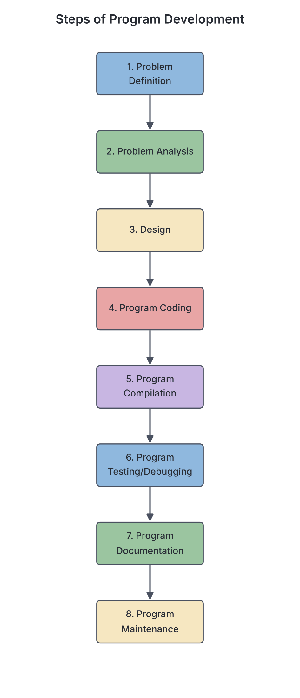
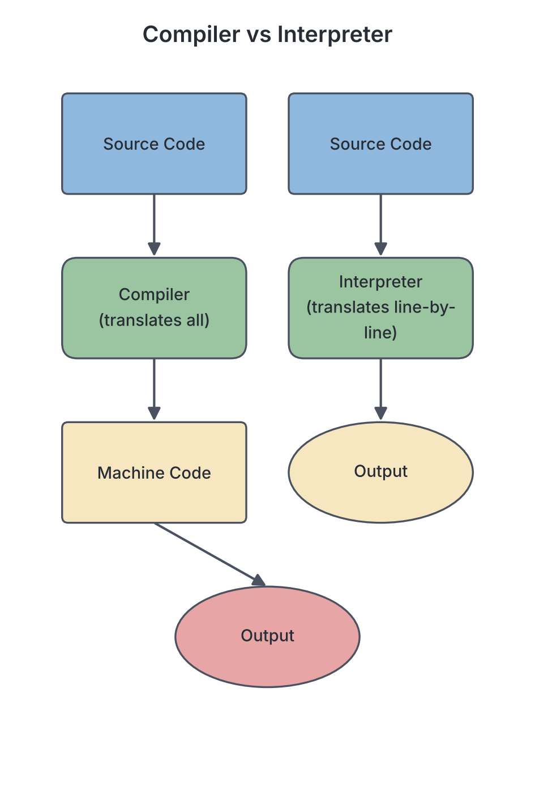

# JAMB Computer Studies Notes: Program Development

## What JAMB expects

This topic is Section G, Topic 5 of the JAMB Computer Studies syllabus: Program Development. It covers the following content items:
* (a) Definition
* (b) Characteristics of programs
* (c) Precautions
* (d) Steps involved in developing program

By the end of these notes, you should be able to:
1. Define a program
2. List characteristics of a good program
3. State the precautions required in the development of a program
4. Steps involved in program development
5. Examples of: Interpreted program (BASIC, java, python); Compiled Program (COBOL, FORTRAN, C, C++, Java etc.)

**Note on the syllabus wording:** In the steps of program development, the syllabus lists "Programme Maintenance". "Program" is the standard American spelling used in computing, while "Programme" is British English. In computing, we almost always write "program", but be prepared to see both in your exam. Also, the syllabus lists Java as *both* an interpreted program and a compiled program. This is actually technically correct—Java uses a hybrid approach (it is compiled into "bytecode", which is then interpreted by the Java Virtual Machine). You must remember that JAMB categorises it under both.

## What is a program?

**Objective i: Define a program**

A **computer program** is a sequence of step-by-step instructions written in a language that a computer can understand, directing the computer to perform a specific task or solve a specific problem. 

Computers are not intelligent on their own. They cannot think or solve problems without human guidance. A program acts as the recipe or rulebook that tells the computer's hardware (the CPU) exactly what to do, what data to take in, how to process it, and what output to produce. 

The person who writes these instructions is called a **programmer**, and the instructions are written using a **programming language** (covered in detail in `G1-programming-language.md`).

## Characteristics of a good program

**Objective ii: List characteristics of a good program**

Not all programs are well-written. A student might write a program that works but is completely confusing to anyone else who tries to read it. Professional programmers aim to write "good" programs. A good program should have the following characteristics:

1. **Accuracy:** The program must produce the correct results for all valid inputs. If a Nigerian bank's transfer program deducts ₦5,000 from your account but only credits ₦4,500 to the receiver without stating a fee, the program is inaccurate. 
2. **Readability:** The code should be easy for humans (other programmers) to read and understand. This is achieved by using clear names for variables, proper indentation (spacing), and adding comments (notes explaining what the code does).
3. **Maintainability:** Software changes over time (for example, adding new features or updating tax rates). A maintainable program is one that can be easily modified, updated, or fixed by programmers without breaking other parts of the system.
4. **Efficiency:** An efficient program does its job quickly and does not waste the computer's memory (RAM) or processing power (CPU). It uses the best available logic to get the result in the shortest time.
5. **Generality:** A good program should be flexible enough to handle a wide range of data, not just one specific case. For example, a program written to calculate the average score of 50 students should easily be adjustable to calculate the average for 500 students.
6. **Clarity:** The logic of the program should be straightforward and simple, not needlessly complicated or confusing. 
7. **Reliability:** It should not crash easily when it encounters unexpected situations (like a user typing letters when asked for a phone number).

## Precautions in program development

**Objective iii: State the precautions required in the development of a program**

Developing a program can be complex and frustrating. To avoid major errors (bugs) and wasted time, programmers must take specific precautions:

1. **Be stable, steady and patient:** Programming requires deep concentration. Rushing through the coding process almost always leads to mistakes. A programmer must patiently test and review their work.
2. **No step skipping:** The steps of program development (explained below) are sequential. You cannot start writing code before you have properly defined the problem and designed the solution. Skipping the design phase is a common mistake that leads to messy, unworkable code.
3. **Follow order of execution:** Inside the code itself, instructions must be arranged in the exact logical sequence required to solve the problem. If a program tries to calculate a student's total score before reading the student's individual subject marks, it will fail.

## Steps involved in program development

**Objective iv: Steps involved in program development**

Creating a working program is a systematic process. Textbooks sometimes group these slightly differently, but the JAMB syllabus identifies exactly eight steps. You must know these steps in their correct order.

### 1. Problem definition
Before solving a problem, you must clearly understand what the problem is. In this stage, the programmer or systems analyst interviews the user to find out exactly what the new program needs to achieve. 
*Example:* A school principal wants a program to calculate students' end-of-term grades and print report cards. The problem is defined as: "Automate the processing of students' continuous assessment and exam scores into a final grade and printed report."

### 2. Problem analysis
Once the problem is defined, the programmer breaks it down into smaller, manageable parts. They identify three major things:
*   **Inputs:** What data will be fed into the computer? (e.g., student names, subjects, scores).
*   **Processes:** What calculations or rules must be applied? (e.g., Total = CA + Exam; Average = Total / Number of Subjects).
*   **Outputs:** What should the final result look like? (e.g., a printed report card).

### 3. Design (Flow charting / algorithm development)
Before writing actual computer code, the programmer plans the logic of the solution using everyday language or diagrams. This acts like a blueprint for a house.
*   **Algorithm:** A step-by-step written procedure for solving the problem (often written in "pseudocode").
*   **Flowchart:** A diagram that uses standard symbols (ovals, rectangles, diamonds) to show the flow of logic. 
(These are covered fully in `G3-algorithm-and-flowcharts.md`).

### 4. Program coding
This is the stage where the logic designed in the previous step is translated into a specific **programming language** (like Python, C++, or BASIC). The programmer writes the actual instructions, which are known as the **source code**. 

### 5. Program compilation
Computers only understand machine language (binary: 0s and 1s). The source code written in a high-level language must be translated into machine code before the computer can run it. This is done by a translator program called a **compiler** or an **interpreter**. During compilation, the system checks the code for spelling or grammar errors (syntax errors) based on the rules of the programming language.

### 6. Program testing / debugging
No program is perfect on the first try. 
*   **Testing:** Running the program using sample data (test data) to see if it produces the expected results.
*   **Debugging:** The process of finding and removing errors (bugs) from the program. 
There are generally three types of errors to fix:
    *   *Syntax errors:* Typing mistakes (e.g., spelling `PRINT` as `PRNT`).
    *   *Logical errors:* The code runs, but gives the wrong answer (e.g., using a `+` instead of a `-` in a calculation).
    *   *Runtime errors:* The program crashes while running (e.g., trying to divide a number by zero).

### 7. Program documentation
This involves writing detailed manuals and guides about the program. 
*   **Internal documentation:** Comments written inside the source code to help other programmers understand it.
*   **External documentation:** User manuals that explain to the final user (like the school principal or teachers) how to install and use the software.

### 8. Programme Maintenance
*(Note: Spelled "Programme" in the JAMB syllabus list, but generally written as "Program")*.
Once the program is in use, it will need to be maintained. This involves fixing new bugs that users discover, adding new features, or updating the program to work with a new operating system (like updating an old Windows 7 app to work on Windows 11).

## Interpreted vs. Compiled Programs

**Objective v: Examples of Interpreted and Compiled Programs**

When programmers write source code in High-Level Languages (HLL), they must use language translators to convert it into machine code. The two main types of translators are **Interpreters** and **Compilers** (explained deeply in `G2-high-level-languages.md`).
*   **Interpreter:** Translates and executes the code line by line. If it finds an error, it stops immediately.
*   **Compiler:** Translates the entire source code into a fully executable machine code file at once before running it.

The syllabus requires you to know examples of programming languages based on how they are translated.

### 1. Examples of Interpreted programs
These languages primarily use an interpreter to run:
*   **BASIC** (Beginner's All-purpose Symbolic Instruction Code)
*   **Python**
*   **Java**

### 2. Examples of Compiled programs
These languages primarily use a compiler to run:
*   **COBOL** (Common Business Oriented Language)
*   **FORTRAN** (Formula Translation)
*   **C**
*   **C++**
*   **Java**

**Why is Java on both lists?**
As mentioned earlier, Java is unique. When a programmer writes Java code, it is first **compiled** into an intermediate code called "bytecode". Then, when the user runs the program, a Java Virtual Machine (JVM) **interprets** that bytecode line by line for the specific computer hardware. Because it uses both processes, JAMB correctly lists Java under both interpreted and compiled programs.

## Key terms

| Term | Meaning |
| --- | --- |
| **Program** | A set of instructions written in a language a computer can understand to perform a specific task. |
| **Programmer** | A person who writes computer programs. |
| **Readability** | A characteristic of a good program; how easy the code is for humans to read and understand. |
| **Algorithm** | A step-by-step written sequence of instructions used in the design phase to solve a problem. |
| **Source code** | The original readable instructions written by the programmer before translation. |
| **Debugging** | The process of finding and removing errors (bugs) from a program. |
| **Compilation** | Translating the entire source code into machine code at once. |
| **Interpreter** | A translator that reads, translates, and executes source code line by line. |

## Exam tips and common mistakes

*   **Order matters:** JAMB frequently asks for the correct sequence of program development. Remember that **Analysis** comes *before* **Design**, and **Design (Flowcharts)** comes *before* **Coding**.
*   **Testing vs Debugging:** Testing is *finding out* if there is an error by running the program; Debugging is the actual act of *removing* the error. They are grouped together in step 6.
*   **Java's dual nature:** If a question asks which language is both compiled and interpreted, the answer is **Java**.
*   **Skipping steps:** "No step skipping" is a required precaution. Exam questions might present a scenario where a programmer writes code immediately after getting a task and asks what rule they violated.
*   **Clarity vs Readability:** Readability refers to the layout and comments in the code making it easy to read; Clarity refers to the logical flow being simple and not overly complex.

## Quick summary

1. A computer program is a step-by-step set of instructions that directs a computer to perform a task.
2. Good programs must be accurate, readable, maintainable, efficient, general, and clear.
3. Programmers must be patient, avoid skipping development steps, and ensure instructions follow the correct order of execution.
4. Program development follows eight strict steps: Problem Definition, Analysis, Design, Coding, Compilation, Testing/Debugging, Documentation, and Maintenance.
5. The Design phase involves creating algorithms and flowcharts as a blueprint before writing the actual code.
6. Translators convert source code into machine language. Interpreters translate line by line, while compilers translate everything at once.
7. Python and BASIC are interpreted; C, C++, COBOL, and FORTRAN are compiled; Java uses a mixture of both compilation and interpretation.

## Practice questions

**1. The sequence of instructions that direct a computer to perform a specific task is called a:**
- A. Flowchart
- B. Program
- C. Compiler
- D. Documentation

**Answer: B.** A program is a sequence of instructions written to tell the computer what to do. A flowchart is a diagram, and a compiler is a translator.

**2. Which of the following is the correct order of the first three steps in program development?**
- A. Design → Problem Analysis → Problem Definition
- B. Problem Definition → Problem Analysis → Design
- C. Problem Analysis → Problem Definition → Coding
- D. Problem Definition → Coding → Design

**Answer: B.** You must first define the problem, then analyze its inputs/processes/outputs, and then design the solution (using flowcharts or algorithms) before coding.

**3. Writing comments in source code and choosing clear variable names greatly improves a program's:**
- A. Efficiency
- B. Readability
- C. Accuracy
- D. Generality

**Answer: B.** Readability refers to how easy it is for humans to read and understand the code. Comments and clear names help achieve this. Efficiency relates to speed and memory usage.

**4. The process of detecting, locating, and removing errors in a computer program is known as:**
- A. Compiling
- B. Debugging
- C. Executing
- D. Documenting

**Answer: B.** Debugging is the process of removing bugs (errors) from a program. Compiling is translating the code.

**5. Which of the following is a vital precaution to take during program development?**
- A. Write the code before drawing the flowchart
- B. Skip the problem definition if the problem is small
- C. Be stable, steady, and patient
- D. Avoid using comments to save storage space

**Answer: C.** The syllabus explicitly lists "Be stable, steady and patient" and "No step skipping" as vital precautions. Rushing leads to bugs.

**6. The stage of program development where the logic of the solution is translated into a specific programming language like Python or C++ is called:**
- A. Program coding
- B. Problem analysis
- C. Program documentation
- D. Program compilation

**Answer: A.** Program coding is the act of writing the actual source code in a programming language.

**7. A program that works perfectly for a class of 20 students but can also easily be adapted to work for a school of 1,000 students exhibits which characteristic?**
- A. Generality
- B. Clarity
- C. Accuracy
- D. Maintainability

**Answer: A.** Generality means the program is flexible and can handle a wide range or volume of data, rather than being restricted to one narrow case.

**8. According to the JAMB syllabus, which of the following programming languages is categorised as BOTH an interpreted and a compiled language?**
- A. BASIC
- B. FORTRAN
- C. Python
- D. Java

**Answer: D.** Java is first compiled into bytecode and then interpreted by the Java Virtual Machine, placing it in both categories.

**9. Which of the following languages is primarily an example of an interpreted program?**
- A. C++
- B. COBOL
- C. Python
- D. FORTRAN

**Answer: C.** Python is generally interpreted. C++, COBOL, and FORTRAN are examples of compiled programs.

**10. Creating user manuals and inserting explanatory notes inside the source code falls under which stage of program development?**
- A. Program testing
- B. Program documentation
- C. Programme maintenance
- D. Problem definition

**Answer: B.** Program documentation involves writing internal comments (for programmers) and external manuals (for users) to explain how the program works and how to use it.

<!-- COVERAGE
obj i | What is a program?
obj ii | Characteristics of a good program
obj iii | Precautions in program development
obj iv | Steps involved in program development
obj v | Interpreted vs. Compiled Programs
item a | What is a program?
item b | Characteristics of a good program
item c | Precautions in program development
item d | Steps involved in program development
-->
