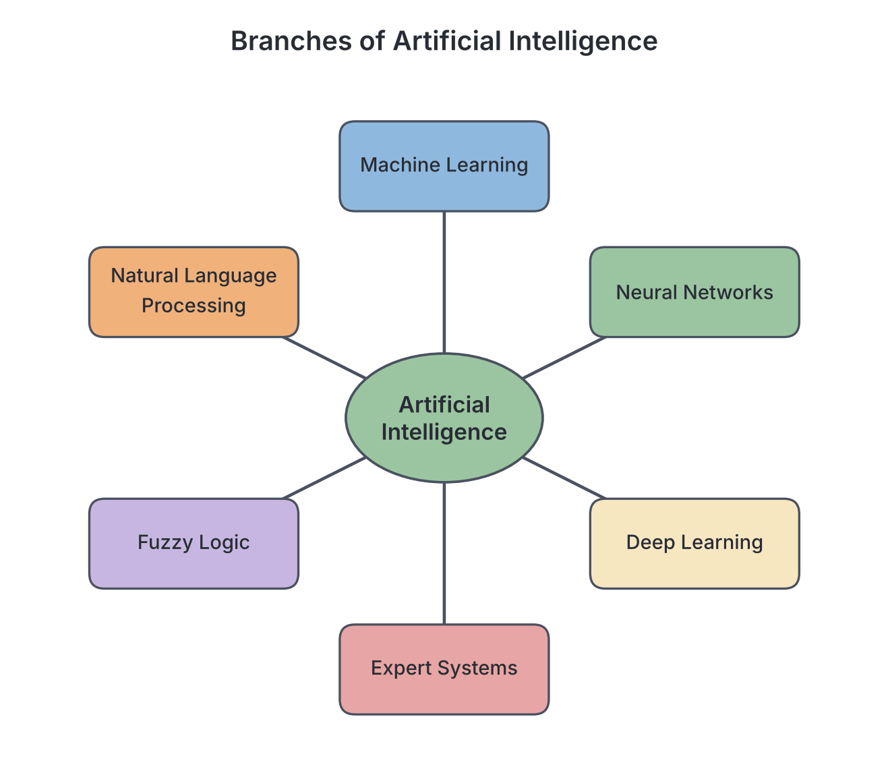
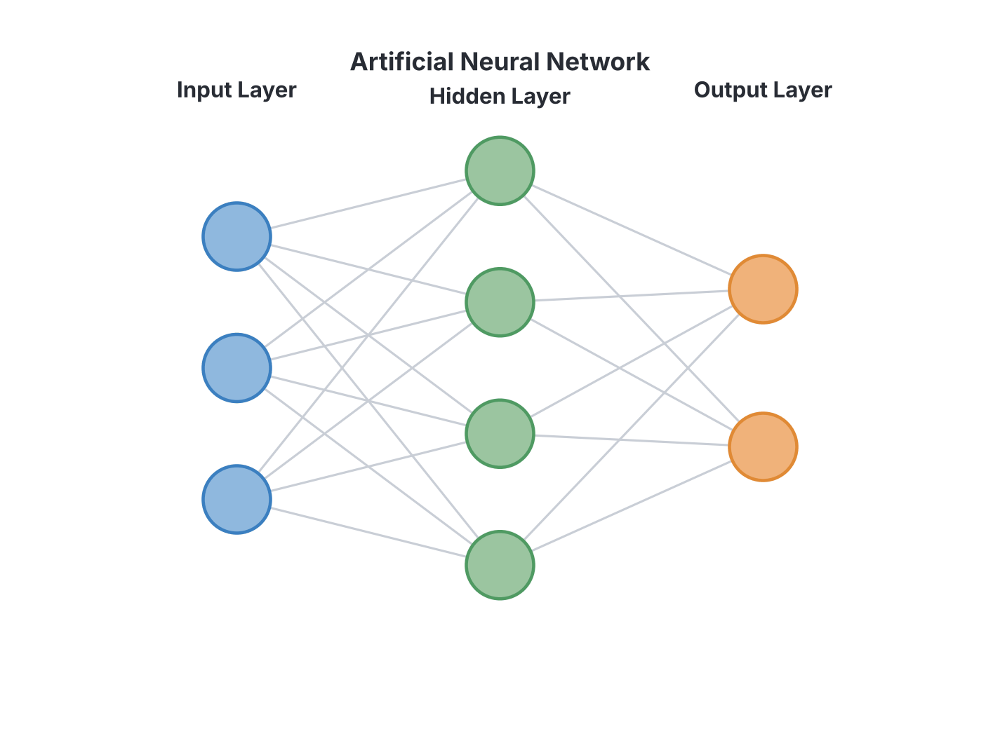

# JAMB Computer Studies Notes: Definition and Branches of Artificial Intelligence

## What JAMB expects

This file covers Topic 1 and Topic 2 of Section H: Artificial Intelligence (AI) and Robotics. It merges the definition of AI with the various branches of AI.

By the end of these notes, you should be able to:
1. Define AI (Objective i).
2. Identify branches of AI, including Machine Learning (supervised, unsupervised, reinforcement), Neural Networks, Expert Systems, Fuzzy Logic, Natural Language Processing, and Deep Learning (Objective ii).

*Note: Artificial Intelligence is a fast-changing field. While the core definitions remain the same, the capabilities of modern AI systems (like advanced chatbots, self-driving cars, and generative AI) evolve rapidly. Statements about specific current products reflect the state of the art as of the mid-2020s.*

---

## Definition of Artificial Intelligence (AI)

**Objective i: Define AI.**

**Artificial Intelligence (AI)** is the branch of computer science that focuses on creating computer systems and machines capable of performing tasks that would normally require human intelligence. 

Instead of just following a rigid set of step-by-step instructions (like a traditional computer program), an AI system can **learn**, **reason**, and **adapt**. 

To simulate human intelligence, AI systems typically carry out three cognitive processes:
1. **Learning:** Acquiring data and the rules (algorithms) needed to turn that data into useful information. 
2. **Reasoning:** Using the rules to reach approximate or definite conclusions.
3. **Self-correction:** Continually fine-tuning the algorithms to ensure they provide the most accurate results possible.

**Everyday Nigerian examples of AI:**
*   When you use a ride-hailing app like Bolt or Uber, AI calculates the fastest route and estimates the price based on traffic and demand.
*   When a Nigerian bank blocks an ATM card because a transaction looks suspicious, an AI system has recognized a pattern of fraud.
*   Smartphone voice assistants like Siri or Google Assistant use AI to understand your voice when you ask for the weather in Kano or Lagos.

---

## Branches of Artificial Intelligence

**Objective ii: Identify branches of AI.**

Because human intelligence is complex, AI is broken down into several branches, each focusing on a different way of simulating thought or solving problems. The JAMB syllabus identifies the following major branches:

### 1. Machine Learning (ML)

**Machine Learning** is a branch of AI where computers are taught to learn from data and improve their performance on a task without being explicitly programmed for every step. Instead of writing code that says "if X happens, do Y", programmers give the computer a lot of data and let the computer find the patterns.

Machine Learning is divided into three main types:

*   **Supervised Learning:** The computer is trained using **labeled data**. This means the system is given the data and the correct answers, so it can learn the relationship between them.
    *   *Example:* Giving a computer 10,000 pictures labeled "cat" and 10,000 pictures labeled "dog". The computer learns the features of each. When shown a new, unlabeled picture, it can correctly guess if it is a cat or a dog.
*   **Unsupervised Learning:** The computer is given **unlabeled data**. The system is not told what the right answers are; instead, it must find hidden patterns, groupings, or structures in the data on its own.
    *   *Example:* A supermarket feeds all its customer purchase receipts into an AI. The AI groups the customers into clusters (e.g., "people who buy baby food also buy milk") without any prior labels.
*   **Reinforcement Learning:** The computer learns by trial and error using a **reward system**. It performs actions in an environment and receives positive rewards for good actions and negative penalties for bad actions. It learns to maximize its reward over time.
    *   *Example:* Training a computer program to play chess. Every time it makes a move that leads to a win, it gets a "reward." Over millions of games, it learns the best winning strategies.

### 2. Neural Networks (Artificial Neural Networks - ANNs)

A **Neural Network** is a computing system inspired by the biological neural networks that make up animal and human brains. It is designed to recognize patterns in data.

A neural network is made up of artificial "neurons" (called nodes) arranged in interconnected layers:
1.  **Input Layer:** Receives the raw data (e.g., the pixels of an image).
2.  **Hidden Layer(s):** The middle layers that perform mathematical computations and process the data. There can be one or multiple hidden layers.
3.  **Output Layer:** Produces the final result or prediction.

When a neural network learns, it adjusts the strength (weights) of the connections between its nodes until it can accurately solve the problem.

### 3. Deep Learning

**Deep Learning** is a specialized, advanced subset of Machine Learning that uses very large Artificial Neural Networks with **many hidden layers** (hence the word "deep"). 

Because they have so many layers, deep learning models can process vast amounts of unstructured data (like thousands of hours of video or millions of audio clips) to perform highly complex tasks.
*   *Application:* As of the mid-2020s, Deep Learning is the technology behind state-of-the-art facial recognition systems, self-driving cars, and highly advanced AI systems that can generate art and text.

### 4. Expert Systems

An **Expert System** is a computer program that emulates (copies) the decision-making ability of a human expert in a specific field. It asks the user questions and uses a set of rules to provide advice or diagnose a problem.

An expert system has two main components:
1.  **The Knowledge Base:** A database containing all the facts, rules, and specialized knowledge about the specific topic (gathered from human experts).
2.  **The Inference Engine:** The logic component that searches the knowledge base, applies the rules to the user's input, and deduces the answer.

*Example:* **MYCIN** was an early expert system designed to diagnose bacterial infections and recommend antibiotics. Today, expert systems are used by banks to decide whether to grant a person a loan based on their financial history.

### 5. Fuzzy Logic

Traditional computer logic (Boolean logic) is strict: a statement is either absolutely True (1) or absolutely False (0). There is no middle ground. 

**Fuzzy Logic** is a branch of AI that resembles human reasoning because it allows for **degrees of truth**. Instead of just 0 or 1, fuzzy logic variables can hold any value between 0 and 1. It handles concepts like "partially true", "slightly hot", or "very fast."

*Example:* An older air conditioner only knows two states: ON (if it's hot) or OFF (if it's cold). An air conditioner using Fuzzy Logic recognizes that the room is "slightly warm" (maybe a truth value of 0.6) and adjusts the fan speed to a medium setting rather than just blasting it on full power.

### 6. Natural Language Processing (NLP)

**Natural Language Processing (NLP)** is the branch of AI that gives computers the ability to understand, interpret, and generate human language (both spoken and written) in a meaningful way.

NLP allows computers to read text, hear speech, measure sentiment (whether a text is happy, angry, or sad), and determine which parts are important.

*Examples:*
*   **Voice Assistants:** When you speak to Siri, Alexa, or Google Assistant, NLP breaks down your spoken words to figure out what you want.
*   **Machine Translation:** Apps like Google Translate use NLP to translate English to Hausa, Yoruba, or Igbo.
*   **Chatbots:** Customer service bots on Nigerian bank websites use NLP to read your typed questions and reply with correct answers.

---

## Key terms

| Term | Meaning |
| --- | --- |
| **Artificial Intelligence (AI)** | The simulation of human intelligence processes by machines, especially computer systems. |
| **Machine Learning (ML)** | A branch of AI where systems learn from data and improve without being explicitly programmed. |
| **Supervised Learning** | Machine learning using labeled data with known correct answers. |
| **Unsupervised Learning** | Machine learning using unlabeled data to find hidden patterns. |
| **Reinforcement Learning** | Machine learning based on a system of trial and error using rewards and penalties. |
| **Neural Network** | A computing system inspired by the human brain, made of connected nodes in layers. |
| **Deep Learning** | An advanced form of machine learning using neural networks with multiple (deep) hidden layers. |
| **Expert System** | An AI program that mimics the decision-making ability of a human expert in a specific field. |
| **Knowledge Base** | The component of an expert system that stores facts and rules. |
| **Inference Engine** | The component of an expert system that applies logical rules to the knowledge base to solve problems. |
| **Fuzzy Logic** | A form of logic that allows for degrees of truth (values between 0 and 1) rather than just True/False. |
| **Natural Language Processing (NLP)** | The branch of AI that helps computers understand, interpret, and generate human language. |

---

## Exam tips and common mistakes

*   **Machine Learning vs. Deep Learning:** Don't confuse the two. Deep learning is a *type* of machine learning. If an exam question specifically mentions neural networks with *many hidden layers*, the answer is Deep Learning.
*   **Supervised vs. Unsupervised:** Remember the keyword "labeled." Supervised learning uses *labeled* data; unsupervised learning uses *unlabeled* data.
*   **Expert System Components:** JAMB frequently tests the components of an Expert System. Always remember it requires a **Knowledge Base** (the facts) and an **Inference Engine** (the brain/rules to process the facts).
*   **Fuzzy Logic values:** If a question asks about logic that deals with partial truth or values ranging between 0 and 1, the answer is Fuzzy Logic, not Boolean logic.
*   **NLP applications:** Translation, speech recognition, and spelling/grammar checkers are all applications of Natural Language Processing.

---

## Quick summary

1. Artificial Intelligence (AI) simulates human intelligence in machines, allowing them to learn, reason, and self-correct.
2. Machine Learning allows computers to learn from data without explicit step-by-step programming.
3. Supervised learning uses labeled data, unsupervised learning finds hidden patterns in unlabeled data, and reinforcement learning learns by trial and error using rewards.
4. Neural Networks process information in layers (input, hidden, output) inspired by the biological brain.
5. Deep Learning is an advanced form of machine learning using multi-layered neural networks for complex tasks like image and speech recognition.
6. Expert Systems use a Knowledge Base and an Inference Engine to mimic the decision-making of a human expert (e.g., in medical diagnosis).
7. Fuzzy Logic handles concepts of partial truth (degrees between 0 and 1), mimicking human reasoning better than strict true/false Boolean logic.
8. Natural Language Processing (NLP) enables computers to understand and generate human languages, powering voice assistants and translation tools.

---

## Practice questions

**1. The branch of computer science that focuses on creating machines capable of simulating human intelligence processes is known as:**
- A. Deep Processing
- B. System Software
- C. Artificial Intelligence
- D. Data Digitization

**Answer: C.** Artificial Intelligence (AI) is the simulation of human intelligence processes (learning, reasoning, self-correction) by computer systems.

**2. Which branch of AI allows a computer to learn from data without being explicitly programmed for the task?**
- A. Natural Language Processing
- B. Machine Learning
- C. Expert Systems
- D. Fuzzy Logic

**Answer: B.** Machine Learning uses algorithms that allow computers to learn patterns from data rather than relying on explicit, hard-coded instructions.

**3. In which type of Machine Learning is a model trained using unlabeled data to find hidden patterns or groupings?**
- A. Supervised Learning
- B. Unsupervised Learning
- C. Reinforcement Learning
- D. Deep Learning

**Answer: B.** Unsupervised learning deals with unlabeled data, leaving the system to figure out the hidden structures or clusters on its own. (A mistake is to choose Supervised learning, which requires labeled data).

**4. A system that learns to play a video game by receiving points for good moves and losing points for bad moves is using:**
- A. Supervised Learning
- B. Natural Language Processing
- C. Reinforcement Learning
- D. Unsupervised Learning

**Answer: C.** Reinforcement learning is based on trial and error and operates on a reward and penalty system.

**5. Which of the following are the two main components of an Expert System?**
- A. Input layer and Output layer
- B. Labeled data and Unlabeled data
- C. Knowledge Base and Inference Engine
- D. Boolean logic and Fuzzy logic

**Answer: C.** An Expert System requires a Knowledge Base (the stored facts and rules from human experts) and an Inference Engine (the system that applies logical rules to the data to deduce an answer).

**6. A computing system composed of an input layer, one or more hidden layers, and an output layer, inspired by the human brain, is called a:**
- A. Natural Language Processor
- B. Neural Network
- C. Rule-based Engine
- D. Knowledge Base

**Answer: B.** A Neural Network (or Artificial Neural Network) is modeled after the biological brain and uses interconnected nodes arranged in input, hidden, and output layers.

**7. Deep Learning is best described as:**
- A. A type of machine learning based on artificial neural networks with multiple hidden layers.
- B. A program that translates written text into spoken words.
- C. An AI system that uses strict Boolean logic (0s and 1s) to make decisions.
- D. An expert system used strictly for medical diagnosis.

**Answer: A.** Deep Learning is a highly advanced subset of Machine Learning characterized by the use of "deep" neural networks with many hidden layers.

**8. Which branch of AI enables virtual assistants like Siri and Alexa to understand spoken human commands?**
- A. Fuzzy Logic
- B. Expert Systems
- C. Natural Language Processing
- D. Reinforcement Learning

**Answer: C.** Natural Language Processing (NLP) gives computers the ability to interpret, understand, and generate human language.

**9. Traditional Boolean logic only recognizes True (1) or False (0). Which AI concept deals with degrees of truth, allowing values anywhere between 0 and 1?**
- A. Binary Logic
- B. Inference Engine
- C. Neural Processing
- D. Fuzzy Logic

**Answer: D.** Fuzzy Logic handles concepts of partial truth, allowing variables to hold intermediate values like 0.3 or 0.8 (e.g., "slightly warm" instead of just "hot" or "cold").

**10. A bank uses an AI software to diagnose the precise reason a network server has failed, using a set of rules provided by top IT engineers. This software is an example of:**
- A. Natural Language Processing
- B. An Expert System
- C. Unsupervised Learning
- D. Fuzzy Logic

**Answer: B.** An Expert System emulates the decision-making ability of a human expert in a specific domain (like IT troubleshooting or medicine) using a stored set of rules and facts.

<!-- COVERAGE
obj i | Definition of Artificial Intelligence (AI)
obj ii | Branches of Artificial Intelligence
-->
