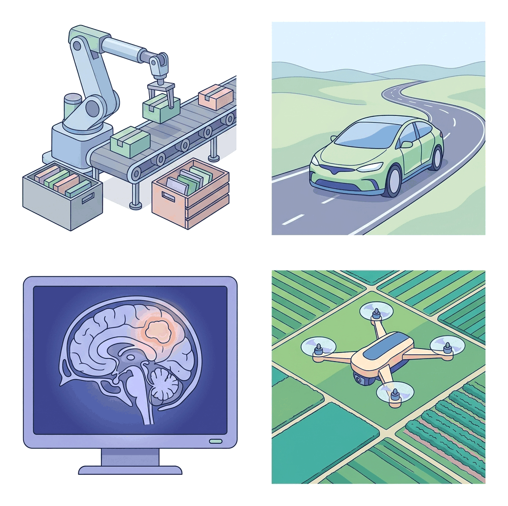
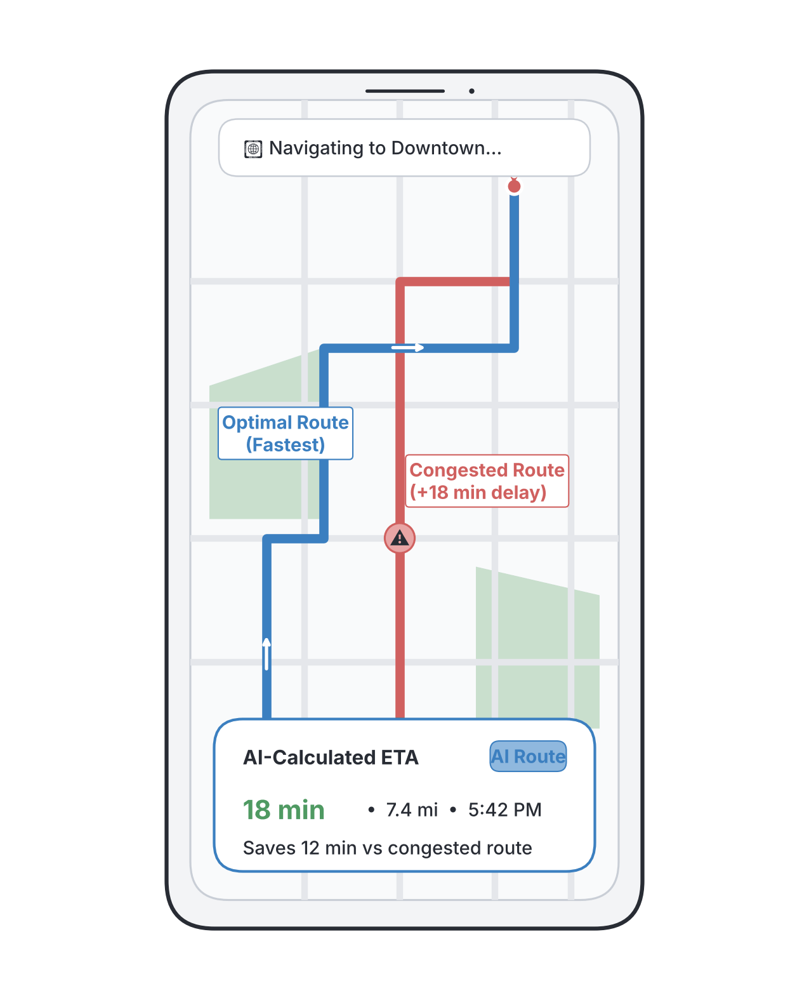

# JAMB Computer Studies Notes: Applications of Artificial Intelligence

## What JAMB expects

This topic is part of Section H (Artificial Intelligence and Robotics), Topic 3 of the JAMB Computer Studies syllabus: Applications of AI. 

By the end of these notes, you should be able to:

1. List Application Areas of AI (including Robotics, E-Commerce, Navigation, Human Resource, Healthcare, Agriculture, Gaming, Automobiles, Social Media, Marketing, etc.)

*Note: The fundamental concepts and branches of AI (like Machine Learning and Expert Systems) are covered in `H1-definition-and-branches-of-ai.md`. The detailed study of robots is covered in `H4-fundamentals-of-robotics.md`. This file focuses purely on how AI is used in the real world.*

## Application Areas of AI

**Objective iii: List Application Areas of AI.**

Artificial Intelligence (AI) is no longer just a concept from science fiction; it is actively used in almost every industry today. By allowing machines to learn from data, recognize patterns, and make decisions, AI solves complex problems faster and often more accurately than humans. 

Below are the major application areas of AI as outlined in the JAMB syllabus.

### 1. Robotics

Robotics involves designing and building physical machines (robots) that can perform tasks. While not all robots use AI (some just follow simple, pre-programmed instructions), **AI-powered robots** can "see" their environment, make decisions, and learn from experience.
*   **Industrial Robots:** In factories, AI helps robotic arms identify defective products on an assembly line using computer vision, or adapt their grip when picking up fragile objects.
*   **Domestic Robots:** Smart vacuum cleaners use AI to map the layout of a house, avoid obstacles like furniture or pets, and find the most efficient cleaning route.
*   **Hazardous Environments:** AI robots are used in bomb disposal, space exploration, and deep-sea diving, making decisions in real-time where human remote control might be delayed or impossible.

### 2. E-Commerce

Electronic commerce (buying and selling online) relies heavily on AI to improve sales and customer experience. Platforms like Amazon, and Nigerian e-commerce sites like Jumia and Konga, use AI extensively.
*   **Recommendation Systems:** AI analyzes a user's past purchases and browsing history to suggest items they are likely to buy ("Customers who bought this also bought...").
*   **Chatbots and Virtual Assistants:** AI-powered chatbots handle customer service on websites, answering common questions about order tracking or returns 24/7 without needing a human agent.
*   **Dynamic Pricing:** AI algorithms adjust the prices of products in real-time based on demand, competitor prices, and inventory levels.
*   **Fraud Detection:** AI monitors transactions in real-time to spot unusual buying patterns (like a sudden large purchase from a new location) and blocks fraudulent credit card use.

### 3. Navigation

AI has completely changed how we travel and find our way around.
*   **GPS and Mapping Apps:** Apps like Google Maps and Apple Maps use AI to analyze historical traffic data and real-time updates from other drivers' smartphones. This allows them to predict traffic jams and suggest the fastest alternative routes.
*   **Ride-Hailing Services:** Companies like Uber and Bolt use AI algorithms to match riders with the nearest available drivers efficiently. They also use AI for "surge pricing," predicting when and where demand for rides will be highest (e.g., after a heavy rain in Lagos) and adjusting prices accordingly.

### 4. Human Resource (HR)

Human Resource departments manage a company's employees. AI helps HR professionals save time and make fairer decisions.
*   **Resume Screening:** When a company receives thousands of applications, AI software can scan the resumes to find the candidates whose skills and experience best match the job description.
*   **Interview Scheduling and Chatbots:** HR bots can chat with applicants to schedule interviews and answer basic questions about company benefits.
*   **Employee Sentiment Analysis:** AI can analyze anonymized employee surveys or internal communication patterns to predict if workers are unhappy and likely to resign, allowing HR to step in early.

### 5. Healthcare

AI in healthcare is saving lives by helping doctors diagnose and treat diseases more accurately.
*   **Medical Imaging:** AI systems trained on millions of X-rays, MRI, and CT scans can spot early signs of diseases (like tumors or pneumonia) that a human doctor might miss. 
*   **Drug Discovery:** Developing a new medicine usually takes years. AI speeds this up by predicting how different chemical compounds will react, helping scientists find new drugs for diseases like malaria or cancer much faster.
*   **Virtual Nurses:** AI apps can monitor patients remotely, reminding them to take their medication and asking them about their symptoms to alert a doctor if their condition worsens.

### 6. Agriculture

In agriculture, AI helps farmers increase their crop yields and reduce waste, which is vital for food security in Nigeria and worldwide.
*   **Precision Farming:** Drones equipped with AI cameras fly over fields to monitor crop health. They can identify exactly which parts of a farm need water, fertilizer, or pesticide, rather than treating the whole field unnecessarily.
*   **Disease and Pest Detection:** Farmers can use mobile phone apps to take pictures of sick plant leaves (e.g., a cassava or maize plant). The AI analyzes the image, identifies the disease or pest, and recommends a treatment.
*   **Weather Prediction:** AI models analyze complex climate data to give farmers accurate forecasts about rainfall and dry spells, helping them know exactly when to plant and harvest.

### 7. Gaming

Video games have used a basic form of AI for decades, but modern AI makes games highly realistic and challenging.
*   **Non-Player Characters (NPCs):** In older games, computer-controlled characters just walked back and forth. Today, AI allows enemies to adapt to the player's strategy, take cover, or work as a team to flank the player.
*   **Game Testing and Generation:** Developers use AI to generate massive, endless game worlds (procedural generation) and use AI bots to play-test games thousands of times to find hidden bugs before the game is released.
*   **Board Game Champions:** AI systems like AlphaGo and Stockfish have defeated human world champions in complex games like Go and Chess by calculating millions of possible moves and learning from past games.

### 8. Automobiles

The automotive industry is moving toward self-driving vehicles, powered heavily by AI.
*   **Autonomous (Self-Driving) Vehicles:** As of the mid-2020s, companies like Tesla and Waymo use AI to process data from cameras, radar, and sensors on the car. The AI identifies pedestrians, traffic lights, and other cars to steer, accelerate, and brake without human help.
*   **Advanced Driver-Assistance Systems (ADAS):** Even non-autonomous cars use AI for safety features, such as automatic emergency braking (if the car senses a crash is about to happen) and lane-keeping assistance (gently steering the car if it drifts out of its lane).
*   **Predictive Maintenance:** AI inside the car listens to the engine and monitors sensors to warn the driver that a part is about to fail *before* the car actually breaks down.

### 9. Social Media

Social media platforms like Facebook, Instagram, X (formerly Twitter), and TikTok rely entirely on AI to keep users engaged and manage content.
*   **Content Recommendation Algorithms:** This is the most powerful use of AI in social media. The AI monitors how long you look at a video, what you "like," and what you share. It then curates a personalized "feed" to show you more of what will keep you on the app.
*   **Content Moderation:** Billions of posts are made daily. AI algorithms automatically scan text, images, and videos to detect and remove spam, hate speech, violence, and fake news before human moderators even see them.
*   **Facial Recognition:** AI is used to suggest tags for people in photos or to apply creative augmented reality (AR) filters (like animal ears or makeup) to your face in real-time.

### 10. Marketing

Marketing is about understanding consumers and persuading them to buy. AI takes the guesswork out of this process.
*   **Targeted Advertising:** Instead of showing the same billboard to everyone, AI analyzes your online behavior and shows you ads for things you actually want. If you search for "cheap flights to Abuja," AI will ensure you start seeing ads for hotels in Abuja.
*   **Customer Segmentation:** AI groups customers into highly specific categories based on their buying habits, allowing companies to send personalized email campaigns rather than generic messages.
*   **Generative AI for Content:** Marketers use AI tools (like ChatGPT or Midjourney) to quickly write advertising copy, generate marketing images, and brainstorm campaign ideas.

## Key terms

| Term | Meaning |
| --- | --- |
| **Recommendation System** | An AI algorithm that suggests products, videos, or content to users based on their past behavior. |
| **Computer Vision** | A field of AI that enables computers and robots to derive meaningful information from digital images and videos. |
| **Chatbot** | An AI program designed to simulate conversation with human users, especially over the internet for customer service. |
| **Predictive Analytics** | Using AI and historical data to predict future outcomes (e.g., predicting traffic, weather, or machine breakdowns). |
| **Precision Farming** | Using technology (like AI drones) to observe and manage crops exactly where they need it, rather than treating the whole farm equally. |
| **Autonomous Vehicle** | A car or truck that uses AI, sensors, and cameras to drive itself with little or no human intervention. |
| **Algorithm** | A set of rules or instructions given to an AI system to help it solve a problem or make a decision. |

## Exam tips and common mistakes

*   **Understand the "Why":** Exam questions often describe a scenario and ask which application area it belongs to. For example, if a question mentions "predicting the best route to avoid a traffic jam," you must identify this as **Navigation**, not Automobiles.
*   **E-Commerce vs. Marketing:** These can overlap, but usually, *E-commerce* refers to the online store functions (shopping cart recommendations, pricing, fraud detection), while *Marketing* refers to advertising, customer segmentation, and promotional emails.
*   **Don't confuse AI with standard software:** A simple digital calendar is just software. An app that automatically reschedules your meetings based on email priority and your daily habits uses AI. 
*   **Agriculture and Healthcare:** Look out for keywords. "Drones monitoring crop health" = Agriculture. "Analyzing X-rays for tumors" = Healthcare.
*   **HR:** Remember that AI is used *before* someone is even hired (resume screening) as well as *during* their employment (sentiment analysis).

## Quick summary

1.  AI is applied in **Robotics** to give machines the ability to see their environment, make autonomous decisions, and perform complex tasks in factories or hazardous areas.
2.  In **E-Commerce**, AI powers product recommendations, dynamic pricing, fraud detection, and customer service chatbots.
3.  **Navigation** uses AI to analyze traffic data in real-time, predict congestion, and calculate the fastest routes (e.g., Google Maps, Uber).
4.  **Human Resource** departments use AI to quickly scan thousands of resumes, schedule interviews, and monitor employee satisfaction.
5.  In **Healthcare**, AI helps doctors analyze medical images (X-rays), discover new drugs faster, and monitor patients remotely.
6.  **Agriculture** benefits from AI through precision farming, predicting weather patterns, and identifying crop diseases via mobile apps.
7.  **Social Media** platforms rely on AI algorithms to curate personalized feeds, keep users engaged, and automatically filter out harmful content.
8.  **Automobiles** use AI for self-driving capabilities and advanced driver safety features like automatic emergency braking.

## Practice questions

**1. Which of the following best describes an application of Artificial Intelligence in Human Resource management?**
- A. Adjusting the price of goods based on demand
- B. Automatically screening job applicant resumes to find the best match
- C. Recommending new friends on a social media platform
- D. Monitoring crop health using drones

**Answer: B.** AI software is used in HR to quickly scan thousands of resumes and match candidates' skills to job descriptions. Option A is E-commerce, C is Social Media, and D is Agriculture.

**2. A system that analyzes a user's past purchases on Jumia and suggests similar items is known as a:**
- A. Recommendation system
- B. Word processing package
- C. Navigation module
- D. Fraud detection algorithm

**Answer: A.** Recommendation systems use AI to analyze user behavior and suggest products they are likely to buy, a core feature of E-commerce. 

**3. How is AI primarily applied in the field of Agriculture?**
- A. By designing characters for video games
- B. By predicting optimal routes for delivery trucks
- C. By analyzing crop images to detect pests and predicting weather patterns
- D. By screening medical X-rays for diseases

**Answer: C.** AI helps farmers by using image recognition to spot crop diseases and predictive analytics to forecast weather and optimize yields.

**4. When Google Maps suggests an alternative route because of a traffic jam ahead, it is utilizing AI for:**
- A. E-Commerce
- B. Healthcare
- C. Navigation
- D. Marketing

**Answer: C.** Navigation apps use AI to analyze real-time traffic data, calculate ETAs, and find the fastest routes for drivers.

**5. Which of the following is an AI safety feature commonly found in modern Automobiles?**
- A. A manual gear stick
- B. Advanced Driver-Assistance Systems (ADAS) like automatic braking
- C. Leather seat warmers
- D. A standard FM radio

**Answer: B.** ADAS uses AI, cameras, and sensors to help drivers stay in their lanes and brake automatically to prevent collisions. The other options are mechanical or basic electronic features, not AI.

**6. In the healthcare sector, AI is heavily utilized to:**
- A. Sell medical equipment on social media
- B. Design hospital buildings
- C. Analyze medical images like CT scans to detect early signs of diseases
- D. Print physical patient ID cards

**Answer: C.** AI excels at pattern recognition, making it highly effective at spotting abnormalities like tumors in medical images faster and sometimes more accurately than human doctors.

**7. A company uses an AI program to group its customers based on their buying habits so it can send them personalized promotional emails. This is an application of AI in:**
- A. Gaming
- B. Marketing
- C. Robotics
- D. Agriculture

**Answer: B.** Grouping customers (segmentation) and sending targeted promotions to encourage sales is a direct application of AI in Marketing.

**8. Social media platforms use AI content moderation primarily to:**
- A. Generate passwords for users
- B. Automatically detect and remove hate speech or violent content
- C. Connect users to GPS satellites
- D. Increase the battery life of smartphones

**Answer: B.** Because billions of posts are made daily, human moderators cannot check them all. AI is used to automatically scan and filter harmful content based on platform rules.

**9. In gaming, AI is often used to control Non-Player Characters (NPCs). What does this allow the NPCs to do?**
- A. Adapt to the player's strategies and behave intelligently
- B. Turn the game console on and off
- C. Charge the player's credit card for in-game purchases
- D. Install the game faster

**Answer: A.** AI gives computer-controlled enemies or allies the ability to react to the player's moves, take cover, and make the game more realistic and challenging.

**10. Which technology allows an AI-powered industrial robot to "see" and identify defective products on an assembly line?**
- A. Word processing
- B. Computer vision
- C. Blockchain
- D. Spreadsheet formulas

**Answer: B.** Computer vision is the branch of AI that allows machines to derive meaning from visual inputs like cameras, enabling robots to "see" and inspect items.

<!-- COVERAGE
obj iii | ## Application Areas of AI
-->
