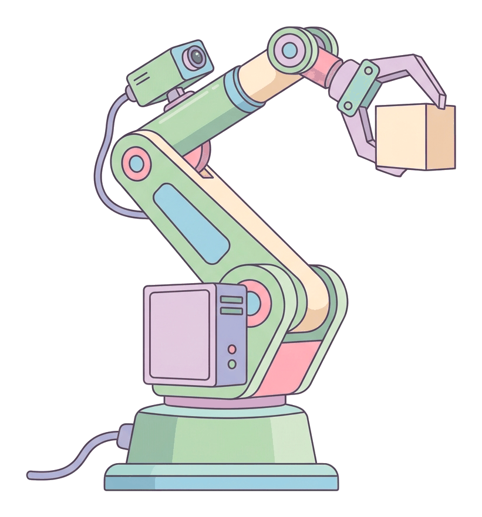

# JAMB Computer Studies Notes: Fundamentals of Robotics

## What JAMB expects

This topic is Section H, Topic 4 of the JAMB Computer Studies syllabus: Fundamentals of Robotics. It covers the following content items:

* (a) Definition of Robotics
* (b) Main Components of Robotics
* (c) Types of Robots
* (d) Application Areas of Robotics
* (e) Advantages and Disadvantages of Robots

By the end of these notes, you should be able to:

1. Define Robotics
2. Define Robots
3. Identify main components of Robots
4. Mention types of Robots
5. Itemise application areas of Robots
6. State advantages and disadvantages of using Robots

**Note on the syllabus wording:** In the list of application areas for objective v, the syllabus prints the word "Manufacturing" twice. The notes below list it once as a major industrial application but acknowledge the repetition. This topic introduces the physical machines of Artificial Intelligence. For the software and theory side of AI, see `H1-definition-and-branches-of-ai.md` and `H3-applications-of-ai.md`.

## Definition of Robotics

**Content a, Objective i: Define Robotics**

**Robotics** is the branch of technology, engineering and computer science that deals with the design, construction, operation, programming and application of robots. 

It is an interdisciplinary field, meaning it combines knowledge from several different subjects:
* **Mechanical Engineering:** To build the physical body, joints and gears of the machine.
* **Electrical/Electronic Engineering:** To design the circuits, sensors and power systems.
* **Computer Science:** To write the software and artificial intelligence algorithms that act as the machine's brain.

The ultimate goal of robotics is to create intelligent machines that can assist humans, replace humans in dangerous settings, or perform tasks faster and more accurately than a human could.

## Definition of Robots

**Objective ii: Define Robots**

A **robot** is a programmable machine capable of carrying out a complex series of physical actions automatically. 

While some robots are controlled directly by humans (like a remote-controlled drone), the most advanced robots are guided by internal computer programs and artificial intelligence, allowing them to make decisions without human help. 

**Key characteristics of a robot:**
1. **Physical presence:** Unlike a simple computer program or chatbot which only exists on a screen, a robot has a physical body that interacts with the real world.
2. **Programmability:** It can be programmed (and reprogrammed) by a computer to perform different tasks.
3. **Autonomy:** It can perform tasks automatically based on its programming and the information it gathers from its surroundings.

The word "robot" comes from the Czech word *robota*, which means "forced labour" or "hard work". It was first used in a 1920 play by the writer Karel Čapek.

## Main Components of Robots

**Content b, Objective iii: Identify main components of Robots**

Just as the human body has a brain, muscles, senses, arms, and a digestive system for energy, a robot has specific parts that perform these functions. A standard robot is made up of five main components:

### 1. Control System (The Brain)
The control system is the central processing unit (CPU) or microcontroller of the robot. It contains the software and programming that tells the robot what to do. 
* **Function:** It receives data from the sensors, processes this information, decides on the best action using its programmed algorithms, and sends commands to the moving parts. 
* **Analogy:** It acts just like the human brain and nervous system.

### 2. Sensors (The Senses)
Sensors are hardware devices that allow the robot to perceive its environment. They collect data about the world around the robot and send it to the control system.
* **Examples:** Cameras (for "sight"), microphones (for "hearing"), ultrasonic and infrared sensors (for measuring distance and detecting obstacles), and pressure sensors (for "touch").
* **Function:** They prevent the robot from crashing into walls, help it find objects, and measure the surrounding temperature or light.

### 3. Actuators (The Muscles)
Actuators are the mechanisms that make the robot move. A control system sends an electrical signal to the actuator, which converts that energy into physical motion.
* **Examples:** Electric motors, hydraulic cylinders (using liquid), and pneumatic cylinders (using compressed air).
* **Function:** They drive the robot's wheels, turn its head, or bend its joints. 

### 4. Power Supply (The Food/Energy)
Every robot needs a source of energy to run its control system, sensors, and actuators. 
* **Examples:** Most mobile robots use rechargeable batteries (like Lithium-ion). Stationary industrial robots are usually plugged directly into the electrical grid. Some outdoor or space robots use solar panels to recharge their batteries.
* **Function:** It provides the electrical power required for operation.

### 5. End Effectors (The Hands/Tools)
An end effector is the device at the end of a robotic arm, designed to interact with the environment.
* **Examples:** Mechanical grippers (claws or fingers to pick things up), welding torches, spray paint guns, suction cups, or surgical scalpels.
* **Function:** It is the specific tool that performs the robot's assigned task.

## Types of Robots

**Content c, Objective iv: Mention types of Robots**

Robots come in many shapes and sizes depending on what they are built to do. The JAMB syllabus categorises them into four major types:

### 1. Humanoid Robots
These are robots designed to look and move like human beings. They typically have a head, a torso, two arms, and two legs (bipedal). 
* **Purpose:** Because they resemble humans, they are often used for research, entertainment, or to work in environments originally built for humans (like climbing standard stairs).
* **Examples:** *Sophia* (by Hanson Robotics, famous for her human-like face and conversation skills) and *ASIMO* (a retired Honda robot that could walk and run).

### 2. Autonomous Robots
Autonomous robots operate independently without any human intervention. They are placed in an environment and use their sensors and control systems to make their own decisions on how to complete a task.
* **Purpose:** Used in situations where it is impossible or inefficient for a human to constantly monitor them.
* **Examples:** Robotic vacuum cleaners (like the *Roomba*) that map a house and clean it on their own, or autonomous delivery drones.

### 3. Teleoperated Robots
These are semi-autonomous or non-autonomous robots controlled remotely by a human being, often using a wireless network.
* **Purpose:** They are used when human judgement is needed, but the environment is too dangerous, difficult, or distant for a human to be physically present.
* **Examples:** Bomb disposal robots guided by police, underwater drones repairing deep-sea oil pipes, and the surgical robots manipulated by doctors from a console.

### 4. Augmenting Robots
Augmenting (or augmentation) robots are connected directly to the human body. They do not work independently; instead, they enhance the user's natural physical capabilities or replace a lost body part.
* **Purpose:** To give humans extra strength, endurance, or to restore normal function to amputees.
* **Examples:** Robotic prosthetic arms that respond to nerve signals, or motorised "exoskeleton" suits that help factory workers lift heavy loads without straining their backs.

## Application Areas of Robotics

**Content d, Objective v: Itemise application areas of Robots**

Robots are deployed across almost every sector of the modern economy. The syllabus identifies the following key application areas:

1. **Manufacturing:** (Note: Listed twice in the syllabus). This is the oldest and largest area for robotics. Industrial robots assemble cars, weld metal, paint components, and package goods. Automated bottling lines in Nigerian breweries use robotic systems to cap and pack drinks quickly.
2. **Logistics:** Robots are used in large warehouses (like those of Amazon, or e-commerce hubs) to lift, sort, and transport thousands of packages accurately, ensuring fast delivery.
3. **Agriculture:** Agricultural robots (agribots) are used for automated harvesting, drone spraying of pesticides, monitoring crop health, and plucking weeds. This increases farm yield and reduces manual labour.
4. **Healthcare:** In hospitals, robots assist surgeons in performing highly precise, minimally invasive operations (like the *Da Vinci* surgical system). Others help nurses lift heavy patients or deliver medicine through hospital corridors.
5. **Space Exploration:** Because space is a vacuum and too dangerous for humans to stay in for long, agencies like NASA send robots. Mars rovers (like *Perseverance*) are autonomous and teleoperated robots exploring the Martian surface.
6. **Security and Military:** The military uses teleoperated drones for surveillance, reconnaissance (scouting), and defusing improvised explosive devices (IEDs). Security robots also patrol malls or borders equipped with night-vision cameras.
7. **Home:** Domestic robots perform household chores. The most common are autonomous vacuum cleaners, robotic lawnmowers, and automated pool cleaners.
8. **Travel:** Autonomous vehicles (self-driving cars) are robots on wheels. They use a massive array of sensors (cameras, radar, lidar) to navigate public roads safely without a human driver.
9. **Entertainment:** Theme parks use complex animatronic robots to create lifelike dinosaurs or movie characters. Toy robots and programmable kits (like LEGO Mindstorms) are also popular for education and fun.
10. **Food Preparation:** In modern food factories and some fast-food restaurants, robotic arms are used to flip burgers, fry chips, bake bread, or mix ingredients precisely.
11. **Customer Service:** Some banks, hotels, and airports use humanoid or wheeled robots to greet customers, answer basic questions, and guide them to the right department. 

## Advantages and Disadvantages of Robots

**Content e, Objective vi: State advantages and disadvantages of using Robots**

While robots bring massive improvements to industry, they also introduce new economic and social challenges.

| Advantages of Robots | Disadvantages of Robots |
| :--- | :--- |
| **Speed and Productivity:** They can work 24 hours a day, 7 days a week, without needing breaks, sleep, or holidays. | **High Initial Cost:** Buying, installing, and programming industrial robots requires massive capital investment. |
| **High Precision and Accuracy:** They perform repetitive tasks with perfect consistency, reducing human error and waste. | **Job Displacement:** They replace human workers in routine, manual jobs, leading to unemployment in certain sectors. |
| **Safety in Hazardous Environments:** They can work in extreme heat, radioactive areas, deep water, or toxic environments, keeping humans safe. | **Need for Specialised Maintenance:** When a robot breaks down, it requires highly skilled (and expensive) engineers to fix it. |
| **Long-Term Cost Savings:** Although expensive to buy, they save money over time by increasing output and reducing labour costs. | **Lack of Flexibility and Emotion:** Unlike humans, robots cannot easily adapt to completely new situations outside their programming, and lack empathy in fields like customer care. |
| **Assisting Human Limitations:** Augmenting robots help disabled individuals regain movement, improving their quality of life. | **Security Risks:** Because they are controlled by software and networks, robots can be hacked or infected with malware. |

## Key terms

| Term | Meaning |
| --- | --- |
| **Robotics** | The interdisciplinary branch of engineering and computer science dealing with the design and application of robots. |
| **Robot** | A programmable machine capable of automatically carrying out complex physical actions. |
| **Control System** | The CPU or "brain" of the robot that processes data and makes decisions. |
| **Sensor** | A device that detects changes in the environment (e.g., light, heat, pressure) and sends data to the control system. |
| **Actuator** | A motor or mechanism that converts energy into physical movement (the "muscles"). |
| **End Effector** | The tool or gripper at the end of a robotic arm used to interact with objects. |
| **Humanoid Robot** | A robot built to resemble the human body in shape and movement. |
| **Autonomous Robot** | A robot that operates independently without human control, using its own sensors and programming. |
| **Teleoperated Robot** | A robot that is controlled remotely by a human operator. |
| **Augmenting Robot** | A robotic device attached to a human to enhance or replace physical capabilities (e.g., an exoskeleton). |

## Exam tips and common mistakes

* **Confusing Actuators and Sensors:** This is the most common mistake. Remember: **Sensors** take information *in* (like eyes and ears), while **Actuators** put movement *out* (like muscles).
* **Confusing End Effectors and Actuators:** An actuator is the motor inside the joint that moves the arm. The end effector is the actual tool at the very tip (the claw, the welder) doing the job.
* **Teleoperated vs Autonomous:** If a human is holding a remote control (like a drone pilot), it is *teleoperated*. If the robot is making its own driving decisions (like a Roomba), it is *autonomous*.
* **Understanding Job Displacement:** In JAMB questions, the most frequently tested disadvantage of robotics and automation is its impact on human employment (job loss).

## Quick summary

1. **Robotics** is the design, creation, and application of robots, merging mechanical engineering, electronics, and computer science.
2. A **robot** is a programmable machine that interacts with the physical world.
3. The main components of a robot are the **Control System** (brain), **Sensors** (senses), **Actuators** (muscles), **Power Supply** (energy), and **End Effectors** (hands/tools).
4. Major types of robots include **Humanoid** (human-like), **Autonomous** (independent), **Teleoperated** (remote-controlled), and **Augmenting** (enhancing the human body).
5. Robots are applied in manufacturing, healthcare, logistics, agriculture, space exploration, the military, and the home.
6. The major advantages of robots are their ability to work endlessly, accurately, and safely in dangerous environments.
7. The major disadvantages are high setup costs, the need for skilled repair technicians, and the displacement of human jobs.

## Practice questions

**1. The branch of computer science and engineering that deals with the design, construction, and operation of robots is called:**
- A. Cybernetics
- B. Robotics
- C. Telecommunications
- D. Ergonomics

**Answer: B.** Robotics is the specific interdisciplinary field concerned with creating and programming robots.

**2. Which component of a robot acts as its "muscles" to create physical movement?**
- A. Sensor
- B. Control system
- C. Actuator
- D. Power supply

**Answer: C.** Actuators (like electric motors or hydraulics) convert energy into motion, acting like muscles. Sensors act as the senses, taking in information.

**3. A robot designed to look and move like a human being, with a head, torso, arms, and legs, is classified as a:**
- A. Teleoperated robot
- B. Humanoid robot
- C. Augmenting robot
- D. Industrial robot

**Answer: B.** Humanoid robots are built to resemble the human body (e.g., Sophia, ASIMO).

**4. The claw, welding torch, or spray gun located at the tip of a robotic arm is referred to as the:**
- A. Actuator
- B. Sensor
- C. Microcontroller
- D. End effector

**Answer: D.** The end effector is the specific tool attached to the end of the robot's arm that interacts with the work environment.

**5. A bomb-disposal robot that is guided by a police officer from a safe distance using a remote console is an example of an:**
- A. Autonomous robot
- B. Augmenting robot
- C. Teleoperated robot
- D. Entertainment robot

**Answer: C.** Teleoperated robots are controlled remotely by a human operator, usually used in dangerous or distant environments.

**6. Which of the following is a major disadvantage of implementing robots in a manufacturing plant?**
- A. They produce goods too slowly
- B. They require frequent breaks to rest
- C. They can displace human workers, causing unemployment
- D. They refuse to work in hazardous environments

**Answer: C.** Job displacement is a major social and economic disadvantage of automation and robotics. Robots do not need breaks and excel in hazardous environments.

**7. Which component serves as the "brain" of the robot, processing sensor data and executing programmed instructions?**
- A. Control system
- B. End effector
- C. Power supply
- D. Actuator

**Answer: A.** The control system (the CPU or microcontroller) processes information and controls the actions of the robot.

**8. An exoskeleton suit worn by a factory worker to help lift extremely heavy loads without back strain is classified as:**
- A. A teleoperated robot
- B. An augmenting robot
- C. An autonomous robot
- D. A humanoid robot

**Answer: B.** Augmenting robots are physically attached to humans to enhance their natural abilities or replace lost limbs.

**9. Why are robots highly valued in space exploration?**
- A. They require a constant supply of oxygen
- B. They can survive and operate in extreme, hazardous environments where humans cannot
- C. They can easily adapt to completely unprogrammed, emotional situations
- D. They are cheaper to build than a simple telescope

**Answer: B.** The primary advantage of space robots (like Mars rovers) is their ability to work in a vacuum, extreme temperatures, and high radiation without risking human life.

**10. A robotic vacuum cleaner that navigates a home, avoids stairs, and cleans the floor without human direction is best described as:**
- A. Autonomous
- B. Teleoperated
- C. Humanoid
- D. Augmenting

**Answer: A.** Autonomous robots use their sensors and programming to operate independently without a human needing to control them.

<!-- COVERAGE
obj i | Definition of Robotics
obj ii | Definition of Robots
obj iii | Main Components of Robots
obj iv | Types of Robots
obj v | Application Areas of Robotics
obj vi | Advantages and Disadvantages of Robots
item a | Definition of Robotics
item b | Main Components of Robots
item c | Types of Robots
item d | Application Areas of Robotics
item e | Advantages and Disadvantages of Robots
-->
