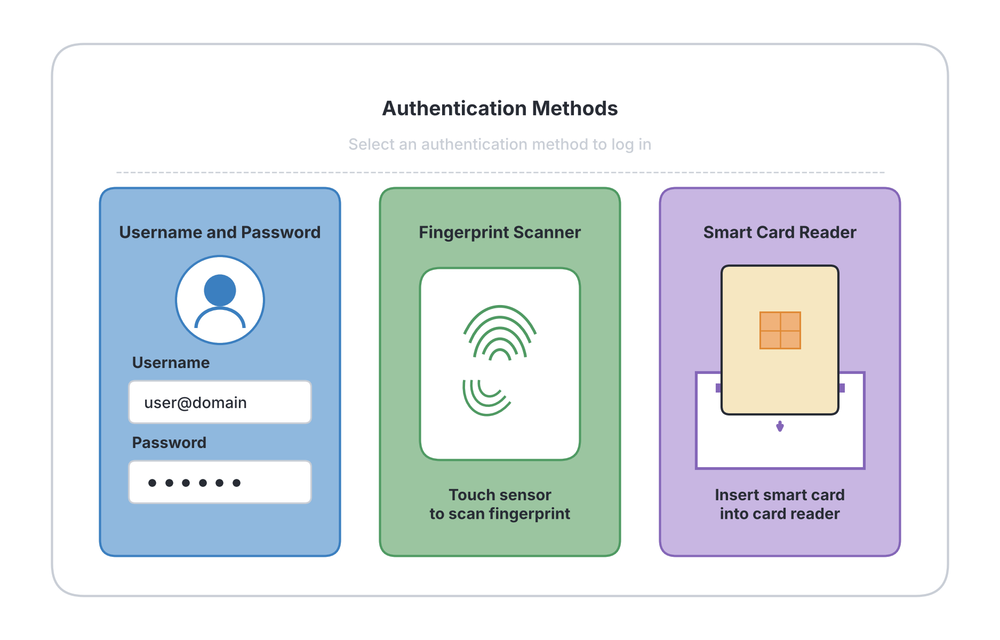
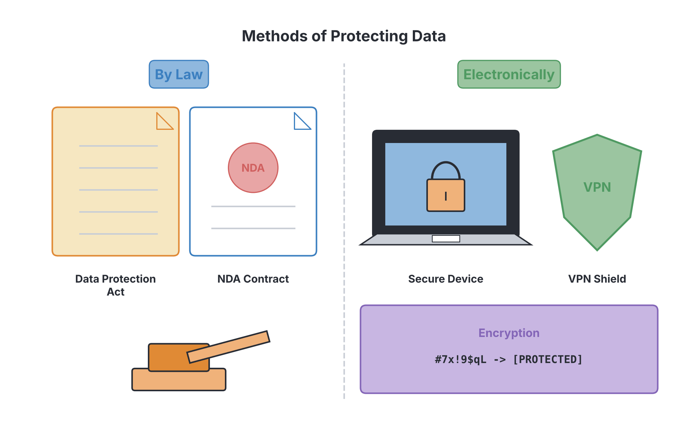

# JAMB Computer Studies Notes: Ethical Issues in Computing

## What JAMB expects

This topic is Section I, Topic 1 of the JAMB Computer Studies syllabus: Basics and Applications of ICT - Ethical Issues. It covers the following content areas:

* a. Computer–related crime
* b. Responsibility for computer failure
* c. Protection of computer property, records and software
* d. Privacy of the company, workers and customers.

By the end of these notes, you should be able to:

1. Define computer-related crime.
2. State examples of computer-related crime. (Compromising computer systems, hacking, theft, etc.)
3. List methods to prevent unauthorised use of computer system (user identification, Passwords etc.)
4. List methods to protect computer resources using both electronic and manual methods.
5. List methods to Protect privacy of individuals (workers, companies, customers, government etc.) by law and electronically.

**Note on the syllabus wording:** Ethical issues in computing deal with the right and wrong behaviours when using computers and data. The syllabus places this under Section I. Security and cyber risks are closely related topics and are covered in more technical detail in `I2-computer-security.md` and `I3-cyber-risks-and-protection.md`.

---

## Computer-related crime

**Content a: Computer–related crime**

### Define computer-related crime

**Objective i: Define computer-related crime.**

A **computer-related crime** (often called cybercrime) is any illegal act that involves a computer, a computer network, or digital technology. In these crimes, the computer can be either the **tool** used to commit the offence (such as sending fraudulent emails) or the **target** of the offence (such as breaking into a bank's server to steal data).

Because computers are used everywhere—from schools and JAMB CBT centres to banks and hospitals—criminals use them to commit traditional crimes (like theft and fraud) faster and on a global scale. 

### State examples of computer-related crime

**Objective ii: State examples of computer-related crime.**

JAMB expects you to know several common examples of computer-related crimes:

1. **Hacking:** The act of gaining unauthorised access to a computer system or network. A hacker might break into a company's database to view, alter, or destroy sensitive information.
2. **Theft (Data and Financial):** Stealing digital property. This includes stealing money from bank accounts, stealing personal information (Identity Theft), or stealing a company's secret business plans. In Nigeria, internet fraud to steal money is locally known as "Yahoo-Yahoo" (Advance Fee Fraud or 419).
3. **Compromising computer systems:** Deliberately causing a computer system to stop working properly. This can be done by spreading malicious software (malware) like viruses and ransomware, or by launching Denial of Service (DoS) attacks that overload a website until it crashes.
4. **Software Piracy:** The illegal copying, distributing, or selling of copyrighted software. Buying a single copy of a game or a program like Microsoft Office and installing it on fifty computers without paying for multiple licenses is a crime.
5. **Cyberbullying and Harassment:** Using computers and the internet to threaten, stalk, or harass individuals.
6. **Phishing:** Sending fake emails or creating fake websites that look like legitimate ones (e.g., a fake Nigerian bank login page) to trick users into typing in their passwords and ATM card details.

---

## Responsibility for computer failure

**Content b: Responsibility for computer failure**

Computers and software are complex, and they sometimes fail. A failure could be a hardware crash, a software bug, or a system being hacked. When a computer fails, it can cause a loss of money, data, or even life (e.g., if medical equipment fails). A major ethical and legal issue is deciding **who is responsible (liable)** when this happens.

Responsibility generally falls into two categories:

1. **The Developer / Manufacturer:**
   * **Bugs and Flaws:** If software is released with major coding errors that delete user data, the software developer or company could be held responsible.
   * **Warranties and SLAs:** For large organizations, software is often provided with a **Service Level Agreement (SLA)**. This is a contract stating that the system must work for a certain percentage of the time (e.g., 99.9%). If it fails, the provider must compensate the company.
   * **End User License Agreements (EULA):** When you install software, you usually click "I Agree" to a long document called a EULA. Legally, most EULAs state that the software is provided "as is", meaning the developer limits their responsibility if the software causes minor data loss or crashes. 

2. **The User / Company:**
   * **Negligence:** If a user clicks on a suspicious link that downloads a virus, or if a company fails to install basic antivirus software and gets hacked, the responsibility lies with the user or the company.
   * **Improper maintenance:** If a computer hardware fails because it was kept in a very dusty room or exposed to power surges without a UPS (Uninterruptible Power Supply) or stabilizer, the owner is responsible, and it will void the manufacturer's warranty.

---

## Protection of computer property, records and software

**Content c: Protection of computer property, records and software**

Because computer resources (hardware, software, and data files) are highly valuable, they must be protected from theft, damage, and unauthorised access.

### List methods to prevent unauthorised use of computer system

**Objective iii: List methods to prevent unauthorised use of computer system.**

To stop strangers or unapproved workers from using a computer system, organisations use strict access controls.

1. **User Identification (Usernames/IDs):** Before using a system, a person must claim an identity. This is usually done by typing a unique **Username** (e.g., `student_001`) or swiping an ID card. Identification tells the computer *who* is trying to access it.
2. **Passwords and PINs:** This is the most common form of **authentication** (proving you are who you say you are). A password is a secret string of characters. A strong password combines letters, numbers, and symbols. A PIN (Personal Identification Number) is a numeric password, commonly used on mobile phones and ATMs.
3. **Biometrics:** Using unique physical characteristics of a person's body to grant access. Examples include **fingerprint scanners**, **facial recognition**, and **iris (eye) scanners**. Because you cannot easily guess or steal a fingerprint, biometrics are very secure.
4. **Two-Factor Authentication (2FA):** Combining two different methods. For example, to log into a bank app, you might need a password (something you know) AND an OTP (One-Time Password) sent to your mobile phone (something you have).
5. **Smart Cards and Tokens:** Physical devices that a user must possess to gain access. If you don't have the card, you cannot log in, even if you know the password.

### List methods to protect computer resources using both electronic and manual methods

**Objective iv: List methods to protect computer resources using both electronic and manual methods.**

Protecting resources requires both **manual (physical)** methods to protect the hardware, and **electronic (logical)** methods to protect the software and data.

| Protection Type | Definition | Examples / Methods |
| :--- | :--- | :--- |
| **Manual (Physical) Methods** | Actions and physical devices used to secure the computer room, hardware, and physical storage media from theft, fire, or damage. | - **Security Guards:** Personnel who check IDs before letting people into the computer room. - **Locks and Keys:** Securing server rooms with heavy doors and padlocks. - **Burglar Alarms & CCTV:** To detect and record intruders. - **Burglar Proofing:** Iron grilles on windows to stop thieves. - **Fire Extinguishers & Smoke Detectors:** To protect hardware from physical destruction by fire. - **Fireproof Safes:** For storing physical backup drives. |
| **Electronic (Logical) Methods** | Software-based tools and configurations used to protect digital data, networks, and software from hackers, viruses, and unauthorised copying. | - **Firewalls:** Software or hardware that blocks unauthorised network traffic from the internet. - **Antivirus/Anti-malware Software:** Programs that detect and remove viruses before they corrupt data. - **Encryption:** Scrambling data so it is unreadable without a secret key. - **Access Control Lists (ACLs):** Software rules that give different permissions (e.g., ordinary staff can only "read" a file, while managers can "edit" it). - **Automated Data Backups:** Electronically copying files to a cloud server so they are not lost if the main computer crashes. |

---

## Privacy of the company, workers and customers

**Content d: Privacy of the company, workers and customers.**

**Privacy** refers to the right of individuals and organisations to control how their personal or confidential information is collected, used, and shared. 
* **Workers' privacy:** Employees have a right to keep their personal details (like medical history or home addresses) safe from other staff. 
* **Customers' privacy:** When you register for JAMB or open a bank account, you provide sensitive details (NIN, phone number, biometric data). The organisation must keep this safe.
* **Company privacy:** A company must keep its trade secrets, financial records, and future plans private from competitors.

### List methods to Protect privacy of individuals by law and electronically

**Objective v: List methods to Protect privacy of individuals (workers, companies, customers, government etc.) by law and electronically.**

To ensure privacy is not violated, methods are grouped into legal protections and electronic (technical) protections.

#### 1. Protecting privacy BY LAW (Legal Methods)

Laws and written policies force organisations to handle data responsibly and punish those who do not.

* **Data Protection Legislation:** Governments pass laws that regulate how personal data must be treated. In Nigeria, the **Nigeria Data Protection Regulation (NDPR)** and the **Nigeria Data Protection Act (NDPA)** govern how companies and the government must protect citizens' data.
* **Non-Disclosure Agreements (NDAs):** A legal contract signed by workers. It states that the worker will be sued if they share the company's private information with outsiders.
* **Privacy Policies:** A document provided by a company to a customer explaining exactly what data is being collected and how it will be used. 
* **Copyright and Patent Laws:** Laws that protect the intellectual property (software, designs) of a company from being copied and sold by others.
* **Computer Misuse Acts / Cybercrime Laws:** National laws that make hacking and data theft criminal offences punishable by imprisonment. (e.g., Nigeria's Cybercrimes Act).

#### 2. Protecting privacy ELECTRONICALLY (Technical Methods)

These are software tools used to physically stop data from leaking or being viewed by the wrong people.

* **Encryption:** The process of converting private data into a scrambled, unreadable format (ciphertext). Only a person with the correct electronic "key" can decrypt and read it. This ensures that even if data is stolen, the thief cannot read the customer's private details.
* **Data Masking / Anonymisation:** Hiding parts of sensitive data. For example, electronically hiding a customer's credit card number on a receipt so it only shows `**** **** **** 1234`.
* **Role-Based Access Control (RBAC):** Setting electronic limits on accounts. For example, a hospital's software is configured so a receptionist can only see a patient's name and appointment time, but cannot access the patient's private medical records. Only the doctor's account has the electronic privilege to see the medical records.
* **Secure Socket Layer (SSL/TLS):** Electronic protocols used on websites (indicated by `https://` and a padlock icon). This protects a customer's privacy by encrypting data as it travels from their web browser to the company's server.
* **Virtual Private Networks (VPNs):** An electronic tool that creates a secure, encrypted tunnel for workers to access company networks safely when working from home or using public Wi-Fi.

---

## Key terms

| Term | Meaning |
| :--- | :--- |
| **Computer-related crime** | Any illegal activity committed using a computer or directed at a computer system. |
| **Hacking** | Gaining unauthorised access to a computer system or network. |
| **Software Piracy** | The illegal copying, distribution, or use of software without a proper license. |
| **Authentication** | The process of verifying a user's identity (e.g., by checking a password or fingerprint). |
| **Biometrics** | Using physical human characteristics (fingerprints, facial recognition) for secure identification. |
| **Firewall** | An electronic security system that monitors and controls network traffic to block unauthorised access. |
| **Encryption** | Scrambling data into an unreadable format to protect it from unauthorised viewing. |
| **NDPA / NDPR** | Nigeria Data Protection Act / Regulation; laws governing the privacy of personal data in Nigeria. |
| **EULA** | End User License Agreement; a contract between a software developer and the user outlining rights and liability. |
| **SLA** | Service Level Agreement; a contract defining the level of service and reliability expected from a provider. |

## Exam tips and common mistakes

* **Understand the difference between Identification and Authentication:** Identification is claiming who you are (Username), while Authentication is *proving* it (Password/Fingerprint). JAMB questions often test this difference.
* **Manual vs. Electronic:** If a question asks for a *manual* method of protection, look for physical items (locks, security guards, safes, burglar alarms). Do not choose Firewalls or Antivirus, as those are *electronic* (logical) methods.
* **Privacy by Law vs. Electronically:** An NDA or the NDPR is a legal method. Encryption is an electronic method. Read the question carefully to see which category they are asking for.
* **Software Failure Liability:** Remember that most standard software uses a EULA (End User License Agreement) that heavily limits the developer's liability for computer failures.
* **Computer crime definitions:** Hacking is unauthorised access; Phishing is deceiving users to get passwords; Software piracy is illegal copying. Do not confuse them.

## Quick summary

1. A computer-related crime (cybercrime) is an illegal act where a computer is either the tool used or the target.
2. Examples of computer crimes include hacking, software piracy, identity theft, malware distribution, and phishing.
3. Responsibility for computer failure can fall on the developer (if the code is flawed) or the user (negligence, poor maintenance), though liability is often limited by contracts like EULAs and SLAs.
4. Unauthorised use is prevented using identification (usernames) and authentication methods like passwords, PINs, biometrics, and smart cards.
5. Computer resources are protected manually (security guards, locks, CCTV, fireproof safes) and electronically (antivirus, firewalls, encryption).
6. Privacy is the right to keep personal and corporate data confidential and secure.
7. Privacy is protected by law through Data Protection Regulations (like NDPR in Nigeria), NDAs, and copyright laws.
8. Privacy is protected electronically using encryption, data masking, secure connections (HTTPS), and strict access control lists.

## Practice questions

**1. Any illegal act that involves the use of a computer or digital technology is broadly referred to as:**
- A. Software piracy
- B. Computer-related crime
- C. Biometric theft
- D. Data encryption

**Answer: B.** A computer-related crime encompasses all illegal acts involving computers, including piracy, hacking, and fraud.

**2. Which of the following is an example of a manual (physical) method used to protect computer resources?**
- A. Installing an updated antivirus program
- B. Using a firewall to block internet traffic
- C. Keeping backups in a fireproof safe
- D. Encrypting all outgoing emails

**Answer: C.** A fireproof safe is a physical (manual) object used to protect physical storage media. The other options are electronic (logical) methods.

**3. The illegal copying and distribution of copyrighted software without paying for it is known as:**
- A. Hacking
- B. Phishing
- C. Cyberbullying
- D. Software piracy

**Answer: D.** Software piracy specifically refers to stealing or illegally copying software. A common mistake is choosing Hacking, but hacking is about unauthorised access to systems, not just copying software.

**4. Which of the following methods uses physical human characteristics to prevent unauthorised access to a computer?**
- A. Two-Factor Authentication
- B. Biometrics
- C. Smart Cards
- D. Passwords

**Answer: B.** Biometrics use biological characteristics like fingerprints, iris scans, and facial recognition for authentication.

**5. To protect a customer's privacy by making their data completely unreadable to anyone who steals it, a company should use:**
- A. Encryption
- B. Burglar alarms
- C. Non-Disclosure Agreements
- D. A Service Level Agreement

**Answer: A.** Encryption scrambles the data electronically so it cannot be read without a key. An NDA (Option C) is a legal document, it doesn't physically stop the data from being read if stolen.

**6. Which legal document is primarily used by a software developer to limit their responsibility if the software crashes on a user's computer?**
- A. Nigeria Data Protection Act (NDPA)
- B. Non-Disclosure Agreement (NDA)
- C. Access Control List (ACL)
- D. End User License Agreement (EULA)

**Answer: D.** A EULA outlines the terms of use and usually contains clauses that limit the developer's liability for data loss or crashes.

**7. A bank sets up its network so that a customer care agent can view a customer's balance, but cannot transfer money out of the account. This electronic privacy and security method is an example of:**
- A. Biometrics
- B. Data masking
- C. Access control / Privileges
- D. Data Protection Law

**Answer: C.** Access control (or Role-Based Access Control) restricts what actions different users can perform electronically on a network.

**8. Which of the following combinations represents a legal method and an electronic method of protecting privacy, respectively?**
- A. Passwords and Biometrics
- B. Data Protection Laws and Encryption
- C. Firewalls and CCTV cameras
- D. Antivirus and Non-Disclosure Agreements

**Answer: B.** Data Protection Laws are legal methods, while Encryption is an electronic method. Option C mixes electronic and physical, Option D is electronic and legal (in reverse order).

**9. When a hacker tricks a user into giving up their password by creating a fake bank website, the crime committed is best described as:**
- A. Phishing
- B. Software Piracy
- C. Hardware theft
- D. Denial of Service

**Answer: A.** Phishing involves tricking users into revealing sensitive information by pretending to be a trustworthy entity.

**10. Why is a Username alone NOT sufficient to prevent unauthorised use of a computer system?**
- A. Because usernames are always numbers
- B. Because it only provides identification, not authentication
- C. Because usernames expire every 30 days
- D. Because biometric scanners cannot read usernames

**Answer: B.** A username only claims an identity (Identification). To prevent unauthorised access, you must prove that identity (Authentication) using a password, PIN, or biometric.

<!-- COVERAGE
obj i | Define computer-related crime
obj ii | State examples of computer-related crime
obj iii | List methods to prevent unauthorised use of computer system
obj iv | List methods to protect computer resources using both electronic and manual methods
obj v | List methods to Protect privacy of individuals by law and electronically
item a | Computer-related crime
item b | Responsibility for computer failure
item c | Protection of computer property, records and software
item d | Privacy of the company, workers and customers.
-->
