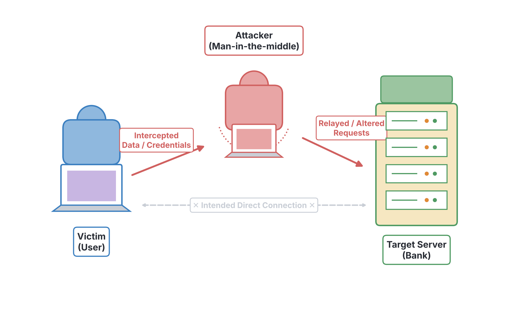
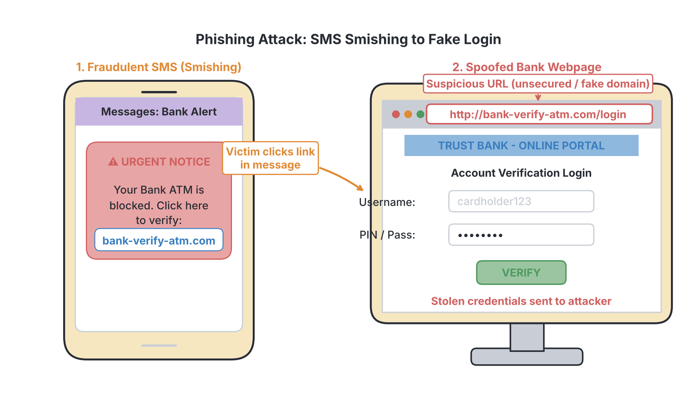

# JAMB Computer Studies Notes: Cyber Risks and Protection

## What JAMB expects

This topic is part of Section I (Computer Ethics and Human Issues) of the JAMB Computer Studies syllabus. It covers the dangers users face when connecting to networks and the internet, and the practices required to stay safe.

By the end of these notes, you should be able to:

1. List Types of cyber security threats (Cybercrime, cyber-attack, cyberterrorism, malware, virus, trojans, spyware, Ransomware, Adware, Botnets, SQL injection, Phishing, Man-in-the-middle attack, Denial of Service, Dridex, Romance scams, Emotet malware,
2. List Cyber security safety tips
   - Regular update of software and operating systems
   - Use of anti-virus software
   - Use of strong passwords
   - Do not open email attachments from unknown senders
   - Do not click on links in emails from unknown senders or unfamiliar websites,
   - avoid use of unsecure WIFI networks in public places etc.

**Note on the syllabus wording:** The syllabus objective naming the cyber threats (objective xiii) ends abruptly with "...Emotet malware," and lacks a closing bracket or the word "etc." In addition, common nouns like "Ransomware" and "Adware" are printed with capital letters. These notes explain every single threat exactly as listed in the syllabus.

## Types of Cyber Security Threats

**Objective xiii: List Types of cyber security threats.**

In today's digital world, computers, smartphones, and networks are constantly connected to the internet. While this brings immense benefits, it also exposes users to cyber risks—dangers arising from malicious individuals and software online. The syllabus groups these threats into general categories, specific malicious software (malware), network attacks, and social engineering scams.

### Broad Categories of Cyber Threats

- **Cybercrime:** This is any illegal activity carried out using a computer, a network, or the internet. The computer could be the tool used to commit the crime (such as stealing money from a bank) or the target of the crime (such as hacking into a company's database). In Nigeria, financial internet fraud (often referred to locally as "Yahoo Yahoo") is a common example of cybercrime.
- **Cyber-attack:** A deliberate, malicious attempt by hackers to damage, destroy, or gain unauthorised access to a computer system, network, or electronic device.
- **Cyberterrorism:** The use of the internet and cyber-attacks to cause widespread fear, disrupt critical infrastructure (like power grids, hospitals, or government networks), or cause bodily harm. The goal of cyberterrorism is usually to achieve political, religious, or ideological gains through intimidation.

### Malware (Malicious Software)

**Malware** is a general term for any software intentionally designed to cause damage to a computer, server, client, or network. The following are different types of malware:

| Malware Type | How it works | Does it copy itself? |
| --- | --- | --- |
| **Virus** | A program that attaches itself to a clean file. When the user opens the infected file, the virus runs and copies itself to infect other files, often deleting data or slowing down the system. | Yes |
| **Trojans (Trojan Horse)** | Disguises itself as legitimate, useful software (like a free game or tool). The user is tricked into installing it. It opens a hidden "backdoor" for hackers to control the computer or steal data. | No |
| **Spyware** | Hides in the background and secretly monitors the user's activity. It records keystrokes (keyloggers), browsing history, and passwords, sending this private information back to the attacker. | No |
| **Ransomware** | Locks the victim's computer or encrypts (scrambles) their files so they cannot be opened. The attacker then demands a ransom (often in cryptocurrency) to unlock the files. | Sometimes |
| **Adware** | Automatically displays or downloads unwanted advertisements, usually as pop-ups on a web browser. It can also track browsing habits and slow down the device. | No |

**Specific Notorious Malware Listed in the Syllabus:**
- **Dridex:** A specific, notorious banking Trojan. It usually arrives in a phishing email as a Microsoft Office attachment (like a Word or Excel file). If the user opens it and enables macros, Dridex installs itself in the background and steals banking passwords and financial information.
- **Emotet malware:** Originally created as a banking Trojan similar to Dridex, Emotet evolved into a highly contagious malware-delivery system. Once it infects a computer (usually via spam emails), it acts as a "downloader," secretly bringing other dangerous malware, such as ransomware, onto the victim's system.
- **Botnets:** A network of private computers that have been infected with malware and are controlled secretly as a group by a hacker (the "botmaster"). The infected computers (called "zombies" or "bots") are often used to send massive amounts of spam emails or launch coordinated attacks on websites without the owners' knowledge.

### Network and Application Attacks

These threats exploit weaknesses in how websites and networks communicate:

- **SQL injection:** A type of attack on database-driven websites. Many websites use a language called SQL (Structured Query Language) to communicate with their databases. In an SQL injection, a hacker types malicious SQL commands into a website's normal input form (like a username box or search bar). If the website is poorly programmed, it obeys the malicious command, allowing the hacker to view, change, or delete private database records (like user passwords).
- **Man-in-the-middle (MitM) attack:** An attack where a hacker secretly intercepts the communication between two parties. For example, if you log into your bank using an unsecure public Wi-Fi network, the attacker sits "in the middle" and reads or alters the data passing between your phone and the bank, stealing your login details.
- **Denial of Service (DoS):** An attack designed to shut down a machine, website, or network, making it inaccessible to its real users. The attacker achieves this by flooding the target server with a massive amount of fake internet traffic. The server becomes so overwhelmed trying to respond to the fake requests that it crashes or becomes too slow to serve legitimate users. (When a DoS attack is launched from a botnet of many computers, it is called a Distributed Denial of Service, or DDoS).

### Social Engineering and Scams

Social engineering attacks rely on tricking human beings rather than finding technical flaws in a computer system:

- **Phishing:** A fraudulent attempt to obtain sensitive information (like passwords, BVN, or ATM card PINs) by disguising as a trustworthy entity. The attacker sends a fake email or text message that looks like it is from a real bank or company (e.g., "Your First Bank account has been blocked. Click here to verify."). The link takes the victim to a fake, look-alike website that steals their details.
- **Romance scams:** A scam where the criminal creates a fake online identity (on dating apps or social media platforms like Facebook) to gain a victim's affection and trust. After establishing a fake romantic relationship over weeks or months, the scammer invents an emergency (such as medical bills, travel costs, or customs fees) and manipulates the victim into sending money.

## Cyber Security Safety Tips

**Objective xiv: List Cyber security safety tips.**

To protect against the threats listed above, computer users and organisations must practice good "cyber hygiene." The syllabus outlines six vital safety tips:

### 1. Regular update of software and operating systems
Hackers constantly look for technical weaknesses (vulnerabilities) in software to exploit. When a weakness is found, software companies release updates or "patches" to fix these holes. Keeping your operating system (like Windows, macOS, or Android) and your applications fully updated ensures you have the latest security protection against new attacks.

### 2. Use of anti-virus software
Anti-virus (or anti-malware) software is a program designed to detect, prevent, and remove malicious software. You should install reputable anti-virus software and keep its virus definitions updated. It scans your files and monitors your computer in real-time, stopping viruses, Trojans, and spyware before they can execute and cause harm.

### 3. Use of strong passwords
A password is often your first line of defence against unauthorised access. Weak passwords (like "123456", "password", or a phone number) can be easily guessed by hackers using automated tools. A strong password should be:
- **Long:** At least 8 to 12 characters.
- **Complex:** A mixture of uppercase letters, lowercase letters, numbers, and special symbols (such as @, #, %, !).
- **Unique:** Never use the same password for different websites; if one site is hacked, all your accounts become vulnerable.

### 4. Do not open email attachments from unknown senders
Many forms of malware, including the notorious **Dridex** and **Emotet**, are distributed via malicious email attachments (especially Microsoft Word, Excel, or ZIP files). If you receive an email with an attachment from someone you do not know, or if a known contact sends an attachment you were not expecting, never open it. Opening the file can secretly install malware on your system.

### 5. Do not click on links in emails from unknown senders or unfamiliar websites
Clicking on malicious links is the primary way victims fall for **phishing** attacks. These links can direct you to fake websites designed to steal your login credentials or secretly download malware onto your device in the background. Always type the official web address directly into your browser rather than clicking a link provided in a suspicious email or text message.

### 6. Avoid use of unsecure WIFI networks in public places
Public Wi-Fi networks found in airports, shopping malls, hotels, and restaurants often lack strong encryption or passwords. Hackers can easily connect to these unsecure networks and perform **Man-in-the-middle (MitM)** attacks to intercept your internet traffic. If you must use public Wi-Fi:
- Do not log into your bank account or enter sensitive information.
- Use a Virtual Private Network (VPN) to encrypt your connection, making your data unreadable to anyone trying to intercept it.

*(Note: At the time of writing, these safety tips are standard practices worldwide, though cybercriminals constantly invent new ways to trick users.)*

## Key terms

| Term | Meaning |
| --- | --- |
| **Cybercrime** | Illegal activities carried out using computers or the internet. |
| **Malware** | A general term for any malicious software designed to harm or exploit a computer. |
| **Trojan** | Malware disguised as legitimate software to trick users into installing it. |
| **Ransomware** | Malware that encrypts a victim's files and demands payment to unlock them. |
| **Botnet** | A network of infected computers controlled remotely by a hacker. |
| **Phishing** | Sending fake emails or messages to trick people into revealing sensitive information. |
| **SQL injection** | Entering malicious code into a website's input form to manipulate its database. |
| **Man-in-the-middle (MitM)** | An attack where a hacker intercepts communication between a user and a server. |
| **Denial of Service (DoS)** | An attack that floods a server with fake traffic to make it crash or become unavailable. |
| **Dridex / Emotet** | Notorious examples of banking Trojans and malware-delivery systems. |

## Exam tips and common mistakes

- **Virus vs. Trojan:** A common mistake is confusing a virus with a Trojan. Remember that a **virus** copies (replicates) itself to spread, while a **Trojan** relies on disguising itself as useful software to trick the user into installing it.
- **Phishing vs. Malware:** Phishing is a social engineering technique (a trick using fake messages), whereas malware is actual malicious code installed on the computer. However, phishing emails often contain links that download malware.
- **SQL injection target:** Remember that SQL injection specifically targets **databases** behind websites, not the user's personal computer.
- **DoS goal:** The goal of a Denial of Service attack is not to steal data, but to make a system or website **unavailable** by crashing it with traffic.
- **Public Wi-Fi:** Using unsecure public Wi-Fi directly exposes you to Man-in-the-middle (MitM) attacks.

## Quick summary

1. Cyber threats range from broad categories like cybercrime and cyberterrorism to specific malicious programs called malware.
2. Common types of malware include viruses (which self-replicate), Trojans (which hide as real software), spyware (which steals data secretly), and ransomware (which locks files for money).
3. Botnets are armies of infected computers controlled by hackers to send spam or launch DoS attacks.
4. Network attacks include SQL injections (attacking databases), Man-in-the-middle attacks (intercepting data), and Denial of Service (crashing servers).
5. Scammers use phishing (fake emails) and romance scams (fake online relationships) to manipulate users into giving up passwords or money.
6. To stay safe online, you must regularly update your software, use anti-virus programs, and create strong, complex passwords.
7. Never open attachments or click links in suspicious emails, and avoid entering sensitive data on unsecure public Wi-Fi networks.

## Practice questions

**1. Which of the following best describes ransomware?**

- A. Software that automatically displays unwanted advertisements
- B. Malware that scrambles the user's files and demands payment to unlock them
- C. A program that monitors and records the user's keystrokes
- D. An attack that floods a website with fake internet traffic

**Answer: B.** Ransomware encrypts (scrambles) the victim's data and demands a ransom payment. Option A describes adware, Option C describes spyware (keyloggers), and Option D describes a Denial of Service attack.

**2. The fraudulent practice of sending emails that appear to be from a legitimate bank to steal login details is known as:**

- A. Phishing
- B. SQL injection
- C. Cyberterrorism
- D. Botnet

**Answer: A.** Phishing relies on disguising as a trustworthy entity to trick the user. Option B targets databases, not users directly.

**3. What is the main difference between a computer virus and a Trojan?**

- A. A virus steals money, while a Trojan only shows advertisements.
- B. A virus attacks hardware, while a Trojan attacks software.
- C. A virus replicates itself to spread, while a Trojan disguises itself as legitimate software and does not self-replicate.
- D. A virus is sent via email, while a Trojan only comes from USB drives.

**Answer: C.** Viruses are self-replicating programs that attach to files, whereas Trojans rely on tricking the user into installing them by pretending to be useful software.

**4. Why is it dangerous to perform banking transactions on an unsecure public Wi-Fi network?**

- A. The screen brightness will automatically reduce.
- B. It makes the computer vulnerable to a Man-in-the-middle attack.
- C. It will permanently delete the operating system.
- D. It increases the chance of an SQL injection on your laptop.

**Answer: B.** Unsecure Wi-Fi allows attackers to intercept the data passing between your device and the bank (Man-in-the-middle attack). Option D is incorrect because SQL injection targets web databases, not personal laptops.

**5. Dridex and Emotet are notorious examples of which category of cyber threat?**

- A. Adware
- B. Romance scams
- C. Denial of Service tools
- D. Banking Trojans and malware

**Answer: D.** Both Dridex and Emotet are highly destructive forms of malware (originally banking Trojans) that steal financial information or download further malware.

**6. The primary goal of a Denial of Service (DoS) attack is to:**

- A. Steal the administrator's password
- B. Intercept emails sent between employees
- C. Overwhelm a server with traffic so that legitimate users cannot access it
- D. Trick a user into downloading a free game

**Answer: C.** A DoS attack floods the target with useless requests, crashing it or making it unavailable.

**7. Which of the following is considered a strong password?**

- A. password2024
- B. 08012345678
- C. Qwerty
- D. Tb8!xM@9qL

**Answer: D.** A strong password must be long and contain a mix of uppercase letters, lowercase letters, numbers, and special symbols. Options A, B, and C are predictable and easily guessed.

**8. An attack where malicious database commands are typed into a website's input form is called:**

- A. Phishing
- B. SQL injection
- C. Botnet
- D. Romance scam

**Answer: B.** SQL injection involves entering SQL commands into input fields to manipulate the database behind the website.

**9. Why should you regularly update your operating system and application software?**

- A. To patch security vulnerabilities and protect against new threats
- B. To increase the physical size of the hard drive
- C. To prevent the computer monitor from overheating
- D. To make the internet connection completely free

**Answer: A.** Software updates (patches) fix known security holes that hackers could otherwise exploit.

**10. A network of infected computers controlled remotely by a hacker without the owners' knowledge is known as a:**

- A. Trojan horse
- B. Phishing net
- C. Botnet
- D. Spyware ring

**Answer: C.** A botnet consists of many infected "zombie" computers controlled by a "botmaster" to perform tasks like sending spam or launching DoS attacks.

<!-- COVERAGE
obj xiii | Types of Cyber Security Threats
obj xiv | Cyber Security Safety Tips
-->
