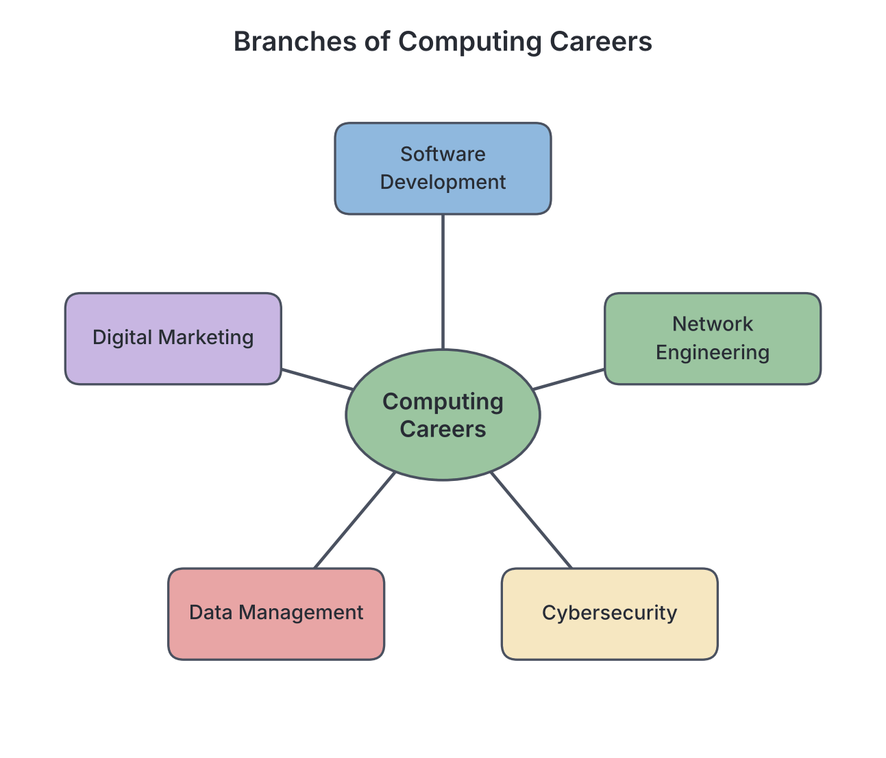
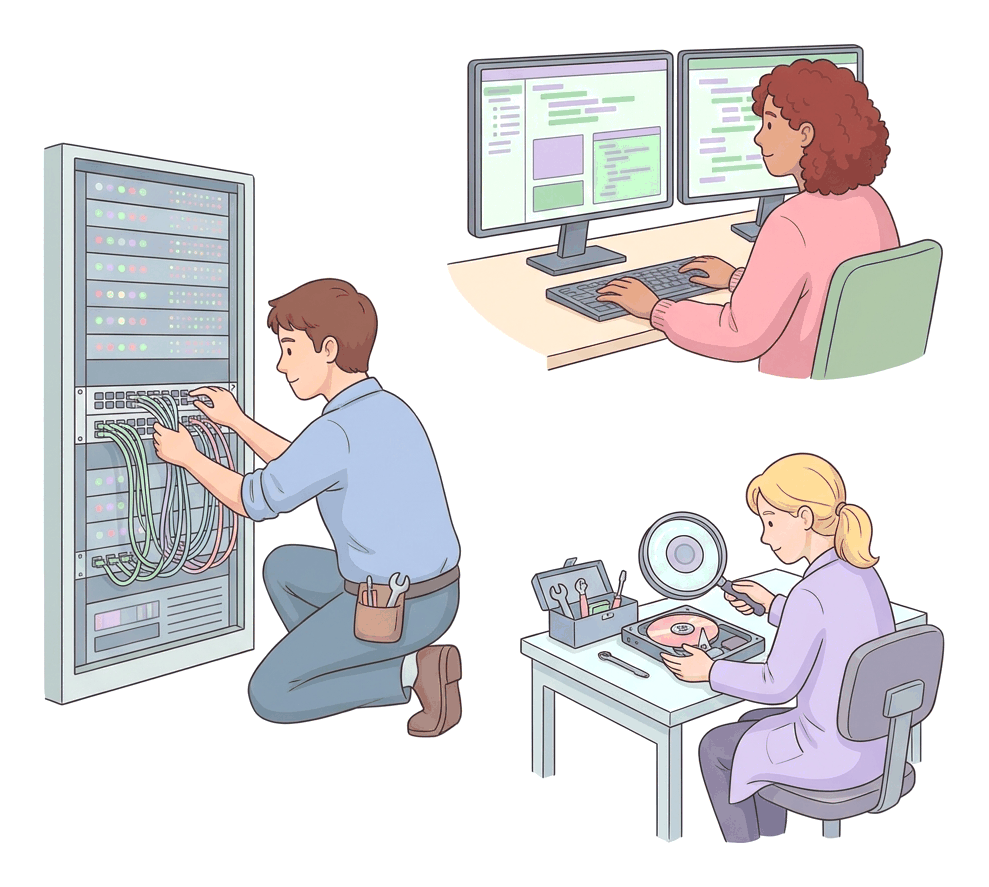

# JAMB Computer Studies Notes: Potentials for Higher Studies in Computing

## What JAMB expects

This topic is Section I, Topic 4 of the JAMB Computer Studies syllabus: Potentials for Higher Studies in Computing.

By the end of these notes, you should be able to:

1. List possible career paths in computing.

**Note on the syllabus wording:** The syllabus lists "AI and Robotics" alongside job titles; we explain this as a career field containing roles like AI Engineer or Roboticist. The syllabus also uses mixed spellings (e.g., "Programme Analyst" but "Program Manager") and includes minor typing oddities like "E- Marketer" (with a space) and a stray comma after "Software Development Engineer". The roles are explained below using their standard industry meanings, keeping the syllabus terms clear.

## Pathways for Higher Studies

Before looking at specific careers, it is important to know how to get there. After secondary school, students can pursue higher studies in computing-related courses at universities, polytechnics, and colleges of education across Nigeria. 

- **University Degree (B.Sc. or B.Eng.):** Courses include Computer Science, Software Engineering, Cybersecurity, Information Technology, and Computer Engineering.
- **Polytechnic Diploma (ND and HND):** Many Nigerian polytechnics offer practical, hands-on courses in Computer Science and Computer Engineering technology.
- **Certifications:** Many professionals take global professional exams (such as Cisco CCNA for networking, or CompTIA Security+ for cybersecurity) alongside or instead of a traditional degree to prove their practical skills to employers.

## Possible career paths in computing

**Objective i: List possible career paths in computing.**

The computing field is vast. Below are the career paths named in the JAMB syllabus, grouped into sensible areas of work.

### 1. Software and Application Development

Professionals in this group write the code that makes computers, smartphones, and websites work.

- **Software Developer:** A professional who designs, writes, and maintains computer programs. They build everything from offline desktop applications to complex cloud software.
- **Software Development Engineer:** Similar to a software developer, but this role often applies strict engineering principles to the entire software development lifecycle, ensuring large-scale software systems are reliable and efficient.
- **System Developer:** Focuses on creating and maintaining backend systems, operating systems, or large enterprise software that keeps an organisation running, rather than just everyday user applications.
- **Mobile App Developer:** Specialises in creating software applications for mobile devices such as smartphones and tablets. In Nigeria, mobile app developers are in high demand to build apps for banking, POS agents, and e-commerce on Android and iOS platforms.
- **Web Developer:** Focuses on building and maintaining websites and web applications. They write the code (such as HTML, CSS, JavaScript, and Python) that makes a website look good and function correctly.
- **Software Test Engineer:** Before a piece of software is released, this engineer tests it rigorously to find "bugs" (errors), security flaws, and performance issues to ensure the final product works perfectly.
- **Programme Analyst:** A hybrid role that combines the skills of a computer programmer and a systems analyst. They analyse business problems and write the specific computer programs needed to solve them.

### 2. Systems and Network Engineering

These roles focus on the physical hardware, servers, and connections that allow computers to communicate and function together.

- **System Analyst** and **Computer System Analyst:** These two roles are essentially the same. A system analyst studies an organisation's current computer systems and procedures, then designs information systems solutions to help the organisation operate more efficiently.
- **System Engineer:** A professional who builds and manages complex computer systems, ensuring that hardware, software, and networking all work together smoothly throughout their life cycle.
- **System Administrator:** Also known as a "sysadmin". They are responsible for the day-to-day management, upkeep, and configuration of an organisation's computer systems and servers. If a company's server goes down, the sysadmin is the one who fixes it.
- **Network Engineer:** Designs, sets up, and manages communication networks, such as Local Area Networks (LANs) and Wide Area Networks (WANs). Network engineers are essential for telecommunications companies (like MTN or Airtel) and large offices to keep everyone connected to the internet.
- **IT Specialist:** A broad term for an expert who installs, configures, and maintains computer hardware, software, and networks. They often specialise in one specific area of IT support.
- **IT User Support/Desk Officer:** Also known as helpdesk support. These are the friendly officers who help everyday users fix immediate computer problems, such as resetting forgotten passwords, fixing jammed printers, or troubleshooting software crashes.

### 3. Data, Databases, and Security

Because data is incredibly valuable, organisations need specialists to store it, analyse it, and protect it from criminals.

- **Database Administrator (DBA):** Uses specialised software to store and organise data (such as financial records or customer details). DBAs ensure that data is safe, backed up, and only accessible to authorised users. Nigerian banks rely heavily on DBAs to keep account balances accurate and secure.
- **Data Analyst/Scientist:** Analyses large amounts of raw data to find trends, patterns, and insights that help businesses make smart decisions. Data scientists often use advanced statistics and programming to predict future trends.
- **System Security Analyst:** Also known as a cybersecurity analyst. They protect an organisation's computer networks and systems from hackers and cyberattacks by monitoring network traffic, installing firewalls, and finding weaknesses in the system.
- **Digital Forensic Analyst:** Think of them as IT detectives. When a cybercrime is committed, a digital forensic analyst recovers and investigates material found in digital devices (like hard drives and smartphones) to be used as evidence in a court of law.
- **Internet Police:** Law enforcement officers who specialise in monitoring the internet to prevent and investigate cybercrimes, such as financial fraud (like "yahoo-yahoo"), hacking, and identity theft. In Nigeria, agencies like the EFCC have specialised cybercrime units that act as internet police.

### 4. Artificial Intelligence and Emerging Technologies

- **AI and Robotics:** Careers in Artificial Intelligence (AI) and robotics involve designing intelligent computer systems and machines that can perform tasks normally requiring human intelligence (such as recognising speech or making decisions) or physical automation (such as manufacturing robots). Professionals here work as AI Engineers or Roboticists.

### 5. Management and Business IT

These professionals bridge the gap between technical computer teams and the business goals of a company.

- **Business Analyst:** Uses data and IT tools to analyse a business's processes and recommend technological solutions that improve efficiency and profit. 
- **Program Manager:** In IT, a program manager oversees a group of related IT projects (a "program"). They coordinate different teams, manage budgets, and ensure that the overall goals of the organisation are met.
- **ICT Manager:** The senior person who directs and manages the overall Information and Communication Technology strategy, budget, and staff within an organisation.

### 6. Digital Content and Marketing

With the rise of the internet, computing careers now include creating media and marketing products online.

- **Blogger:** A person who writes, edits, and manages content on a blog (a regularly updated website). Bloggers often specialise in topics like tech, fashion, or news, and can earn a living through digital advertising, sponsored posts, and affiliate marketing.
- **E- Marketer:** Uses digital platforms (like the internet, email, and mobile devices) to market and advertise products or services. They analyse online consumer behaviour to increase sales.
- **Social Media Manager:** Manages an organisation's official presence on platforms like Facebook, X (formerly Twitter), Instagram, and LinkedIn. They create engaging content, reply to customer comments, and build brand awareness.

### 7. Education, Academia, and Entrepreneurship

Knowledge of computing can be used to teach others or to start a new business.

- **ICT Educator:** A teacher who instructs students in computer studies and ICT at the primary, secondary, or college level.
- **Computer Instructor:** Someone who provides practical, hands-on training for specific computer skills or software packages (such as Microsoft Office, CorelDraw, or basic coding), often in private computer training centres.
- **Career in Academia:** This involves working as a lecturer or researcher in a university or polytechnic. Academics teach higher-level computer science courses and conduct research to invent new computing technologies.
- **ICT Librarian:** A modern librarian who manages digital resources, online databases, e-books, and electronic information systems to help users find the information they need in a library setting.
- **Private Entrepreneurship:** Starting and running your own tech-based business. In Nigeria, tech entrepreneurs have founded successful startups (such as fintech companies in Lagos), cybercafés, computer repair shops, and IT consultancy firms.

## Key terms

| Term | Meaning |
| --- | --- |
| Software Developer | A professional who designs, writes, and maintains computer programs. |
| System Administrator | A person responsible for managing and maintaining an organisation's daily computer systems and servers. |
| Network Engineer | A professional who designs, sets up, and maintains computer networks like LANs and WANs. |
| Database Administrator | An expert who uses software to store, organise, and secure an organisation's data. |
| Software Test Engineer | A professional who checks new software for bugs and errors before it is released to the public. |
| Digital Forensic Analyst | An investigator who recovers and analyses data from digital devices to be used as evidence in cybercrime cases. |
| Business Analyst | A professional who analyses business needs and recommends IT solutions to improve efficiency. |
| Internet Police | Law enforcement officers who monitor the internet and investigate cybercrimes. |

## Exam tips and common mistakes

- **Differentiate between a Network Engineer and a System Administrator:** A Network Engineer builds and maintains the network cables, routers, and connections, while a System Administrator manages the servers and computers that run on that network.
- **Software Developer vs. Software Test Engineer:** A developer writes the code; a test engineer tries to break the code to find bugs before release.
- **System Analyst vs. Data Analyst:** A System Analyst studies business IT systems to design software improvements. A Data Analyst studies raw numbers and data to find business insights.
- **Internet Police:** In JAMB questions, this term refers strictly to cybercrime law enforcement units, not regular security guards.
- **ICT Educator vs. Computer Instructor:** An ICT Educator works in formal education (like a secondary school teacher), whereas a Computer Instructor often focuses on short, practical skills training in private centres.

## Quick summary

1. A degree or diploma in a computing field opens up careers in software development, networking, data management, business, and education.
2. Software roles include Software Developers (who write code), Web and Mobile App Developers, and Software Test Engineers (who find bugs).
3. Network and Systems roles include Network Engineers, System Administrators (who manage daily IT server operations), and IT User Support officers.
4. Data and Security roles involve Database Administrators (who secure data storage), Data Analysts, and Digital Forensic Analysts (who investigate cybercrimes).
5. Business IT roles include Business Analysts, Program Managers, and ICT Managers who bridge the gap between technology and company goals.
6. Digital Content roles include E-Marketers, Bloggers, and Social Media Managers who use the internet to promote brands and share information.
7. Education and Entrepreneurship roles include ICT Educators, Academics, and private tech entrepreneurs who build start-ups or IT businesses.

## Practice questions

**1. Which of the following professionals is primarily responsible for writing the code that creates a computer program?**

- A. System Administrator
- B. Database Administrator
- C. Software Developer
- D. Network Engineer

**Answer: C.** A software developer designs, writes, and maintains the code for computer applications. The most tempting wrong option is System Administrator, but a sysadmin focuses on managing and maintaining existing computer systems and servers, not writing new software.

**2. The professional who recovers data from digital devices to be used as evidence in solving cybercrimes is the:**

- A. Internet Police
- B. Digital Forensic Analyst
- C. System Security Analyst
- D. Data Analyst

**Answer: B.** A Digital Forensic Analyst recovers and investigates digital material to be used as evidence in court. The most tempting wrong option is Internet Police, but while they are law enforcement, the specific role of analysing the digital evidence deeply falls to the forensic analyst.

**3. Which of the following roles focuses specifically on building and maintaining websites?**

- A. System Developer
- B. Web Developer
- C. Network Engineer
- D. ICT Librarian

**Answer: B.** A Web Developer writes the code (like HTML and CSS) to build and maintain websites. The most tempting wrong option is System Developer, but a system developer focuses on building backend IT systems and operating software, rather than web pages.

**4. A bank needs an expert to ensure its vast customer records are securely stored, backed up, and quickly accessible. Which professional should they hire?**

- A. E-Marketer
- B. Database Administrator
- C. ICT Librarian
- D. Blogger

**Answer: B.** A database administrator (DBA) is responsible for the secure storage, organisation, and backup of large amounts of data. The most tempting wrong option is ICT Librarian, as they also deal with information, but they manage digital resources for library users, whereas a DBA manages strict operational databases for an organisation.

**5. The career path that involves setting up, maintaining, and troubleshooting Local Area Networks (LANs) and Wide Area Networks (WANs) is:**

- A. Network Engineer
- B. System Administrator
- C. Social Media Manager
- D. Computer Instructor

**Answer: A.** A Network Engineer designs, sets up, and manages communication networks. The most tempting wrong option is System Administrator, but while they may troubleshoot small network issues, their main focus is on the servers and computers, whereas the Network Engineer builds the network infrastructure itself.

**6. Which professional uses advanced statistics to find trends and patterns in large amounts of business data?**

- A. Data Analyst/Scientist
- B. System Administrator
- C. System Engineer
- D. Blogger

**Answer: A.** A Data Analyst or Data Scientist analyses raw data to find trends and insights that help businesses make decisions. The most tempting wrong option is System Engineer, but a system engineer focuses on building complex IT hardware/software systems, not analysing business data trends.

**7. A company's internal servers have stopped working, and employees cannot access their files. Who is primarily responsible for fixing this daily operational issue?**

- A. Software Test Engineer
- B. Digital Forensic Analyst
- C. System Administrator
- D. Data Analyst/Scientist

**Answer: C.** The System Administrator manages and maintains the daily operation of computer systems and servers, ensuring they stay online. The most tempting wrong option is Software Test Engineer, but they test new software for bugs before release, rather than fixing broken server infrastructure.

**8. The role of a Software Test Engineer is to:**

- A. sell software to other companies
- B. write the first draft of the source code
- C. find bugs and ensure software works perfectly before release
- D. fix physically broken computer hardware

**Answer: C.** A Software Test Engineer rigorously tests software to find bugs, security flaws, and performance issues. The most tempting wrong option is B, but writing the initial code is the job of the Software Developer.

**9. Which professional oversees an organisation's entire IT strategy, budget, and manages the IT staff?**

- A. ICT Manager
- B. IT User Support Officer
- C. Web Developer
- D. Programme Analyst

**Answer: A.** An ICT Manager is a senior role that directs and manages the overall Information and Communication Technology operations of an organisation. The most tempting wrong option is IT User Support Officer, but they handle daily user helpdesk problems, not the overall IT strategy and management.

**10. A career in academia within the computing field generally involves:**

- A. managing a bank's database servers
- B. teaching and conducting research at a university or polytechnic
- C. monitoring social media for a large business
- D. building robots for a manufacturing company

**Answer: B.** Working in academia means being a lecturer or researcher at a higher education institution, advancing computer science through teaching and study. The most tempting wrong option is D, but building robots for manufacturing is typically a commercial engineering role (AI and Robotics), rather than an academic one.

<!-- COVERAGE
obj i | Possible career paths in computing
-->
