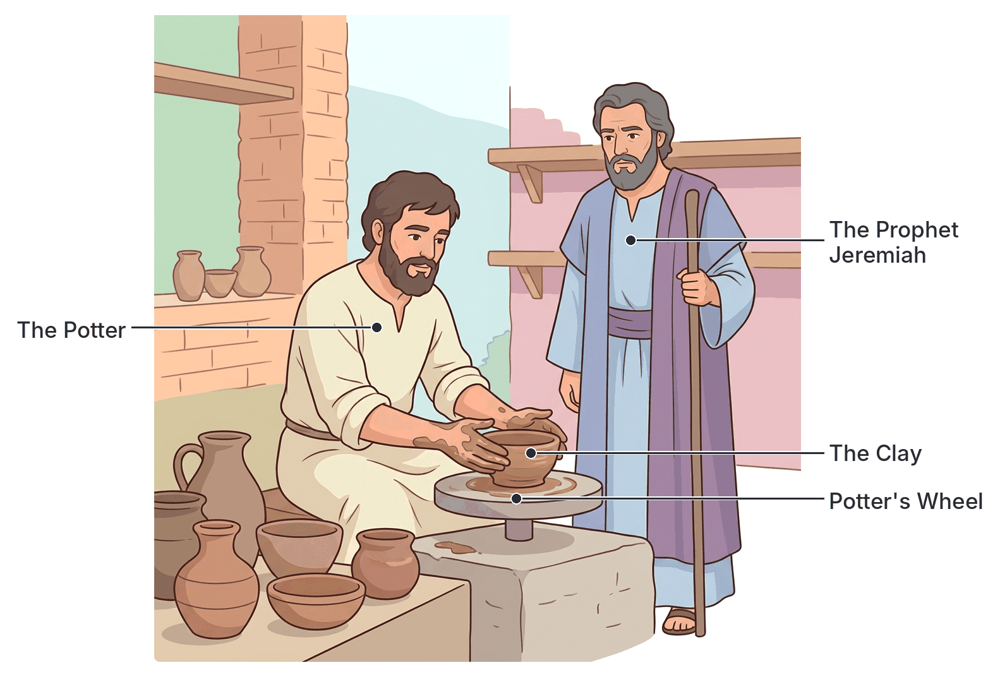

# JAMB Crk Notes: The Sovereignty of God

## What JAMB expects

This topic is Section A, Topic 1 of the JAMB CRK syllabus: The Sovereignty of God. It covers God's supreme power over creation, human beings, and the entire universe.

This file covers the following content item:
* God as Creator and Controller of the Universe (Gen. 1 and 2) cf. Amos 9:5-6; Is. 45:5-12; Ps. 19:1-6; Jer. 18:1-16; Rom. 8:28.

By the end of these notes, you should be able to:
1. define the term 'sovereignty';
2. analyse God's process of creation;
3. interpret the sequence of creation;
4. identify man's role in advancing God's purpose in creation;
5. recognize the sovereignty of God in the affairs of man and nations.

## Define the term 'sovereignty'

**Sovereignty** means having supreme, absolute, and unrestricted power and authority over a territory or a system. 

In Christian Religious Knowledge, the **sovereignty of God** means that God is the supreme ruler and absolute controller of the universe. It means He has the ultimate power to do whatever He pleases, whenever He pleases, and however He pleases, without needing anyone's permission. Because God created the universe, He owns it, sustains it, and directs everything in it according to His divine will and purpose. Nobody can question His authority or stop His plans.

## God as Creator and Controller of the Universe

The Bible begins with the fundamental truth that God is the Creator. By creating the heavens, the earth, and everything within them, God established His authority over them. The creation accounts in Genesis, as well as the writings of the prophets and the apostles, demonstrate that God did not just create the world and leave it alone; He actively controls nature, human history, and the destinies of nations.

## Analyse God's process of creation

The Bible presents God's process of creation primarily in the first two chapters of Genesis. Christians understand these chapters to reveal the nature of God's power and how He brought the universe into existence.

### Creation by the Spoken Word (Genesis 1)
In the first chapter of Genesis, God's primary method of creation was through His **spoken word**. The chapter repeatedly states, "And God said, Let there be..." and it instantly happened. 
*   **Creation *ex nihilo*:** This is a Latin term meaning "out of nothing." Before creation, the earth was "without form, and void; and darkness was upon the face of the deep" (Genesis 1:2). God did not use pre-existing building materials to create the universe; He spoke it into existence by His supreme power.
*   **The role of the Spirit:** The process involved the Spirit of God, which "moved upon the face of the waters," indicating the active presence of God in bringing order out of chaos.
*   **Order and Perfection:** God's process was orderly. He first created environments (light, sky, seas, land) before filling them (stars, birds, fish, animals). After each phase, God examined His work and saw that "it was good."

### Creation by Physical Formation (Genesis 2)
While Genesis 1 gives a grand, cosmic view of creation, Genesis 2 provides a more detailed, close-up account of how God created human beings and their immediate environment. Here, the process is described in a more "hands-on" or personal way:
*   **Forming man from dust:** God formed man (Adam) from the dust of the ground. Unlike the rest of creation, man was not simply spoken into existence. God personally shaped him.
*   **The breath of life:** After forming man's body, God "breathed into his nostrils the breath of life; and man became a living soul" (Genesis 2:7). This intimate process gave humanity a unique spiritual connection to God.
*   **Planting the Garden:** God planted a garden eastward in Eden and placed the man there. 
*   **Creating woman:** To create a companion for the man, God caused a deep sleep to fall upon Adam, took one of his ribs, and formed the woman (Eve) from it, establishing the close bond of marriage.

## Interpret the sequence of creation

The sequence of creation in Genesis 1 took place over six days, with God resting on the seventh day. This orderly sequence highlights God's sovereignty as He carefully prepared the earth for living creatures.

| Day | What God Created | Details |
| :--- | :--- | :--- |
| **Day 1** | Light | God separated the light from the darkness. He called the light Day, and the darkness Night. |
| **Day 2** | The Firmament (Sky) | God created the firmament to divide the waters above from the waters below. He called the firmament Heaven (or sky). |
| **Day 3** | Dry Land, Seas, and Vegetation | God gathered the waters together to let dry land appear. He commanded the earth to bring forth grass, herbs, and fruit trees yielding seed. |
| **Day 4** | Sun, Moon, and Stars | God created lights in the sky to separate day from night and to serve as signs for seasons, days, and years. The "greater light" (sun) ruled the day, and the "lesser light" (moon) ruled the night. |
| **Day 5** | Sea Creatures and Birds | God created great whales, all living creatures in the waters, and all winged fowls (birds). He blessed them to be fruitful and multiply. |
| **Day 6** | Land Animals and Mankind | God created cattle, creeping things, and beasts of the earth. Finally, God created man (male and female) in His own image and likeness. |
| **Day 7** | Rest (The Sabbath) | God finished His work, rested on the seventh day, and blessed and sanctified it. |

[IMAGE: A clean, flat textbook illustration showing the six days of creation in a grid of six panels. Panel 1: A striking contrast of bright golden light breaking through dark shadows. Panel 2: A clear blue sky separating clouds above from blue water below. Panel 3: Green rolling hills, trees with fruit, and blue seas. Panel 4: A bright sun, a crescent moon, and twinkling stars in space. Panel 5: Fish leaping from water and birds flying in the sky. Panel 6: Various land animals (lion, elephant, cattle) and the silhouettes of a man and woman standing together on the grass. Labels to add later: "Day 1: Light", "Day 2: Sky and Waters", "Day 3: Land and Plants", "Day 4: Sun, Moon, Stars", "Day 5: Birds and Fish", "Day 6: Animals and Mankind". White background.]

**Note on textbook variation:** Genesis 2 presents what appears to be a different order, focusing strictly on mankind. In Genesis 2, God creates man (v. 7), then plants the garden of Eden (v. 8), then forms animals from the ground and brings them to Adam to name (v. 19), and finally creates woman (v. 22). The Christian teaching generally interprets Genesis 1 as the chronological order of the whole universe, and Genesis 2 as a detailed focus on the specific events in the Garden of Eden on the sixth day.

## Identify man's role in advancing God's purpose in creation

When God created human beings, He did not intend for them to be idle. He delegated a part of His authority to them, giving mankind a specific role in advancing and maintaining His purpose on earth.

1. **To Bear God's Image:** Humans were created in the image and likeness of God (Genesis 1:26). This means humans possess rational, moral, and spiritual capacities that reflect God's nature, enabling them to represent God on earth.
2. **Procreation (Fruitfulness):** God commanded the man and woman to "Be fruitful, and multiply, and replenish the earth" (Genesis 1:28). Man is tasked with continuing the human race and filling the earth with people who can worship and obey God.
3. **Having Dominion (Authority):** God told humanity to "subdue" the earth and "have dominion over the fish of the sea, and over the fowl of the air, and over every living thing that moveth upon the earth" (Genesis 1:28). Man is appointed as God's representative manager (steward) to rule over the animal kingdom and natural resources responsibly.
4. **Cultivating and Tending the Earth (Dignity of Labour):** In Genesis 2:15, God put the man in the Garden of Eden "to dress it and to keep it." This establishes work and agriculture as a divine mandate. Man is to care for the environment and make it productive.
5. **Naming the Animals:** God brought all the beasts and birds to Adam to see what he would call them (Genesis 2:19). Whatever Adam named an animal, that became its name. This exercise of naming demonstrates man's intelligence and his God-given authority over the creatures.

In everyday Nigerian life, this means humanity is responsible for protecting the environment, engaging in honest labour, starting families, and managing natural resources wisely, reflecting God's order and care.

## Recognize the sovereignty of God in the affairs of man and nations

God's sovereignty extends far beyond the original act of creation. The Bible passages specified in the syllabus illustrate how God exercises absolute control over nature, individuals, and entire nations.

### 1. God's Sovereignty over Nature (Amos 9:5-6; Psalm 19:1-6)
God continuously controls the physical world He created.
*   **Amos 9:5-6:** The prophet Amos describes God's awesome physical power over the earth. When "the Lord God of hosts" touches the land, it melts. God controls the waters, causing them to rise and fall like the river Nile in Egypt. He builds His "stories" (chambers) in the heavens and commands the waters of the sea to pour out upon the land. This passage shows that nature is entirely obedient to God's command.
*   **Psalm 19:1-6:** The psalmist David declares that the natural world acts as a silent preacher of God's majesty: "The heavens declare the glory of God; and the firmament sheweth his handywork." The daily rising and setting of the sun, which moves like a strong man running a race or a bridegroom coming out of his chamber, proves that God's laws govern the universe perfectly. Nature constantly points to the sovereign Creator.

### 2. God's Sovereignty over Nations and History (Isaiah 45:5-12)
God's plans for the world cannot be stopped by human rulers, and He can use anyone to achieve His purpose—even those who do not worship Him.
*   **The Call of Cyrus:** In Isaiah 45, God declares His absolute supremacy: "I am the LORD, and there is none else, there is no God beside me" (v. 5). To prove this, God announces that He has chosen and anointed **Cyrus**, a Gentile Persian king, to conquer nations, subdue kings, and ultimately free the Israelites from their exile in Babylon.
*   **Using the Unknowing:** God says to Cyrus, "I girded thee, though thou hast not known me" (v. 5). This powerful statement shows that God can use international political leaders, who do not even acknowledge Him, as instruments to fulfill His divine will. 
*   **Creator of All Outcomes:** God declares His total control over all conditions: "I form the light, and create darkness: I make peace, and create evil [calamity/disaster]: I the LORD do all these things" (v. 7). He orchestrates the rise and fall of nations in human history.

### 3. God's Sovereignty in Shaping Nations (Jeremiah 18:1-16)
God uses the illustration of a craftsman to explain His absolute right over nations.
*   **The Potter and the Clay:** God told the prophet Jeremiah to visit a potter's house. Jeremiah watched the potter working with clay on a wheel. When a vessel the potter was making was "marred" (spoiled) in his hands, the potter simply crushed it and remade it into a different vessel, as it pleased him.
*   **The Application to Israel:** God then spoke to Jeremiah, comparing the nation of Israel to the clay: "O house of Israel, cannot I do with you as this potter? saith the LORD. Behold, as the clay is in the potter's hand, so are ye in mine hand" (Jeremiah 18:6). 
*   **Conditional Sovereignty:** God explained that if He decides to pluck up, pull down, or destroy a nation, but that nation repents of its evil, God will change His mind and spare them. Conversely, if God plans to build and plant a nation, but they do evil and disobey His voice, He will withhold the good He intended for them. God acts as the Sovereign Judge over the morality of nations.

### 4. God's Sovereignty in the Lives of Believers (Romans 8:28)
In the New Testament, the Apostle Paul explains how God's sovereignty works for the individual Christian's benefit.
*   **All Things Work Together:** "And we know that all things work together for good to them that love God, to them who are the called according to his purpose" (Romans 8:28).
*   Because God is totally sovereign over the universe, no event in a believer's life happens by accident. God controls and weaves together all circumstances—whether joyful or painful—to achieve a good outcome in the end for those who love Him and follow His purpose.

## Key terms

| Term | Meaning |
| :--- | :--- |
| Sovereignty | Supreme power and absolute authority; the right to rule without being questioned. |
| Ex nihilo | A Latin phrase meaning "out of nothing," referring to how God created the universe without using pre-existing materials. |
| Firmament | The sky or heavens, created on the second day to separate the waters above from the waters below. |
| Dominion | Rule, authority, or control, which God granted to mankind over the earth and animals. |
| Eden | The garden God planted in the east, where He placed the first man and woman. |
| Cyrus | The Persian king whom God called and anointed in Isaiah 45 to subdue nations and fulfill God's purpose, despite Cyrus not knowing God. |
| Potter and Clay | The metaphor used in Jeremiah 18 to demonstrate God's absolute right to shape, destroy, or rebuild nations as He pleases. |

## Exam tips and common mistakes

*   **Memorize the sequence of creation:** JAMB very frequently tests which item was created on which day. A common mistake is confusing Day 4 (Sun, moon, stars) with Day 1 (Light). Light was Day 1; the heavenly bodies to *carry* the light were Day 4.
*   **Distinguish Genesis 1 and 2:** Remember that Genesis 1 uses the spoken word ("Let there be..."), while Genesis 2 involves physical actions (forming man from dust, breathing into his nostrils, taking a rib).
*   **Know the specific prophets:** If a question asks about God being the potter and mankind the clay, the answer is **Jeremiah**. If the question is about God calling a foreign king (Cyrus), the answer is **Isaiah**.
*   **Identify the message of Romans 8:28:** Understand that this verse relates to God's sovereign control over circumstances in the lives of believers ("all things work together for good").
*   **Man's mandate:** The command to "have dominion" means stewardship and responsible management, not destructive exploitation of the earth.

## Quick summary

1. The sovereignty of God means God has absolute, unquestionable power and authority over the entire universe.
2. God created the universe out of nothing (*ex nihilo*) simply by His spoken word, establishing order from chaos over six days, and resting on the seventh.
3. In Genesis 2, God created man uniquely by forming him from the dust and breathing the breath of life into his nostrils.
4. Man's role in creation is to bear God's image, be fruitful, have dominion over the animals, and dress and keep the earth.
5. God's sovereignty extends over nature; He commands the earth, the seas, and the sun, as seen in Amos and Psalms.
6. God controls the history of nations, famously using King Cyrus of Persia, who did not even know God, to accomplish His plans (Isaiah 45).
7. Like a potter holding clay, God has the absolute right to build up or destroy nations based on their obedience to Him (Jeremiah 18).
8. God sovereignly controls all events in a believer's life so that they ultimately work together for good (Romans 8:28).

## Practice questions

**1. The term 'sovereignty of God' implies that God**
- A. created the world out of existing materials
- B. shares His authority with the angels
- C. has supreme and absolute power over the universe
- D. only controls the spiritual world, not human affairs

**Answer: C.** Sovereignty means having supreme, absolute, and unrestricted power and authority over everything.

**2. According to the Genesis creation account, what was created on the fourth day?**
- A. The firmament
- B. Sea creatures and birds
- C. Sun, moon, and stars
- D. Dry land and vegetation

**Answer: C.** God created the heavenly bodies (sun, moon, and stars) on the fourth day to rule the day and night and be for signs and seasons.

**3. In Genesis 2, the unique way God created man, unlike the rest of creation, was by**
- A. commanding the earth to bring forth man
- B. forming him from dust and breathing into his nostrils
- C. speaking him into existence out of nothing
- D. taking a rib from an animal

**Answer: B.** Genesis 2:7 specifies that God formed man of the dust of the ground and breathed into his nostrils the breath of life.

**4. The command given to man to "dress it and to keep it" in the Garden of Eden illustrates the**
- A. dignity of labour and environmental stewardship
- B. punishment for original sin
- C. superiority of man over angels
- D. reason for the creation of woman

**Answer: A.** Tending the garden was man's God-given responsibility before the Fall, showing that work and caring for creation are divine mandates.

**5. Which prophet used the analogy of the potter and the clay to explain God's absolute right over nations?**
- A. Isaiah
- B. Amos
- C. Jeremiah
- D. Ezekiel

**Answer: C.** In Jeremiah 18, God sent Jeremiah to the potter's house to show that He can reshape, destroy, or build nations just as a potter shapes clay.

**6. In Isaiah 45, God demonstrated His sovereignty over history by anointing which foreign king to subdue nations?**
- A. Nebuchadnezzar
- B. Pharaoh
- C. Herod
- D. Cyrus

**Answer: D.** God called King Cyrus of Persia, girding him to subdue nations and deliver Israel, even though Cyrus did not know God.

**7. "The heavens declare the glory of God; and the firmament sheweth his handywork." This passage is found in**
- A. Genesis 1
- B. Amos 9
- C. Romans 8
- D. Psalm 19

**Answer: D.** This verse is from Psalm 19:1, demonstrating how the natural universe reveals God's sovereign power and glory.

**8. According to Romans 8:28, God exercises His sovereignty in the lives of believers by ensuring that**
- A. they never face any trials or suffering
- B. all things work together for good to them that love Him
- C. they receive immediate punishment for every sin
- D. they become rulers over the nations

**Answer: B.** Paul teaches that God sovereignly orchestrates all circumstances to result in ultimate good for those who love Him and are called to His purpose.

**9. In the creation story, God gave man dominion over all the following EXCEPT**
- A. the fish of the sea
- B. the fowl of the air
- C. every creeping thing
- D. the heavenly bodies

**Answer: D.** Man was given dominion over the fish, birds, cattle, and all the earth (the animal kingdom and natural environment), but not over the sun, moon, and stars, which God set in place to rule the day and night.

**10. God's creation of the universe out of nothing by His spoken word is referred to by the term**
- A. Ex nihilo
- B. Firmament
- C. Totipotent
- D. Predestination

**Answer: A.** *Ex nihilo* is a Latin term meaning "out of nothing," reflecting the Christian teaching that God did not use pre-existing materials to create the universe.

<!-- COVERAGE
obj i | Define the term 'sovereignty'
obj ii | Analyse God's process of creation
obj iii | Interpret the sequence of creation
obj iv | Identify man's role in advancing God's purpose in creation
obj v | Recognize the sovereignty of God in the affairs of man and nations
God as Creator and Controller of the Universe | God as Creator and Controller of the Universe
-->
