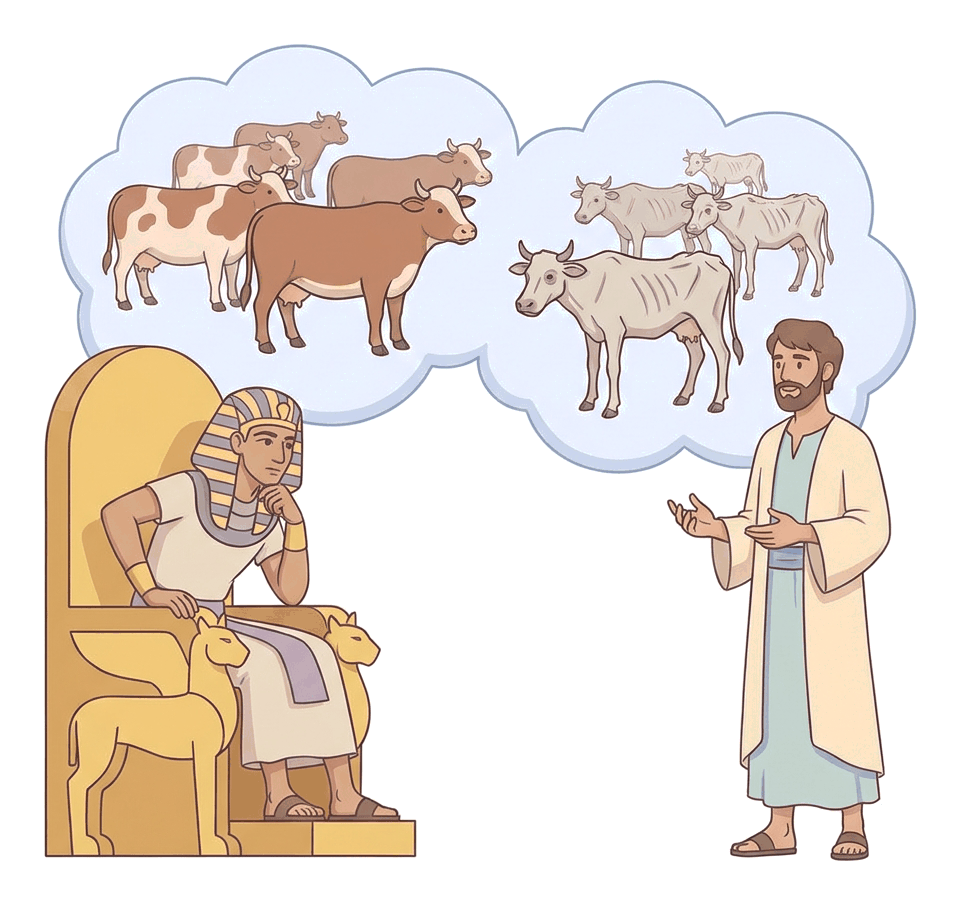
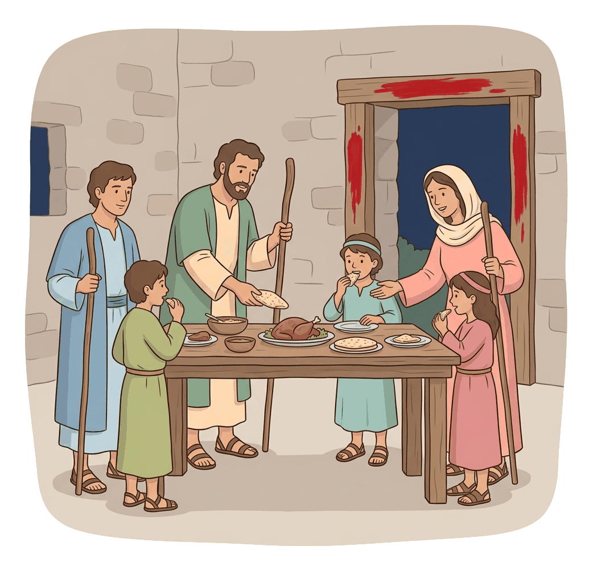
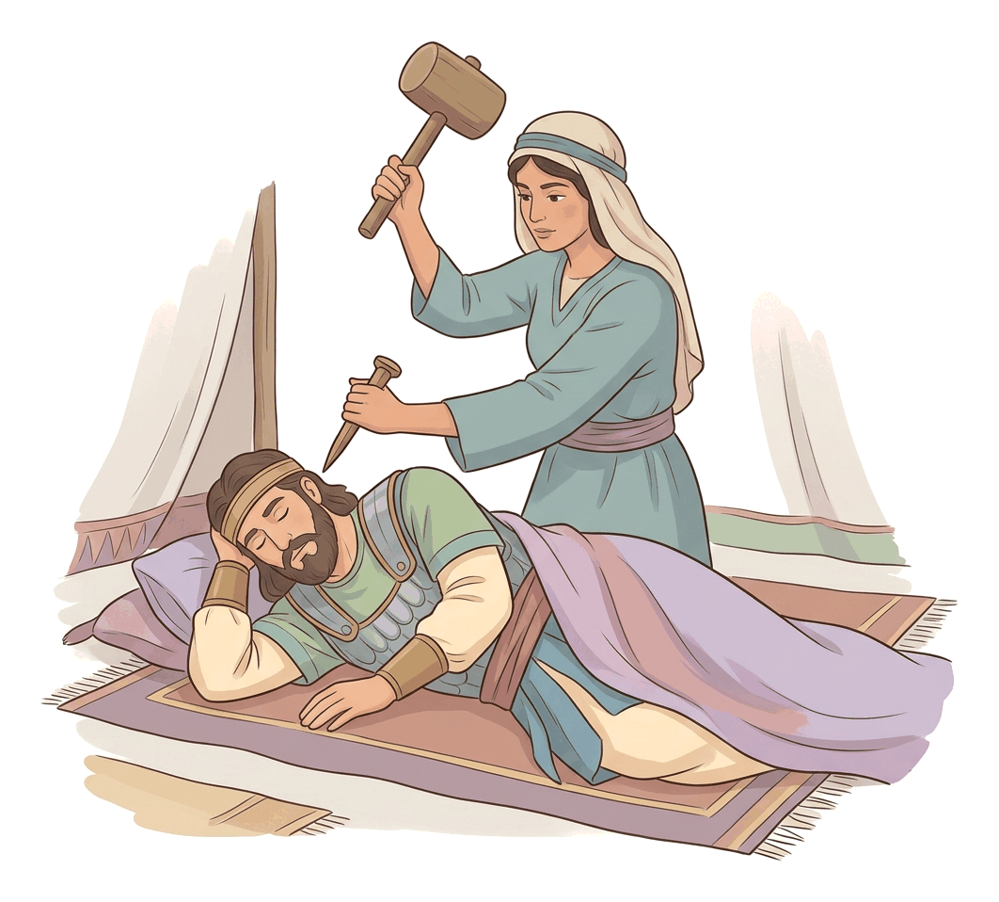

# JAMB Crk Notes: Leadership Qualities

## What JAMB expects

This topic is Section A, Topic 3 of the JAMB CRK syllabus: Leadership Qualities. It focuses on how God called, equipped, and used specific individuals to lead His people in the Old Testament. 

The content items covered are:
- **a.** Examples of Joseph (Gen. 37:1-28; 41:1-57; 45:1-15)
- **b.** Examples of Moses (Ex. 1; 2; 3; 4:1-17; 5; 12; Num. 13:1-20; 14:1-19)
- **c.** Examples of Joshua (Num. 13:21-33; 27:15-23; Josh. 1:1-15; 6; 7; 24:1-31)
- **d.** Examples of Judges (Deborah - Judges 4:1-24; Gideon: Judges 6:11-40; Samson: Judges 13:1-7, 21-25; 16:4-31)

By the end of these notes, you should be able to:
1. examine the circumstances that gave rise to the leadership of Joseph, Moses, Joshua and the Judges;
2. identify the major talents of these leaders;
3. assess God's role in the works of these leaders;
4. analyse the achievements of these leaders.

To make the stories easy to follow, we will first look at the biblical accounts of each leader (covering all the content passages). Then, we will use comparison tables to examine their circumstances, talents, God's role, and their achievements, exactly as the JAMB objectives demand.

---

## Examples of Joseph (Content a)

Joseph’s journey to leadership was not through a formal election but through God's providence during personal hardship and national crisis.

### 1. The Dreams and the Pit (Genesis 37:1-28)
Joseph, the son of Jacob and Rachel, was deeply loved by his father, who made him a "coat of many colours" (a long robe with sleeves). This made his older brothers fiercely jealous. Joseph worsened the situation by sharing two dreams:
1. **The Sheaves:** He and his brothers were binding sheaves in the field. Joseph's sheaf stood upright, and his brothers' sheaves bowed down to it.
2. **The Heavenly Bodies:** The sun, the moon, and eleven stars bowed down to him. Even his father rebuked him for this dream.

When Jacob sent Joseph to check on his brothers in Dothan, they plotted to kill him. Reuben, the eldest, convinced them to throw Joseph into a dry pit instead, planning to rescue him later. However, while Reuben was absent, Judah suggested they sell Joseph to a passing caravan of Ishmaelites (Midianite traders) for twenty shekels of silver. Joseph was taken to Egypt as a slave.

### 2. Rise to Power in Egypt (Genesis 41:1-57)
In Egypt, Joseph endured slavery and false imprisonment. After interpreting dreams for the king's cupbearer and baker, Joseph was eventually recommended to Pharaoh when the king had two troubling dreams:
1. Seven ugly, thin cows ate seven fat, attractive cows but remained thin.
2. Seven thin, blighted ears of grain swallowed seven plump, good ears.

God gave Joseph the interpretation: Egypt would experience seven years of great plenty, followed by seven years of severe famine. Joseph advised Pharaoh to appoint a wise and discreet man to collect a fifth of the harvest during the years of plenty and store it for the famine. 

Recognising the Spirit of God in Joseph, Pharaoh appointed him as Prime Minister (second-in-command over all Egypt), gave him his signet ring, fine linen, a gold chain, and a new Egyptian name, *Zaphenath-paneah*. Joseph successfully managed the food storage, saving Egypt and the surrounding nations from starvation.

### 3. Revealing Himself to His Brothers (Genesis 45:1-15)
The famine forced Joseph's brothers to come to Egypt to buy grain. After testing them in earlier encounters to see if they had changed, Joseph could no longer control his emotions. He ordered all Egyptians out of the room, wept loudly, and said, "I am Joseph; is my father still alive?"

His brothers were terrified, but Joseph comforted them with a profound statement of faith and leadership: *"Do not be distressed, or angry with yourselves, because you sold me here; for God sent me before you to preserve life."* He instructed them to bring their father and settle in the land of Goshen in Egypt to survive the remaining five years of famine.

---

## Examples of Moses (Content b)

Moses was chosen by God to deliver the Israelites from slavery in Egypt and lead them to the edge of the Promised Land.

### 1. Oppression and the Birth of Moses (Exodus 1–2)
A new Pharaoh, who did not know Joseph, feared the growing population of the Israelites. He enslaved them, forcing them to build the store cities of Pithom and Raamses. When the Hebrew midwives, **Shiphrah and Puah**, refused his order to kill all newborn Hebrew boys, Pharaoh commanded all his people to throw every Hebrew baby boy into the Nile River.

Moses was born to a Levite woman (Jochebed). She hid him for three months, then placed him in a papyrus basket coated with pitch among the reeds of the river. Pharaoh's daughter found the baby, took pity on him, and adopted him, while Moses’ own mother was unknowingly hired to nurse him.

As an adult, Moses saw an Egyptian beating a Hebrew. He killed the Egyptian and hid the body in the sand. When he realised the deed was known, he fled to the land of Midian, where he married **Zipporah**, the daughter of Jethro (the priest of Midian).

### 2. The Burning Bush and the Call (Exodus 3–4:1-17)
While tending his father-in-law's flock at Mount Horeb (Sinai), Moses saw a bush burning with fire but not being consumed. God called to him, telling him to remove his sandals because it was holy ground. God declared that He had seen the affliction of His people and was sending Moses to Pharaoh to lead them out of Egypt.

Moses gave several excuses:
1. *"Who am I that I should go?"* (God answered: "I will be with you.")
2. *"What is His name?"* (God revealed His name: **"I AM WHO I AM"** or Yahweh).
3. *"They will not believe me."* (God gave him three signs: his staff turning into a snake, his hand turning leprous and then clean, and water from the Nile turning to blood).
4. *"I am not eloquent; I am slow of speech."* (God became angry but appointed Moses' brother, **Aaron**, to be his spokesman).

### 3. Confrontation and the Passover (Exodus 5, 12)
Moses and Aaron went to Pharaoh, saying, "Thus says the LORD, the God of Israel, 'Let my people go, that they may hold a feast to me in the wilderness.'" Pharaoh arrogantly replied that he did not know the Lord, and he punished the Israelites by forcing them to gather their own straw to make bricks without reducing their quota.

After a series of devastating plagues, God commanded the final blow: the death of the firstborn. To be spared, the Israelites were instructed in **Exodus 12** to celebrate the **Passover**. Each household was to slaughter a blemish-free lamb, smear its blood on the two doorposts and the lintel of their houses, and eat the roasted meat with unleavened bread and bitter herbs. That night, the Lord struck down the Egyptian firstborn but "passed over" the houses marked with blood. Pharaoh finally urged the Israelites to leave.

### 4. Sending the Spies and Intercession (Numbers 13:1-20; 14:1-19)
Years later, at the edge of Canaan, God told Moses to send twelve men (one leader from each tribe) to spy out the Promised Land. Moses instructed them to see if the people were strong or weak, few or many, and to bring back some of the fruit of the land.

When the people later rebelled (as covered in the Joshua section below) and wanted to return to Egypt, God threatened to strike them with a pestilence and make a new, greater nation from Moses. Moses demonstrated incredible leadership by **interceding** for the people. He argued that if God destroyed Israel, the Egyptians and Canaanites would say God was not able to bring them into the land. He appealed to God's character: *"The LORD is slow to anger, and abounding in steadfast love, forgiving iniquity and transgression..."* God pardoned them but decreed the rebellious generation would wander and die in the wilderness.

---

## Examples of Joshua (Content c)

Joshua served as Moses' assistant and eventually his successor, leading Israel into the Promised Land.

### 1. The Spies' Report (Numbers 13:21-33)
The twelve spies explored Canaan for forty days. They brought back a huge cluster of grapes from the Valley of Eshcol, carried on a pole between two men. They reported that the land indeed flowed with milk and honey. 

However, ten spies gave a bad report, saying the inhabitants were strong, the cities were fortified, and they had seen the giants (descendants of Anak) there, making them feel like "grasshoppers." Only **Caleb** (and Joshua) silenced the people, saying, "Let us go up at once, and occupy it; for we are well able to overcome it."

### 2. Joshua Commissioned (Numbers 27:15-23; Joshua 1:1-15)
When Moses learned he would not enter the Promised Land, he asked God to appoint a man over the congregation so they would not be "as sheep which have no shepherd." God selected **Joshua, the son of Nun**, a man in whom was the spirit. Moses presented Joshua before **Eleazar the priest** and laid his hands on him, transferring his authority.

After Moses' death, God directly commanded Joshua to cross the Jordan River. God promised him success, saying, *"As I was with Moses, so I will be with you; I will not fail you or forsake you."* God's primary instruction to Joshua was to **"be strong and of good courage"** and to strictly obey the Book of the Law, meditating on it day and night.

### 3. The Fall of Jericho and the Sin of Achan (Joshua 6–7)
Jericho was a tightly shut, fortified city. God gave Joshua a unique military strategy: the armed men, along with seven priests blowing ram's horn trumpets before the Ark of the Covenant, were to march around the city once a day for six days. On the seventh day, they marched around it seven times. When the priests blew a long blast, Joshua commanded the people to shout. The walls of Jericho collapsed, and Israel destroyed the city.

However, God had commanded that all the plunder (devoted things) belonged to the Lord. A man named **Achan** secretly stole a beautiful Babylonian garment, silver, and a wedge of gold, hiding them in his tent. As a result of this sin, God's anger burned against Israel, and they were humiliatingly defeated by the small town of **Ai**. Joshua tore his clothes in grief and prayed. God revealed there was sin in the camp. Achan was identified by casting lots, confessed, and was stoned to death in the Valley of Achor, restoring Israel to God's favour.

### 4. Covenant Renewal at Shechem (Joshua 24:1-31)
At the end of his life, Joshua gathered all the tribes of Israel at Shechem. He recounted God's faithfulness from the time of Abraham to their present victories. He then challenged the people to make a firm decision: *"Choose this day whom you will serve, whether the gods your fathers served in the region beyond the River, or the gods of the Amorites in whose land you dwell; but as for me and my house, we will serve the LORD."* The people promised to serve God. Joshua died at the age of 110.

---

## Examples of the Judges (Content d)

After Joshua, Israel entered a repeated cycle: they would abandon God to worship idols (apostasy), God would allow foreign enemies to oppress them, the people would cry out in distress, and God would raise up a "Judge" (a military deliverer) to save them. 

### 1. Deborah (Judges 4:1-24)
Israel had been brutally oppressed for 20 years by **Jabin, king of Canaan**, and his military commander, **Sisera**, who possessed 900 chariots of iron. At this time, **Deborah**, a prophetess and the wife of Lappidoth, was judging Israel. She held court under the palm of Deborah.

She summoned **Barak** and commanded him in God's name to gather 10,000 men at Mount Tabor. Barak was hesitant and said he would only go if she went with him. Deborah agreed but prophesied that the glory of killing Sisera would not go to Barak, but to a woman. 

God routed Sisera’s army before Barak. Sisera fled on foot and hid in the tent of **Jael**, the wife of Heber the Kenite. While Sisera was exhausted and sleeping, Jael took a tent peg and a hammer and drove the peg through his temple into the ground, killing him.

### 2. Gideon (Judges 6:11-40)
Israel was severely oppressed by the **Midianites**, who ruined their crops and impoverished them, forcing Israelites to hide in caves. **Gideon** was secretly beating out wheat in a winepress to hide it from the Midianites when the Angel of the Lord appeared and said, *"The LORD is with you, you mighty man of valour."* 

Gideon questioned this, pointing out Israel's suffering and his own weak background (his clan was the weakest in Manasseh, and he was the least in his family). God promised to be with him. Gideon's first act of leadership was to obey God's command to tear down his father's altar to **Baal** and the Asherah pole beside it, and build an altar to the Lord. Because he did this at night out of fear, the townspeople demanded his death the next day, but his father Joash defended him.

Before leading the army, Gideon asked God for two signs using a fleece of wool to confirm his calling:
1. Dew on the fleece only, and the ground dry.
2. The fleece dry, and dew on the ground all around it.
God graciously granted both signs.

### 3. Samson (Judges 13:1-7, 21-25; 16:4-31)
The Philistines had oppressed Israel for 40 years. An angel appeared to the barren wife of **Manoah** (of the tribe of Dan) and promised she would have a son. He was to be a **Nazirite** from the womb: no razor was to touch his head, and he must not drink wine or eat anything unclean. His life's mission was to *begin* to deliver Israel from the Philistines. Samson grew, and the Spirit of the Lord began to stir him.

Samson's downfall came through his lack of self-control. He fell in love with **Delilah** in the Valley of Sorek. The Philistine lords bribed her with 1,100 pieces of silver each to find the secret of his great strength. After lying to her three times, he finally revealed his Nazirite vow: if his hair was shaved, his strength would leave him.

While he slept on her lap, his seven locks of hair were shaved off. The Spirit of the Lord left him, and the Philistines captured him, gouged out his eyes, bound him with bronze shackles, and made him grind grain in the prison in Gaza.

Later, the Philistines gathered to offer a great sacrifice to their god **Dagon**, celebrating Samson's capture. They brought Samson out to entertain them. His hair had begun to grow back. He asked the lad leading him to let him feel the two middle pillars supporting the temple. Samson prayed, *"O Lord GOD, remember me, I pray thee, and strengthen me, I pray thee, only this once, O God, that I may be at once avenged of the Philistines for my two eyes."* He pushed the pillars apart. The temple collapsed, killing Samson and more Philistines in his death than he had killed in his life.

---

## Objective i: Circumstances giving rise to leadership

JAMB often tests your knowledge of *why* God called these specific individuals at the time He did.

| Leader | Circumstances that necessitated their leadership |
| :--- | :--- |
| **Joseph** | His family's severe dysfunction (jealousy, betrayal) led to his enslavement. Meanwhile, God needed a wise administrator in Egypt to prepare for a devastating **seven-year famine**, ensuring the survival of the Israelites (Jacob's family) so God's covenant with Abraham would continue. |
| **Moses** | The Israelites were suffering **severe oppression, slavery, and infanticide** (killing of baby boys) under a cruel Egyptian Pharaoh. They cried out in misery, and God remembered His covenant, requiring a deliverer to bring them out of Egypt. |
| **Joshua** | Moses was about to die because of his sin at Meribah, and the Israelites were camped on the edge of the **Promised Land (Canaan)**. They needed a bold, faithful military commander to lead the conquest and settle the tribes in their inheritance. |
| **The Judges** | The Israelites repeatedly fell into **apostasy** (worshipping Canaanite idols like Baal). God punished them by allowing foreign nations (Canaanites, Midianites, Philistines) to brutally oppress and impoverish them. When they repented and cried out, God raised up Judges as military saviours to break the oppression. |

---

## Objective ii: Major talents of these leaders

Each leader had unique gifts, natural and spiritual, that made them effective.

| Leader | Major Talents and Leadership Qualities |
| :--- | :--- |
| **Joseph** | **Wisdom and Administration:** Organized a nationwide food storage system.  **Spiritual insight:** Accurate interpretation of dreams.  **Forgiveness:** Refused to take revenge on his brothers, showing great emotional maturity. |
| **Moses** | **Intercession:** Pleaded for his people when God wanted to destroy them (selfless leadership).  **Humility:** The Bible calls him the meekest man on earth.  **Patience and endurance:** Handled the complaints of a rebellious people for 40 years. |
| **Joshua** | **Courage and Faith:** One of only two spies to believe God could conquer the giants.  **Military Strategy:** Led the armies brilliantly at Jericho and Ai.  **Strict Obedience:** Carefully followed all of God's laws and commands given to Moses. |
| **Deborah** | **Prophetic Insight:** Spoke God's exact strategies to Barak.  **Inspiration:** Motivated a hesitant general (Barak) to fight a superior army.  **Adjudication:** Successfully judged civil disputes among the people. |
| **Gideon** | **Tactical Planning:** Executed a night mission to tear down the altar; later used psychological warfare.  **Caution and Seeking God:** Refused to act until he was absolutely sure of God's will (the fleece). |
| **Samson** | **Supernatural Physical Strength:** A one-man army capable of destroying hundreds of enemies alone, beginning the destabilisation of Philistine rule. |

---

## Objective iii: God's role in the works of these leaders

A major theme of the Old Testament is that leadership is not humanly achieved but divinely empowered. God was the ultimate leader of Israel.

1. **God as the Initiator:** None of these leaders campaigned for their positions. 
   * God placed Joseph in the perfect position through divine providence. 
   * God aggressively called a reluctant Moses from a burning bush.
   * God specifically chose Joshua as Moses' successor.
   * God explicitly sent angels or the Spirit to call Gideon and Samson.
2. **God as the Provider of Strategy:** The leaders succeeded only when they followed God’s specific plans (e.g., storing grain, the Passover blood, marching around Jericho, the fleece signs). 
3. **God as the Source of Power:** The abilities of the leaders came from God. Moses could not perform plagues without God; the walls of Jericho fell by God's power, not Joshua's shouting; Samson’s strength was not from exercise but from the Holy Spirit.
4. **God as the Ultimate Deliverer:** Whether using Deborah’s rainstorm to muddy Sisera’s chariots or bringing a famine to move Jacob’s family, God orchestrated nature and history to achieve His purposes.

---

## Objective iv: Achievements of these leaders

| Leader | Key Achievements |
| :--- | :--- |
| **Joseph** | Saved Egypt and surrounding nations from starvation. Preserved the lineage of Abraham, Isaac, and Jacob. Reconciled his broken family. |
| **Moses** | Led the great Exodus out of Egypt. Instituted the Passover. Mediated the Old Covenant (Ten Commandments) at Sinai. Transformed a group of slaves into an organized, law-abiding nation. |
| **Joshua** | Successfully led the invasion and conquest of Canaan. Defeated highly fortified cities like Jericho. Shared the Promised Land among the Twelve Tribes. Led the nation in a historic renewal of the covenant with God at Shechem. |
| **Deborah** | Broke the 20-year oppression of Jabin and Sisera, resulting in 40 years of national peace. Proved that God can use anyone, male or female, to lead and save His people. |
| **Gideon** | Destroyed the altar of Baal, restoring true worship in his community. Delivered Israel from the devastating Midianite raids, resulting in 40 years of peace. |
| **Samson** | Single-handedly terrorized the Philistines and began the process of Israel's deliverance. Destroyed the temple of Dagon, eliminating the Philistine leadership and thousands of their people in a single day. |

---

## Key terms

| Term | Meaning |
| :--- | :--- |
| **Apostasy** | The abandonment or renunciation of a religious belief (e.g., Israel leaving God to worship Baal). |
| **Providence** | The protective care and sovereign guidance of God over human history (seen clearly in Joseph's life). |
| **Intercession** | Pleading or praying to God on behalf of someone else (as Moses did for Israel). |
| **Nazirite** | An Israelite consecrated to the service of God, under vows to abstain from alcohol, let hair grow, and avoid contact with corpses (Samson). |
| **Passover** | The night the Lord passed over the houses of the Israelites marked by the blood of the lamb, and struck the firstborn of Egypt. |
| **Theocracy** | A system of government in which priests rule in the name of God, or God rules directly. Israel was meant to be a theocracy. |

---

## Exam tips and common mistakes

* **Know your spies:** 12 spies were sent. 10 brought a bad report. 2 (Joshua and Caleb) brought a good report. JAMB often asks who the faithful spies were.
* **Know the oppressors:** Match the Judge to the enemy! 
  * Deborah/Barak fought the **Canaanites** (Jabin/Sisera). 
  * Gideon fought the **Midianites**. 
  * Samson fought the **Philistines**.
* **Distinguish the successors:** Joshua succeeded Moses. Eleazar (Aaron's son) was the priest who helped commission Joshua.
* **Identify the signs:** Remember that Gideon used the **fleece of wool** to test God, whereas Moses received the signs of the **snake, leprous hand, and bloody water**.
* **Do not confuse the deaths:** Achan was stoned in the Valley of Achor for stealing devoted things at Jericho. Sisera was killed by Jael with a tent peg.
* **Note on Moses' excuses:** Remember the specific excuses Moses gave (who am I, what is His name, they won't believe me, I can't speak well).

---

## Quick summary

1. **Joseph** was sold into slavery out of jealousy but was raised by God to Prime Minister of Egypt to save the world from famine and preserve his family.
2. **Moses** was called from a burning bush to deliver Israel from Egyptian bondage, guided them through the Passover, and interceded for them when they rebelled.
3. **Joshua** was Moses' courageous successor who believed God over the giants, commanded the fall of Jericho, purged Achan's sin, and led Israel in a covenant renewal at Shechem.
4. **Deborah** was a prophetess and Judge who inspired Barak to defeat the Canaanite commander Sisera (who was killed by Jael).
5. **Gideon** was called a "mighty man of valour" by an angel; he destroyed his father's Baal altar and defeated the Midianites after testing God with a fleece.
6. **Samson** was a Nazirite with supernatural strength whose lack of discipline led to his capture, but he achieved his greatest victory against the Philistines in his death.
7. God's role was central in all these leaders' works: He initiated their call, provided their strategies, and supplied the power for their miracles and military victories.

---

## Practice questions

**1. Joseph’s brothers hated him primarily because of**
- A. his coat of many colours and his dreams
- B. his refusal to work in the field with them
- C. his desire to marry an Egyptian woman
- D. his plot to take the birthright from Reuben

**Answer: A.** Genesis 37 reveals that his father's favouritism (the coat) and Joseph's dreams of them bowing to him fueled their intense hatred and jealousy.

**2. When God called Moses from the burning bush, the name God revealed to him was**
- A. El-Shaddai
- B. Jehovah Jireh
- C. I AM WHO I AM
- D. The Lord of Hosts

**Answer: C.** In Exodus 3:14, God said to Moses, "I AM WHO I AM" and instructed him to tell the Israelites that "I AM" had sent him.

**3. Moses demonstrated the leadership quality of intercession when he**
- A. pleaded with Pharaoh to let his people go
- B. begged God not to destroy the Israelites after the spies brought a bad report
- C. appointed Joshua as his successor
- D. struck the rock to bring out water

**Answer: B.** In Numbers 14, after the people rebelled, God threatened to wipe them out. Moses interceded, pleading for God to pardon them based on God's steadfast love.

**4. The priest who stood with Moses when Joshua was commissioned was**
- A. Aaron
- B. Phinehas
- C. Eli
- D. Eleazar

**Answer: D.** Numbers 27:22 states that Moses took Joshua and set him before Eleazar the priest and the whole congregation to commission him.

**5. Why was Israel defeated at the town of Ai?**
- A. Joshua did not pray before the battle
- B. Achan stole devoted items from Jericho
- C. The army of Ai was larger than the army of Jericho
- D. The priests failed to blow the trumpets

**Answer: B.** Joshua 7 explains that Israel lost God's protection and was defeated at Ai because Achan took devoted plunder (a garment, silver, and gold) from Jericho, violating God's command.

**6. At the end of his life, Joshua gathered the tribes at Shechem to**
- A. share the remaining land among the tribes
- B. appoint Othniel as the first Judge
- C. renew the covenant and challenge them to choose whom they would serve
- D. prepare them for a final war against the Philistines

**Answer: C.** In Joshua 24, Joshua recounted God's history and issued the famous challenge: "choose this day whom you will serve... but as for me and my house, we will serve the LORD."

**7. Deborah prophesied to Barak that the glory of the victory over Sisera would go to**
- A. God alone
- B. a woman
- C. the tribe of Naphtali
- D. Barak himself

**Answer: B.** Deborah told Barak that because he hesitated and insisted she go with him, the Lord would sell Sisera into the hand of a woman (which was fulfilled when Jael killed Sisera).

**8. Gideon tested God's call to deliver Israel by asking for a sign involving**
- A. a burning bush
- B. a staff turning into a snake
- C. a fleece of wool and dew
- D. fire falling from heaven on an altar

**Answer: C.** In Judges 6, Gideon asked that dew be on the fleece only and the ground dry, and the next night for the fleece to be dry and the ground wet, to confirm God's calling.

**9. Samson's supernatural strength was directly tied to his**
- A. daily exercise in the wilderness
- B. strict diet of locusts and wild honey
- C. Nazirite vow, specifically not cutting his hair
- D. carrying the Ark of the Covenant

**Answer: C.** Samson was a Nazirite from the womb. He told Delilah in Judges 16 that if his head was shaved, his vow would be broken, and his strength would leave him.

**10. What major circumstance necessitated God raising up Judges in Israel?**
- A. The Israelites wanted a king like other nations
- B. The people repeatedly fell into idolatry and were oppressed by foreign enemies
- C. Moses commanded that Judges rule after Joshua's death
- D. The priests in Shiloh became corrupt

**Answer: B.** The era of the Judges was characterized by a cycle of apostasy (worshipping idols), oppression by enemies as punishment, repentance, and deliverance through a Judge.

<!-- COVERAGE
obj i | Objective i: Circumstances giving rise to leadership
obj ii | Objective ii: Major talents of these leaders
obj iii | Objective iii: God's role in the works of these leaders
obj iv | Objective iv: Achievements of these leaders
item a | Examples of Joseph (Content a)
item b | Examples of Moses (Content b)
item c | Examples of Joshua (Content c)
item d | Examples of the Judges (Content d)
-->
