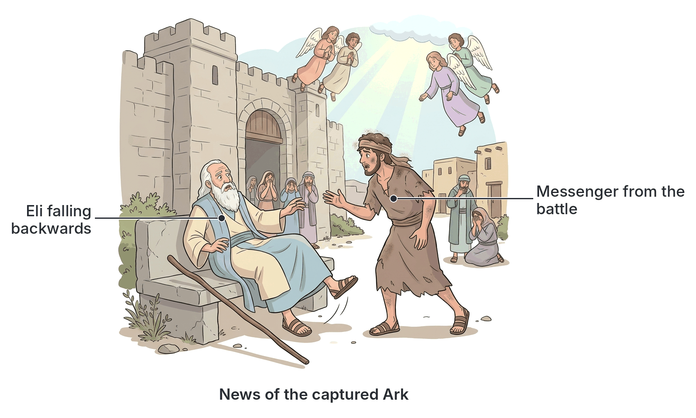
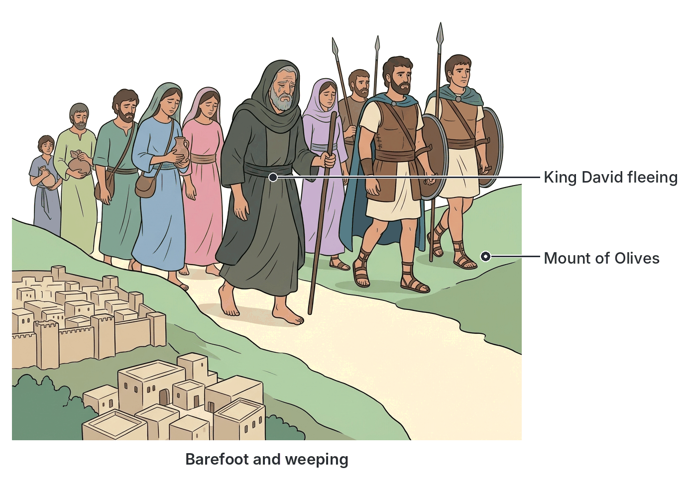
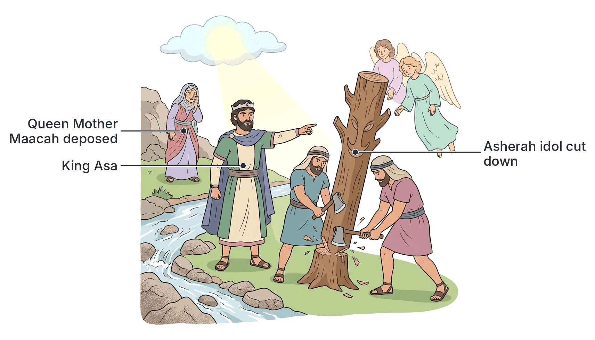

# JAMB Crk Notes: Parental Responsibility

## What JAMB expects

This topic is Section A, Topic 5 of the JAMB CRK syllabus: Parental Responsibility. It evaluates the duties of parents in raising godly children and the consequences of failing to do so, using biblical examples. 

It covers three content items:
- **a. Examples of Eli and Samuel** (1 Sam. 2:11-36; 3:2-18; 4:10-22; 8:1-5)
- **b. Example of David** (II Sam. 13; 15:1-29; 18; 19:1-8)
- **c. Example of Asa** (1 Kings 15:9-15; 22:41-44) and teachings on child training (Deut. 6:4-9; Prov. 4:1-10; 13:1; 24; 22:6; 23:13-14; 31:10-31)

By the end of these notes, you should be able to:
1. determine the extent to which Eli, Samuel and David were responsible for the short-comings of their children;
2. describe how Asa pleased God.

**Notes on the syllabus wording:**
- **Typographical errors in references:** The syllabus prints `11 Sam. 13` for David; this is a clear misprint for **II Sam. 13** (Second Samuel). 
- For Samuel's sons, the syllabus prints `8:15`. This is certainly a misprint for **1 Sam. 8:1-5**, which is the passage detailing the corrupt behaviour of Samuel's sons. 
- For the Proverbs references, the syllabus includes a bare number `24`. This may refer to Proverbs chapter 24 (about building a house by wisdom) or could be a typo for Proverbs 13:24 ("He who spares the rod..."). The notes cover both possibilities.
- **Typo in objective:** The syllabus contains a double full stop in "i. . determine". We treat this simply as "i. determine".

## Examples of Eli and Samuel

**Content a: Examples of Eli and Samuel (1 Sam. 2:11-36; 3:2-18; 4:10-22; 8:1-5)**

### Eli and his wicked sons (Hophni and Phinehas)
Eli was the High Priest and Judge of Israel, ministering at the tabernacle in Shiloh. His two sons, **Hophni and Phinehas**, were also priests, but the Bible describes them as "worthless men" who did not know the Lord (1 Sam. 2:12). 

Their shortcomings (sins) were severe:
1. **Abusing the sacrifices:** When people brought sacrifices, the law stated that the fat must be burned first to God, and the priests received specific boiled parts. Instead, Eli's sons sent a servant with a three-pronged fork to take whatever raw meat he could while it was boiling. If the worshipper objected and asked to burn the fat to God first, the servant would threaten to take the meat by force. This showed immense disrespect for God's offerings.
2. **Sexual immorality:** They slept with the women who served at the entrance to the tent of meeting.

**Eli's weak response:**
Eli was very old. When he heard what his sons were doing, he merely gave them a mild verbal rebuke: *"Why do you do such things? ... If a man sins against a man, God will mediate for him; but if a man sins against the Lord, who can intercede for him?"* (1 Sam. 2:23-25). 
However, his sons did not listen. Eli failed to use his authority as High Priest to remove them from office or discipline them severely.

**God's judgment on Eli's house:**
Because of Eli's failure, God sent warnings through two messengers:
1. **An unnamed "Man of God":** He came to Eli and told him that because Eli **"honoured his sons above God"** (by fattening themselves on the best parts of the offerings), God would cut off Eli's strength. There would not be an old man in his house, and as a sign, both Hophni and Phinehas would die on the same day. The priesthood would be given to a faithful priest.
2. **Young Samuel:** God called the boy Samuel in the night and gave him a harsh message against Eli. God said He was about to punish Eli's house forever *"for the iniquity which he knew, because his sons were blaspheming God, and he did not restrain them"* (1 Sam. 3:13). The next morning, Eli forced Samuel to tell him the vision. Eli humbly accepted it, saying, *"It is the Lord; let him do what seems good to him."*

**The tragic outcome (1 Sam. 4:10-22):**
During a battle against the Philistines, the Israelites foolishly brought the Ark of the Covenant to the battlefield, hoping it would save them. The result was a disaster:
- Israel was heavily defeated (30,000 foot soldiers died).
- The Ark of God was captured by the Philistines.
- **Hophni and Phinehas** were both killed in battle on the same day.
- When a messenger ran to Shiloh and told the blind, 98-year-old Eli the news, upon hearing that the **Ark of God was captured**, Eli fell backward off his seat by the gate, broke his neck, and died.
- Phinehas's pregnant wife went into labour upon hearing the news. Before dying in childbirth, she named the child **Ichabod** (meaning "The glory has departed"), because the Ark of God had been captured and her father-in-law and husband were dead.

### Samuel and his corrupt sons (Joel and Abijah)
Samuel grew up to be a great prophet and judge who led Israel faithfully. However, when Samuel grew old, he appointed his two sons, **Joel (the firstborn) and Abijah**, to be judges over Israel in Beersheba (1 Sam. 8:1-5).

**Their shortcomings:**
Unlike Samuel, his sons did not walk in his ways. They:
1. Turned aside after gain (were greedy for money).
2. Took bribes.
3. Perverted justice.

**The outcome:**
The elders of Israel gathered together and came to Samuel at Ramah. They told him plainly, *"Behold, you are old and your sons do not walk in your ways; now appoint for us a king to govern us like all the nations"* (1 Sam. 8:5). Samuel's failure to raise godly children directly led to Israel's demand for a king, rejecting God's direct leadership over them as a nation.

## The Example of David

**Content b: Example of David (II Sam. 13; 15:1-29; 18; 19:1-8)**

King David was "a man after God's own heart," but his family life was disastrous, largely because of his failures as a father in a polygamous household.

### The rape of Tamar and murder of Amnon (II Sam. 13)
David's oldest son, **Amnon**, fell sick with lust for his beautiful half-sister **Tamar** (the full sister of Absalom). Pretending to be ill, Amnon asked David to send Tamar to his bedroom to bake bread for him. When they were alone, Amnon forced himself on her and raped her. Afterward, Amnon hated her intensely and threw her out.

Tamar put ashes on her head, tore her royal robe, and wept. Her full brother, **Absalom**, took her into his house and hated Amnon for what he had done. 
When King David heard about all these things, he was **very angry, but he did nothing**. He failed to punish Amnon or seek justice for Tamar, possibly because Amnon was his firstborn and favourite. 

Because David failed to act, Absalom took the law into his own hands. Two years later, Absalom invited all the king's sons to a sheep-shearing feast at Baal-hazor. When Amnon's heart was "merry with wine," Absalom ordered his servants to assassinate Amnon. Absalom then fled to Geshur and stayed in exile for three years.

### Absalom's Rebellion (II Sam. 15:1-29)
David eventually allowed Absalom to return to Jerusalem but refused to see his face for two years. This lack of reconciliation made Absalom bitter. 
Absalom began a subtle campaign to steal the throne:
1. He got himself a chariot, horses, and 50 men to run before him.
2. He stood by the city gate early in the morning and intercepted people bringing lawsuits to the king. He told them their claims were good, but the king had no one to hear them, adding, *"Oh that I were judge in the land!"*
3. By doing this, Absalom **"stole the hearts of the men of Israel"**.

After four years (some translations say forty, but four fits the timeline), Absalom asked David for permission to go to **Hebron** to pay a vow. Once there, he sent secret messengers throughout Israel to declare, *"As soon as you hear the sound of the trumpet, then say, ‘Absalom is king at Hebron!’"* 
The conspiracy grew strong. When David heard of it, he and his loyal servants fled Jerusalem weeping, bare-footed, and with their heads covered, to avoid a bloodbath in the city.

### The defeat and death of Absalom (II Sam. 18)
David organised his remaining troops into three groups under Joab, Abishai, and Ittai. As they marched out to fight Absalom's rebel army in the forest of Ephraim, David gave his commanders a strict order in the hearing of all the troops: *"Deal gently for my sake with the young man Absalom."* 

The battle was fierce, and Absalom's army was defeated (20,000 men died). As Absalom rode on his mule under a great oak tree, his thick hair caught fast in the branches. The mule kept going, leaving Absalom hanging in mid-air.
A soldier saw him and told **Joab** (David's commander). Joab, ignoring the king's order, took three darts (spears) and thrust them into Absalom's heart while he was still alive in the tree. Joab's ten armour-bearers then surrounded Absalom and finished him off. 

When messengers brought the news to David, the king was crushed. He went up to the chamber over the gate and wept bitterly, crying: *"O my son Absalom, my son, my son Absalom! Would I had died instead of you, O Absalom, my son, my son!"*

### Joab rebukes David (II Sam. 19:1-8)
David's intense mourning turned a day of victory into a day of mourning for the whole army. The soldiers who had just risked their lives for the king felt ashamed, stealing into the city like cowards.

Joab went into the house to the king and gave him a harsh but necessary rebuke:
- He accused David of shaming the faces of his loyal servants who had just saved his life and the lives of his wives and children.
- He said David was making it clear that he **loved those who hated him, and hated those who loved him**. 
- Joab swore that if David did not go out and speak kindly to his servants, not a single man would stay with him that night.

Realising Joab was right, David arose and took his seat in the gate, and the troops came before him.

## Responsibility for the Shortcomings of the Children

**Objective i: determine the extent to which Eli, Samuel and David were responsible for the short-comings of their children.**

When examining these three biblical fathers, we must evaluate how much of their children's bad behaviour was the fault of the fathers, and how much was the children's own choices. 

| Father | Shortcomings of the Children | Father's Responsibility | Extent of Blame |
| :--- | :--- | :--- | :--- |
| **Eli** | Hophni and Phinehas stole sacrifices, committed sexual immorality at the tabernacle, and disrespected God. | Eli only gave them a mild verbal scolding. He **failed to use his authority** as High Priest to remove them from office. God explicitly stated that Eli **"honoured his sons above God"** and "did not restrain them." | **Highly responsible.** God held Eli directly accountable for his inaction, judging his entire family line. Eli's sin was one of omission and over-indulgence. |
| **Samuel** | Joel and Abijah took bribes and perverted justice while acting as judges in Beersheba. | Samuel likely neglected his home because of his busy public life travelling the circuit of Israel as a judge and prophet. Furthermore, he committed **nepotism** by appointing his sons to powerful positions without ensuring they had the moral character for it. | **Partially responsible.** Unlike Eli, there is no record of God punishing Samuel for his sons' sins, because Samuel did not actively disrespect God's offerings. The adult sons made their own greedy choices, but Samuel's poor judgment in appointing them caused the crisis. |
| **David** | Amnon raped Tamar. Absalom murdered Amnon, and later led a national rebellion against David. | David was an absentee and overly indulgent father. He **failed to administer justice** (did not punish Amnon for the rape), which forced Absalom to seek his own revenge. David also **failed to reconcile** fully with Absalom, allowing bitterness to fester. David's own previous sins (murder, adultery) set a terrible moral example. | **Highly responsible.** David's favouritism, lack of discipline, and failure to act as the chief judge in his own household directly created the environment for murder and rebellion. |

**Application to modern Nigerian life:** 
These stories warn modern parents against being so busy with business, politics, or church ministry (like Samuel and Eli) that they neglect their children's moral upbringing. They also warn against failing to discipline children (like David) or using nepotism to give unqualified children positions of power.

## The Example of King Asa

**Content c & Objective ii: describe how Asa pleased God (1 Kings 15:9-15; 22:41-44).**

While Eli and David failed to correct their families, **King Asa** of Judah provides a contrasting example of taking decisive, godly action, even against his own family members.

Asa reigned in Judah for 41 years. The Bible states that **"Asa did what was right in the eyes of the Lord, as David his father had done."** (David was his ancestor). 

### How Asa pleased God (His Religious Reforms)
Asa pleased God by initiating sweeping religious reforms to rid Judah of idolatry:
1. **He banished the male cult prostitutes** from the land.
2. He removed all the **idols** that his fathers (ancestors) had made.
3. **He removed his own grandmother, Maacah, from being queen mother.** She had made an abominable image for the goddess Asherah. Asa did not let family ties stop him from doing God's will; he cut down her idol and burned it at the brook Kidron. (This sharply contrasts with Eli, who honoured his sons above God).
4. He brought the **votive gifts** (dedicated things) of his father and his own dedicated gifts—silver, gold, and vessels—into the house of the Lord.

Though the "high places" (local altars on hills) were not completely taken away, the Bible records that **Asa's heart was wholly true to the Lord all his days**. He had peace during his reign, demonstrating God's approval of his leadership and his willingness to take responsibility for the spiritual health of his nation and family.

## Biblical Teachings on Child Training

**Content c: Teachings from Deuteronomy and Proverbs**

The Bible provides clear instructions on how parents should raise their children, emphasizing early training, consistent teaching, and loving discipline.

### Deuteronomy 6:4-9 (The Shema)
This passage is known as the *Shema* (the Jewish confession of faith). It commands parents to:
1. Love the Lord with all their heart, soul, and might.
2. Keep God's words in their own hearts first.
3. **Teach them diligently to their children:** Parents are commanded to talk of God's laws constantly—when they sit in their house, when they walk by the way, when they lie down, and when they rise. This means spiritual education should be a daily, continuous part of home life, not just a once-a-week event.

### Instructions from Proverbs

The Book of Proverbs is filled with wisdom on parental responsibility and the necessity of discipline.

- **Proverbs 4:1-10:** Encourages children to "Hear, O sons, a father's instruction, and be attentive, that you may gain insight." A father passes down the wisdom he received from his own father, guiding his children on the right path.
- **Proverbs 13:1:** "A wise son hears his father's instruction, but a scoffer does not listen to rebuke."
- **Proverbs 22:6:** *"Train up a child in the way he should go, and when he is old he will not depart from it."* This is the foundational verse for early childhood moral and spiritual training.
- **Proverbs 23:13-14:** *"Do not withhold discipline from a child; if you beat him with a rod, he will not die. If you beat him with the rod you will save his life from Sheol (hell/destruction)."* This emphasizes that physical discipline (the rod), when applied in love and moderation, is necessary for correcting a child and saving them from a ruined life.
- *Note on Proverbs 24 (or 13:24):* As mentioned, the syllabus lists "24". Proverbs 24:3-4 says, *"By wisdom a house is built, and by understanding it is established."* This means a stable family requires godly wisdom. Alternatively, if it is a typo for Proverbs 13:24, the text reads: *"He who spares the rod hates his son, but he who loves him is diligent to discipline him."*

### Proverbs 31:10-31 (The Virtuous Woman / Excellent Wife)
This famous passage outlines the responsibilities of a godly mother and wife. 
- She works hard to provide food and clothing for her family.
- She opens her mouth with wisdom, and the teaching of kindness is on her tongue.
- She looks well to the ways of her household and does not eat the bread of idleness.
- **The result of her excellent parenting:** *"Her children rise up and call her blessed; her husband also, and he praises her."*

## Key terms

| Term | Meaning |
| :--- | :--- |
| **Shiloh** | The city where the tabernacle and the Ark of the Covenant were kept during the time of Eli and young Samuel. |
| **Ichabod** | Meaning "The glory has departed." The son born to Phinehas's widow when the Ark was captured. |
| **Nepotism** | The practice among those with power or influence of favouring relatives or friends, especially by giving them jobs (e.g., Samuel appointing his corrupt sons as judges). |
| **Geshur** | The kingdom where Absalom fled and stayed in exile for three years after murdering Amnon. |
| **Hebron** | The city where Absalom went to declare himself king and start his rebellion against David. |
| **Queen Mother** | A powerful title held by the king's mother or grandmother. Asa courageously removed his grandmother Maacah from this position due to her idolatry. |
| **Asherah** | A Canaanite fertility goddess; Maacah made an abominable image of her. |
| **The Shema** | The central Jewish prayer found in Deut 6:4-9, commanding parents to teach God's laws to their children continuously. |
| **The Rod** | A symbol in Proverbs for physical discipline and correction used by parents to train children. |

## Exam tips and common mistakes

- **Know the specific sins:** Differentiate between the sins of Eli's sons (abusing sacrifices, sleeping with tabernacle women) and Samuel's sons (taking bribes, perverting justice).
- **Eli's exact failure:** JAMB often tests *why* God was angry with Eli. It was not because he didn't scold them at all; it was because he "did not restrain them" and "honoured his sons above God" by letting them stay in office.
- **Identify characters in David's family:** Amnon (the rapist), Tamar (the victim), Absalom (the avenger/rebel), Joab (the commander who killed Absalom and rebuked David). 
- **Understand Asa's reforms:** Asa is the positive example in this topic. Know that he deposed his own grandmother, Maacah, for making an idol. This shows that true godly responsibility prioritizes God over family loyalty.
- **Link Proverbs to discipline:** If a JAMB question asks which book emphasizes the use of the "rod" for child training, the answer is Proverbs. 

## Quick summary

1. **Eli** failed as a father by not using his authority to stop his sons, Hophni and Phinehas, from desecrating God's sacrifices. As a result, his sons died in battle, the Ark was captured, and Eli died of shock.
2. **Samuel**, though a great prophet, appointed his corrupt sons, Joel and Abijah, as judges. Their greed and injustice caused the Israelites to reject Samuel's leadership and ask for a king.
3. **David** failed as a father by not punishing Amnon for raping Tamar. This inaction led Absalom to murder Amnon and eventually rebel against David, resulting in Absalom's tragic death at the hands of Joab.
4. **King Asa** set a positive example of godly leadership by removing idols from Judah and even deposing his grandmother, Maacah, because of her idolatry. 
5. **Deuteronomy 6** commands parents to teach God's laws to their children diligently every day, making it a constant part of home life.
6. **Proverbs** teaches that parents who love their children must discipline them early, using the rod of correction, so they will grow in wisdom and not depart from the right path.

## Practice questions

**1. Eli's sons, Hophni and Phinehas, provoked God to anger primarily because they**

- A. demanded to be made kings over Israel
- B. took bribes and perverted justice at the city gates
- C. treated the Lord's offerings with contempt and committed sexual immorality
- D. worshipped the Canaanite goddess Asherah

**Answer: C.** They demanded raw meat before the fat was burned, and slept with women at the tent of meeting (1 Sam 2). Option B describes Samuel's sons.

**2. God's judgment was pronounced on the house of Eli because he**

- A. offered strange fire on the altar
- B. knew of his sons' blasphemy but did not restrain them
- C. refused to appoint Samuel as a judge
- D. took the Ark of the Covenant into battle

**Answer: B.** God told Samuel that He would punish Eli's house because Eli knew of the iniquity of his sons but did not restrain them (1 Sam 3:13).

**3. The behaviour of Samuel's sons as judges directly led the Israelites to**

- A. build a new tabernacle in Jerusalem
- B. rebel and follow Absalom
- C. ask Samuel to appoint a king to govern them
- D. bring the Ark of the Covenant to battle

**Answer: C.** Because Joel and Abijah took bribes and perverted justice, the elders of Israel came to Samuel and demanded a king to judge them like other nations.

**4. Why did Absalom order the murder of Amnon?**

- A. Amnon was planning to overthrow King David.
- B. Amnon had raped their sister Tamar, and David did nothing to punish him.
- C. Amnon had stolen Absalom's inheritance.
- D. Joab advised Absalom to eliminate his rival to the throne.

**Answer: B.** Amnon raped Tamar (Absalom's full sister). Because King David failed to administer justice, Absalom waited two years and then had Amnon killed at a sheep-shearing feast.

**5. How did King David react when he received the news of Absalom's death?**

- A. He rejoiced that the rebellion was crushed and his throne was safe.
- B. He immediately ordered the execution of Joab.
- C. He went up to the chamber over the gate and wept bitterly for his son.
- D. He tore his clothes and refused to eat for seven days.

**Answer: C.** David was devastated and cried, "O my son Absalom... Would I had died instead of you" (II Sam 18:33).

**6. Joab rebuked King David after the defeat of Absalom because David**

- A. wanted to surrender the city to the surviving rebels
- B. was mourning Absalom, thereby shaming the loyal soldiers who had just saved his life
- C. refused to offer sacrifices of thanksgiving to God
- D. planned to promote Absalom's commander to replace Joab

**Answer: B.** Joab told David that by weeping for Absalom, he was showing that he loved those who hated him and hated those who loved him, putting his loyal soldiers to shame.

**7. King Asa pleased God by doing all the following EXCEPT**

- A. banishing the male cult prostitutes from the land
- B. cutting down and burning his grandmother's idol
- C. removing his grandmother Maacah from being queen mother
- D. completely removing all the high places from the land

**Answer: D.** While Asa did many great reforms, 1 Kings 15:14 specifically notes that "the high places were not taken away."

**8. Which of the following best describes the contrast between Eli and King Asa regarding family responsibility?**

- A. Eli protected his sons, while Asa deposed his grandmother for idolatry.
- B. Eli disciplined his sons severely, while Asa allowed his family to worship idols.
- C. Eli appointed his sons as kings, while Asa killed his own sons.
- D. Eli offered sacrifices for his sons, while Asa refused to enter the temple.

**Answer: A.** Eli failed to act against his wicked sons because he honoured them above God. In contrast, Asa prioritized God over family ties by removing his grandmother Maacah from power due to her idolatry.

**9. According to Proverbs, withholding discipline (the rod) from a child indicates that a parent**

- A. loves the child too much
- B. hates the child
- C. is trusting God to teach the child
- D. is following the laws of Moses

**Answer: B.** Proverbs 13:24 states, "He who spares the rod hates his son, but he who loves him is diligent to discipline him."

**10. The instruction in Deuteronomy 6:4-9 to teach God's laws to children "when you sit in your house, and when you walk by the way" emphasizes that parental teaching should be**

- A. done only during religious festivals
- B. the responsibility of the priests
- C. continuous and integrated into daily life
- D. done secretly to avoid persecution

**Answer: C.** The Shema commands parents to make the teaching of God's word a constant, diligent, everyday part of family life.

<!-- COVERAGE
obj i | Responsibility for the Shortcomings of the Children
obj ii | The Example of King Asa
item a | Examples of Eli and Samuel
item b | The Example of David
item c | The Example of King Asa
item c | Biblical Teachings on Child Training
-->
