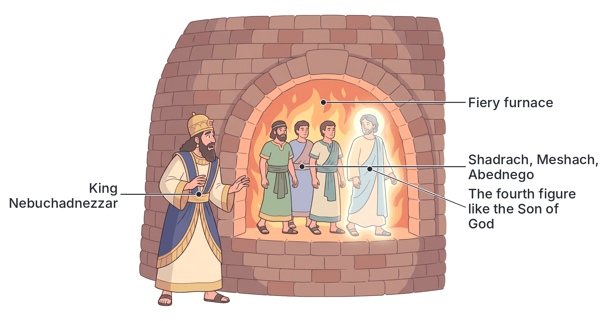
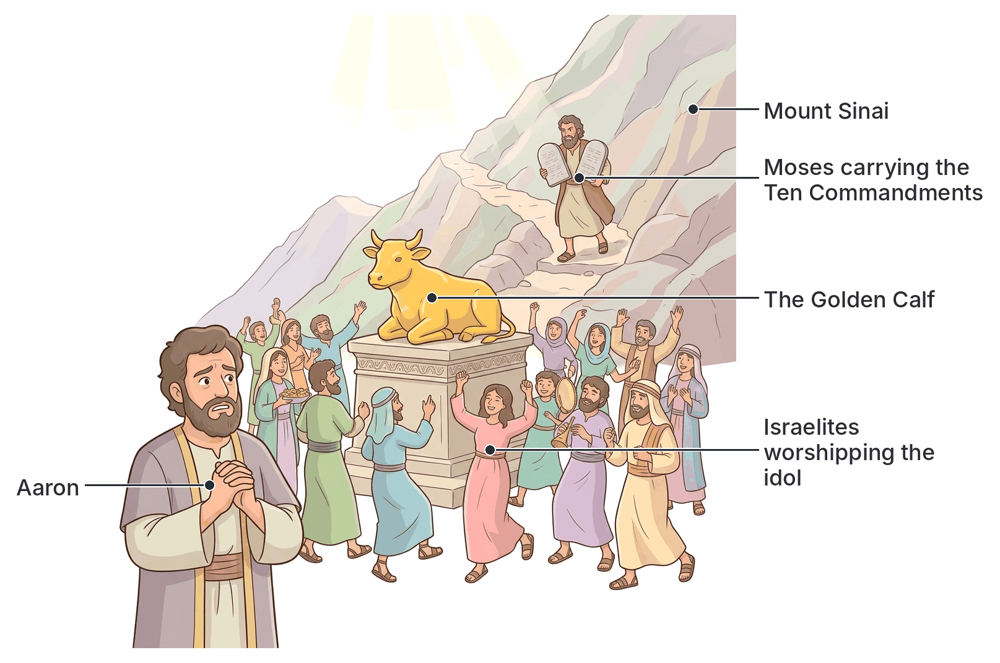

# JAMB Crk Notes: Obedience and Disobedience

## What JAMB expects

This topic is Section A, Topic 6 of the JAMB CRK syllabus: Obedience and Disobedience. It is divided into two main parts:

*   **(i) Obedience and Rewards:** Examples of (a) Abraham, (b) Three Hebrew Youths, (c) David.
*   **(ii) Disobedience and Consequences:** Examples of (a) Adam, (b) Collection of Manna, (c) The Golden Calf, (d) Moses, (e) Saul.

By the end of these notes, you should be able to:
1. determine why Abraham, the Three Hebrew Youths and David obeyed God;
2. identify the rewards for obedience;
3. compare the disobedience of Adam, the people of Israel, Moses and Saul;
4. indicate the reasons for their disobedience;
5. identify the consequences of disobedience.

**Note on the syllabus wording:** In the printed syllabus, the numbering for the objectives restarts for the second part (the syllabus lists them as *i, ii* for obedience, then *i, ii, iii* for disobedience). In these notes, they are treated as objectives 1 to 5 to avoid confusion. Also, the syllabus content item for disobedience lacks an opening bracket and is printed as `ii) Disobedience and Consequences`. We refer to it correctly as `(ii)`.

## (i) Obedience and Rewards

**Content item (i): Obedience and Rewards.**

Obedience in the biblical context means hearing the word or command of God and acting upon it with complete trust and submission. God demands total obedience from His followers, and He often rewards those who obey Him faithfully.

### (a) Abraham (Genesis 22:1-19)

God decided to test Abraham's faith and obedience. He commanded Abraham to take his only son, Isaac, whom he loved, and go to the land of **Moriah** to offer him as a burnt offering on one of the mountains. 

**The sequence of events:**
1. Abraham rose early in the morning, saddled his donkey, and took two of his young men and his son Isaac. He cut the wood for the burnt offering and travelled for three days.
2. When he saw the place from afar, he told the young men to stay behind with the donkey while he and the boy went ahead to worship.
3. Abraham laid the wood on Isaac, while he carried the fire and the knife. 
4. Isaac asked a logical question: "Behold the fire and the wood: but where is the lamb for a burnt offering?" (Genesis 22:7). Abraham replied in faith that God would provide Himself a lamb.
5. At the site, Abraham built an altar, bound Isaac, laid him on the wood, and took the knife to slay his son.
6. The Angel of the LORD called to him from heaven, telling him not to lay a hand on the boy. The Angel said, "for now I know that thou fearest God, seeing thou hast not withheld thy son, thine only son from me."
7. Abraham looked up and saw a ram caught in a thicket by its horns. He sacrificed the ram instead of his son and named the place **Jehovah-jireh** (The LORD will provide).

### (b) Three Hebrew Youths (Daniel 3:1-30)

During the Babylonian exile, King Nebuchadnezzar made a massive image of gold and set it up in the plain of Dura. He decreed that whenever the people heard the sound of musical instruments (the cornet, flute, harp, sackbut, psaltery, and dulcimer), they must fall down and worship the golden image. Anyone who refused would be thrown into a burning fiery furnace.

**The sequence of events:**
1. Certain Chaldeans (Babylonians) reported to the king that three Jewish administrators—**Shadrach, Meshach, and Abednego**—had refused to serve his gods or worship the golden image.
2. Furious, Nebuchadnezzar summoned them and offered them one last chance to bow, asking, "who is that God that shall deliver you out of my hands?"
3. The youths boldly replied that their God was able to deliver them from the furnace. However, they added that *even if God chose not to deliver them*, they would still not serve the king's gods or worship the image.
4. Filled with rage, the king ordered the furnace to be heated **seven times hotter** than usual. The strongest soldiers bound the youths and threw them in. The fire was so intense that it killed the soldiers who threw them in.
5. Soon after, Nebuchadnezzar was astonished to see **four men** walking loose in the midst of the fire, unhurt, and noted that the form of the fourth was "like the Son of God."
6. The king called them out. Not a hair on their heads was singed, nor did their clothes smell of smoke.

### (c) David (1 Samuel 30:1-20)

David and his men had been living in **Ziklag**, a city given to him by the Philistine king Achish. While David and his men were away, the **Amalekites** invaded the south, burned Ziklag, and took captive all the women and children, including David's two wives (Ahinoam and Abigail).

**The sequence of events:**
1. When David and his men returned and found the city destroyed and their families gone, they wept until they had no more strength.
2. The men were so bitter that they spoke of stoning David. 
3. Instead of acting on his own or giving up, David "encouraged himself in the LORD his God."
4. David called for **Abiathar the priest** to bring the ephod (a priestly garment used to inquire of God). David asked God: "Shall I pursue after this troop? shall I overtake them?"
5. God answered him clearly: "Pursue: for thou shalt surely overtake them, and without fail recover all."
6. Obeying God's command, David and his men pursued the Amalekites. Along the way, they found a sick, starving Egyptian who was a slave to an Amalekite. After feeding him, the Egyptian led David to the Amalekite camp.
7. David attacked the Amalekites from twilight until the evening of the next day. He recovered everything that had been taken—all the wives, children, and goods—and took extra flocks and herds as spoil.

## Why Abraham, the Three Hebrew Youths and David obeyed God

**Objective i: determine why Abraham, the Three Hebrew Youths and David obeyed God.**

The stories of these biblical figures show distinct reasons for their absolute obedience:

*   **Abraham obeyed God out of supreme faith and reverence:** He believed totally in God's sovereignty and trusted that God, who miraculously gave him Isaac in his old age, could even raise him from the dead if necessary (as Christians later interpret). His obedience was rooted in his "fear of God"—a deep respect and submission to the Creator.
*   **The Three Hebrew Youths obeyed God out of absolute loyalty:** They obeyed God rather than the king because they recognized God as the supreme authority. They had an unshakeable faith in God's power to save them, but their obedience was not conditional on their survival. Their loyalty to the First Commandment (having no other gods) outweighed their fear of a painful death.
*   **David obeyed God because he recognized his dependence on divine guidance:** In a moment of crisis where his life was threatened by his own men, David did not rely on military strategy alone. He inquired of the Lord because he knew that victory and success come only through following God's specific instructions.

## The rewards for obedience

**Objective ii: identify the rewards for obedience.**

God honoured the obedience of these individuals with significant rewards:

*   **Abraham's reward:** Because he did not withhold his son, God swore an oath to him, saying, "I will multiply thy seed as the stars of the heaven, and as the sand which is upon the sea shore." God also promised that Abraham's descendants would possess the gates of their enemies, and through his seed, all the nations of the earth would be blessed.
*   **The Three Hebrew Youths' reward:** They were miraculously preserved from death, demonstrating God's power to a pagan king. As a reward, Nebuchadnezzar issued a decree that no one in his empire could speak against their God, and he **promoted** Shadrach, Meshach, and Abednego to higher positions in the province of Babylon.
*   **David's reward:** By strictly following God's command to pursue, David enjoyed total victory. His reward was the complete **recovery of his family and property**, the acquisition of massive spoils of war, and the restoration of his men's loyalty and respect, which secured his leadership.

## (ii) Disobedience and Consequences

**Content item (ii): Disobedience and Consequences.**

Disobedience is the failure to follow God's commands or instructions. While obedience brings blessings, the Bible teaches that disobedience leads to severe physical and spiritual consequences.

### (a) Adam (Genesis 2:15-25; 3)

God placed Adam in the Garden of Eden to tend and keep it. God commanded him that he could freely eat of every tree in the garden, with one exception: **"But of the tree of the knowledge of good and evil, thou shalt not eat of it: for in the day that thou eatest thereof thou shalt surely die."** (Genesis 2:17). 

In Genesis 3, the serpent (described as the most cunning beast) deceived Eve, making her doubt God's word by saying they would not die, but their eyes would be opened and they would be like gods. Eve saw that the fruit was good for food, pleasant to the eyes, and desirable to make one wise. She ate it and gave some to Adam, who was with her, and he also ate. Immediately, their eyes were opened, they realized they were naked, and they hid from God.

### The People of Israel 

The Israelites, after their deliverance from Egypt, repeatedly disobeyed God during their wilderness journey.

#### (b) Collection of Manna (Exodus 16:22-30)
God provided bread from heaven (manna) for the Israelites. The rule for collection was simple: gather a certain amount every morning, but on the **sixth day**, gather twice as much, because the **seventh day** was the Sabbath (a day of holy rest) and no manna would fall. Moses told the people to bake and boil what they needed on the sixth day and keep the rest for the Sabbath. However, on the seventh day, some of the people disobeyed and went out to gather manna, but they found none. God rebuked them, asking Moses, "How long refuse ye to keep my commandments and my laws?"

#### (c) The Golden Calf (Exodus 32)
When Moses went up Mount Sinai to receive the Ten Commandments, he was delayed. The impatient Israelites went to Aaron and demanded he make gods to go before them. Aaron collected their gold earrings, melted them, and fashioned a **Golden Calf**. The people worshipped it, offered sacrifices, and held a pagan revelry, saying, "These be thy gods, O Israel, which brought thee up out of the land of Egypt."

God saw this and told Moses that the people had corrupted themselves and quickly turned aside from His commands. Moses pleaded with God not to destroy them, but when Moses came down and saw the calf and the dancing, his anger burned. He threw down the two tables of stone, breaking them. He ground the calf to powder, scattered it on the water, and made the Israelites drink it. The sons of Levi then went through the camp, killing about three thousand men who had participated in the idolatry.

### (d) Moses (Numbers 20:7-12; Deuteronomy 34:1-6)

At Kadesh, in the wilderness of Zin, there was no water, and the people gathered against Moses and Aaron to complain bitterly. Moses and Aaron went to the Tabernacle and fell on their faces. The glory of the Lord appeared, and God gave Moses a specific instruction: **Take the rod, gather the assembly, and speak to the rock before their eyes, and it will give forth water.**

Moses took the rod, gathered the people, but in a moment of intense frustration and anger, he shouted: "Hear now, ye rebels; must we fetch you water out of this rock?" (Numbers 20:10). Instead of speaking to the rock as commanded, Moses **struck the rock twice** with his rod. Water gushed out abundantly, but Moses had disobeyed the specific instruction and failed to honour God's holiness before the people.

### (e) Saul (1 Samuel 10:1-16; 15:1-25; 16:14-23; 31:1-13)

Saul, the first king of Israel, started well. In 1 Samuel 10, he was anointed by Samuel, given specific signs by God to confirm his calling, and the Spirit of God came upon him mightily, changing his heart. 

However, his most critical test of obedience came in 1 Samuel 15. God, speaking through the prophet Samuel, commanded Saul to utterly destroy the **Amalekites** and all they had, sparing absolutely nothing (men, women, infants, and livestock), as a punishment for what Amalek did to Israel when they came out of Egypt.

Saul attacked the Amalekites and won, but he **spared Agag**, the king of the Amalekites, and kept the best of the sheep, oxen, and fatlings, destroying only what was despised and worthless. When Samuel confronted him, Saul lied, claiming he had obeyed, and then made excuses, saying the *people* took the spoil to sacrifice to the Lord. 

Samuel delivered God's famous rebuke: **"Hath the LORD as great delight in burnt offerings and sacrifices, as in obeying the voice of the LORD? Behold, to obey is better than sacrifice, and to hearken than the fat of rams."** (1 Samuel 15:22).

## Comparing the disobedience

**Objective iii: compare the disobedience of Adam, the people of Israel, Moses and Saul.**

The table below compares these four major events of disobedience, showing how different commands were broken.

| Person / Group | The Divine Command | The Act of Disobedience |
| :--- | :--- | :--- |
| **Adam** | "Thou shalt not eat of the tree of the knowledge of good and evil." | He listened to his wife and ate the forbidden fruit from the tree. |
| **People of Israel** | Do not gather manna on the Sabbath; have no other gods before Jehovah. | Some went out on the Sabbath to look for manna; they built and worshipped a Golden Calf. |
| **Moses** | "Speak ye unto the rock before their eyes." | In anger, he did not speak to the rock but instead struck it twice with his rod. |
| **Saul** | Utterly destroy Amalek and all they have; spare nothing. | He spared King Agag and the best of the livestock, keeping them as spoil. |

## Reasons for their disobedience

**Objective iv: indicate the reasons for their disobedience.**

Why did these figures disobey God? The scriptures indicate different human weaknesses behind their actions:

*   **Adam's reasons:** Adam yielded to the deception of the serpent (via Eve) and the physical appeal of the fruit (it looked good and was desired to make one wise). He allowed his attachment to his wife and earthly desires to override God's clear instruction.
*   **The people of Israel's reasons:** The Israelites were characterized by impatience, lack of faith, and stubbornness. They disobeyed the manna rule out of greed and lack of trust in God's provision. They built the Golden Calf because Moses was delayed, and they lacked the faith to serve an unseen God, preferring a physical idol like those in Egypt.
*   **Moses' reasons:** Moses disobeyed because of extreme provocation, frustration, and anger caused by the constant complaining of the Israelites. In that moment of intense emotion, he lost his self-control and failed to honour God (he took the credit by saying "must *we* fetch you water").
*   **Saul's reasons:** Saul's disobedience was driven by greed (keeping the best animals), pride (setting up a monument for himself and sparing a rival king as a trophy), and the fear of his men. Saul admitted to Samuel, "I feared the people, and obeyed their voice" (1 Sam 15:24), showing he lacked the moral courage to lead according to God's standard.

## Consequences of disobedience

**Objective v: identify the consequences of disobedience.**

God is just, and disobedience always brings consequences, regardless of a person's status.

*   **Consequences for Adam:** The immediate consequence was spiritual death—the loss of innocence, realizing they were naked, and hiding from God. God cursed the serpent, multiplied the woman's pain in childbirth, and cursed the ground, condemning Adam to hard labour for food. Finally, they were expelled from the Garden of Eden and lost access to the tree of life, bringing physical death into the world.
*   **Consequences for the Israelites:** For the Sabbath manna, they found nothing and faced God's rebuke. For the Golden Calf, the consequences were severe: the breaking of the stone tablets (symbolizing the broken covenant), the execution of three thousand idolaters by the Levites, and a plague sent by God upon the people.
*   **Consequences for Moses:** Because he failed to believe and sanctify God before the people at the waters of Meribah, God declared that Moses would not bring the congregation into the Promised Land. In Deuteronomy 34, Moses was only allowed to see the land from Mount Nebo before he died there, and Joshua took over his leadership.
*   **Consequences for Saul:** Samuel pronounced God's judgment: because Saul had rejected the word of the Lord, God had rejected him from being king. Subsequently, the Spirit of the Lord departed from Saul, and an evil spirit from the Lord began to torment him (1 Samuel 16). His life spiralled into madness, and he eventually died a tragic, dishonourable death by falling on his own sword in battle against the Philistines at Mount Gilboa (1 Samuel 31).

## Key terms

| Term | Meaning |
| :--- | :--- |
| Obedience | Hearing and acting upon the commands of God with trust and submission. |
| Disobedience | Failure or refusal to follow God's commands and instructions. |
| Moriah | The mountainous region where Abraham was sent to sacrifice Isaac. |
| Shadrach, Meshach, Abednego | The Babylonian names of the three Hebrew youths thrown into the furnace. |
| Ziklag | The city given to David, which was raided and burned by the Amalekites. |
| Ephod | A priestly garment used by the Israelites to seek guidance from God. |
| Manna | The miraculous bread provided from heaven for the Israelites in the wilderness. |
| Meribah | The place ("waters of strife") where Moses struck the rock in anger. |
| Agag | The king of the Amalekites whom Saul unlawfully spared. |
| Jehovah-jireh | "The LORD will provide", the name Abraham gave the place of sacrifice. |

## Exam tips and common mistakes

*   **Know what Moses was told to do vs. what he did:** A very common JAMB question asks what God commanded Moses at Meribah (to *speak* to the rock) and what Moses actually did (he *struck* it twice). His consequence was dying on Mt. Nebo without entering the Promised Land.
*   **Identify Saul's exact excuse:** Saul claimed the people saved the best livestock to "sacrifice unto the LORD thy God". Samuel responded with the famous quote, "To obey is better than sacrifice."
*   **David at Ziklag:** Remember that David used the *ephod* brought by *Abiathar* to inquire of God, and the people he fought to recover his families were the *Amalekites*.
*   **The Sabbath rule for manna:** The Israelites were commanded to gather twice as much on the *sixth day* because they were not supposed to gather any on the *seventh day* (Sabbath). 
*   **The Three Hebrew Youths:** Their refusal to bow was an absolute commitment. They stated God *could* save them, but even if He *did not*, they would still not serve idols.

## Quick summary

1. Abraham obeyed God's difficult command to sacrifice his only son Isaac at Moriah. Because of his immense faith, God provided a ram and rewarded him with a sworn blessing of multiplied descendants.
2. The Three Hebrew Youths refused to worship Nebuchadnezzar's golden image out of absolute loyalty to God. They were thrown into a fiery furnace but walked out unharmed, leading to their promotion.
3. David's obedience in seeking God's guidance before pursuing the Amalekites who raided Ziklag resulted in a total victory and the recovery of all that was lost.
4. Adam disobeyed God by eating the forbidden fruit, yielding to deception and desire, resulting in a curse, hard labour, and expulsion from Eden.
5. The Israelites constantly disobeyed, as seen when they gathered manna on the Sabbath, and when they built the Golden Calf due to impatience, resulting in plagues and death.
6. Moses lost his self-control at Meribah and struck the rock twice instead of speaking to it. As a consequence, he was denied entry into the Promised Land.
7. Saul failed to utterly destroy the Amalekites, sparing King Agag and the best livestock out of greed and fear of the people. Consequently, God rejected him as king, his spirit was tormented, and he died tragically in battle.

## Practice questions

**1. Abraham named the place where he went to sacrifice Isaac "Jehovah-jireh", which means**
- A. The Lord is my banner
- B. The Lord is peace
- C. The Lord will provide
- D. The Lord is my shepherd

**Answer: C.** Jehovah-jireh means "The LORD will provide", reflecting Abraham's faith that God would provide the lamb for the burnt offering (Gen 22:14).

**2. The Three Hebrew Youths refused to bow down to King Nebuchadnezzar's golden image primarily because**
- A. they wanted to be promoted in the province of Babylon
- B. they were completely loyal to God and would not serve idols
- C. they knew the fire could not burn them
- D. they hated the Babylonian musical instruments

**Answer: B.** Their refusal was based on absolute loyalty to God's commandment not to worship other gods, regardless of whether God chose to save them or not.

**3. When David found Ziklag burned and his family taken, he first**
- A. pursued the Amalekites immediately
- B. executed the Amalekite slave he found
- C. wept, then encouraged himself in the Lord and inquired of Him
- D. fought against his own men who wanted to stone him

**Answer: C.** Before doing anything else, David encouraged himself in God and used the ephod brought by Abiathar to ask God if he should pursue the raiders.

**4. God rejected Saul from being king over Israel because he**
- A. lost the battle against the Philistines at Mount Gilboa
- B. consulted the witch of Endor
- C. offered sacrifices before Samuel arrived at Gilgal
- D. spared Agag and the best of the Amalekite livestock

**Answer: D.** Though Saul committed other sins, the ultimate rejection of his kingship in 1 Samuel 15 was because he disobeyed the command to utterly destroy the Amalekites.

**5. Which of the following statements was made by Samuel to rebuke Saul's disobedience?**
- A. "Hear now, ye rebels; must we fetch you water out of this rock?"
- B. "To obey is better than sacrifice, and to hearken than the fat of rams."
- C. "How long refuse ye to keep my commandments and my laws?"
- D. "Who is that God that shall deliver you out of my hands?"

**Answer: B.** Samuel spoke these words to Saul to show that God values direct obedience over religious rituals and offerings made from stolen goods.

**6. At the waters of Meribah, Moses offended God by**
- A. complaining that the Israelites were stubborn
- B. speaking to the rock instead of striking it
- C. striking the rock twice in anger instead of speaking to it
- D. refusing to lead the Israelites any further

**Answer: C.** God commanded Moses to *speak* to the rock. Because of his frustration with the people, Moses disobeyed by *striking* the rock twice with his rod.

**7. The immediate consequence of Moses' disobedience at Meribah was that God**
- A. took away the prophetic spirit from him
- B. caused the earth to open and swallow the rebels
- C. told him he would not bring the Israelites into the Promised Land
- D. caused a plague of fiery serpents to bite him

**Answer: C.** God told Moses and Aaron that because they did not believe Him and sanctify Him before the people, they would not lead the congregation into the land.

**8. The Israelites disobeyed God's instruction regarding the manna by**
- A. keeping it until the morning on weekdays and going out to gather on the Sabbath
- B. refusing to eat it and asking for meat instead
- C. throwing it into the fire
- D. selling it to the Midianites

**Answer: A.** Some people disobeyed by going out to gather manna on the seventh day (the Sabbath), despite being told that none would fall and they should gather double on the sixth day.

**9. Who made the Golden Calf for the Israelites to worship?**
- A. Moses
- B. Joshua
- C. Miriam
- D. Aaron

**Answer: D.** When the people saw that Moses delayed coming down from the mountain, they pressured Aaron, who took their gold earrings and fashioned the Golden Calf.

**10. What was a direct consequence of Adam and Eve eating the forbidden fruit?**
- A. They were immediately struck with a deadly plague
- B. The serpent became the ruler of the garden
- C. Their eyes were opened, they realized their nakedness, and were expelled from Eden
- D. God destroyed the tree of knowledge of good and evil

**Answer: C.** Upon eating the fruit, they lost their innocence (realized they were naked), hid from God, and as a final punishment, were driven out of the Garden of Eden.

<!-- COVERAGE
obj i | Why Abraham, the Three Hebrew Youths and David obeyed God
obj ii | The rewards for obedience
obj iii | Comparing the disobedience
obj iv | Reasons for their disobedience
obj v | Consequences of disobedience
item i | (i) Obedience and Rewards
item ii | (ii) Disobedience and Consequences
-->
