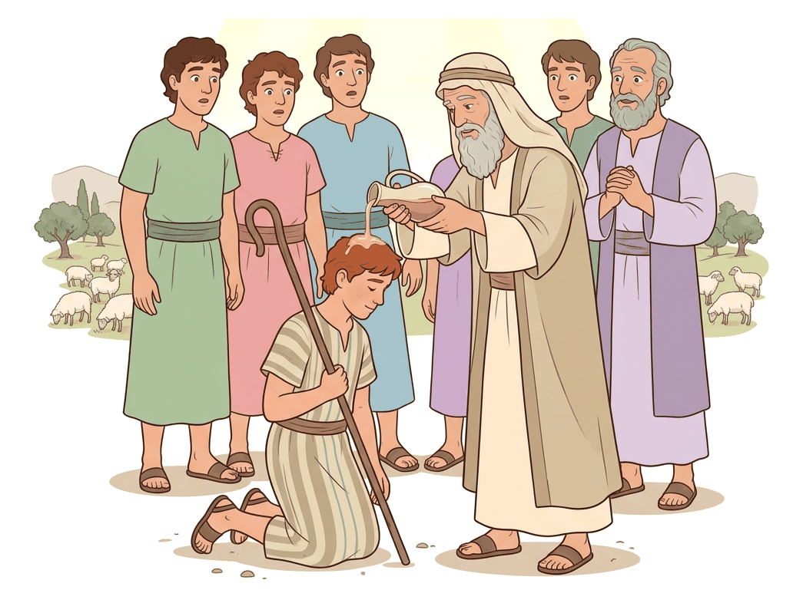
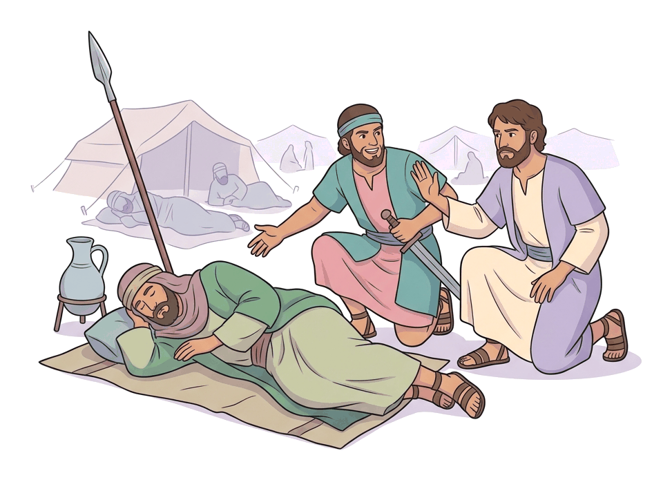

# JAMB Crk Notes: A Man After God's Own Heart

## What JAMB expects

This topic is Section A, Topic 7 of the JAMB CRK syllabus: A man after God's own heart. It covers three main content areas:

*   **(a) The early life of David** (1 Sam. 16:1-13; 17; 18:17-30; 22:1-5; 24:1-23; II Sam. 2:1-7; 3:1-39)
*   **(b) David’s submission to the will of God** (1 Sam. 26:1-25, II Sam 12:15-25)
*   **(c) David’s repentance and forgiveness** (II Sam. 11; 12:1-15, cf. Ps. 51)

By the end of these notes, you should be able to:
1.  Identify David’s anointing experience.
2.  Specify how David submitted to the will of God.
3.  Examine the situations that led to David’s sin and repentance.
4.  Identify the consequences of David’s sin.
5.  Identify why God forgave David.

**Note on the syllabus wording:** In the syllabus, content item (c) contains the reference `Ps. 51:130`. This is a typographical error. The Book of Psalms does not have a Psalm 51 with 130 verses; in the Bible, Psalm 51 has exactly 19 verses. The intended reference is clearly Psalm 51 as a whole, which is David's great prayer of repentance. These notes will teach the content of Psalm 51.

## The early life of David

**Content (a): The early life of David**

David was the youngest of the eight sons of Jesse, an Ephrathite from Bethlehem in Judah. He spent his youth as a shepherd, tending his father's sheep. During this time, he developed great courage by defending the flock from wild animals, and he became highly skilled in playing the lyre (a stringed instrument) and using a sling.

### David's anointing experience

**Objective i: identify David’s anointing experience.**

Because King Saul had repeatedly disobeyed God (see `A6-obedience-and-disobedience.md`), God rejected him as king over Israel. God instructed the prophet Samuel to go to Bethlehem to anoint one of the sons of Jesse as the new king. 

1.  **The arrival in Bethlehem:** Samuel went to Bethlehem and invited Jesse and his sons to a sacrifice.
2.  **Looking at outward appearances:** When Samuel saw Jesse's oldest son, **Eliab**, who was tall and handsome, Samuel thought he was the chosen one. But God told Samuel, "Look not on his countenance, or on the height of his stature; because I have refused him: for the LORD seeth not as man seeth; for man looketh on the outward appearance, but the LORD looketh on the heart" (1 Samuel 16:7).
3.  **The seven sons pass by:** Jesse made seven of his sons pass before Samuel (including Abinadab and Shammah), but God did not choose any of them.
4.  **Sending for David:** Samuel asked if these were all the sons. Jesse replied that the youngest was still in the field keeping the sheep. Samuel insisted they send for him, saying they would not sit down until he arrived.
5.  **The Anointing:** When David was brought in—described as ruddy, with beautiful eyes, and handsome—the Lord said to Samuel, "Arise, anoint him: for this is he." Samuel took the horn of oil and anointed David in the presence of his brothers. 
6.  **The Spirit's presence:** From that day forward, the Spirit of the Lord came mightily upon David, while the Spirit of the Lord departed from Saul.

### David and Goliath (1 Sam. 17)

During a standoff between Israel and the Philistines in the Valley of Elah, a Philistine giant named **Goliath** from Gath stepped forward daily for forty days, challenging Israel to send a man to fight him one-on-one. King Saul and the Israelites were terrified.

David, sent by his father Jesse to deliver food to his older brothers in the army, heard Goliath's defiance. Angered that an uncircumcised Philistine would "defy the armies of the living God," David volunteered to fight. He rejected the heavy royal armor offered by King Saul, choosing instead his shepherd's staff, his sling, and five smooth stones from the brook. David confronted Goliath, declaring that the battle was the Lord's. He slung a single stone that sank into the giant's forehead, killing him, and then used Goliath's own sword to cut off his head, leading to a great Israelite victory.

### Saul’s hostility and David’s marriage (1 Sam. 18:17-30)

David became a highly successful military commander. When the army returned from battle, women sang, "Saul hath slain his thousands, and David his ten thousands" (1 Samuel 18:7). This made Saul intensely jealous and fearful of David. Saul began plotting to kill him, often trying to make it look like an accident in battle.

1.  **Merab offered and withdrawn:** Saul promised his older daughter, Merab, to David on the condition that David fight the Lord's battles, hoping the Philistines would kill him. However, when the time came, Saul gave Merab to another man.
2.  **Michal's love and the deadly dowry:** Saul's younger daughter, **Michal**, fell in love with David. Saul saw this as a trap. He told David he required no dowry except **one hundred foreskins of the Philistines**, secretly hoping David would be killed trying to get them.
3.  **David's success:** David and his men went out and killed two hundred Philistines, bringing their foreskins in full number to the king. Saul was forced to give Michal to David as a wife. Michal's love for David, combined with God being with him, made Saul even more afraid and established Saul as David's lifelong enemy.

### David's flight to Adullam and Mizpeh (1 Sam. 22:1-5)

Fleeing from Saul's constant assassination attempts, David became a fugitive. 
*   **The Cave of Adullam:** David escaped to the cave of Adullam. When his brothers and all his father's house heard of it, they went down to him. Additionally, everyone who was in distress, in debt, or discontented gathered around him. David became the captain over a band of about four hundred men.
*   **Refuge for his parents:** Fearing for his family's safety, David went to **Mizpeh of Moab** and asked the King of Moab to give his parents shelter until he knew what God would do for him.
*   **The Prophet's instruction:** The prophet **Gad** told David not to remain in the stronghold in Moab but to return to the land of Judah. David obeyed and went into the forest of Hareth.

### David spares Saul at En-gedi (1 Sam. 24:1-23)

King Saul relentlessly hunted David. While pursuing David with 3,000 chosen men, Saul went into a cave at the wilderness of En-gedi to relieve himself. Unknown to Saul, David and his men were hiding deep inside the very same cave.

David's men urged him to kill Saul, claiming God had delivered his enemy into his hands. Instead, David crept up and secretly cut off a piece of the skirt (the edge) of Saul's robe. Afterwards, David's conscience bothered him just for doing that. He firmly told his men he would not lay a hand on Saul, saying, "The LORD forbid that I should do this thing unto my master, the LORD's anointed."

When Saul left the cave, David called out after him, bowing down and showing him the piece of cloth as proof that he had no intention to harm or rebel against the king. Saul wept aloud, acknowledged David's righteousness in returning good for evil, and confessed he knew David would surely be the next king. He made David swear not to cut off his descendants, which David did.

### David becomes King of Judah (2 Sam. 2:1-7)

After Saul and his sons (including David's close friend Jonathan) died in battle against the Philistines at Mount Gilboa, David asked the Lord if he should go up to any of the cities of Judah. God directed him to **Hebron**.

David moved there with his family and his loyal men. The men of Judah came to Hebron and **anointed David king over the house of Judah**. One of David's first acts was to send messengers to bless the men of Jabesh-gilead for showing loyalty to Saul by giving him a proper burial.

### The long war between the two houses (2 Sam. 3:1-39)

While David ruled Judah, **Abner**, the commander of Saul's army, made Saul's surviving son **Ish-bosheth** king over the rest of Israel. This resulted in a long, bitter civil war between the house of Saul and the house of David. 
*   David grew steadily stronger, while Saul's house grew weaker.
*   **Abner's defection:** After a dispute with Ish-bosheth (over one of Saul's concubines), Abner angrily defected to David's side, promising to bring all of Israel over to David. David welcomed him and they made a covenant.
*   **Joab's revenge:** **Joab**, the commander of David's army, returned from a raid and learned Abner had been there in peace. Joab secretly sent for Abner and murdered him in the city gate. Joab did this to avenge his brother **Asahel**, whom Abner had killed in a previous battle.
*   **David's reaction:** David publicly mourned for Abner, fasting, tearing his clothes, and following the bier to the grave, condemning Joab's act. This showed all of Israel that the king had no part in the treacherous murder, earning their favor and trust.

## David’s submission to the will of God

**Content (b): David’s submission to the will of God (I Sam. 26:1-25, II Sam 12:15-25)**

**Objective ii: specify how David submitted to the will of God.**

To submit to the will of God means yielding one's own desires, rights, or vengeance to God's authority and timing. David demonstrated this profoundly on several occasions, notably in how he treated Saul and how he accepted God's discipline. 

### Sparing Saul at Ziph (1 Sam. 26:1-25)

*(Note: Do not confuse this with the cave at En-gedi. This is a second, separate occasion where David spared Saul.)*

The Ziphites betrayed David's location to Saul, who marched out with 3,000 men to the wilderness of Ziph to hunt him. One night, David and his nephew **Abishai** infiltrated Saul's camp. They found Saul sleeping, surrounded by his commander Abner and the army.

Abishai saw this as God delivering Saul into David's hands and begged David for permission to pin Saul to the ground with one strike of his spear. 

**David's submission:** David refused, demonstrating profound submission to God's order. He said:
> "Destroy him not: for who can stretch forth his hand against the LORD's anointed, and be guiltless? ... As the LORD liveth, the LORD shall smite him; or his day shall come to die; or he shall descend into battle, and perish." (1 Samuel 26:9-10)

David refused to take the throne by his own hand. He left vengeance and the timing of his kingship entirely to the will of God. Instead of killing Saul, David and Abishai simply took Saul's spear and his jug of water from near his head.

Standing on a faraway hill, David called out to Abner, rebuking him for failing to protect the king, and showed them the spear and jug. Once again, Saul recognized David's voice, admitted he had "played the fool," and promised to harm him no more.

### Accepting the death of the child (2 Sam. 12:15-25)

Later in his reign, David committed a grave sin (explained below). As a consequence, God struck the infant son born to David and Bathsheba with a severe illness.

While the child was sick, David pleaded with God for the child's life. He fasted, went into his house, and spent the nights lying on the ground. The elders of his house tried to raise him up and make him eat, but he refused. 

On the seventh day, the child died. David's servants were terrified to tell him, fearing he might harm himself out of grief, given how distraught he was when the child was only sick. When David saw them whispering, he realized the child was dead. 

**David's submission:** Instead of breaking down or getting angry at God, David got up from the ground, washed, anointed himself, changed his clothes, **went into the house of the Lord and worshipped**. Then he went to his own house and asked for food.

His servants were bewildered and asked him to explain his behavior. David answered:
> "While the child was yet alive, I fasted and wept: for I said, Who can tell whether GOD will be gracious to me, that the child may live? But now he is dead, wherefore should I fast? can I bring him back again? I shall go to him, but he shall not return to me." (2 Samuel 12:22-23)

David submitted to the finality of God's will. As long as there was a chance for mercy, he pleaded. Once God had made His final decision, David accepted the discipline without bitterness, worshipped God, and moved on. Afterward, he comforted Bathsheba, and she soon conceived and gave birth to a second son, **Solomon**.

## David’s sin, repentance and forgiveness

**Content (c): David’s repentance and forgiveness (II Sam. 11; 12:1-15, cf. Ps. 51)**

### The situations that led to David’s sin

**Objective iii: examine the situations that led to David’s sin and repentance.**

David’s great fall occurred during the time of a war against the Ammonites. The events leading to his sin unfolded in a clear sequence of idleness, lust, deceit, and murder:

1.  **Idleness:** It was spring, the time when kings normally went out to battle. However, David stayed behind in Jerusalem, sending Joab and the army to besiege the Ammonite city of Rabbah. 
2.  **Lust and Adultery:** One evening, David walked on the roof of his palace and saw a very beautiful woman bathing. He sent messengers to find out who she was and learned she was **Bathsheba**, the wife of **Uriah the Hittite**, who was away fighting in David's army. David sent for her and slept with her. Later, Bathsheba sent word to David that she was pregnant.
3.  **Deceit:** To cover up his sin, David ordered Uriah to be sent home from the battlefront, hoping Uriah would sleep with his wife and think the child was his. However, Uriah was a fiercely loyal soldier. He refused to go down to his house to enjoy comfort while the Ark of the Covenant, Israel, and his commander Joab were camping in open fields. Even after David got him drunk, Uriah slept at the palace door.
4.  **Murder:** Realizing the cover-up had failed, David wrote a letter to Joab and sent it by the hand of Uriah himself. The letter ordered Joab to place Uriah in the front lines of the fiercest battle and then pull the other troops back so that Uriah would be struck down and die. Joab obeyed, and Uriah was killed in combat.
5.  **Marriage:** After Bathsheba mourned her husband, David brought her to his house and she became his wife and bore him a son. But the Bible states, "the thing that David had done displeased the LORD."

### David's Repentance

God sent the prophet **Nathan** to confront David. Nathan did not accuse the king directly at first; instead, he told him a parable to bypass David's defenses.

**The Parable of the Ewe Lamb:** 
Nathan described two men in a city: one rich, one poor. The rich man had exceedingly many flocks and herds. The poor man had nothing except one little ewe lamb that he had bought and raised; it grew up with his children, ate his food, drank from his cup, and was like a daughter to him. A traveler came to visit the rich man. Unwilling to take an animal from his own vast flock to feed the guest, the rich man forcibly took the poor man's single beloved lamb and cooked it.

David's anger was kindled greatly against the rich man. He declared to Nathan, "As the LORD liveth, the man that hath done this thing shall surely die: And he shall restore the lamb fourfold, because he did this thing, and because he had no pity."

Nathan then delivered the devastating truth: **"Thou art the man."**

Nathan reminded David of all God had given him, asking why he had despised the commandment of the Lord by striking down Uriah with the sword of the Ammonites and taking his wife. 

Faced with his horrific actions, David did not make excuses, blame his subordinates, or try to justify himself (as King Saul often did). He immediately accepted full responsibility and confessed, saying: **"I have sinned against the LORD."** (2 Samuel 12:13)

### The consequences of David's sin

**Objective iv: identify the consequences of David’s sin.**

Because God is just, He did not let David's sin go unpunished. Through Nathan, God pronounced severe, long-lasting consequences upon David and his household:

1.  **The sword would never depart from his house:** His family would be plagued by violence and bloodshed.
2.  **Evil would be raised against him out of his own house:** God would allow rebellion and betrayal from within David's own family (later fulfilled when his son Absalom rebelled).
3.  **Public humiliation:** Someone close to David would take his wives and sleep with them in broad daylight, as a public recompense for David's secret sin (fulfilled by Absalom on the palace roof).
4.  **The death of the child:** The child born to Bathsheba from this adulterous union would surely die, because by this deed David had "given great occasion to the enemies of the LORD to blaspheme."

### Why God forgave David

**Objective v: identify why God forgave David.**

Despite the severe punishment, Nathan immediately assured David of God's forgiveness, saying: "The LORD also hath put away thy sin; thou shalt not die." 

God forgave David for several crucial reasons:
1.  **Genuine and immediate repentance:** David did not try to deny his guilt when confronted. He took complete ownership of his failure.
2.  **A broken and contrite heart:** David was profoundly sorrowful for having offended God. He understood that his sin was ultimately against God Himself.
3.  **God's inherent grace and mercy:** God responds to true repentance with forgiveness. 

**Psalm 51: The cry of a repentant heart**
Psalm 51 is the prayer David wrote after Nathan confronted him. It provides a deep look into *why* God forgave him—it shows the true state of David's heart. 

*   He appealed entirely to God's mercy, not his own merit: "Have mercy upon me, O God, according to thy lovingkindness..." (Ps. 51:1).
*   He acknowledged that his sin was a direct offense against God: "Against thee, thee only, have I sinned, and done this evil in thy sight" (Ps. 51:4).
*   He asked for inward transformation, not just escaping punishment: "Create in me a clean heart, O God; and renew a right spirit within me" (Ps. 51:10).
*   He recognized what God truly values: "The sacrifices of God are a broken spirit: a broken and a contrite heart, O God, thou wilt not despise" (Ps. 51:17).

David was called a "man after God's own heart" not because he was flawless, but because he deeply loved God, submitted to His discipline, and knew how to repent completely when he failed.

## Key terms

| Term | Meaning |
| --- | --- |
| Anointing | The pouring of holy oil on someone’s head to signify they are chosen and empowered by God for a specific role (like kingship). |
| Ephrathite | A person from Ephrath, an older name for Bethlehem. |
| The Lord's Anointed | A title of deep respect used by David for King Saul, acknowledging that Saul was placed on the throne by God. |
| Adullam | The cave where David fled to escape Saul, where 400 discontented/distressed men gathered to him. |
| Hebron | The city in Judah where David was first anointed king over the tribe of Judah. |
| Submission | Yielding one's own desires, rights, or vengeance to God's authority and will. |
| En-gedi | A wilderness area with caves where David spared Saul the first time (cutting his robe). |
| Ziph | The wilderness area where David sneaked into Saul's camp at night and took his spear and water jug. |
| Contrite | Feeling or expressing deep remorse or penitence; broken-hearted over sin. |

## Exam tips and common mistakes

*   **Do not confuse En-gedi and Ziph:** Both are occasions when David spared Saul. At **En-gedi**, David cut Saul's robe in a cave. At **Ziph**, David snuck into Saul's camp at night, stopped Abishai from killing Saul, and took his spear and water jug. Ziph is specifically tested as an example of David's submission to God's will.
*   **Know the characters in the Abner story:** **Abner** was Saul's commander; **Joab** was David's commander. Joab killed Abner to avenge his brother **Asahel**. David mourned publicly to show he was innocent of the murder.
*   **The dowry for Michal:** Saul asked for 100 Philistine foreskins; David brought 200.
*   **Nathan's parable:** Be able to identify the parable of the ewe lamb, the prophet who told it (Nathan), and who the rich and poor men represented (David and Uriah).
*   **Remember the consequences of David's sin:** The death of the baby was only *one* consequence. The sword never departing his house and public rebellion/humiliation from his own family were the others.
*   **Psalm 51:** Note that this is the specific chapter where David begs for mercy after his sin with Bathsheba ("Create in me a clean heart...").

## Quick summary

1.  David, a shepherd boy from Bethlehem, was anointed by Samuel because God looks at the heart, not outward appearances. 
2.  David defeated Goliath, which earned him great fame but caused King Saul to become intensely jealous and try repeatedly to kill him.
3.  While fleeing Saul, David became the leader of an outcast army. Despite Saul's hostility, David refused to kill the "Lord's anointed" at En-gedi and Ziph, leaving vengeance to God.
4.  After Saul's death, David was made king of Judah at Hebron, and eventually, after a long war with Saul's house and the murder of Abner, he became king of all Israel.
5.  David showed absolute submission to God by sparing Saul, and later by washing and worshipping God immediately after God took the life of his infant son.
6.  David's great sin began with idleness, led to adultery with Bathsheba, and ended with the murder of her husband, Uriah the Hittite.
7.  Confronted by the prophet Nathan's parable of the ewe lamb, David immediately confessed his sin. 
8.  God forgave him due to his broken, contrite heart (expressed in Psalm 51), but punished him by decreeing violence and rebellion in his family, and the death of the child.

## Practice questions

**1. Who was the prophet that God sent to anoint David as king over Israel?**
- A. Nathan
- B. Gad
- C. Samuel
- D. Elijah

**Answer: C.** God sent Samuel to Bethlehem to the house of Jesse to anoint the new king.

**2. When Samuel saw Eliab, he thought he was the Lord's anointed, but God told him that He looks at the**
- A. skills of a warrior
- B. physical strength
- C. heart
- D. obedience

**Answer: C.** 1 Samuel 16:7 states, "...for man looketh on the outward appearance, but the LORD looketh on the heart."

**3. What specific dowry did King Saul demand from David in order for him to marry Michal?**
- A. The head of Goliath
- B. One hundred foreskins of the Philistines
- C. Ten thousand talents of silver
- D. Defeating the Ammonites

**Answer: B.** Saul demanded one hundred Philistine foreskins, hoping David would be killed in battle trying to obtain them. David brought two hundred.

**4. Where did David's family and four hundred distressed men join him while he was hiding from Saul?**
- A. The wilderness of Ziph
- B. The cave of Adullam
- C. The city of Hebron
- D. The forest of Hareth

**Answer: B.** David escaped to the cave of Adullam, where his family and those in distress, debt, or discontentment joined him (1 Sam 22:1-2).

**5. How did David demonstrate his submission to the will of God in the wilderness of Ziph?**
- A. By cutting the skirt of Saul's robe.
- B. By refusing to let Abishai kill Saul with a spear.
- C. By washing and eating after his child died.
- D. By confessing his sin to the prophet Nathan.

**Answer: B.** At Ziph, Abishai wanted to pin the sleeping Saul to the ground with a spear, but David submitted to God's will by refusing to harm the Lord's anointed.

**6. Who did Joab murder in revenge for the death of his brother Asahel?**
- A. Ish-bosheth
- B. Uriah
- C. Abner
- D. Absalom

**Answer: C.** Joab murdered Abner in revenge, which David publicly condemned and mourned to prove he had no part in it.

**7. In Nathan's parable of the ewe lamb, the poor man represents**
- A. God
- B. David
- C. Joab
- D. Uriah the Hittite

**Answer: D.** The poor man with one beloved lamb represented Uriah, who had only Bathsheba, while David (the rich man) had many wives.

**8. Which of the following was NOT pronounced as a consequence of David’s sin with Bathsheba?**
- A. The sword shall never depart from his house.
- B. His kingdom would be torn away and given to his servant.
- C. Evil would be raised against him out of his own house.
- D. The child born of the adultery would die.

**Answer: B.** Tearing the kingdom away and giving it to a servant was the punishment pronounced on King Saul (and later on Solomon), not on David.

**9. David's reaction when he realized his sick child had died was to**
- A. tear his clothes and curse God
- B. fast for another seven days
- C. wash, worship in the house of the Lord, and eat
- D. flee from Jerusalem in shame

**Answer: C.** David accepted God's final judgment, washed himself, worshipped God, and asked for food, explaining that he could not bring the child back.

**10. God forgave David's great sin primarily because David**
- A. offered thousands of animal sacrifices
- B. immediately acknowledged his guilt with a contrite heart
- C. was a great warrior who fought the Lord's battles
- D. built the temple in Jerusalem

**Answer: B.** When confronted by Nathan, David did not make excuses but immediately confessed, "I have sinned against the Lord," showing a broken and contrite spirit (Psalm 51).

<!-- COVERAGE
obj i | David's anointing experience
obj ii | David’s submission to the will of God
obj iii | The situations that led to David’s sin
obj iv | The consequences of David's sin
obj v | Why God forgave David
item a | The early life of David
item b | David’s submission to the will of God
item c | David’s sin, repentance and forgiveness
-->
