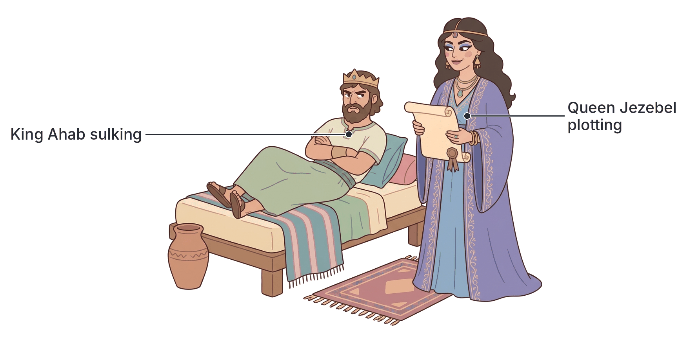
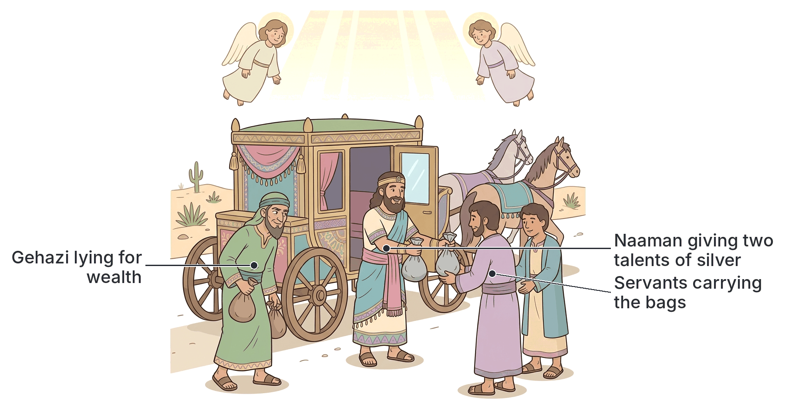

# JAMB Crk Notes: Greed and Its Effects

## What JAMB expects

This topic is Section B, Topic 1 of the JAMB CRK syllabus: Greed and its effects. It covers the biblical stories of Ahab and Gehazi to show the nature and consequences of covetousness.

This file covers the following content items:
- (a) Examples of Ahab (I Kings 21:1-29; 22:1-40; II Kings 9:30-37)
- (b) Examples of Gehazi (II Kings 5:1-27 cf. Josh 7)

By the end of these notes, you should be able to:
1. deduce the meaning of greed;
2. distinguish between Ahab and Gehazi's greed;
3. analyse the consequences of Ahab and Gehazi's greed.

**Note on the syllabus wording:** In the syllabus, the reference for Gehazi is printed with a typing error as `cf ( Josh 7)`. The correct reading is `cf. (Josh 7)`, meaning you should compare Gehazi's greed to the story of Achan in Joshua 7. These notes cover this comparison.

## Deduce the meaning of greed

**Objective i: deduce the meaning of greed.**

**Greed** is the excessive and selfish desire to acquire or possess more than one needs or deserves, especially at the expense of others. It is a strong craving for wealth, power, land, food, or status. 

In the Bible, greed is often referred to as **covetousness**. The Tenth Commandment directly forbids it: "Thou shalt not covet thy neighbour's house... nor any thing that is thy neighbour's" (Exodus 20:17). 

Characteristics of greed include:
- **Selfishness:** Thinking only about what you want, regardless of how it affects others.
- **Discontentment:** Never being satisfied with what God has already given.
- **Injustice:** A willingness to lie, cheat, steal, or even kill to get what is desired.

In Nigerian society, greed is a major root cause of corruption, embezzlement of public funds, land grabbing, election violence, and armed robbery. Christians teach that greed destroys both the individual who practices it and the society they live in.

## Examples of Ahab

**Content a: Examples of Ahab (I Kings 21:1-29; 22:1-40; II Kings 9:30-37)**

Ahab was a powerful king of the Northern Kingdom of Israel (Samaria). His wife was Jezebel, a foreign princess from Zidon. Despite his vast wealth and power, Ahab fell into the sin of greed over a small piece of land.

### The story of Naboth's vineyard (1 Kings 21)

1. **Ahab's request:** Ahab had a palace in Jezreel. Next to it was a vineyard belonging to a man named Naboth. Ahab wanted the vineyard to make a vegetable garden. He offered to give Naboth a better vineyard or to buy it for cash.
2. **Naboth's refusal:** Naboth refused, saying, "The LORD forbid it me, that I should give the inheritance of my fathers unto thee." Under Israelite law (Leviticus 25), ancestral land belonged to God and the family; it could not be sold permanently.
3. **Ahab's reaction:** Ahab acted like a spoiled child. He went home, lay on his bed, turned his face to the wall, and refused to eat.
4. **Jezebel's wicked plot:** Queen Jezebel found out why he was upset. She mocked his lack of authority and promised to get the vineyard for him. She wrote letters in Ahab's name, sealed them with his royal seal, and sent them to the elders of Jezreel.
5. **The false trial:** Jezebel commanded the elders to proclaim a fast and set Naboth in a high place among the people. She told them to hire two false witnesses (described as "sons of Belial" or worthless men) to testify that Naboth had blasphemed God and the king.
6. **The murder:** The elders obeyed out of fear. Naboth was falsely accused, dragged outside the city, and stoned to death along with his sons (to remove any heirs).
7. **The theft:** Jezebel heard that Naboth was dead and told Ahab to go and take possession of the vineyard. Ahab gladly went down to take the land he had coveted.

### Elijah's prophecy against Ahab

God sent the prophet Elijah to meet Ahab in Naboth's vineyard. When Ahab saw him, he said, "Hast thou found me, O mine enemy?" Elijah delivered God's judgment:
- Because Ahab had murdered and taken possession, where dogs licked the blood of Naboth, dogs would lick Ahab's blood.
- Ahab's entire dynasty would be wiped out.
- For Jezebel, "The dogs shall eat Jezebel by the wall of Jezreel."

When Ahab heard these words, he genuinely repented. He tore his clothes, put on sackcloth, fasted, and walked softly. Because of his humility, God told Elijah that the destruction of Ahab's family would be delayed until the days of Ahab's son, though Ahab and Jezebel would still face their personal punishments.

### The death of Ahab (1 Kings 22)

The prophecy of Ahab's death came to pass during a war.
1. Ahab asked King Jehoshaphat of Judah to help him fight the Syrians to recover Ramoth-gilead.
2. Despite a warning from the true prophet Micaiah that the battle would end in disaster, Ahab went to war.
3. Trying to cheat his fate, Ahab disguised himself as an ordinary soldier, while Jehoshaphat wore his royal robes.
4. However, a Syrian soldier "drew a bow at a venture" (shot an arrow randomly) and struck Ahab between the joints of his armour. 
5. Ahab bled heavily in his chariot and died that evening. 
6. When his chariot was washed at the pool of Samaria, **dogs licked up his blood**, exactly as Elijah had prophesied.

### The death of Jezebel (2 Kings 9)

Years later, God anointed Jehu to wipe out Ahab's house. 
1. Jehu rode into Jezreel. 
2. Jezebel painted her eyes, adorned her head, and looked out of an upper window, mocking Jehu as he arrived.
3. Jehu called out to see who was on his side. Two or three eunuchs looked out. Jehu ordered them to throw her down.
4. They threw Jezebel out of the window. Her blood splattered on the wall and on the horses, and Jehu's chariot trampled her.
5. Later, Jehu ordered his men to bury her because she was a king's daughter. However, when they went to find her body, the stray city dogs had eaten her. They found only her skull, feet, and the palms of her hands, fulfilling Elijah's prophecy to the letter.

## Examples of Gehazi

**Content b: Examples of Gehazi (II Kings 5:1-27 cf. Josh 7)**

Gehazi was the servant of the great prophet Elisha. His greed cost him his health, his ministry, and his legacy. 

### The healing of Naaman

Naaman was the commander of the Syrian army. He was a great man, but he suffered from leprosy. A captive Israelite slave girl told Naaman's wife about Elisha, and Naaman travelled to Israel for healing. Elisha did not even come out to meet him; he simply sent a messenger telling Naaman to wash in the River Jordan seven times. After overcoming his pride, Naaman obeyed and was completely healed.

### Gehazi's greed and deception

1. **Elisha refuses payment:** Overjoyed, Naaman returned to Elisha and urged him to accept a massive gift of silver, gold, and expensive garments. Elisha swore by God and absolutely refused. Elisha wanted Naaman to know that the God of Israel heals by grace, and salvation cannot be bought. Naaman departed in peace.
2. **Gehazi covets:** Gehazi watched this and felt his master was being foolish. He said to himself, "As the LORD liveth, I will run after him, and take somewhat of him."
3. **Gehazi's lies:** Gehazi ran and caught up with Naaman's chariot. He invented a lie, telling Naaman that two young prophets from the hill country of Ephraim had just arrived unexpectedly, and Elisha had changed his mind. He asked for one talent of silver and two changes of garments for them.
4. **The theft:** Naaman was generous and insisted Gehazi take **two** talents of silver (a huge sum of money) in two bags, along with two garments. He even sent two servants to carry them for Gehazi.
5. **The cover-up:** When they got to the hill (the tower) near Elisha's house, Gehazi took the items, sent the Syrian servants away, and hid the wealth secretly in the house.

### Elisha's judgment

Gehazi went in and stood before Elisha, pretending everything was normal. 
- Elisha asked, "Whence comest thou, Gehazi?" 
- Gehazi lied again: "Thy servant went no whither."
- Elisha rebuked him, revealing that he had seen everything in his spirit: "Went not mine heart with thee, when the man turned again from his chariot to meet thee?"
- Elisha declared that this was not the time to be accepting money, garments, olive yards, vineyards, sheep, or servants (showing he knew exactly what Gehazi planned to buy with the wealth).

Because of his greed and lies, Elisha pronounced judgment: "The leprosy therefore of Naaman shall cleave unto thee, and unto thy seed for ever." Gehazi immediately walked out of Elisha's presence "a leper as white as snow."

### Comparison with Achan (Joshua 7)

The syllabus asks you to compare this with Joshua 7. During the conquest of Jericho, God commanded Israel not to take any loot; everything was "devoted to destruction" or for God's treasury. 

A man named **Achan** saw a beautiful Babylonian garment, 200 shekels of silver, and a wedge of gold. He **coveted** them, stole them, and hid them in the ground under his tent. 
- **The result:** His secret sin caused God's presence to leave Israel, leading to their defeat in the battle of Ai, where 36 Israelites died. 
- **The punishment:** When Achan was exposed, he and his entire family were stoned to death and burned in the Valley of Achor. 

**Similarities between Gehazi and Achan:**
1. Both men allowed their eyes to cause them to covet wealth that did not belong to them.
2. Both stole the items secretly and hid them in their homes/tents.
3. Both thought they could hide their sin from God and their spiritual leaders (Elisha and Joshua).
4. Both brought disaster upon themselves and their families because of their greed. 

## Distinguish between Ahab and Gehazi's greed

**Objective ii: distinguish between Ahab and Gehazi's greed.**

Although both Ahab and Gehazi committed terrible sins because of greed, the nature and circumstances of their covetousness were different. 

| Feature | Ahab's Greed | Gehazi's Greed |
| :--- | :--- | :--- |
| **Status** | A powerful King who already had great wealth. | A lowly servant who wanted to get rich quickly. |
| **Object of greed** | Real estate (land/property) to use as a vegetable garden. | Money (silver) and clothing (garments). |
| **Method used** | Abuse of power, false accusation, and murder (orchestrated by his wife, while he stood by). | Deception, lying, and misusing his master's respected name. |
| **Direct Victim** | An innocent citizen of his own kingdom (Naboth). | A foreign convert to the God of Israel (Naaman). |
| **Nature of sin** | Shedding innocent blood and violating God's land laws. | Commercialising God's free grace and destroying the witness of the prophetic ministry. |
| **Reaction to judgment** | Demonstrated temporary remorse and repentance when confronted. | No record of repentance; he was struck instantly and walked away. |

## Analyse the consequences of Ahab and Gehazi's greed

**Objective iii: analyse the consequences of Ahab and Gehazi's greed.**

Greed never affects only the greedy person; its consequences spread like poison. The Bible uses Ahab and Gehazi to show the personal, family, and national disasters that follow covetousness.

### Consequences of Ahab's greed

1. **Personal destruction:** Ahab lost his peace of mind when he could not get the land. Ultimately, his greed led to his violent death in battle, with dogs licking up his blood.
2. **Family ruin:** Because of this act, God pronounced a curse on his entire dynasty. His wicked wife Jezebel suffered a shameful and gruesome death (eaten by dogs). Later, Jehu slaughtered all 70 of Ahab's sons, completely wiping his family from the throne of Israel.
3. **National injustice and instability:** Ahab's greed corrupted the judicial system. The elders of Jezreel were forced to become murderers. Innocent blood was shed, which brought God's curse upon the whole nation and led to violent political upheaval (Jehu's bloody revolution).

### Consequences of Gehazi's greed

1. **Physical suffering (Leprosy):** Gehazi was instantly struck with an incurable disease. He became a leper "as white as snow," making him an outcast from normal society.
2. **Loss of destiny:** Gehazi was the servant of Elisha, just as Elisha had been the servant of Elijah. Gehazi was in line to become the next great prophet of Israel. His greed cost him his spiritual inheritance and his ministry. 
3. **Generational curse:** Elisha declared that the leprosy would cling to Gehazi *and to his descendants forever*. His momentary greed ruined his unborn children's lives.
4. **Spiritual damage:** Elisha had refused the money to show Naaman that God's grace is free. Gehazi's greed threatened to ruin Naaman's new faith by making it look like Israel's prophets were just greedy men who performed magic for money.

### Lessons for today

In Nigeria today, the consequences of greed are visible everywhere. When leaders (like Ahab) are greedy, they embezzle public funds, grab land, and oppress citizens. This leads to poverty, lack of infrastructure, and violence. When subordinates or civil servants (like Gehazi) are greedy, they demand bribes, forge documents, and ruin the reputation of their offices. The biblical stories teach that wealth gained through greed is cursed and will eventually bring ruin.

## Key terms

| Term | Meaning |
| :--- | :--- |
| Greed / Covetousness | An intense and selfish desire for something, especially wealth, power, or property, beyond what one needs. |
| Inheritance | Land passed down from ancestors, which Israelite law forbade selling permanently. |
| Blasphemy | Speaking evil or acting offensively against God. Naboth was falsely accused of this. |
| Sons of Belial | A biblical term for worthless, wicked, or lawless men (used as false witnesses against Naboth). |
| Leprosy | A severe, disfiguring skin disease. In biblical times, lepers were isolated from society. |
| Talent | A heavy biblical unit of weight, usually of silver or gold, representing a massive sum of money. |

## Exam tips and common mistakes

- **Remember the exact prophecies:** Exam questions often ask *where* the dogs licked Ahab's blood (the pool of Samaria) and *where* Jezebel died (by the wall of Jezreel).
- **Distinguish the prophets:** Elijah confronted Ahab. Elisha dealt with Naaman and Gehazi. Do not mix them up.
- **Know the exact items Gehazi requested:** He asked for *one* talent of silver and *two* changes of garments. Naaman gave him *two* talents.
- **Understand Naboth's refusal:** He didn't refuse just to be stubborn; he refused because God's law (Leviticus) forbade selling ancestral land permanently. 
- **Compare Gehazi and Achan:** If a question asks who committed a sin most similar to Gehazi's covering up of stolen wealth, the answer is Achan.

## Quick summary

1. Greed (covetousness) is the selfish desire for more than one needs, often leading to lying, stealing, or murder.
2. King Ahab coveted Naboth's vineyard. When Naboth refused to sell his ancestral inheritance, Queen Jezebel arranged for false witnesses to accuse Naboth, leading to his death by stoning.
3. God sent Elijah to curse Ahab: dogs would lick his blood, his family would be destroyed, and dogs would eat Jezebel. These all came true exactly as prophesied.
4. Elisha healed Naaman of leprosy and refused a reward to show that God's healing cannot be bought.
5. Gehazi, Elisha's servant, coveted the wealth, lied to Naaman to get silver and clothes, and then lied to Elisha to cover it up.
6. As a consequence, Gehazi and his descendants were cursed with Naaman's leprosy forever.
7. Both Ahab and Gehazi's stories (and Achan's in Joshua 7) prove that wealth gained through greed brings ruin to individuals, their families, and their communities.

## Practice questions

**1. Greed in the biblical context is best described as**
- A. working hard to become wealthy to help the poor
- B. an excessive and selfish desire for wealth, power, or property
- C. refusing to share your food with strangers
- D. asking God for a large inheritance

**Answer: B.** Greed (or covetousness) is the selfish desire for more than one needs or deserves, often at the expense of others.

**2. Why did Naboth refuse to give his vineyard to King Ahab?**
- A. The king did not offer enough money for it
- B. Naboth hated the king and his foreign wife
- C. The land was the inheritance of his fathers
- D. The land was cursed and could not produce vegetables

**Answer: C.** Naboth said, "The LORD forbid it me, that I should give the inheritance of my fathers unto thee," adhering to the laws concerning ancestral land.

**3. How did Queen Jezebel ensure Naboth's death?**
- A. She sent an assassin to stab him in the vineyard
- B. She poisoned his food during a fast
- C. She hired false witnesses to accuse him of blaspheming God and the king
- D. She ordered the army to run him over with chariots

**Answer: C.** Jezebel wrote letters to the elders instructing them to set up "sons of Belial" (false witnesses) to accuse Naboth, leading to his stoning.

**4. The prophecy that dogs would lick Ahab's blood was fulfilled when he**
- A. was thrown out of a window in Jezreel
- B. died in battle at Ramoth-gilead and his chariot was washed at the pool of Samaria
- C. was assassinated by his own servants while sleeping
- D. was killed by Jehu in Naboth's vineyard

**Answer: B.** Ahab was struck by a random arrow at the battle of Ramoth-gilead. When they washed his blood-stained chariot at the pool of Samaria, dogs licked his blood (1 Kings 22:38).

**5. What specific items did Gehazi falsely request from Naaman?**
- A. Two talents of gold and one garment
- B. One talent of silver and two changes of garments
- C. Two talents of silver and two changes of garments
- D. Five shekels of silver and olive yards

**Answer: B.** Gehazi asked for one talent of silver and two changes of garments (claiming it was for two young prophets). Naaman insisted on giving him two talents.

**6. Elisha refused to accept Naaman's gifts because he wanted to**
- A. show that Israel was richer than Syria
- B. demonstrate that the grace of God cannot be bought with wealth
- C. prove that he did not like Naaman's attitude
- D. wait for a larger sum of money

**Answer: B.** Elisha wanted the Syrian commander to understand that the God of Israel heals by grace, not for commercial gain.

**7. As a consequence of his greed, Gehazi suffered**
- A. death by stoning in the Valley of Achor
- B. the loss of his prophetic ministry and immediate blindness
- C. Naaman's leprosy clinging to him and his descendants forever
- D. exile to Syria as Naaman's slave

**Answer: C.** Elisha pronounced that the leprosy of Naaman would cleave to Gehazi and his seed forever. 

**8. Which of the following individuals committed a sin of greed most similar to Gehazi's act of hiding stolen wealth?**
- A. Ahab
- B. Achan
- C. Jehu
- D. Naboth

**Answer: B.** Achan (Joshua 7) coveted Babylonian garments and silver, and secretly hid them in his tent, bringing a curse upon himself and his people, just as Gehazi hid Naaman's gifts.

**9. A major difference between the greed of Ahab and Gehazi is that**
- A. Ahab stole from a foreigner, while Gehazi stole from an Israelite
- B. Ahab desired property using royal power, while Gehazi desired money using deception
- C. Ahab was punished immediately, while Gehazi repented and was forgiven
- D. Ahab acted alone, while Gehazi was helped by Jezebel

**Answer: B.** Ahab was a king who abused his power to get land, whereas Gehazi was a servant who used lies and deception to get money and clothes.

**10. What happened to Jezebel as a result of her role in Naboth's death?**
- A. She was struck with leprosy and lived in isolation
- B. She died in battle alongside Ahab at Ramoth-gilead
- C. She was thrown from a window, trampled by horses, and eaten by dogs
- D. She repented and God delayed her punishment

**Answer: C.** During Jehu's revolt, eunuchs threw her from a window. She was trampled, and dogs ate her flesh, leaving only her skull, feet, and hands (2 Kings 9).

<!-- COVERAGE
obj i | Deduce the meaning of greed
obj ii | Distinguish between Ahab and Gehazi's greed
obj iii | Analyse the consequences of Ahab and Gehazi's greed
item a | Examples of Ahab
item b | Examples of Gehazi
-->
