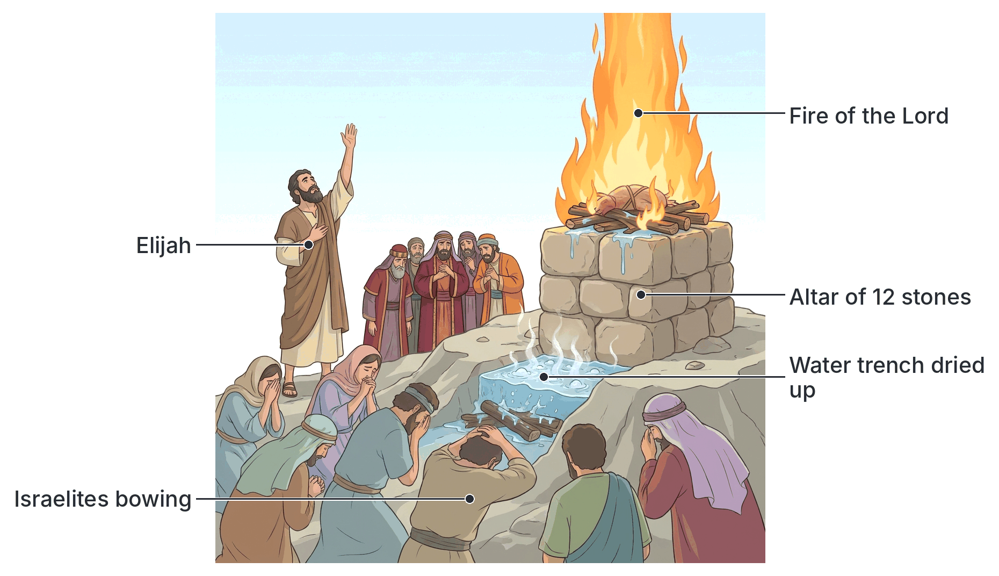

# JAMB Crk Notes: The Supremacy of God

## What JAMB expects

This topic is Section B, Topic 2 of the JAMB CRK syllabus: The Supremacy of God. It has one main content item:

- **Religious tension and the power of God on Mount Carmel** (1 Kings 16:29-34; 17:1-7; 18; 19:1-18)

By the end of these notes, you should be able to:
1. assess the religious situation in Israel at the time of Elijah and Ahab;
2. identify the characters involved in the contest on Mount Carmel;
3. differentiate between God’s power and that of Baal.

## Religious tension and the power of God on Mount Carmel

### Objective i: Assess the religious situation in Israel at the time of Elijah and Ahab

To understand the contest on Mount Carmel, you must first understand the religious crisis in the Northern Kingdom of Israel during the reign of King Ahab (1 Kings 16:29-34). 

Ahab, the son of Omri, reigned in Samaria. The Bible says he did more evil in the sight of the Lord than all the kings who were before him. The religious situation was characterised by:

1. **Apostasy and Idolatry:** Ahab married **Jezebel**, a foreign princess, the daughter of Ethbaal, king of the Zidonians (Sidon). Through this marriage, the worship of the Phoenician god **Baal** (the Canaanite god of rain, storm, and fertility) became the official state religion of Israel.
2. **State-Sponsored Paganism:** Ahab built a temple and an altar for Baal in Samaria. He also made an Asherah pole (a wooden symbol of a fertility goddess), openly provoking the God of Israel. 
3. **Persecution of Yahweh's Prophets:** Jezebel actively hunted down and killed the prophets of the Lord. The worship of Yahweh was driven underground. 
4. **Syncretism:** The ordinary people of Israel were halting between two opinions. They tried to mix the worship of Yahweh (the God of their ancestors) with the worship of Baal (who they believed controlled their agricultural success). 

### The announcement of the drought (1 Kings 17:1-7)

Because Baal was worshipped as the god who controlled rain and fertility, God used Elijah the Tishbite to challenge this belief directly. 

1. **The declaration:** Elijah appeared before King Ahab and declared: *"As the LORD God of Israel liveth, before whom I stand, there shall not be dew nor rain these years, but according to my word."* (1 Kings 17:1). This directly proved that Yahweh, not Baal, controlled the rain.
2. **Elijah at the Brook Cherith:** To protect Elijah from Ahab's anger, God commanded him to hide by the **Brook Cherith**, east of the River Jordan.
3. **Divine provision:** God commanded ravens to feed Elijah. The ravens brought him bread and meat every morning and evening, and he drank from the brook.
4. **The brook dries up:** Because there was no rain in the land, the brook eventually dried up, leading God to send Elijah to a widow in Zarephath (which is outside the JAMB syllabus text for this section, but completes the story).

### The build-up to the contest (1 Kings 18)

After three years of severe drought, God commanded Elijah to present himself to Ahab, promising to send rain on the earth.

**Obadiah and Ahab:**
Ahab summoned **Obadiah**, the governor of his house. Obadiah was a devout man who feared the Lord. When Jezebel was massacring the Lord's prophets, Obadiah took one hundred prophets, hid them by fifties in two caves, and fed them with bread and water. Ahab and Obadiah divided the land to search for grass and water to save their horses and mules. 

**Elijah meets Obadiah:**
While searching, Obadiah met Elijah. Elijah commanded Obadiah to go and tell Ahab, "Behold, Elijah is here." Obadiah was terrified, fearing that the Spirit of the Lord would carry Elijah away before Ahab arrived, and Ahab would kill Obadiah for lying. Elijah swore to show himself to Ahab that day.

**The meeting of Elijah and Ahab:**
When Ahab met Elijah, he accused him, saying, "Art thou he that troubleth Israel?" 
Elijah boldly replied that he had not troubled Israel, but Ahab and his father's house had, because they had forsaken the commandments of the Lord and followed Baalim. Elijah then demanded that Ahab gather all Israel, along with the 450 prophets of Baal and the 400 prophets of Asherah (the groves), to Mount Carmel.

### Objective ii: Identify the characters involved in the contest on Mount Carmel

The contest on Mount Carmel was a public showdown to prove who was the true God in Israel. The key characters present were:

1. **Elijah:** The solitary prophet of Yahweh who initiated the contest. He stood alone representing the God of Israel.
2. **King Ahab:** The king of Israel who represented state authority and the apostate religious system.
3. **The 450 prophets of Baal:** The state-sponsored religious leaders who ate at Jezebel's table. (Note: Although Elijah also summoned the 400 prophets of Asherah, the biblical text only focuses on the actions and death of the 450 prophets of Baal during the actual sacrifice).
4. **The people of Israel:** The general public who had gathered to watch. They were the "undecided audience" halting between two opinions, whom Elijah intended to turn back to Yahweh.

### The Contest on Mount Carmel (1 Kings 18:21-40)

**1. The Challenge:**
Elijah addressed the people, saying, *"How long halt ye between two opinions? if the LORD be God, follow him: but if Baal, then follow him."* (1 Kings 18:21). The people answered him not a word.

**2. The Rules of the Contest:**
Elijah proposed a test. He and the prophets of Baal would each take a bull, cut it in pieces, and lay it on wood with no fire underneath. They would call on the name of their gods, and the God that answered by fire would be the true God. The people agreed to this test.

**3. The Failure of Baal:**
The prophets of Baal went first. 
- They prepared their bull and called on Baal from morning until noon, crying, "O Baal, hear us." But there was no voice or answer.
- They leaped upon their altar.
- At noon, Elijah mocked them, suggesting their god was talking, pursuing, on a journey, or sleeping.
- They cried louder and cut themselves with knives and lancets until blood gushed out, continuing until the time of the evening sacrifice. Still, there was no voice, no answer, and no attention.

**4. The Triumph of Yahweh:**
- Elijah called the people near. He repaired the broken altar of the Lord, taking **twelve stones** (representing the twelve tribes of the sons of Jacob).
- He dug a deep trench around the altar.
- He put the wood and the cut bull in order.
- To prove there was no trickery, he ordered four barrels of water to be poured over the sacrifice and the wood. He made them do this three times (twelve barrels in total), until the trench was full of water.
- At the time of the evening sacrifice, Elijah prayed a simple prayer: *"LORD God of Abraham, Isaac, and of Israel, let it be known this day that thou art God in Israel, and that I am thy servant..."* (1 Kings 18:36).
- Immediately, the fire of the Lord fell. It consumed the burnt sacrifice, the wood, the stones, the dust, and licked up all the water in the trench.

**5. The Aftermath:**
When the people saw it, they fell on their faces and cried, *"The LORD, he is the God; the LORD, he is the God."* (1 Kings 18:39).
Elijah commanded the people to seize the 450 prophets of Baal. He brought them down to the **brook Kishon** and killed them there.

### The end of the drought (1 Kings 18:41-46)

Elijah told Ahab to eat and drink because there was a sound of abundance of rain. While Ahab ate, Elijah went to the top of Carmel, cast himself down upon the earth, and put his face between his knees. 
He sent his servant to look toward the sea seven times. On the seventh time, the servant saw a little cloud rising out of the sea, the size of a man's hand. Elijah told Ahab to prepare his chariot and hurry down before the rain stopped him. A heavy rain fell, ending the three-and-a-half-year drought, proving once again that Yahweh, not Baal, controls nature. The hand of the Lord came upon Elijah, and he outran Ahab's chariot to the entrance of Jezreel.

### Elijah's flight and God's revelation (1 Kings 19:1-18)

**Jezebel's threat and Elijah's flight:**
When Ahab told Jezebel everything Elijah had done and how he had killed all her prophets with the sword, Jezebel sent a messenger to Elijah, swearing by her gods that she would make his life like one of them by the next day.
Elijah became terrified and fled for his life. He went to Beersheba in Judah, left his servant there, and went a day's journey into the wilderness. Sitting under a juniper tree, he prayed that he might die, feeling he was no better than his fathers.

**Divine provision:**
As he slept, an angel touched him and told him to eat. He found a cake baked on coals and a cruse of water at his head. He ate, drank, and slept again. The angel woke him a second time to eat, saying the journey was too great for him. Strengthened by that food, Elijah travelled for **forty days and forty nights** to **Horeb** (Mount Sinai), the mount of God.

**The revelation at Mount Horeb:**
At Horeb, Elijah hid in a cave. The word of the Lord came to him, asking, *"What doest thou here, Elijah?"* 
Elijah complained that he had been very jealous for the Lord, but Israel had forsaken God's covenant, thrown down His altars, and killed His prophets, and that he alone was left, and they were seeking to kill him.

God told him to stand upon the mount. A series of powerful natural phenomena occurred, but God showed that His true power and presence were not always in destructive forces:
1. A great and strong **wind** tore the mountains and broke the rocks in pieces, but the Lord was not in the wind.
2. An **earthquake** occurred, but the Lord was not in the earthquake.
3. A **fire** passed by, but the Lord was not in the fire.
4. Finally, there came a **"still small voice"** (a gentle whisper).

When Elijah heard it, he wrapped his face in his mantle (cloak) and stood at the entrance of the cave. The voice again asked, "What doest thou here, Elijah?" and Elijah repeated his complaint.

**God's instructions:**
God showed His supremacy by revealing that He was still in control of history and politics, both in Israel and in foreign nations. He commanded Elijah to return through the wilderness to Damascus and anoint three successors:
1. **Hazael** to be king over Syria.
2. **Jehu** the son of Nimshi to be king over Israel.
3. **Elisha** the son of Shaphat to be prophet in Elijah's place.

God also corrected Elijah's belief that he was the only faithful person left. God stated: *"Yet I have left me seven thousand in Israel, all the knees which have not bowed unto Baal, and every mouth which hath not kissed him."* (1 Kings 19:18).

### Objective iii: Differentiate between God’s power and that of Baal

The events of Elijah's ministry clearly contrast the reality and absolute supremacy of Yahweh with the powerlessness of the idol Baal.

| Feature | The Power of Yahweh (God of Israel) | The "Power" of Baal |
| --- | --- | --- |
| **Control of Nature** | Absolute control. He caused the three-year drought and sent the rain to end it. | Powerless. Though known as the Canaanite god of rain and fertility, he could not produce a single drop of water for three years. |
| **Response to Prayer** | Responsive and living. Answered Elijah's simple, dignified prayer instantly with fire from heaven. | Unresponsive and dead. Ignored hours of frantic screaming, dancing, and bloodletting by 450 prophets. |
| **Nature of Worship** | Demands moral purity, obedience, and exclusive devotion. Responds to faithful prayer. | Associated with frenzied emotionalism, self-mutilation (cutting with knives), and state-sponsored idolatry. |
| **Method of Revelation** | Speaks to the human spirit through a "still small voice" and acts rationally to preserve a faithful remnant (the 7,000). | A man-made idol that cannot speak, hear, or guide its followers. |
| **Authority** | Supreme over all nations (appointing kings in Syria and Israel) and supreme over all other supposed gods. | A local, false deity promoted by royal patronage (Ahab and Jezebel), entirely destroyed when tested. |

## Key terms

| Term | Meaning |
| --- | --- |
| Apostasy | The abandonment or rejection of true religious belief (as Israel did under Ahab). |
| Syncretism | The mixing of different religious beliefs and practices, like attempting to worship both Yahweh and Baal. |
| Baal | The Canaanite and Phoenician god of fertility, rain, and storms. |
| Asherah | A Canaanite fertility goddess, often represented by a wooden pole or "grove". |
| Brook Cherith | The stream where God commanded Elijah to hide and be fed by ravens. |
| Mount Carmel | The mountain where the great contest between Elijah and the prophets of Baal took place. |
| Brook Kishon | The valley/stream at the foot of Mount Carmel where the 450 prophets of Baal were executed. |
| Mount Horeb | Also known as Mount Sinai; the mountain where God revealed Himself to Elijah in a still small voice. |
| Mantle | A prophet's cloak or outer garment. |

## Exam tips and common mistakes

- **Ahab vs. Elijah on "troubling Israel":** Remember that Ahab called Elijah the "troubler of Israel," but Elijah correctly pointed out that Ahab and his father's house were the real troublers because of their idolatry.
- **Numbers matter:** Memorise that there were **450** prophets of Baal (the ones slaughtered at Kishon). Obadiah hid **100** prophets of the Lord (by 50s in a cave). God preserved **7,000** faithful Israelites.
- **Obadiah's role:** Do not confuse Obadiah the governor of Ahab's house (who feared the Lord and hid the prophets) with Obadiah the writing prophet.
- **The order of the elements at Horeb:** Wind, Earthquake, Fire, Still Small Voice. The Lord was *only* in the still small voice.
- **The test:** The challenge on Mount Carmel was specifically to see which God would answer by **fire**, not by rain (the rain came later, after the contest was settled).
- **The altar:** Elijah repaired the altar using exactly **12 stones**, symbolising the unity of the 12 tribes of Israel, even though the kingdom was divided.

## Quick summary

1. King Ahab and Queen Jezebel introduced the worship of Baal to Israel, causing religious apostasy and the persecution of Yahweh's prophets.
2. Elijah declared a drought to challenge Baal's supposed control over rain and fertility, hiding at the Brook Cherith where ravens fed him.
3. After three years, Elijah challenged Ahab and the 450 prophets of Baal to a contest on Mount Carmel to prove who was the true God.
4. The prophets of Baal prayed frantically and cut themselves, but received no answer. 
5. Elijah repaired Yahweh's altar with 12 stones, drenched it in water, and prayed. God answered instantly by sending fire from heaven.
6. The people acknowledged Yahweh as God, and the 450 prophets of Baal were killed at the brook Kishon. God then sent a heavy rain.
7. Fleeing Jezebel's death threat, Elijah travelled 40 days to Mount Horeb, where God revealed Himself not in wind, earthquake, or fire, but in a "still small voice."
8. God showed His absolute supremacy by commanding Elijah to anoint new kings (Hazael and Jehu) and a new prophet (Elisha), and revealing that He had kept 7,000 faithful people in Israel.

## Practice questions

**1. Who was the governor of Ahab's house that secretly feared the Lord and hid one hundred prophets?**

- A. Jehu
- B. Elisha
- C. Obadiah
- D. Hazael

**Answer: C.** Obadiah was a devout man who served in Ahab's court and hid 100 of the Lord's prophets in caves when Jezebel was trying to kill them (1 Kings 18:3-4).

**2. "How long halt ye between two opinions? if the LORD be God, follow him: but if Baal, then follow him." Elijah made this statement to the people at:**

- A. the Brook Cherith
- B. Mount Horeb
- C. Samaria
- D. Mount Carmel

**Answer: D.** Elijah challenged the Israelites with this question on Mount Carmel right before the contest between Yahweh and Baal began (1 Kings 18:21).

**3. During the drought, how did God initially provide food for Elijah at the Brook Cherith?**

- A. An angel baked cakes for him daily
- B. Ravens brought him bread and meat morning and evening
- C. A widow supplied him with unending flour and oil
- D. Obadiah secretly brought him food from the palace

**Answer: B.** God commanded the ravens to feed him, and they brought bread and flesh in the morning and evening (1 Kings 17:6). The angel fed him later when he fled to Horeb, and the widow fed him after the brook dried up.

**4. When King Ahab met Elijah after the severe drought, he greeted him by asking:**

- A. "Hast thou found me, O mine enemy?"
- B. "Where is the rain thou promised?"
- C. "Art thou he that troubleth Israel?"
- D. "Why hast thou forsaken the Lord?"

**Answer: C.** Ahab blamed Elijah for the drought and the suffering in the land, calling him the troubler of Israel (1 Kings 18:17).

**5. How many stones did Elijah use to repair the altar of the Lord on Mount Carmel?**

- A. 7
- B. 10
- C. 12
- D. 40

**Answer: C.** He took 12 stones, according to the number of the tribes of the sons of Jacob, representing the unity of God's covenant people (1 Kings 18:31).

**6. The prophets of Baal were executed at the brook Kishon because they:**

- A. refused to pay taxes to King Ahab
- B. led Israel into idolatry and could not prove Baal's power
- C. attempted to assassinate Elijah
- D. prophesied falsely against King Ahab

**Answer: B.** After the fire from heaven proved Yahweh was the true God, Elijah ordered their execution as false prophets who had led the nation into apostasy (1 Kings 18:40).

**7. In 1 Kings 19, when Elijah fled from Jezebel to Mount Horeb, God revealed His presence to the prophet through a:**

- A. burning bush
- B. still small voice
- C. strong wind breaking the rocks
- D. pillar of fire

**Answer: B.** While there was a wind, an earthquake, and a fire, the biblical text explicitly states the Lord was not in those, but in the "still small voice" that followed (1 Kings 19:12).

**8. God corrected Elijah's belief that he was the only faithful worshipper left in Israel by revealing that He had preserved how many people who had not bowed to Baal?**

- A. 100
- B. 400
- C. 3,000
- D. 7,000

**Answer: D.** God told Elijah, "Yet I have left me seven thousand in Israel, all the knees which have not bowed unto Baal..." (1 Kings 19:18).

**9. Which of the following was NOT one of the men God commanded Elijah to anoint at Mount Horeb?**

- A. Hazael as king over Syria
- B. Jehu as king over Israel
- C. Obadiah as governor of Judah
- D. Elisha as prophet

**Answer: C.** God commanded Elijah to anoint Hazael, Jehu, and Elisha. Obadiah was already the governor of Ahab's house, not someone Elijah was told to anoint (1 Kings 19:15-16).

**10. The major difference between the power of God and that of Baal demonstrated on Mount Carmel was that:**

- A. Baal answered by rain, but God answered by fire
- B. God answered by fire instantly, while Baal was powerless to answer
- C. Baal required a larger animal sacrifice than God
- D. God spoke through a wind, while Baal spoke through his prophets

**Answer: B.** The test was that the true God would answer by fire. The prophets of Baal cried all day with no response. Elijah prayed, and God immediately sent fire to consume the sacrifice.

<!-- COVERAGE
obj i | Objective i: Assess the religious situation in Israel at the time of Elijah and Ahab
obj ii | Objective ii: Identify the characters involved in the contest on Mount Carmel
obj iii | Objective iii: Differentiate between God’s power and that of Baal
Religious tension and the power of God on Mount Carmel | Religious tension and the power of God on Mount Carmel
-->
