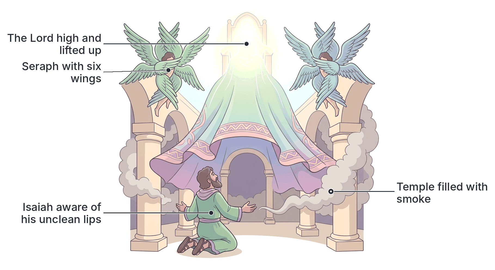

# JAMB Crk Notes: Holiness and Divine Call

## What JAMB expects

This topic is Section B, Topic 8 of the JAMB CRK syllabus: Holiness and Divine call. It covers the biblical accounts of the prophetic calls of Isaiah, Ezekiel, and Jeremiah. 

The syllabus lists the following content items:
- Isaiah 6:1-13; Ezek. 2; 3:1-11; Jer. 1:4-10

By the end of these notes, you should be able to:
1. analyze the vision of Isaiah on God’s holiness;
2. distinguish the calls of Isaiah, Ezekiel and Jeremiah;
3. compare the assignments given to these prophets;
4. determine the need for God’s people to be holy.

## The Call of Isaiah and the Vision of God's Holiness

**Content item: Isaiah 6:1-13**
**Objective i: analyze the vision of Isaiah on God’s holiness**

Isaiah was a prophet who lived in the southern kingdom of Judah. His call to be a prophet happened in the year that King Uzziah died. He experienced a powerful and terrifying vision of God in the temple, which completely changed his life and ministry.

### 1. The Throne Room Vision
Isaiah saw the Lord sitting upon a throne, high and lifted up, and His train (the hem of His robe) filled the temple. Above the throne stood angelic beings called **seraphim**. Each seraph had six wings:
* With two wings, they covered their faces (showing reverence and inability to look directly upon God's glory).
* With two wings, they covered their feet (showing humility).
* With two wings, they flew.

The seraphim called out to one another, declaring God's absolute holiness:
> "Holy, holy, holy, is the LORD of hosts: the whole earth is full of his glory." (Isaiah 6:3)

As they cried out, the posts of the temple doors shook, and the house was filled with smoke, representing the awesome presence and mystery of God.

### 2. Analyzing the Vision of God's Holiness
The repetition of the word "holy" three times (a literary device called the *trisagion*) is the biblical way of expressing absolute, ultimate perfection. God's holiness means He is completely pure, morally perfect, and entirely separated from all sin and evil. 

Because God is completely holy, any sin in His presence is immediately exposed. When Isaiah saw this perfect holiness, he did not feel proud or excited; instead, he felt deep terror and a sharp awareness of his own sinfulness. He cried out:
> "Woe is me! for I am undone; because I am a man of unclean lips, and I dwell in the midst of a people of unclean lips: for mine eyes have seen the King, the LORD of hosts." (Isaiah 6:5)

This reaction shows that **human impurity cannot stand in the presence of God's divine holiness**. True encounters with God always reveal human sinfulness and the desperate need for cleansing.

### 3. The Cleansing and the Call
In response to Isaiah's confession, one of the seraphim flew to him with a **live coal** taken with tongs from the altar. The seraph touched Isaiah’s mouth with the coal and said:
"Lo, this hath touched thy lips; and thine iniquity is taken away, and thy sin purged."

Once Isaiah was cleansed, he was fit to serve a holy God. He then heard the voice of the Lord asking:
"Whom shall I send, and who will go for us?"
Isaiah immediately volunteered, answering, **"Here am I; send me."**

### 4. Isaiah's Assignment
God gave Isaiah a difficult and discouraging assignment. He was told to go and tell the people of Judah:
"Hear ye indeed, but understand not; and see ye indeed, but perceive not."
God told Isaiah to make the hearts of the people "fat" (stubborn), their ears heavy, and their eyes blind. This meant that Isaiah's preaching would not bring the people to repentance; instead, it would harden their hearts and confirm their judgment. 

Isaiah asked, "Lord, how long?" God replied that he must preach until the cities were laid waste without inhabitant, the houses were without people, and the land was completely desolate. However, God promised that a tenth would remain, like a stump of a tree that has been cut down. This "holy seed" (the stump) represented a faithful remnant that would survive the judgment.

## The Call of Ezekiel

**Content item: Ezek. 2; 3:1-11**

Ezekiel was a priest who was called to be a prophet while he was living among the Jewish exiles in Babylon. Throughout his book, God addresses him as **"Son of man"**, a title that emphasizes his human weakness compared to God's glorious majesty.

### 1. The Call to a Rebellious Nation
God's Spirit entered Ezekiel and set him on his feet to hear the Lord speak. God commissioned Ezekiel, sending him to the children of Israel, whom God described as a "rebellious nation" that had transgressed against Him. They were impudent (boldly disrespectful) and stiff-hearted.

God told Ezekiel to speak His words to them, warning them, saying, "Thus saith the Lord GOD." God commanded Ezekiel not to be afraid of them or their words, even though he would be living among "briers and thorns" and dwelling among "scorpions." Whether the people listened or refused to listen, they would know that there had been a prophet among them.

### 2. The Scroll of Lamentation
God commanded Ezekiel not to be rebellious like the house of Israel, but to open his mouth and eat what God was about to give him. 
Ezekiel saw a hand stretched out to him, holding a **roll of a book (a scroll)**. The scroll was written on both the inside and the outside (front and back), and written on it were "lamentations, and mourning, and woe" (messages of judgment and sadness). 

### 3. Eating the Scroll
God commanded Ezekiel, "Son of man, eat that thou findest; eat this roll, and go speak unto the house of Israel." (Ezekiel 3:1). 
Ezekiel opened his mouth, and God caused him to eat the scroll. Even though the scroll contained terrible words of judgment, when Ezekiel ate it, it was **"in my mouth as honey for sweetness."** This showed that receiving and internalizing the word of God is a sweet and satisfying experience for a true prophet, even when the message itself is full of sorrow.

God then sent him to his own people. God noted that Ezekiel was not being sent to foreigners with a strange, difficult language who might not understand him, but to the house of Israel. Yet, Israel would not listen to Ezekiel because they were not willing to listen to God. To prepare him for this stubborn rejection, God made Ezekiel's face as hard as their faces, and his forehead like an "adamant stone" (harder than flint), so that he would not be intimidated by their rebellious looks.

[IMAGE: An illustration of the prophet Ezekiel receiving his call. A hand descends from a glowing cloud at the top, holding out an ancient rolled-up parchment scroll with Hebrew-like writing visible on both the inside and outside. Ezekiel, dressed as a Jewish captive in Babylon, is reaching up with open mouth to eat the scroll. Inset circle: a honeycomb, representing the sweet taste of the scroll. Labels to add later: "Hand of God offering the word", "Scroll written with lamentation and woe", "Ezekiel (Son of man)", "Tastes as sweet as honey". Clean flat textbook style, white background.]

## The Call of Jeremiah

**Content item: Jer. 1:4-10**

Jeremiah was called to be a prophet during the final, turbulent years of the kingdom of Judah, before Jerusalem was destroyed by the Babylonians.

### 1. The Pre-natal Call
The word of the LORD came to Jeremiah, revealing that God had chosen him long before he was even born. God said:
> "Before I formed thee in the belly I knew thee; and before thou camest forth out of the womb I sanctified thee, and I ordained thee a prophet unto the nations." (Jeremiah 1:5)

This shows that Jeremiah's calling was predestined. God had known him, set him apart (sanctified him), and appointed him for a specific divine purpose before his conception.

### 2. Jeremiah's Objection
Unlike Isaiah who eagerly volunteered, Jeremiah was reluctant. He protested that he was unfit for the task, saying:
"Ah, Lord GOD! behold, I cannot speak: for I am a child." (Jeremiah 1:6). 
Jeremiah felt he was too young (a youth) and lacked the experience and authority to be a public speaker and prophet.

### 3. God's Reassurance and Equipping
God rejected Jeremiah's excuse and commanded him:
"Say not, I am a child: for thou shalt go to all that I shall send thee, and whatsoever I command thee thou shalt speak." 
God promised to be with him and to protect him, saying, "Be not afraid of their faces: for I am with thee to deliver thee."

Then the LORD put forth His hand and **touched Jeremiah's mouth**. God said, "Behold, I have put my words in thy mouth." This physical act of touching his mouth symbolized God empowering him and giving him the exact messages he was to deliver.

### 4. Jeremiah's Assignment
God gave Jeremiah authority over nations and kingdoms. His assignment was summarized in six powerful verbs:
1. To root out (pluck up)
2. To pull down (break down)
3. To destroy
4. To throw down (overthrow)
5. To build
6. To plant

The first four verbs are negative, representing messages of judgment, destruction, and the uprooting of sinful nations (especially Judah). The last two verbs are positive, representing messages of hope, restoration, and a new beginning after the punishment.

## Distinguishing the Calls of the Prophets

**Objective ii: distinguish the calls of Isaiah, Ezekiel and Jeremiah**

Although Isaiah, Ezekiel, and Jeremiah were all major prophets called by God, the manner of their calling and their personal responses were very different.

| Feature | Isaiah | Ezekiel | Jeremiah |
| :--- | :--- | :--- | :--- |
| **Location/Setting** | In the temple at Jerusalem. | In exile by the river Chebar in Babylon. | In his hometown (Anathoth) in Judah. |
| **Nature of the Call** | A majestic throne room vision of God's holiness and angelic seraphim. | The Spirit entering him, followed by a command to eat a physical scroll. | A direct word from the Lord revealing a pre-natal (before birth) appointment. |
| **Response to the Call** | **Volunteered eagerly:** "Here am I; send me." | **Obediently received it:** Opened his mouth and ate the scroll as commanded. | **Protested/Reluctant:** Said he was too young and did not know how to speak. |
| **Method of Equipping/Cleansing** | A seraph touched his lips with a burning **coal** from the altar to purge his sin. | God commanded him to eat a **scroll** which tasted sweet as honey. | God stretched out His hand and touched his **mouth** to put words into it. |

## Comparing the Assignments Given to the Prophets

**Objective iii: compare the assignments given to these prophets**

God gave each prophet a specific mission tailored to the spiritual condition of the people during their respective times.

| Prophet | Target Audience | Core Assignment | Tone/Outcome of the Assignment |
| :--- | :--- | :--- | :--- |
| **Isaiah** | The kingdom of Judah. | To preach to the people until their hearts were hardened, their ears heavy, and their eyes blind. | A message of **inevitable judgment** that would lead to total devastation, leaving only a small faithful remnant (the "holy seed"). |
| **Ezekiel** | The Jewish exiles in Babylon and the house of Israel. | To speak God's warning to a stubborn, impudent, and rebellious people, whether they listened or refused. | A message of **accountability and warning**. He was to be a fearless watchman with a face as hard as flint against their rebellion. |
| **Jeremiah** | Judah, and the surrounding nations and kingdoms. | To pluck up, break down, destroy, overthrow, build, and plant. | A message of **both destruction and restoration**. He had to announce the terrible fall of Jerusalem, but also prophesy future rebuilding and planting. |

## The Need for God's People to be Holy

**Objective iv: determine the need for God’s people to be holy**

Holiness means being set apart from sin and dedicated to God's pure and perfect standard. From the call of Isaiah, we learn essential lessons about why God's people (Christians today) must pursue holiness.

1. **God's Nature Demands It:** God is absolutely holy ("Holy, holy, holy"). Because He is pure, He expects His followers to be pure. The Bible frequently commands, "Be holy, for I am holy." 
2. **Sin Separates Us from God:** When Isaiah saw God's holiness, he immediately realized his own uncleanness ("Woe is me!"). Sin makes a person unfit to stand in God's presence. Without the pursuit of holiness, fellowship with God is broken.
3. **Cleansing is Required for Service:** Before Isaiah could be sent on his mission, his lips had to be purged with the burning coal. Similarly, God's people today need to be cleansed from sin through repentance and the blood of Jesus before they can effectively serve God or be His messengers.
4. **Representing God Accurately:** Prophets and Christians are ambassadors for God. In a Nigerian society that sometimes struggles with corruption, dishonesty, and moral decay, God's people are called to stand out as a "holy seed." If believers live unholy lives, they misrepresent the holy God they claim to serve.
5. **Boldness and Confidence:** When a person’s sins are forgiven and they live a holy life, they can confidently say, as Isaiah did, "Here am I; send me." Purity of heart gives believers the boldness to carry out God's assignments without fear or guilt.

## Key terms

| Term | Meaning |
| :--- | :--- |
| **Seraphim** | Angelic beings with six wings seen by Isaiah, declaring God's absolute holiness. |
| **Trisagion** | The threefold repetition of "Holy, holy, holy" used to express supreme divine perfection. |
| **Unclean lips** | Isaiah's description of his and his people's sinful and impure state before God. |
| **Live coal** | A burning coal taken from the heavenly altar, used to cleanse Isaiah's lips and take away his sin. |
| **Son of man** | The title God repeatedly used to address Ezekiel, highlighting his human frailty. |
| **Scroll (Roll of a book)** | The item given to Ezekiel to eat, containing words of lamentation, mourning, and woe. |
| **Sanctified** | Set apart for a holy use; God did this to Jeremiah before he was born. |
| **Pre-natal call** | A divine calling and appointment made before a person is even born (as with Jeremiah). |
| **Holy seed** | The faithful remnant (the "tenth" or "stump") that would survive God's judgment in Isaiah's prophecy. |

## Exam tips and common mistakes

* **Who ate the scroll?** Do not confuse Ezekiel with John in the book of Revelation. In the JAMB syllabus, it is **Ezekiel** who ate the scroll that tasted sweet as honey.
* **Who volunteered?** Remember that **Isaiah** volunteered ("Here am I; send me"). **Jeremiah** was the one who made an excuse ("I am a child/youth").
* **How were they cleansed/equipped?** Match the prophet to the action: 
  * Isaiah = Live coal on lips.
  * Ezekiel = Eating a scroll.
  * Jeremiah = God's hand touching his mouth.
* **Jeremiah's Six Verbs:** Memorize the ratio of Jeremiah's verbs: Four are destructive (pluck up, pull down, destroy, overthrow) and two are constructive (build, plant).
* **The nature of the scroll:** Remember that Ezekiel's scroll was written on *both* sides (inside and outside) and contained lamentation, mourning, and woe.
* **Isaiah's strange assignment:** Students often think prophets were always sent to save people. Remember that Isaiah's specific assignment was to preach *until* the people's hearts were fat and their ears heavy, leading to desolation. 

## Quick summary

1. Isaiah was called in the year King Uzziah died through a spectacular temple vision where he saw God on a throne and seraphim crying "Holy, holy, holy."
2. Recognizing his sinfulness, Isaiah's lips were purged with a live coal, after which he volunteered for service ("Here am I; send me").
3. Isaiah's assignment was to preach a message of judgment that would harden the people's hearts until the land was desolate, leaving only a "holy seed."
4. Ezekiel was called "Son of man" and sent to a stubborn and rebellious house of Israel.
5. Ezekiel was commanded to eat a scroll covered in lamentations and woe, which tasted sweet as honey, equipping him to speak God's word fearlessly.
6. Jeremiah received a pre-natal call, having been known and sanctified by God before he was formed in the womb.
7. Jeremiah protested that he was too young to speak, but God touched his mouth, put words in it, and appointed him to tear down and build up nations.
8. God's absolute holiness requires His people to recognize their sin, seek cleansing, and live pure, separated lives in order to serve Him effectively.

## Practice questions

**1. During whose reign did Isaiah receive his call to be a prophet?**
- A. King Hezekiah
- B. King Josiah
- C. King Uzziah
- D. King Ahab

**Answer: C.** Isaiah's vision and call occurred "in the year that king Uzziah died" (Isaiah 6:1).

**2. Which of the following best describes the seraphim in Isaiah's vision?**
- A. They had four wings and guarded the scroll.
- B. They had six wings, covering their faces and feet, and flying.
- C. They touched Jeremiah's mouth with a coal.
- D. They handed Ezekiel a scroll to eat.

**Answer: B.** In Isaiah 6:2, the seraphim are described as having six wings: two covered the face, two covered the feet, and two were used to fly.

**3. "Here am I; send me." Who made this statement, and in what context?**
- A. Jeremiah, when God said he was a prophet to the nations.
- B. Ezekiel, after he ate the sweet scroll.
- C. Isaiah, after his lips were cleansed with a live coal.
- D. Moses, when he saw the burning bush.

**Answer: C.** Isaiah said this in response to God asking, "Whom shall I send, and who will go for us?" after a seraph had purged his sin with a live coal.

**4. According to Ezekiel's call, what was written on the scroll he was commanded to eat?**
- A. Laws, commandments, and statutes.
- B. Lamentations, mourning, and woe.
- C. Blessings, peace, and prosperity.
- D. Prophecies of building and planting.

**Answer: B.** Ezekiel 2:10 says the scroll was written within and without, and contained "lamentations, and mourning, and woe."

**5. How did the scroll taste in Ezekiel's mouth?**
- A. Bitter as gall
- B. Tasteless like water
- C. Sour like vinegar
- D. Sweet as honey

**Answer: D.** Despite containing messages of woe, Ezekiel 3:3 records that the scroll was "in my mouth as honey for sweetness."

**6. Which prophet was told that God knew and sanctified him before he was formed in the womb?**
- A. Isaiah
- B. Jeremiah
- C. Ezekiel
- D. Samuel

**Answer: B.** In Jeremiah 1:5, God told Jeremiah, "Before I formed thee in the belly I knew thee; and before thou camest forth out of the womb I sanctified thee..."

**7. What excuse did Jeremiah give when God called him to be a prophet?**
- A. He was a man of unclean lips.
- B. He was afraid of the faces of the people.
- C. He was only a youth and could not speak.
- D. He was living among a rebellious house.

**Answer: C.** Jeremiah protested in Jeremiah 1:6, saying, "I cannot speak: for I am a child [youth]."

**8. To equip Jeremiah for his assignment, God physically...**
- A. gave him a scroll to eat.
- B. touched his mouth with His hand.
- C. placed a burning coal on his lips.
- D. gave him an adamant stone for his forehead.

**Answer: B.** God put forth His hand and touched Jeremiah's mouth, saying, "Behold, I have put my words in thy mouth" (Jeremiah 1:9).

**9. Part of Jeremiah's assignment to the nations was to...**
- A. make their hearts fat and ears heavy.
- B. dwell among scorpions and briers.
- C. pluck up, break down, build, and plant.
- D. cleanse the people with a live coal.

**Answer: C.** Jeremiah 1:10 summarizes his mission with six verbs: root out/pluck up, pull down, destroy, throw down, build, and plant.

**10. What does Isaiah's reaction to God's presence teach about the need for holiness?**
- A. God's presence brings immediate joy to a sinner.
- B. Human impurity is exposed and cannot stand before God's absolute holiness.
- C. A person does not need to be cleansed to serve God if they volunteer eagerly.
- D. Prophets are naturally born holy and without sin.

**Answer: B.** When Isaiah saw God's perfect holiness, he immediately cried "Woe is me," realizing his own sinfulness. This shows that to serve a holy God, human impurity must be exposed and cleansed.

<!-- COVERAGE
obj i | Analyzing the Vision of God's Holiness
obj ii | Distinguishing the Calls of the Prophets
obj iii | Comparing the Assignments Given to the Prophets
obj iv | The Need for God's People to be Holy
Isaiah 6:1-13 | The Call of Isaiah and the Vision of God's Holiness
Ezek. 2; 3:1-11 | The Call of Ezekiel
Jer. 1:4-10 | The Call of Jeremiah
-->
