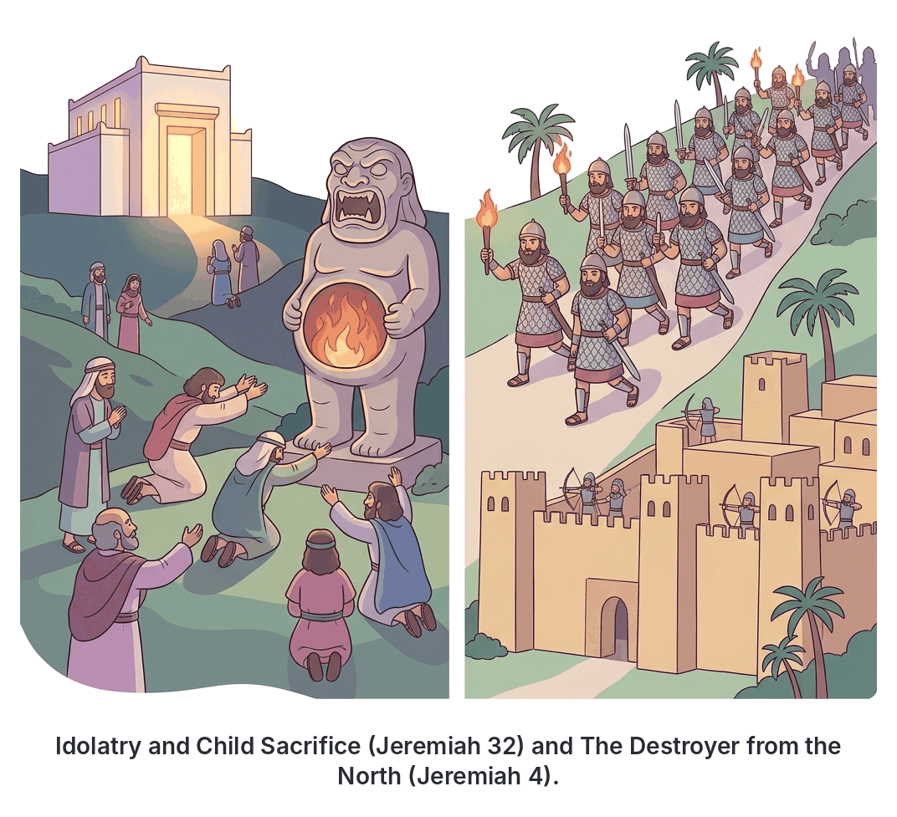
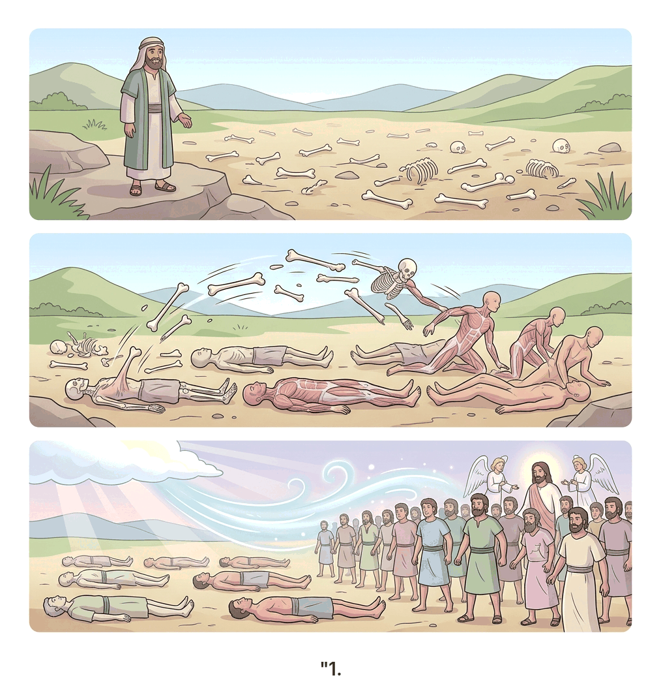

# JAMB Crk Notes: Punishment and Hope

## What JAMB expects

This topic is part of Section B (Prophets) of the JAMB CRK syllabus. It examines the messages of the prophets Jeremiah, Ezekiel, and Isaiah regarding the judgment of Israel and Judah, the conditions for their forgiveness, and the glorious promises of their future restoration.

The syllabus covers the following passages: Jeremiah 3:11-18; 32:26-35; Ezekiel 18; 37:1-14; Isaiah 61; and Jeremiah 4:5-8.

By the end of these notes, you should be able to:
1. Describe the situations that led to the punishment of Israel.
2. Identify the conditions for hope.
3. Determine the benefits of restoration.

## Objective i: Describe the situations that led to the punishment of Israel

During the time of the divided kingdom, the Northern Kingdom (Israel) and the Southern Kingdom (Judah) consistently turned away from God. The prophets were sent to warn them that their continued rebellion, idolatry, and social injustice would lead to severe national punishment—specifically, being conquered and taken into exile by foreign empires (Assyria and Babylon). 

### The threat of invasion (Jeremiah 4:5-8)

Jeremiah was called to prophesy to Judah during its final years before the Babylonian exile. In Jeremiah 4:5-8, God commanded the people of Judah to blow the trumpet and gather into the fortified cities (like Jerusalem) for safety. 

A terrible destruction was coming from the north. Jeremiah described this approaching enemy as a **"lion from his thicket"** and a "destroyer of the Gentiles" (nations). This represented King Nebuchadnezzar and the Babylonian army. 

The prophet warned that the cities of Judah would be laid waste and left without inhabitants. The situation that led to this punishment was the people's deep-rooted sin, which had provoked the **"fierce anger of the Lord."** Jeremiah instructed the people to put on sackcloth, lament, and howl because God's anger had not turned back from them.

### The specific sins of Judah (Jeremiah 32:26-35)

While Jeremiah 4 warns of the coming punishment, Jeremiah 32 details exactly *why* God was punishing His people. As the Babylonians (Chaldeans) were actively laying siege to Jerusalem, the word of the Lord came to Jeremiah explaining why the city would be handed over to be burned.

God pointed out the following situations and sins that caused the punishment:
1. **Idolatry:** The people burned incense to Baal and poured out drink offerings to other gods on the roofs of their houses.
2. **Rebellion and stubbornness:** God said the children of Israel and Judah had done evil before Him from their youth. "They have turned unto me the back, and not the face." Even though God continually sent prophets to teach them, they refused to listen or receive instruction.
3. **Defiling the Temple:** They set up their abominations (idols) inside the house called by God's name (the Temple in Jerusalem), polluting it.
4. **Child sacrifice:** In the valley of the son of Hinnom (just outside Jerusalem), they built "high places of Baal" to sacrifice their children. They caused their sons and daughters to "pass through the fire unto Molech." God stated clearly that He never commanded such a wicked abomination, nor did it ever enter His mind that they should do this.

Because of these extreme spiritual and moral failures, God decreed that Jerusalem would fall to the Babylonians.

## Objective ii: Identify the conditions for hope

Despite the certainty of punishment, the prophets did not leave the people without hope. God provided a path to forgiveness, but it required genuine change. The conditions for hope centered on true repentance, acknowledging guilt, and accepting personal responsibility.

### Personal responsibility and repentance (Ezekiel 18)

During the exile, many Israelites blamed their ancestors for their suffering. They circulated a popular proverb: **"The fathers have eaten sour grapes, and the children's teeth are set on edge."** This meant they believed they were being unfairly punished for the sins of their parents and grandparents.

Through the prophet Ezekiel, God strongly rejected this mindset and laid down a new condition for hope based on **individual accountability**:
1. **"The soul that sinneth, it shall die"**: God declared that all souls belong to Him. A son will not bear the iniquity of the father, nor will a father bear the iniquity of the son. The righteousness of the righteous shall be upon himself, and the wickedness of the wicked shall be upon himself.
2. **The righteous man:** If a man is just—does not worship idols, does not commit adultery, does not oppress anyone, feeds the hungry, and executes true justice—he shall surely live.
3. **The wicked son:** If that righteous man has a violent, thieving, idolatrous son, that wicked son will die for his own sins; his father's righteousness will not save him.
4. **The repentant son:** If a wicked man has a son who sees all his father's sins, fears God, and chooses to live righteously, that son shall not die for his father's sins; he shall live.

**The condition for hope:** God takes no pleasure in the death of the wicked. The ultimate condition for hope is true repentance. God promised that if a wicked person turns away from all their sins, keeps God's laws, and does what is right, **they shall surely live and not die**. 

*Application in Nigeria:* Just as the Israelites had to take personal responsibility rather than blaming their ancestors, Nigerians today are encouraged by Christian teaching to take personal responsibility for their actions. Blaming past generations for corruption or bad leadership does not excuse personal involvement in bribery or injustice. True national hope begins with individual repentance.

### Jeremiah 3:11-18

In this passage, God compares the Northern Kingdom ("backsliding Israel") with the Southern Kingdom ("treacherous Judah"). Israel had already been punished and sent into Assyrian exile because of her idolatry. Yet, Judah saw this and still did not fear God, continuing in her own treacherous sins. God declared that backsliding Israel had proved herself more righteous than treacherous Judah.

Through Jeremiah, God called out to the north, offering conditions for hope and restoration to the exiled people of Israel:
- **"Return, thou backsliding Israel"**: God promised He would not cause His anger to fall upon them forever because He is merciful.
- **The specific condition:** *"Only acknowledge thine iniquity, that thou hast transgressed against the Lord thy God..."* (Jeremiah 3:13). 

The essential condition for hope was for the people to stop making excuses, admit their guilt, confess that they had scattered their ways to foreign gods, and acknowledge that they had not obeyed the voice of the Lord. 

## Objective iii: Determine the benefits of restoration

When the conditions of repentance and acknowledging guilt are met, God promises profound blessings. The prophets painted a beautiful picture of what the restored nation would look like—spiritually, politically, and physically.

### The benefits of restoration in Jeremiah 3:11-18

If the people returned to God (acknowledging their guilt as seen above), Jeremiah 3 outlined several glorious benefits:

1. **Good leadership:** God promised, *"I will give you pastors [shepherds] according to mine heart, which shall feed you with knowledge and understanding."* Instead of corrupt kings and false prophets, they would have leaders who genuinely cared for them.
2. **Growth and multiplication:** The nation would grow and multiply in the land again.
3. **A new focus of worship:** The people would no longer talk about or remember the **Ark of the Covenant**. The Ark would not come to mind, nor would it be rebuilt. Why? Because the very presence of God would be with them entirely. 
4. **Jerusalem as the Throne of the Lord:** Jerusalem itself would be called the throne of God, and all nations would gather there in the name of the Lord. They would no longer walk after the stubbornness of their evil hearts.
5. **Reunification:** The divided kingdoms of the house of Judah and the house of Israel would walk together. They would return together out of the land of the north to the inheritance God had given their fathers.

### The Valley of Dry Bones (Ezekiel 37:1-14)

Ezekiel 37 contains one of the most famous visions in the Bible, dramatically illustrating the benefit of national and spiritual restoration.

**The Vision:**
1. The Spirit of the Lord took Ezekiel to a valley full of very dry bones. God asked him, *"Son of man, can these bones live?"* Ezekiel answered, *"O Lord God, thou knowest."*
2. God commanded Ezekiel to prophesy to the bones, telling them to hear the word of the Lord. 
3. As Ezekiel prophesied, there was a noise and a shaking. The bones came together, bone to his bone. Sinews (tendons) and flesh came upon them, and skin covered them, but there was **no breath** in them.
4. God then told Ezekiel to prophesy to the wind (the breath/Spirit). Ezekiel did, and breath came into the bodies. They lived and stood upon their feet, becoming an **"exceeding great army."**

**The Meaning of the Vision:**
God explained to Ezekiel that the dry bones represented the **"whole house of Israel."** In exile, the people were saying, *"Our bones are dried, and our hope is lost: we are cut off for our parts."* They felt their nation was completely dead and unrecoverable.

**The Benefits of Restoration Revealed in the Vision:**
- **Resurrection of the nation:** God promised to open their graves (their captivity in Babylon) and bring them out.
- **Return to the Promised Land:** He promised to bring them back into the land of Israel.
- **Spiritual renewal:** God promised, *"And shall put my spirit in you, and ye shall live."* The ultimate benefit of restoration was not just political freedom, but a completely renewed spiritual life empowered by the Spirit of God.
- **Knowledge of God:** Through this miraculous restoration, they would finally know that the Lord had spoken and performed it.

### Good tidings of salvation (Isaiah 61)

Isaiah 61 is a beautiful poetic description of the ultimate restoration God would bring. Jesus later read from this exact passage in the synagogue at Nazareth to declare His own earthly mission (Luke 4). The passage describes the mission of God's anointed one and outlines the profound benefits of restoration for God's people.

**The Mission:**
*"The Spirit of the Lord God is upon me; because the Lord hath anointed me to preach good tidings unto the meek..."*

**The Benefits of Restoration in Isaiah 61:**
1. **Healing and Freedom:** The anointed one will bind up the brokenhearted, proclaim liberty to the captives, and open the prisons for those who are bound.
2. **The Year of Favor:** He will proclaim the "acceptable year of the Lord" (a time of grace and salvation) and the day of God's vengeance against their enemies.
3. **Comfort for Mourners:** He will comfort all who mourn in Zion. God promises a divine exchange:
   - **Beauty for ashes** (in biblical times, mourners sat in ashes; this means exchanging sorrow for glory).
   - **The oil of joy for mourning.**
   - **The garment of praise for the spirit of heaviness.**
4. **Rebuilding the Nation:** The restored people will rebuild the "old wastes" (ruined cities) and the desolations of many generations. The physical infrastructure of the nation will be completely restored.
5. **A Holy Calling:** The people of Israel will be named the **Priests of the Lord** and the Ministers of God.
6. **An Everlasting Covenant:** Instead of shame and confusion, they will have double honor. God, who loves justice and hates robbery, promises to direct their work in truth and make an **everlasting covenant** with them. Their descendants will be recognized globally as a people blessed by the Lord.

## Key terms

| Term | Meaning |
| --- | --- |
| **Molech** | A false Canaanite god associated with the abominable practice of child sacrifice by fire. |
| **Chaldeans** | Another name used in the Bible for the Babylonians, the empire that destroyed Jerusalem. |
| **Sackcloth** | Rough, dark cloth worn as a sign of deep mourning, sorrow, and repentance. |
| **Sour grapes** | Unripe grapes. In Ezekiel, used in a proverb to symbolize ancestors' sins souring the lives of their children. |
| **Backsliding** | Turning away from a commitment to God and falling back into sin (applied to the Northern Kingdom of Israel). |
| **Ark of the Covenant** | The sacred gold-covered chest representing God's presence, which Jeremiah prophesied would no longer be needed in the restored Jerusalem. |
| **Valley of Dry Bones** | Ezekiel's prophetic vision representing the hopeless state of exiled Israel, and their future miraculous resurrection by God's Spirit. |
| **Zion** | Often used as a synonym for Jerusalem and the people of God. |

## Exam tips and common mistakes

- **Know the specific sins:** If a question asks why Judah was punished according to Jeremiah 32, look for options mentioning idolatry (Baal) and child sacrifice to Molech in the valley of Hinnom.
- **Understand the "sour grapes" proverb:** This proverb (*"The fathers have eaten sour grapes, and the children's teeth are set on edge"*) means that children are suffering for their parents' sins. Ezekiel 18 teaches the exact **opposite**: God rejects this proverb and insists on **individual responsibility** (*"The soul that sinneth, it shall die"*).
- **The Ark will not be missed:** According to Jeremiah 3, a benefit of restoration is that the Ark of the Covenant will not be remembered, missed, or remade, because God's presence will be everywhere in Jerusalem.
- **Who is the "lion from the thicket"?** In Jeremiah 4, the lion represents the Babylonian army coming to destroy Judah.
- **What do the dry bones represent?** Ezekiel is explicitly told that the bones represent **"the whole house of Israel"** who had lost hope during their captivity in Babylon. 
- **Isaiah 61 matches Jesus' ministry:** Remember that the benefits listed in Isaiah 61 (beauty for ashes, liberty for captives) were fulfilled in the coming of the Messiah.

## Quick summary

1. God used prophets like Jeremiah and Ezekiel to explain that Israel and Judah were punished due to their relentless idolatry, rebellion, and practices like child sacrifice (Molech).
2. Jeremiah 4 warned of impending doom from Babylon, describing the invading army as a fierce "lion from his thicket."
3. Ezekiel 18 rejected the idea of generational punishment ("sour grapes"), establishing that God judges based on individual responsibility.
4. The primary condition for hope and avoiding ultimate destruction is genuine repentance—turning away from wickedness and acknowledging guilt before God (Jeremiah 3).
5. Upon genuine repentance, God promised restoration, including giving the people good shepherds (pastors) according to His heart and reuniting Israel and Judah.
6. Ezekiel's vision of the Valley of Dry Bones symbolized God miraculously restoring the "dead" nation of Israel from exile and putting His Spirit in them.
7. Isaiah 61 describes the glorious benefits of restoration: replacing mourning with joy ("beauty for ashes"), releasing captives, rebuilding ruined cities, and establishing an everlasting covenant.

## Practice questions

**1. According to Jeremiah 4, the "lion from his thicket" refers to**

- A. the Egyptian army marching to defend Judah
- B. the Babylonian army coming to destroy Judah
- C. the righteous remnant of Israel
- D. the anger of the Lord in the temple

**Answer: B.** The lion is a metaphor for the fierce, destroying army coming from the north (Babylon) to execute God's judgment on Judah.

**2. Which abominable practice did the people of Judah commit in the valley of the son of Hinnom, according to Jeremiah 32?**

- A. Worshipping the golden calf
- B. Selling their brothers into slavery
- C. Sacrificing their children in the fire to Molech
- D. Stealing the Ark of the Covenant

**Answer: C.** Jeremiah 32:35 states they built high places to Baal in the valley of the son of Hinnom to cause their sons and daughters to pass through the fire unto Molech.

**3. What does the proverb "The fathers have eaten sour grapes, and the children's teeth are set on edge" mean in Ezekiel 18?**

- A. Parents must teach their children to eat healthy food
- B. Children are being punished for the sins committed by their ancestors
- C. Wicked parents will have wicked children
- D. God punishes parents when their children commit sins

**Answer: B.** The proverb was used by the Israelites in exile to complain that they were suffering unjustly for the idolatry and sins of their fathers.

**4. How did God respond to the "sour grapes" proverb through the prophet Ezekiel?**

- A. He agreed with it and told the children to repent for their fathers
- B. He rejected it, stating that "The soul that sinneth, it shall die"
- C. He commanded the fathers to offer sacrifices for the children
- D. He said the curse would end after four generations

**Answer: B.** God rejected the proverb entirely, establishing the rule of individual responsibility—everyone will be judged for their own actions.

**5. According to Jeremiah 3, what is the primary condition for the hope and restoration of "backsliding Israel"?**

- A. They must rebuild the Ark of the Covenant
- B. They must acknowledge their guilt and transgressions
- C. They must offer thousands of rams
- D. They must defeat the Babylonian army

**Answer: B.** Jeremiah 3:13 says, "Only acknowledge thine iniquity, that thou hast transgressed against the Lord thy God." True repentance is the condition.

**6. In Ezekiel's vision of the Valley of Dry Bones, what did the dry bones represent?**

- A. The army of Babylon that would be destroyed
- B. The false prophets of Judah
- C. The whole house of Israel in a state of hopelessness
- D. The ancestors who committed child sacrifice

**Answer: C.** God explicitly told Ezekiel, "Son of man, these bones are the whole house of Israel" (Ezekiel 37:11), representing their feeling of being cut off and devoid of hope in exile.

**7. In Ezekiel 37, what finally caused the bodies in the valley to come alive and stand on their feet?**

- A. Ezekiel pouring water on them
- B. The prophesying to the wind/breath (Spirit)
- C. The flesh and sinews covering the bones
- D. An earthquake that shook the valley

**Answer: B.** The bodies were fully formed but lifeless until Ezekiel prophesied to the wind (representing the breath or Spirit of God), which entered them and brought them to life.

**8. According to Isaiah 61, one of the benefits of restoration for those who mourn in Zion is that God will give them**

- A. beauty for ashes
- B. wealth for poverty
- C. swords for plowshares
- D. the Ark of the Covenant

**Answer: A.** Isaiah 61:3 promises "beauty for ashes, the oil of joy for mourning, the garment of praise for the spirit of heaviness."

**9. What did Jeremiah prophesy would happen regarding the Ark of the Covenant when God restores His people (Jeremiah 3)?**

- A. It will be rebuilt with pure gold
- B. It will be found hidden in a cave
- C. It will no longer come to mind or be remembered
- D. It will be carried by all the nations

**Answer: C.** Jeremiah prophesied that they would say no more, "The ark of the covenant of the Lord: neither shall it come to mind... neither shall that be done any more," because God's presence would be central to all of Jerusalem.

**10. According to Jeremiah 3, what kind of leaders did God promise to give His restored people?**

- A. Fierce kings who would conquer their enemies
- B. Wealthy merchants who would rebuild the economy
- C. Pastors (shepherds) according to God's own heart
- D. Priests from the line of Aaron only

**Answer: C.** God promised, "I will give you pastors according to mine heart, which shall feed you with knowledge and understanding" (Jeremiah 3:15).

<!-- COVERAGE
obj i | Objective i: Describe the situations that led to the punishment of Israel
obj ii | Objective ii: Identify the conditions for hope
obj iii | Objective iii: Determine the benefits of restoration
Jer. 3:11-18 | Jeremiah 3:11-18
-->
