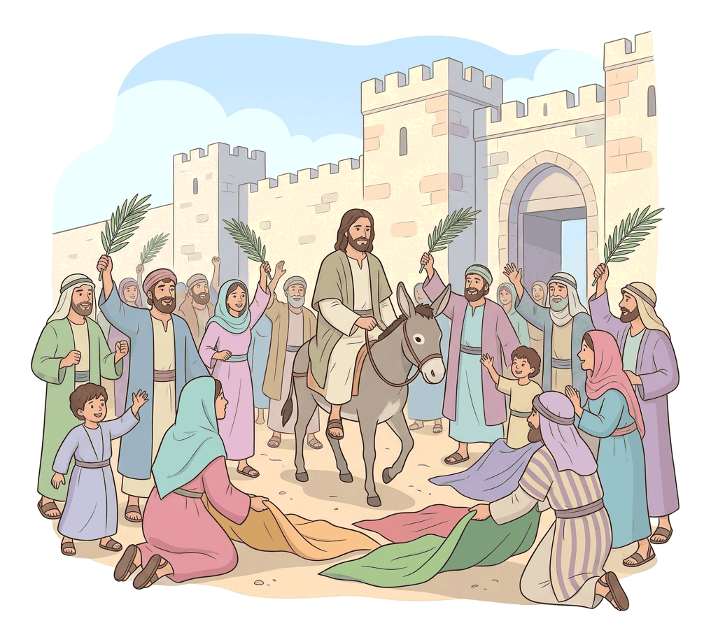
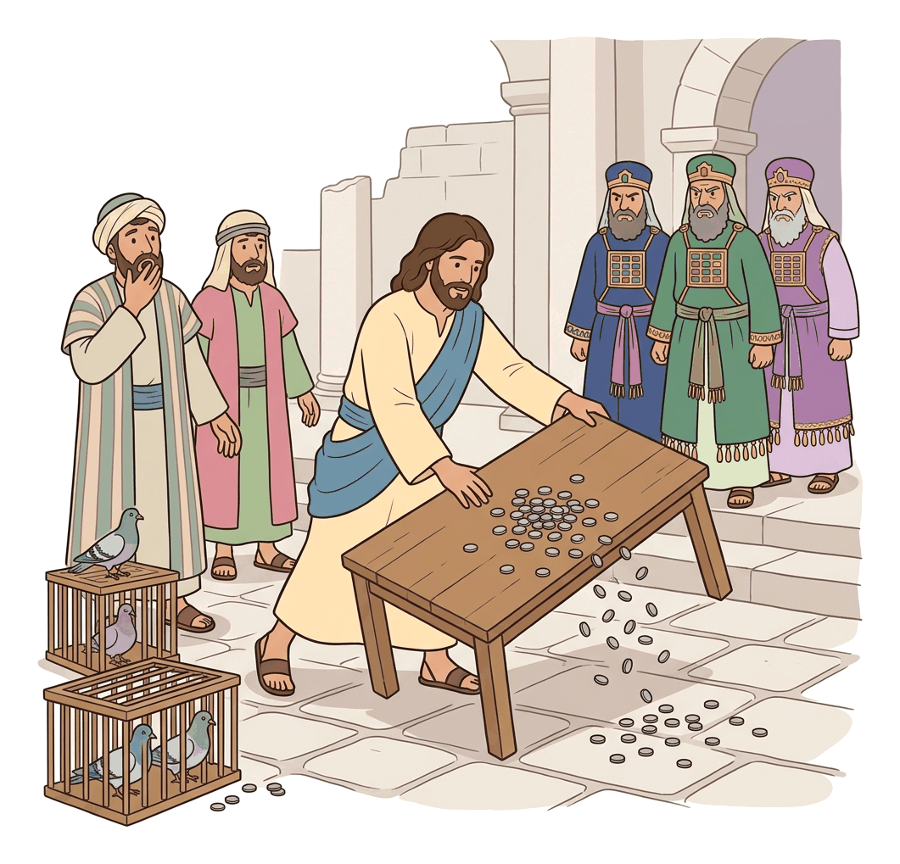

# JAMB Crk Notes: The Triumphal Entry and the Cleansing of the Temple

## What JAMB expects

This topic is Section C, Topic 10 of the JAMB CRK syllabus: The Triumphal Entry and the cleansing of the Temple. 

This file covers the following content item:
- Mt. 21:1-17 (with reference to Mk. 11:1-19 and Lk. 19:29-48 as listed in the syllabus)

By the end of these notes, you should be able to:
1. recount the Triumphal Entry and the cleansing of the Temple;
2. determine the significance of the Triumphal Entry and the cleansing of the Temple;
3. examine how the cleansing of the Temple caused hostility towards Jesus.

## The Triumphal Entry and the Cleansing of the Temple (Mt. 21:1-17)

Jesus' ministry was mostly concentrated in Galilee, but as the time of His death approached, He travelled to Jerusalem for the Passover feast. His arrival and His immediate actions in the Temple marked a turning point, triggering direct conflict with the religious authorities.

### Objective i: recount the Triumphal Entry and the cleansing of the Temple

The events of the Triumphal Entry and the cleansing of the Temple are recorded in all three Synoptic Gospels (Matthew, Mark, and Luke). While the core story is the same, each Gospel writer includes unique details.

#### The Narrative of the Triumphal Entry

1. **The Preparation:** As Jesus and His disciples approached Jerusalem, they came to **Bethphage** (and Bethany, according to Mark and Luke) at the **Mount of Olives**. Jesus sent two of His disciples ahead into the village. 
2. **The Instructions:** He told them they would find a tied animal (Matthew specifically mentions a donkey and a colt; Mark and Luke mention only a colt on which no one had ever sat). They were to untie it and bring it to Him. If anyone asked why they were doing this, they were to say, *"The Lord has need of them"* (Matthew 21:3).
3. **The Prophecy Fulfilled:** Matthew notes that this happened to fulfill the prophecy of Zechariah: *"Tell ye the daughter of Sion, Behold, thy King cometh unto thee, meek, and sitting upon an ass, and a colt the foal of an ass"* (Zechariah 9:9).
4. **The Procession:** The disciples brought the animals, placed their garments on them, and Jesus sat on them. As He rode into Jerusalem, a great crowd spread their garments on the road. Others cut branches from the trees and spread them on the road.
5. **The Shouts of the Crowd:** The crowds going ahead of Him and following Him shouted: *"Hosanna to the Son of David: Blessed is he that cometh in the name of the Lord; Hosanna in the highest"* (Matthew 21:9). "Hosanna" is a Hebrew word meaning "Save now!" or "Save, we pray!"
6. **The Reaction in Jerusalem:** When Jesus entered Jerusalem, the whole city was stirred, asking, "Who is this?" The crowds replied, "This is the prophet Jesus, from Nazareth of Galilee."

#### The Narrative of the Cleansing of the Temple

Following His entry into the city, Jesus went directly to the Temple.

1. **Driving out the Merchants:** Jesus entered the Temple courts and drove out all who sold and bought there. He overturned the tables of the **money-changers** and the seats of those who sold pigeons.
2. **The Pronouncement:** As He did this, He quoted from two Old Testament prophets, saying, *"It is written, My house shall be called the house of prayer; but ye have made it a den of thieves"* (Matthew 21:13). He combined Isaiah 56:7 ("house of prayer") and Jeremiah 7:11 ("den of robbers").
3. **Healing and Praise (Matthew's account):** According to Matthew, after Jesus cleansed the Temple, the blind and the lame came to Him there, and He healed them. Children in the Temple courts were shouting, "Hosanna to the Son of David!"
4. **The Anger of the Leaders:** The chief priests and scribes saw the miracles He did and heard the children shouting. They were deeply angered and asked Jesus, "Do you hear what these are saying?" Jesus replied by quoting Psalm 8:2: *"Yea; have ye never read, Out of the mouth of babes and sucklings thou hast perfected praise?"* (Matthew 21:16).
5. **Departure:** After this, Jesus left them and went out of the city to **Bethany**, where He lodged for the night.

#### Comparing the Synoptic Accounts

While the exam focuses heavily on Matthew 21:1-17, the syllabus also lists Mark and Luke. Here are the key differences you should know:

| Feature | Matthew 21:1-17 | Mark 11:1-19 | Luke 19:29-48 |
| :--- | :--- | :--- | :--- |
| **The Animals** | Mentions **two** animals: a donkey and a colt. | Mentions only a colt. | Mentions only a colt. |
| **The Crowd's Shout** | "Hosanna to the Son of David!" | "Blessed is the kingdom of our father David that is coming!" | "Blessed is the King who comes in the name of the Lord! Peace in heaven and glory in the highest!" |
| **Pharisees' Reaction** | Focuses on the chief priests' anger at the children shouting in the Temple. | No specific dialogue with Pharisees during the entry. | Pharisees in the crowd tell Jesus to rebuke His disciples. Jesus replies: **"If these were silent, the very stones would cry out."** |
| **Jesus' Emotions** | Not mentioned during the entry. | Not mentioned. | Luke records that as Jesus approached Jerusalem, He **wept over it**, predicting its future destruction. |
| **Timing of Cleansing** | Appears to happen on the same day as the Triumphal Entry. | Jesus looks around the Temple, leaves for Bethany, and returns to cleanse it the **next day**. | Happens immediately after the entry. |

### Objective ii: determine the significance of the Triumphal Entry and the cleansing of the Temple

Jesus’ actions during these two events were highly symbolic and carried deep theological meaning. 

#### Significance of the Triumphal Entry
1. **Public Declaration of Messiahship:** For most of His ministry, Jesus kept His identity as the Messiah a secret (the "Messianic Secret"), often telling people not to broadcast His miracles. The Triumphal Entry was His first open, public declaration that He was the promised Messiah (the "Son of David").
2. **A Different Kind of King:** By riding a donkey (a beast of burden) instead of a war horse (a symbol of military conquest), Jesus demonstrated that He was a King of peace, humility, and salvation. This corrected the popular Jewish expectation of a political and military Messiah who would lead a violent rebellion against the Roman Empire.
3. **Fulfillment of Prophecy:** The event proved that Jesus was the fulfillment of Old Testament prophecies concerning the Messiah, specifically Zechariah 9:9.
4. **Acceptance of His Mission:** Jesus rode into Jerusalem fully knowing that it would lead to His arrest, suffering, and crucifixion. The entry signified His willing submission to God's plan for the salvation of humanity.

#### Significance of the Cleansing of the Temple
1. **Assertion of Divine Authority:** By purging the Temple, Jesus acted as the Lord of the Temple. He exercised divine authority over the most sacred institution in Judaism, effectively claiming that it belonged to God ("My house") and that He had the right to regulate its use.
2. **Condemnation of Religious Corruption:** The Temple authorities had turned religious worship into a profitable business. Worshippers had to pay a Temple tax using special Tyrian currency, forcing them to use the money-changers who charged high exchange rates. They also had to buy "unblemished" sacrificial animals from approved merchants at inflated prices. Jesus' action condemned this exploitation of the poor and faithful.
3. **Restoration of True Worship:** Jesus reminded the people of the Temple's true purpose—it was meant to be a "house of prayer" for all nations, not a marketplace or a "den of robbers." 
4. **Foreshadowing the End of the Temple System:** Jesus' action was a prophetic judgment against the Temple. The healing of the blind and lame in the Temple immediately after the cleansing (recorded by Matthew) showed that Jesus Himself was replacing the Temple as the true center of God's presence, healing, and grace.

### Objective iii: examine how the cleansing of the Temple caused hostility towards Jesus

The cleansing of the Temple was the final spark that ignited the official plot to execute Jesus. The religious leaders (chief priests, scribes, and elders, many of whom were Sadducees) became intensely hostile towards Him for several reasons:

1. **Economic Threat:** The Temple markets (often called the "Bazaars of Annas") were a massive source of wealth for the high priestly families. By driving out the merchants and money-changers, Jesus directly disrupted their lucrative business and threatened their income.
2. **Challenge to Authority:** The chief priests were in charge of the Temple's administration. By taking matters into His own hands, Jesus publicly undermined their authority and made them look incompetent and corrupt in front of the pilgrims. 
3. **Fear of Losing Popularity:** The crowds were astonished by Jesus' teaching, and the children were hailing Him as the Messiah. The religious leaders were deeply jealous of His popularity and feared that the people would follow Him instead of them. As Mark 11:18 notes, *"the chief priests and the scribes... sought a way to destroy him, for they feared him, because all the crowd was astonished at his teaching."*
4. **Fear of Roman Retaliation (Political Threat):** Jerusalem was packed with millions of pilgrims for the Passover feast. Tensions were always high, and the Roman authorities (led by Pontius Pilate) were on high alert for any signs of Jewish rebellion. The religious leaders feared that Jesus' bold actions and the crowds hailing Him as a "King" would cause a riot, prompting the Romans to intervene militarily and strip the Jewish leaders of their remaining power.

Consequently, from the moment Jesus cleansed the Temple, the religious hierarchy resolved that He had to die, and they actively began seeking a way to trap and destroy Him without causing a riot among the people.

## Key terms

| Term | Meaning |
| :--- | :--- |
| Triumphal Entry | Jesus' messianic and victorious arrival into Jerusalem riding on a donkey. |
| Hosanna | A Hebrew expression meaning "Save now!" or "Save us, we pray." Used as a shout of praise and welcome. |
| Son of David | A title recognizing Jesus as the promised Messiah from the royal line of King David. |
| Money-changers | People in the Temple courts who exchanged foreign Roman/Greek coins for the acceptable Tyrian currency needed to pay the Temple tax. |
| Mount of Olives | A hill just east of Jerusalem; the starting point of Jesus' Triumphal Entry. |
| Bethphage and Bethany | Small villages on the slopes of the Mount of Olives near Jerusalem. |
| Zechariah 9:9 | The Old Testament prophecy fulfilled by Jesus riding the donkey into Jerusalem. |

## Exam tips and common mistakes

*   **Matthew's specific details:** Remember that Matthew is the only Gospel that mentions the disciples bringing **two** animals (a donkey and a colt) and the healing of the **blind and lame** in the Temple after the cleansing.
*   **The Prophecy:** You must know exactly which prophet Jesus fulfilled by riding the donkey. The answer is **Zechariah**.
*   **Old Testament Quotes:** Know the two prophets Jesus quoted during the cleansing: **Isaiah** ("house of prayer") and **Jeremiah** ("den of robbers").
*   **Luke's addition:** If a question asks about the stones crying out, or Jesus weeping over Jerusalem, remember that these details are only found in **Luke's** account.
*   **Hostility Trigger:** If asked why the religious leaders plotted against Jesus after this event, focus on the threat to their **economic interests** and their **religious authority**.
*   **Common mistake:** Do not confuse the Triumphal Entry with the Transfiguration. The Triumphal Entry is when Jesus rode into Jerusalem on a donkey before His death.

## Quick summary

1. Jesus sent two disciples to a village to bring a donkey and a colt, fulfilling the prophecy of Zechariah 9:9 that the King would come humbly.
2. Crowds spread their garments and palm branches on the road, shouting, "Hosanna to the Son of David!"
3. The Triumphal Entry publicly declared Jesus as a peaceful Messiah, contrary to Jewish expectations of a military conqueror.
4. Upon entering Jerusalem, Jesus went to the Temple and drove out the merchants and money-changers who were exploiting worshippers.
5. He quoted scripture, declaring the Temple should be a "house of prayer" rather than a "den of robbers."
6. In Luke's account, Pharisees demanded Jesus rebuke His disciples, to which He replied that if they were quiet, the stones would cry out.
7. The cleansing of the Temple caused intense hostility because it threatened the wealth, authority, and political stability of the religious leaders.

## Practice questions

**1. Jesus rode a donkey into Jerusalem in order to**
- A. show that He was a poor man.
- B. fulfill the prophecy of Zechariah.
- C. avoid walking the long distance from Bethany.
- D. mock the Roman soldiers on their horses.

**Answer: B.** Jesus rode the donkey to fulfill the Old Testament prophecy of Zechariah 9:9, demonstrating He was a peaceful Messiah.

**2. The crowd that welcomed Jesus into Jerusalem shouted, "Hosanna to the Son of David!" The word "Hosanna" translates to**
- A. Praise the Lord!
- B. Peace be unto you!
- C. Save now!
- D. King of kings!

**Answer: C.** "Hosanna" is a Hebrew word that literally means "Save now!" or "Save, we pray!"

**3. During the Triumphal Entry, when the Pharisees asked Jesus to rebuke His disciples for praising Him, Jesus replied that**
- A. the Kingdom of God is at hand.
- B. out of the mouth of babes God has perfected praise.
- C. they should repent and believe the gospel.
- D. if they were silent, the very stones would cry out.

**Answer: D.** According to Luke 19:40, Jesus told the Pharisees that if the disciples kept quiet, the stones would immediately cry out.

**4. When Jesus cleansed the Temple, He said, "My house shall be called a house of prayer; but you make it a den of robbers." The phrase "den of robbers" is a quote from the prophet**
- A. Isaiah.
- B. Zechariah.
- C. Jeremiah.
- D. Ezekiel.

**Answer: C.** Jesus combined two scriptures: Isaiah 56:7 ("house of prayer") and Jeremiah 7:11 ("den of robbers").

**5. According to Matthew's account, what group of people came to Jesus in the Temple and were healed immediately after He cleansed it?**
- A. The scribes and the Pharisees
- B. The blind and the lame
- C. The tax collectors and sinners
- D. The deaf and the dumb

**Answer: B.** Matthew 21:14 states that after He cleansed the temple, the blind and the lame came to Him there, and He healed them.

**6. Which of the following is a major significance of the Triumphal Entry?**
- A. It showed Jesus' desire to lead a violent revolution against Rome.
- B. It was Jesus' public declaration that He was the promised Messiah.
- C. It proved that the disciples finally understood His parables.
- D. It established Jerusalem as the only place where God could be worshipped.

**Answer: B.** For the first time, Jesus openly accepted public recognition as the Messiah (the Son of David) and King of Israel.

**7. Jesus sent two disciples to bring a colt, instructing them that if anyone asked what they were doing, they should say,**
- A. "The Master will return it shortly."
- B. "We are preparing for the Passover."
- C. "The Lord has need of it."
- D. "It is written in the prophets."

**Answer: C.** Jesus specifically told them to say, "The Lord has need of them" (Matthew 21:3).

**8. The primary reason the religious leaders became hostile toward Jesus after the cleansing of the Temple was that**
- A. He healed the sick on the Sabbath day.
- B. He disrupted their lucrative economic interests in the Temple.
- C. He told the people to stop paying taxes to Caesar.
- D. He claimed to be the Son of God.

**Answer: B.** The Temple market was a major source of wealth and power for the high priests. By overturning the tables, Jesus directly attacked their corrupt economic system.

**9. In Matthew's account, when the chief priests were angered by the children shouting "Hosanna" in the Temple, Jesus responded by quoting**
- A. Psalms.
- B. Isaiah.
- C. Proverbs.
- D. Deuteronomy.

**Answer: A.** Jesus quoted Psalm 8:2, saying, "Out of the mouth of babes and sucklings thou hast perfected praise."

**10. What village did Jesus approach on the Mount of Olives before sending His disciples for the donkey?**
- A. Bethlehem
- B. Nazareth
- C. Bethphage
- D. Capernaum

**Answer: C.** The Gospel accounts state that Jesus drew near to Jerusalem and came to Bethphage at the Mount of Olives (Matthew 21:1). Mark and Luke also mention Bethany.

<!-- COVERAGE
obj i | ### Objective i: recount the Triumphal Entry and the cleansing of the Temple
obj ii | ### Objective ii: determine the significance of the Triumphal Entry and the cleansing of the Temple
obj iii | ### Objective iii: examine how the cleansing of the Temple caused hostility towards Jesus
Mt. 21:1-17 | ## The Triumphal Entry and the Cleansing of the Temple (Mt. 21:1-17)
-->
