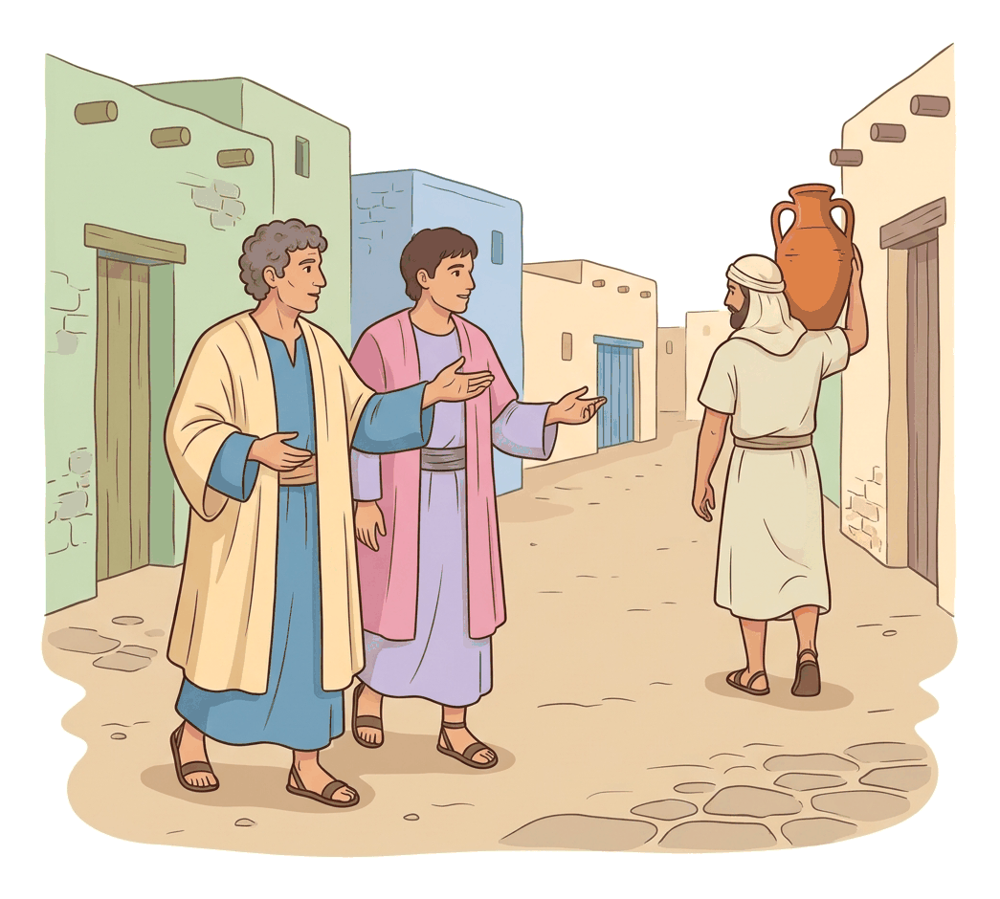
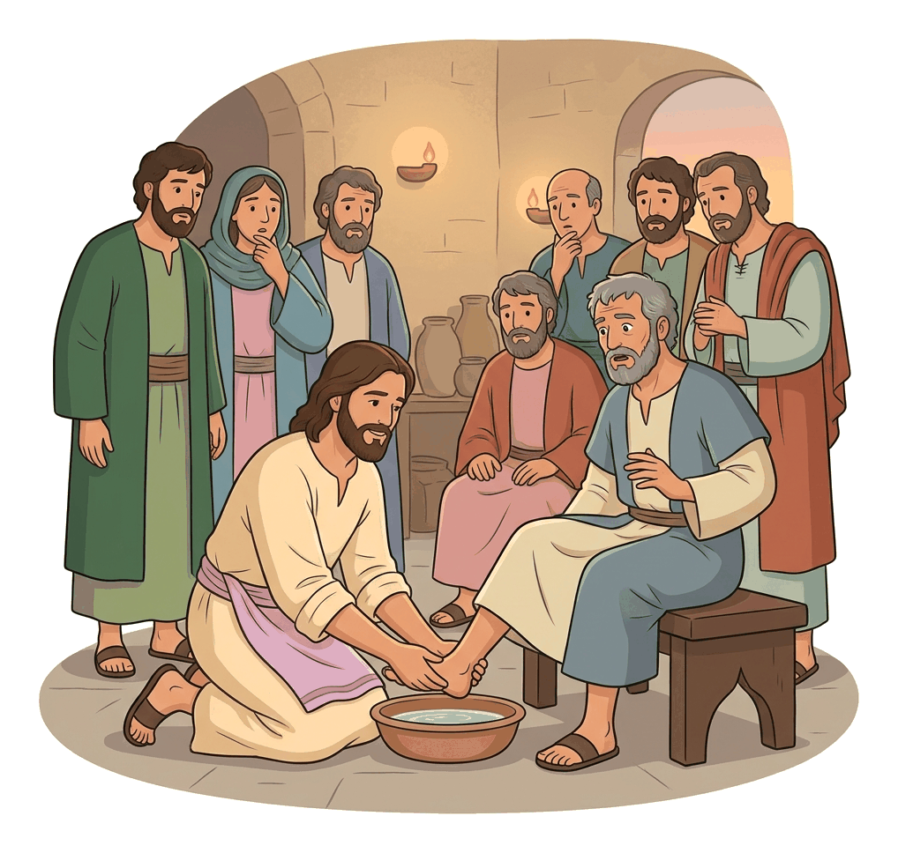
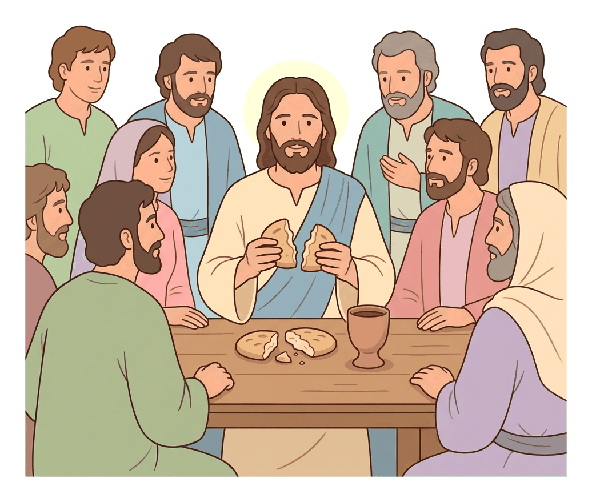

# JAMB Crk Notes: The Last Supper

## What JAMB expects

This topic is Section C, Topic 11 of the JAMB CRK syllabus: The Last Supper. It covers the events that took place in the Upper Room on the night before Jesus was crucified. 

The syllabus lists the following passages:
- Matthew 26:17-30
- Mark 14:10-26
- Luke 22:7-23
- John 13:2-38

By the end of these notes, you should be able to:
1. Trace the story of the Last Supper.
2. Evaluate the significance of the Last Supper.

**Note on the syllabus:** The syllabus requires you to study all four Gospel accounts. While the Synoptic Gospels (Matthew, Mark, and Luke) focus on the preparation for the Passover, the prediction of the betrayal, and the institution of the Lord's Supper (the bread and wine), the Gospel of John adds the washing of the disciples' feet, the giving of the New Commandment, and the specific prediction of Peter's denial in the Upper Room. These notes combine all these elements as JAMB often tests your knowledge of which detail belongs to which Gospel.

## Tracing the story of the Last Supper

**Objective i: trace the story of the Last Supper.**
**Content: Mt. 26:17-30 (and parallel Gospel accounts).**

The Last Supper took place during the Jewish festival of the **Passover** (also called the Feast of Unleavened Bread). The Passover was an annual Jewish festival commemorating how God delivered the Israelites from slavery in Egypt. During the original Passover, the blood of a lamb was painted on their doorposts so the Angel of Death would "pass over" them, and they ate bread without yeast (unleavened bread) because they had to leave Egypt in a hurry. 

Jesus used this ancient festival to introduce a new meaning for His followers, on the night He was betrayed. 

### The Prelude: Judas agrees to betray Jesus
*(Mark 14:10-11, Luke 22:3-6)*

Just before the Last Supper, **Judas Iscariot**, one of the twelve disciples, went secretly to the chief priests to betray Jesus to them. The religious leaders were delighted and promised to give him money (Matthew specifies thirty pieces of silver). From that moment, Judas began looking for an opportunity to hand Jesus over to them away from the crowds.

### The Preparation for the Passover
*(Matthew 26:17-19; Mark 14:12-16; Luke 22:7-13)*

On the first day of Unleavened Bread, when it was customary to sacrifice the Passover lamb, the disciples asked Jesus where He wanted them to prepare the Passover meal. 

Jesus gave specific, prophetic instructions:
1. He sent two disciples. (Luke specifically names them as **Peter and John**).
2. He told them to go into the city (Jerusalem), where they would meet a **man carrying a jar of water**. (In that culture, carrying water jars was almost always done by women, so a man doing this would be a clear and unusual sign).
3. They were to follow him into the house he entered and say to the owner of the house: *"The Teacher says, Where is my guest room, where I may eat the Passover with my disciples?"*
4. Jesus said the owner would show them a **large upper room**, furnished and ready. They were to make preparations there.

The disciples left, found everything exactly as Jesus had told them, and prepared the Passover meal.

### The Washing of the Disciples' Feet
*(John 13:2-17)*

The Gospel of John uniquely records a powerful event that happened during the supper. 

In ancient times, people wore open sandals and walked on dusty roads. It was the job of the lowest household servant to wash the feet of arriving guests. At the Last Supper, none of the disciples had volunteered to do this humble task.

1. **Jesus takes the role of a servant:** Jesus rose from supper, laid aside His outer garments, and tied a towel around His waist. He poured water into a basin and began to wash the disciples' feet and wipe them with the towel.
2. **Peter's objection:** When Jesus came to Simon Peter, Peter was shocked and said, "Lord, do you wash my feet?" Jesus replied that Peter did not understand now, but would later. Peter stubbornly insisted, *"Thou shalt never wash my feet."* (John 13:8). 
3. **Jesus' warning:** Jesus answered, *"If I wash thee not, thou hast no part with me."* 
4. **Peter's extreme response:** Hearing this, Peter asked Jesus to wash not only his feet but his hands and his head as well. Jesus explained that a person who has bathed only needs to wash his feet to be completely clean, adding, "And you are clean, but not every one of you" (referring secretly to Judas, the betrayer).
5. **The Lesson (Humility and Service):** After finishing, Jesus put His garments back on and sat down. He explained His actions: *"If I then, your Lord and Master, have washed your feet; ye also ought to wash one another's feet. For I have given you an example, that ye should do as I have done to you."* (John 13:14-15).

### The Prediction of the Betrayal
*(Matthew 26:20-25; Mark 14:17-21; Luke 22:21-23; John 13:21-30)*

As they were eating, Jesus became deeply troubled in spirit and made a shocking announcement: *"Verily I say unto you, that one of you shall betray me."*

This caused great sorrow and confusion among the disciples. 
- They began to ask Him one after another, *"Is it I, Lord?"*
- Jesus answered that the betrayer was the one who dipped his hand into the bowl with Him. He added a solemn warning: *"The Son of man goeth as it is written of him: but woe unto that man by whom the Son of man is betrayed! it had been good for that man if he had not been born."* (Matthew 26:24).
- **Matthew's unique detail:** Judas himself asked, *"Master, is it I?"* Jesus replied, *"Thou hast said"* (meaning "Yes, it is you"). 
- **John's unique detail:** The "disciple whom Jesus loved" (traditionally John) was reclining next to Jesus. Peter motioned to him to ask Jesus who the betrayer was. Jesus told him privately, "It is he to whom I will give this morsel of bread when I have dipped it." Jesus dipped the morsel and gave it to Judas. After Judas took the bread, **Satan entered into him**. Jesus told him, "What you are going to do, do quickly." Judas immediately left the room, and John notes powerfully: *"and it was night."*

### The Institution of the Lord's Supper
*(Matthew 26:26-30; Mark 14:22-26; Luke 22:14-20)*

After Judas left, Jesus instituted what Christians now call the Lord's Supper, Holy Communion, or the Eucharist. He used the traditional elements of the Passover meal—unleavened bread and wine—to establish a new covenant.

1. **The Bread (The Body):** 
   While they were eating, Jesus took bread, blessed it (gave thanks), broke it, and gave it to His disciples, saying:
   *"Take, eat; this is my body."* (Matthew 26:26).
   *(Luke adds: "which is given for you: this do in remembrance of me.")*

2. **The Cup (The Blood):** 
   Then He took a cup, gave thanks, and offered it to them, saying:
   *"Drink ye all of it; For this is my blood of the new testament [covenant], which is shed for many for the remission of sins."* (Matthew 26:27-28).

3. **The Promise of the Kingdom:** 
   Jesus then made a vow regarding the future: *"I will not drink henceforth of this fruit of the vine, until that day when I drink it new with you in my Father's kingdom."* 

4. **The Departure:** 
   After singing a hymn (traditionally the Hallel Psalms, Psalms 113-118, sung at the end of the Passover meal), they went out to the Mount of Olives.

### The New Commandment and Prediction of Peter's Denial
*(John 13:31-38)*

Before leaving for the Mount of Olives, John's Gospel records further teachings of Jesus in the Upper Room:
- **The New Commandment:** Jesus told them He would only be with them a little longer. He then gave them a new instruction: *"A new commandment I give unto you, That ye love one another; as I have loved you, that ye also love one another. By this shall all men know that ye are my disciples, if ye have love one to another."* (John 13:34-35).
- **Peter's Denial Predicted:** Simon Peter asked Jesus where He was going. Jesus said Peter could not follow Him now, but would later. Peter confidently declared, *"I will lay down my life for thy sake."* Jesus answered by predicting his failure: *"Verily, verily, I say unto thee, The cock shall not crow, till thou hast denied me thrice."* (The Synoptic Gospels also record this prediction, but place it on the way to the Mount of Olives).

### Comparing the Gospel Accounts of the Last Supper

JAMB often tests specific details unique to a particular Gospel. Use this table for quick revision:

| Feature/Event | Matthew | Mark | Luke | John |
| :--- | :--- | :--- | :--- | :--- |
| **Preparation Details** | Sends disciples | Mentions man with water jar | Names **Peter and John**; man with water jar | Not mentioned |
| **Washing of Feet** | Not mentioned | Not mentioned | Not mentioned | **Unique to John** |
| **Institution of Bread & Wine** | Yes | Yes | Yes (mentions two cups and "do this in remembrance of me") | Not mentioned (focuses on teachings instead) |
| **Identifying the Betrayer** | Judas asks, "Master, is it I?" | General prediction | General prediction | Jesus gives Judas a **dipped morsel** |
| **The New Commandment**| Not mentioned | Not mentioned | Not mentioned | **Unique to John** ("Love one another") |

---

## The significance of the Last Supper

**Objective ii: evaluate the significance of the Last Supper.**

The Last Supper is one of the most theologically rich events in the Bible. It marks the transition from the Old Covenant (based on the Law of Moses and animal sacrifices) to the New Covenant (based on grace and the sacrifice of Jesus). Christians believe the events of that night hold perpetual significance.

### 1. The Establishment of the New Covenant
When Jesus said, *"This is my blood of the new testament [covenant]"*, He was fulfilling a prophecy made by Jeremiah (Jeremiah 31:31). In the Old Testament, the covenant between God and Israel at Mount Sinai was sealed with the blood of sacrificed animals (Exodus 24:8). At the Last Supper, Jesus established a New Covenant between God and humanity, which would be sealed not by animal blood, but by His own blood on the cross. 

### 2. The Supreme Sacrifice for Sin
Jesus stated that His blood was *"shed for many for the remission [forgiveness] of sins."* 
- In the original Passover, the blood of a lamb saved the Israelites from physical death. 
- In the Last Supper, Jesus presents Himself as the ultimate "Passover Lamb." His upcoming death on the cross was the perfect, once-and-for-all sacrifice required to forgive human sin and save humanity from spiritual death. 
- The breaking of the bread symbolised His body being broken on the cross.

### 3. A Perpetual Memorial (Holy Communion)
By commanding His disciples, *"This do in remembrance of me"* (Luke 22:19), Jesus established a lasting sacrament or ordinance. Today, churches worldwide celebrate the Lord's Supper (also known as Holy Communion, the Eucharist, or the Mass).
- It is a time for Christians to **remember** the suffering and death of Jesus.
- It is a time for **self-examination** and repentance before God, as believers reflect on the cost of their salvation.
- Sharing from one loaf and one cup symbolises the **unity and fellowship** of all believers as one body in Christ.

### 4. An Example of Supreme Humility and Service
The foot washing (recorded in John) was a powerful, practical lesson in Christian leadership. 
- Jesus, the Lord and Master, took on the role of the lowest servant. 
- He taught that in God's kingdom, greatness is not about ruling over others with power, but about serving others in humility. 
- It challenges modern Christians and leaders (in families, schools, churches, and government) to avoid arrogance and to serve those under their care with genuine humility.

### 5. Divine Foreknowledge and Human Responsibility
The prediction of the betrayal shows Jesus' divine foreknowledge—He was not caught by surprise; He knew exactly who would betray Him and what would happen. 
However, it also highlights human responsibility. Even though Jesus' death was part of God's plan for salvation, Judas was still held morally responsible for his greedy and deceitful actions (*"woe unto that man by whom the Son of man is betrayed!"*).

### 6. Eschatological Hope (Looking to the Future)
When Jesus said He would not drink the fruit of the vine again until He drank it new in the Father's kingdom, He was offering a message of hope. The Last Supper points forward to the "messianic banquet"—a future time of ultimate joy, victory, and fellowship in heaven when Christ returns. 

## Key terms

| Term | Meaning |
| :--- | :--- |
| **Passover** | An annual Jewish festival celebrating God's deliverance of the Israelites from slavery in Egypt. |
| **Unleavened bread** | Bread made without yeast; eaten during the Passover to remember the hasty departure from Egypt. |
| **New Covenant** | The new agreement between God and humanity established by the death (blood) of Jesus, offering forgiveness of sins. |
| **Eucharist / Holy Communion** | The Christian sacrament celebrating the Last Supper, using bread and wine as symbols of Christ's body and blood. |
| **Morsel** | A small piece of food or bread; Jesus gave a dipped morsel to Judas to identify him as the betrayer. |
| **Hallel** | A group of Psalms (113–118) traditionally sung at the end of the Passover meal as a hymn of praise. |

## Exam tips and common mistakes

- **Know which Gospel says what:** This is a very common JAMB trick. 
  - If a question asks which disciples were sent to prepare the meal, the answer is **Peter and John** (only Luke names them).
  - If a question asks about the **washing of feet** or the **New Commandment**, it is strictly from the Gospel of **John**.
  - If a question asks about the **man carrying a water jar**, it is found in **Mark and Luke**.
- **The meaning of the elements:** The bread represents Jesus' body, and the wine represents His blood of the new covenant. Do not mix them up or invent other meanings.
- **The betrayer's identity:** In John, Jesus identifies the betrayer by giving him a dipped piece of bread (morsel). In Matthew, Judas asks directly, "Master, is it I?" and Jesus confirms it.
- **The hymn:** Remember that immediately after the supper, before going to the Mount of Olives, they sang a hymn. 
- **Peter's refusal:** Remember that Peter initially refused to let Jesus wash his feet, showing a misunderstanding of what Jesus was doing.

## Quick summary

1. The Last Supper took place during the Jewish Passover (Feast of Unleavened Bread).
2. Jesus sent Peter and John into Jerusalem, telling them to follow a man carrying a water jar to find the guest room.
3. During the meal, Jesus demonstrated supreme humility by washing the disciples' feet, commanding them to serve one another (recorded only in John).
4. Jesus predicted His betrayal. He identified Judas as the betrayer by giving him a dipped morsel of bread. 
5. Jesus instituted the Lord's Supper, taking bread ("this is my body") and wine ("this is my blood of the new covenant, shed for the remission of sins").
6. He commanded the disciples to continue this practice in remembrance of Him, establishing a perpetual ordinance for the Christian Church.
7. Jesus gave a New Commandment to love one another and predicted that Peter would deny Him three times before the rooster crowed.
8. The Last Supper signifies the New Covenant, the final sacrifice for sins, a model for servant-leadership, and the future hope of the Kingdom.

## Practice questions

**1. According to Luke's Gospel, which two disciples did Jesus send to prepare the Passover meal?**
- A. James and John
- B. Peter and Andrew
- C. Peter and John
- D. Philip and Thomas

**Answer: C.** According to Luke 22:8, Jesus sent Peter and John, saying, "Go and prepare the passover for us, that we may eat."

**2. Which of the following events of the Last Supper is recorded ONLY in the Gospel of John?**
- A. The breaking of the bread
- B. The singing of a hymn
- C. The washing of the disciples' feet
- D. The prediction of the betrayal

**Answer: C.** The washing of the disciples' feet (and the New Commandment) are unique to John's account of the Upper Room events. The Synoptic Gospels do not mention it.

**3. When Jesus said, "This is my blood of the new covenant, which is poured out for many", He meant that His death would**
- A. bring an end to the Roman Empire.
- B. provide forgiveness of sins for humanity.
- C. punish the Jewish religious leaders.
- D. make the disciples rich and powerful.

**Answer: B.** Jesus explicitly stated in Matthew 26:28 that His blood was shed "for the remission [forgiveness] of sins", establishing a New Covenant based on grace.

**4. During the Last Supper, how did Jesus indicate who would betray Him, according to the Gospel of John?**
- A. He pointed His finger at Judas.
- B. He gave a dipped piece of bread to Judas.
- C. He announced Judas's name loudly.
- D. He told Peter to arrest Judas.

**Answer: B.** In John 13:26, Jesus told the beloved disciple, "He it is, to whom I shall give a sop [morsel], when I have dipped it." He then gave it to Judas Iscariot.

**5. What sign did Jesus tell His disciples they would see when they entered the city to prepare the Passover?**
- A. A man riding on a donkey
- B. A woman carrying a basket of bread
- C. A man carrying a jar of water
- D. A Roman soldier standing at the gate

**Answer: C.** Jesus told them they would meet a man carrying a jar of water and they should follow him to the house (Mark 14:13; Luke 22:10).

**6. "If I wash thee not, thou hast no part with me." To whom was Jesus speaking?**
- A. Judas Iscariot
- B. John the beloved
- C. Simon Peter
- D. James

**Answer: C.** Jesus said this to Simon Peter when Peter initially refused to allow Jesus to wash his feet (John 13:8).

**7. Immediately after the institution of the Lord's Supper, what did Jesus and His disciples do before leaving for the Mount of Olives?**
- A. They prayed for three hours.
- B. They washed each other's feet.
- C. They sang a hymn.
- D. They divided the remaining bread.

**Answer: C.** Matthew 26:30 and Mark 14:26 record that "And when they had sung an hymn, they went out into the mount of Olives."

**8. The New Commandment given by Jesus during the Last Supper was that His disciples should**
- A. preach the gospel to all nations.
- B. love one another as He had loved them.
- C. observe the Sabbath strictly.
- D. refuse to pay taxes to Caesar.

**Answer: B.** In John 13:34, Jesus said, "A new commandment I give unto you, That ye love one another; as I have loved you, that ye also love one another."

**9. At the Last Supper, Jesus stated that He would not drink the fruit of the vine again until**
- A. He had risen from the dead.
- B. the Holy Spirit descended on Pentecost.
- C. He drank it new in His Father's kingdom.
- D. Judas was punished for his betrayal.

**Answer: C.** Jesus looked forward to the future eschatological hope, saying He would not drink of it again until that day when He drank it new with them in His Father's kingdom (Matthew 26:29).

**10. What is the primary theological significance of Jesus commanding His disciples to "do this in remembrance of me"?**
- A. It established a perpetual memorial and sacrament for the Christian Church.
- B. It meant they could no longer eat normal food.
- C. It proved that the Passover was an evil festival.
- D. It showed that only the twelve disciples could go to heaven.

**Answer: A.** "Do this in remembrance of me" established Holy Communion (the Eucharist) as a permanent ordinance for believers to remember His sacrifice and the New Covenant.

<!-- COVERAGE
obj i | Tracing the story of the Last Supper
obj ii | The significance of the Last Supper
Mt. 26:17-30 | Tracing the story of the Last Supper
-->
