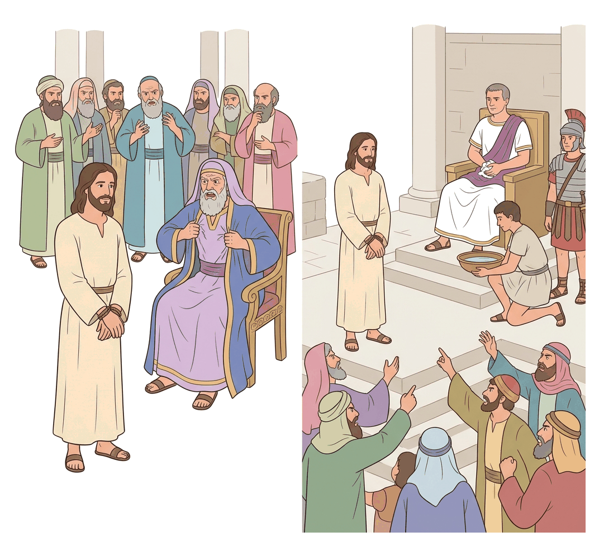
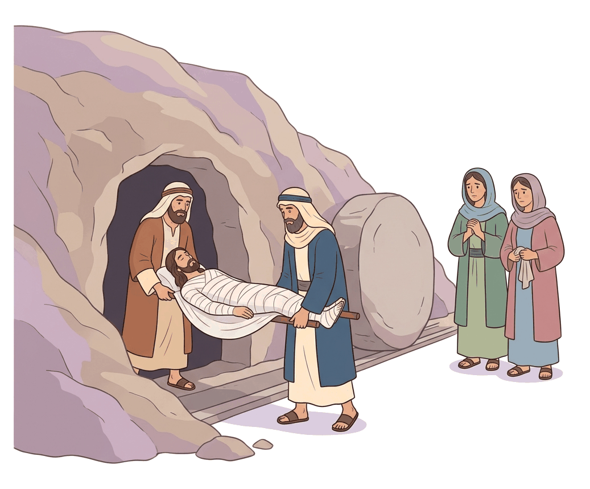

# JAMB Crk Notes: The Trials and Death of Jesus

## What JAMB expects

This topic is Section C, Topic 12 of the JAMB CRK syllabus: The trials and the death of Jesus. It covers two main content areas:

*   **(a) The trials of Jesus before:**
    *   (i) the High Priest (Matt. 26:36-75; Mark 14:53-72; Luke 22:66-71)
    *   (ii) Pilate (Matt. 27:11-26; Mark 15:1-15; Luke 23:1-5, 13-25; John 18:28-40, 19:1-16)
    *   (iii) Herod (Luke 23:6-12)
*   **(b) Crucifixion and burial of Jesus** (Matt. 27:32-66; Luke 23:26-56; Mark 15:16-47; John 19:17-42)

By the end of these notes, you should be able to:
1.  Analyse the different trials of Jesus.
2.  Describe the crucifixion and burial of Jesus.
3.  Deduce the lessons of the death of Jesus.
4.  Recount the statements of Jesus on the cross.

**Note on the syllabus wording:** For the trial before the High Priest, the syllabus lists Matthew 26:36-75. This range does not just cover the trial; verses 36-46 describe Jesus praying in Gethsemane, verses 47-56 describe His arrest, and verses 69-75 cover Peter's denial. Because these are in the assigned reading, they are summarised in these notes as the background to the trials.

## The Arrest and Peter's Denial (Background)

Before the trials began, Jesus went to the **Garden of Gethsemane** with His disciples. He was in deep sorrow and prayed three times, asking God to take the "cup" of suffering away from Him, but concluding: *"nevertheless not as I will, but as thou wilt"* (Matthew 26:39). His disciples kept falling asleep instead of keeping watch.

Soon, **Judas Iscariot** arrived with a great crowd armed with swords and clubs, sent by the chief priests and elders. Judas identified Jesus by greeting Him with a **kiss**. One of Jesus' followers (identified as Peter in John's Gospel) drew his sword and cut off the ear of the high priest's servant (Malchus). Jesus told him to put the sword away, stating that those who take the sword will perish by it, and He allowed Himself to be arrested. All the disciples fled.

While the religious trial was happening inside the high priest's house, Peter sat outside in the courtyard. Three different times, people recognised him as a follower of Jesus (noticing his Galilean accent), but Peter denied knowing Jesus with oaths and curses. Immediately, the **cock crew**, and Peter remembered Jesus' prophecy that he would deny Him three times before the cock crowed. Peter went out and wept bitterly.

## Objective i: Analyse the different trials of Jesus

**Content a(i), a(ii), a(iii): The trials of Jesus before the High Priest, Pilate, and Herod.**

The trials of Jesus took place in two stages: the **religious trial** before the Jewish authorities, and the **civil (political) trial** before the Roman authorities.

### 1. The Religious Trial before the High Priest (Sanhedrin)

After His arrest, Jesus was taken first to the Jewish leaders. Matthew and Mark record that He was taken to the house of **Caiaphas**, the high priest, where the scribes, elders, and the whole council (the **Sanhedrin**) had gathered at night. Luke places the formal hearing at daybreak. (John adds that Jesus was first taken to Annas, Caiaphas' father-in-law).

**The Trial:**
*   The chief priests sought false witnesses to testify against Jesus so they could put Him to death, but the testimonies did not agree.
*   Eventually, two witnesses came forward claiming Jesus said He was able to destroy the temple of God and rebuild it in three days. Jesus remained silent.
*   Caiaphas then put Jesus under oath: *"I adjure thee by the living God, that thou tell us whether thou be the Christ, the Son of God."* (Matthew 26:63).
*   Jesus replied, *"Thou hast said"* (meaning "Yes, it is as you say"), and added that they would see the Son of Man sitting at the right hand of Power and coming on the clouds of heaven.
*   **The Verdict:** Caiaphas tore his robes, declaring that Jesus had spoken **blasphemy** (claiming the attributes of God). The council agreed He was guilty and deserved death. They spat in His face, struck Him, and mocked Him, asking Him to prophesy who hit Him.

### 2. The First Civil Trial before Pontius Pilate

The Sanhedrin condemned Jesus to death, but under Roman rule, the Jewish leaders did not have the authority to execute anyone. Therefore, early in the morning, they bound Jesus and handed Him over to **Pontius Pilate**, the Roman governor of Judea.

**The Trial:**
*   Knowing Pilate would not care about Jewish religious laws (blasphemy), the Jewish leaders changed their accusation to **treason** (political rebellion).
*   According to Luke, they accused Jesus of three things: (1) perverting the nation, (2) forbidding the payment of taxes to Caesar, and (3) claiming to be Christ a King.
*   Pilate asked Jesus, *"Art thou the King of the Jews?"* Jesus replied, *"Thou sayest"* (meaning "It is as you say"). However, Jesus made no answer to the many accusations of the chief priests, which greatly amazed Pilate.
*   After questioning Jesus (John records Jesus saying, "My kingdom is not of this world"), Pilate went out to the Jews and declared, **"I find no fault in this man."**
*   The priests insisted that Jesus was stirring up the people from Galilee to Jerusalem. Hearing that Jesus was a Galilean, Pilate realised Jesus was under the jurisdiction of **Herod Antipas** (the ruler of Galilee), who happened to be in Jerusalem for the Passover. Pilate sent Jesus to Herod.

### 3. The Civil Trial before Herod Antipas

**This event is recorded only in the Gospel of Luke (Luke 23:6-12).**

*   Herod was very glad to see Jesus. He had heard much about Him and hoped to see Jesus perform a miracle.
*   Herod asked Jesus many questions, and the chief priests vigorously accused Him, but **Jesus made no answer at all**.
*   Disappointed, Herod and his soldiers treated Jesus with contempt and mocked Him. They arrayed Him in a **gorgeous robe** (mocking His claim to royalty) and sent Him back to Pilate.
*   Luke notes that before this day, Pilate and Herod had been enemies, but that day they became friends.

### 4. The Second Civil Trial before Pilate

When Jesus was returned, Pilate called the chief priests and the rulers, reminding them that neither he nor Herod had found Jesus guilty of any crime deserving death. Pilate offered to chastise (whip) Jesus and release Him.

**The Custom of the Passover:**
*   It was Pilate's custom to release one Jewish prisoner to the crowd at the Passover feast.
*   Pilate offered the crowd a choice between Jesus and a notorious prisoner named **Barabbas** (a robber and rebel who had committed murder in an uprising).
*   *Pilate's Wife:* Matthew records that while Pilate was sitting on the judgment seat, his wife sent a message warning him: *"Have thou nothing to do with that just man: for I have suffered many things this day in a dream because of him."* (Matthew 27:19).
*   Persuaded by the chief priests, the crowd violently demanded Barabbas. When Pilate asked what to do with Jesus, they shouted, **"Let him be crucified!"**
*   Seeing that a riot was starting, Pilate took water and **washed his hands** before the crowd, saying, *"I am innocent of the blood of this just person: see ye to it."* The people replied, *"His blood be on us, and on our children."* (Matthew 27:24-25).
*   Pilate released Barabbas. He had Jesus **scourged** (severely whipped) and handed Him over to be crucified. The Roman soldiers then stripped Jesus, put a scarlet robe on Him, placed a crown of thorns on His head, and mocked Him, hailing Him as "King of the Jews".

### Summary Comparison of the Trials

| Feature | Religious Trial | Civil Trials |
| :--- | :--- | :--- |
| **Authority** | Caiaphas and the Sanhedrin (Jewish council) | Pontius Pilate (Roman Governor) and Herod Antipas |
| **Main Charge** | Blasphemy (claiming to be the Son of God) | Treason/Sedition (claiming to be a King, opposing Caesar) |
| **Witnesses** | False witnesses who did not agree | The chief priests and the screaming crowd |
| **Verdict** | Guilty of death | Declared innocent by Pilate and Herod, but condemned to please the crowd |

## Objective ii: Describe the crucifixion and burial of Jesus

**Content b: Crucifixion and burial of Jesus.**

### The Road to Golgotha
After mocking Jesus, the soldiers led Him away to be crucified. As they were going out, they met a man from Cyrene named **Simon**, who was coming in from the country. They compelled Simon to carry Jesus' cross. Luke records that a great multitude of people followed, including women who beat their breasts and mourned for Him. Jesus told them, *"Daughters of Jerusalem, weep not for me, but weep for yourselves, and for your children."* (Luke 23:28).

### The Crucifixion
They came to a place called **Golgotha** (an Aramaic word meaning **"Place of a Skull"**; the Latin equivalent is *Calvary*).
*   **The Drink:** They offered Jesus wine mingled with gall (Matthew) or myrrh (Mark), which acted as a mild painkiller. After tasting it, He refused to drink it.
*   **The Garments:** The soldiers crucified Him and divided His garments among themselves by casting lots, fulfilling Old Testament prophecy (Psalm 22:18).
*   **The Inscription:** Pilate placed a sign over Jesus' head stating the charge against Him: **"THIS IS JESUS THE KING OF THE JEWS"** (often abbreviated as INRI from Latin). It was written in Hebrew, Latin, and Greek.
*   **The Two Thieves:** Jesus was crucified between two robbers, one on the right and one on the left.
*   **The Mockery:** People passing by, the chief priests, the scribes, and even the robbers mocked Him, saying, *"He saved others; himself he cannot save. If he be the King of Israel, let him now come down from the cross, and we will believe him."* (Matthew 27:42).

### The Death of Jesus
*   From the sixth hour (12:00 noon) until the ninth hour (3:00 PM), there was **darkness over all the land**.
*   At the ninth hour, Jesus cried out with a loud voice and yielded up His spirit (died).
*   **Miraculous Signs:** When Jesus died, the **curtain (veil) of the temple was torn in two** from top to bottom. The earth shook, rocks were split, and tombs were opened (many bodies of the saints were raised, according to Matthew).
*   **The Centurion:** Seeing the earthquake and how Jesus died, the Roman centurion guarding Him was terrified and said, *"Truly this was the Son of God"* (Matthew/Mark) or *"Certainly this was a righteous man"* (Luke).

### The Burial
Because it was the Day of Preparation (the day before the Sabbath), the Jews asked Pilate that the bodies not remain on the cross. The soldiers broke the legs of the two thieves to speed up their deaths, but finding Jesus already dead, they pierced His side with a spear, bringing out blood and water (John).

*   **Joseph of Arimathea:** A rich man and a respected member of the Jewish council (Sanhedrin) who secretly followed Jesus. He went to Pilate and boldly asked for the body of Jesus.
*   Pilate, surprised that Jesus was already dead, confirmed it with the centurion and granted Joseph the body.
*   **Nicodemus:** John's Gospel adds that Nicodemus (who had earlier visited Jesus by night) brought a mixture of myrrh and aloes (about a hundred pounds weight) to prepare the body.
*   They wrapped Jesus' body in a clean linen shroud with the spices, according to Jewish burial custom.
*   Joseph laid the body in his own **new tomb**, which he had cut out of solid rock, and rolled a great stone to the door of the tomb.
*   Mary Magdalene and "the other Mary" (the mother of Joses) sat opposite the tomb, watching where He was laid.
*   **The Guard (Matthew only):** The next day, the chief priests went to Pilate, remembering Jesus said He would rise after three days. They asked Pilate to secure the tomb so disciples couldn't steal the body. Pilate gave them a guard of soldiers, and they sealed the stone.

## Objective iv: Recount the statements of Jesus on the cross

While on the cross, Jesus spoke seven times. These statements are gathered from across all four Gospels and are known as the **"Seven Words on the Cross."** In JAMB exams, it is very important to know **which Gospel** records which statement.

1.  **"Father, forgive them; for they know not what they do." (Luke 23:34)**
    Jesus prayed for forgiveness for the Roman soldiers and those who had arranged His crucifixion, demonstrating His teaching to love one's enemies.
2.  **"Verily I say unto thee, To day shalt thou be with me in paradise." (Luke 23:43)**
    One of the thieves crucified with Jesus repented, rebuked the other mocking thief, and asked Jesus to remember him in His kingdom. Jesus promised him immediate salvation.
3.  **"Woman, behold thy son! ... Behold thy mother!" (John 19:26-27)**
    Jesus spoke to His mother, Mary, and to the "disciple whom He loved" (John). He was ensuring His mother would be cared for after His death.
4.  **"Eli, Eli, lama sabachthani?" (Matthew 27:46 / Mark 15:34)**
    This translates to *"My God, my God, why hast thou forsaken me?"* This is the only statement recorded in Matthew and Mark. It expresses the deep agony of Jesus taking on the sins of the world and feeling separated from God. It is also a direct quotation of Psalm 22:1.
5.  **"I thirst." (John 19:28)**
    This expressed His physical humanity and suffering, and led to the soldiers offering Him a sponge full of vinegar on a hyssop branch.
6.  **"It is finished." (John 19:30)**
    Jesus' final declaration in John's Gospel. The Greek word *Tetelestai* means "paid in full." He was announcing that His mission to save humanity and atone for sin was complete.
7.  **"Father, into thy hands I commend my spirit." (Luke 23:46)**
    Jesus' final words in Luke's Gospel, showing His complete trust in God as He yielded His life.

## Objective iii: Deduce the lessons of the death of Jesus

Christians draw many profound lessons and doctrines from the death of Jesus:

1.  **Atonement and Forgiveness of Sins:** Jesus is seen as the ultimate sacrifice (the Lamb of God). His death paid the penalty for humanity's sins, offering salvation to all who believe.
2.  **Direct Access to God:** The tearing of the temple veil from top to bottom is highly symbolic. The veil separated the Holy of Holies (God's presence) from the rest of the temple. Its tearing means that because of Jesus' death, all believers now have direct access to God; there is no longer a need for human high priests to make animal sacrifices.
3.  **Unconditional Love and Forgiveness:** Jesus praying for His executioners ("Father, forgive them") teaches Christians to forgive those who wrong them, no matter how severe the offence.
4.  **Complete Obedience to God's Will:** Even in extreme agony, Jesus submitted to God's plan (starting in Gethsemane). This teaches Christians to submit to God's will even when it involves suffering.
5.  **Fulfillment of Prophecy:** Jesus' trial, suffering, and death fulfilled many Old Testament prophecies (e.g., being mocked, clothes divided, pierced but no bones broken), proving His identity as the Messiah.

## Key terms

| Term | Meaning |
| :--- | :--- |
| **Sanhedrin** | The supreme religious council of the Jews, led by the High Priest. |
| **Caiaphas** | The Jewish High Priest who presided over the religious trial of Jesus. |
| **Pontius Pilate** | The Roman Governor of Judea who sentenced Jesus to be crucified. |
| **Herod Antipas** | The ruler of Galilee to whom Pilate sent Jesus. |
| **Barabbas** | A notorious robber and rebel released by Pilate instead of Jesus. |
| **Golgotha** | "The Place of a Skull", the Aramaic name for the site of the crucifixion (Calvary). |
| **Simon of Cyrene** | The man compelled by Roman soldiers to carry Jesus' cross. |
| **Joseph of Arimathea** | A wealthy member of the Sanhedrin who buried Jesus in his own new tomb. |
| **Blasphemy** | The act of insulting or showing contempt or lack of reverence for God; the religious charge against Jesus. |
| **Treason** | The crime of betraying one's country or attempting to overthrow the government; the political charge against Jesus. |

## Exam tips and common mistakes

*   **Know the difference in the charges:** The Sanhedrin convicted Jesus of *blasphemy* (a religious crime), but they accused Him before Pilate of *treason* (a political crime), because Rome wouldn't care about Jewish religious arguments.
*   **Memorise the Seven Words and their Gospels:** JAMB frequently asks which Gospel contains a specific saying.
    *   Only Matthew and Mark record *"My God, my God..."*
    *   Luke records: *"Father forgive them"*, *"Today shalt thou be with me in paradise"*, and *"Father into thy hands..."*
    *   John records: *"Woman, behold thy son"*, *"I thirst"*, and *"It is finished"*.
*   **Don't confuse Herod Antipas with Herod the Great:** Herod the Great tried to kill baby Jesus. Herod Antipas (his son) tried Jesus during the Passion.
*   **Remember Pilate's actions:** He declared Jesus innocent, washed his hands, and offered to release Jesus, but eventually yielded to the crowd.
*   **Only Luke mentions Herod:** The trial before Herod Antipas is found *only* in the Gospel of Luke.
*   **Who buried Jesus?** Joseph of Arimathea asked for the body. John's Gospel adds that Nicodemus helped him.

## Quick summary

1.  Jesus was betrayed by Judas and arrested in Gethsemane; Peter denied Him three times before the cock crowed.
2.  The Jewish religious trial was held before Caiaphas and the Sanhedrin; Jesus was condemned to death for blasphemy.
3.  The civil trials were held before Pontius Pilate, Herod Antipas, and Pilate again. The Jewish leaders accused Jesus of treason (claiming to be a King).
4.  Pilate and Herod found Jesus innocent, but Pilate gave in to the crowd, released Barabbas, and sentenced Jesus to crucifixion.
5.  Jesus was crucified at Golgotha between two thieves, after Simon of Cyrene carried His cross.
6.  Jesus spoke seven statements from the cross, died at the ninth hour, and the temple veil tore in two, signifying direct access to God.
7.  Joseph of Arimathea (aided by Nicodemus) took Jesus' body and buried Him in a new rock-cut tomb.

## Practice questions

**1. The Sanhedrin condemned Jesus to death because they found Him guilty of**

- A. treason against Caesar
- B. blasphemy against God
- C. inciting the people to riot
- D. threatening to destroy the temple

**Answer: B.** The high priest tore his robes and declared Jesus guilty of blasphemy after Jesus confirmed He was the Christ, the Son of God. (Treason was the charge used later before Pilate).

**2. Which of the following statements of Jesus on the cross is recorded only in Matthew and Mark?**

- A. "Father, forgive them; for they know not what they do."
- B. "It is finished."
- C. "My God, my God, why hast thou forsaken me?"
- D. "Father, into thy hands I commend my spirit."

**Answer: C.** "My God, my God, why hast thou forsaken me?" (Eli, Eli, lama sabachthani) is the only saying of Jesus from the cross recorded in the Gospels of Matthew and Mark.

**3. Pilate sent Jesus to Herod Antipas because**

- A. Herod was a senior Roman official.
- B. Pilate wanted Herod's advice on Jewish law.
- C. Jesus was a Galilean and under Herod's jurisdiction.
- D. the Jews demanded that Herod should judge Him.

**Answer: C.** When Pilate heard that Jesus belonged to Herod's jurisdiction (Galilee), he sent Him over to Herod, who was also in Jerusalem at that time.

**4. The man who was compelled to carry the cross of Jesus was**

- A. Joseph of Arimathea
- B. Nicodemus
- C. Simon of Cyrene
- D. Simon Peter

**Answer: C.** Simon of Cyrene was coming in from the country when the Roman soldiers forced him to carry Jesus' cross.

**5. According to Luke's Gospel, Pilate and Herod became friends on the day of Jesus' trial because**

- A. they both agreed that Jesus was guilty of treason.
- B. Pilate showed respect to Herod by sending Jesus to him.
- C. Herod helped Pilate calm the rioting crowd.
- D. they both washed their hands of Jesus' blood.

**Answer: B.** Luke 23:12 notes that Herod and Pilate became friends that day; previously they had been at enmity. Pilate's act of deferring to Herod's jurisdiction likely bridged the gap.

**6. The tearing of the temple curtain at the death of Jesus signifies**

- A. the destruction of Jerusalem.
- B. the end of the Roman Empire.
- C. that the Jews were completely rejected by God.
- D. direct access to God for all believers without an earthly priest.

**Answer: D.** The tearing of the veil (which separated the Holy of Holies from the rest of the temple) symbolises that Christ's ultimate sacrifice removed the barrier between God and humanity.

**7. Who went to Pilate to ask for the body of Jesus for burial?**

- A. Simon Peter
- B. Mary Magdalene
- C. Nicodemus
- D. Joseph of Arimathea

**Answer: D.** Joseph of Arimathea, a respected member of the council, boldly went to Pilate and asked for the body of Jesus.

**8. According to Matthew, what did Pilate's wife tell him while he was sitting on the judgment seat?**

- A. "Crucify him, for he has claimed to be King."
- B. "Have nothing to do with that just man."
- C. "Release Barabbas instead of Jesus."
- D. "Send him back to Herod."

**Answer: B.** She warned Pilate to "Have thou nothing to do with that just man", because she had suffered many things in a dream because of Him (Matthew 27:19).

**9. "Truly, I say to you, today you will be with me in Paradise." Jesus made this statement on the cross to**

- A. Mary, His mother
- B. the beloved disciple
- C. the repentant robber
- D. the Roman centurion

**Answer: C.** Jesus said this to the repentant thief who was crucified beside Him and who had asked Jesus to remember him in His kingdom (Luke 23:43).

**10. Why did the chief priests ask Pilate to place a guard at the tomb of Jesus?**

- A. To prevent wild animals from digging up the body.
- B. To stop Mary Magdalene from taking the body.
- C. Because they were afraid Jesus would resurrect immediately.
- D. To prevent His disciples from stealing the body and claiming He had risen.

**Answer: D.** They remembered Jesus' prophecy about rising after three days, and wanted to prevent the disciples from staging a fake resurrection by stealing the corpse (Matthew 27:64).

<!-- COVERAGE
obj i | Objective i: Analyse the different trials of Jesus
obj ii | Objective ii: Describe the crucifixion and burial of Jesus
obj iii | Objective iii: Deduce the lessons of the death of Jesus
obj iv | Objective iv: Recount the statements of Jesus on the cross
item a | Objective i: Analyse the different trials of Jesus
item b | Objective ii: Describe the crucifixion and burial of Jesus
-->
