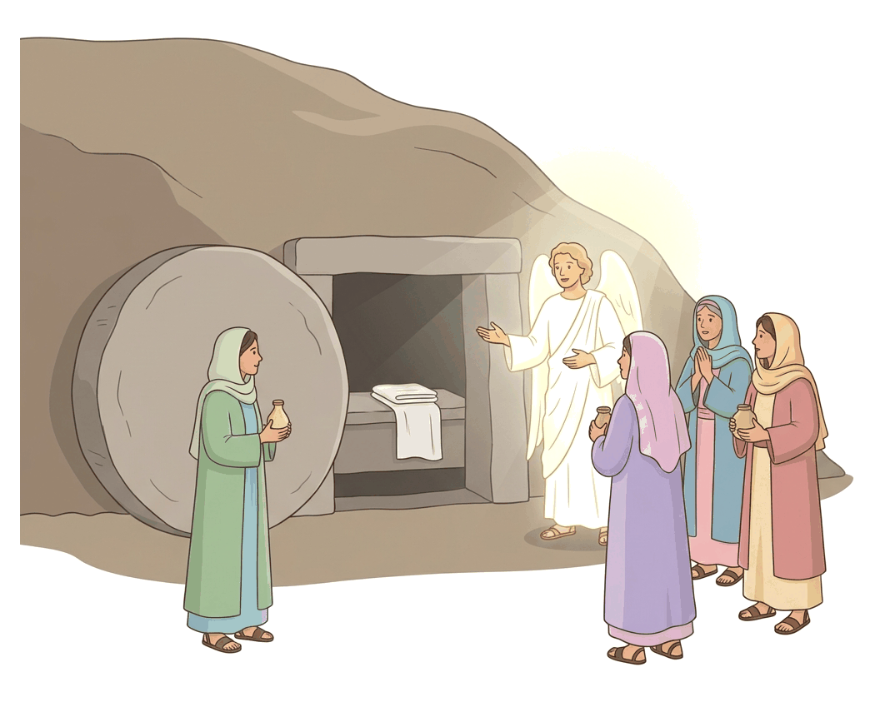
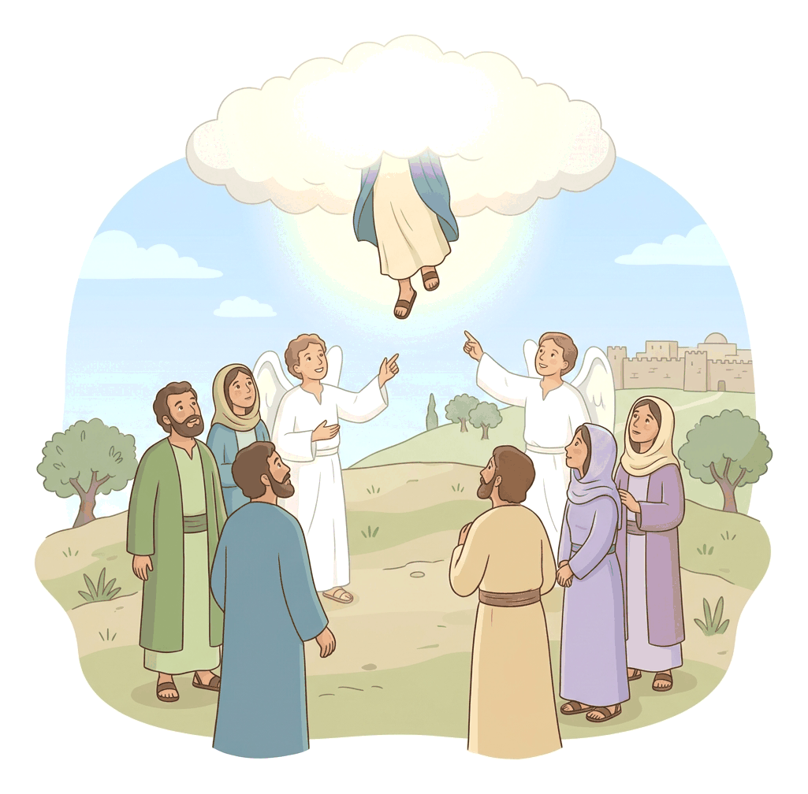

# JAMB Crk Notes: Resurrection, Appearances and Ascension of Jesus

## What JAMB expects

This topic is Section C, Topic 13 of the JAMB CRK syllabus: Resurrection, appearances and ascension of Jesus. It covers the Gospel and early Acts narratives of Christ's victory over death and His return to heaven.

The syllabus lists the following passages:
* (Mt. 28:1-20; Mk. 16:1-20; Lk. 24:1-53; Jn. 20:1-31; Acts 1:1-11)

By the end of these notes, you should be able to:
1. Trace the stories of the resurrection, appearances and ascension of Jesus.
2. Compare the personalities involved in the stories.
3. Analyse the relevance of the resurrection, appearances and ascension of Jesus.

## Objective i: trace the stories of the resurrection, appearances and ascension of Jesus

The story of Jesus' resurrection and His subsequent appearances to His disciples is recorded in all four Gospels. While they share the same core message—that the tomb was empty and Jesus appeared alive—each Gospel writer highlights different details.

### The Resurrection and Empty Tomb (Mt. 28:1-20; Mk. 16:1-20; Lk. 24:1-53; Jn. 20:1-31)

**Matthew's Account (Mt. 28:1-20)**
On Sunday morning, Mary Magdalene and "the other Mary" went to see the sepulchre (tomb). There was a great earthquake, and an angel of the Lord descended from heaven, rolled back the stone from the door, and sat upon it. His appearance was like lightning, and his clothing white as snow. The Roman guards were so terrified that they shook and became "as dead men." 
The angel told the women not to fear, for Jesus was risen. He invited them to see the empty place where Jesus lay and instructed them to go quickly and tell His disciples that He would meet them in Galilee. As they ran to tell the disciples, Jesus Himself met them, saying, "All hail." They held His feet and worshipped Him.
*The Bribery of the Guards:* Matthew uniquely records that the terrified guards went into the city and told the chief priests what had happened. The priests and elders bribed the soldiers with large sums of money, telling them to spread a lie: "His disciples came by night, and stole him away while we slept." This story circulated widely among the Jews.

**Mark's Account (Mk. 16:1-20)**
Mary Magdalene, Mary the mother of James, and Salome brought sweet spices to anoint Jesus' body. As they walked, they wondered who would roll away the heavy stone for them. Arriving, they found the stone already rolled away. Inside the tomb, they saw a "young man" (an angel) clothed in a long white garment sitting on the right side. He told them Jesus of Nazareth was risen and instructed them to tell His disciples and Peter to meet Him in Galilee. Mark notes that the women fled in terror and amazement, and initially said nothing to anyone because they were afraid.

**Luke's Account (Lk. 24:1-53)**
The women (including Mary Magdalene, Joanna, and Mary the mother of James) arrived with spices and found the stone rolled away but did not find the body. While they were perplexed, two men stood by them in "shining garments." The men asked, "Why seek ye the living among the dead?" and reminded them that Jesus had prophesied His crucifixion and resurrection while still in Galilee. The women remembered His words and returned to tell the eleven apostles. However, the apostles did not believe them; their words seemed like "idle tales." Only Peter arose and ran to the tomb, where he saw the linen clothes laid by themselves, and he departed wondering at what had happened.

**John's Account (Jn. 20:1-31)**
Mary Magdalene came to the tomb early, while it was still dark, and saw the stone taken away. Assuming the body had been stolen, she immediately ran to tell Simon Peter and "the other disciple, whom Jesus loved" (John). 
Peter and the other disciple ran to the tomb. John outran Peter and reached the tomb first. He looked in and saw the linen clothes but did not enter. Peter arrived, went inside, and saw the linen clothes lying there, and the napkin that was about Jesus' head folded together in a separate place. Then John also entered, and "he saw, and believed," even though they did not yet fully understand the scripture that Jesus must rise from the dead. They then returned home.

### The Post-Resurrection Appearances

After the empty tomb was discovered, Jesus appeared to His followers on several occasions.

**Appearance to Mary Magdalene (John 20:11-18)**
After Peter and John left, Mary stood outside the tomb weeping. Looking in, she saw two angels in white where the body of Jesus had lain. They asked why she was weeping. As she turned back, she saw Jesus standing there but did not recognize Him, thinking He was the gardener. Jesus asked her, "Woman, why weepest thou? whom seekest thou?" She asked Him where He had taken the body. 
Jesus simply said her name: "Mary." Instantly recognizing His voice, she turned and said, "Rabboni" (which means Master). Jesus told her not to hold on to Him, for He had not yet ascended to the Father, but to go and tell His "brethren" that He was ascending to His Father and their God.

**Appearance on the Road to Emmaus (Luke 24:13-35)**
Later that same day, two disciples (one named Cleopas) were walking to a village called Emmaus, about seven miles from Jerusalem. They were discussing the events of the crucifixion and the empty tomb. Jesus joined them, but their eyes were kept from recognizing Him. He asked what they were discussing and why they were sad. 
They expressed their disappointment, explaining they had hoped Jesus was the one to redeem Israel. Jesus gently rebuked them for being "slow of heart to believe" and then expounded to them all the scriptures concerning Himself, beginning from Moses and the prophets. When they arrived at Emmaus, they urged Him to stay. As they sat at meat, Jesus took bread, blessed it, broke it, and gave it to them. At that moment, "their eyes were opened, and they knew him; and he vanished out of their sight." They immediately returned to Jerusalem to tell the others.

**Appearance to the Disciples without Thomas (Luke 24:36-49; John 20:19-23)**
As the two disciples from Emmaus were telling their story to the gathered apostles in Jerusalem, Jesus suddenly stood in their midst and said, "Peace be unto you." They were terrified, thinking they were seeing a spirit. 
Jesus proved He was physically resurrected by showing them His hands and feet. He told them to handle Him, saying, "a spirit hath not flesh and bones, as ye see me have." To further prove it, He asked for food and ate a piece of broiled fish and a honeycomb before them. 
In John's account of this same evening, Jesus breathed on them and said, "Receive ye the Holy Ghost," commissioning them to forgive sins.

**Appearance to Thomas (John 20:24-31)**
Thomas, one of the twelve, was not present during that first appearance. When the others told him they had seen the Lord, Thomas declared he would not believe unless he saw the print of the nails in His hands, put his finger into the nail prints, and thrust his hand into Jesus' side.
Eight days later, the disciples were indoors again, and Thomas was with them. The doors were shut, but Jesus stood in their midst and said, "Peace be unto you." He then turned directly to Thomas and invited him to touch His hands and side, saying, "be not faithless, but believing." Thomas immediately responded with a profound declaration of faith: "My Lord and my God." Jesus replied, "Thomas, because thou hast seen me, thou hast believed: blessed are they that have not seen, and yet have believed."

**The Great Commission (Mt. 28:16-20)**
Following Jesus' instructions, the eleven disciples went to a designated mountain in Galilee. When they saw Him, they worshipped Him, though some still doubted. Jesus approached them and delivered the Great Commission:
"All power is given unto me in heaven and in earth. Go ye therefore, and teach all nations, baptizing them in the name of the Father, and of the Son, and of the Holy Ghost: Teaching them to observe all things whatsoever I have commanded you: and, lo, I am with you alway, even unto the end of the world."

### The Ascension (Lk. 24:50-53; Acts 1:1-11)

The ascension is the event where Jesus was taken up into heaven, marking the end of His physical post-resurrection appearances on earth.

**Luke's Account (Lk. 24:50-53)**
Jesus led His disciples out as far as Bethany. He lifted His hands and blessed them. "And it came to pass, while he blessed them, he was parted from them, and carried up into heaven." The disciples worshipped Him and returned to Jerusalem with great joy, where they spent their time continually in the temple, praising and blessing God.

**The Account of the Ascension: Acts 1:1-11**
Luke provides a more detailed account in the Book of Acts (which he also wrote). He notes that Jesus showed Himself alive after His passion by "many infallible proofs," being seen by the disciples for **forty days**, and speaking of the things concerning the kingdom of God.
Jesus commanded them not to depart from Jerusalem but to wait for the "promise of the Father" (the Holy Spirit). The disciples, still hoping for a political deliverance, asked if He was about to restore the kingdom to Israel. Jesus replied that it was not for them to know the times or seasons, but He promised:
"But ye shall receive power, after that the Holy Ghost is come upon you: and ye shall be witnesses unto me both in Jerusalem, and in all Judaea, and in Samaria, and unto the uttermost part of the earth." (Acts 1:8)
After saying these things, as they watched, He was taken up, and a cloud received Him out of their sight. While they were looking steadfastly toward heaven, two men in white apparel (angels) stood by them. They said, "Ye men of Galilee, why stand ye gazing up into heaven? this same Jesus, which is taken up from you into heaven, shall so come in like manner as ye have seen him go into heaven."

## Objective ii: compare the personalities involved in the stories

The resurrection narratives feature various individuals whose reactions to the miraculous events differed greatly. Examining their personalities helps us understand the different ways people respond to faith and divine revelation.

| Personality | Role in the Narrative | Key Characteristics and Response |
| :--- | :--- | :--- |
| **Mary Magdalene** | First to the tomb (often with other women); first to see the risen Christ in John and Mark. | **Devoted and persistent:** She remained at the tomb weeping when others left. She showed deep emotional attachment but lacked initial understanding (thought the body was stolen, mistook Jesus for a gardener). Her sorrow turned instantly to faith upon hearing Jesus call her name. |
| **Peter** | Heard the women's report and ran to the tomb. Entered the tomb to investigate. | **Impulsive and seeking:** Unlike the other apostles who dismissed the women's report as "idle tales," Peter took action. He was curious and bewildered, departing "wondering in himself" (Luke) before fully understanding. |
| **John (The Beloved Disciple)** | Ran to the tomb with Peter; arrived first but waited outside initially. | **Perceptive and faithful:** He outran Peter (showing eagerness), but deferred to Peter to enter first. Upon seeing the neatly folded grave clothes, he "saw, and believed" without having seen Jesus yet. |
| **Thomas** | Absent during Jesus' first appearance to the group. Refused to believe without physical proof. | **Skeptical but honest:** Known as "Doubting Thomas," he demanded empirical evidence (touching the wounds). However, once confronted with the truth, his confession ("My Lord and my God") was the highest declaration of Christ's divinity in the Gospels. |
| **Cleopas & Companion** | Disciples walking to Emmaus who encountered Jesus. | **Disappointed but open-hearted:** They were disillusioned, thinking Jesus' mission had failed. However, their hearts "burned within them" when Jesus explained the scriptures. They were hospitable (inviting the stranger in) and their faith was ignited through the breaking of bread. |
| **The Chief Priests and Elders** | Heard the report of the resurrection from the Roman guards. | **Corrupt and obstinate:** Confronted with undeniable supernatural evidence (the earthquake, angels, empty tomb), they chose deceit over belief. They bribed the soldiers to spread a lie, protecting their political and religious power. |
| **The Roman Guards** | Assigned to guard the tomb. Witnessed the angel rolling away the stone. | **Fearful and pragmatic:** Hardened soldiers who were paralyzed by fear ("became as dead men") at the divine manifestation. Later, they pragmatically accepted a bribe to lie, valuing money and safety over the truth. |

## Objective iii: analyse the relevance of the resurrection, appearances and ascension of Jesus

The events of the resurrection, post-resurrection appearances, and ascension are the cornerstone of the Christian faith. Without them, Christianity would not exist.

### Relevance of the Resurrection
1. **Victory over Death and Sin:** The resurrection proves that Jesus conquered death, which Christians believe is the ultimate consequence of sin. It demonstrates God's power over mortality.
2. **Validation of Jesus' Identity:** It serves as the ultimate proof that Jesus is the Son of God and that all His earthly claims and teachings were true.
3. **Foundation of the Christian Faith:** As the Apostle Paul later taught, if Christ is not risen, Christian preaching is empty, and faith is in vain (1 Corinthians 15). The resurrection is the central pillar of the Gospel.
4. **Guarantee of Future Resurrection:** For Christians, Jesus' resurrection is the "firstfruits" (the guarantee) that believers will also be resurrected to eternal life at the end of time.

### Relevance of the Appearances
1. **Proof of Bodily Resurrection:** The appearances proved that Jesus was not a ghost, spirit, or hallucination. By eating fish, allowing Thomas to touch His wounds, and walking with disciples, Jesus proved His resurrection was physical and real.
2. **Restoration of Faith:** The disciples were shattered, afraid, and hiding after the crucifixion. The appearances restored their courage, turning them from fearful individuals into bold witnesses willing to die for their faith.
3. **Commissioning for Mission:** It was during these appearances that Jesus gave the Great Commission, officially passing the mandate to His disciples to preach the Gospel to all nations.

### Relevance of the Ascension
1. **Exaltation and Glorification:** The ascension marked the end of Jesus' earthly humiliation and His return to heavenly glory, taking His rightful place at the right hand of God the Father, possessing all authority.
2. **Preparation for the Holy Spirit:** Jesus had taught that He must go away so that the Comforter (the Holy Spirit) could come. The ascension prepared the way for the outpouring of the Holy Spirit on the Day of Pentecost.
3. **Intercession:** Christians believe that ascended into heaven, Jesus now serves as a High Priest, continuously interceding (praying) for believers before God.
4. **Promise of the Second Coming:** The ascension sets the pattern for Jesus' promised return. The angels explicitly stated that He would return in the exact same manner as He left—visibly, in the clouds.

## Key terms

| Term | Meaning |
| :--- | :--- |
| **Resurrection** | The act of rising from the dead; specifically, Jesus coming back to life on the third day. |
| **Ascension** | The event where Jesus was visibly taken up into heaven, 40 days after His resurrection. |
| **The Great Commission** | Jesus' final command to His disciples to go, teach, and baptize all nations (Matthew 28). |
| **Emmaus** | The village to which two disciples were travelling when the resurrected Jesus joined them. |
| **Rabboni** | A respectful Hebrew/Aramaic title meaning "Master" or "Teacher," used by Mary Magdalene. |
| **Sepulchre** | A stone tomb or burial chamber where Jesus was laid. |
| **Infallible proofs** | Undeniable evidence; a phrase Luke uses in Acts 1 to describe how Jesus proved He was alive. |

## Exam tips and common mistakes

* **Know who went to the tomb:** While Mary Magdalene is in all four accounts, Matthew mentions "the other Mary," Mark adds Salome, and Luke mentions Joanna.
* **Know the differences at the tomb:** Matthew mentions an earthquake and an angel sitting on the stone. Mark mentions a young man on the right side. Luke mentions two men in dazzling apparel. John mentions two angels sitting where the body had lain.
* **Identify the Gospel:** JAMB often tests which Gospel contains a specific event. 
    * The bribery of the guards is ONLY in **Matthew**.
    * The Road to Emmaus is ONLY in **Luke**.
    * "Doubting Thomas" is ONLY in **John**.
    * Jesus eating broiled fish is in **Luke**.
* **The Ascension timeline:** According to Acts 1, Jesus appeared to His disciples for **40 days** before ascending.
* **Ascension Location:** Luke 24 says He led them out as far as **Bethany**, while Acts 1 notes they returned from the **Mount of Olives** (Bethany is on the eastern slope of the Mount of Olives). Both refer to the same event.
* **Thomas's confession:** Remember the exact words: "My Lord and my God" (John 20:28).

## Quick summary

1. The four Gospels record the discovery of the empty tomb on Sunday morning by women, primarily Mary Magdalene, who were met by angelic messengers declaring Jesus had risen.
2. The chief priests bribed the Roman guards to say the disciples stole Jesus' body while they slept (Matthew).
3. Jesus appeared to Mary Magdalene (who thought He was the gardener), the women, two disciples on the road to Emmaus, the assembled apostles, and to Thomas.
4. Jesus proved His bodily resurrection by showing His wounds, allowing Himself to be touched, and eating food.
5. In Galilee, Jesus gave the Great Commission, commanding the disciples to teach and baptize all nations.
6. Forty days after His resurrection, Jesus led His disciples to the Mount of Olives (Bethany) and visibly ascended into heaven.
7. Two angels promised that Jesus would return in the same manner He was taken up.
8. The resurrection proves Christ's divinity and victory over death, while the ascension seated Him at God's right hand to intercede for believers and send the Holy Spirit.

## Practice questions

**1. According to Matthew's Gospel, what story were the Roman guards bribed to tell?**
- A. That Jesus was not truly dead when buried
- B. That an angel blinded them and took the body
- C. That the disciples came by night and stole the body while they slept
- D. That Mary Magdalene secretly moved the body

**Answer: C.** The chief priests gave "large money" to the soldiers to spread the lie that His disciples stole Him away while they slept (Matthew 28:13).

**2. Which of the following disciples said he would not believe Jesus had resurrected until he put his finger in the nail prints?**
- A. Peter
- B. Thomas
- C. John
- D. Cleopas

**Answer: B.** Thomas (often called Doubting Thomas) demanded physical proof in John 20:25 before he would believe.

**3. In Luke's account, how did the two disciples on the road to Emmaus finally recognize Jesus?**
- A. When He explained the prophecies of Moses
- B. When they saw the nail marks in His hands
- C. When He vanished out of their sight
- D. When He took bread, blessed, and broke it

**Answer: D.** Their eyes were opened and they recognized Him in the breaking of the bread, after which He vanished (Luke 24:30-31).

**4. According to Acts of the Apostles, for how many days did Jesus show Himself to His disciples after His resurrection?**
- A. 3 days
- B. 7 days
- C. 40 days
- D. 50 days

**Answer: C.** Acts 1:3 states that He was seen of them for forty days, speaking of the things pertaining to the kingdom of God.

**5. Which two disciples ran to the tomb after hearing Mary Magdalene's report?**
- A. Peter and John
- B. Peter and James
- C. Thomas and Matthew
- D. Cleopas and John

**Answer: A.** Peter and "the other disciple, whom Jesus loved" (John) ran to the tomb (John 20:2-4).

**6. Jesus' final command in Matthew's Gospel to "teach all nations, baptizing them..." is commonly referred to as the**
- A. Beatitudes
- B. Great Confession
- C. Great Commission
- D. Sermon on the Mount

**Answer: C.** The command to go and make disciples of all nations in Matthew 28:19-20 is universally known as the Great Commission.

**7. When Mary Magdalene recognized Jesus at the tomb, she called Him "Rabboni", which means**
- A. Saviour
- B. Messiah
- C. Master
- D. Lord of Hosts

**Answer: C.** John 20:16 explicitly translates the Hebrew/Aramaic word Rabboni as meaning "Master" (or Teacher).

**8. To prove to His frightened disciples that He was not a spirit, Jesus did all the following EXCEPT**
- A. Show them His hands and feet
- B. Ask them to handle (touch) Him
- C. Eat a piece of broiled fish
- D. Walk on water before them

**Answer: D.** Jesus showed His hands and feet, asked to be touched, and ate fish and honeycomb (Luke 24:39-43) to prove He was physical. He did not walk on water during this appearance.

**9. What did the two men in white apparel tell the disciples immediately after the Ascension?**
- A. They must begin preaching in Samaria immediately
- B. Jesus would return in the exact same manner as He left
- C. They should return to Galilee to wait for the Holy Spirit
- D. Jesus had gone to prepare a place for them

**Answer: B.** In Acts 1:11, the angels said, "this same Jesus, which is taken up from you into heaven, shall so come in like manner as ye have seen him go into heaven."

**10. One major relevance of the Ascension of Jesus is that it**
- A. marked the exact moment death was defeated
- B. proved that Jesus was a ghost
- C. prepared the way for the coming of the Holy Spirit
- D. showed that the disciples were now equal to angels

**Answer: C.** The Ascension was necessary because Jesus had stated that He must return to the Father so that the Holy Spirit (the Comforter) could be sent to empower the Church.

<!-- COVERAGE
obj i | Objective i: trace the stories of the resurrection, appearances and ascension of Jesus
obj ii | Objective ii: compare the personalities involved in the stories
obj iii | Objective iii: analyse the relevance of the resurrection, appearances and ascension of Jesus
Mt. 28:1-20 | The Resurrection and Empty Tomb (Mt. 28:1-20; Mk. 16:1-20; Lk. 24:1-53; Jn. 20:1-31)
Mk. 16:1-20 | The Resurrection and Empty Tomb (Mt. 28:1-20; Mk. 16:1-20; Lk. 24:1-53; Jn. 20:1-31)
Lk. 24:1-53 | The Resurrection and Empty Tomb (Mt. 28:1-20; Mk. 16:1-20; Lk. 24:1-53; Jn. 20:1-31)
Jn. 20:1-31 | The Resurrection and Empty Tomb (Mt. 28:1-20; Mk. 16:1-20; Lk. 24:1-53; Jn. 20:1-31)
Acts 1:1-11 | The Ascension (Lk. 24:50-53; Acts 1:1-11)
-->
