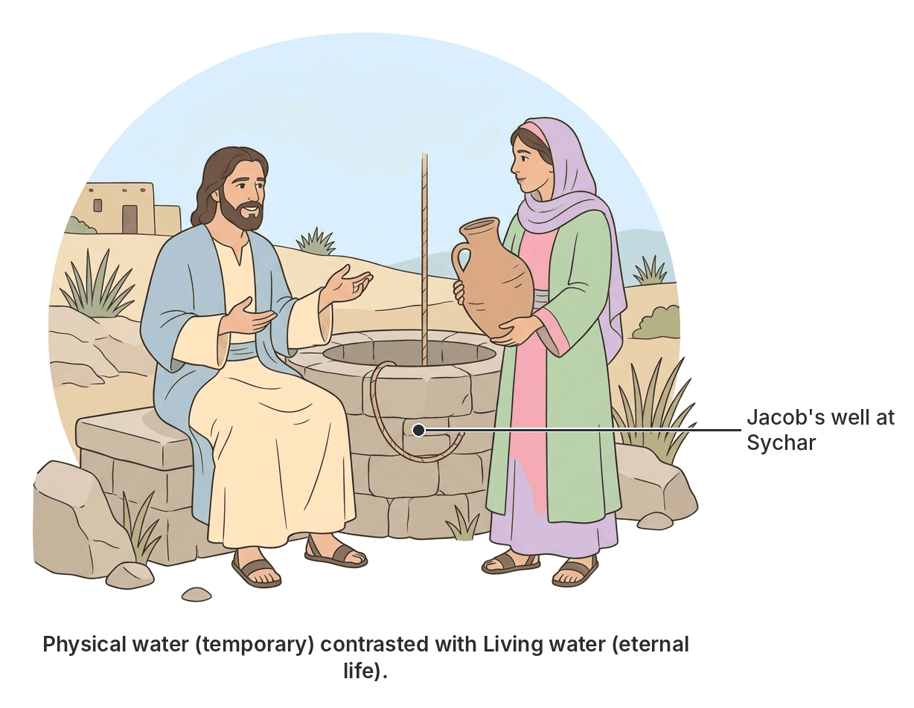
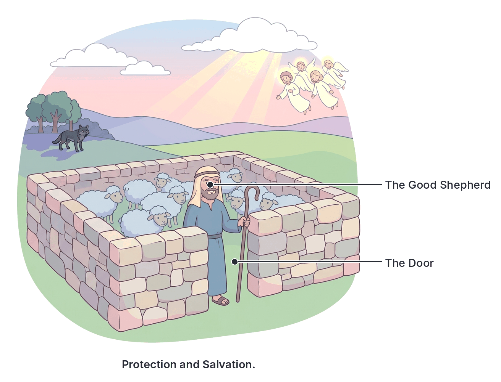

# JAMB Crk Notes: Jesus' Teachings About Himself

## What JAMB expects

This topic is Section C, Topic 14 of the JAMB CRK syllabus: Jesus' teachings about Himself. It focuses on the Gospel of John, where Jesus uses powerful symbols (often starting with "I AM") to explain who He is and why He came.

This file covers the following content items:
- (a) The Bread of Life and the Living Water (Jn. 4:7-15; 6:25-58)
- (b) The Light of the World (Jn. 1:4-8; 3:19-21; 8:12; 9:1-5; 12:35-36; 1 Jn. 1:5-7)
- (c) The Door, the Lamb and the Good Shepherd (Jn. 1:29-34; 10:1-18)
- (d) The True Vine (Jn. 15:1-11)
- (e) The Resurrection (Jn. 11:25)

By the end of these notes, you should be able to:
1. analyse the different teachings of Jesus about Himself;
2. deduce the reasons for Jesus' teachings about Himself;
3. interpret the meanings of the symbols used by Jesus about Himself.

## Reasons for Jesus' teachings about Himself

**Objective ii: deduce the reasons for Jesus' teachings about Himself.**

In the Gospel of John, Jesus frequently uses the phrase "I AM" followed by a metaphor (like the bread, the door, or the vine). Christians teach that these statements were given for several vital reasons:

1. **To reveal His divine identity:** In the Old Testament (Exodus 3:14), God revealed His name to Moses as "I AM THAT I AM". When Jesus used the "I AM" sayings, He was claiming equality with God and revealing His divine origin.
2. **To explain His earthly mission:** The symbols show that He came to provide salvation, spiritual nourishment, guidance, and the ultimate sacrifice for humanity's sins.
3. **To make spiritual truths easy to understand:** By using everyday, familiar objects from agriculture and daily life (water, bread, sheep, vines, light), Jesus helped ordinary people grasp deep spiritual realities.
4. **To show the necessity of a personal relationship with Him:** Teachings like "abiding in the vine" or "eating the bread" emphasise that a person must be intimately connected to Jesus to receive eternal life.
5. **To correct false expectations:** Many Jews wanted a political Messiah to fight the Romans or provide physical miracles (like endless physical bread). Jesus used these teachings to show that His kingdom and His blessings were primarily spiritual.

## Analysing the different teachings of Jesus about Himself

**Objective i: analyse the different teachings of Jesus about Himself.**

The Gospel of John records distinct conversations and events where Jesus explained His identity. The analysis of these teachings is broken down into the key passages below.

### The Bread of Life and the Living Water

**Content (a): The Bread of Life and the Living Water (Jn. 4:7-15; 6:25-58)**

#### The Living Water (John 4:7-15)

1. **Who and where:** Jesus and a Samaritan woman at Jacob's well in the city of Sychar, in Samaria.
2. **The request:** Jesus, being tired and thirsty, asked the woman for a drink. The woman was shocked because Jews usually refused to associate with Samaritans.
3. **The offer:** Jesus told her that if she knew the gift of God and who was asking her for a drink, she would have asked Him, and He would have given her "living water".
4. **The misunderstanding:** The woman pointed out that the well was deep and He had no bucket. She asked if He was greater than their ancestor Jacob, who provided the well.
5. **The explanation:** Jesus explained the difference between the two waters: "Whosoever drinketh of this water shall thirst again: But whosoever drinketh of the water that I shall give him shall never thirst; but the water that I shall give him shall be in him a well of water springing up into everlasting life" (Jn. 4:13-14).
6. **The outcome:** The woman, still thinking of physical water and wanting an easier life, asked Him to give her this water so she would never be thirsty or have to travel to the well again.

#### The Bread of Life (John 6:25-58)

1. **Who and where:** Jesus and the large crowd He had just miraculously fed with five loaves and two fish, gathered at Capernaum.
2. **The confrontation:** When the crowd found Jesus, He rebuked them for seeking Him just to fill their stomachs. He told them to work not for food that perishes, but for food that endures to eternal life, which the Son of man would give them.
3. **The demand for a sign:** The people asked for a sign, comparing Jesus to Moses, who they claimed gave their ancestors manna (bread from heaven) in the wilderness.
4. **The declaration:** Jesus corrected them, stating that God, not Moses, gives the true bread from heaven. He declared, **"I am the bread of life: he that cometh to me shall never hunger; and he that believeth on me shall never thirst."** (Jn. 6:35).
5. **The deeper meaning:** Jesus explained that He is the living bread that came down from heaven. He made a difficult statement: the bread is His flesh, given for the life of the world.
6. **The outcome:** The Jews argued among themselves about how He could give them His flesh to eat. Jesus insisted that unless they eat the flesh of the Son of man and drink His blood, they have no life in them. 

*(Note: Christians generally teach that "eating His flesh and drinking His blood" is a metaphor for fully believing in Him and accepting His sacrificial death on the cross. Many denominations also connect this to the Holy Communion.)*

### The Light of the World

**Content (b): The Light of the World (Jn. 1:4-8; 3:19-21; 8:12; 9:1-5; 12:35-36; 1 Jn. 1:5-7)**

Jesus and His apostles frequently used the contrast between light and darkness to analyse and explain salvation and truth. 

- **John 1:4-8 (The Prologue):** The Gospel of John introduces Jesus (the Word) by stating, "In him was life; and the life was the light of men." The light shines in the darkness, and the darkness could not overcome it. The text clarifies that John the Baptist was not that Light, but was sent simply to bear witness to the Light.
- **John 3:19-21 (Nicodemus discourse context):** Jesus analysed why some reject Him: light has come into the world, but men loved darkness rather than light because their deeds were evil. Those who do evil hate the light because it exposes their sins. However, those who live by the truth come to the light.
- **John 8:12:** Jesus boldly declared to the people, **"I am the light of the world: he that followeth me shall not walk in darkness, but shall have the light of life."**
- **John 9:1-5 (Healing the blind man):** Before healing a man born blind, Jesus told His disciples that the blindness was an opportunity for God's works to be displayed. He stated, "As long as I am in the world, I am the light of the world," proving it by giving both physical and spiritual sight to the man.
- **John 12:35-36:** Jesus warned the crowd that the light would be with them only a little while longer. He urged them to walk while they had the light, so darkness would not overtake them, and to "believe in the light, that ye may be the children of light."
- **1 John 1:5-7 (The Epistle):** John writes that the core message of Jesus is that "God is light, and in him is no darkness at all." If a person claims to have fellowship with God but walks in darkness (sin), they lie. If they walk in the light, they have fellowship with other believers, and the blood of Jesus cleanses them from all sin.

### The Door, the Lamb and the Good Shepherd

**Content (c): The Door, the Lamb and the Good Shepherd (Jn. 1:29-34; 10:1-18)**

#### The Lamb of God (John 1:29-34)

1. **The declaration:** When John the Baptist saw Jesus coming toward him, he pointed and declared, **"Behold the Lamb of God, which taketh away the sin of the world."**
2. **The testimony:** John analysed Jesus' identity, explaining that Jesus was the one he had prophesied about—the one who ranked before him because He existed before him.
3. **The proof:** John testified that God had told him that the one on whom the Holy Spirit descended and remained would be the one who baptises with the Holy Spirit. John saw the Spirit descend from heaven like a dove and remain on Jesus, confirming that Jesus is the Son of God.

#### The Door and the Good Shepherd (John 10:1-18)

Jesus used the setting of a sheepfold (a pen where sheep were kept safe at night) to teach about His role.

1. **The Door (John 10:1-10):** 
   - Jesus taught that anyone who does not enter the sheepfold by the door, but climbs in another way, is a thief and a robber. The sheep know the true shepherd's voice and follow him.
   - When the people did not understand, Jesus plainly said, **"I am the door of the sheep."** 
   - He explained that anyone who enters through Him will be saved, finding safety and pasture. He contrasted Himself with the thief whose only purpose is to "steal, and to kill, and to destroy." Jesus came so that His followers might have life, and have it abundantly.
2. **The Good Shepherd (John 10:11-18):**
   - Jesus declared, **"I am the good shepherd: the good shepherd giveth his life for the sheep."**
   - He contrasted Himself with a "hireling" (a hired worker). A hired worker does not own the sheep and does not truly care for them. When a wolf comes, the hireling runs away, leaving the sheep to be attacked and scattered.
   - Jesus noted that He has "other sheep" (meaning the Gentiles) who are not of this fold, and He must bring them in too, so there will be "one fold, and one shepherd."
   - Jesus analysed His own upcoming death by emphasizing it was voluntary: "No man taketh it from me, but I lay it down of myself. I have power to lay it down, and I have power to take it again."

### The True Vine

**Content (d): The True Vine (Jn. 15:1-11)**

In the Old Testament, the vine was a common symbol for the nation of Israel. Jesus presented Himself as the *true* and perfect vine.

1. **The analogy:** Jesus told His disciples, **"I am the true vine, and my Father is the husbandman [gardener]."**
2. **The Father's work:** Jesus taught that the Father cuts off every branch in Him that bears no fruit. However, every branch that does bear fruit, He prunes (purges) it so that it will bear even more fruit.
3. **The necessity of abiding:** Jesus stressed absolute dependence on Him: "As the branch cannot bear fruit of itself, except it abide in the vine; no more can ye, except ye abide in me." He warned that apart from Him, they can do nothing.
4. **The consequences:** If a person does not abide in Jesus, they are cast away like a withered branch, gathered up, and thrown into the fire to be burned.
5. **The reward of obedience:** If believers abide in Jesus and keep His commandments, they will remain in His love. Their prayers will be answered, they will bear much fruit (bringing glory to the Father), and their joy will be full.

### The Resurrection

**Content (e): The Resurrection (Jn. 11:25)**

1. **Who and where:** Jesus and Martha at Bethany, shortly after the death of her brother, Lazarus, who had been in the tomb for four days.
2. **The conversation:** Martha expressed her faith, saying that if Jesus had been there, Lazarus would not have died. When Jesus said her brother would rise again, Martha assumed He was referring to the general resurrection of the dead at the end of the world.
3. **The declaration:** Jesus shifted her focus from a future *event* to His present *person*. He declared: **"I am the resurrection, and the life: he that believeth in me, though he were dead, yet shall he live."**
4. **The significance:** Jesus was teaching that He does not merely possess the power to give life; He *is* the source of life itself. He proved this claim moments later by raising Lazarus from the dead.

## Interpreting the meanings of the symbols used by Jesus

**Objective iii: interpret the meanings of the symbols used by Jesus about Himself.**

Jesus deliberately used symbols that possessed deep spiritual meanings. To understand His teachings fully, we must interpret what each element of His metaphors represents in Christian theology.

| Symbol / Concept | Interpretation / Spiritual Meaning |
| :--- | :--- |
| **Physical water / Manna** | Temporary, physical satisfaction that does not last; the old ways of trying to satisfy spiritual hunger. |
| **Living Water** | The Holy Spirit and the gift of eternal life that permanently satisfies the soul's spiritual thirst. |
| **The Bread of Life** | Jesus Himself, who provides spiritual nourishment and sustains eternal life. |
| **Eating flesh / drinking blood** | Believing in Jesus completely, internalising His teachings, and accepting His sacrifice on the cross. |
| **Light** | God's truth, holiness, purity, spiritual guidance, and life. |
| **Jesus as the Light** | The one who reveals God's truth, exposes human sin, and guides believers safely out of spiritual ignorance. |
| **Darkness** | Sin, spiritual blindness, evil deeds, and separation from God. |
| **The Lamb of God** | Jesus as the perfect, innocent sacrifice provided by God to pay the penalty for humanity's sins (mirroring the Passover lamb). |
| **The Door** | Jesus as the only legitimate way to access God's kingdom and receive salvation. |
| **The Good Shepherd** | Jesus as the loving, dedicated protector and leader who willingly dies for His followers. |
| **The Sheep** | Believers / true followers of Jesus who listen to and obey His voice. |
| **The Hireling / Thief** | Self-serving, false religious leaders who abandon, exploit, or destroy the people. |
| **The Wolf** | Danger, persecution, or the devil seeking to destroy believers. |
| **The True Vine** | Jesus, the sole source of spiritual life, nourishment, and strength. |
| **The Husbandman (Gardener)** | God the Father, who actively cares for, oversees, and disciplines the branches. |
| **The Branches** | Believers / followers of Jesus. |
| **Bearing fruit** | Living a righteous life, showing Christian character (love, joy, peace), and doing good works. |
| **Pruning (Purging)** | God's discipline and the removal of sinful habits to make a believer more spiritually productive. |
| **Withered branches / Fire** | Those who reject Jesus and fail to produce fruit, leading to spiritual death and judgment. |
| **The Resurrection and the Life** | Jesus is the conqueror of death and the very source of eternal life. Eternal life is found in a relationship with His person, not just in a future event. |

## Key terms

| Term | Meaning |
| :--- | :--- |
| **I AM sayings** | Seven profound statements in John's Gospel where Jesus uses metaphors to describe His divine identity and mission. |
| **Manna** | The physical bread from heaven that God provided to the Israelites in the wilderness. |
| **Living Water** | A metaphor for the Holy Spirit and the permanent spiritual satisfaction found in Jesus. |
| **Husbandman** | A farmer or gardener; used by Jesus to describe God the Father's role in tending the "vine". |
| **Abide** | To remain, stay, or be deeply connected; central to the teaching of the True Vine. |
| **Hireling** | A hired worker who cares only for his wages, used to describe false leaders who abandon the sheep. |
| **Passover lamb** | The lamb sacrificed by Israelites in Egypt; Jesus is the ultimate fulfillment as the "Lamb of God". |
| **Pruning (Purging)** | The agricultural practice of cutting back branches to encourage better growth; a metaphor for God's discipline. |

## Exam tips and common mistakes

*   **Match the location/person to the teaching:** The Living Water was taught to the Samaritan woman at Sychar (Jacob's well). The Bread of Life was taught to the crowd at Capernaum after the feeding of the 5,000.
*   **Know the difference between the Door and the Shepherd:** In John 10, Jesus is *both*. The Door represents Him as the only *entrance* to salvation. The Good Shepherd represents Him as the *protector* who dies for the sheep.
*   **Identify the characters in the True Vine:** A very common JAMB question asks who the Husbandman is. Answer: God the Father. Jesus is the Vine, believers are the branches.
*   **Understand the "Lamb of God":** John the Baptist (not an apostle or Jesus Himself) said this. It specifically points to Jesus' role in taking away the *sin of the world* through sacrifice.
*   **Remember the context of the Resurrection saying:** Jesus said "I am the resurrection and the life" to *Martha* (not Mary), just before raising Lazarus. 
*   **Don't confuse literal and spiritual:** In all these teachings, Jesus' listeners usually misunderstood Him by thinking literally (the woman wanted physical water; the crowd wanted physical bread). Jesus was always teaching about spiritual, eternal realities.

## Quick summary

1. Jesus used powerful symbols to reveal His divine identity, explain His mission, and make spiritual truths easy for ordinary people to grasp.
2. At Jacob's well in Sychar, Jesus offered a Samaritan woman **Living Water**, symbolising eternal life and the Holy Spirit that permanently satisfies spiritual thirst.
3. At Capernaum, Jesus declared Himself the **Bread of Life**, teaching that true spiritual nourishment and eternal life come only through believing in Him and accepting His sacrifice.
4. Jesus is the **Light of the World**, bringing truth, exposing sin, and guiding believers out of spiritual darkness.
5. John the Baptist identified Jesus as the **Lamb of God**, the perfect sacrifice meant to take away the sins of the world.
6. Jesus is the **Door** (the only way to salvation) and the **Good Shepherd** (the loving leader who voluntarily lays down His life to protect His sheep).
7. Jesus is the **True Vine** and God the Father is the Gardener. Believers are the branches who must abide in Jesus to bear good fruit, while fruitless branches are cut off and burned.
8. Before raising Lazarus, Jesus told Martha He is the **Resurrection and the Life**, showing that He Himself is the source of eternal life and the conqueror of death.

## Practice questions

**1. Jesus taught about the "Living Water" during His conversation with a woman at a well in**
- A. Jerusalem
- B. Capernaum
- C. Sychar
- D. Bethany

**Answer: C.** Jesus met the Samaritan woman at Jacob's well in the city of Sychar in Samaria.

**2. In the teaching of the True Vine, Jesus identified the Husbandman as**
- A. Himself
- B. the Holy Spirit
- C. the Apostles
- D. God the Father

**Answer: D.** Jesus said, "I am the true vine, and my Father is the husbandman" (John 15:1).

**3. "Behold the Lamb of God, which taketh away the sin of the world." This statement was made by**
- A. Peter
- B. John the Baptist
- C. Jesus Christ
- D. Nicodemus

**Answer: B.** John the Baptist said this when he saw Jesus coming toward him, identifying Jesus as the perfect sacrifice for sin (John 1:29).

**4. According to Jesus, what makes the Good Shepherd different from a hireling?**
- A. The Good Shepherd feeds the sheep every day.
- B. The Good Shepherd builds a stronger sheepfold.
- C. The Good Shepherd lays down his life for the sheep.
- D. The Good Shepherd leads the sheep to living water.

**Answer: C.** Jesus taught that a hireling flees when danger comes, but the Good Shepherd voluntarily gives His life to protect the sheep.

**5. Jesus declared "I am the resurrection, and the life" in the context of**
- A. His own resurrection on Easter morning.
- B. healing the man born blind.
- C. the death of Lazarus.
- D. the Last Supper.

**Answer: C.** He made this statement to Martha in Bethany, just before He raised her brother Lazarus from the dead (John 11:25).

**6. Why did Jesus rebuke the crowd that followed Him to Capernaum before giving the "Bread of Life" discourse?**
- A. Because they had brought weapons to make Him king by force.
- B. Because they were seeking Him only to get their stomachs filled with physical food.
- C. Because they refused to believe in the miracles they had seen.
- D. Because they were Pharisees trying to trick Him.

**Answer: B.** Jesus told them, "ye seek me, not because ye saw the miracles, but because ye did eat of the loaves, and were filled," urging them to seek spiritual food instead.

**7. In the Gospel of John, what is the consequence for a branch that does not bear fruit?**
- A. It is pruned so it can heal.
- B. It is grafted onto a new vine.
- C. It is taken away, cast forth, and burned.
- D. It is left alone until the next season.

**Answer: C.** Jesus warned that any branch in Him that does not bear fruit is taken away by the Father, and withered branches are cast into the fire.

**8. When Jesus referred to Himself as the "Door of the sheep," He meant that He is**
- A. the one who protects the temple gates.
- B. the sole legitimate entrance to salvation and God's kingdom.
- C. the one who keeps the Gentiles out of Israel.
- D. the barrier between sinners and God.

**Answer: B.** Jesus said, "I am the door: by me if any man enter in, he shall be saved" (John 10:9).

**9. According to 1 John 1:5-7, walking in the light results in**
- A. instant wealth and prosperity.
- B. the ability to perform miracles.
- C. fellowship with one another and cleansing from sin.
- D. immunity from physical death.

**Answer: C.** The scripture says, "if we walk in the light... we have fellowship one with another, and the blood of Jesus Christ his Son cleanseth us from all sin."

**10. What is a primary reason Jesus used everyday symbols like bread, water, and vines to teach about Himself?**
- A. To prove to the Jews that He was a skilled farmer and shepherd.
- B. To hide His true identity from the Romans.
- C. To help ordinary people understand profound spiritual truths about His divine mission.
- D. To fulfill the laws of Moses regarding agriculture.

**Answer: C.** Jesus used familiar, physical objects to explain deep spiritual realities, such as humanity's need for spiritual nourishment, guidance, and salvation.

<!-- COVERAGE
obj i | Analysing the different teachings of Jesus about Himself
obj ii | Reasons for Jesus' teachings about Himself
obj iii | Interpreting the meanings of the symbols used by Jesus
item a | The Bread of Life and the Living Water
item b | The Light of the World
item c | The Door, the Lamb and the Good Shepherd
item d | The True Vine
item e | The Resurrection
-->
