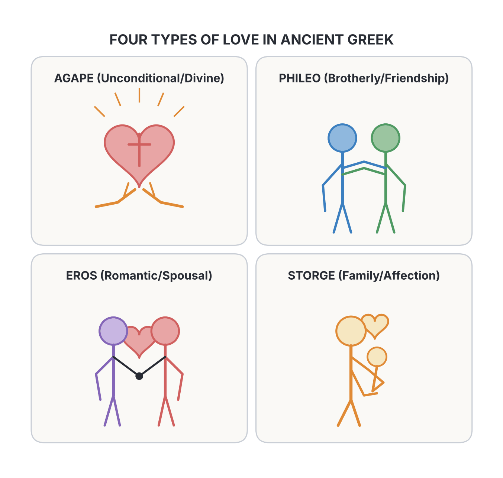
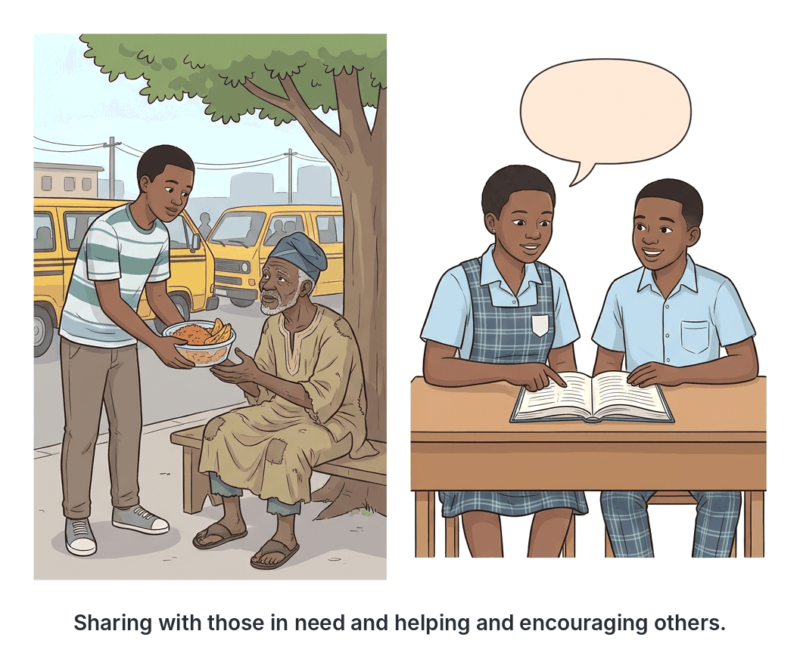

# JAMB Crk Notes: Love

## What JAMB expects

This topic is Section C, Topic 15 of the JAMB CRK syllabus: Love. It covers the biblical teachings on God's love for humanity and the Christian duty to love others.

The syllabus covers two main content items:
- **a.** God’s love for man (John 3:16-18)
- **b.** Love for one another (John 13:34-35; 15:12-13; 1 Corinthians 13; cf. 1 John 4:7-21)

By the end of these notes, you should be able to:
1. Describe God’s love for man.
2. Identify various types of love.
3. Specify the ways they can love one another.
4. Evaluate the significance of love.

**Note on the syllabus wording:** In the syllabus, 1 Corinthians 13 is printed with a lowercase "c" as `1 cor. 13`. This is a minor typographical error; the standard abbreviation is 1 Cor. 13.

## God's love for man

**Objective i: describe God’s love for man.**
**Content a: God's love for man (John 3:16-18)**

The central theme of the Christian message is that God has a deep, unconditional, and sacrificial love for humanity. This is most famously captured in the Gospel of John.

### The gift of the Son (John 3:16)
The Bible says, *"For God so loved the world, that he gave his only begotten Son, that whosoever believeth in him should not perish, but have everlasting life"* (John 3:16). 

From this verse, God's love is described in several ways:
1. **Universal:** God's love is directed toward the whole "world" (all of humanity), regardless of race, background, or past mistakes.
2. **Sacrificial:** Love is not just a feeling; it involves giving. God gave His most precious possession, His "only begotten Son" (Jesus Christ), to die for the sins of humanity.
3. **Redemptive:** The purpose of this love is to save people from perishing (eternal destruction) and to offer them everlasting life.
4. **Conditional on belief:** While the love is offered to everyone, the benefit of everlasting life is received only by "whosoever believeth in him."

### Salvation, not condemnation (John 3:17-18)
Jesus further explained that God did not send His Son into the world to condemn the world. Instead, the mission was entirely driven by love to ensure that the world might be saved through Him. 
- **Those who believe** in Jesus are not condemned. 
- **Those who do not believe** are condemned already, because they have rejected the only means of salvation provided by God's love (the name of the only begotten Son of God).

## Various types of love

**Objective ii: identify various types of love.**

The English word "love" is used to describe many different feelings (e.g., "I love my mother," "I love rice," "I love my wife"). However, in the original Greek language (which the New Testament was written in), there are four distinct words used to identify various types of love. JAMB expects you to know these four types:

| Type of Love (Greek) | Meaning and Characteristics | Examples |
| --- | --- | --- |
| **Agape** | Unconditional, selfless, and sacrificial love. It is the highest form of love, based on the will and commitment rather than feelings. This is the love God has for humanity and the love Christians are commanded to show others. | God giving Jesus to die for sinners; a person forgiving an enemy. |
| **Phileo** | Brotherly love, deep friendship, and affection. It is a mutual love between people who share common interests and respect each other. | The friendship between David and Jonathan; close friends in school. |
| **Eros** | Romantic, passionate, or sexual love. It is based on physical attraction and desire. (Note: This word does not appear in the New Testament, but is a recognized Greek concept of love). | The love between a husband and a wife. |
| **Storge** | Natural family love and affection. It is the protective and natural bond shared between family members. | A mother's love for her baby; love between siblings. |

In Christian teaching, **Agape** is the standard for how believers should treat God and one another.

## Love for one another

**Objective iii: specify the ways they can love one another.**
**Content b: Love for one another (Jn. 13:34-35; 15:12-13; 1 Cor. 13; cf. 1 Jn. 4:7-21)**

Jesus and the apostles emphasized that receiving God's love must result in showing love to others.

### Jesus' New Commandment (John 13:34-35; 15:12-13)
During the Last Supper, Jesus gave His disciples a direct command: *"A new commandment I give unto you, That ye love one another; as I have loved you, that ye also love one another"* (John 13:34). 
- **The standard of love:** They were not just to love their neighbour as themselves (the Old Testament law), but to love **as Jesus loved them** (with unconditional, sacrificial *Agape* love).
- **The mark of discipleship:** Jesus declared that this love would be the distinguishing mark of Christians to the outside world: *"By this shall all men know that ye are my disciples, if ye have love one to another"* (John 13:35).
- **The ultimate sacrifice:** In John 15:12-13, Jesus repeated this command and set the highest measure for love: *"Greater love hath no man than this, that a man lay down his life for his friends."* Jesus practically demonstrated this by dying on the cross.

### Paul's Hymn to Love (1 Corinthians 13)
The Apostle Paul wrote a detailed description of what Christian love looks like in practice. This chapter is often called the "Hymn to Love."

**1. The Supremacy of Love (Verses 1-3):**
Paul explained that without love, all spiritual gifts and good works are useless:
- Speaking in human or angelic tongues without love is just like a noisy gong or a "sounding brass, or a tinkling cymbal."
- Having the gift of prophecy, knowing all mysteries, and having faith that can move mountains means **nothing** if there is no love.
- Even giving away all one's money to the poor or giving one's body to be burned as a martyr is completely useless if it is not motivated by love.

**2. The Characteristics of Love (Verses 4-7):**
Paul specifies how true love behaves.
- **What love is:** Patient (suffers long), kind, rejoices in the truth, bears all things, believes all things, hopes all things, endures all things.
- **What love is NOT:** It does not envy, does not boast (vaunteth not itself), is not proud (puffed up), does not behave rudely (unseemly), does not seek its own selfish interests, is not easily provoked to anger, and keeps no record of wrongs (thinketh no evil). It does not rejoice in injustice (iniquity).

**3. The Permanence of Love (Verses 8-13):**
Spiritual gifts are temporary. Prophecies will fail, tongues will cease, and knowledge will vanish away. However, love never fails. Paul concludes that out of the three great Christian virtues—faith, hope, and love (charity)—*"the greatest of these is charity (love)."*

### John's teaching on love (1 John 4:7-21)
The Apostle John wrote extensively about love in his epistles, stating plainly that **"God is love."**
- **The source of love:** Love comes from God. Anyone who loves is born of God and knows God. Anyone who does not love does not know God.
- **The proof of God's love:** God manifested His love by sending His only begotten Son to be the "propitiation" (an atoning sacrifice) for our sins.
- **Our response:** Because God loved us so much, we ought to love one another. If we love one another, God dwells in us.
- **Love and Fear:** "There is no fear in love; but perfect love casteth out fear."
- **The test of true love:** A person cannot claim to love God whom they have not seen, while hating their brother whom they have seen. John calls such a person a liar. The commandment is clear: he who loves God must love his brother also.

### Practical ways to love one another
Applying these teachings to everyday life in Nigeria, Christians can specify their love for one another by:
1. **Forgiving offenses:** Keeping no record of wrongs when schoolmates, siblings, or neighbours offend them.
2. **Sharing resources:** Giving food, clothes, and financial help to the poor, widows, and orphans in the community, especially during hard economic times.
3. **Rejecting tribalism and nepotism:** Treating every Nigerian with kindness and fairness, regardless of their ethnic group, language, or denomination.
4. **Sacrificing time:** Visiting the sick in hospitals, comforting the bereaved, and helping weaker students with their studies.
5. **Praying for others:** Interceding for friends, family, and even enemies.
6. **Being patient and kind:** Avoiding unnecessary anger, insults, and rudeness in public transport, markets, and homes.

## The significance of love

**Objective iv: evaluate the significance of love.**

From the biblical texts, the significance (importance and value) of love in the Christian faith cannot be overstated. It is significant because:

1. **It is the foundation of salvation:** God's love for humanity is the sole reason Jesus was sent to die, providing salvation and eternal life (John 3:16). Without it, humanity would be condemned.
2. **It identifies true believers:** Love is the badge or uniform of Christianity. Jesus said the world will recognize His disciples not by their miracles, wealth, or church attendance, but by their genuine love for one another (John 13:35).
3. **It validates spiritual gifts:** According to Paul, no matter how gifted a person is in preaching, tongues, or faith, without love, they are spiritually empty and useless (1 Cor. 13:1-3).
4. **It proves a relationship with God:** John writes that "God is love." Therefore, a person who hates others does not know God and is living a lie, while a person who loves demonstrates that they are born of God (1 John 4:7-8, 20).
5. **It brings peace and casts out fear:** True love eliminates fear of judgment and promotes a peaceful, trusting relationship with God and humans (1 John 4:18).
6. **It is eternal:** While human knowledge and spiritual gifts will eventually pass away, love is permanent and will endure forever (1 Cor. 13:8).

## Key terms

| Term | Meaning |
| --- | --- |
| Agape | Unconditional, sacrificial, and divine love; the highest form of Christian love. |
| Phileo | Brotherly love, deep friendship, and mutual affection. |
| Eros | Romantic or sexual love between spouses. |
| Storge | Natural affection, such as the love of parents for their children. |
| Begotten | Uniquely born; Jesus is described as the "only begotten Son" of God. |
| Condemnation | A sentence of doom or punishment; John 3:17 says Jesus came to save, not condemn. |
| Charity | An old English word used in the King James Version of 1 Corinthians 13 to translate the Greek word for *Agape* (love). |
| Propitiation | An atoning sacrifice that turns away wrath and restores favor (1 John 4:10). |

## Exam tips and common mistakes

*   **Know the Greek words:** JAMB often asks questions identifying the types of love. Remember that *Agape* is unconditional/sacrificial, *Phileo* is friendship, *Eros* is romantic, and *Storge* is family.
*   **The mark of a disciple:** If a question asks how men will know Jesus' disciples, the answer is "by their love for one another" (John 13:35) — not by their faith, miracles, or fasting.
*   **1 Corinthians 13 vs. 1 John 4:** Remember who wrote what. Paul wrote 1 Corinthians 13 (the characteristics of love, "sounding brass", faith/hope/love). John wrote 1 John 4 ("God is love", "perfect love casts out fear"). 
*   **The greatest virtue:** In 1 Corinthians 13, the three things that remain are faith, hope, and charity (love), but the *greatest* of these is love.
*   **John 3:16-17 purpose:** Jesus was sent into the world to save it, not to condemn it. 
*   **Common mistake:** Do not assume "charity" in 1 Cor. 13 (KJV) only means giving money to the poor. Verse 3 says you can give all your goods to the poor and still not have "charity" (true Agape love).

## Quick summary

1. God showed His supreme, universal, and sacrificial love by giving His only Son, Jesus Christ, so that believers might have everlasting life and avoid condemnation.
2. The four types of love in Greek thought are Agape (divine/unconditional), Phileo (friendship), Eros (romantic), and Storge (family affection). Agape is the Christian standard.
3. Jesus gave a new commandment to His followers: to love one another just as He loved them, which serves as the identifying mark of true discipleship.
4. The greatest expression of love is laying down one's life for one's friends.
5. According to Paul (1 Cor. 13), without love, all spiritual gifts, extreme sacrifices, and knowledge are entirely useless.
6. Love is patient, kind, forgiving, and eternal. Of faith, hope, and love, love is the greatest.
7. John teaches that "God is love," and it is impossible to genuinely love God while hating a fellow human being. Perfect love casts out fear.

## Practice questions

**1. According to Jesus in the Gospel of John, by what sign will all men know who His true disciples are?**
- A. By their ability to perform great miracles
- B. By their deep knowledge of the law
- C. By their love for one another
- D. By their fasting and prayers

**Answer: C.** Jesus said in John 13:35, "By this shall all men know that ye are my disciples, if ye have love one to another."

**2. Which of the following Greek words represents the unconditional, sacrificial love that God has for humanity?**
- A. Eros
- B. Phileo
- C. Agape
- D. Storge

**Answer: C.** *Agape* is the unconditional, selfless love of God, which Christians are commanded to show to others.

**3. According to Paul in 1 Corinthians 13, speaking in the tongues of men and angels without love is like**
- A. a dark cloud without rain
- B. a sounding brass or a tinkling cymbal
- C. a tree without fruit
- D. a house built on sand

**Answer: B.** Paul says in 1 Cor. 13:1 that without love, speaking in tongues is just like a "sounding brass, or a tinkling cymbal" (meaningless noise).

**4. According to John 3:17, God did not send His Son into the world to**
- A. establish a new earthly kingdom
- B. judge the angels
- C. condemn the world
- D. heal the sick

**Answer: C.** John 3:17 says, "For God sent not his Son into the world to condemn the world; but that the world through him might be saved."

**5. How does the Apostle John describe a person who claims to love God but hates his brother?**
- A. A hypocrite
- B. A pharisee
- C. A liar
- D. A sinner

**Answer: C.** 1 John 4:20 says, "If a man say, I love God, and hateth his brother, he is a liar: for he that loveth not his brother whom he hath seen, how can he love God whom he hath not seen?"

**6. Which of the following is NOT a characteristic of love according to Paul's teaching in 1 Corinthians 13?**
- A. It is patient
- B. It keeps a record of wrongs
- C. It does not boast
- D. It is kind

**Answer: B.** 1 Cor. 13:5 says love "thinketh no evil" (which translates to keeping no record of wrongs). Therefore, keeping a record of wrongs is *not* a characteristic of love.

**7. Jesus taught that the greatest love a man can show is to**
- A. give all his money to the poor
- B. preach the gospel to his enemies
- C. lay down his life for his friends
- D. forgive those who offend him seventy times seven

**Answer: C.** In John 15:13, Jesus states, "Greater love hath no man than this, that a man lay down his life for his friends."

**8. The type of love that exists naturally between family members, such as a mother and her child, is called**
- A. Agape
- B. Storge
- C. Phileo
- D. Eros

**Answer: B.** *Storge* is the Greek term used for natural family affection and the bond between family members.

**9. According to 1 John 4, what is the effect of "perfect love"?**
- A. It casts out fear
- B. It brings wealth and prosperity
- C. It covers a multitude of sins
- D. It performs miracles

**Answer: A.** 1 John 4:18 states, "There is no fear in love; but perfect love casteth out fear: because fear hath torment."

**10. Paul concluded his teaching on love in 1 Corinthians 13 by listing three enduring virtues, but stated that the greatest is love. What are the other two?**
- A. Truth and peace
- B. Faith and hope
- C. Joy and patience
- D. Grace and mercy

**Answer: B.** 1 Cor. 13:13 says, "And now abideth faith, hope, charity [love], these three; but the greatest of these is charity."

<!-- COVERAGE
obj i | ## God's love for man
obj ii | ## Various types of love
obj iii | ## Love for one another
obj iv | ## The significance of love
item a | ## God's love for man
item b | ## Love for one another
-->
