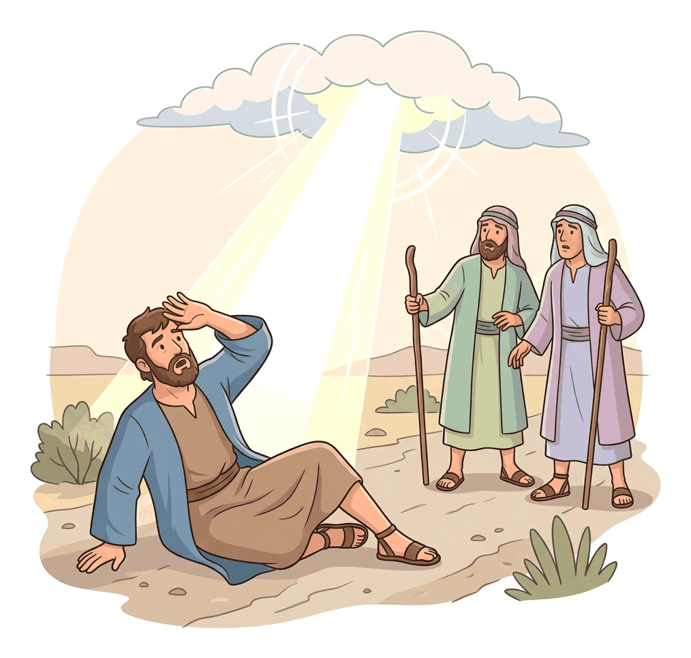
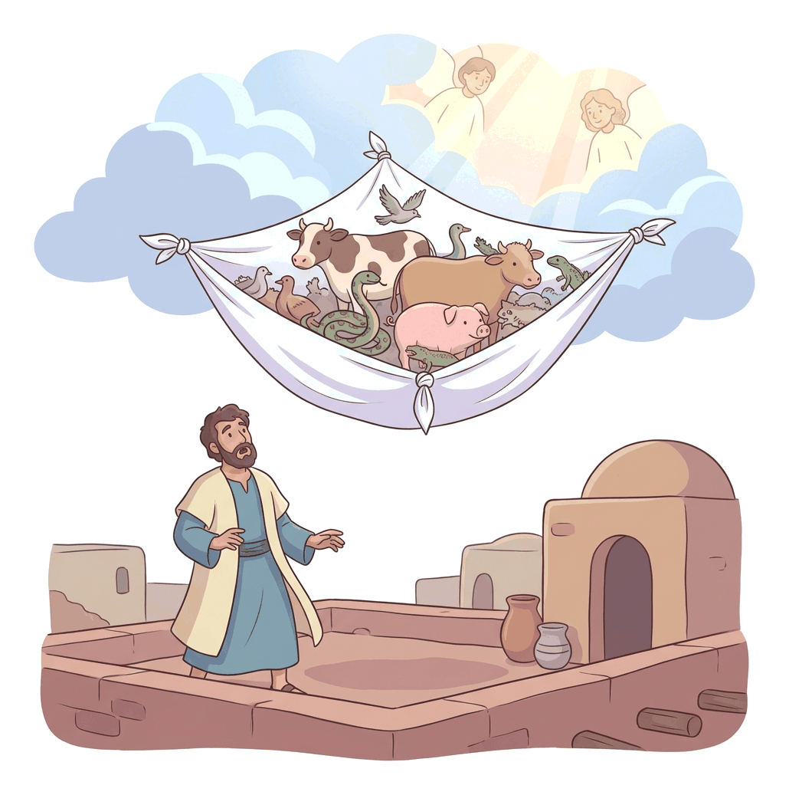

# JAMB Crk Notes: Mission to the Gentiles

## What JAMB expects

This topic is Section C, Topic 19 of the JAMB CRK syllabus: Mission to the Gentiles. It covers the crucial period in the early church when the Gospel spread beyond the Jewish people to the non-Jewish world (the Gentiles). It includes the following content items:

- **a.** Conversion of Saul (Acts 9:1-30; 22:4-21; 26:9-18)
- **b.** Conversion of Cornelius (Acts 10:1-48)
- **c.** The commissioning and mission of Paul (Acts 13; 14:1-20)
- **d.** The Council of Jerusalem (Acts 15:1-35; Gal. 2:1-21)

By the end of these notes, you should be able to:

1. Compare the conversions of Saul and Cornelius.
2. Analyse the commissioning and mission of Paul.
3. Examine the main decisions at the Council of Jerusalem.
4. Identify the personalities involved at the Council of Jerusalem.
5. Examine the relevance of the main decisions at the Council of Jerusalem.
6. Assess Paul’s role in the mission to the Gentiles.

## Conversion of Saul

**Content a: Conversion of Saul.**

Saul (who later became known as Paul) was a strict Jewish Pharisee from Tarsus. He was a zealous defender of Jewish law and fiercely persecuted the early Christians (whom he called followers of "the Way"), believing they were destroying the traditions of his fathers.

The story of his conversion is told as a clear sequence of events in Acts 9, with Paul later retelling it in his own words in Acts 22 (before a Jewish crowd in Jerusalem) and Acts 26 (before King Agrippa).

1. **The journey to Damascus:** Still "breathing out threatenings and slaughter" against the disciples, Saul went to the high priest in Jerusalem. He obtained official letters allowing him to go to the synagogues in Damascus to arrest any Christians he found and bring them bound to Jerusalem.
2. **The divine encounter:** As he came near Damascus, a sudden, blinding light from heaven flashed around him. He fell to the earth and heard a voice saying, *"Saul, Saul, why persecutest thou me?"* (Acts 9:4).
3. **The revelation:** Saul asked, "Who art thou, Lord?" The voice replied, *"I am Jesus whom thou persecutest..."* (In his later account in Acts 26, Paul notes that Jesus added, *"it is hard for thee to kick against the pricks"*, meaning it is useless to fight against God's will).
4. **The blindness:** The men travelling with Saul stood speechless; they heard a voice but saw no man (in Acts 22, Paul clarifies that they saw the light but did not understand the voice). Saul was told to go into the city to receive instructions. When he stood up and opened his eyes, he was completely blind. His companions had to lead him by the hand into Damascus, where he fasted (eating and drinking nothing) for three days.
5. **The role of Ananias:** In Damascus, God spoke to a disciple named Ananias in a vision, instructing him to go to the house of Judas on a street called Straight, and lay hands on Saul of Tarsus. Ananias hesitated, reminding God of how much evil Saul had done to the saints in Jerusalem.
6. **God's purpose for Saul:** The Lord reassured Ananias, declaring that Saul was a *"chosen vessel"* unto Him, specifically called to bear Christ's name before the **Gentiles**, kings, and the children of Israel, and that Saul would suffer greatly for His name's sake.
7. **Sight restored and baptism:** Ananias obeyed. He went to the house, laid his hands on Saul, and called him "Brother Saul." He told him Jesus had sent him so he might receive his sight and be filled with the Holy Spirit. Immediately, something like scales fell from Saul's eyes. He regained his sight, arose, and was baptized.
8. **The aftermath:** After eating and regaining his strength, Saul immediately began preaching in the synagogues that Christ is the Son of God. The people were amazed at his transformation. Soon, the Jews in Damascus plotted to kill him, but his fellow disciples saved his life by lowering him down the outside of the city wall in a basket at night.

## Conversion of Cornelius

**Content b: Conversion of Cornelius.**

The conversion of Cornelius is a landmark event in Christian history because it proved that the Gospel was not just for the Jews, but also for the Gentiles.

1. **Cornelius' vision:** Cornelius was a Roman centurion (a commander of 100 soldiers) of the Italian band stationed in Caesarea. He was a Gentile, but the Bible describes him as a devout man who feared God, gave much alms (charity) to the people, and prayed constantly. Around the ninth hour of the day (3:00 PM), he had a vision of an angel who told him that his prayers and alms had come up as a memorial before God. The angel instructed him to send men to Joppa to bring back Peter, who was lodging with Simon the tanner by the seaside.
2. **Peter's vision in Joppa:** The next day, as Cornelius' messengers were approaching Joppa, Peter went up to the housetop to pray around the sixth hour (noon). He became very hungry and fell into a trance. He saw heaven open and a vessel descending like a great sheet tied at the four corners. Inside were all kinds of four-footed beasts, wild animals, creeping things, and birds.
3. **The command to eat:** A voice said, *"Rise, Peter; kill, and eat."* Peter, a strict Jew who kept the laws of Moses, refused, saying he had never eaten anything common or unclean. The voice replied, *"What God hath cleansed, that call not thou common"* (Acts 10:15). This happened three times before the sheet was taken back into heaven.
4. **The meeting:** While Peter was wondering what the vision meant, the Holy Spirit told him that three men were looking for him and that he should go with them, doubting nothing. Peter welcomed the messengers and travelled with them to Caesarea the next day.
5. **Breaking cultural barriers:** Peter entered Cornelius' house, where many relatives and friends were gathered. Peter told them that it was normally unlawful for a Jew to keep company with or visit a Gentile, but God had shown him (through the vision of the sheet) that he should not call any man common or unclean.
6. **The sermon and the Holy Spirit:** Cornelius explained his vision, and Peter realized the profound truth: *"Of a truth I perceive that God is no respecter of persons: But in every nation he that feareth him, and worketh righteousness, is accepted with him"* (Acts 10:34-35). As Peter preached about the life, death, and resurrection of Jesus, the Holy Spirit suddenly fell on all the Gentiles hearing the word.
7. **Baptism of the Gentiles:** The Jewish believers who had travelled with Peter were astonished because the gift of the Holy Spirit was poured out on the Gentiles, evidenced by them speaking in tongues and magnifying God. Recognizing God's clear acceptance of them, Peter commanded that they be baptized in water in the name of the Lord.

## Comparison of the conversions of Saul and Cornelius

**Objective i: compare the conversions of Saul and Cornelius.**

Although both conversions were directed by God and involved visions, they served different purposes and happened to very different kinds of men.

| Feature | Conversion of Saul (Acts 9) | Conversion of Cornelius (Acts 10) |
| --- | --- | --- |
| **Background of the convert** | A strict, highly educated Jewish Pharisee who hated and violently persecuted Christians. | A Gentile (non-Jew) and Roman soldier who was already devout, feared God, and gave to the poor. |
| **The divine encounter** | Experienced a direct, blinding, and terrifying encounter with the risen Jesus Christ. | Experienced a calm vision of an angel of God giving him instructions. |
| **Use of visions** | Saul had a vision of Jesus on the road. Ananias had a vision instructing him to go to Saul. | Cornelius had a vision of an angel. Peter had a vision of a sheet of animals to break his Jewish prejudice. |
| **Agent used by God** | Ananias, an ordinary disciple, was sent to restore Saul's sight and baptize him. | Peter, the chief apostle, was sent to preach the Gospel to Cornelius. |
| **Reception of the Holy Spirit** | Saul received the Holy Spirit when Ananias laid hands on him, just before his baptism. | Cornelius and his household received the Holy Spirit directly from heaven *while* Peter was preaching, before they were baptized. |
| **Significance to the Church** | Transformed the church's greatest enemy into its greatest missionary to the Gentiles. | Opened the door of the church to Gentiles, proving to Jewish Christians that God does not show partiality. |

## The commissioning and mission of Paul

**Content c: The commissioning and mission of Paul.**

After his conversion, Saul spent time in Damascus, Arabia, and Jerusalem before returning to his hometown of Tarsus. Later, Barnabas brought him to Antioch (in modern-day Syria), where they taught the church for a whole year. It was here that believers were first called "Christians."

### The Commissioning (Acts 13:1-3)
The church at Antioch had several prophets and teachers, including Barnabas, Simeon (called Niger), Lucius of Cyrene, Manaen, and Saul. As these leaders ministered to the Lord and fasted, the Holy Spirit spoke: *"Separate me Barnabas and Saul for the work whereunto I have called them."* After fasting and praying further, the church leaders laid their hands on Barnabas and Saul to bless and authorize their mission, and sent them away.

### The First Missionary Journey (Acts 13:4 - 14:20; the return journey continues to 14:28)
Accompanied initially by John Mark (who acted as their assistant), Paul and Barnabas travelled through several regions to preach the Gospel.

1. **Cyprus (Salamis and Paphos):** They sailed to the island of Cyprus and began preaching in the Jewish synagogues in Salamis. They then travelled across the island to Paphos, where the Roman proconsul (governor), Sergius Paulus, wanted to hear the word of God. However, a Jewish sorcerer and false prophet named Elymas (Bar-Jesus) opposed them, trying to turn the governor away from the faith. Saul (who from this point in the Bible is called Paul), filled with the Holy Spirit, rebuked Elymas and struck him with temporary blindness. Seeing this miracle, the governor believed.
2. **Perga in Pamphylia:** They sailed to the mainland of Asia Minor. Here, John Mark abandoned the mission and returned to Jerusalem, a decision that deeply disappointed Paul.
3. **Antioch in Pisidia:** (Note: This is a different Antioch from the one in Syria where they started). Paul preached a powerful, long sermon in the Jewish synagogue, summarizing the history of Israel and proving that Jesus was the promised Saviour. Many believed, but the following week, the unbelieving Jews were filled with envy at the massive crowds and contradicted Paul. Paul and Barnabas boldly declared a major shift in their ministry: since the Jews rejected the message, *"lo, we turn to the Gentiles."* The Gentiles were glad, but the Jews stirred up the city's leading men and women and expelled Paul and Barnabas from the region. The apostles shook the dust off their feet against them.
4. **Iconium:** They preached successfully in the synagogue, but again, unbelieving Jews stirred up the Gentiles against them. Learning of a plot to stone them, they fled to the cities of Lycaonia.
5. **Lystra:** Paul healed a man who had been crippled from birth. Seeing this, the pagan crowds thought the gods had come down in human form. They called Barnabas "Jupiter" (Zeus) and Paul "Mercurius" (Hermes) because Paul was the chief speaker. The local priest even brought oxen and garlands to offer sacrifices to them. Horrified, Paul and Barnabas tore their clothes, rushed into the crowd, and begged them to stop, urging them to turn from vain idols to the living God who created all things. Soon after, hostile Jews arrived from Antioch and Iconium, turned the crowd against Paul, stoned him, and dragged him out of the city, thinking he was dead. But as the disciples gathered around him, Paul miraculously stood up and walked right back into the city.
6. **Derbe and the return:** The next day, Paul and Barnabas went to Derbe, preached, and taught many. They then bravely retraced their steps back through Lystra, Iconium, and Antioch, encouraging the new disciples to remain in the faith through tribulations, and ordaining elders in every church before sailing back to their home base in Antioch (Syria).

[IMAGE: A map of the eastern Mediterranean Sea detailing Paul's First Missionary Journey. Red arrows show the route starting from Antioch in Syria, sailing to the island of Cyprus (Salamis to Paphos), then sailing north to Perga in Pamphylia. From there, inland arrows go to Antioch in Pisidia, Iconium, Lystra, and Derbe, before tracing the same path back to the coast and sailing straight back to Antioch in Syria. Clean flat textbook style, white background.]

## Analysis of the commissioning and mission of Paul

**Objective ii: analyse the commissioning and mission of Paul.**

To analyse this mission is to look at how it worked and what strategies made it successful:

- **Divine Initiative:** The mission was not a human idea; it was directly initiated by the Holy Spirit during a time of fasting and prayer in the Antioch church.
- **Church Support:** Paul did not go as an independent "lone ranger." He was officially commissioned, prayed for, and sent out by the local church, demonstrating the importance of church order and backing in missionary work.
- **A Consistent Strategy:** In almost every new city, Paul's strategy was to go to the Jewish synagogue first. This was practical because the Jews and God-fearing Gentiles there already knew the Old Testament scriptures, making it easier for Paul to explain that Jesus was the fulfillment of biblical prophecy.
- **The Turning Point:** The mission clearly established the pattern of turning to the Gentiles. Whenever the Jewish establishment rejected the Gospel out of envy or stubbornness (as in Antioch in Pisidia), Paul confidently took the message directly to the non-Jewish population.
- **Validation by Miracles:** God confirmed their preaching with signs and wonders (blinding Elymas, healing the cripple at Lystra), which was crucial for convincing pagan audiences.
- **Extreme Resilience:** The mission required immense physical and mental endurance. Paul survived being stoned and left for dead, yet he immediately returned to the very cities where he was persecuted to ensure the new churches had strong foundations and appointed leaders (elders).

## Paul's role in the mission to the Gentiles

**Objective vi: assess Paul’s role in the mission to the Gentiles.**

Paul's contribution to the spread of Christianity to the non-Jewish world cannot be overstated. His role can be assessed in several ways:

1. **The Principal Pioneer:** While Peter opened the door to the Gentiles (with Cornelius), it was Paul who walked through it on a global scale. He was the chief architect of taking the Gospel out of its Jewish, Middle Eastern cradle and spreading it across Asia Minor and into Europe.
2. **Defender of Gentile Freedom:** Paul strongly defended the right of Gentiles to become Christians without first becoming Jews. He fought against those who wanted to force Gentile converts to be circumcised and obey the Law of Moses, arguing that salvation is entirely by grace through faith in Christ.
3. **Bridge-Builder:** Paul was uniquely qualified by God for this role. He was a strict Jewish Pharisee (knowing the scriptures), spoke fluent Greek, and was a Roman citizen. He used this combination to relate to Jewish rabbis, Greek philosophers, and Roman officials alike.
4. **Church Planter and Writer:** Paul did not just preach and leave; he planted organized local churches. When he could not visit them, he wrote letters (Epistles) to guide, correct, and encourage them. Much of the New Testament consists of these letters written to Gentile churches (like those in Galatia, Ephesus, and Corinth).

## The Council of Jerusalem

**Content d: The Council of Jerusalem.**

As large numbers of Gentiles became Christians through Paul's ministry, a major crisis arose in the early church.

Certain Jewish Christians came down from Judaea to Antioch and began teaching the new Gentile brothers: *"Except ye be circumcised after the manner of Moses, ye cannot be saved"* (Acts 15:1). This meant they believed Christianity was essentially a branch of Judaism, and a person had to become a Jew before they could be a Christian.

Paul and Barnabas strongly disagreed, leading to a fierce debate (no small dissension). To prevent the church from splitting, the Antioch church decided to send Paul, Barnabas, and a few others to Jerusalem to discuss this question with the apostles and elders.

### Paul's perspective in Galatians 2
In Galatians 2:1-21, Paul gives his own account of the principles at stake during this period. He states that he went up to Jerusalem "by revelation" and took Titus, a Gentile believer, with him. The fact that Titus was not compelled to be circumcised was proof that the Jerusalem leaders accepted Paul's gospel. The "pillars" of the church (James, Cephas/Peter, and John) added no new rules to Paul's message and gave him the "right hand of fellowship," agreeing that Paul should focus on the Gentiles while they focused on the Jews.

Paul also recounts an incident that happened later in Antioch: Peter (Cephas) had been eating freely with Gentile Christians, but when conservative Jewish men sent from James arrived, Peter withdrew out of fear of the "circumcision party." His hypocrisy caused other Jews, even Barnabas, to do the same. Paul publicly confronted Peter to his face, reminding him that a person is justified by faith in Jesus Christ, not by the works of the law.

### The debate in Jerusalem (Acts 15)
Back at the council in Acts 15, the "Judaizers" (believers who belonged to the sect of the Pharisees) stood up and demanded that it was necessary to circumcise the Gentiles and command them to keep the Law of Moses. This led to a formal council meeting where the leaders deliberated on the matter.

## Personalities involved at the Council of Jerusalem

**Objective iv: identify the personalities involved at the Council of Jerusalem.**

The council involved several key figures, each playing a specific role:

- **Paul and Barnabas:** They represented the Gentile churches, sharing testimonies of the great miracles and wonders God had performed among the Gentiles through their ministry.
- **The Judaean Teachers (Judaizers / Believing Pharisees):** The conservative Jewish faction who insisted that Gentiles must be circumcised and obey the Law of Moses to be saved.
- **Peter (Simeon / Cephas):** He gave a crucial speech, reminding the council that God had chosen him years earlier to preach to Cornelius. Peter argued that God gave the Holy Spirit to the Gentiles without discriminating, and asked why they should put a "yoke" (the heavy burden of the Jewish law) on the neck of the Gentile disciples that even the Jews had been unable to bear.
- **James:** The brother of Jesus and the respected leader of the Jerusalem church. After listening to everyone, he gave the final judgment. He quoted the Old Testament prophet Amos to show that God always intended to rebuild David's tent so that the Gentiles might seek the Lord. He proposed the final compromise and decree.
- **Judas (called Barsabas) and Silas:** They were leading men among the brethren in Jerusalem. The council chose them to accompany Paul and Barnabas back to Antioch to deliver the written decree and confirm it by word of mouth.

## Main decisions at the Council of Jerusalem

**Objective iii: examine the main decisions at the Council of Jerusalem.**

James proposed, and the apostles, elders, and the whole church agreed, that they should not trouble the Gentiles with the heavy burden of the Jewish law. **They officially decided that Gentile Christians did NOT need to be circumcised to be saved.**

Instead, they wrote a letter laying upon them *"no greater burden than these necessary things"* (Acts 15:28). The decree instructed the Gentiles to abstain from four specific things:

1. **Meats offered to idols:** Food that had been sacrificed in pagan temples.
2. **Blood:** Consuming blood was strictly forbidden in the Old Testament as life is in the blood.
3. **Things strangled:** Animals killed without having their blood drained properly.
4. **Sexual immorality (fornication):** Pagan cultures often had very loose sexual morals, sometimes even including temple prostitution, which was entirely contrary to Christian holiness.

## Relevance of the main decisions at the Council of Jerusalem

**Objective v: examine the relevance of the main decisions at the Council of Jerusalem.**

**For the Early Church:**
- **Unity:** It prevented a disastrous split between Jewish and Gentile believers, keeping the early church united as one body in Christ.
- **Universality of the Gospel:** It established that Christianity was a universal religion for all mankind, not just a sect of Judaism.
- **Salvation by Grace:** It firmly established the core Christian doctrine that salvation comes through the grace of the Lord Jesus Christ by faith, and not by performing the works of the law (like circumcision).

**For Today (including the Nigerian context):**
- **Handling disputes:** It teaches modern churches how to resolve conflicts. Instead of fighting or splitting, leaders should come together, dialogue, listen to testimonies of what the Holy Spirit is doing, and search the scriptures to find a peaceful resolution.
- **Cultural boundaries:** In Nigeria, with its many diverse ethnic groups and traditions, the council's decision reminds Christians that local cultural practices (like tribal marks, specific dress codes, or traditional diets) should not be forced on others as a condition for being a "true" Christian.
- **Focusing on essentials:** It challenges church leaders today not to lay unnecessary burdens on new converts, but to guide them gently while insisting only on moral essentials (like avoiding sexual immorality and idolatry).

## Key terms

| Term | Meaning |
| --- | --- |
| **Gentile** | A person who is not Jewish. |
| **Pharisee** | A member of a strict Jewish sect known for exact observance of the law; Paul was a Pharisee before his conversion. |
| **Centurion** | An officer in the Roman army in command of a hundred soldiers (e.g., Cornelius). |
| **Judaizers** | Early Jewish Christians who believed that Gentiles had to adopt Jewish customs, especially circumcision, to be saved. |
| **Circumcision** | The surgical removal of the foreskin, which was the physical sign of God's covenant with the Jewish people. |
| **Proconsul** | A governor of a province in the Roman Republic/Empire (e.g., Sergius Paulus in Cyprus). |
| **Council of Jerusalem** | The first major church council (around AD 50) that decided Gentiles did not need to be circumcised. |
| **Epistle** | A letter, particularly one of the letters written by the Apostles (like Paul) to the early churches. |

## Exam tips and common mistakes

- **Know the specific cities and events of Paul's first journey:** Elymas was struck blind in **Paphos** (Cyprus). Paul preached his major turning-point sermon in **Antioch in Pisidia**. Paul was stoned and left for dead in **Lystra**.
- **Don't confuse the two Antiochs:** The missionary journey *began and ended* at Antioch in Syria. The place where the Jews rejected Paul and he said "we turn to the Gentiles" was Antioch in Pisidia.
- **Who was the first Gentile convert?** Cornelius is considered the first major Gentile convert, opening the door. However, Paul is known as the *Apostle to the Gentiles*.
- **Know the four prohibitions of the Jerusalem Council:** Abstain from meat offered to idols, blood, things strangled, and sexual immorality. If a question asks what was *not* included, watch out for "circumcision" or "eating pork" (pork was forbidden to Jews, but was not part of the Gentile decree).
- **Who made the final decision?** At the Council of Jerusalem, Peter gave a strong speech, but **James** made the final proposal that became the church's decree.
- **Galatians 2 confrontation:** Remember that it was Paul who publicly confronted Peter (Cephas) in Antioch for acting hypocritically by refusing to eat with Gentiles out of fear of the Jewish believers.

## Quick summary

1. Saul, a fierce persecutor of Christians, was converted on the road to Damascus after a blinding vision of Jesus, and Ananias was sent to restore his sight.
2. Cornelius, a devout Roman centurion, and Peter both received visions from God that led to Peter preaching to Gentiles, resulting in them receiving the Holy Spirit and proving God accepts all nations.
3. Paul and Barnabas were commissioned by the Holy Spirit and the church in Antioch for the first missionary journey, where they faced opposition (Elymas, stonings) but successfully planted churches among the Gentiles.
4. Paul became the principal apostle to the Gentiles, using his unique background to bridge cultures and fiercely defending salvation by grace without the Jewish law.
5. The Council of Jerusalem was convened to resolve the dispute caused by Judaizers who demanded that Gentile converts must be circumcised to be saved.
6. Led by James, with support from Peter, Paul, and Barnabas, the Council decreed that Gentiles did not need circumcision, but should only abstain from idol meats, blood, things strangled, and sexual immorality.
7. These decisions preserved the unity of the early church, established salvation by grace, and provide a model for resolving church conflicts today without imposing unnecessary cultural burdens.

## Practice questions

**1. Saul was travelling to which city to arrest Christians when he encountered the blinding light?**

- A. Jerusalem
- B. Damascus
- C. Antioch
- D. Tarsus

**Answer: B.** Saul had obtained letters from the high priest to go to the synagogues in Damascus to arrest followers of the Way (Acts 9:2).

**2. Who was instructed by God in a vision to go to the street called Straight to lay hands on Saul?**

- A. Peter
- B. Barnabas
- C. Ananias
- D. Silas

**Answer: C.** God spoke to the disciple Ananias in a vision, telling him to go to the house of Judas on Straight Street to pray for Saul (Acts 9:10-11).

**3. What was the profession of Cornelius?**

- A. A Jewish priest
- B. A Roman centurion
- C. A tentmaker
- D. A sorcerer

**Answer: B.** Cornelius was a centurion of the Italian band stationed in Caesarea (Acts 10:1).

**4. The primary purpose of Peter's vision of the great sheet descending from heaven was to teach him that:**

- A. he should become a vegetarian.
- B. the Law of Moses was fully abolished for all Jews.
- C. God does not consider any person common or unclean.
- D. he should move his ministry to Rome.

**Answer: C.** The vision taught Peter not to call what God has cleansed "common or unclean," preparing him to associate with and preach to a Gentile (Acts 10:28).

**5. During the first missionary journey, who was struck blind for trying to turn the Roman proconsul away from the faith?**

- A. Elymas (Bar-Jesus)
- B. Simon the Sorcerer
- C. Judas Barsabas
- D. Lucius of Cyrene

**Answer: A.** In Paphos, the sorcerer Elymas opposed Paul and Barnabas, and Paul struck him with temporary blindness (Acts 13:8-11).

**6. Which of the following best describes the reaction of the pagan crowds in Lystra after Paul healed a crippled man?**

- A. They stoned him immediately.
- B. They attempted to offer sacrifices to Paul and Barnabas as gods.
- C. They drove the apostles out of the city.
- D. They repented and were all baptized.

**Answer: B.** The crowds thought the gods had come down, calling Barnabas Jupiter and Paul Mercurius, and tried to offer sacrifices to them (Acts 14:11-13).

**7. Why did Paul and Barnabas travel to Jerusalem for the council in Acts 15?**

- A. To be officially ordained as apostles.
- B. To resolve a dispute over whether Gentile converts must be circumcised.
- C. To collect money for the poor in Antioch.
- D. To report the death of James the brother of John.

**Answer: B.** Men from Judaea had come to Antioch teaching that Gentiles could not be saved unless they were circumcised according to the Law of Moses, causing a major dispute (Acts 15:1-2).

**8. At the Council of Jerusalem, who made the final proposal summarizing the judgment that formed the council's decree?**

- A. Peter
- B. Paul
- C. James
- D. Barnabas

**Answer: C.** After hearing the testimonies, James (the leader of the Jerusalem church) stood up and proposed the final judgment not to trouble the Gentiles, but to write to them to abstain from four things (Acts 15:13-20).

**9. Which of the following was NOT one of the restrictions placed on Gentile believers by the Council of Jerusalem?**

- A. Abstaining from meat offered to idols
- B. Abstaining from things strangled
- C. Abstaining from eating pork
- D. Abstaining from sexual immorality

**Answer: C.** The four prohibitions were idol meats, blood, things strangled, and sexual immorality. Pork was a Jewish dietary restriction not placed on the Gentiles (Acts 15:29).

**10. In Galatians 2, whom did Paul publicly confront in Antioch for hypocritically withdrawing from eating with Gentiles?**

- A. James
- B. Barnabas
- C. Titus
- D. Peter (Cephas)

**Answer: D.** Paul opposed Peter (Cephas) to his face because Peter withdrew from eating with Gentiles out of fear of the circumcision party that came from James (Galatians 2:11-12).

<!-- COVERAGE
obj i | Comparison of the conversions of Saul and Cornelius
obj ii | Analysis of the commissioning and mission of Paul
obj iii | Main decisions at the Council of Jerusalem
obj iv | Personalities involved at the Council of Jerusalem
obj v | Relevance of the main decisions at the Council of Jerusalem
obj vi | Paul's role in the mission to the Gentiles
item a | Conversion of Saul
item b | Conversion of Cornelius
item c | The commissioning and mission of Paul
item d | The Council of Jerusalem
-->
