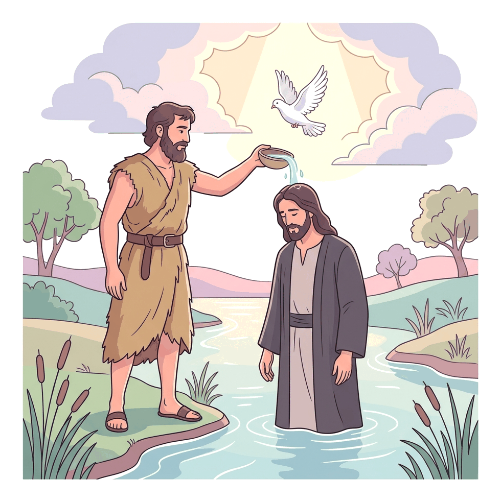
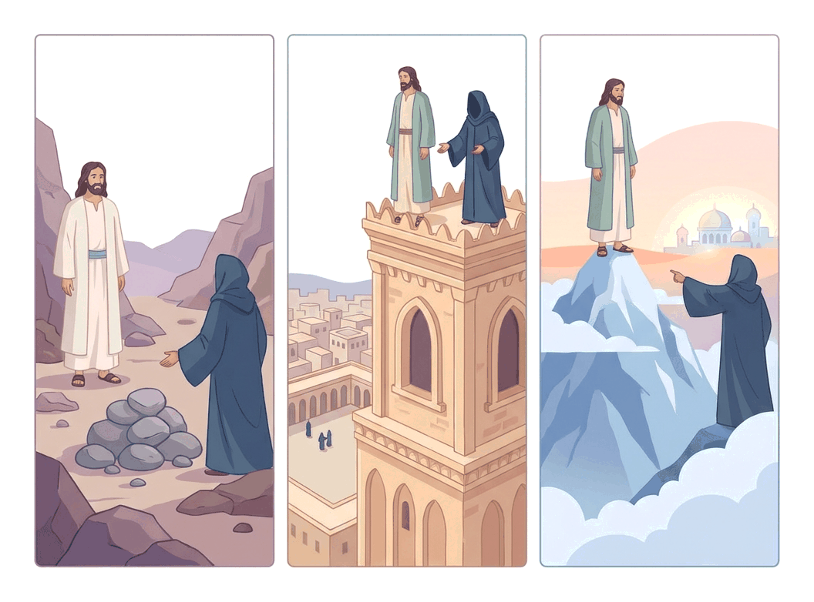

# JAMB Crk Notes: The Baptism and Temptation of Jesus

## What JAMB expects

This topic is Section C, Topic 2 of the JAMB CRK syllabus: The baptism and temptation of Jesus. It covers the biblical accounts from the Synoptic Gospels:

- (Mt. 3:13-17; 4:1-11; Mk. 1:9-13; Lk. 3:21-22; 4:1-13)

By the end of these notes, you should be able to:

1. determine the meaning and purpose of the baptism of Jesus
2. enumerate the temptations of Jesus;
3. examine the significance of the temptations of Jesus.
4. describe how Jesus overcame the temptations.

## The Baptism of Jesus

### The story of the baptism

Jesus grew up in the town of Nazareth. When He was about thirty years old, John the Baptist was preaching a message of repentance and baptizing people in the River Jordan. Jesus travelled from Galilee to the Jordan River to be baptized by John.

According to Matthew's Gospel, when Jesus arrived, John recognized His superiority and tried to prevent Him. John said, *"I have need to be baptized of thee, and comest thou to me?"* (Matthew 3:14). 

Jesus answered, *"Suffer it to be so now: for thus it becometh us to fulfil all righteousness"* (Matthew 3:15). Hearing this, John agreed and baptized Him.

Immediately as Jesus came up out of the water, three miraculous things happened:
1. **The heavens were opened** (Luke adds that Jesus was praying when this happened).
2. **The Spirit of God descended** like a dove and rested upon Him (Luke specifies it was in a "bodily shape like a dove").
3. **A voice from heaven spoke**, saying, *"This is my beloved Son, in whom I am well pleased"* (Matthew 3:17).

**Textbook variation:** The Gospel of Mark (Mark 1:9-13) gives a very brief account of the baptism. It mentions Jesus coming from Nazareth, the heavens opening, the Spirit descending, and the voice speaking, but it leaves out the dialogue between Jesus and John.

### Meaning and purpose of the baptism

**Objective i: determine the meaning and purpose of the baptism of Jesus**

John's baptism was a "baptism of repentance for the remission of sins." Since Christians believe Jesus was without sin, why did He need to be baptized? The baptism served several vital purposes:

1. **To fulfil all righteousness:** By being baptized, Jesus demonstrated His complete obedience to God's will and His submission to God's plan for salvation.
2. **Identification with sinners:** By joining the crowds of ordinary people seeking baptism, Jesus publicly identified Himself with the sinful humanity He had come to save.
3. **Commissioning for ministry:** The baptism marked the official start of Jesus' public, earthly ministry. It was His formal dedication to the work ahead.
4. **Empowerment by the Holy Spirit:** The descent of the Holy Spirit showed that Jesus was equipped and empowered by God for His messianic mission.
5. **Divine approval and revelation:** The voice from heaven confirmed His true identity as the Son of God and showed the Father's absolute approval. The event is also seen by Christians as a clear manifestation of the **Trinity**—the Father speaking, the Son being baptized, and the Holy Spirit descending.

## The Temptation of Jesus

### The wilderness experience

Immediately after His baptism, Jesus was led (or as Mark says, "driven") by the Holy Spirit into the wilderness to be tempted by the devil. This shows that the temptation was not an accident, but a necessary test planned by God. 

Jesus fasted for **forty days and forty nights**, and afterwards, He was physically very hungry. The devil then approached Him to test His obedience and His understanding of His mission.

### Enumerating the temptations

**Objective ii: enumerate the temptations of Jesus;**

Satan presented three distinct temptations. Matthew and Luke record the exact same three tests, but they list the second and third in a different order. **JAMB frequently tests this difference**, so it is important to know Matthew's order specifically, while being aware of Luke's.

| Event | Gospel of Matthew (Matthew 4:1-11) | Gospel of Luke (Luke 4:1-13) |
| --- | --- | --- |
| **First temptation** | Turn stones into bread | Turn a stone into bread |
| **Second temptation** | Throw Himself down from the pinnacle of the temple | Worship Satan in exchange for all the kingdoms of the world |
| **Third temptation** | Worship Satan in exchange for all the kingdoms of the world | Throw Himself down from the pinnacle of the temple |

*(Note: Mark 1:12-13 is very brief. It simply says Jesus was in the wilderness forty days, tempted by Satan, was with the wild beasts, and angels ministered to Him, without listing the three specific temptations.)*

Let us look at each temptation in detail, following Matthew's order:

**1. The First Temptation: Turning stones to bread**
- **The Test:** Knowing Jesus was starving, Satan said, *"If thou be the Son of God, command that these stones be made bread."* 
- **The Reply:** Jesus answered, *"It is written, Man shall not live by bread alone, but by every word that proceedeth out of the mouth of God."*

**2. The Second Temptation: The pinnacle of the temple**
- **The Test:** Satan took Jesus to the holy city (Jerusalem) and set Him on the highest roof (pinnacle) of the temple. Satan said, *"If thou be the Son of God, cast thyself down."* Satan even misquoted Scripture (Psalm 91:11-12), claiming God would command angels to catch Jesus so He wouldn't get hurt.
- **The Reply:** Jesus answered, *"It is written again, Thou shalt not tempt the Lord thy God."*

**3. The Third Temptation: The kingdoms of the world**
- **The Test:** Satan took Jesus to an exceedingly high mountain and showed Him all the kingdoms of the world and their glory. He offered, *"All these things will I give thee, if thou wilt fall down and worship me."*
- **The Reply:** Jesus rebuked him: *"Get thee hence, Satan: for it is written, Thou shalt worship the Lord thy God, and him only shalt thou serve."*

After this third temptation, the devil left Him (Luke adds that he departed "for a season"), and angels came and ministered to Jesus.

### The significance of the temptations

**Objective iii: examine the significance of the temptations of Jesus.**

The temptations were Satan's attempt to make Jesus choose a false path for His messianic mission—one that avoided the suffering of the cross. 

1. **Significance of the first temptation (Stones to bread): Economic Messiahship.** 
   Satan tempted Jesus to use His divine power for personal, physical satisfaction and to win followers simply by feeding them. Jesus' rejection signifies that **spiritual nourishment is greater than physical needs**. Materialism cannot save humanity; obedience to God's word is the true source of life.
2. **Significance of the second temptation (Temple pinnacle): Miraculous/Sensational Messiahship.** 
   This was a temptation to perform a spectacular, magical stunt to win cheap popularity and to unnecessarily test God's protection. Jesus' rejection signifies that **God's power is not for showmanship**. True faith trusts God completely without demanding sensational signs or putting God to the test.
3. **Significance of the third temptation (Worshipping Satan): Political Messiahship.** 
   Satan offered Jesus global dominion and political power through a shortcut—compromising with evil. Jesus' rejection signifies **absolute loyalty to God**. Idolatry and compromising with evil are never acceptable ways to achieve God's purposes.

**Application to Nigerian life:** These temptations reflect common challenges today. Many leaders face the temptation to use their spiritual or political positions to enrich themselves (stones to bread), to perform fake or spectacular miracles just to attract large crowds and fame (cheap popularity), or to compromise their Christian values and engage in corruption to gain political office (worshipping Satan for power). Jesus' example teaches strict reliance on God's principles.

### How Jesus overcame the temptations

**Objective iv: describe how Jesus overcame the temptations.**

Jesus successfully overcame Satan through three main strategies:

1. **Thorough knowledge and use of Scripture:** Jesus answered every single temptation by quoting from the Old Testament **Book of Deuteronomy** (Deut. 8:3, 6:16, and 6:13). He used the Word of God as a weapon. Even when Satan tried to twist Scripture, Jesus knew the Word well enough to apply it correctly.
2. **Absolute submission to God's will:** Jesus refused to act independently of God the Father. He chose the difficult, painful path of the cross over the easy shortcuts offered by Satan.
3. **Reliance on the Holy Spirit:** Jesus was "full of the Holy Spirit" (Luke 4:1). He allowed the Spirit to guide and strengthen Him, rather than acting on His own physical hunger or human desires.

## Key terms

| Term | Meaning |
| --- | --- |
| **Baptism** | A religious rite involving water, symbolizing purification, repentance, or admission into the faith. |
| **Jordan** | The river where John the Baptist preached and where Jesus was baptized. |
| **Repentance** | Sincere regret for one's sins, leading to a complete change of behaviour. |
| **Fasting** | Willingly abstaining from food (and sometimes water) for a period, often for spiritual focus. |
| **Pinnacle** | The highest peak or point, specifically the towering roof of the temple in Jerusalem. |
| **Messiahship** | The role and mission of the promised deliverer (the Messiah) sent by God. |
| **Trinity** | The Christian teaching that there is one God who exists in three distinct persons: Father, Son, and Holy Spirit. |

## Exam tips and common mistakes

- **Memorize the reason for baptism:** Jesus told John He needed to be baptized "to fulfil all righteousness." JAMB loves this exact phrase.
- **Know the voice from heaven:** Memorize the exact words spoken by God: *"This is my beloved Son, in whom I am well pleased."*
- **Watch out for the order of temptations:** Matthew's order ends with the high mountain (kingdoms of the world). Luke's order ends with the pinnacle of the temple. JAMB will often specify "According to Matthew's Gospel..." in the question.
- **Remember the source book:** Every scripture Jesus quoted to overcome the devil came from the Book of **Deuteronomy**.
- **Distinguish the meanings:** Know which temptation represents economic power (stones to bread), cheap popularity/testing God (temple pinnacle), and political power/idolatry (worshipping Satan).

## Quick summary

1. Jesus was baptized by John in the River Jordan to "fulfil all righteousness" and identify with the sinners He came to save.
2. At His baptism, the heavens opened, the Holy Spirit descended like a dove, and God the Father spoke, expressing His approval.
3. Jesus was led by the Spirit into the wilderness, where He fasted for forty days and was tempted by the devil.
4. The three temptations were: turning stones to bread, throwing Himself from the temple pinnacle, and worshipping Satan for worldly kingdoms (Matthew's order).
5. The temptations represented false paths for His ministry: economic materialism, sensational showmanship (cheap popularity), and political compromise.
6. Jesus overcame all the temptations by relying on the Holy Spirit, submitting completely to God's will, and accurately quoting the Book of Deuteronomy.

## Practice questions

**1. According to Matthew's Gospel, Jesus told John the Baptist to permit His baptism in order to**

- A. show the crowds that John was a true prophet.
- B. wash away His original sin.
- C. fulfil all righteousness.
- D. prove that He was the Son of God.

**Answer: C.** Jesus answered John's hesitation by saying, "Suffer it to be so now: for thus it becometh us to fulfil all righteousness" (Matthew 3:15).

**2. At the baptism of Jesus, the voice from heaven said,**

- A. "This is my beloved Son, listen to him."
- B. "This is my beloved Son, in whom I am well pleased."
- C. "Behold the Lamb of God who takes away the sin of the world."
- D. "You are the Christ, the Son of the living God."

**Answer: B.** Immediately after Jesus came out of the water, a voice from heaven declared His sonship and divine approval using these exact words (Matthew 3:17).

**3. According to Matthew's account, the second temptation of Jesus was the command to**

- A. turn stones into bread.
- B. bow down and worship Satan.
- C. throw Himself down from the pinnacle of the temple.
- D. turn water into wine.

**Answer: C.** In Matthew's order, the first is stones to bread, the second is the temple pinnacle, and the third is the high mountain. (Note that in Luke, the temple pinnacle is the third temptation).

**4. To overcome the devil's temptations in the wilderness, Jesus consistently quoted from the Old Testament book of**

- A. Psalms.
- B. Isaiah.
- C. Exodus.
- D. Deuteronomy.

**Answer: D.** Jesus answered every temptation by quoting from Deuteronomy (Deut. 8:3, 6:16, and 6:13).

**5. The temptation to turn stones into bread signifies the rejection of**

- A. political messiahship.
- B. economic and material messiahship.
- C. miraculous and sensational messiahship.
- D. a spiritual and suffering messiahship.

**Answer: B.** This temptation was an attempt to make Jesus focus on physical, economic, and material needs rather than spiritual dependence on God.

**6. According to Luke's Gospel, after the devil had ended every temptation, he**

- A. was cast into the lake of fire by angels.
- B. departed from Him for a season.
- C. sent wild beasts to attack Him in the desert.
- D. repented and asked for forgiveness.

**Answer: B.** Luke 4:13 explicitly states that when the devil had ended all the temptations, "he departed from him for a season" (until an opportune time).

**7. When Satan asked Jesus to throw Himself down from the pinnacle of the temple, Satan quoted scripture to claim that**

- A. Jesus would not die but live forever.
- B. the people would see the miracle and immediately believe.
- C. God would command His angels to bear Him up.
- D. the temple was a place of ultimate safety.

**Answer: C.** Satan misused Psalm 91:11-12, tempting Jesus to test God's protection by claiming angels would catch Him before He hit the ground.

**8. Which two gospels provide the detailed dialogue of the three temptations of Jesus?**

- A. Matthew and Mark.
- B. Mark and Luke.
- C. Matthew and Luke.
- D. Luke and John.

**Answer: C.** Matthew and Luke both detail the three specific tests and the dialogue. Mark only mentions the temptation briefly, and John does not record it at all.

**9. A major theological significance of Jesus seeking John's baptism is that it**

- A. marked the immediate end of John the Baptist's ministry.
- B. demonstrated His identification with the sinful humanity He came to save.
- C. officially replaced the Jewish law of circumcision.
- D. showed that river water is sacred for healing.

**Answer: B.** Even though Jesus had no sin, undergoing a baptism of repentance showed His willingness to identify with and stand in the place of sinners.

**10. Jesus' reply *"Thou shalt worship the Lord thy God, and him only shalt thou serve"* was in response to the temptation to**

- A. command stones to become bread.
- B. cast Himself down from the temple.
- C. worship Satan in exchange for the kingdoms of the world.
- D. prove His identity to the Pharisees.

**Answer: C.** Jesus gave this response when Satan offered Him all the political power and glory of the world's kingdoms in exchange for idolatrous worship.

<!-- COVERAGE
obj i | Meaning and purpose of the baptism
obj ii | Enumerating the temptations
obj iii | The significance of the temptations
obj iv | How Jesus overcame the temptations
Mt. 3:13-17 | The story of the baptism
-->
