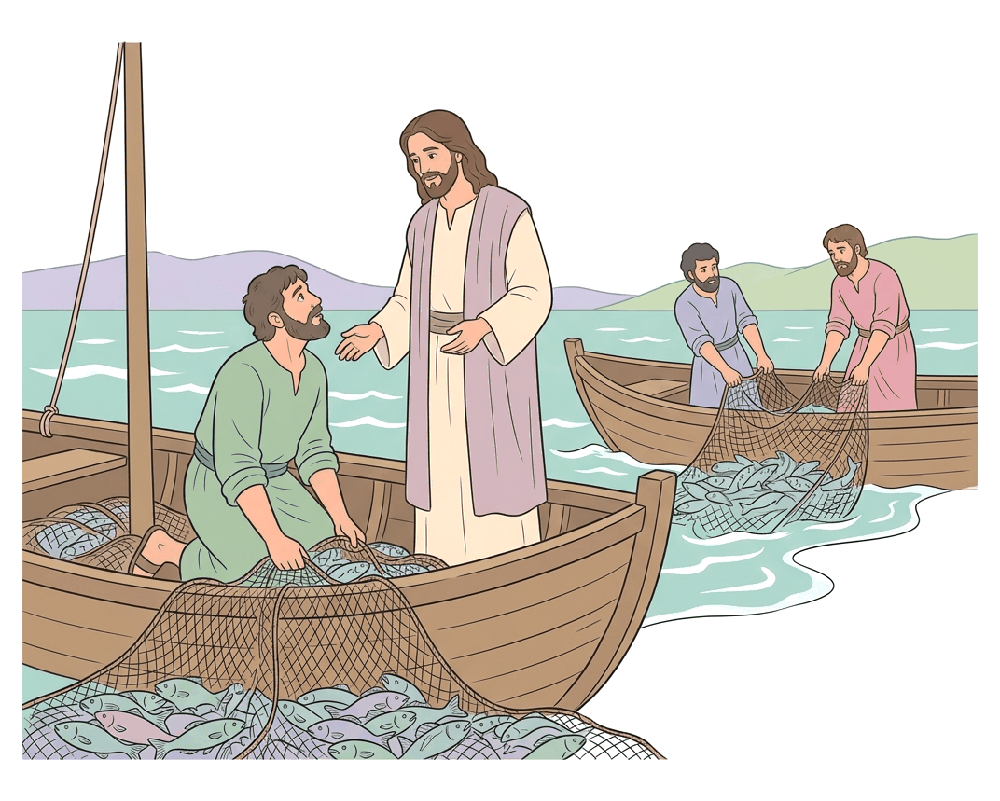
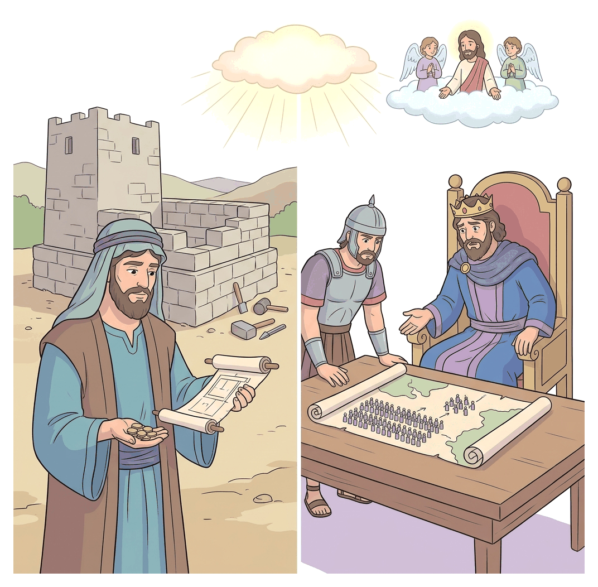

# JAMB Crk Notes: Discipleship

## What JAMB expects

This topic is Section C, Topic 3 of the JAMB CRK syllabus: Discipleship. It covers the accounts of Jesus calling his first followers and his teachings on what it costs to follow him. 

The syllabus includes two content items:
* **(a) The call of the first disciples** (Matthew 4:18-22; 9:9-13; Mark 1:16-20; 2:13-17; Luke 5:1-11; 27-32)
* **(b) The demands of discipleship** (Matthew 8:19-22; Luke 9:57-63; 14:25-33)

By the end of these notes, you should be able to:
1. Identify the first disciples to be called by Jesus;
2. Determine the demands of discipleship.

**Note on the syllabus wording:** The syllabus lists "Luke 9:57-63" under the demands of discipleship. This is a typographical error, as the Gospel of Luke chapter 9 ends at verse 62. These notes cover the passage to its actual end at verse 62. 

## Content (a): The call of the first disciples

A "disciple" is a learner, pupil, or follower of a teacher. In the time of Jesus, it was common for Jewish Rabbis (teachers) to have disciples. However, Jesus' method was unusual: instead of waiting for students to apply to learn from him, he went out and personally called them.

### Objective i: Identify the first disciples to be called by Jesus

The first disciples called by Jesus were common working men—fishermen and a tax collector. The Gospels of Matthew, Mark, and Luke record these events with slightly different details, highlighting different aspects of the calling.

#### The call of the fishermen (Peter, Andrew, James, and John)

Jesus called four fishermen to be his first core followers. Matthew and Mark give a straightforward account of this, while Luke provides a more detailed story involving a miracle.

**Matthew 4:18-22 and Mark 1:16-20**
1. **Simon (Peter) and Andrew:** As Jesus was walking by the Sea of Galilee, he saw two brothers, Simon (called Peter) and Andrew, casting a net into the sea, for they were fishermen. 
2. Jesus said to them, "Follow me, and I will make you fishers of men." (Matthew 4:19).
3. Immediately, they left their nets and followed him.
4. **James and John:** Going a little farther, Jesus saw another pair of brothers, James the son of Zebedee, and his brother John. They were in a ship with their father Zebedee, mending their nets.
5. Jesus called them, and they immediately left the ship and their father, and followed him.

**Luke 5:1-11 (The Miraculous Catch of Fish)**
Luke's account is set by the Lake of Gennesaret (another name for the Sea of Galilee) and explains *why* the fishermen were so willing to leave everything.
1. A large crowd pressed upon Jesus to hear the word of God. To teach them effectively, Jesus got into one of the empty fishing boats, which belonged to Simon (Peter), and asked him to push out a little from the land. Jesus sat down and taught the people from the boat.
2. When he finished speaking, Jesus told Simon, "Launch out into the deep, and let down your nets for a draught."
3. Simon replied that they had worked hard all night and caught nothing, "nevertheless at thy word I will let down the net."
4. When they did, they caught such a massive number of fish that their net began to break. They signalled to their partners in the other boat (James and John) to come and help.
5. They filled both boats with fish so heavily that the boats began to sink.
6. Seeing this miracle, Simon Peter fell down at Jesus' knees, saying, "Depart from me; for I am a sinful man, O Lord."
7. Jesus reassured him, saying, "Fear not; from henceforth thou shalt catch men."
8. When they had brought their ships to land, they forsook all and followed him. (Note: Andrew is not explicitly named in Luke's specific text here, though he was Simon's brother and partner).

**Comparison of the accounts of the first calling:**

| Feature | Matthew and Mark | Luke |
| --- | --- | --- |
| **Setting** | Walking by the shore of the Sea of Galilee | Teaching from a boat on the Lake of Gennesaret |
| **Action before calling** | Peter and Andrew casting nets; James and John mending nets | Jesus teaching the crowd, then performing a miracle |
| **The Miracle** | None mentioned | The miraculous catch of fish after a night of catching nothing |
| **Peter's Reaction** | Leaves his net immediately | Falls at Jesus' knees, confessing he is a sinful man |
| **Jesus' Promise** | "I will make you fishers of men" | "From henceforth thou shalt catch men" |

#### The call of Matthew (Levi) the Tax Collector

The next major calling recorded is that of a tax collector. Matthew (also called Levi in Mark and Luke) had a profession that was deeply despised by the Jewish people. Tax collectors (publicans) worked for the oppressive Roman Empire and were widely known to be corrupt, often collecting more than required to keep the extra money for themselves. They were considered outcasts and "sinners" by religious leaders.

**Matthew 9:9-13; Mark 2:13-17; Luke 5:27-32**
1. **The Call:** As Jesus passed by, he saw a man named Matthew (referred to as Levi, the son of Alphaeus, in Mark and Luke) sitting at the tax office (receipt of custom). 
2. Jesus simply said to him, "Follow me." 
3. Matthew immediately left everything, rose up, and followed him.
4. **The Feast:** Matthew then hosted a great feast in his own house for Jesus, and many tax collectors and "sinners" sat down to eat with them.
5. **The Criticism:** The Pharisees and their scribes saw this and complained to Jesus' disciples, asking, "Why do ye eat and drink with publicans and sinners?" In Jewish culture, eating a meal with someone was a sign of deep fellowship and acceptance.
6. **Jesus' Response:** Jesus heard the complaint and answered, "They that are whole need not a physician; but they that are sick. I came not to call the righteous, but sinners to repentance." (Luke 5:31-32).
7. *Note on Matthew's account:* Only the Gospel of Matthew includes Jesus adding the quote from the prophet Hosea: "But go ye and learn what that meaneth, I will have mercy, and not sacrifice..." (Matthew 9:13).

**Application for Nigerians:** The calling of Matthew shows that Jesus does not judge based on societal status or past corruption. Just as Matthew left a lucrative but corrupt job to follow Jesus, Nigerian Christians are taught that discipleship may require abandoning corrupt practices, bribery, or unethical businesses to live righteously.

## Content (b): The demands of discipleship

Following Jesus was not meant to be a casual decision. Jesus frequently warned large crowds and eager individuals that being his disciple required extreme sacrifice, total commitment, and the willingness to suffer.

### Objective ii: Determine the demands of discipleship

The demands of discipleship are illustrated through Jesus' encounters with three "would-be" disciples, and his direct teachings to the crowds about bearing the cross and counting the cost.

#### The Three Would-Be Disciples

In Matthew 8:19-22 and Luke 9:57-62, Jesus encounters men who express a desire to follow him, but Jesus responds by revealing the hidden costs of discipleship. 

1. **The First Man (The Demand to Sacrifice Comfort)**
   * **The Encounter:** A certain scribe (or a man in Luke's account) came to Jesus and said, "Lord, I will follow thee whithersoever thou goest."
   * **The Response:** Jesus replied, "Foxes have holes, and birds of the air have nests; but the Son of man hath not where to lay his head."
   * **The Meaning:** Discipleship demands a willingness to face physical hardship, poverty, and homelessness. Jesus was telling the man not to expect a life of comfort, wealth, or earthly security.

2. **The Second Man (The Demand to Prioritize the Kingdom over Family Duty)**
   * **The Encounter:** Jesus told another man, "Follow me." But the man said, "Lord, suffer me first to go and bury my father."
   * **The Response:** Jesus said, "Let the dead bury their dead: but go thou and preach the kingdom of God."
   * **The Meaning:** In Jewish culture, burying a parent was one of the highest religious and family duties. However, Jesus demanded that proclaiming the Kingdom of God must take absolute priority, even over the most urgent and sacred family obligations. ("The dead burying their dead" means letting those who are spiritually dead handle earthly matters).

3. **The Third Man (The Demand for Undivided Loyalty - Luke only)**
   * **The Encounter:** Another man said, "Lord, I will follow thee; but let me first go bid them farewell, which are at home at my house."
   * **The Response:** Jesus answered, "No man, having put his hand to the plough, and looking back, is fit for the kingdom of God."
   * **The Meaning:** Plowing a straight furrow in a field requires the farmer to look straight ahead. Looking back ruins the work. Jesus used this agricultural image to teach that a disciple must have absolute focus. A divided heart or lingering attachment to the old life makes one unfit for the Kingdom.

#### Hating Family and Bearing the Cross

In **Luke 14:25-33**, large multitudes were travelling with Jesus. Knowing that many followed him for the wrong reasons (like free food or political hopes), Jesus turned to them and delivered some of the hardest teachings on discipleship:

1. **Prioritizing Jesus above all relationships:** 
   * "If any man come to me, and hate not his father, and mother, and wife, and children, and brethren, and sisters, yea, and his own life also, he cannot be my disciple."
   * *Explanation:* Christians teach that Jesus was not promoting actual hatred or breaking the commandment to honour parents. In Hebrew idiom, to "hate" in this context means to "love less". Jesus demanded that a disciple's love and loyalty to Him must be so great that all other loves—even family ties and one's own life—look like hatred by comparison.
2. **Bearing the Cross:**
   * "And whosoever doth not bear his cross, and come after me, cannot be my disciple."
   * *Explanation:* In the Roman world, the cross was a brutal instrument of execution. A man carrying a cross was on a one-way trip to his death. Jesus meant that disciples must be fully prepared to face public shame, suffering, persecution, and even death for his sake. 

#### Counting the Cost

Jesus concluded his warnings in Luke 14 with two short parables emphasizing that a person must carefully "count the cost" before committing to follow him, to avoid starting a journey they cannot finish.

1. **The Parable of the Tower Builder:** 
   * Which of you, intending to build a tower, does not sit down first and count the cost to see if he has enough money to finish it? If he lays the foundation and cannot finish, onlookers will mock him, saying, "This man began to build, and was not able to finish."
2. **The Parable of the King Going to War:** 
   * What king, going to make war against another king, does not sit down first and consult whether he can use 10,000 soldiers to defeat an enemy coming with 20,000? If he cannot, while the enemy is still far away, he sends a delegation to ask for conditions of peace.

Jesus concluded these parables with a final absolute demand: **"So likewise, whosoever he be of you that forsaketh not all that he hath, he cannot be my disciple."** Discipleship requires total surrender of personal possessions, ambitions, and rights to God.

## Key terms

| Term | Meaning |
| --- | --- |
| Disciple | A learner, pupil, or follower who adopts and helps spread the teachings of a master. |
| Rabbi | A Jewish religious teacher or master. |
| Publican / Tax Collector | A Jew who collected taxes on behalf of the Roman government; widely hated and viewed as corrupt sinners. |
| Fishers of men | Jesus' metaphor for the fishermen; instead of catching fish, they would now gather people into the Kingdom of God. |
| Bearing the cross | A metaphor for the willingness to endure suffering, public shame, and death for the sake of following Christ. |
| Counting the cost | Carefully considering the severe demands and sacrifices required before deciding to follow Jesus. |
| Scribe | A Jewish expert in the Law of Moses. |

## Exam tips and common mistakes

* **Know the differences between the Gospel accounts:** JAMB frequently tests the specific details of the calling of the fishermen. Remember that the **miraculous catch of fish** is only found in **Luke's** account.
* **Identify the would-be disciples:** Be able to match the excuse with Jesus' exact reply.
  * Wanting comfort -> "Foxes have holes..."
  * Burying a father -> "Let the dead bury their dead..."
  * Saying farewell -> "No man, having put his hand to the plough..."
* **Understand the meaning of "hate":** If a question asks why Jesus told disciples to hate their father and mother, the correct option will usually reflect "loving God more than family" or "prioritizing Jesus above all," not literal hatred.
* **Matthew vs. Levi:** Remember that Matthew the tax collector is the same person called Levi in Mark and Luke. He was sitting at the "receipt of custom" (tax office).
* **Jesus' mission statement:** Memorise Jesus' justification for eating with sinners: "They that are whole need not a physician; but they that are sick."

## Quick summary

1. Jesus' first disciples were common men: Peter, Andrew, James, and John were fishermen; Matthew (Levi) was a tax collector.
2. In Matthew and Mark, the fishermen left their nets immediately upon Jesus' call; in Luke, Peter submitted after the miracle of the great catch of fish.
3. Jesus calling Matthew and eating with tax collectors angered the Pharisees, but Jesus declared he came as a physician for sinners, not the righteous.
4. Jesus warned a scribe that discipleship brings physical hardship ("foxes have holes...").
5. Jesus demanded that proclaiming the Kingdom takes priority over family duties ("let the dead bury their dead") and requires undivided focus ("hand to the plough").
6. A true disciple must prioritize Jesus over all family ties (loving them less by comparison) and be willing to endure suffering ("bear his cross").
7. Jesus used the parables of the tower builder and the king going to war to teach that believers must intentionally "count the cost" of forsaking everything to follow him.

## Practice questions

**1. "Follow me, and I will make you fishers of men." This statement was addressed by Jesus to**
- A. James and John
- B. Philip and Bartholomew
- C. Simon Peter and Andrew
- D. Matthew and Thomas

**Answer: C.** Jesus first spoke these words to Simon Peter and Andrew as they were casting a net into the Sea of Galilee (Matthew 4:18-19).

**2. According to Luke's Gospel, Peter fell down at Jesus' knees and said "Depart from me; for I am a sinful man" because**
- A. he realised he had been collecting unfair taxes.
- B. Jesus had just healed his mother-in-law.
- C. he was amazed by the miraculous catch of fish.
- D. he had just denied Jesus three times.

**Answer: C.** In Luke 5, Peter makes this confession immediately after obeying Jesus' command to let down the nets, resulting in a sinking-boat load of fish.

**3. When Jesus called Matthew, he was**
- A. mending nets with his father Zebedee.
- B. sitting at the receipt of custom.
- C. burying his father.
- D. plowing a field.

**Answer: B.** Matthew (Levi) was a tax collector and was called by Jesus while sitting at the tax office (receipt of custom).

**4. How did Jesus reply to the Pharisees who complained that he ate with publicans and sinners?**
- A. "Let the dead bury their dead."
- B. "Foxes have holes, and birds of the air have nests."
- C. "They that are whole need not a physician, but they that are sick."
- D. "No man, having put his hand to the plough, and looking back, is fit for the kingdom."

**Answer: C.** Jesus used the metaphor of a physician to explain that his mission was to call sinners to repentance, just as a doctor visits the sick, not the healthy.

**5. "Lord, suffer me first to go and bury my father." Jesus' reply to this request teaches that**
- A. disciples must not attend funerals under any circumstances.
- B. the Kingdom of God must take priority over even the most sacred family duties.
- C. physical death is an illusion.
- D. disciples should let the church handle family matters.

**Answer: B.** By saying "Let the dead bury their dead", Jesus meant that the urgent call to preach the Kingdom supersedes all other earthly obligations.

**6. Jesus said, "No man, having put his hand to the plough, and looking back, is fit for the kingdom of God." He said this to a man who wanted to**
- A. go and bury his father.
- B. sell his possessions first.
- C. bid farewell to those at his house.
- D. finish building a tower.

**Answer: C.** The third would-be disciple in Luke 9 asked to first go and say goodbye to his family, prompting Jesus to teach about undivided loyalty.

**7. According to Jesus, anyone who does not bear his cross and come after him**
- A. will be forgiven at the final judgment.
- B. cannot be his disciple.
- C. must pay a fine to the church.
- D. is like a king going to war with 10,000 men.

**Answer: B.** In Luke 14:27, Jesus clearly states that bearing one's cross (readiness to suffer and die) is an absolute condition; without it, one "cannot be my disciple."

**8. The parable of the man building a tower was used by Jesus to teach the necessity of**
- A. working hard to gain wealth.
- B. counting the cost of discipleship.
- C. building a strong foundation on the rock.
- D. paying workers fairly.

**Answer: B.** Jesus used the tower builder and the king going to war to illustrate that one must deliberately evaluate and accept the severe costs before committing to discipleship.

**9. When Jesus said a disciple must "hate his father, and mother, and wife...", he meant that the disciple should**
- A. treat his family members as enemies.
- B. abandon his family to live in the wilderness.
- C. love Jesus so much more that earthly loves seem like hatred by comparison.
- D. only associate with other Christians.

**Answer: C.** In this context, "hate" is a Hebrew idiom meaning to love less; loyalty and devotion to Jesus must take first place above all human relationships.

**10. "Foxes have holes, and birds of the air have nests; but the Son of man hath not where to lay his head." This was said to show that following Jesus involves**
- A. loving nature and animals.
- B. a loss of physical comfort and earthly security.
- C. building houses for the poor.
- D. running away from enemies.

**Answer: B.** Jesus warned the eager scribe that being a disciple meant adopting a life of hardship and relying on God, rather than expecting a comfortable home.

<!-- COVERAGE
obj i | Objective i: Identify the first disciples to be called by Jesus
obj ii | Objective ii: Determine the demands of discipleship
item a | Content (a): The call of the first disciples
item b | Content (b): The demands of discipleship
-->
