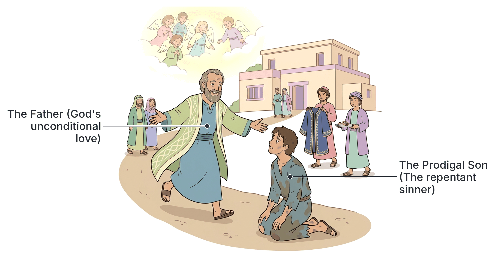

# JAMB Crk Notes: The Parables

## What JAMB expects

This topic is Section C, Topic 5 of the JAMB CRK syllabus: The Parables. It covers:

*   **(a) Parables of the kingdom:**
    *   (i) The sower (Mt. 13:1-23; Mk. 4:1-20)
    *   (ii) The weeds (Mt. 13:24-30; 36-43)
    *   (iii) The drag-net (Mt. 13:47-50)
    *   (iv) The wedding garment (Matt. 22:1-14)
*   **(b) Parables about love of God** (Mt. 18:12-14; Lk. 15:1-32)
*   **(c) Parables about love for one another** (Lk. 10:25-37; 16:19-31)
*   **(d) Parable about wealth:** The rich fool (Lk. 12:13-21)
*   **(e) Parables on prayer** (Lk. 18:2-14)

By the end of these notes, you should be able to:
1.  define a parable;
2.  classify the different parables of Jesus;
3.  identify the occasion of each parable;
4.  interpret the meaning of each parable;
5.  give reasons why Jesus taught in parables.

**Note on the syllabus wording:** Under Content (e), the syllabus lists the reference as "Lk. 18:2-14". However, the parable of the persistent widow and the unjust judge actually begins at verse 1, which states the vital occasion for the parable ("that men ought always to pray, and not to faint"). The two parables are Luke 18:1-8 and 18:9-14. These notes will cover the full passages, while noting that the printed reference starts at verse 2.

## What is a parable?

**Objective i: define a parable.**

A **parable** is a simple earthly story used to illustrate a profound spiritual or moral lesson. It is often described as "an earthly story with a heavenly meaning." 

Jesus used familiar objects, events, and situations from daily life in ancient Palestine—such as farming (sowing seeds), fishing (throwing nets), weddings, masters and servants, and finding lost objects—to explain complex spiritual truths, especially regarding the Kingdom of God. Because the imagery was drawn from the everyday lives of the people, the stories were easy to remember, even if the deeper spiritual meanings required further explanation.

## Why Jesus taught in parables

**Objective v: give reasons why Jesus taught in parables.**

Jesus did not use parables simply to entertain the crowds. The Bible gives specific reasons why He chose this method of teaching:

1.  **To reveal truths to His followers:** Parables helped explain the mysteries of the Kingdom of God to the disciples in a way they could understand.
2.  **To conceal truths from unbelievers:** Jesus said He spoke in parables so that those with hardened hearts (such as the Pharisees) would hear the story but not grasp the spiritual truth. He quoted the prophet Isaiah (Isaiah 6:9-10) to explain this: "seeing they see not; and hearing they hear not, neither do they understand" (Matthew 13:13).
3.  **To hold the listeners' attention:** Engaging stories capture human interest far better than abstract theological lectures. 
4.  **To provoke deep thought:** Parables required the listeners to think actively and apply the meaning to their own lives, rather than just passively receiving rules.
5.  **To fulfill prophecy:** Matthew notes that Jesus spoke in parables to fulfill what was spoken by the prophet: "I will open my mouth in parables; I will utter things which have been kept secret from the foundation of the world" (Matthew 13:35, quoting Psalm 78:2).

## Classification of the parables

**Objective ii: classify the different parables of Jesus.**

Jesus told many parables, and they are generally classified into different categories based on their main themes. The JAMB syllabus groups them into five main classes:

| Classification | Parables in the Syllabus | Main Focus |
| :--- | :--- | :--- |
| **Parables of the Kingdom** | The Sower, The Weeds (Tares), The Drag-net, The Wedding Garment | How the Kingdom of God grows, who belongs to it, and the final judgment. |
| **Parables about Love of God** | The Lost Sheep, The Lost Coin, The Prodigal Son | God's seeking love for sinners and His joy when they repent. |
| **Parables about Love for One Another**| The Good Samaritan, The Rich Man and Lazarus | Practical compassion for neighbours regardless of race or class, and the duty to care for the poor. |
| **Parables about Wealth** | The Rich Fool | The danger of greed, materialism, and trusting in earthly riches rather than God. |
| **Parables on Prayer** | The Persistent Widow, The Pharisee and the Tax Collector | The need for persistence, faith, humility, and repentance in prayer. |

## Identifying the occasion of each parable

**Objective iii: identify the occasion of each parable.**

The "occasion" of a parable is the specific event, location, question, or controversy that prompted Jesus to tell the story. JAMB frequently tests whether you know *why* Jesus told a particular parable.

| Parable | The Occasion (Why or where Jesus told it) |
| :--- | :--- |
| **The Sower** | Jesus was sitting by the Sea of Galilee. Great crowds gathered, so He got into a boat and taught the multitudes standing on the beach. |
| **The Weeds (Tares)** | Jesus was teaching the multitudes by the sea. Later, He went into a house where His disciples asked Him to explain the parable. |
| **The Drag-net** | Jesus was inside the house with His disciples, giving them further private teachings about the Kingdom of heaven. |
| **The Wedding Garment**| Jesus was in the Temple during His final week, responding to the chief priests and Pharisees who were questioning His authority. |
| **The Lost Sheep (Luke 15)**| Tax collectors and sinners were drawing near to hear Jesus, and the Pharisees and scribes murmured, saying, "This man receives sinners and eats with them." (In Matthew 18, it was told when disciples asked who is the greatest, warning them not to despise "little ones"). |
| **The Lost Coin** | Same occasion as above: told in response to the Pharisees' complaining about Jesus associating with sinners. |
| **The Prodigal Son** | Same occasion as above: the climax of His response to the self-righteous Pharisees complaining about Him eating with sinners. |
| **The Good Samaritan** | A lawyer (expert in the law) stood up to test Jesus and asked, "And who is my neighbour?" in an attempt to justify himself. |
| **The Rich Man & Lazarus** | The Pharisees, who were lovers of money, heard Jesus say "You cannot serve God and mammon" and scoffed at Him. |
| **The Rich Fool** | Someone in the crowd interrupted Jesus' teaching, asking, "Teacher, bid my brother divide the inheritance with me." |
| **The Persistent Widow** | Jesus told it to His disciples "to the effect that they ought always to pray and not lose heart." |
| **Pharisee & Tax Collector**| Jesus told it to "some who trusted in themselves that they were righteous and despised others." |

## Interpreting the meaning of each parable

**Objective iv: interpret the meaning of each parable.**

To interpret a parable is to decode its symbols and understand its core spiritual lesson. Below are the specific stories required by the syllabus, along with their detailed interpretations.

### Parables of the kingdom

**Content (a): Parables of the kingdom.**

#### 1. The Sower (Matthew 13:1-23; Mark 4:1-20)
**The Story:** A sower went out to sow grain. The seeds fell on four different types of ground:
1.  **Along the path:** The birds came and ate the seeds.
2.  **On rocky ground:** The seeds sprang up quickly because the soil was shallow. But when the sun rose, they were scorched and withered because they had no deep roots.
3.  **Among thorns:** The thorns grew up and choked the plants.
4.  **On good soil:** The seeds grew and produced a crop—some a hundredfold, some sixty, some thirty.

**The Interpretation:** Jesus later explained this to His disciples. The seed is the Word of God (the Gospel). The different soils represent the different conditions of human hearts:
*   **The Path:** Someone who hears the word but does not understand it. The evil one (the devil) snatches it away.
*   **The Rocky Ground:** Someone who hears the word and receives it with joy, but has no firm root. When tribulation or persecution arises, they quickly fall away.
*   **The Thorns:** Someone who hears the word, but the cares of the world and the deceitfulness of riches choke it, making them unfruitful.
*   **The Good Soil:** Someone who hears the word, understands it, and bears much spiritual fruit.

[IMAGE: A four-panel illustration showing the Parable of the Sower. Panel 1: A seed on a hard dirt path being eaten by a crow. Panel 2: A small green shoot withering under a blazing yellow sun on stony ground. Panel 3: A green plant being strangled by thorny vines. Panel 4: A tall, healthy stalk of wheat full of grain in rich brown soil. Labels to add later: "Path (snatched away)", "Rocky Ground (withers in hardship)", "Thorns (choked by riches/cares)", "Good Soil (bears fruit)". Clean flat textbook style, white background.]

#### 2. The Weeds / Tares (Matthew 13:24-30, 36-43)
**The Story:** A man sowed good seed in his field. While his men were sleeping, his enemy came, sowed weeds (tares) among the wheat, and went away. When the plants grew, the weeds appeared too. The servants asked if they should pull out the weeds. The master said, "No; lest in gathering the weeds you root up the wheat along with them." He ordered them to let both grow together until the harvest. At harvest time, the reapers would gather the weeds to be burned, and gather the wheat into the barn.

**The Interpretation:** 
*   **The Sower:** The Son of Man (Jesus).
*   **The Field:** The world.
*   **The Good Seed:** True believers (sons of the kingdom).
*   **The Weeds:** The wicked (sons of the evil one).
*   **The Enemy:** The devil.
*   **The Harvest:** The close of the age (final judgment).
*   **The Reapers:** The angels.
**Meaning:** Good and evil people will coexist in the world until the end of time. Humans should not try to forcefully root out all evil now; God's angels will perfectly separate the righteous from the wicked at the final judgment.

#### 3. The Drag-net (Matthew 13:47-50)
**The Story:** The Kingdom of heaven is like a large drag-net thrown into the sea, gathering fish of every kind. When it was full, fishermen drew it ashore, sorted the fish, put the good into baskets, and threw the bad away.
**The Interpretation:** At the end of the age, the angels will come out and separate the evil from the righteous, throwing the evil into the furnace of fire. It shares the same lesson as the Weeds: final separation and judgment belong to God at the end of time.

#### 4. The Wedding Garment (Matthew 22:1-14)
**The Story:** A king gave a marriage feast for his son. He sent servants to call the invited guests, but they refused to come, making light of it and killing the servants. The angry king sent troops to destroy the murderers and burn their city. Then, the king told his servants to invite everyone they could find on the main roads. The hall was filled. However, the king saw a guest with no wedding garment. When the man could not explain himself, the king ordered him bound and cast into outer darkness. Jesus concluded: "For many are called, but few are chosen."

**The Interpretation:** 
*   **The King & Son:** God the Father and Jesus Christ.
*   **The First Guests:** The Jews (especially religious leaders) who rejected God's prophets (the servants).
*   **The Burning of the City:** A prophecy of the destruction of Jerusalem (AD 70).
*   **The New Guests:** The Gentiles and sinners, to whom the gospel was offered.
*   **The Man without a Garment:** A person who wants kingdom blessings but refuses to put on the required "garment" of righteousness and repentance. 
**Meaning:** The kingdom is open to all, but requires personal transformation and faith.

### Parables about love of God

**Content (b): Parables about love of God.**

These three parables (Luke 15) were told together to show God's immense love for sinners, contrasting with the Pharisees' harsh legalism.

#### 1. The Lost Sheep (Matthew 18:12-14; Luke 15:3-7)
**The Story:** A shepherd has a hundred sheep and loses one. He leaves the ninety-nine in the wilderness and searches for the lost one until he finds it. He lays it on his shoulders rejoicing, goes home, and calls his friends to celebrate.
**The Interpretation:** Jesus said, "There will be more joy in heaven over one sinner who repents than over ninety-nine righteous persons who need no repentance." It shows God's pursuing, individual love for sinners.

#### 2. The Lost Coin (Luke 15:8-10)
**The Story:** A woman has ten silver coins and loses one. She lights a lamp, sweeps the house, and seeks diligently until she finds it. She then calls her friends to rejoice.
**The Interpretation:** "There is joy before the angels of God over one sinner who repents." It reinforces the thoroughness of God's search for the lost and the value He places on every soul.

#### 3. The Prodigal Son (Luke 15:11-32)
**The Story:** A man had two sons. The younger asked for his inheritance, went to a far country, and wasted it in reckless living. Becoming destitute during a famine, he ended up feeding pigs. Coming to his senses, he returned to his father, planning to beg to be a servant. While he was still far off, his father saw him, ran to him, kissed him, and threw a massive feast, giving him a fine robe and ring. 
The elder son was angry, complaining he had served faithfully for years without a feast, while the son who devoured the estate got the fatted calf. The father replied, "Son, you are always with me... but it was fitting to make merry and be glad, for this your brother was dead, and is alive; he was lost, and is found."

**The Interpretation:** 
*   **The Father:** God, full of unconditional love, grace, and quick forgiveness.
*   **The Younger Son:** Repentant sinners and tax collectors.
*   **The Elder Son:** The self-righteous Pharisees who were angry at God's grace toward sinners.
**Meaning:** God is a loving Father who eagerly waits for sinners to return and restores them fully without making them earn their way back.

### Parables about love for one another

**Content (c): Parables about love for one another.**

#### 1. The Good Samaritan (Luke 10:25-37)
**The Story:** A man travelling from Jerusalem to Jericho was beaten by robbers and left half dead. A Priest saw him and passed by on the other side. A Levite did the same. Finally, a Samaritan (a race despised by the Jews) saw him and had compassion. He bound his wounds with oil and wine, put him on his animal, took him to an inn, and paid the innkeeper two denarii to care for him, promising to pay any extra costs later. Jesus asked the lawyer which of the three proved to be a neighbour. The lawyer answered, "The one who showed him mercy."

**The Interpretation:** A true "neighbour" is not defined by race, religion, or tribe. A neighbour is anyone in need. True love for one another crosses all social boundaries and involves practical, self-sacrificial action.

#### 2. The Rich Man and Lazarus (Luke 16:19-31)
**The Story:** A rich man lived in luxury, while a poor man named Lazarus lay at his gate covered in sores, hoping for crumbs. Both died. Lazarus was carried by angels to Abraham's bosom (heaven). The rich man went to Hades (hell) in torment. He begged Abraham to send Lazarus with a drop of water to cool his tongue. Abraham refused, noting the great chasm between them and that their earthly fortunes were now reversed. The rich man then begged Abraham to send Lazarus to warn his five brothers. Abraham replied that they have "Moses and the prophets" (the Scriptures); if they will not listen to them, they will not be convinced even if someone rises from the dead.

**The Interpretation:** 
*   Earthly wealth does not guarantee God's favour, and poverty does not mean God has abandoned you.
*   Failing to show love and compassion to the poor is a severe sin leading to eternal condemnation.
*   Our eternal destiny is decided by how we respond to God's word in this life. There is no second chance after death.

### Parable about wealth

**Content (d): Parable about wealth.**

#### The Rich Fool (Luke 12:13-21)
**The Story:** A rich man's land brought forth a massive harvest. He had no room to store it, so he decided to tear down his barns and build larger ones. He thought to himself, "Soul, you have ample goods laid up for many years; take your ease, eat, drink, be merry." But God said to him, "Fool! This night your soul is required of you; and the things you have prepared, whose will they be?" Jesus concluded: "So is he who lays up treasure for himself, and is not rich toward God."

**The Interpretation:** 
*   Greed and selfishness are foolish. The man thought only of himself and failed to consider God, the poor, or eternity.
*   Earthly wealth cannot secure a person's life or buy extra time. Death can come at any moment. 
*   True wisdom is being "rich toward God" (investing in spiritual things and helping others).

### Parables on prayer

**Content (e): Parables on prayer.**

#### 1. The Persistent Widow (The Unjust Judge) (Luke 18:1-8)
**The Story:** A judge who neither feared God nor respected man continually refused to grant justice to a widow against her adversary. However, the widow kept bothering him. Eventually, the judge said to himself, "Because this widow bothers me, I will vindicate her, or she will wear me out by her continual coming."

**The Interpretation:** This parable uses a contrast. Jesus is *not* saying God is an unjust judge. He is arguing from the lesser to the greater: if an evil human judge will answer a powerless widow just because of her persistence, how much more will a loving and righteous God quickly answer His chosen people who cry to Him day and night! The lesson is **persistence in prayer**—believers must pray and never give up.

#### 2. The Pharisee and the Tax Collector (Luke 18:9-14)
**The Story:** Two men went to the temple to pray. The Pharisee stood and boasted: "God, I thank thee that I am not like other men, extortioners, unjust, adulterers, or even like this tax collector. I fast twice a week, I give tithes of all that I get." The Tax Collector stood far off, would not lift his eyes, and beat his breast, saying, "God, be merciful to me a sinner!" Jesus said the tax collector went home justified rather than the Pharisee.

**The Interpretation:** 
*   The Pharisee's prayer was full of pride, self-righteousness, and judgment of others.
*   The tax collector's prayer was full of humility, repentance, and recognition of his need for mercy. 
*   **Meaning:** God rejects the proud but justifies (forgives and accepts) those who approach Him with true humility and repentance. "He who humbles himself will be exalted."

## Key terms

| Term | Meaning |
| :--- | :--- |
| **Parable** | An earthly story with a heavenly/spiritual meaning used for teaching. |
| **Tares (Weeds)** | A poisonous weed (darnel) that looks exactly like wheat when young, representing evil people. |
| **Samaritan** | People from Samaria, historically despised by the Jews, used as the hero of Jesus' parable on neighbourly love. |
| **Levite** | A member of the tribe of Levi, assigned to assist the priests in the Jewish temple duties. |
| **Denarius** | A Roman silver coin, equal to a labourer's day's wage in Jesus' time. |
| **Prodigal** | Wasteful, reckless, and extravagant with money. |
| **Abraham's bosom** | A Jewish term for the place of comfort and rest in the afterlife for the righteous (Paradise). |
| **Justified** | Declared righteous or forgiven by God; this happened to the humble tax collector. |

## Exam tips and common mistakes

*   **Occasions are highly tested:** JAMB frequently asks what caused Jesus to tell a specific parable.
    *   *Good Samaritan:* A lawyer asking, "Who is my neighbour?"
    *   *The Prodigal Son:* Pharisees complaining that Jesus ate with sinners.
    *   *The Rich Fool:* A man asking Jesus to divide an inheritance.
    *   *The Pharisee and Tax Collector:* People who trusted in their own righteousness and despised others.
*   **Confusing the soils in the Sower:** Remember what each soil represents. Rocky ground = falls away during persecution. Thorny ground = choked by worldly wealth/cares.
*   **Confusing the Weeds and the Drag-net:** Both teach about the final judgment. However, the *Weeds* focuses on good and evil growing together in the world, while the *Drag-net* focuses purely on the sorting at the end.
*   **Luke 18 syllabus note:** Know that Luke 18 contains *two* parables on prayer (Persistent Widow for not giving up, Pharisee/Tax collector for humility).
*   **The "Elder Brother":** In the Prodigal Son, the elder brother represents the self-righteous religious leaders (Pharisees) who resented God's grace to sinners.

## Quick summary

1.  A parable is a simple story drawn from everyday life to teach a deep spiritual truth. Jesus used them to reveal truth to His disciples and hide it from the hard-hearted.
2.  **Kingdom parables:** The Sower shows different responses to the Gospel; the Weeds and Drag-net show that God will separate the good and wicked at the end of time; the Wedding Garment shows that God's kingdom requires a life of righteousness.
3.  **God's Love parables:** The Lost Sheep, Lost Coin, and Prodigal Son all demonstrate God's unconditional love and the great joy in heaven when one sinner repents.
4.  **Love for Neighbour parables:** The Good Samaritan teaches that anyone in need is our neighbour; the Rich Man and Lazarus warns that ignoring the poor leads to eternal doom.
5.  **Wealth parable:** The Rich Fool warns against greed and hoarding earthly possessions while neglecting one's relationship with God.
6.  **Prayer parables:** The Persistent Widow teaches us to pray without losing heart, and the Pharisee and Tax Collector teaches that God justifies the humble and repentant.

## Practice questions

**1. A parable can best be defined as**

- A. a historical account of events in Israel
- B. a prophecy concerning the end of the world
- C. an earthly story with a heavenly meaning
- D. a miracle that cannot be explained scientifically

**Answer: C.** A parable uses familiar, everyday earthly imagery (farming, weddings) to explain profound spiritual (heavenly) truths.

**2. Which of the following prompted Jesus to tell the parable of the Good Samaritan?**

- A. His disciples asked Him how to pray.
- B. A lawyer asked Him, "And who is my neighbour?"
- C. The Pharisees complained that He ate with sinners.
- D. A rich man asked Him to divide an inheritance.

**Answer: B.** The parable was told directly in response to a lawyer who wanted to justify himself by asking "And who is my neighbour?" (Luke 10:29).

**3. In the parable of the Sower, the seeds that fell among thorns represent those who**

- A. hear the word but have it snatched away by the devil
- B. hear the word but fall away when persecution comes
- C. hear the word but are choked by the cares of the world and riches
- D. hear the word, understand it, and bear fruit

**Answer: C.** Jesus explained in Matthew 13:22 that the thorny ground represents those whose spiritual growth is choked by worldly cares and the deceitfulness of riches.

**4. According to the parable of the Weeds (Tares), the final separation of the good from the evil will be done by**

- A. the prophets
- B. the angels
- C. the disciples
- D. the church leaders

**Answer: B.** Jesus explained that the reapers are the angels, who will gather the weeds to be burned at the close of the age (Matthew 13:39).

**5. Jesus told the parables of the Lost Sheep, the Lost Coin, and the Prodigal Son to illustrate that**

- A. money is the root of all evil
- B. God rejoices greatly over one sinner who repents
- C. Jews and Gentiles will eventually unite
- D. believers must forgive their neighbours seventy times seven

**Answer: B.** All three parables in Luke 15 share the central theme of God's seeking love and the joy in heaven over a repentant sinner, told in response to the Pharisees murmuring about Jesus eating with sinners.

**6. In the parable of the Rich Man and Lazarus, the rich man begged Abraham to send Lazarus to**

- A. give him food to eat
- B. bring his wealth to his five brothers
- C. dip his finger in water to cool his tongue
- D. build a bridge across the great chasm

**Answer: C.** In Hades, being in torment from the flame, the rich man begged Abraham to send Lazarus to dip the tip of his finger in water to cool his tongue (Luke 16:24).

**7. "Teacher, bid my brother divide the inheritance with me." This request led Jesus to teach the parable of the**

- A. Unjust Judge
- B. Prodigal Son
- C. Rich Fool
- D. Wedding Garment

**Answer: C.** Jesus refused to act as a judge over their inheritance, warned against covetousness, and immediately told the parable of the Rich Fool (Luke 12:13-21).

**8. According to the parable of the Pharisee and the Tax Collector, the tax collector was justified because he**

- A. paid his tithes and fasted twice a week
- B. approached God with deep humility and repentance
- C. returned the money he had stolen
- D. stood in the most holy place in the temple

**Answer: B.** The tax collector stood far off, beat his breast, and asked for mercy, showing humility. Jesus said, "he who humbles himself will be exalted" (Luke 18:14).

**9. In the parable of the Wedding Garment, what happened to the man who was found without the proper garment?**

- A. He was forgiven and given a new robe
- B. He was made to wash the dishes
- C. He was bound and cast into outer darkness
- D. He was sent to invite more guests

**Answer: C.** The king commanded his servants to bind him hand and foot and cast him into the outer darkness, representing exclusion from the kingdom (Matthew 22:13).

**10. Jesus stated that His reason for speaking to the multitudes in parables was to**

- A. make them laugh and enjoy His teaching
- B. prove that He was a better teacher than the Pharisees
- C. reveal the mysteries of the kingdom to His disciples while hiding them from unbelievers
- D. test the disciples' knowledge of farming and fishing

**Answer: C.** Jesus quoted Isaiah, explaining that He spoke in parables so that those with hardened hearts would hear but not understand, while it was given to the disciples to know the mysteries of the kingdom (Matthew 13:10-15).

<!-- COVERAGE
obj i | What is a parable?
obj ii | Classification of the parables
obj iii | Identifying the occasion of each parable
obj iv | Interpreting the meaning of each parable
obj v | Why Jesus taught in parables
item a | Parables of the kingdom
item b | Parables about love of God
item c | Parables about love for one another
item d | Parable about wealth
item e | Parables on prayer
-->
