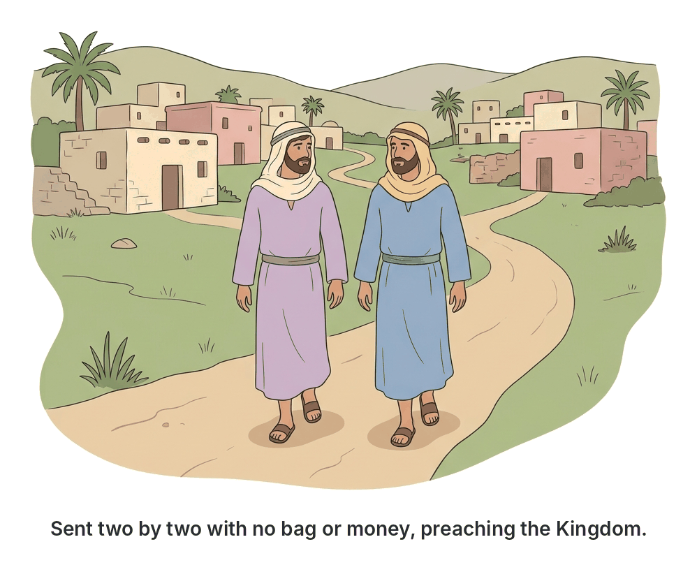
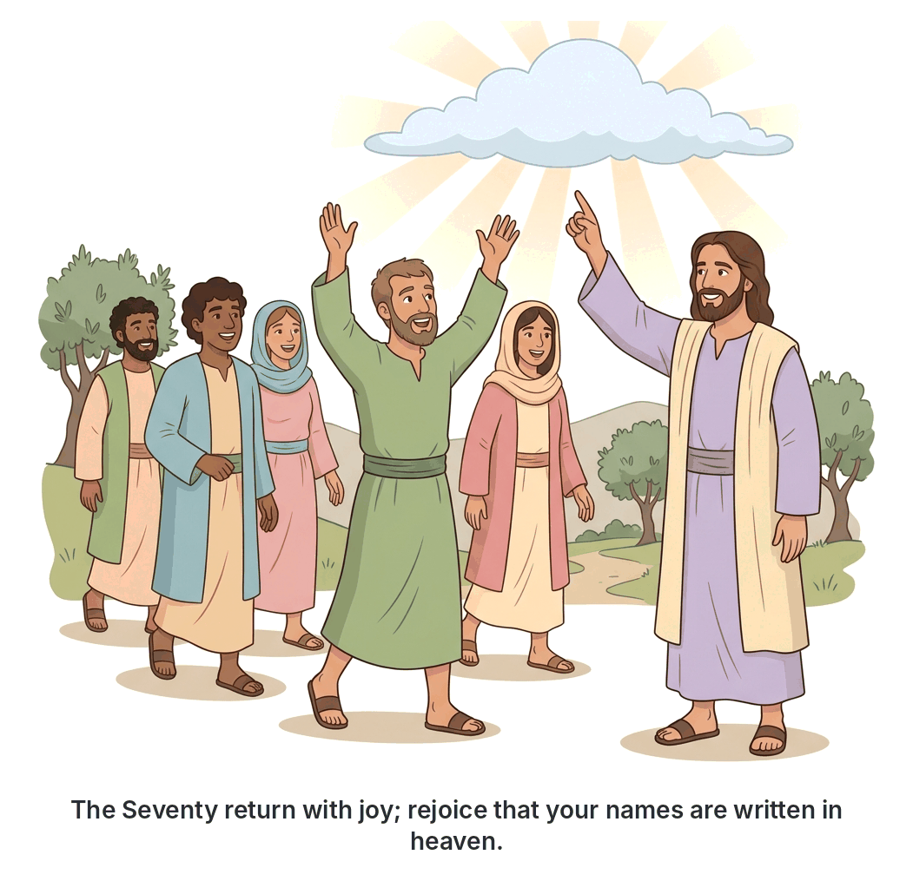

# JAMB Crk Notes: Mission of the Disciples

## What JAMB expects

This topic is Section C, Topic 7 of the JAMB CRK syllabus: Mission of the Disciples. It covers the times Jesus sent his followers out to preach, heal, and prepare the way for his ministry. 

The syllabus includes two main content items:
- **(a) The mission of the twelve** (Matthew 10:5-15; Mark 6:7-13; Luke 9:1-16)
- **(b) The mission of the seventy** (Luke 10:1-24)

By the end of these notes, you should be able to:
1. Distinguish between the mission of the twelve and the seventy.
2. Specify the instructions to the disciples.
3. Assess the outcomes of the missions.

**Note on the syllabus wording:** The syllabus lists Luke 9:1-16 for the mission of the twelve. Verses 1-9 cover the mission and the disciples' return, while verses 10-17 describe the Feeding of the Five Thousand. Because the syllabus cuts off at verse 16 (mid-miracle), these notes will follow the text strictly, showing how the disciples' return directly led into the feeding of the multitude. 

## The mission of the twelve

**Content (a): The mission of the twelve (Mt. 10:5-15; Mk. 6:7-13; Lk. 9:1-16)**

After spending time teaching and training his core group of disciples, Jesus decided it was time to send them out to share in his ministry. He called his twelve disciples together and gave them power and authority over all demons, and the ability to cure diseases. 

### The Commissioning
Jesus sent the twelve out to preach the kingdom of God and to heal the sick. According to Mark, he sent them out **two by two**. 

He gave them very specific instructions regarding **where to go**, **what to preach**, and **how to travel**. In Matthew's account, Jesus strictly commanded them: "Go nowhere among the Gentiles, and enter no town of the Samaritans, but go rather to the lost sheep of the house of Israel." Their mission was exclusively to the Jewish people.

### The Message and the Method
Jesus told them to preach a simple but powerful message: "The kingdom of heaven is at hand." They were commanded to:
1. Heal the sick.
2. Raise the dead.
3. Cleanse lepers.
4. Cast out demons.

Jesus reminded them, "You received without pay, give without pay" (freely you have received, freely give). This meant they were not to charge money for their miracles or their preaching.

### The Return and the Multitude (Luke 9:10-16)
When the twelve returned, they gathered around Jesus and told him all they had done and taught. Because they were surrounded by crowds and had no time even to eat, Jesus took them and withdrew privately to a city called **Bethsaida** to rest. 

However, the crowds learned where they were and followed them. Jesus, showing great compassion, welcomed the crowds, spoke to them about the kingdom of God, and healed those who needed curing. 

As the day began to wear away, the twelve came to Jesus and asked him to send the crowd away into the surrounding villages to find lodging and food, because they were in a desolate place. Instead, Jesus told the disciples, "You give them something to eat." They replied that they only had five loaves and two fish. Jesus instructed them to make the people sit down in groups of about fifty. Then, taking the five loaves and two fish, he looked up to heaven, blessed and broke them, and gave them to the disciples to set before the crowd. (Verse 17, just outside the syllabus range, confirms that all ate and were satisfied).

## The mission of the seventy

**Content (b): The mission of the seventy (Lk. 10:1-24)**

Later in his ministry, as he was making his way towards Jerusalem, Jesus appointed **seventy others** (some Bible translations say seventy-two). He sent them on ahead of him, **two by two**, into every town and place where he himself was about to go. 

### The Commissioning
Jesus introduced this mission by emphasizing the urgency and the danger of the task. He told them, "The harvest is plentiful, but the laborers are few; pray therefore the Lord of the harvest to send out laborers into his harvest." 

He then warned them of the danger ahead: "Go your way; behold, I send you out as lambs in the midst of wolves."

### The Message and the Method
Like the twelve, the seventy were told to travel extremely light. They were instructed to carry no purse, no bag, and no sandals. Emphasizing the urgency of their mission, Jesus told them to "salute no one on the road" (do not stop for long, formal greetings along the way). 

When they entered a house, they were to first say, "Peace be to this house!" If a "son of peace" was there, their peace would rest upon him; if not, it would return to them. They were to stay in the same house, eating and drinking whatever was provided, for "the laborer deserves his wages." They were not to move from house to house looking for better accommodation.

In the towns that received them, they were to heal the sick and declare: **"The kingdom of God has come near to you."** 

### Jesus' Woes on Unrepentant Cities
In his instructions to the seventy, Jesus pronounced "woes" (judgments) upon cities that had already seen his miracles but refused to repent. He mentioned **Chorazin** and **Bethsaida**, saying that if the miracles done in them had been done in the ancient, wicked cities of Tyre and Sidon, they would have repented in sackcloth and ashes long ago. He also declared that **Capernaum** would be brought down to Hades (hell) for its pride and unbelief. 

Jesus assured the seventy: "He who hears you hears me, and he who rejects you rejects me, and he who rejects me rejects him who sent me."

### The Return of the Seventy
The seventy returned with great joy. They were amazed by their spiritual authority, telling Jesus, "Lord, even the demons are subject to us in your name!"

Jesus confirmed their victory, stating, **"I saw Satan fall like lightning from heaven."** He told them he had given them authority to tread upon serpents and scorpions, and over all the power of the enemy, and nothing would hurt them. 

However, Jesus immediately corrected their focus. He told them not to rejoice merely because the spirits were subject to them, but to **"rejoice that your names are written in heaven."** 

In that same hour, Jesus rejoiced in the Holy Spirit and thanked God the Father for hiding these spiritual truths from the wise and understanding, and revealing them to "babes" (the humble disciples). 

## Instructions to the disciples

**Objective ii: specify the instructions to the disciples.**

Jesus gave very specific, practical instructions to his disciples in both missions. These instructions tested their faith, ensured their focus, and established the pattern for Christian evangelism. 

The instructions can be grouped into four main areas:

### 1. Provision and traveling light
In both missions, Jesus commanded the disciples to rely entirely on God's providence and the hospitality of the people they preached to. 
*   **Do not take money or extra luggage:** They were to take no gold, silver, or copper in their belts; no bag for their journey; and no extra tunics (shirts). 
*   *Note on Gospel variations:* There is a slight difference between the Gospels regarding the mission of the twelve. In Mark 6:8-9, Jesus allows them to take a **staff** and wear **sandals**. In Matthew 10:10 and Luke 9:3, he forbids taking a staff or sandals. JAMB typically focuses on the general theme: Jesus wanted them to travel light and depend on others, avoiding greed and unnecessary burdens.
*   **The seventy** were specifically told to carry no purse, no bag, and no sandals, and to "greet no one on the road" to show the urgency of their journey.

### 2. Accommodation and hospitality
*   **Stay in one place:** When they entered a town or village, they were to find a worthy person and stay in that person's house until they left the town. They were not to move from house to house (which might look like they were searching for wealthier hosts or better food).
*   **Eat what is offered:** The seventy were explicitly told to eat and drink whatever was set before them, because "the laborer deserves his wages." 
*   **Give a blessing of peace:** Upon entering a house, they were to pronounce peace upon it. 

### 3. The Message and Action
*   **Preach:** They were to proclaim that "The kingdom of heaven (or God) is at hand / has come near."
*   **Heal:** They were given authority to heal the sick, cleanse lepers, raise the dead, and cast out demons. 
*   **Free service:** The twelve were strictly told, "You received without pay, give without pay."

### 4. Dealing with rejection
Jesus prepared them for the reality that not everyone would accept the gospel.
*   If anyone would not receive them or listen to their words, they were to leave that house or town and **shake off the dust from their feet** as a testimony against them. 
*   Jesus warned the twelve that on the Day of Judgment, it would be more tolerable for the wicked cities of Sodom and Gomorrah than for the town that rejected the disciples.

## Outcomes of the missions

**Objective iii: assess the outcomes of the missions.**

Both missions were highly successful and demonstrated the transfer of Jesus' spiritual authority to his followers. 

### Outcome of the mission of the twelve
1. **Successful preaching and healing:** According to Mark and Luke, the disciples departed and went through the villages, preaching the gospel and healing everywhere. Mark 6:13 notes that they "cast out many demons, and anointed with oil many that were sick and healed them."
2. **Accountability to Jesus:** They returned and reported back to Jesus, telling him all they had done and taught. 
3. **Need for rest and further ministry:** The mission was so demanding that it drew massive crowds. This led Jesus to take the disciples away to Bethsaida to rest, which ultimately resulted in the miraculous feeding of the five thousand when the crowds followed them.

### Outcome of the mission of the seventy
1. **Joyful return:** The seventy returned with immense joy, specifically amazed that the demons submitted to them in Jesus' name.
2. **Spiritual victory confirmed:** Jesus assessed their mission as a massive blow to the kingdom of darkness, describing it as seeing "Satan fall like lightning from heaven."
3. **Increased authority:** Jesus granted them even more authority, giving them power to "tread upon serpents and scorpions" (symbols of demonic power) and promising divine protection.
4. **Correction of priorities:** The most important outcome was Jesus teaching them that spiritual power is secondary to salvation. Their greatest joy should not be their power over demons, but the fact that their "names are written in heaven" (they had received eternal life). 
5. **Jesus' rejoicing:** The success of the humble seventy caused Jesus to rejoice in the Holy Spirit, thanking God for revealing his power through ordinary people.

## Distinguishing between the mission of the twelve and the seventy

**Objective i: distinguish between the mission of the twelve and the seventy.**

While both missions involved preaching the kingdom, healing the sick, traveling light, and shaking the dust off their feet when rejected, there are several key differences that JAMB frequently tests. 

| Feature | The Mission of the Twelve | The Mission of the Seventy |
| :--- | :--- | :--- |
| **Number of Disciples** | 12 | 70 (or 72 in some versions) |
| **Where it is recorded** | Matthew, Mark, and Luke (Synoptic Gospels) | Only in the Gospel of Luke (Luke 10) |
| **Target Audience (Scope)** | Strictly Jewish: "Go nowhere among the Gentiles... but to the lost sheep of the house of Israel" (Mt 10:5-6) | Broader/Universal: "Every town and place where he himself was about to come" (Lk 10:1) |
| **Danger Warning** | "Sheep in the midst of wolves" (Mt 10:16) | "Lambs in the midst of wolves" (Lk 10:3) |
| **Greeting Instructions** | Salutations not specifically restricted | Strictly told to "salute no one on the road" to show urgency |
| **Pronouncing Peace** | Simply told to find who is worthy and let their peace come upon the house (Mt 10) | Told to specifically say, "Peace be to this house!" and look for a "son of peace" (Lk 10) |
| **Focus of the Return Report** | Reported all they had "done and taught" (General ministry) | Expressed great joy specifically because "even the demons are subject to us" |
| **Jesus' Response to the Return** | Took them away to rest at Bethsaida, leading to the feeding of the 5000 | Spoke of Satan falling like lightning; told them to rejoice that their names are written in heaven |

## Key terms

| Term | Meaning |
| :--- | :--- |
| **Commissioning** | The act of giving someone a specific task, authority, or mission. |
| **Bethsaida** | The city where Jesus took the twelve to rest after their mission; also one of the cities Jesus pronounced a "woe" upon for its unbelief. |
| **Chorazin / Capernaum** | Cities Jesus condemned during his instructions to the seventy because they saw his miracles but refused to repent. |
| **Son of peace** | A receptive, hospitable person who welcomes the gospel message and the messengers. |
| **Scrip / Purse** | A small bag or wallet used for carrying money or provisions on a journey. Jesus forbade carrying one. |
| **Salute no one on the road** | An instruction given to the seventy meaning they should not waste time on long, elaborate Eastern greetings, emphasizing the urgency of the mission. |

## Exam tips and common mistakes

*   **Target audience trap:** JAMB often asks who the twelve were sent to. The correct answer is **the lost sheep of Israel (the Jews only)**. Do not choose options suggesting they were sent to the Gentiles or Samaritans; Jesus explicitly forbade that in the first mission.
*   **The Seventy's true joy:** If a question asks why Jesus said the seventy should rejoice, the answer is **because their names are written in heaven**, NOT because they had power over demons. Jesus specifically corrected them on this point.
*   **Distinguishing the missions:** Remember that the mission of the seventy is recorded **only in the Gospel of Luke**. The mission of the twelve is in Matthew, Mark, and Luke.
*   **Traveling light:** Both groups were told to take no money, bag, or extra clothes. This was to teach them complete **dependence on God** and to avoid the appearance of greed. 
*   **Satan falling:** The statement "I saw Satan fall like lightning from heaven" was made by Jesus when the **seventy** returned, not the twelve. 
*   **Rejection protocol:** "Shaking the dust off the feet" was a Jewish gesture showing complete separation from people who rejected God's message. It served as a testimony or warning against the town.

## Quick summary

1. Jesus first commissioned the **twelve disciples**, sending them out to preach that the kingdom of heaven was at hand, and giving them power to heal and cast out demons.
2. The twelve were sent **strictly to the Jews** ("lost sheep of the house of Israel") and were told to travel light, relying on the hospitality of the people.
3. If a town rejected them, they were to **shake the dust off their feet** as a testimony against that place. 
4. Upon the return of the twelve, Jesus took them to Bethsaida to rest, which resulted in the miraculous feeding of the five thousand. 
5. Later, Jesus sent out **seventy disciples**, two by two, to every town he planned to visit, warning them they were "lambs among wolves."
6. The seventy were given urgent instructions: carry no purse or sandals, greet no one on the road, and eat whatever is provided.
7. The seventy returned with great joy because demons submitted to them. Jesus confirmed this spiritual victory but taught them that their greatest joy should be that their **names are written in heaven**. 

## Practice questions

**1. During the mission of the twelve, Jesus strictly instructed his disciples to go to**
- A. all the nations of the earth
- B. the lost sheep of the house of Israel
- C. the towns of the Samaritans
- D. the Gentiles and the Greeks

**Answer: B.** Jesus commanded the twelve in Matthew 10:5-6: "Go nowhere among the Gentiles, and enter no town of the Samaritans, but go rather to the lost sheep of the house of Israel."

**2. What did Jesus say to the seventy when they returned rejoicing that demons were subject to them?**
- A. "Let the little children come to me."
- B. "You give them something to eat."
- C. "I saw Satan fall like lightning from heaven."
- D. "Get behind me, Satan."

**Answer: C.** According to Luke 10:18, Jesus responded to the joyful report of the seventy by confirming their spiritual victory, saying, "I saw Satan fall like lightning from heaven."

**3. In both missions, what did Jesus instruct the disciples to do if a town refused to receive them or hear their words?**
- A. Pray for fire to come down from heaven
- B. Stay and argue with the leaders of the town
- C. Shake off the dust from their feet as a testimony against them
- D. Pay for their own food and lodging

**Answer: C.** Shaking the dust off their feet was a symbolic gesture of separation and a warning of impending judgment against those who rejected the gospel.

**4. Jesus told the seventy disciples that their primary reason for rejoicing should be that**
- A. they had power to heal the sick
- B. the demons were subject to them in his name
- C. they lacked nothing on their journey
- D. their names are written in heaven

**Answer: D.** In Luke 10:20, Jesus corrected their focus: "Nevertheless do not rejoice in this, that the spirits are subject to you; but rejoice that your names are written in heaven."

**5. How many disciples did Jesus send out in the mission recorded exclusively in the Gospel of Luke?**
- A. Twelve
- B. Forty
- C. Seventy
- D. One hundred and twenty

**Answer: C.** The mission of the seventy (or seventy-two) is found only in Luke chapter 10. The mission of the twelve is found in all three Synoptic Gospels.

**6. Which of the following instructions was given specifically to the seventy to emphasize the urgency of their mission?**
- A. Salute no one on the road
- B. Take no copper in your belts
- C. Go only to the lost sheep of Israel
- D. Beware of the leaven of the Pharisees

**Answer: A.** Jesus told the seventy to "salute no one on the road" (Luke 10:4), meaning they should not delay their journey with long, traditional greetings.

**7. When commissioning the disciples, Jesus summarized their preaching message as:**
- A. "Repent and be baptized."
- B. "The kingdom of heaven is at hand."
- C. "Love your enemies."
- D. "I am the bread of life."

**Answer: B.** Both the twelve and the seventy were instructed to preach that the kingdom of heaven (or the kingdom of God) was at hand / had come near. 

**8. According to Jesus, what should the disciples say immediately upon entering a house?**
- A. "Repent for the kingdom is near."
- B. "Peace be to this house."
- C. "The Lord is my shepherd."
- D. "Freely we have received, freely we give."

**Answer: B.** Jesus instructed the seventy that into whatever house they entered, they should first say, "Peace be to this house" (Luke 10:5).

**9. When the twelve returned from their mission and reported to Jesus, what event immediately followed?**
- A. The Transfiguration
- B. The Triumphal Entry
- C. Jesus washing the disciples' feet
- D. Jesus taking them away to rest, leading to the feeding of the multitude

**Answer: D.** According to Luke 9:10-16, after they reported back, Jesus took them to Bethsaida to rest. The crowds followed, resulting in Jesus teaching, healing, and eventually feeding the five thousand. 

**10. "You received without pay, give without pay." This instruction to the twelve meant that they should**
- A. not buy any food on their journey
- B. not accept hospitality from wealthy people
- C. not charge money for their preaching and healing
- D. pay back anyone who helped them

**Answer: C.** Jesus gave them this command (Matthew 10:8) to ensure they ministered freely, just as God's grace and their spiritual gifts had been freely given to them. 

<!-- COVERAGE
obj i | Distinguishing between the mission of the twelve and the seventy
obj ii | Instructions to the disciples
obj iii | Outcomes of the missions
item a | The mission of the twelve
item b | The mission of the seventy
-->
