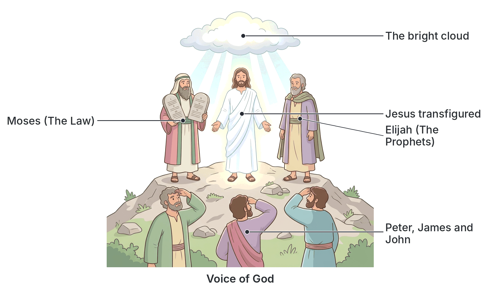

# JAMB Crk Notes: The Transfiguration

## What JAMB expects

This topic is part of Section C (The Ministry of Jesus and His Reactions to the Society) of the JAMB CRK syllabus. It covers the Transfiguration of Jesus.

The syllabus lists the following content items:
- Mt. 17:1-13
- Mk. 9:2-13
- Lk. 9:28-36

By the end of these notes, you should be able to:
1. trace the events leading to the Transfiguration;
2. identify the personalities involved in the Transfiguration account;
3. determine the significance of the Transfiguration to the disciples.

## The events leading to the Transfiguration

**Objective i: trace the events leading to the Transfiguration.**

To understand the Transfiguration, it is important to know what happened immediately before it. The events leading up to this moment set the stage for why Jesus needed to reveal His glory to His closest disciples.

1. **The Great Confession at Caesarea Philippi:** A short time before the Transfiguration, Jesus had asked His disciples who they believed He was. Peter boldly declared, "Thou art the Christ, the Son of the living God" (Matthew 16:16). This was a major turning point in Jesus' ministry (covered fully in `C8-the-great-confession.md`).
2. **The First Prediction of His Passion:** Immediately after Peter's confession, Jesus began to teach His disciples that He must go to Jerusalem, suffer many things from the elders and chief priests, be killed, and rise again on the third day. 
3. **The Disciples' Confusion and Fear:** The idea of a suffering and dying Messiah shocked the disciples. Peter even tried to rebuke Jesus for saying this, showing that they expected a political, conquering king, not a suffering servant. Jesus rebuked Peter, calling him "Satan," because Peter was focusing on human desires rather than God's will.
4. **The Teaching on Cross-Bearing:** Jesus then told the crowd and His disciples that anyone who wanted to follow Him must deny themselves, take up their cross, and follow Him. He warned that following Him involved suffering but promised that the Son of Man would eventually come in the glory of His Father.
5. **The Timing of the Transfiguration:** According to Matthew and Mark, the Transfiguration happened **"six days"** after these conversations. Luke writes that it was **"about an eight days after"** (which includes the day of the conversation and the day of the event). The disciples were likely still confused and saddened by the news of His upcoming death, making the revelation of His glory exactly what they needed to strengthen their faith.

## The Transfiguration Narrative

**Content items: Mt. 17:1-13; Mk. 9:2-13; Lk. 9:28-36**

The story of the Transfiguration is recorded in all three Synoptic Gospels (Matthew, Mark, and Luke). The sequence of events is as follows:

1. **Going up the mountain:** Jesus took three of His disciples—**Peter, James, and John**—and led them up a high mountain privately. Luke specifically notes that Jesus went up the mountain "to pray."
2. **The physical change (The Transfiguration):** As Jesus was praying, His appearance dramatically changed (He was "transfigured"). Matthew records that "his face did shine as the sun, and his raiment was white as the light." Mark says His clothes became shining, exceedingly white like snow, whiter than any launderer on earth could make them. 
3. **The appearance of heavenly visitors:** Suddenly, two great figures from the Old Testament, **Moses and Elijah**, appeared in glory and began talking with Jesus. Luke provides a unique detail about their conversation: they spoke of His "decease" (His upcoming departure or death) which He was about to accomplish in Jerusalem.
4. **The disciples' reaction:** Luke records that Peter and the others had been heavy with sleep, but when they fully awoke, they saw Jesus' glory and the two men standing with Him. 
5. **Peter's suggestion:** As Moses and Elijah were leaving, Peter, not knowing what to say because they were terrified, said to Jesus: "Lord, it is good for us to be here: if thou wilt, let us make here three tabernacles; one for thee, and one for Moses, and one for Elias [Elijah]." (Matthew 17:4).
6. **The Cloud and the Voice:** While Peter was still speaking, a bright cloud overshadowed them. The disciples were afraid as they entered the cloud. A voice came out of the cloud saying, *"This is my beloved Son, in whom I am well pleased; hear ye him"* (Matthew 17:5).
7. **Jesus reassures them:** Hearing the voice, the disciples fell on their faces in great terror. Jesus came and touched them, saying, "Arise, and be not afraid." When they looked up, they saw no one except Jesus alone.
8. **The journey down the mountain:** As they came down, Jesus commanded them strictly: "Tell the vision to no man, until the Son of man be risen again from the dead." 
9. **The question about Elijah:** The disciples kept the matter secret but debated what "rising from the dead" meant. They then asked Jesus, "Why then say the scribes that Elias must first come?" Jesus answered that Elijah truly must come first to restore all things, but that "Elias is come already," and the authorities did not recognize him but treated him poorly. Jesus warned that the Son of Man would suffer similarly. The disciples then understood that He was speaking about **John the Baptist**.

### Comparison of the Gospel Accounts

While the core event is the same, each Gospel writer includes unique details. Understanding these differences is helpful for JAMB questions.

| Feature | Matthew (17:1-13) | Mark (9:2-13) | Luke (9:28-36) |
| --- | --- | --- | --- |
| **Timeframe** | "After six days" | "After six days" | "About an eight days after" |
| **Reason for going up** | Not specified | Not specified | "To pray" |
| **Description of change** | Face shone as the sun, raiment white as light | Garments glistening, exceedingly white like snow | Fashion of his countenance was altered, raiment white and glistering |
| **Topic of conversation** | Not mentioned | Not mentioned | Spake of His "decease" (death) to be accomplished at Jerusalem |
| **State of the disciples** | Awake | Awake | "Heavy with sleep" but woke up |
| **The Voice's words** | "This is my beloved Son, in whom I am well pleased; hear ye him." | "This is my beloved Son: hear him." | "This is my beloved Son: hear him." (Some versions say "my chosen") |
| **Reaction to the Voice** | Fell on their faces, Jesus touched them | Not specified | Kept it close, told no one in those days |

## Personalities involved in the Transfiguration

**Objective ii: identify the personalities involved in the Transfiguration account.**

The Transfiguration involves a unique gathering of earthly and heavenly figures.

### 1. Jesus Christ
Jesus is the central figure. His transfiguration (a complete change of form and appearance) revealed His divine nature, stripping away His ordinary human appearance for a brief moment to show His heavenly glory.

### 2. The Inner Circle: Peter, James, and John
Jesus had twelve apostles, but He frequently chose these three for special, intimate moments (such as the raising of Jairus' daughter and His later agony in the Garden of Gethsemane). 
*   **Peter:** The spontaneous leader of the group, who had recently declared Jesus as the Messiah. He proposes building three booths (tabernacles), showing a misunderstanding of the event by trying to place Jesus on the same level as Moses and Elijah.
*   **James and John:** Brothers (the sons of Zebedee) who, along with Peter, represent the human witnesses required by Jewish law to confirm a profound event.

### 3. Moses
Moses was the great deliverer of Israel and the giver of the **Law**. His presence on the mountain represented the Old Testament Law. The fact that he was talking with Jesus symbolized that the Law of the Old Covenant pointed toward and was fulfilled in Jesus.

### 4. Elijah
Elijah was considered the greatest of the Old Testament **Prophets**. He represented the prophetic tradition of Israel. His presence symbolized that all the prophecies regarding the Messiah were being fulfilled in the person and mission of Jesus. 

### 5. God the Father (The Voice from the Cloud)
In the Old Testament, a bright cloud often symbolized the *Shekinah* glory—the visible presence of God (e.g., the cloud that led the Israelites in the wilderness). God the Father spoke directly from the cloud, validating Jesus as His Son and commanding the disciples to listen to Him.

## Significance of the Transfiguration to the disciples

**Objective iii: determine the significance of the Transfiguration to the disciples.**

The Transfiguration was not just a miraculous display; it carried deep theological meaning and was highly significant for the disciples who witnessed it.

1. **Confirmation of Jesus' Divine Sonship:** The voice from heaven confirmed Peter's earlier confession at Caesarea Philippi. The disciples received undeniable proof that Jesus was not just a great teacher or prophet, but the actual Son of God.
2. **Encouragement before the Crucifixion:** Jesus had just told them He was going to suffer and die. This terrifying news had discouraged them. The glimpse of His heavenly glory served to strengthen their faith, assuring them that ultimate victory lay ahead despite the coming suffering of the cross.
3. **Fulfillment of the Law and the Prophets:** The appearance of Moses and Elijah showed the disciples that Jesus was the fulfillment of the entire Old Testament. The old era was passing, and the new era in Christ had arrived. 
4. **The Supremacy of Jesus:** By commanding, *"hear ye him,"* God the Father made it clear that Jesus' authority surpassed that of Moses (the Law) and Elijah (the Prophets). The disciples were to take their ultimate instruction from Jesus. Peter's mistake of wanting to build three equal tabernacles was corrected—Jesus stands entirely alone in His supreme authority.
5. **A Glimpse of the Resurrection Glory:** The dazzling light and glorified state of Jesus gave the disciples a preview of the resurrection and the future kingdom of God. It showed them the heavenly reality of who Jesus truly was, giving them hope that would sustain them through the difficult days of His trial and death.

## Key terms

| Term | Meaning |
| --- | --- |
| Transfiguration | A complete change of form or appearance into a more beautiful or spiritual state; from the Greek word *metamorphoo*. |
| Tabernacle | A tent, booth, or temporary dwelling; Peter suggested building three of these on the mountain. |
| The Law and the Prophets | A common phrase referring to the entire Old Testament Scriptures, represented at the Transfiguration by Moses and Elijah. |
| Decease | An older English word for departure or death. Luke notes that Moses and Elijah spoke to Jesus about His decease in Jerusalem. |
| Inner Circle | The term often used to describe Peter, James, and John, who witnessed events the other nine disciples did not. |

## Exam tips and common mistakes

*   **Know the specific disciples:** JAMB frequently asks which disciples were taken up the mountain. It was always **Peter, James, and John**. Do not confuse this by adding Andrew.
*   **Know what Moses and Elijah represent:** Moses represents the **Law**, and Elijah represents the **Prophets**. 
*   **Identify the Gospel differences:** Remember that only **Luke** mentions that the disciples were "heavy with sleep" and that Moses and Elijah spoke about Jesus' upcoming "decease" (death) in Jerusalem. Luke also says "eight days" while Matthew and Mark say "six days".
*   **Understand Peter's suggestion:** Peter wanted to build three tabernacles (tents/booths). This showed his desire to prolong the glorious experience and his initial failure to realize that Jesus was greater than Moses and Elijah.
*   **The John the Baptist connection:** When the disciples asked about Elijah returning, Jesus explained that the prophecy had already been fulfilled in **John the Baptist**, who came in the spirit and power of Elijah.

## Quick summary

1. The Transfiguration took place shortly after Peter confessed Jesus as the Christ and Jesus predicted His own suffering and death.
2. Jesus took Peter, James, and John up a high mountain to pray.
3. Jesus' appearance was transformed; His face shone like the sun and His clothes became dazzling white.
4. Moses (representing the Law) and Elijah (representing the Prophets) appeared and spoke with Jesus about His upcoming death in Jerusalem.
5. Peter suggested building three tabernacles for Jesus, Moses, and Elijah.
6. A bright cloud covered them, and God's voice declared Jesus as His beloved Son, commanding the disciples to "hear him."
7. The event confirmed Jesus' identity, fulfilled the Old Testament, and encouraged the disciples for the difficult days ahead.
8. On the way down, Jesus commanded secrecy until His resurrection and identified John the Baptist as the "Elijah" who was prophesied to come first.

## Practice questions

**1. Which three disciples witnessed the Transfiguration of Jesus?**
- A. Peter, Andrew, and John
- B. Peter, James, and John
- C. James, John, and Philip
- D. Peter, James, and Matthew

**Answer: B.** Jesus took Peter, James, and John up the high mountain privately.

**2. At the Transfiguration, Moses and Elijah appeared representing the**
- A. old and new covenants
- B. priests and the kings
- C. Law and the Prophets
- D. living and the dead

**Answer: C.** Moses was the giver of the Law, and Elijah was considered the greatest of the Old Testament Prophets.

**3. According to the Gospel of Luke, what was the specific topic of conversation between Jesus, Moses, and Elijah?**
- A. The establishment of the Kingdom of God
- B. His upcoming departure (death) at Jerusalem
- C. The betrayal by Judas Iscariot
- D. The faith of the disciples

**Answer: B.** Luke 9:31 states that they "spake of his decease which he should accomplish at Jerusalem."

**4. What did Peter suggest they do while on the mount of Transfiguration?**
- A. Go back to Jerusalem immediately
- B. Build three tabernacles for Jesus, Moses, and Elijah
- C. Call the other disciples to come up the mountain
- D. Offer a sacrifice to God

**Answer: B.** Peter said, "let us make here three tabernacles; one for thee, and one for Moses, and one for Elias" (Matthew 17:4).

**5. According to Matthew and Mark, how many days after Peter's great confession did the Transfiguration occur?**
- A. Three days
- B. Six days
- C. Eight days
- D. Twelve days

**Answer: B.** Both Matthew and Mark record that Jesus took the disciples up the mountain "after six days." (Luke says "about an eight days after").

**6. What did the voice from the cloud command the disciples to do?**
- A. Build the three tabernacles
- B. Preach the gospel to all nations
- C. Hear Him (Jesus)
- D. Fear not

**Answer: C.** The voice said, "This is my beloved Son, in whom I am well pleased; hear ye him."

**7. Why did Jesus command the disciples not to tell anyone about the vision on the mountain?**
- A. Because the other disciples would be jealous
- B. Because the Pharisees were looking for a reason to arrest Him
- C. Because they were to wait until the Son of Man had risen from the dead
- D. Because the vision was only meant for the Gentiles

**Answer: C.** Jesus charged them to "Tell the vision to no man, until the Son of man be risen again from the dead" (Matthew 17:9).

**8. When the disciples asked about the prophecy that Elijah must come first, who did Jesus indicate had fulfilled this?**
- A. Jesus Himself
- B. Peter
- C. Moses
- D. John the Baptist

**Answer: D.** Jesus explained that Elijah had already come and suffered at the hands of the authorities, and the disciples understood He spoke of John the Baptist.

**9. A major significance of the Transfiguration for the disciples was that it**
- A. showed them how to pray effectively
- B. proved that Elijah did not die
- C. confirmed Jesus' divine sonship and encouraged them before His death
- D. marked the beginning of Jesus' earthly ministry

**Answer: C.** The event validated Peter's confession that Jesus was the Son of God and gave the disciples a glimpse of His glory to strengthen them for the upcoming crucifixion.

**10. Which Gospel writer uniquely mentions that Peter and the others were "heavy with sleep" before seeing the Transfiguration?**
- A. Matthew
- B. Mark
- C. Luke
- D. John

**Answer: C.** Luke 9:32 is the only account that notes, "But Peter and they that were with him were heavy with sleep: and when they were awake, they saw his glory..."

<!-- COVERAGE
obj i | The events leading to the Transfiguration
obj ii | Personalities involved in the Transfiguration
obj iii | Significance of the Transfiguration to the disciples
Mt. 17:1-13 | The Transfiguration Narrative
Mk. 9:2-13 | The Transfiguration Narrative
Lk. 9:28-36 | The Transfiguration Narrative
-->
