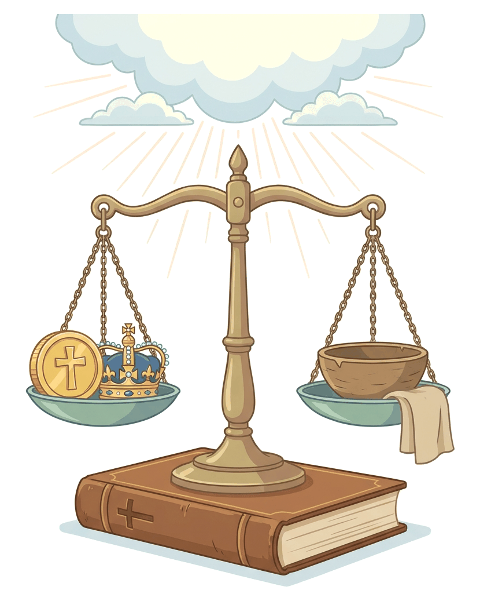
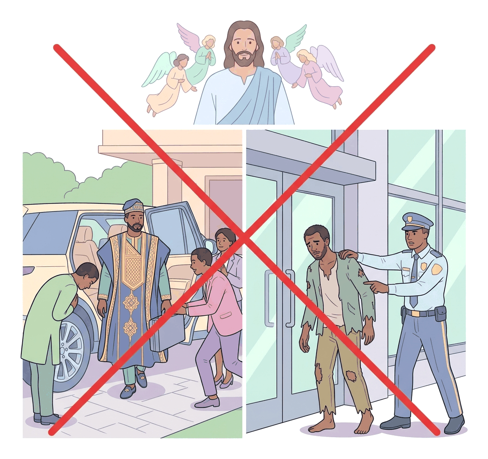

# JAMB Crk Notes: Impartiality

## What JAMB expects

This topic is Section D, Topic 12 of the JAMB CRK syllabus: Impartiality. It covers the biblical teachings against favouritism and discrimination, focusing mainly on the Epistle of James, supported by teachings from the Gospels and the Acts of the Apostles.

**The syllabus content includes:**
* James 2:1-13 cf. Acts 10:34-35; Matt 7:1-5; Luke 6:31

**By the end of these notes, you should be able to:**
1. interpret the concept of impartiality;
2. identify causes of partiality;
3. examine the consequences of partiality.

**Note on the syllabus wording:** In the JAMB syllabus, the main reference is printed as "James 2:1-13cf. Acts 10:34-35". This is simply missing a space. It means "James 2:1-13, compare with (*confer*) Acts 10:34-35". We will cover all the listed passages in detail.

## Objective i: Interpret the concept of impartiality

To understand the biblical teaching on this topic, we must first define what partiality and impartiality mean.

*   **Partiality (Favouritism):** This means treating one person or group better than another based on outward appearances, wealth, social status, tribe, or race. In the King James Version of the Bible, this is often called being a "respecter of persons."
*   **Impartiality:** This is the opposite of partiality. It is the practice of fairness and justice, treating everyone equally and with the same level of respect, regardless of who they are, how much money they have, or where they come from. 

The Bible teaches that God is entirely impartial. Because God does not show favouritism, Christians are commanded to be impartial in their dealings with others.

### Acts 10:34-35: God shows no partiality

The book of Acts provides a clear example of God's impartiality through the story of Peter and Cornelius. 

**The context:** In the early days of the church, Jewish Christians believed that salvation and God's favour were meant only for the Jews. Jews were forbidden by their traditions from associating with Gentiles (non-Jews). However, God gave Peter a vision of a sheet filled with unclean animals, telling him not to call anything unclean that God has cleansed. Immediately after, Peter was called to the house of Cornelius, a Roman centurion (a Gentile).

**Peter's interpretation:** When Peter arrived and saw that God had prepared Cornelius and his household to hear the gospel, he finally understood that God does not judge based on race or nationality. Peter declared: 

> *"Of a truth I perceive that God is no respecter of persons: But in every nation he that feareth him, and worketh righteousness, is accepted with him."* (Acts 10:34-35).

This passage establishes the foundational concept of impartiality: God looks at the heart (fear of God and righteous living), not at a person's background, race, or status.

### Matthew 7:1-5: Judging others impartially

In the Sermon on the Mount, Jesus taught about the danger of hypocritical and biased judgment.

**The context:** Jesus said, "Judge not, that ye be not judged" (Matthew 7:1). This does not mean Christians should never discern right from wrong, but rather that they must not judge others unfairly, harshly, or hypocritically while ignoring their own faults.

**The speck and the log:** Jesus used a humorous illustration to explain this. He asked why a person would look at the tiny "speck" (a small piece of dust or sawdust) in their brother's eye, but ignore the massive "beam" or "log" (a large piece of wood) in their own eye. 

Jesus called such a person a hypocrite and commanded: *"First cast out the beam out of thine own eye; and then shalt thou see clearly to cast out the mote out of thy brother's eye"* (Matthew 7:5).

**Interpretation for impartiality:** To be impartial means holding yourself to the same standards you demand of others. You cannot judge a poor person harshly for a small mistake while excusing a rich person—or yourself—for a massive sin. Impartiality requires fair, self-reflective judgment.

### Luke 6:31: The Golden Rule

Jesus gave a very simple but powerful rule for human relationships, often called the **Golden Rule**:

> *"And as ye would that men should do to you, do ye also to them likewise."* (Luke 6:31).

**Interpretation for impartiality:** If you want to be treated fairly, you must treat others fairly. If you do not want to be discriminated against because of your background or bank account, you must not discriminate against others. Impartiality is simply the Golden Rule in action.

## James 2:1-13: The core teaching on impartiality

The most detailed teaching on impartiality in the New Testament is found in the Epistle of James. James wrote to early Jewish Christians, warning them strongly against bringing worldly discrimination into the church. 

### The scenario of the rich and poor man

James begins by telling his readers: "My brethren, have not the faith of our Lord Jesus Christ, the Lord of glory, with respect of persons" (James 2:1). He then gives a practical, everyday example of partiality:

1. **The rich man arrives:** A man comes into the assembly (church) wearing gold rings and fine clothing. 
2. **The poor man arrives:** A poor man also comes in, wearing shabby, dirty clothes.
3. **The discriminatory reaction:** The church members pay special attention to the rich man, saying, "Sit here in a good place." But to the poor man, they say, "Stand there, or sit here under my footstool."

James strongly condemns this behaviour. He points out four reasons why this partiality is terribly wrong:

**1. It makes them evil judges:** By making distinctions based on clothes and wealth, they have become "judges with evil thoughts."

**2. It contradicts God's choice:** James reminds them that God has chosen the poor of this world to be "rich in faith" and heirs of the kingdom promised to those who love Him. By dishonouring the poor man, they are dishonouring someone whom God has chosen.

**3. It makes no logical sense:** James points out the irony of their actions. He asks, "Do not rich men oppress you, and draw you before the judgment seats? Do not they blaspheme that worthy name by the which ye are called?" (James 2:6-7). The early Christians were being persecuted, dragged to court, and oppressed primarily by the wealthy elite, yet they were foolishly bowing down to those same wealthy people in the church.

**4. It breaks the Royal Law:** James points to the supreme law of love found in the Old Testament (Leviticus 19:18), which he calls the **Royal Law**: *"Thou shalt love thy neighbour as thyself."* If they keep this law, they do well. But if they show partiality, they commit a sin and are convicted by the law as transgressors.

### The unity of God's Law

To explain how serious the sin of partiality is, James explains the unity of God's law. He states that whoever keeps the whole law but fails in one point has become guilty of breaking all of it. 

He reasons that the same Lawgiver (God) who said, "Do not commit adultery," also said, "Do not murder." If a person does not commit adultery but commits murder, they are still a lawbreaker. In the same way, if you do not murder, but you show partiality, you have broken the Royal Law of love, making you a transgressor of God's entire law.

### The conclusion: Judgment and Mercy

James concludes his teaching on impartiality by urging Christians to speak and act as people who are going to be judged under the "law of liberty." He gives a stern warning: 

> *"For he shall have judgment without mercy, that hath shewed no mercy; and mercy rejoiceth against judgment."* (James 2:13).

Because partiality is a failure to show mercy and love to a fellow human being, the person who practices it will face God's judgment without mercy.

## Objective ii: Identify causes of partiality

Why do people show partiality in the church and in society? Based on the biblical texts and human nature, the main causes of partiality include:

| Cause of Partiality | Explanation |
| :--- | :--- |
| **Wealth and Material Possessions** | As seen in James 2, people naturally gravitate towards those who have money, gold, and fine clothes. They believe the rich are more important than the poor. |
| **Social Status and Power** | People often favour politicians, bosses, and celebrities. They respect the powerful because they want to associate with success or fear the person's influence. |
| **Selfish Ambition and Greed** | People show favouritism because they want something in return. A church member might give a rich man a good seat hoping the rich man will give a large donation or a business contract. |
| **Outward Appearance** | Humans often judge by what they see on the outside—clothes, physical beauty, or expensive cars—rather than looking at a person's heart and character, which is how God judges. |
| **Tribalism and Ethnicity** | Very common in Nigeria, this occurs when people favour members of their own ethnic group or hometown over others in jobs, school admissions, or church leadership. This contradicts Peter's teaching in Acts 10 that God accepts people from *every* nation. |
| **Nepotism** | Favouring family members and relatives for positions they may not be qualified for, ignoring fairness and merit. |
| **Religious Denomination** | Treating people of other Christian denominations or other religions unfairly in everyday life, refusing to apply the Golden Rule (Luke 6:31) to those outside one's own group. |
| **Hypocrisy** | As Jesus taught in Matthew 7, people are partial when they are blind to their own faults (the log) but overly critical of others (the speck). This pride makes them think they are better than others. |

## Objective iii: Examine the consequences of partiality

Showing partiality is not a minor mistake; the Bible treats it as a serious offence with severe consequences, both spiritually and socially.

### 1. It is a sin against God
James clearly states, "But if ye have respect to persons, ye commit sin" (James 2:9). Partiality is not just bad manners; it is a direct violation of God's command.

### 2. It makes one a transgressor of the whole law
Because God's law is a unified whole based on love, breaking the command to love your neighbour by showing partiality makes you guilty of breaking the entire law of God. You become a "transgressor" (a lawbreaker).

### 3. Judgment without mercy
The most terrifying consequence of partiality mentioned by James is that God will judge the partial person harshly. If you show no mercy to the poor or the vulnerable by discriminating against them, God will show you no mercy on the Day of Judgment (James 2:13).

### 4. It dishonours God's chosen people
God often chooses the poor, who rely completely on Him, to be "rich in faith." When people discriminate against the poor, they are insulting the very people God has chosen to bless, putting themselves in opposition to God's will.

### 5. It creates division and strife
In the church or in society, favouritism creates a class system. It makes the poor feel worthless and the rich feel proud. This destroys the unity, peace, and fellowship that Jesus prayed for His followers to have. 

### 6. It enables oppression
When society constantly favours the rich and powerful, it allows them to continue oppressing the weak. As James noted, the rich were the ones dragging the poor to court and blaspheming Christ. Partiality gives wicked people a free pass simply because they have money.

### 7. It leads to societal corruption (Application to Nigeria)
When partiality (like tribalism, nepotism, and bribery) takes root in a country, justice is destroyed. Unqualified people get jobs, the innocent are punished in court while the guilty go free (hypocritical judgment), and the nation fails to develop. Impartiality is essential for national progress.

## Key terms

| Term | Meaning |
| :--- | :--- |
| **Impartiality** | Treating everyone fairly and equally, without bias or favouritism. |
| **Partiality** | Showing favouritism or bias toward one person or group based on wealth, status, or background. |
| **Respecter of persons** | An old English (KJV) phrase meaning someone who shows partiality or favouritism based on a person's outward status. |
| **Royal Law** | The supreme biblical law found in Leviticus 19:18 and quoted by James: "Thou shalt love thy neighbour as thyself." |
| **Transgressor** | Someone who breaks a law; a sinner or lawbreaker. |
| **Hypocrite** | A person who demands a standard from others that they do not keep themselves (e.g., the man with the log in his eye). |
| **The Golden Rule** | Jesus' command in Luke 6:31 to treat others the way you want to be treated. |
| **Gentile** | A person who is not Jewish. Cornelius was a Gentile. |

## Exam tips and common mistakes

*   **Know the James 2 scenario perfectly:** JAMB often asks who came into the assembly. Answer: A man in fine clothes/gold rings and a poor man in shabby clothes. Remember what they were told: The rich man was given a good seat, the poor man was told to stand or sit under the footstool.
*   **The Royal Law:** If a question asks what James calls the command to "love thy neighbour as thyself," the answer is the **Royal Law**.
*   **Breaking the whole law:** Remember James's logic. Why is partiality so bad? Because whoever keeps the whole law but fails in one point is guilty of all of it.
*   **Acts 10 Connection:** Always link Peter's statement "God is no respecter of persons" to the story of **Cornelius**. This was when Peter realised the gospel was for Gentiles too, not just Jews.
*   **The Speck and the Log:** This comes from **Matthew 7**. It teaches against **hypocritical judgment**, which is a form of partiality. You must judge yourself before you judge others.
*   **Common mistake:** Do not confuse the "law of liberty" with the "royal law." The Royal Law is loving your neighbour. The law of liberty is the standard by which Christians will be judged.
*   **James's view of the rich:** James points out that it was the rich who were dragging Christians to court and blaspheming Christ's name.

## Quick summary

1. Impartiality means treating all people equally and fairly, without showing favouritism based on wealth, status, or race.
2. God is entirely impartial. Peter realised this at the house of Cornelius, declaring that God is "no respecter of persons" (Acts 10).
3. Jesus taught impartiality through the Golden Rule (treat others as you want to be treated) and the warning against hypocritical judgment (removing the log from your own eye first).
4. James condemned Christians for honouring a rich man with a good seat while telling a poor man to sit on the floor.
5. Causes of partiality include greed, respect for wealth/status, tribalism, and judging by outward appearance.
6. According to James, showing partiality is a sin that breaks the Royal Law ("love thy neighbour as thyself").
7. Breaking one part of God's law makes a person guilty of breaking the entire law.
8. The ultimate consequence of showing partiality is facing God's judgment without mercy, because the partial person showed no mercy to others.

## Practice questions

**1. According to James, if a Christian shows partiality, he has**
- A. misunderstood the gospel
- B. committed a sin and is a transgressor of the law
- C. acted foolishly but is forgiven
- D. offended the poor man

**Answer: B.** James 2:9 states: "But if ye have respect to persons, ye commit sin, and are convinced of the law as transgressors."

**2. Which law does James refer to as the "Royal Law"?**
- A. The Ten Commandments
- B. Thou shalt love the Lord thy God with all thy heart
- C. Thou shalt not murder
- D. Thou shalt love thy neighbour as thyself

**Answer: D.** James 2:8 specifically identifies "Thou shalt love thy neighbour as thyself" as the Royal Law according to the scripture.

**3. In Acts 10, Peter declared that God is no respecter of persons when he was at the house of**
- A. Zacchaeus
- B. Ananias
- C. Cornelius
- D. Stephen

**Answer: C.** Peter made this statement (Acts 10:34) after arriving at the house of Cornelius, a Roman centurion, and realising God accepts righteous people from every nation.

**4. According to Jesus in Matthew 7, before a person can remove the speck from their brother's eye, they must first**
- A. pray for forgiveness
- B. cast the beam out of their own eye
- C. wash their hands in pure water
- D. judge the matter impartially

**Answer: B.** Matthew 7:5 says, "First cast out the beam out of thine own eye; and then shalt thou see clearly to cast out the mote out of thy brother's eye."

**5. According to James, what is the consequence for a person who shows no mercy to others?**
- A. They will be cast out of the church
- B. They will have judgment without mercy
- C. They will lose their wealth
- D. They will be dragged to court

**Answer: B.** James 2:13 states: "For he shall have judgment without mercy, that hath shewed no mercy."

**6. James pointed out the irony of honouring the rich in the church by reminding the believers that the rich usually**
- A. give the largest offerings
- B. oppress them and drag them to court
- C. build the synagogues
- D. have no need for salvation

**Answer: B.** James 2:6 asks, "Do not rich men oppress you, and draw you before the judgment seats?"

**7. Jesus' command, "And as ye would that men should do to you, do ye also to them likewise," is commonly known as the**
- A. Royal Law
- B. Law of Liberty
- C. Golden Rule
- D. Great Commission

**Answer: C.** Found in Luke 6:31, this principle of reciprocal fairness is universally known as the Golden Rule.

**8. To explain that God's law is a unified whole, James argued that the same God who said "Do not commit adultery" also said**
- A. "Do not steal"
- B. "Remember the Sabbath day"
- C. "Do not bear false witness"
- D. "Do not murder"

**Answer: D.** James 2:11 says, "For he that said, Do not commit adultery, said also, Do not kill [murder]." Breaking one command makes you a transgressor of all.

**9. According to James, whom has God chosen to be rich in faith and heirs of the kingdom?**
- A. The apostles
- B. The poor of this world
- C. Those who keep the whole law
- D. The Jewish nation

**Answer: B.** James 2:5 states: "Hath not God chosen the poor of this world rich in faith, and heirs of the kingdom which he hath promised to them that love him?"

**10. Favouring someone in employment or church leadership simply because they come from your hometown is an example of partiality caused by**
- A. tribalism and nepotism
- B. religious denomination
- C. outward appearance
- D. hypocrisy

**Answer: A.** Tribalism (favouring one's ethnic group) and nepotism (favouring relatives) are direct causes of partiality, violating the principle of fairness.

<!-- COVERAGE
obj i | Objective i: Interpret the concept of impartiality
obj ii | Objective ii: Identify causes of partiality
obj iii | Objective iii: Examine the consequences of partiality
James 2:1-13 | James 2:1-13: The core teaching on impartiality
Acts 10:34-35 | Acts 10:34-35: God shows no partiality
Matt 7:1-5 | Matthew 7:1-5: Judging others impartially
Luke 6:31 | Luke 6:31: The Golden Rule
-->
