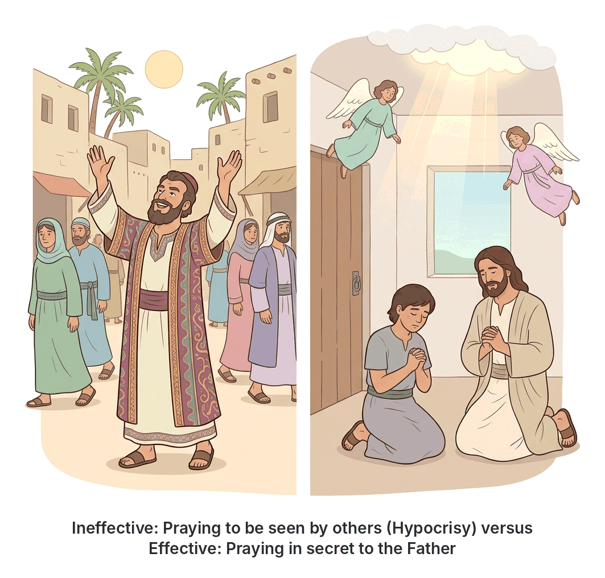

# JAMB Crk Notes: Effective Prayer

## What JAMB expects

This topic is Section D, Topic 13 of the JAMB CRK syllabus: Effective Prayer. It covers the biblical teachings on how to pray correctly, the attitudes that hinder prayer, and the power of sincere prayer, drawing from the Sermon on the Mount and the Epistle of James.

The syllabus covers the following content items:
- Jesus' teaching on prayer (Matthew 6:5-13)
- Praying for wisdom in faith (James 1:2-8)
- Asking with wrong motives (James 4:1-3)
- The prayer of faith and Elijah's example (James 5:13-18)

By the end of these notes, you should be able to:
1. Identify the requirements of effective prayer.
2. Distinguish between effective and ineffective prayer.
3. Identify the importance of prayer.
4. Identify types of prayer.

## Types of prayer

**Objective iv: identify types of prayer.**

Prayer is the act of communicating with God. It is not just about asking for things; it includes various forms of expression. Based on Jesus' teachings and the rest of the Bible, Christians generally classify prayer into five main types (often remembered in textbooks by the acronym **ACTS**, with Intercession added):

1. **Adoration (Praise):** Worshipping God for who He is—His greatness, holiness, and power. For example, the Lord's Prayer begins with adoration: *"Hallowed be thy name"* (Matthew 6:9).
2. **Confession:** Admitting our sins and faults to God and asking for His forgiveness. Jesus included this when He taught us to pray, *"And forgive us our debts"* (Matthew 6:12). James also instructs believers to *"Confess your faults one to another"* (James 5:16).
3. **Thanksgiving:** Expressing gratitude to God for what He has done, such as providing for needs, protecting us, or giving us life. James hints at this joyful expression when he says, *"Is any merry? let him sing psalms"* (James 5:13).
4. **Petition (Supplication):** Asking God for our own personal needs. This can be physical needs, like asking for *"our daily bread"* (Matthew 6:11), or spiritual needs, such as asking for wisdom when facing trials (James 1:5).
5. **Intercession:** Praying on behalf of other people. When the elders of the church gather to pray over a sick person (James 5:14), or when we pray for our leaders, family, or country, we are interceding for them.

## Jesus' teaching on prayer (Matthew 6:5-13)

**Content item: Matt 6:5-13.**

During the Sermon on the Mount, Jesus taught His disciples how to pray effectively by contrasting true prayer with the wrong practices of the hypocrites and the pagans.

### How not to pray: The hypocrites and the pagans
Jesus warned against two common but ineffective ways of praying:
- **The Hypocrites:** Jesus said that hypocrites love to pray standing in the synagogues and on street corners just so that people can see them and think they are holy. Because their motive is to get human praise, Jesus stated that they have already received their reward in full. God will not answer such boastful prayers.
- **The Pagans (Heathen):** The pagans thought that by using **"vain repetitions"** (babbling and repeating the same words over and over), they could force their gods to hear them. Jesus told His followers not to be like them, because *"your Father knoweth what things ye have need of, before ye ask him"* (Matthew 6:8). In Nigeria today, some people still believe that shouting or chanting the same phrase for hours is what forces God to act, but Jesus taught that God desires sincere, meaningful communication.

### How to pray: Secret and sincere prayer
Instead of seeking public attention, Jesus commanded: *"But thou, when thou prayest, enter into thy closet, and when thou hast shut thy door, pray to thy Father which is in secret"* (Matthew 6:6). Praying in private removes the temptation to show off. The Father, who sees what is done in secret, will reward the believer openly.

### The Lord's Prayer (The Model Prayer)
Jesus then gave His disciples a model of how to pray, which we call the Lord's Prayer. It is brief, sincere, and covers all the essential types of prayer:
1. **Adoration:** *"Our Father which art in heaven, Hallowed be thy name."* (Recognising God as a holy, loving Father).
2. **Submission:** *"Thy kingdom come. Thy will be done in earth, as it is in heaven."* (Submitting to God's authority and plans).
3. **Petition:** *"Give us this day our daily bread."* (Trusting God for everyday physical provision).
4. **Confession and Forgiveness:** *"And forgive us our debts, as we forgive our debtors."* (Asking for forgiveness, with the strict condition that we must also forgive those who offend us).
5. **Deliverance:** *"And lead us not into temptation, but deliver us from evil..."* (Asking for spiritual protection).

## James' teaching on effective prayer

James, the brother of Jesus, wrote a practical letter to early Christians, giving them clear instructions on the attitudes required for prayer to work.

### Praying for wisdom in faith (James 1:2-8)

**Content item: James 1:2-8.**

James writes that believers will face many trials and temptations, and they should view these as an opportunity to build patience. However, navigating hard times requires wisdom. 

- **Ask God:** If anyone lacks wisdom, they should ask God, who gives to all men *"liberally"* (generously) and *"upbraideth not"* (without finding fault).
- **The requirement of faith:** When asking, a person must ask in absolute faith, *"nothing wavering"* (without doubting).
- **The danger of doubting:** James compares a person who doubts to a **wave of the sea** that is blown and tossed around by the wind. He calls such a person a **"double-minded man,"** who is unstable in all his ways.
- **The result:** A double-minded, doubting person should not expect to receive anything from the Lord.

### Asking with wrong motives (James 4:1-3)

**Content item: James 4:1-3.**

James addresses the quarrels, fights, and divisions happening among the believers. He points out that these conflicts come from their own selfish lusts and desires.
- First, they do not have what they want because they do not ask God in prayer (*"ye have not, because ye ask not"*).
- Second, when they do ask, they still do not receive anything because they **ask amiss** (with the wrong motives). 
- Their wrong motive is that they want to *"consume it upon your lusts"* (spend what they get on their own selfish pleasures). For example, praying for sudden wealth just to "pepper" or show off to neighbors is a selfish motive. God does not answer prayers born out of greed or pride.

### The prayer of faith and Elijah's example (James 5:13-18)

**Content item: James 5:13-18.**

In the final chapter of his letter, James gives practical rules for different life situations:
- If anyone is **afflicted** (suffering or in trouble), they should pray.
- If anyone is **merry** (happy), they should sing psalms of praise.
- If anyone is **sick**, they should call for the **elders of the church**. The elders should pray over the sick person and **anoint them with oil** in the name of the Lord.

[IMAGE: A simple bedroom scene showing a sick person resting in bed. Three respected church elders stand around the bed; one is holding a small flask of olive oil and gently placing a hand on the sick person's forehead, while the others have their heads bowed in prayer. Labels to add later: "Elders of the church", "Anointing with oil", "The prayer of faith for the sick". Clean flat textbook style, white background.]

**The power of the prayer of faith:**
James promises that *"the prayer of faith shall save the sick, and the Lord shall raise him up; and if he have committed sins, they shall be forgiven him"* (James 5:15). He also commands believers to confess their faults to one another and pray for each other so they can be healed.

**The Example of Elijah (Elias):**
To prove that ordinary people can pray powerful prayers, James states: *"The effectual fervent prayer of a righteous man availeth much"* (James 5:16). He uses the Old Testament prophet Elijah as proof. 
Elijah was a human being with the same nature and feelings as us (*"subject to like passions"*). Yet, when he prayed earnestly that it would not rain, **it did not rain on the land for three years and six months**. When he prayed again, the heavens gave rain, and the earth produced its crops. This shows that effective prayer depends on righteousness and earnest faith, not on being a superhuman.

## Requirements of effective prayer

**Objective i: identify the requirements of effective prayer.**

By combining the teachings of Jesus and James, we can identify several clear conditions that must be met for prayer to be effective:

1. **Faith and absolute trust in God:** You must believe that God can and will answer, without wavering or doubting (James 1:6).
2. **Right motives:** Prayers must not be driven by greed, pride, or a desire to satisfy selfish lusts (James 4:3).
3. **Sincerity and humility:** Prayer should be an honest conversation with God, not a public performance to impress other people like the hypocrites did (Matthew 6:5).
4. **Righteous living:** A person's lifestyle matters. The fervent prayer of a *righteous* person is what carries power (James 5:16).
5. **Confession and forgiveness:** We must confess our sins to God and to one another. Furthermore, God's forgiveness of our sins is strictly tied to our willingness to forgive those who offend us (Matthew 6:12, 14-15; James 5:16).
6. **Submission to God's will:** Effective prayer aligns with what God wants for the world, asking for His will to be done on earth (Matthew 6:10).

## Distinguishing between effective and ineffective prayer

**Objective ii: distinguish between effective and ineffective prayer.**

| Feature | Effective Prayer | Ineffective Prayer |
| --- | --- | --- |
| **Motive** | Sincere desire to seek God's will and genuine needs. | Selfish desires; asking only to satisfy personal lusts and greed. |
| **Attitude** | Full of faith, earnest, unwavering. | Doubting, double-minded, unstable like a wave. |
| **Audience** | Addressed directly to God, often in private (secret). | Done publicly in synagogues or streets just to be seen and praised by men (hypocrisy). |
| **Words used** | Meaningful, direct, and trusting that the Father already knows what is needed. | Vain repetitions (babbling) like the pagans, thinking many words force God to act. |
| **State of the believer** | Righteous, forgiving, quick to confess sins. | Harbours unforgiveness, lives in unconfessed sin. |
| **Outcome** | God answers, provides healing, wisdom, and daily needs. | God does not answer; the person receives nothing from the Lord. |

## The importance of prayer

**Objective iii: identify the importance of prayer.**

Prayer is vital to the Christian life for several reasons mentioned in these passages:

1. **It brings physical and spiritual healing:** The prayer of faith saves the sick and brings about the forgiveness of sins (James 5).
2. **It provides wisdom in difficult times:** When believers face trials and lack the knowledge of what to do, prayer connects them to God's generous wisdom (James 1).
3. **It secures our daily needs:** Through petition, believers rely on God for their "daily bread" and basic survival (Matthew 6).
4. **It delivers us from evil:** Prayer offers spiritual protection, asking God to lead us away from temptation and deliver us from the wicked one (Matthew 6).
5. **It changes natural circumstances:** As seen in the life of Elijah, earnest prayer can alter natural events, such as stopping and starting the rain to fulfill God's purposes (James 5).
6. **It unites the community:** Confessing faults and praying for one another builds a healthy, accountable, and spiritually strong church community (James 5).

## Key terms

| Term | Meaning |
| --- | --- |
| Adoration | Praising and worshipping God for His greatness and holiness. |
| Intercession | Praying to God on behalf of other people. |
| Petition (Supplication) | Asking God to fulfill one's own personal needs. |
| Hypocrite | A person who acts as if they are holy to impress others, but whose heart is insincere. |
| Vain repetitions | Babbling or repeating the same words meaninglessly, a practice Jesus associated with pagans. |
| Double-minded | Being unstable in faith; doubting whether God will answer while asking Him. |
| Anointing with oil | A practice mentioned by James where church elders rub or pour a small amount of oil on a sick person as a symbol of the Holy Spirit and healing. |

## Exam tips and common mistakes

- **Do not confuse the groups Jesus criticised:** Hypocrites pray publicly to be seen by men. Pagans (heathen) use "vain repetitions" because they think many words will make them heard.
- **Know James' specific analogies:** James compares a doubting man to a **wave of the sea** driven by the wind, and calls him **double-minded**.
- **Remember the exact time frame:** According to James, Elijah prayed and it did not rain for **three years and six months**.
- **Wrong motives lead to unanswered prayer:** If a question asks why some people ask and do not receive according to James, the answer is always because they ask amiss (with wrong motives) to spend it on their lusts.
- **Know who to call when sick:** James instructs sick believers to call for the **elders of the church**, not the pastor alone, a prophet, or a traditional healer.

## Quick summary

1. Prayer is communicating with God and includes adoration, thanksgiving, confession, petition, and intercession.
2. Jesus taught that believers should pray sincerely in secret to the Father, avoiding the showy hypocrisy of the religious leaders and the vain repetitions of the pagans.
3. The Lord's Prayer is Jesus' model for prayer, covering worship, submission to God's will, daily provision, forgiveness, and protection from evil.
4. James teaches that we must pray for wisdom in absolute faith; a doubting, double-minded person will receive nothing from God.
5. Prayers are often unanswered when they are asked with wrong motives, such as fulfilling selfish lusts.
6. When a believer is sick, they should call the church elders to pray over them and anoint them with oil; the prayer of faith will heal them.
7. The earnest prayer of a righteous person is incredibly powerful, as proven by Elijah, an ordinary human who controlled the rain through prayer.

## Practice questions

**1. In the Sermon on the Mount, Jesus taught that believers should avoid using "vain repetitions" in prayer like the**
- A. hypocrites
- B. Pharisees
- C. pagans (heathen)
- D. Sadducees

**Answer: C.** Jesus specifically linked "vain repetitions" (meaningless babbling) to the heathen or pagans, who thought they would be heard for their many words (Matthew 6:7).

**2. According to James, a man who doubts when asking God for wisdom is like**
- A. a house built on sand
- B. a wave of the sea driven by the wind
- C. a flower that fades in the sun
- D. a merchant seeking fine pearls

**Answer: B.** James 1:6 states that he who wavers (doubts) is like a wave of the sea driven with the wind and tossed. 

**3. James teaches that some believers ask and do not receive because they**
- A. ask without fasting
- B. ask to spend it on their own lusts
- C. do not pray in the synagogue
- D. do not bring an offering

**Answer: B.** James 4:3 says, "Ye ask, and receive not, because ye ask amiss, that ye may consume it upon your lusts."

**4. In James 5, if a believer is sick, he is instructed to**
- A. fast for three days
- B. go to the pool of Siloam
- C. call for the elders of the church to pray over him
- D. offer a sacrifice at the temple

**Answer: C.** James 5:14 clearly instructs the sick to call for the elders of the church to pray over them and anoint them with oil.

**5. Which biblical prophet did James use as an example of a righteous man whose prayer was powerful?**
- A. Moses
- B. Elisha
- C. Isaiah
- D. Elijah

**Answer: D.** James used Elijah (Elias), who prayed earnestly that it would not rain, and it did not rain for three and a half years (James 5:17).

**6. In the Lord's Prayer, the phrase "Give us this day our daily bread" is an example of which type of prayer?**
- A. Intercession
- B. Adoration
- C. Supplication (Petition)
- D. Confession

**Answer: C.** Supplication or petition is the type of prayer where a person asks God to provide for their own personal needs, such as daily food.

**7. According to Jesus, where is the best place to pray to ensure sincerity and avoid hypocrisy?**
- A. In the synagogue
- B. In secret, behind a closed door
- C. On the street corner
- D. On a high mountain

**Answer: B.** Jesus said to enter your closet, shut the door, and pray to your Father in secret, so as not to be like the hypocrites who pray on street corners to be seen (Matthew 6:5-6).

**8. Which type of prayer involves asking God to forgive our sins?**
- A. Thanksgiving
- B. Intercession
- C. Confession
- D. Adoration

**Answer: C.** Confession is the act of admitting our sins, faults, or "debts" to God and asking for His pardon.

**9. What condition must be met for God to forgive our debts, according to the Lord's Prayer?**
- A. We must give alms to the poor
- B. We must fast for forty days
- C. We must forgive our debtors
- D. We must offer burnt offerings

**Answer: C.** The prayer states, "And forgive us our debts, as we forgive our debtors," making our forgiveness of others a condition for receiving God's forgiveness.

**10. James writes that the prayer of faith offered for a sick person will**
- A. save the sick and raise him up
- B. make the person a prophet
- C. remove all future trials from the person
- D. guarantee him immense wealth

**Answer: A.** James 5:15 promises that the prayer of faith shall save the sick, and the Lord shall raise him up.

<!-- COVERAGE
obj i | Requirements of effective prayer
obj ii | Distinguishing between effective and ineffective prayer
obj iii | The importance of prayer
obj iv | Types of prayer
James 1:2-8 | Praying for wisdom in faith (James 1:2-8)
James 4:1-3 | Asking with wrong motives (James 4:1-3)
James 5:13-18 | The prayer of faith and Elijah's example (James 5:13-18)
Matt 6:5-13 | Jesus' teaching on prayer (Matthew 6:5-13)
-->
