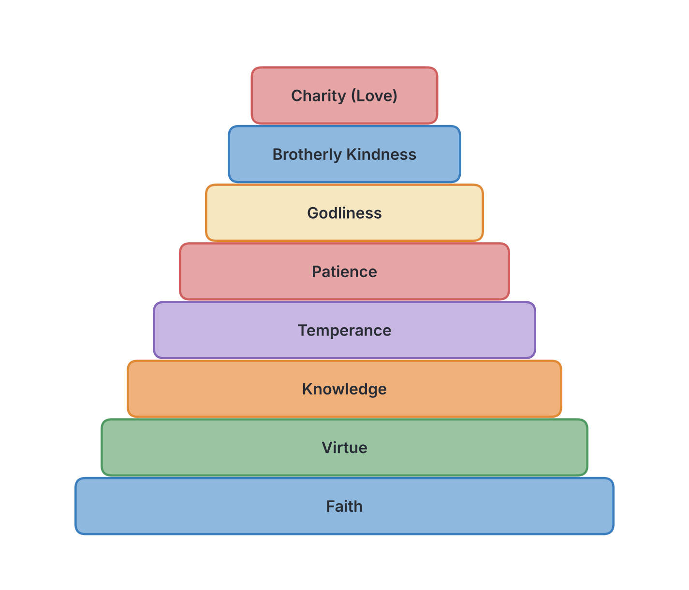
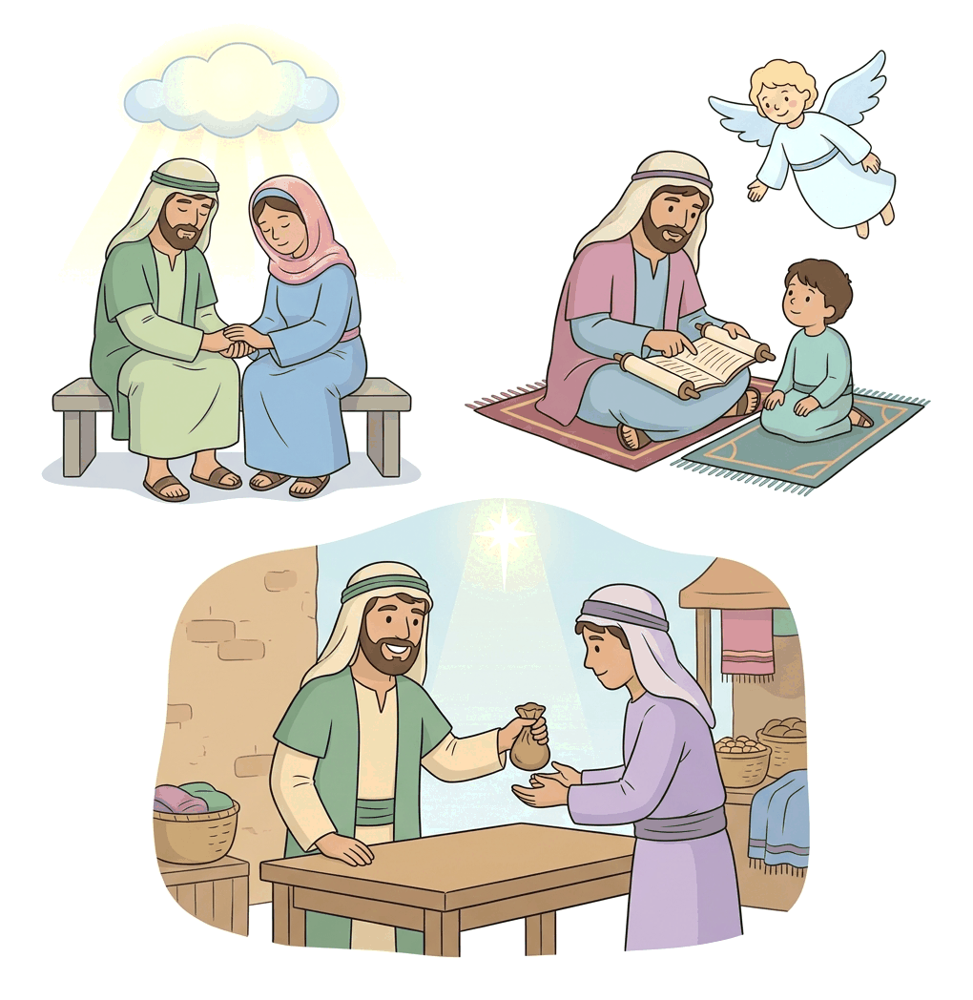

# JAMB Crk Notes: Christian Living in the Community

## What JAMB expects

This topic is Section D, Topic 14 of the JAMB CRK syllabus: Christian living in the community. It covers practical teachings from the New Testament epistles (Romans, Ephesians, Colossians, Hebrews, 1 Peter, and 2 Peter) on how Christians should live together and interact with the wider world. 

It has four content items:
* (a) Interpersonal relationships among Christians (I Pet. 5:1-4; Rom. 12:3-21; 2 Pet. 1:3-11; Heb.13:1-21)
* (b) Christians living among non-Christians (I Pet. 2:3-25; Rom. 15:1-2)
* (c) Christian attitude to persecution (I Pet. 1:5-9; 4:1-19; 1 Pet. 3:13-22)
* (d) Relationship in the Christian family (Eph. 6: 1-9; Col. 3:18-21; I Pet. 3:1-7)

By the end of these notes, you should be able to:
1. determine interpersonal relationships among Christians;
2. analyse Christian living among non-Christians;
3. relate Christian attitude to persecution;
4. determine the relationship in the Christian family;
5. examine the importance of maintaining good relationships.

## Interpersonal relationships among Christians

**Objective i: determine interpersonal relationships among Christians.**
**Content (a): Interpersonal relationships among Christians**

The New Testament letters provide strict guidelines on how believers should interact with one another in love, humility, and mutual respect to ensure the church functions as a healthy, united community. 

### Romans 12:3-21: Using gifts and loving genuinely
The Apostle Paul teaches that Christians belong to one body (the body of Christ), and just as the human body has many parts with different functions, Christians have different spiritual gifts. 
* **Humility:** Paul warns believers not to think of themselves more highly than they ought to, but to evaluate themselves with sober judgment.
* **Spiritual Gifts:** Christians must use their given gifts faithfully. If a person's gift is prophecy, they should use it in proportion to their faith; if service, in serving; if teaching, in teaching; if exhorting, in exhortation; if contributing, in generosity; if leadership, in zeal; and if acts of mercy, with cheerfulness.
* **Genuine Love:** Love must be without hypocrisy ("Let love be without dissimulation"). Believers should hate what is evil and hold fast to what is good.
* **Brotherly Affection:** Christians must love one another with brotherly affection and outdo one another in showing honour.
* **Practical duties:** Paul urges Christians to be fervent in spirit, rejoice in hope, be patient in tribulation, constant in prayer, and contribute to the needs of the saints (showing hospitality).
* **Overcoming Evil:** They should bless those who persecute them. They must live in harmony, not be haughty, and never avenge themselves. Paul quotes the Old Testament to say, "Therefore if thine enemy hunger, feed him; if he thirst, give him drink..." He concludes: **"Be not overcome of evil, but overcome evil with good."**

### 1 Peter 5:1-4: The duty of elders and the flock
Peter addresses church leaders and members regarding their relationship:
1. **To the Elders (Leaders):** Peter, calling himself a fellow elder, urges them to shepherd (tend) the flock of God. They must do this willingly, not by compulsion; eagerly, not for "filthy lucre" (shameful gain). They must not domineer over those in their charge but be examples to the flock.
2. **The Reward:** When the Chief Shepherd (Jesus Christ) appears, faithful elders will receive a "crown of glory that fadeth not away."

### 2 Peter 1:3-11: Growing in Christian virtues
Peter teaches that God's divine power has granted believers all things that pertain to life and godliness. To prevent Christians from being ineffective and unfruitful in their community, he commands them to make every effort to build a progression of virtues.

Believers must add the following step by step:
1. To **faith**, add **virtue** (moral excellence).
2. To virtue, add **knowledge**.
3. To knowledge, add **temperance** (self-control).
4. To temperance, add **patience** (steadfastness/endurance).
5. To patience, add **godliness**.
6. To godliness, add **brotherly kindness** (affection).
7. To brotherly kindness, add **charity** (love).

Peter states that whoever lacks these qualities is blind and has forgotten that they were cleansed from their past sins. By practicing these qualities, Christians will "make their calling and election sure."

### Hebrews 13:1-21: Practical community living
The writer of Hebrews outlines specific ways Christians must relate to one another and God:
* **Brotherly Love:** "Let brotherly love continue."
* **Hospitality:** Do not neglect to show hospitality to strangers, because by doing so, some have entertained angels unawares (as Abraham and Lot did in Genesis).
* **Remembering the suffering:** Believers must remember those in prison as if they were in prison with them, and those who are mistreated, since they also are in the body.
* **Marriage:** Marriage should be held in honour among all, and the marriage bed kept undefiled, for God will judge the sexually immoral.
* **Contentment:** Keep your life free from the love of money, and be content with what you have, because God has promised, "I will never leave thee, nor forsake thee."
* **Submission to Leaders:** Obey church leaders and submit to them, because they keep watch over your souls as those who will have to give an account. Let them do this with joy, not with groaning.

## Christians living among non-Christians

**Objective ii: analyse Christian living among non-Christians.**
**Content (b): Christians living among non-Christians**

Christians do not live in isolation. The epistles instruct believers on how to conduct themselves in a secular or non-Christian society, providing a witness through their exemplary lifestyle.

### 1 Peter 2:3-25: A chosen race and submission to authority
Peter describes the unique identity of Christians and how this identity dictates their behaviour among non-believers.
* **Identity of Believers:** Christians are "lively stones" built into a spiritual house to offer spiritual sacrifices. More famously, Peter calls them **"a chosen generation, a royal priesthood, an holy nation, a peculiar people"** (1 Peter 2:9). The purpose of this status is so they may proclaim the praises of God who called them out of darkness into His marvelous light.
* **Abstaining from fleshly lusts:** Because believers are "strangers and pilgrims" in the world, they must abstain from sinful desires which war against the soul.
* **Honourable conduct:** They must keep their conduct excellent among the Gentiles (non-Christians). Even if non-Christians speak against them as evildoers, they will see the believers' good deeds and glorify God on the day of visitation.
* **Submission to the State:** Christians must submit to every human institution for the Lord's sake—whether it is the emperor as supreme, or governors sent to punish those who do evil and praise those who do good. Doing good is God's will to "put to silence the ignorance of foolish men."
* **General respect:** Peter summarises this with four commands: "Honour all men. Love the brotherhood. Fear God. Honour the king."
* **Submission to Masters:** Servants (or employees in a modern Nigerian context) must be subject to their masters with all respect, not only to the good and gentle ones but also to the unjust. 
* **Christ as the Example:** Enduring suffering when one has done good is commendable before God. Christ left an example: He committed no sin, no deceit was found in His mouth, and when He was reviled, He did not revile in return, but entrusted Himself to God the righteous Judge.

### Romans 15:1-2: Pleasing others
Paul gives a brief but powerful principle for interacting with others, particularly those who do not share the same convictions.
* The strong are obligated to bear the failings of the weak, and not simply to please themselves.
* "Let every one of us please his neighbour for his good to edification" (to build them up). 

## Christian attitude to persecution

**Objective iii: relate Christian attitude to persecution.**
**Content (c): Christian attitude to persecution**

In the early church, identifying as a Christian often meant facing social rejection, economic hardship, imprisonment, and physical violence. The Apostle Peter wrote extensively to encourage believers facing these "fiery trials."

### 1 Peter 1:5-9: Joy in the testing of faith
* Peter tells believers that they are being guarded by God's power through faith for salvation.
* Because of this, they should rejoice, even if for a little while they are grieved by various trials.
* **The purpose of trials:** The testing of their faith is more precious than gold that perishes when tested by fire. This tested faith will result in praise, glory, and honour at the revelation of Jesus Christ. 
* Though they have not seen Jesus, they love Him and believe in Him, rejoicing with "joy unspeakable and full of glory."

### 1 Peter 3:13-22: Suffering for righteousness' sake
* **No fear:** Peter asks, "And who is he that will harm you, if ye be followers of that which is good?" But even if they should suffer for righteousness' sake, they are blessed. They should not be afraid of human threats or be troubled.
* **Being prepared to testify:** Believers must always be ready to make a defence (give an answer) to anyone who asks them for a reason for the hope that is in them. However, they must do this with **meekness and fear (gentleness and respect)**.
* **A clear conscience:** They must keep a clear conscience, so that when they are slandered, those who revile their good behaviour in Christ will be put to shame.
* **God's Will:** It is better to suffer for doing good, if that should be God's will, than for doing evil.
* **Christ's Suffering:** Peter reminds them that Christ suffered once for sins, the righteous for the unrighteous, to bring us to God.

### 1 Peter 4:1-19: Suffering as a Christian
* Christians must arm themselves with the same mindset as Christ, who suffered in the flesh. They should no longer live for human passions but for the will of God.
* Non-believers will be surprised when Christians do not join them in wild living (such as drunkenness, reveling, and idolatry) and will malign them. But everyone will give an account to God who judges the living and the dead.
* **The Fiery Trial:** Peter says, "Beloved, think it not strange concerning the fiery trial which is to try you, as though some strange thing happened unto you."
* **Rejoicing in suffering:** They should rejoice in sharing Christ's sufferings, so they may also be glad when His glory is revealed. If they are insulted for the name of Christ, they are blessed, because the Spirit of glory and of God rests upon them.
* **Not suffering as evildoers:** Christians must never suffer for doing actual wrong. "But let none of you suffer as a murderer, or as a thief, or as an evildoer, or as a busybody in other men's matters."
* **Unashamed:** If a person suffers as a Christian, they should not be ashamed but should glorify God in that name. 
* **Judgment in the house of God:** Peter notes that judgment begins at the house of God, meaning God purifies His own people first through trials. He concludes that those who suffer according to God's will should entrust their souls to a faithful Creator while doing good.

## Relationship in the Christian family

**Objective iv: determine the relationship in the Christian family.**
**Content (d): Relationship in the Christian family**

The Christian household in the first century included husbands, wives, children, and servants (or slaves). The Apostles Paul (in Ephesians and Colossians) and Peter (in 1 Peter) outlined reciprocal (two-way) duties for each group to ensure peace, order, and a good witness to the outside world.

### Ephesians 6:1-9 and Colossians 3:18-21: Paul's teaching
Paul addresses three pairs of relationships within the household.

**1. Children and Parents:**
* **Children:** Commanded to obey their parents "in the Lord, for this is right." Paul quotes the Fifth Commandment: "Honour thy father and mother" and notes it is the **first commandment with a promise**—"that it may be well with thee, and thou mayest live long on the earth." Colossians adds that obeying parents "pleases the Lord."
* **Fathers (Parents):** Fathers are warned not to provoke their children to wrath (anger), but to bring them up in the discipline and instruction of the Lord. Colossians adds that provoking children will cause them to be discouraged.

**2. Wives and Husbands (Colossians 3):**
* **Wives:** Commanded to submit to their husbands, as is fitting in the Lord.
* **Husbands:** Commanded to love their wives and not be bitter or harsh towards them.

**3. Servants (Slaves) and Masters:**
* **Servants:** Must obey their earthly masters in everything, with fear and trembling, in singleness of heart, just as they would obey Christ. They should not serve only as "menpleasers" when the master is watching, but do the will of God from the heart.
* **Masters:** Must treat their servants well and stop threatening them. They must remember that both they and the servant have the same Master in heaven, and with God, there is no partiality (impartiality).

*Note: While slavery is abolished today, Christian teaching applies these principles to the modern workplace relationship between employees and employers, or between homeowners and domestic help in Nigeria.*

### 1 Peter 3:1-7: Peter's teaching on husbands and wives
Peter provides deeper instructions specifically for marriages, especially where the husband might not be a believer.

* **Wives:** Peter instructs wives to be subject to their husbands. The primary reason is evangelistic: so that if any husbands do not obey the word (are not Christians), they may be won over to Christ without a word, simply by observing the chaste (pure) and respectful behaviour of their wives. 
    * **True Beauty:** Peter warns that a woman's beauty should not merely come from outward adornment like braiding hair, wearing gold jewelry, or putting on fine clothes. Instead, it should be the hidden person of the heart—the imperishable beauty of a **meek and quiet spirit**, which is very precious in God's sight. 
    * **Example of Sarah:** He uses Sarah, the wife of Abraham, as an example of holy women who hoped in God and submitted to their husbands, calling Abraham "lord."
* **Husbands:** Husbands must live with their wives in an understanding way. They are commanded to give honour to the wife as to the "weaker vessel" (meaning physically weaker, not spiritually inferior), since both are joint heirs of the grace of life.
    * **The Reason:** Husbands must do this **"that your prayers be not hindered."** If a husband mistreats his wife, his relationship with God and his prayer life will be blocked.

### Comparison Table: Duties in the Christian Family

| Role | Instruction (Ephesians/Colossians/1 Peter) | Reason / Motivation |
| --- | --- | --- |
| **Wives** | Submit to husbands. Maintain inner beauty (a meek and quiet spirit). | It is fitting in the Lord. To win unbelieving husbands to Christ without a word. |
| **Husbands** | Love wives. Do not be harsh. Treat them with understanding and honour. | They are joint heirs of the grace of life. Mistreating them will hinder prayers. |
| **Children** | Obey parents in the Lord. Honour father and mother. | It is right. It is the first commandment with a promise (long life and wellness). It pleases the Lord. |
| **Fathers** | Do not provoke children to wrath. Bring them up in Godly discipline. | Provoking them will cause them to become discouraged. |
| **Servants** | Obey masters sincerely, not just as men-pleasers. Work as if serving Christ. | God will reward whatever good anyone does. |
| **Masters** | Treat servants well. Stop threatening them. | Knowing they also have a Master in heaven who shows no partiality. |

## The importance of maintaining good relationships

**Objective v: examine the importance of maintaining good relationships.**

Based on all the apostolic instructions, maintaining good relationships within the church, the family, and the wider non-Christian community is extremely important for several reasons:

1. **Unanswered Prayers:** The Bible explicitly states that broken relationships (such as a husband mistreating a wife) will hinder prayers (1 Peter 3:7). God expects His children to be at peace with others before bringing requests to Him.
2. **Effective Evangelism (Witnessing):** Good relationships are the best tool for preaching the Gospel. Peter explains that a wife's good conduct can win an unbelieving husband, and believers' good deeds will cause non-believers to "glorify God on the day of visitation."
3. **Church Unity and Growth:** The church functions like a human body. When Christians use their gifts properly and show genuine brotherly love, the church is edified (built up) and strengthened.
4. **Silencing Opponents:** In a hostile environment, living an honourable, law-abiding, and loving life puts to silence "the ignorance of foolish men" who might otherwise falsely accuse Christians of being evildoers.
5. **Societal Peace and Harmony:** In a diverse country like Nigeria, applying these principles—submitting to authorities, obeying laws, respecting employers, treating workers fairly, and living peaceably with people of other religions—promotes national development, security, and peaceful coexistence.

## Key terms

| Term | Meaning |
| --- | --- |
| **Interpersonal** | Connected with relationships between people. |
| **Elder** | A leader or overseer in the early Christian church. |
| **Filthy lucre** | Shameful or dishonest gain (money); an improper motive for ministry. |
| **Peculiar people** | In the KJV, this means a people belonging specially to God (God's own possession). |
| **Edification** | The building up or improvement of someone, especially spiritually or morally. |
| **Fiery trial** | Severe persecution and suffering experienced by early Christians. |
| **Busybody** | A meddler; someone who interferes in other people's affairs. |
| **Meek and quiet spirit** | Inner gentleness and calmness, which Peter says is precious to God. |
| **Men-pleasers** | People who only work hard when the boss is watching, seeking human approval rather than God's. |

## Exam tips and common mistakes

* **Know who said what:** JAMB often asks whether Paul or Peter gave a specific instruction. Remember:
  * Romans, Ephesians, Colossians = **Paul**
  * 1 Peter, 2 Peter = **Peter**
  * Hebrews = **The writer of Hebrews** (author unnamed in the text).
* **The first commandment with a promise:** This is "Honour thy father and mother" (Ephesians 6:2).
* **Hindered prayers:** Know that 1 Peter 3:7 specifically links a husband failing to honour his wife with his prayers being hindered.
* **Suffering as a Christian:** Peter said believers should not suffer as murderers, thieves, evildoers, or busybodies, but should not be ashamed if they suffer as a Christian (1 Pet. 4:15-16).
* **The virtue ladder (2 Peter 1):** Memorize the order: Faith → Virtue → Knowledge → Temperance → Patience → Godliness → Brotherly Kindness → Charity (Love).
* **Entertaining angels:** Hebrews 13 mentions that by showing hospitality, some have entertained angels unawares.
* **Submission to the state:** 1 Peter 2 commands submission to kings and governors to silence foolish men.

## Quick summary

1. Paul (Romans 12) teaches Christians to use their diverse spiritual gifts with humility, to love genuinely, and to overcome evil with good. 
2. Peter (1 Peter 5, 2 Peter 1) commands elders to shepherd the flock willingly, not for money, and urges all believers to continually add virtues (like knowledge, temperance, and love) to their faith.
3. Hebrews 13 instructs Christians to maintain brotherly love, show hospitality, honour marriage, and obey their leaders.
4. Christians are a "chosen generation and royal priesthood." They must live honourably among non-believers, submitting to civil authorities and even unjust masters, following Christ's example of suffering without retaliation (1 Peter 2).
5. When facing persecution, Christians must not suffer for committing crimes, but if they suffer for doing good, they should rejoice, keep a clear conscience, and defend their faith with gentleness (1 Peter 3 and 4).
6. In the Christian family, wives must submit to husbands (which can win unbelievers to Christ), husbands must honour wives (so prayers are not hindered), children must obey parents, and masters must treat servants fairly, knowing God is impartial.
7. Maintaining good interpersonal relationships ensures that prayers are answered, the church is united, and non-believers are attracted to the Christian faith.

## Practice questions

**1. According to 1 Peter, why should a husband live with his wife in an understanding way and honour her?**
- A. So that she will not be provoked to wrath.
- B. Because she is the stronger vessel.
- C. So that his prayers will not be hindered.
- D. To prevent her from becoming a busybody.

**Answer: C.** 1 Peter 3:7 states husbands should give honour to the wife "that your prayers be not hindered."

**2. Which of the following does Peter describe as a "chosen generation, a royal priesthood, an holy nation"?**
- A. The Jews in Jerusalem
- B. Christian believers
- C. Church elders
- D. The Roman authorities

**Answer: B.** 1 Peter 2:9 uses these terms to describe Christian believers, highlighting their special identity in God.

**3. According to Paul in Ephesians, what is the first commandment with a promise?**
- A. Thou shalt not kill.
- B. Remember the sabbath day, to keep it holy.
- C. Thou shalt have no other gods before me.
- D. Honour thy father and mother.

**Answer: D.** Ephesians 6:2-3 points out that "Honour thy father and mother" is the first commandment with a promise attached (that it may be well with you and you may live long).

**4. In 2 Peter 1, which virtue should immediately be added to faith?**
- A. Temperance
- B. Charity
- C. Virtue (moral excellence)
- D. Patience

**Answer: C.** The progression begins: "add to your faith virtue; and to virtue knowledge..." (2 Peter 1:5).

**5. According to Hebrews 13, Christians should not forget to show hospitality to strangers because by doing so, some have**
- A. received financial blessings unawares.
- B. entertained angels unawares.
- C. escaped persecution.
- D. become church leaders.

**Answer: B.** Hebrews 13:2 says, "Be not forgetful to entertain strangers: for thereby some have entertained angels unawares."

**6. How does Peter say a Christian should answer anyone who asks for a reason for the hope in them?**
- A. With deep theological arguments
- B. With meekness and fear
- C. With anger and boldness
- D. With signs and wonders

**Answer: B.** 1 Peter 3:15 instructs believers to be ready to give an answer "with meekness and fear" (translated as gentleness and respect in modern versions).

**7. According to Colossians 3, why should fathers not provoke their children?**
- A. Lest they become rebellious
- B. Lest they become discouraged
- C. Because it violates the civil law
- D. Because they will leave the church

**Answer: B.** Colossians 3:21 says, "Fathers, provoke not your children to anger, lest they be discouraged."

**8. Peter instructs that if a believer must suffer, they should NOT suffer as a**
- A. Christian.
- B. prophet.
- C. servant.
- D. murderer or a busybody.

**Answer: D.** 1 Peter 4:15 says, "But let none of you suffer as a murderer, or as a thief, or as an evildoer, or as a busybody in other men's matters."

**9. According to 1 Peter 5, elders must feed the flock of God willingly, and not for**
- A. worldly praise.
- B. political power.
- C. filthy lucre.
- D. fear of the emperor.

**Answer: C.** 1 Peter 5:2 instructs elders to oversee the flock "not for filthy lucre, but of a ready mind." Filthy lucre means shameful financial gain.

**10. In Romans 12, what does Paul instruct Christians to do if their enemy is hungry?**
- A. Report him to the authorities.
- B. Ignore him to teach him a lesson.
- C. Pray for fire to consume him.
- D. Feed him.

**Answer: D.** Romans 12:20 quotes the Old Testament: "Therefore if thine enemy hunger, feed him..." as part of the command to overcome evil with good.

<!-- COVERAGE
obj i | Interpersonal relationships among Christians
obj ii | Christians living among non-Christians
obj iii | Christian attitude to persecution
obj iv | Relationship in the Christian family
obj v | The importance of maintaining good relationships
item a | Interpersonal relationships among Christians
item b | Christians living among non-Christians
item c | Christian attitude to persecution
item d | Relationship in the Christian family
-->
