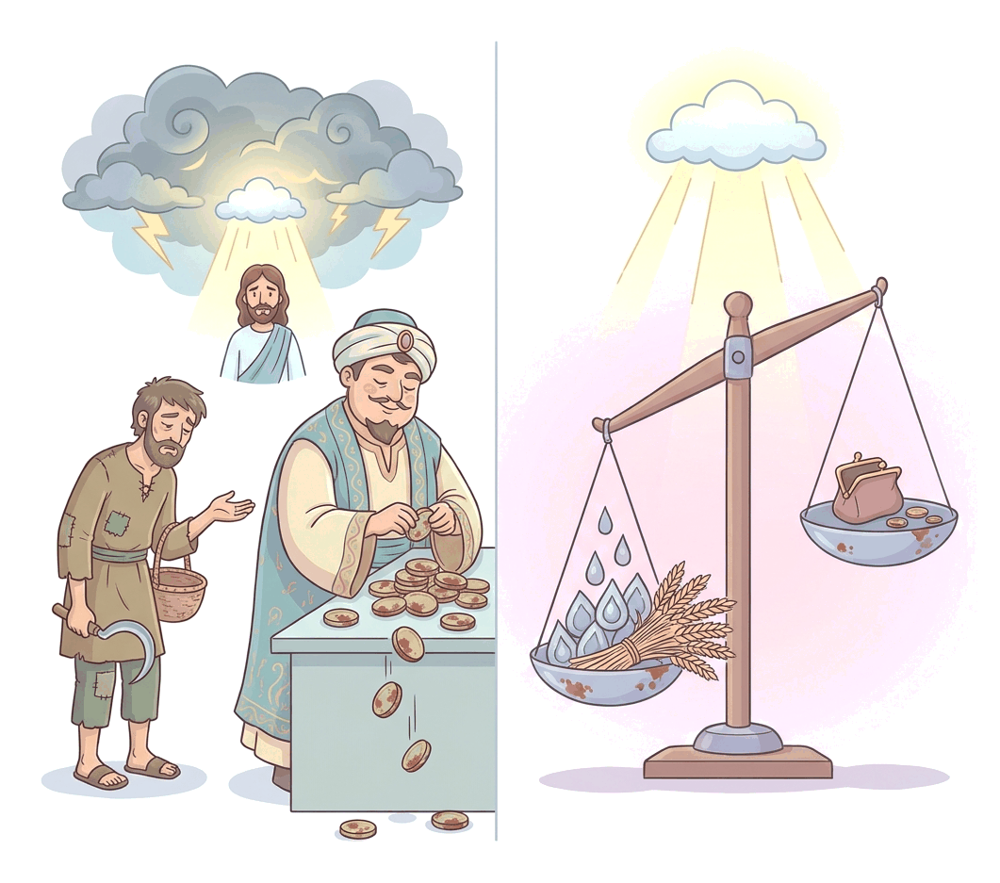

# JAMB Crk Notes: Corruption

## What JAMB expects

This topic is Section D, Topic 15 of the JAMB CRK syllabus: Corruption. It covers the biblical teachings on moral decay, the love of money, and the exploitation of the poor. 

The syllabus specifies the following Bible passages as content items:
- 1 Tim 6:6-11
- 2 Tim 3:8
- 2 Pet. 1:4-11
- James 5:1-6

By the end of these notes, you should be able to:
1. define the term corruption;
2. identify the causes of corruption;
3. determine the effects and consequences of corruption;
4. identify ways of curbing corruption.

## What is corruption?

**Objective i: define the term corruption.**

In general, **corruption** is dishonest or fraudulent conduct by those in power, typically involving bribery, embezzlement, or the abuse of public office for private gain. 

In the biblical context, corruption goes deeper than just stealing money. It refers to **moral decay**, depravity, and the perversion of what is good and right. A corrupt mind is one that has turned away from God's truth, leading to actions that harm others—such as cheating, withholding wages, lying, and oppressing the weak. The Bible views corruption as a destructive force that begins in the heart (through greed and lust) and spreads to infect communities and nations.

In Nigeria, corruption is often seen in practices like demanding bribes, inflating contracts, examination malpractice, and paying for jobs. The Bible addresses the root causes of these actions long before modern terms for them were invented.

## The causes of corruption

**Objective ii: identify the causes of corruption.**

The Bible pinpoints several root causes of corruption, primarily focusing on the condition of the human heart, the desire for wealth, and a rejection of the truth.

### 1. The love of money and lack of contentment (1 Timothy 6:6-11)

In his first letter to Timothy, Paul explains that one of the greatest causes of corrupt behaviour is an unhealthy desire to be rich, coupled with a lack of contentment. 

**The danger of greed:**
Paul writes that "godliness with contentment is great gain." He reminds believers of a basic reality: human beings brought nothing into the world, and they can take nothing out of it. Therefore, having food and clothing should be enough to make a person content. 

However, those who are desperate to be rich fall into:
1. **Temptation and a snare (trap):** The intense desire for wealth leads people to cut corners, cheat, and take bribes.
2. **Foolish and harmful lusts:** These desires eventually drown people in destruction and perdition (ruin).

**The root of all evil:**
Paul makes a famous statement in 1 Timothy 6:10: *"For the love of money is the root of all evil: which while some coveted after, they have erred from the faith, and pierced themselves through with many sorrows."* 

It is important to note that the Bible does **not** say money itself is evil. Money is a tool. It is the **love** of money—the greedy, uncontrolled desire to get rich by any means—that produces all kinds of evil, including corruption, robbery, and murder.

### 2. Corrupt minds and resistance to the truth (2 Timothy 3:8)

Another root cause of corruption is a mind that deliberately rejects the truth. In 2 Timothy 3:8, Paul writes: *"Now as Jannes and Jambres withstood Moses, so do these also resist the truth: men of corrupt minds, reprobate concerning the faith."*

- **Jannes and Jambres:** Although they are not named in the Old Testament book of Exodus, Jewish tradition identifies Jannes and Jambres as the Egyptian magicians in Pharaoh's court who opposed Moses by copying his miracles (such as turning their staffs into snakes).
- **Resisting the truth:** Just as those magicians opposed God's messenger, Paul says that false teachers in the church resist the truth. 
- **Corrupt minds:** Their actions stem from having "corrupt minds" (minds ruined by sin) and being "reprobate" (rejected or disqualified) concerning the faith. When people suppress the truth to protect their own power or pride, corruption naturally follows.

## The effects and consequences of corruption

**Objective iii: determine the effects and consequences of corruption.**

Corruption does not only harm the person who commits it; it destroys society, oppresses the poor, and eventually brings the strict judgment of God.

### Oppression and judgment (James 5:1-6)

The Apostle James gives a severe warning to rich people who have gathered their wealth through corrupt and fraudulent means. He outlines both the wicked actions they took to get rich (the effects on society) and the terrifying consequences they will face from God.

**The effects on society (Exploitation and cruelty):**
1. **Fraud and withholding wages:** James accuses the rich of keeping back the wages of the labourers who reaped their fields. This is a classic form of corruption: those in power exploiting the vulnerable by denying them what they have rightfully earned.
2. **The cries of the oppressed:** The unpaid wages "cry out," and the cries of the poor reapers have reached the ears of the *"Lord of Sabaoth"* (a Hebrew title meaning "Lord of Hosts" or "Lord of Armies," highlighting God's power to defend the weak).
3. **Selfish luxury:** While the workers starved, the corrupt rich lived in extreme luxury and pleasure on the earth, fattening their hearts "as in a day of slaughter" (like animals unknowingly fattening themselves for the butcher).
4. **Condemning the innocent:** The rich used their power and influence to condemn and kill the "just" (the righteous poor), who did not have the power to resist them.

**Applying this to Nigeria:** James is describing exactly what happens when corruption takes over a society. When public funds meant for roads, hospitals, or pensions are embezzled, or when civil servants' salaries are withheld for months while leaders live in luxury, the poor suffer directly.

**The consequences for the corrupt (Divine judgment):**
James tells the corrupt rich to "weep and howl" for the miseries that are coming upon them.
- Their riches are corrupted (rotted).
- Their expensive garments are moth-eaten.
- Their gold and silver are "cankered" (rusted). 

James says the rust of their hoarded wealth will act as a **witness against them** and will "eat their flesh as it were fire." They foolishly hoarded wealth for the "last days," not realising it would only guarantee their destruction. 

## Ways of curbing corruption

**Objective iv: identify ways of curbing corruption.**

The biblical solution to corruption is not just making stricter laws; it requires a transformation of character. The Bible teaches that corruption is curbed when individuals turn away from worldly lusts and actively pursue godliness.

### 1. Escaping worldly corruption through godly virtues (2 Peter 1:4-11)

Peter explains that God has given believers "exceeding great and precious promises" so that they can share in the divine nature and **"escape the corruption that is in the world through lust."** This means that corruption is driven by lust (greedy desires), and the only way to escape it is by embracing God's nature.

To curb corruption in one's personal life, Peter provides a "ladder of virtues" that believers must diligently build upon their faith. 

| Virtue | Meaning / Application to curbing corruption |
| :--- | :--- |
| **Faith** | The foundational belief and trust in God. |
| **Virtue** | Moral excellence and integrity; choosing to do the right thing even when no one is watching. |
| **Knowledge** | Understanding God's will and truth, which protects the mind from being deceived by false values. |
| **Temperance** | Self-control; the ability to say "no" to bribes, greed, and the urge to steal public funds. |
| **Patience** | Endurance and perseverance; being willing to wait for honest wealth rather than taking corrupt shortcuts. |
| **Godliness** | Living with reverence for God in all daily activities. |
| **Brotherly kindness** | Showing genuine care for others, which prevents a person from exploiting their workers or neighbours. |
| **Charity (Love)** | Unselfish love (agape) for all people. A leader who truly loves their people will not steal their resources. |

Peter concludes that if these qualities are present and increasing, a person will be fruitful and will "never fall." 

### 2. Fleeing greed and pursuing righteousness (1 Timothy 6:11)

After warning Timothy that the love of money is the root of all evil, Paul gives a clear command on how to avoid this corruption:
*"But thou, O man of God, flee these things; and follow after righteousness, godliness, faith, love, patience, meekness."*

Curbing corruption involves two actions:
1. **Fleeing (Running away):** One must actively avoid situations, desires, and company that encourage greed and dishonesty.
2. **Following (Pursuing):** One must actively chase after good character traits (righteousness, godliness, faith, love, patience, meekness). 

If a nation's citizens and leaders adopt contentment, exercise self-control (temperance), and treat others with brotherly kindness, the systemic corruption that destroys societies can be curbed.

## Key terms

| Term | Meaning |
| :--- | :--- |
| **Corruption** | Dishonest or fraudulent conduct; biblical moral decay and exploitation driven by lust and greed. |
| **Contentment** | Being satisfied with what one has; not constantly craving more wealth. |
| **Jannes and Jambres** | The Egyptian magicians who resisted Moses, used by Paul as examples of men with corrupt minds. |
| **Lord of Sabaoth** | "Lord of Hosts" or "Lord of Armies"; a title showing God's power to judge oppressors and defend the weak. |
| **Temperance** | Self-control; the ability to control one's desires and impulses. |
| **Charity** | In the King James Version, this means unconditional, self-sacrificing love (agape). |

## Exam tips and common mistakes

*   **Common misquote:** The Bible does **not** say "money is the root of all evil." It says "the **love** of money is the root of all evil" (1 Tim 6:10). JAMB frequently tests this exact distinction.
*   **Jannes and Jambres:** Remember that they are found in **2 Timothy 3:8**. They are examples of people with *corrupt minds* who *resist the truth*. 
*   **James 5 focus:** The warning in James 5 is directed specifically at the **corrupt rich** who have defrauded their labourers. The main sin highlighted is keeping back wages by fraud.
*   **The ladder of virtues:** In 2 Peter 1, make sure you know that escaping the "corruption that is in the world through lust" requires adding specific virtues to your faith (virtue, knowledge, temperance, patience, godliness, brotherly kindness, charity).
*   **Godliness + Contentment:** Know the formula from 1 Tim 6:6: "Godliness with contentment is great gain."

## Quick summary

1. Corruption is not just bribery; biblically, it is moral decay, exploitation, and resistance to the truth, driven by greedy lusts.
2. According to 1 Timothy 6, a major cause of corruption is the "love of money," which leads people into snares, temptations, and many sorrows.
3. True wealth, according to Paul, is found in "godliness with contentment," recognising that we brought nothing into the world and will take nothing out.
4. 2 Timothy 3:8 compares those who resist the truth to Jannes and Jambres; they are men of "corrupt minds."
5. James 5 warns the corrupt rich that their hoarded wealth will rust and stand as a witness against them in God's judgment.
6. A major effect of corruption is the oppression of the poor, specifically keeping back the wages of labourers by fraud, whose cries reach the Lord of Sabaoth.
7. To curb corruption, 2 Peter 1 urges believers to escape worldly lusts by adding virtues to their faith, such as self-control (temperance), godliness, and brotherly kindness.
8. Paul advises Timothy to actively "flee" the love of money and instead "follow after" righteousness and godliness.

## Practice questions

**1. According to Paul in 1 Timothy, what is the root of all evil?**
- A. The lack of contentment
- B. Money and wealth
- C. The love of money
- D. Corrupt minds

**Answer: C.** 1 Timothy 6:10 states explicitly, "For the love of money is the root of all evil." Money itself is not evil, but the greedy love for it is.

**2. Which of the following did Paul write to Timothy to describe true spiritual wealth?**
- A. Godliness with contentment is great gain
- B. Faith without works is dead
- C. The joy of the Lord is your strength
- D. Brotherly kindness and charity

**Answer: A.** In 1 Timothy 6:6, Paul teaches that "godliness with contentment is great gain."

**3. In 2 Timothy 3:8, Paul compares men of corrupt minds who resist the truth to:**
- A. Pharaoh and his army
- B. Jannes and Jambres
- C. Ananias and Sapphira
- D. The rich fools

**Answer: B.** Paul says, "Now as Jannes and Jambres withstood Moses, so do these also resist the truth: men of corrupt minds..."

**4. According to James 5, what specific corrupt act did the rich commit against the poor labourers?**
- A. They forced them to worship idols
- B. They kept back their wages by fraud
- C. They took away their farmlands
- D. They sold them into slavery

**Answer: B.** James 5:4 says, "Behold, the hire of the labourers who have reaped down your fields, which is of you kept back by fraud, crieth..."

**5. How does Peter say believers can escape the corruption that is in the world?**
- A. By giving all their money to the poor
- B. By fleeing to the wilderness
- C. By becoming partakers of the divine nature and adding virtues to their faith
- D. By resisting the rich oppressors

**Answer: C.** 2 Peter 1:4 explains that through God's promises, believers can be "partakers of the divine nature, having escaped the corruption that is in the world through lust."

**6. Whose cries reached the ears of the Lord of Sabaoth in James 5?**
- A. The widows and orphans
- B. The prophets
- C. The unpaid labourers who reaped the fields
- D. The men of corrupt minds

**Answer: C.** James notes that the cries of those who reaped the fields (the unpaid labourers) have entered into the ears of the Lord of Sabaoth.

**7. In 2 Peter 1:5-7, which of the following is NOT listed as a virtue to be added to faith to curb corruption?**
- A. Temperance
- B. Knowledge
- C. Wealth
- D. Brotherly kindness

**Answer: C.** Wealth is not listed. The ladder includes virtue, knowledge, temperance, patience, godliness, brotherly kindness, and charity.

**8. According to James 5:3, what will act as a witness against the corrupt rich in the last days?**
- A. The rust of their gold and silver
- B. The magistrates of the city
- C. The words of the prophets
- D. Their fine clothing

**Answer: A.** James warns that "Your gold and silver is cankered; and the rust of them shall be a witness against you, and shall eat your flesh as it were fire."

**9. What does Paul instruct the "man of God" to do in response to the love of money in 1 Timothy 6:11?**
- A. Gather it to give to the poor
- B. Flee these things and follow after righteousness
- C. Pray for the rich to be converted
- D. Curse those who hoard it

**Answer: B.** Paul says, "But thou, O man of God, flee these things; and follow after righteousness, godliness, faith, love, patience, meekness."

**10. In the context of curbing corruption from 2 Peter 1, the virtue of "temperance" refers to:**
- A. Showing love to others
- B. Having correct knowledge of the scriptures
- C. Self-control over worldly lusts and desires
- D. Endurance during difficult times

**Answer: C.** Temperance means self-control, which is essential to stop oneself from yielding to the worldly lusts that drive corruption.
