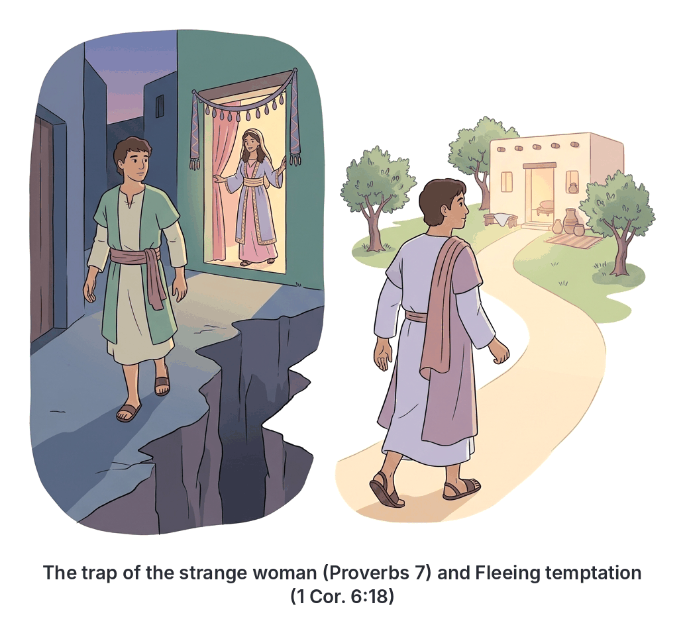

# JAMB Crk Notes: Sexual Immorality

## What JAMB expects

This topic is Section D, Topic 16 of the JAMB CRK syllabus: Sexual Immorality. It covers the following content items:

*   **(a) Prostitution** (1 Cor. 6:16-20 cf. Prov. 7:10-27; 23:27-28)
*   **(b) Adultery and Fornication** (Heb. 13:4, Eph. 5:3-10 cf. Matt. 5:28-32; Deut. 22:22; Lev. 20:10)
*   **(c) Homosexuality** (Rom. 1:24-32 cf. Lev. 18:21-30; 20:13)

By the end of these notes, you should be able to:
1.  identify what constitute sexual immorality;
2.  determine the causes of sexual immorality;
3.  examine the effects and consequences of sexual immorality;
4.  identify ways of curbing sexual immorality.

**Note on the syllabus wording:** For homosexuality, the syllabus lists the reference `Lev. 18:21-30`. The specific verse addressing homosexuality in that passage is verse 22. These notes cover the passage as printed in the syllabus while highlighting the exact verse.

## Identifying what constitutes sexual immorality

**Objective i: identify what constitute sexual immorality.**

In Christian teaching, the human body is considered sacred. The Bible teaches that sexual intimacy is a gift from God, but it is strictly reserved for marriage between a man and a woman. **Sexual immorality** refers to any sexual activity or practice that takes place outside of this lawful, marital context. 

The Bible outlines several forms of sexual immorality. The JAMB syllabus requires you to know three main categories and what the scriptures say about them:
1.  **Prostitution:** The exchange of sexual acts for money or other favours.
2.  **Adultery and Fornication:** Adultery is sexual intercourse involving a married person and someone who is not their spouse. Fornication is sexual intercourse between unmarried people.
3.  **Homosexuality:** Sexual relations between people of the same sex.

Christians believe that participating in these acts is a sin against God and against one's own body.

## Prostitution

**Content (a): Prostitution**

### Paul's teaching to the Corinthians (1 Corinthians 6:16-20)
In his letter to the church in Corinth—a city known in ancient times for its immorality and temple prostitution—Paul firmly warned believers against engaging with prostitutes.

1.  **Becoming one body:** Paul explains that whoever joins himself to a prostitute becomes one body with her. He quotes the Genesis principle of marriage ("two shall be one flesh") to show that sexual union creates a deep, binding connection. Therefore, joining a believer's body to a prostitute is a severe spiritual violation.
2.  **The body as a temple:** He reminds Christians that their bodies are not their own; they were "bought with a price" (the death of Christ). Furthermore, the believer's body is the "temple of the Holy Ghost." 
3.  **Sinning against one's own body:** Paul states that while other sins are committed outside the body, the person who commits sexual immorality "sinneth against his own body."
4.  **The instruction:** Paul commands believers to **"Flee fornication."** He concludes that Christians must glorify God in both their body and their spirit.

### The Book of Proverbs on Prostitution (Proverbs 7:10-27; 23:27-28)
The Book of Proverbs provides practical wisdom, often framed as a father advising his son to avoid the trap of the "strange woman" (a term often used for a prostitute or an adulteress).

**The seduction of the foolish youth (Proverbs 7:10-27):**
*   **The setting:** The writer observes a young man "void of understanding" wandering near the corner of a harlot's house at twilight.
*   **The approach:** A woman meets him, dressed as a harlot and with a "subtil of heart." She is loud, stubborn, and wanders the streets looking for victims.
*   **The flattery:** She catches him, kisses him, and boldly tells him she has prepared her bed with fine linens, myrrh, aloes, and cinnamon. She tells him to come so they can "take our fill of love until the morning."
*   **The excuse:** She assures him it is safe because her husband ("the goodman") is away on a long journey and will not return until an appointed time.
*   **The outcome:** The foolish youth yields to her flattery and follows her. The proverb warns that he follows her **"as an ox goeth to the slaughter, or as a fool to the correction of the stocks,"** not knowing it will cost him his life. The passage concludes that her house is "the way to hell, going down to the chambers of death."

**The trap of the harlot (Proverbs 23:27-28):**
The proverb uses strong imagery to describe the danger of prostitution:
*   "For a whore is a deep ditch; and a strange woman is a narrow pit."
*   She lies in wait for her victims like a robber, and she increases the number of unfaithful men (transgressors) among men.

## Adultery and Fornication

**Content (b): Adultery and Fornication**

### The sacredness of marriage (Hebrews 13:4)
The writer of Hebrews summarises the biblical view on sexual purity concisely:
*   "Marriage is honourable in all, and the bed undefiled: but whoremongers and adulterers God will judge."
*   This means that sexual intimacy is pure and honourable only within marriage. Those who practice fornication ("whoremongers") and adultery will face God's judgment.

### Paul's warning to the Ephesians (Ephesians 5:3-10)
Paul warns the Ephesian church that sexual sins have no place among God's people.
*   He states that **fornication, all uncleanness, and covetousness** should not even be named among believers, as is fitting for saints.
*   Filthiness, foolish talking, and coarse joking are also condemned.
*   **The consequence:** Paul explicitly warns that no "whoremonger, nor unclean person" has any inheritance in the kingdom of Christ and of God.
*   He advises believers not to let anyone deceive them with empty words, because God's wrath comes upon the children of disobedience. Christians are instructed to walk as "children of light" and find out what is acceptable to the Lord.

### Jesus' teaching on adultery (Matthew 5:28-32)
In the Sermon on the Mount, Jesus expanded the definition of adultery beyond the physical act to include the thoughts of the heart.
*   **Adultery in the heart:** Jesus said, "Whosoever looketh on a woman to lust after her hath committed adultery with her already in his heart." 
*   **Drastic measures:** He taught that if a person's right eye or right hand causes them to sin, they should pluck it out or cut it off. It is better to lose one part of the body than for the whole body to be cast into hell. (Christians understand this metaphorically as a command to take drastic, ruthless action to remove sources of temptation from one's life).
*   **Divorce and adultery:** Jesus taught that a man who divorces his wife for any reason other than fornication (sexual immorality) causes her to commit adultery, and whoever marries a divorced woman also commits adultery.

### The Old Testament penalty (Deuteronomy 22:22 and Leviticus 20:10)
Under the Law of Moses given to the Israelites, adultery was considered a severe crime against the community and God.
*   **Deuteronomy 22:22:** If a man is found lying with a woman married to a husband, **both of them must die**—the man and the woman. This was to "put away evil from Israel."
*   **Leviticus 20:10:** This law is repeated, stating that the adulterer and the adulteress "shall surely be put to death."

## Homosexuality

**Content (c): Homosexuality**

### Paul's description of a fallen society (Romans 1:24-32)
In his letter to the Romans, Paul explains how humanity rejected the knowledge of the true God and turned to idolatry. As a result, God abandoned them to their sinful desires.
*   **Vile affections:** Because people exchanged the truth of God for a lie, Paul writes that God "gave them up unto vile affections."
*   **The acts described:** He specifies that women exchanged natural sexual relations for unnatural ones. Likewise, men abandoned natural relations with women and burned with lust for one another, "men with men working that which is unseemly."
*   **The spiritual consequence:** Paul notes that they received in themselves the "recompence of their error." Furthermore, because they did not like to retain God in their knowledge, God gave them over to a "reprobate mind" (a corrupted, degenerate mind) to do things that are not fitting, filling them with all unrighteousness, maliciousness, and envy.
*   **Approval of sin:** The passage concludes that those who do such things know the judgment of God—that they are worthy of death—yet they not only continue to do them but also take pleasure in others who do them.

### The Old Testament Law (Leviticus 18:21-30 and 20:13)
The book of Leviticus contains strict laws separating the Israelites from the practices of the Canaanites and Egyptians.
*   **Leviticus 18:21-30:** This passage lists various forbidden practices, including sacrificing children to Molech, sexual relations with animals, and incest. Verse 22 specifically addresses homosexuality: **"Thou shalt not lie with mankind, as with womankind: it is abomination."** The passage warns that the nations before them committed these abominations, which defiled the land. If the Israelites do the same, the land will "vomit you out" just as it vomited out the previous nations.
*   **Leviticus 20:13:** This verse restates the prohibition and gives the legal penalty under the Old Covenant: "If a man also lie with mankind, as he lieth with a woman, both of them have committed an abomination: **they shall surely be put to death**; their blood shall be upon them."

## Causes of Sexual Immorality

**Objective ii: determine the causes of sexual immorality.**

Understanding why people fall into sexual immorality is crucial for preventing it. Common causes include:

1.  **Lack of self-control and spiritual discipline:** Failing to guard one's thoughts and giving in to fleshly desires instead of being led by the Holy Spirit.
2.  **Peer pressure and bad company:** Associating with friends who engage in and glorify sexual immorality often influences young people to join in so they will not be mocked or excluded.
3.  **Indecent dressing:** Provocative and revealing clothing can stir up lustful thoughts and invite unwanted sexual advances.
4.  **Poverty and greed:** In Nigeria, some young people are pushed into prostitution or "sugar daddy/mummy" relationships due to financial hardship. Others do it purely out of greed for flashy lifestyles, expensive phones, and clothes.
5.  **Exposure to pornographic materials:** The internet and social media make it very easy to access explicit movies, pictures, and books. These pollute the mind and trigger lust (which Jesus called adultery of the heart).
6.  **Moral decadence in society:** A society that normalises premarital sex, infidelity, and casual relationships makes it harder for youths to see the danger in these acts.
7.  **Desire for academic or career favours:** The corrupt practice of exchanging "marks for sex" in schools, or sex for job promotions, drives many into forced or voluntary immorality.

## Effects and Consequences of Sexual Immorality

**Objective iii: examine the effects and consequences of sexual immorality.**

The Bible and everyday life demonstrate that sexual immorality has devastating spiritual, physical, and social consequences.

| Category | Consequences |
| :--- | :--- |
| **Spiritual Consequences** | • **Separation from God:** It defiles the body (the temple of the Holy Spirit). • **Loss of salvation/heaven:** Ephesians 5:5 warns that no sexually immoral person has an inheritance in God's kingdom. • **Divine judgment:** Hebrews 13:4 says God will judge adulterers and fornicators. In the Old Testament, the penalty was death. |
| **Physical/Health Consequences** | • **Sexually Transmitted Infections (STIs):** Exposure to diseases like HIV/AIDS, syphilis, and gonorrhoea. • **Unwanted pregnancies:** Often leading to illegal and unsafe abortions, which can cause death or permanent damage to the womb. |
| **Social and Psychological Consequences** | • **Broken homes and marriages:** Adultery destroys trust and leads to divorce, causing immense pain to spouses and children. • **School dropouts:** Unwanted pregnancies often force young girls to abandon their education. • **Loss of dignity and respect:** The book of Proverbs warns that yielding to a harlot reduces a person to a piece of bread and costs them their honour. • **Guilt and emotional trauma:** It often leaves psychological scars, depression, and a loss of self-worth. |

## Ways of Curbing Sexual Immorality

**Objective iv: identify ways of curbing sexual immorality.**

To build a morally sound society and maintain spiritual purity, individuals and communities must take deliberate steps:

1.  **Proper religious upbringing and parental guidance:** Parents must teach their children the fear of God and the biblical value of chastity from a young age.
2.  **Self-discipline and fleeing temptation:** Like Joseph (who ran away from Potiphar's wife), youths must recognise danger and physically flee from situations that invite immorality.
3.  **Modest dressing:** Both men and women should dress decently to avoid causing others to stumble or attracting lustful attention.
4.  **Avoiding bad company:** "Evil communications corrupt good manners." Choosing friends who share Christian values helps maintain moral purity.
5.  **Controlling media consumption:** Being disciplined about what to watch, read, or browse on the internet prevents the heart from being polluted.
6.  **Poverty alleviation and youth empowerment:** Governments and religious bodies should provide jobs and skills for the youth, reducing the financial desperation that leads to prostitution.
7.  **Strict school policies:** Institutions must heavily penalise teachers or lecturers who demand sex for marks, and enforce rules against indecent behaviour on campus.

## Key terms

| Term | Meaning |
| :--- | :--- |
| **Sexual immorality** | Any sexual activity outside the bounds of a lawful marriage between a man and a woman. |
| **Fornication** | Sexual intercourse between two unmarried persons. |
| **Adultery** | Sexual intercourse involving a married person and someone who is not their spouse. |
| **Prostitution (Harlotry)** | The practice of engaging in sexual acts for money or material gain. |
| **Homosexuality** | Sexual relations between persons of the same sex. |
| **Abomination** | Something that is disgusting, hateful, and morally repulsive to God. |
| **Reprobate mind** | A mind that is depraved, morally corrupt, and unable to make righteous judgments (used by Paul in Romans 1). |

## Exam tips and common mistakes

*   **Know the specific books:** JAMB often asks where a particular teaching is found. 
    *   *The body is the temple of the Holy Spirit* = **1 Corinthians 6**.
    *   *Looking at a woman lustfully is adultery in the heart* = **Matthew 5**.
    *   *Marriage is honourable, but God will judge adulterers* = **Hebrews 13:4**.
    *   *The foolish youth and the harlot* = **Proverbs 7**.
*   **Understand Jesus' standard vs. Old Testament standard:** The Old Testament penalty for adultery was physical death (stoning) for both parties (Deut 22, Lev 20). Jesus elevated the moral standard by saying that even *lustful thoughts* constitute adultery in the heart.
*   **Don't confuse fornication and adultery:** Fornication is between unmarried people; adultery involves at least one married person breaking their marital vow.
*   **Read carefully:** When asked about Paul's teaching in Romans 1 regarding homosexuality, remember the phrase "God gave them up to vile affections" and a "reprobate mind."

## Quick summary

1.  Sexual immorality encompasses any sexual act outside heterosexual marriage, including prostitution, fornication, adultery, and homosexuality.
2.  Paul taught in 1 Corinthians 6 that the believer's body is the temple of the Holy Spirit and that Christians must "flee fornication."
3.  Proverbs 7 compares a youth seduced by a harlot to an ox going to the slaughter, warning that prostitution leads to death and hell.
4.  Jesus taught in Matthew 5 that looking at someone with lust is equal to committing adultery in the heart, demanding strict mental discipline.
5.  Under Old Testament Law (Deuteronomy 22, Leviticus 20), the penalty for adultery and homosexuality was death.
6.  In Romans 1, Paul describes homosexual acts as "vile affections" resulting from humanity rejecting God and being given over to a reprobate mind.
7.  Causes of sexual immorality include peer pressure, indecent dressing, poverty, and media influence.
8.  Consequences include STIs, unwanted pregnancies, broken homes, loss of salvation, and the judgment of God.

## Practice questions

**1. According to Paul in 1 Corinthians, what is the unique nature of the sin of sexual immorality?**

- A. It is the only sin that cannot be forgiven.
- B. The person sins against his own body.
- C. It causes immediate physical death.
- D. It cannot be committed by believers.

**Answer: B.** Paul states in 1 Corinthians 6:18, "Every sin that a man doeth is without the body; but he that committeth fornication sinneth against his own body."

**2. In the Sermon on the Mount, Jesus taught that a man commits adultery in his heart when he**

- A. divorces his wife without cause.
- B. marries a divorced woman.
- C. looks at a woman to lust after her.
- D. visits the house of a harlot.

**Answer: C.** Jesus expanded the law by teaching that lustful looks constitute adultery of the heart (Matthew 5:28).

**3. According to the book of Proverbs, a young man who yields to the seduction of a harlot is compared to**

- A. a lion caught in a net.
- B. an ox going to the slaughter.
- C. a sheep lost in the wilderness.
- D. a bird flying into a snare.

**Answer: B.** Proverbs 7:22 says, "He goeth after her straightway, as an ox goeth to the slaughter, or as a fool to the correction of the stocks."

**4. Under the Old Testament law in Leviticus 20 and Deuteronomy 22, the punishment for a man and a married woman caught in adultery was**

- A. banishment from Israel.
- B. offering a sin offering to the priest.
- C. paying a fine to the woman's husband.
- D. they must both be put to death.

**Answer: D.** The law stated that the adulterer and the adulteress "shall surely be put to death" to put away evil from Israel.

**5. "Marriage is honourable in all, and the bed undefiled: but whoremongers and adulterers God will judge." This teaching is found in the book of**

- A. Romans
- B. Ephesians
- C. Hebrews
- D. 1 Corinthians

**Answer: C.** This exact summary of the sacredness of marriage and God's judgment on sexual immorality is found in Hebrews 13:4.

**6. Paul writes in Ephesians 5 that no sexually immoral, unclean, or covetous person has any inheritance in the kingdom of Christ. What alternative behaviour does he recommend?**

- A. Offering daily sacrifices
- B. Walking as children of light
- C. Fleeing to the wilderness
- D. Fasting for forgiveness

**Answer: B.** Paul instructs the Ephesians to avoid darkness and instead walk as "children of light," finding out what is acceptable to the Lord.

**7. In Romans 1, Paul explains that homosexual practices were a result of people**

- A. being deceived by false prophets.
- B. eating meat sacrificed to idols.
- C. exchanging the truth of God for a lie and worshipping the creature.
- D. intermarrying with the Canaanites.

**Answer: C.** Paul explains that because they rejected God and turned to idolatry (worshipping the creature rather than the Creator), God gave them up to "vile affections."

**8. Which of the following is a practical way for a Christian youth to curb sexual immorality?**

- A. Fleeing from compromising situations and bad company
- B. Attending social parties to prove self-control
- C. Engaging in physical fights with prostitutes
- D. Keeping the behaviour a secret

**Answer: A.** Fleeing temptation (as Paul advised in 1 Cor 6:18 and as Joseph did in the Old Testament) and avoiding bad company are key biblical strategies for maintaining purity.

**9. Proverbs 23:27 uses vivid imagery to describe a whore as a**

- A. raging fire.
- B. deep ditch.
- C. poisoned arrow.
- D. barren land.

**Answer: B.** Proverbs 23:27 states, "For a whore is a deep ditch; and a strange woman is a narrow pit."

**10. One of the severe physical and social consequences of sexual immorality among Nigerian youths is**

- A. the reduction of agricultural yield.
- B. exposure to sexually transmitted infections and broken education.
- C. increased political corruption in government.
- D. an increase in natural disasters.

**Answer: B.** Unwanted pregnancies (leading to school dropouts) and STIs like HIV/AIDS are direct physical and social consequences of sexual immorality.

<!-- COVERAGE
obj i | Identifying what constitutes sexual immorality
obj ii | Causes of Sexual Immorality
obj iii | Effects and Consequences of Sexual Immorality
obj iv | Ways of Curbing Sexual Immorality
item a | Prostitution
item b | Adultery and Fornication
item c | Homosexuality
-->
