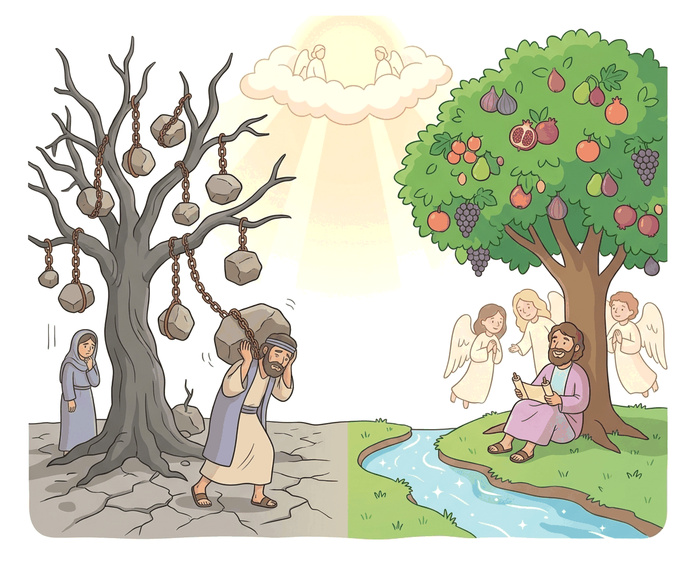

# JAMB Crk Notes: New Life in Christ

## What JAMB expects

This topic is Section D, Topic 3 of the JAMB CRK syllabus: New Life in Christ. It draws from several of Paul’s letters to the early churches.

The syllabus lists the following content to study:
* Romans 6:1-4; 12-14
* Colossians 3:1-17
* Galatians 5:16-26
* II Corinthians 5:16-19
* I Thessalonians 4:1-8
* Romans 12

By the end of these notes, you should be able to:
1. Describe the characteristics of the old life.
2. Analyse the new life in Christ.
3. Identify the conditions of the new life.
4. Examine the benefits of the new life.

## Objective i: Describe the characteristics of the old life

In Christian teaching, the **"old life"** refers to the way a person lives before they accept Jesus Christ and are transformed by the Holy Spirit. The Apostle Paul often calls this living according to the **"flesh"** or the "earthly nature." The old life is driven by sinful human desires, selfishness, and worldly values, rather than by God's commands.

Paul describes the characteristics of the old life in several of his letters:

### The works of the flesh (Galatians 5:16-21)
Paul warns the Galatians that the desires of the flesh are entirely against the Spirit. He provides a detailed list of the characteristics of the old life, which he calls the "works of the flesh":
* **Sexual sins:** Adultery, fornication (sexual immorality), uncleanness, and lasciviousness (uncontrolled lust).
* **Spiritual sins:** Idolatry (worshipping false gods) and witchcraft (sorcery).
* **Social and relational sins:** Hatred, variance (discord or strife), emulations (jealousy), wrath (fits of rage), strife (selfish ambition), seditions (dissensions or forming rebellious factions), and heresies.
* **Sins of intemperance:** Envyings, murders, drunkenness, and revellings (wild partying).

Paul strictly warns that those who practice such things will not inherit the kingdom of God. In modern Nigeria, these traits are often visible in societal problems like ethnic hatred, ritual killings (sorcery/idolatry), political violence (strife and seditions), and widespread sexual immorality.

### Earthly members to be put to death (Colossians 3:5-9)
Paul commands the Colossians to put to death what is earthly in them. He groups the characteristics of the old life into two categories:
1. **Immoral passions:** Sexual immorality, impurity, passion, evil desire, and covetousness (which Paul says is a form of idolatry because it puts the love of money or things above God).
2. **Harmful speech and attitudes:** Anger, wrath, malice, blasphemy (slander), and filthy communication out of the mouth. He also emphasizes that people living the old life lie to one another. 

### Impurity and lust (I Thessalonians 4:1-8)
When writing to the Thessalonians, Paul contrasts God's call to holiness with the lifestyle of the "Gentiles which know not God." The old life is characterized by the **"lust of concupiscence"** (passion of lust). In this state, people lack self-control over their own bodies and often wrong or defraud their brothers and sisters in various matters, including sexual purity.

## Objective ii: Analyse the new life in Christ

The **"new life"** is the spiritual rebirth and moral transformation that happens when a person accepts Jesus Christ. It is a life controlled and guided by the Holy Spirit, resulting in godly character and actions.

### A New Creation (II Corinthians 5:16-19)
The fundamental definition of the new life is found in II Corinthians 5:17: 
> *"Therefore if any man be in Christ, he is a new creature: old things are passed away; behold, all things are become new."*

In the new life, a Christian no longer judges people by worldly standards ("after the flesh"). The old life of sin is gone, and a completely new spiritual reality has begun.

### The Fruit of the Spirit (Galatians 5:22-26)
While the old life produces the "works of the flesh," the new life produces the **"fruit of the Spirit."** This is a set of nine Christ-like qualities that the Holy Spirit grows in a believer:
1. **Love:** Selfless, sacrificial care for others.
2. **Joy:** A deep, spiritual gladness independent of circumstances.
3. **Peace:** Inner calmness and harmony with God and people.
4. **Longsuffering (Patience):** Endurance under provocation or suffering.
5. **Gentleness (Kindness):** Being considerate and helpful to others.
6. **Goodness:** Moral excellence and generosity.
7. **Faith (Faithfulness):** Being reliable, loyal, and trustworthy.
8. **Meekness:** Power under control; humility.
9. **Temperance (Self-control):** The ability to restrain sinful passions and appetites.

Paul states that there is no law against these things. Those who belong to Christ have "crucified the flesh with the affections and lusts."

### Putting on the New Man (Colossians 3:10-17)
Just as Christians are told to "put off" the old life like dirty clothes, Paul tells the Colossians to "put on the new man." This new self is continually being renewed in knowledge after the image of God. 
In the new life, ethnic and social divisions disappear (there is no longer Greek or Jew, circumcised or uncircumcised, barbarian, Scythian, slave, or free). 

The new life is marked by:
* **Bowels of mercies (Compassion)**, kindness, humbleness of mind, meekness, and longsuffering.
* **Forbearance and forgiveness:** Forgiving one another just as Christ forgave them.
* **Charity (Love):** The "bond of perfectness" that binds all other virtues together.
* **The peace of God** ruling in their hearts.
* **Thankfulness** and letting the word of Christ dwell in them richly (teaching and singing psalms, hymns, and spiritual songs).

### Marks of a True Christian (Romans 12)
In Romans 12, Paul gives a practical breakdown of how the new life looks in a Christian community:
* **Sincere Love:** Love must be without hypocrisy. Christians must hate evil and cling to what is good.
* **Brotherly Affection:** Outdoing one another in showing honour.
* **Diligence:** Not being lazy, but fervent in spirit, serving the Lord.
* **Endurance:** Rejoicing in hope, being patient in tribulation, and constant in prayer.
* **Generosity and Hospitality:** Contributing to the needs of the saints and welcoming strangers.
* **Response to Enemies:** Blessing those who persecute them (blessing and not cursing), living in harmony, never avenging themselves, but leaving wrath to God. If an enemy is hungry, feed him.

### Contrast: The Old Life vs. The New Life

| Feature | The Old Life (The Flesh) | The New Life (The Spirit) |
| :--- | :--- | :--- |
| **Identity** | Unregenerate, separated from God | A new creation in Christ (2 Cor 5:17) |
| **Control** | Governed by the flesh, lusts, and worldly passions | Governed by the Holy Spirit and the word of Christ |
| **Relational Traits** | Hatred, strife, jealousy, anger, slander, envy, division | Love, peace, kindness, forgiveness, harmony, humility |
| **Sexual Morality** | Fornication, adultery, impurity, unchecked lust | Purity, holiness, controlling one's body (1 Thess 4:4) |
| **Speech** | Lying, filthy language, cursing, blasphemy | Truthfulness, singing spiritual songs, blessing enemies |
| **Ultimate Result** | Shall not inherit the kingdom of God | Eternal life, bearing the fruit of the Spirit |

## Objective iii: Identify the conditions of the new life

How does a person enter into this new life, and what are the conditions for maintaining it? Paul outlines several crucial steps and spiritual realities.

### 1. Being "In Christ" (II Corinthians 5:17)
The primary condition for the new life is being united with Jesus Christ through faith. Paul says, "If any man be **in Christ**, he is a new creature." The new life is not achieved by human effort or keeping religious rules, but by a spiritual union with Jesus.

### 2. Dying to Sin (Romans 6:1-4)
In Romans 6, Paul asks, "Shall we continue in sin, that grace may abound? God forbid." 
The condition for the new life is a complete break with the old life, symbolized by **baptism**. 
* **Baptized into His death:** When a person is baptized, it represents dying to the old sinful nature, just as Jesus died on the cross.
* **Buried with Him:** The old life is permanently put away.
* **Raised to walk in newness of life:** Just as Christ was raised from the dead by the glory of the Father, the Christian is raised spiritually to live a completely new life. A person cannot live the new life if they are still serving sin.

### 3. Becoming a Living Sacrifice (Romans 12:1)
Paul begs the Romans, by the mercies of God, to present their bodies as a **"living sacrifice, holy, acceptable unto God."** In the Old Testament, dead animals were offered to God. In the new life, the condition is offering one's living body entirely to God for His service. Paul calls this our "reasonable service" (or spiritual act of worship).

### 4. Renewing the Mind (Romans 12:2)
To maintain the new life, a Christian must not be "conformed to this world." This means rejecting the corrupt values, fashions, and mindsets of society. Instead, they must be **"transformed by the renewing of your mind."** A changed mind allows a believer to understand and prove what is the "good, and acceptable, and perfect, will of God." 

### 5. Setting the Mind on Heavenly Things (Colossians 3:1-2)
Because believers have been "risen with Christ," the condition of their new life is a shift in focus. Paul instructs: *"Set your affection on things above, not on things on the earth."* A Christian must actively focus on spiritual realities and Christ's kingdom, rather than being obsessed with earthly wealth or status.

### 6. Walking by the Spirit (Galatians 5:16)
The new life is a daily journey. The condition for overcoming the old life is to **"Walk in the Spirit, and ye shall not fulfil the lust of the flesh."** This means daily listening to, obeying, and yielding to the Holy Spirit.

## Objective iv: Examine the benefits of the new life

The new life in Christ brings profound spiritual, psychological, and social benefits to the believer.

### 1. Freedom from the Dominion of Sin (Romans 6:12-14)
In the old life, a person is a slave to their sinful desires. A major benefit of the new life is emancipation. Paul writes, *"For sin shall not have dominion over you: for ye are not under the law, but under grace."* (Rom 6:14). Believers are given the spiritual power to not let sin reign in their mortal bodies. They are free to offer themselves to God as instruments of righteousness.

### 2. Reconciliation with God (II Corinthians 5:18-19)
The old life causes enmity between human beings and a holy God. In the new life, God has reconciled us to Himself by Jesus Christ. 
* **Not imputing trespasses:** God no longer counts the believer's past sins against them.
* **The Ministry of Reconciliation:** A further benefit is that God trusts believers with a divine purpose—He has given them the "ministry of reconciliation" (the job of telling the world that they too can be restored to God).

### 3. Peace and Harmony (Colossians 3:15, Romans 12)
The old life is full of strife, malice, and revenge. The new life brings psychological peace (*"let the peace of God rule in your hearts"*) and social harmony. Because Christians are commanded to forgive, forbear, and outdo one another in honour, the new life creates a community built on genuine love and mutual support, free from the bitter ethnic and tribal divisions of the world.

### 4. Sanctification and Pleasing God (I Thessalonians 4:1-8)
God's will for believers is their **sanctification** (being made holy). A benefit of the new life is that a believer can finally live in a way that pleases God. God gives them His Holy Spirit, empowering them to live honorably and purely. To reject this new life of holiness is not merely rejecting human rules, but rejecting God Himself, who gives the Holy Spirit.

### 5. Spiritual Gifts for the Community (Romans 12:4-8)
In the new life, believers become members of one body (the Church). A great benefit is that God gives different **gifts of grace** to each member to help the whole community. Paul lists these gifts:
* Prophecy (preaching/declaring God's will)
* Ministry (serving others)
* Teaching
* Exhortation (encouraging)
* Giving (contributing generously)
* Leadership (ruling with diligence)
* Mercy (showing kindness with cheerfulness)

## Key terms

| Term | Meaning |
| :--- | :--- |
| **Old life (The flesh)** | The unregenerate, sinful state of human beings before accepting Christ, driven by worldly desires. |
| **New life** | The transformed spiritual life of a believer in Christ, empowered by the Holy Spirit. |
| **New creation (New creature)** | A person who has been spiritually reborn and transformed by being united with Jesus Christ. |
| **Works of the flesh** | Sinful actions and attitudes that come from the old human nature (e.g., adultery, idolatry, hatred). |
| **Fruit of the Spirit** | Nine Christ-like character traits produced by the Holy Spirit in a believer's life (e.g., love, joy, peace). |
| **Reconciliation** | The restoration of a broken relationship; God making peace with humanity through Christ's sacrifice. |
| **Sanctification** | The ongoing process of being made holy and separated from sin. |
| **Living sacrifice** | Offering one's daily life, body, and actions entirely to God as an act of worship. |
| **Covetousness** | An intense, greedy desire for wealth or other people's possessions, which Paul equates to idolatry. |

## Exam tips and common mistakes

* **Memorize II Corinthians 5:17:** "Therefore if any man be in Christ, he is a new creature..." This is a very common exam question.
* **Distinguish between Galatians 5 and Colossians 3:** While both talk about the old/new life, Galatians 5 is famous for the contrast between the *works of the flesh* and the *fruit of the Spirit*. Colossians 3 focuses on *putting off the old man* and *setting the mind on things above*.
* **Know the 9 fruits of the Spirit:** (Love, joy, peace, longsuffering, gentleness, goodness, faith, meekness, temperance). JAMB often asks "Which of the following is NOT a fruit of the Spirit?" Provide a list, and look for the odd one out (e.g., wealth, pride, or a work of the flesh).
* **Understand the symbol of Baptism in Romans 6:** Baptism represents dying to sin (burial) and being raised to a new life in Christ.
* **The meaning of "Living Sacrifice":** This phrase comes from Romans 12:1. It means giving your body and life to God for His service, not offering a literal dead animal.
* **Covetousness as Idolatry:** Remember that in Colossians 3, Paul specifically calls covetousness (greed) a form of idolatry.

## Quick summary

1. The "old life" is driven by the flesh and characterized by sexual immorality, idolatry, strife, anger, and greed, which ultimately separate a person from God.
2. The "new life" occurs when a person is in Christ; they become a completely new creation, and the old things pass away.
3. Instead of the works of the flesh, the new life produces the "fruit of the Spirit," such as love, joy, peace, patience, and self-control.
4. The conditions for the new life include being baptized into Christ's death (dying to sin), offering oneself as a living sacrifice, and renewing the mind.
5. Christians are instructed to put off the "old man" (like taking off dirty clothes) and put on the "new man" by showing compassion, kindness, humility, and forgiveness.
6. A major benefit of the new life is freedom from the dominion of sin, because believers are under grace, not the law.
7. God reconciles believers to Himself in the new life and entrusts them with the ministry of reconciliation, not counting their sins against them.
8. The new life transforms community relations; Christians are commanded to love sincerely, bless their persecutors, and use their spiritual gifts to serve one another.

## Practice questions

**1. According to Paul in II Corinthians 5, if anyone is in Christ, he is a**
- A. restored saint
- B. new creature
- C. spiritual Jew
- D. living sacrifice

**Answer: B.** Paul states in II Corinthians 5:17, "Therefore if any man be in Christ, he is a new creature: old things are passed away; behold, all things are become new."

**2. Which of the following is NOT listed as a fruit of the Spirit in Galatians 5?**
- A. Joy
- B. Knowledge
- C. Peace
- D. Meekness

**Answer: B.** The nine fruits of the Spirit are love, joy, peace, longsuffering, gentleness, goodness, faith, meekness, and temperance. Knowledge is not in this specific list.

**3. In Romans 6, Paul explains that Christians are buried with Christ by baptism into death so that they might**
- A. speak in tongues
- B. walk in newness of life
- C. receive the law of Moses
- D. escape physical death

**Answer: B.** Romans 6:4 says, "Therefore we are buried with him by baptism into death: that like as Christ was raised up from the dead... even so we also should walk in newness of life."

**4. According to Romans 12, a believer is transformed by the**
- A. preaching of the word
- B. reading of the law
- C. renewing of the mind
- D. shedding of blood

**Answer: C.** Romans 12:2 commands believers not to be conformed to this world, "but be ye transformed by the renewing of your mind."

**5. In Colossians 3, Paul equates covetousness with**
- A. fornication
- B. murder
- C. idolatry
- D. witchcraft

**Answer: C.** Colossians 3:5 tells believers to put to death evil desires and "covetousness, which is idolatry."

**6. The "ministry of reconciliation" given to believers means**
- A. reconciling different tribes in the church
- B. collecting money for the poor saints
- C. preaching the law to sinners
- D. declaring that God is restoring the world to Himself through Christ

**Answer: D.** II Corinthians 5:18-19 explains that God reconciled us to Himself by Christ, and has given us the ministry of reconciliation—telling others that God is not counting their trespasses against them.

**7. Which of the following is a characteristic of the "old life" according to Galatians 5?**
- A. Longsuffering
- B. Strife
- C. Temperance
- D. Hospitality

**Answer: B.** Strife is listed among the "works of the flesh" in Galatians 5:19-21. The other options are positive virtues.

**8. Paul told the Colossians that above all the virtues of the new man, they should put on charity (love), which is the**
- A. shield of faith
- B. bond of perfectness
- C. helmet of salvation
- D. anchor of the soul

**Answer: B.** Colossians 3:14 says, "And above all these things put on charity, which is the bond of perfectness."

**9. In Romans 6:14, Paul states that sin shall not have dominion over believers because they are**
- A. under the law
- B. baptized in water
- C. under grace
- D. Abraham's seed

**Answer: C.** The verse reads: "For sin shall not have dominion over you: for ye are not under the law, but under grace."

**10. According to I Thessalonians 4, God has not called believers unto uncleanness, but unto**
- A. holiness (sanctification)
- B. liberty
- C. prosperity
- D. wisdom

**Answer: A.** I Thessalonians 4:7 states, "For God hath not called us unto uncleanness, but unto holiness" (sanctification).

<!-- COVERAGE
obj i | Objective i: Describe the characteristics of the old life
obj ii | Objective ii: Analyse the new life in Christ
obj iii | Objective iii: Identify the conditions of the new life
obj iv | Objective iv: Examine the benefits of the new life
Rom. 6:1-4 | Dying to Sin (Romans 6:1-4)
-->
