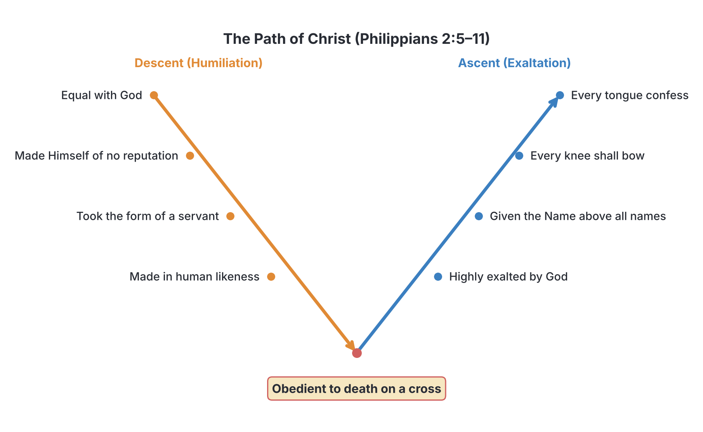

# JAMB Crk Notes: Humility

## What JAMB expects

This topic is Section D, Topic 5 of the JAMB CRK syllabus: Humility. It covers several key biblical passages that explain the Christian view of humility and its rewards. 

The syllabus lists the following passages to study:
* (Phil. 2:1-11; I Pet. 5:5-11)
* (James 4:10; Matt. 23:12)

By the end of these notes, you should be able to:
1. Determine the meaning of humility.
2. Identify the requirements of humility.
3. Identify the rewards of humility.

**Note on the syllabus wording:** The syllabus contains a typing error in one of its references, printing it as `James 4;10`. This is clearly a misprint for **James 4:10**, which is the verse studied in these notes. 

## The meaning of humility

**Objective i: determine the meaning of humility.**

**Humility** is the quality of having a modest or low view of one's own importance. In the biblical and Christian context, it is not a sign of weakness or low self-esteem; rather, it is the conscious decision to submit oneself to God and to put the needs and interests of others before one's own. 

A humble person recognises that all their talents, wealth, and achievements are gifts from God. Therefore, they do not boast, show off, or look down on others. Instead of displaying arrogance, pride, or a "do you know who I am?" attitude—which is common in human society—a humble person is willing to serve others, accept correction, and depend entirely on God for guidance and provision.

In summary, the biblical meaning of humility involves:
1. **Total dependence on God** rather than trusting in one's own strength.
2. **Proper self-assessment**, not thinking of oneself more highly than one ought.
3. **Servant-heartedness**, valuing and serving others regardless of their status.

## Paul's teaching on humility (Philippians 2:1-11)

**Content item: Phil. 2:1-11.**

The most profound biblical explanation of humility is found in the Apostle Paul's letter to the Philippians. Paul wrote to the church at Philippi to encourage unity and to warn them against selfishness and pride, which can easily destroy a community. To illustrate his point, he used Jesus Christ as the supreme example of humility.

### The call to unity and selflessness (Verses 1-4)
Paul begins by appealing to the believers to be of the same mind, having the same love, and being united in spirit. He gives them clear instructions on how to treat one another:
* "Let nothing be done through strife or vainglory" (Philippians 2:3). This means they should not do things out of selfish ambition or a desire to show off.
* "...but in lowliness of mind let each esteem other better than themselves." Believers are commanded to value others above themselves.
* They should not look only to their own interests, but also to the interests of others.

### The supreme example of Christ (Verses 5-8)
To show the Philippians what true humility looks like, Paul points to Jesus Christ. Christians are instructed: "Let this mind be in you, which was also in Christ Jesus." 

Paul then describes Christ's ultimate act of humility, often called the **Kenosis** (a Greek word meaning "self-emptying"):
1. **His pre-existence:** Jesus originally existed "in the form of God" and was equal with God. 
2. **His self-emptying:** Jesus "made himself of no reputation" (He emptied Himself). He did not cling to His divine privileges or use them for His own advantage.
3. **His incarnation:** He took upon Himself the "form of a servant" and was made "in the likeness of men." 
4. **His obedience and death:** As a human, He humbled Himself completely, becoming obedient to God the Father up to the point of death—even the most shameful and painful death on a cross.

### The reward of Christ's humility (Verses 9-11)
Because of Jesus' absolute submission and humility, God gave Him the ultimate reward:
* God **highly exalted** Him.
* God gave Him a **name which is above every name**.
* At the name of Jesus, **every knee should bow** (in heaven, on earth, and under the earth).
* **Every tongue should confess** that Jesus Christ is Lord, to the glory of God the Father.

This passage establishes a fundamental Christian principle: the way up is down. True exaltation comes only after true humility.

## Peter's teaching on humility (1 Peter 5:5-11)

The Apostle Peter also taught extensively on humility, applying it to relationships within the church and to the believer's relationship with God.

### Submission and mutual humility
Peter addresses different groups within the church:
* **The younger generation:** "Likewise, ye younger, submit yourselves unto the elder." In any community, including Nigerian society, respect for elders and submission to legitimate authority is a core requirement of humility.
* **All believers:** Peter instructs everyone to be "clothed with humility" towards one another. Humility should be like a garment that every Christian wears daily.

To back this up, Peter quotes a well-known Old Testament proverb (Proverbs 3:34): *"God resisteth the proud, and giveth grace to the humble"* (1 Peter 5:5). Pride puts a person in direct opposition to God, while humility opens the door to God's grace and unmerited favour.

### Humbling oneself before God
Peter moves from human relationships to the believer's relationship with God: "Humble yourselves therefore under the mighty hand of God, that he may exalt you in due time" (1 Peter 5:6). 

He then explains a practical way to show this humility: **"Casting all your care upon him; for he careth for you"** (1 Peter 5:7). Worry and anxiety are often subtle forms of pride, where a person believes they must carry their burdens alone because they are in control. Casting one's cares upon God is an act of humility because it is an admission of human weakness and a declaration of total dependence on God.

### Humility and spiritual warfare
Finally, Peter links humility and dependence on God to spiritual warfare. He warns believers to be "sober" and "vigilant" because their adversary, the devil, walks around "as a roaring lion, seeking whom he may devour." Believers must resist the devil by remaining steadfast in their faith, knowing that they will suffer for a while, but the God of all grace will eventually "perfect, stablish, strengthen, and settle" them.

## James and Jesus on humility (James 4:10; Matthew 23:12)

The syllabus also requires knowledge of two very short but powerful verses that summarize the biblical rule of humility and exaltation.

### James 4:10
*"Humble yourselves in the sight of the Lord, and he shall lift you up."*

James echoes the exact same principle taught by Peter and Paul. Humility is not an action performed for the applause of men; it is done "in the sight of the Lord." When a person recognizes their lowliness before God and repents of their pride, God takes it upon Himself to lift them up in His own time and manner.

### Matthew 23:12
*"And whosoever shall exalt himself shall be abased; and he that shall humble himself shall be exalted."*

Jesus spoke these words during a severe warning against the religious leaders of His day—the scribes and the Pharisees. The Pharisees loved the place of honour at banquets, the best seats in the synagogues, and being respectfully greeted in the marketplaces. They did all their religious works to be seen by men.

Jesus taught that God's kingdom operates on the reverse of the world's standards. Anyone who tries to forcefully promote themselves, demand respect, or show off (exalting themselves) will eventually be disgraced or brought low (abased) by God. Conversely, the one who willingly takes the lowest place will be honoured by God.

## Requirements of humility

**Objective ii: identify the requirements of humility.**

Based on the passages studied above, JAMB expects you to identify the specific actions and attitudes that are required of a humble person.

| Passage | Requirements of Humility |
| :--- | :--- |
| **Philippians 2:1-11** | - Doing nothing out of selfish ambition or conceit. - Esteeming others better than oneself. - Looking out for the interests of others. - Having the mind of Christ (willingness to let go of privileges and status). - Total obedience to God, even when it is difficult or costly (as Christ was obedient to death). |
| **1 Peter 5:5-11** | - Younger people submitting to their elders. - All believers being "clothed" with humility toward one another. - Humbling oneself under God's mighty hand. - Casting all cares and anxieties upon God (acknowledging dependence on Him). - Being sober and vigilant against the devil. |
| **James 4:10** | - Humbling oneself deliberately in the sight of the Lord. |
| **Matthew 23:12** | - Refusing to self-promote, boast, or seek the highest places of honour (unlike the Pharisees). |

### Practical application in daily life
In a Nigerian context, the requirements of humility include respecting elders and teachers, not looking down on the poor or those from different backgrounds, avoiding the flaunting of wealth on social media, admitting when one is wrong, and serving in church or community without demanding a title or public recognition. 

## Rewards of humility

**Objective iii: identify the rewards of humility.**

The biblical texts are clear that humility is never ignored by God. Though it may look like weakness to the world, God promises great rewards for those who humble themselves.

| Passage | Rewards of Humility |
| :--- | :--- |
| **Philippians 2:1-11** | - Supreme exaltation by God (as God highly exalted Jesus). - Being given a name of high honour (Jesus was given the name above all names). - Receiving universal submission and confession from others. |
| **1 Peter 5:5-11** | - Receiving **grace** from God (God gives grace to the humble, while resisting the proud). - Being **exalted** by God in due time. - Receiving God's care (He cares for those who cast their burdens on Him). - Being perfected, established, strengthened, and settled by God after suffering. |
| **James 4:10** | - Being **lifted up** by the Lord. |
| **Matthew 23:12** | - **Exaltation** (he who humbles himself shall be exalted). |

**Summary of the ultimate reward:** 
Across all four passages, the consistent and ultimate reward for humility is **exaltation by God**. Whether it is expressed as being "lifted up", "highly exalted", or given "grace", the Christian teaching is that God actively intervenes to honour and elevate those who lower themselves in service and obedience.

## Key terms

| Term | Meaning |
| :--- | :--- |
| **Humility** | Lowliness of mind; putting others first and recognizing total dependence on God. |
| **Kenosis** | A theological term based on Philippians 2, referring to Christ's "self-emptying" when He took human form. |
| **Exaltation** | Being raised to a higher rank, position, or honour. God's promised reward for the humble. |
| **Vainglory** | Excessive pride in oneself or one's achievements; boastful vanity. |
| **Abased** | Brought low, humbled, or humiliated. Jesus warned that those who exalt themselves will be abased. |
| **Submission** | Yielding to the authority, will, or wisdom of another (e.g., the younger to the elder). |

## Exam tips and common mistakes

* **Know who wrote what:** JAMB often asks which apostle gave a specific instruction. Remember:
  * **Paul (Philippians 2):** Used Jesus (taking the form of a servant, obedient to death) as the prime example.
  * **Peter (1 Peter 5):** Spoke about younger people submitting to elders, being "clothed with humility", and casting cares on God.
  * **James (James 4):** Simply said, "Humble yourselves in the sight of the Lord, and he shall lift you up."
  * **Jesus (Matthew 23):** Spoke against the Pharisees, saying "whosoever shall exalt himself shall be abased."
* **Don't confuse the rewards:** While all passages promise exaltation, only Peter explicitly mentions that God gives *grace* to the humble and *resists* the proud. 
* **Meaning of casting cares:** Students sometimes fail to connect 1 Peter 5:7 ("casting all your care upon him") with humility. It is a requirement of humility because it shows you trust God to handle your life rather than proudly relying on your own strength.
* **The "mind of Christ":** If a question asks what the "mind of Christ" refers to in Philippians 2, the answer is His extreme humility and willingness to serve and sacrifice.

## Quick summary

1. Humility means having a lowly mind, placing the interests of others above your own, and depending completely on God.
2. In Philippians 2, Paul points to Jesus as the ultimate example of humility; Jesus left His heavenly glory, took the form of a servant, and was obedient even to death on a cross.
3. Because of Christ's humility, God's reward was to highly exalt Him and give Him the name above every name.
4. In 1 Peter 5, Peter requires younger people to submit to elders and all believers to be clothed with humility, because God resists the proud but gives grace to the humble.
5. Peter also teaches that casting all our anxieties on God is an act of humility, acknowledging our dependence on Him.
6. James 4:10 and Matthew 23:12 both teach a central biblical paradox: whoever forcefully exalts himself will be brought low, but whoever humbles himself will be lifted up by God.
7. The primary requirements of humility include serving others, obedience, and submission, while the ultimate reward for humility is divine exaltation and grace.

## Practice questions

**1. According to Paul in Philippians, believers are instructed to let nothing be done through strife or**
- A. anger
- B. vainglory
- C. jealousy
- D. ignorance

**Answer: B.** Paul wrote in Philippians 2:3, "Let nothing be done through strife or vainglory; but in lowliness of mind let each esteem other better than themselves."

**2. In Philippians 2, what was the ultimate reward God gave Jesus for His obedience and humility?**
- A. He was given wealth and power on earth.
- B. He was highly exalted and given a name above every name.
- C. He was allowed to return to heaven without dying.
- D. He was given the power to destroy His enemies.

**Answer: B.** Philippians 2:9 states, "Wherefore God also hath highly exalted him, and given him a name which is above every name."

**3. According to Peter, what is God's reaction to the proud?**
- A. He ignores them.
- B. He resists them.
- C. He punishes them immediately.
- D. He pities them.

**Answer: B.** 1 Peter 5:5 quotes the proverb, "God resisteth the proud, and giveth grace to the humble."

**4. According to 1 Peter 5, what specific instruction is given to the younger ones regarding humility?**
- A. They should preach to the elders.
- B. They should remain silent in the church.
- C. They should submit themselves to the elder.
- D. They should cast their burdens on the elders.

**Answer: C.** 1 Peter 5:5 says, "Likewise, ye younger, submit yourselves unto the elder."

**5. Jesus taught in Matthew 23:12 that "whosoever shall exalt himself shall be..."**
- A. lifted up
- B. rewarded
- C. ignored
- D. abased

**Answer: D.** Jesus warned the crowds and His disciples against the pride of the Pharisees, stating that whoever exalts himself shall be abased (brought low or humbled).

**6. Which of the following best demonstrates the "mind of Christ" as described in Philippians 2?**
- A. Demanding one's rights in all situations.
- B. Taking the form of a servant and being obedient to God.
- C. Seeking the highest position in the community.
- D. Praying loud prayers in the marketplace.

**Answer: B.** The "mind of Christ" refers to His willingness to empty Himself of His divine privileges, take the form of a servant, and be totally obedient, even to death.

**7. According to James 4:10, what is the reward for those who humble themselves in the sight of the Lord?**
- A. They will gain material wealth.
- B. They will never suffer.
- C. The Lord will lift them up.
- D. They will be praised by men.

**Answer: C.** James 4:10 explicitly states, "Humble yourselves in the sight of the Lord, and he shall lift you up."

**8. Peter instructs believers to cast all their care upon God because**
- A. God is a consuming fire.
- B. God cares for them.
- C. they have too many sins.
- D. they need to fight the devil.

**Answer: B.** 1 Peter 5:7 says, "Casting all your care upon him; for he careth for you."

**9. Which of the following is NOT a requirement of humility according to the prescribed texts?**
- A. Esteeming others better than oneself.
- B. Looking only to one's own interests.
- C. Submitting to elders.
- D. Humbling oneself under the mighty hand of God.

**Answer: B.** Philippians 2:4 commands the opposite: "Look not every man on his own things, but every man also on the things of others." Looking only to your own interests is a sign of selfishness, not humility.

**10. What does the term "kenosis" refer to in the context of Paul's teaching on humility?**
- A. Christ's ascension into heaven.
- B. Christ's self-emptying and taking the form of a servant.
- C. The resistance of God against the proud.
- D. The casting of cares upon God.

**Answer: B.** Kenosis is the theological term derived from the Greek in Philippians 2:7, describing how Jesus "made himself of no reputation" or emptied Himself to become a human servant.

<!-- COVERAGE
obj i | The meaning of humility
obj ii | Requirements of humility
obj iii | Rewards of humility
Phil. 2:1-11 | Paul's teaching on humility (Philippians 2:1-11)
-->
