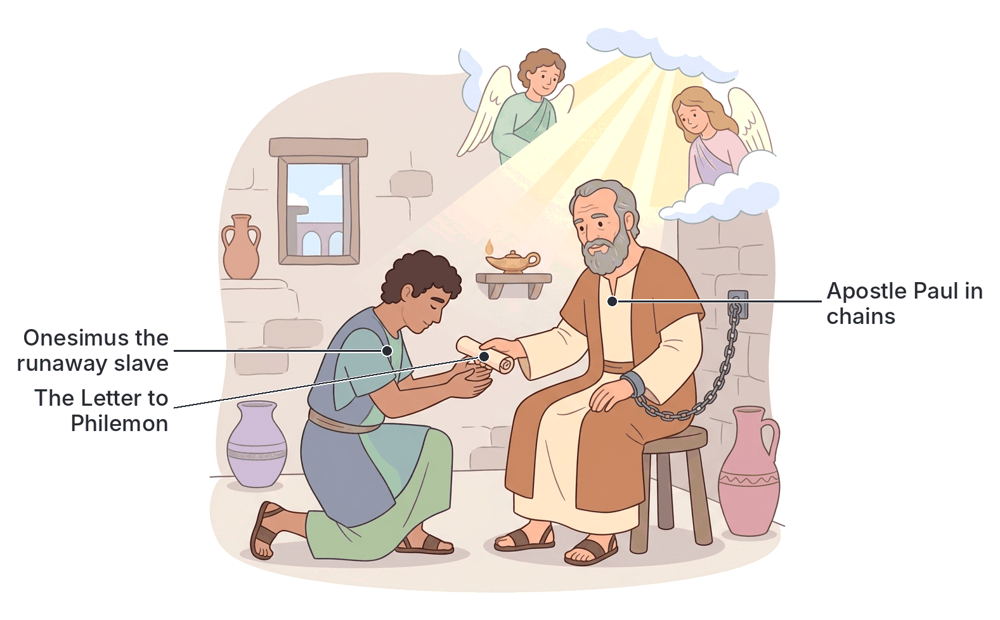
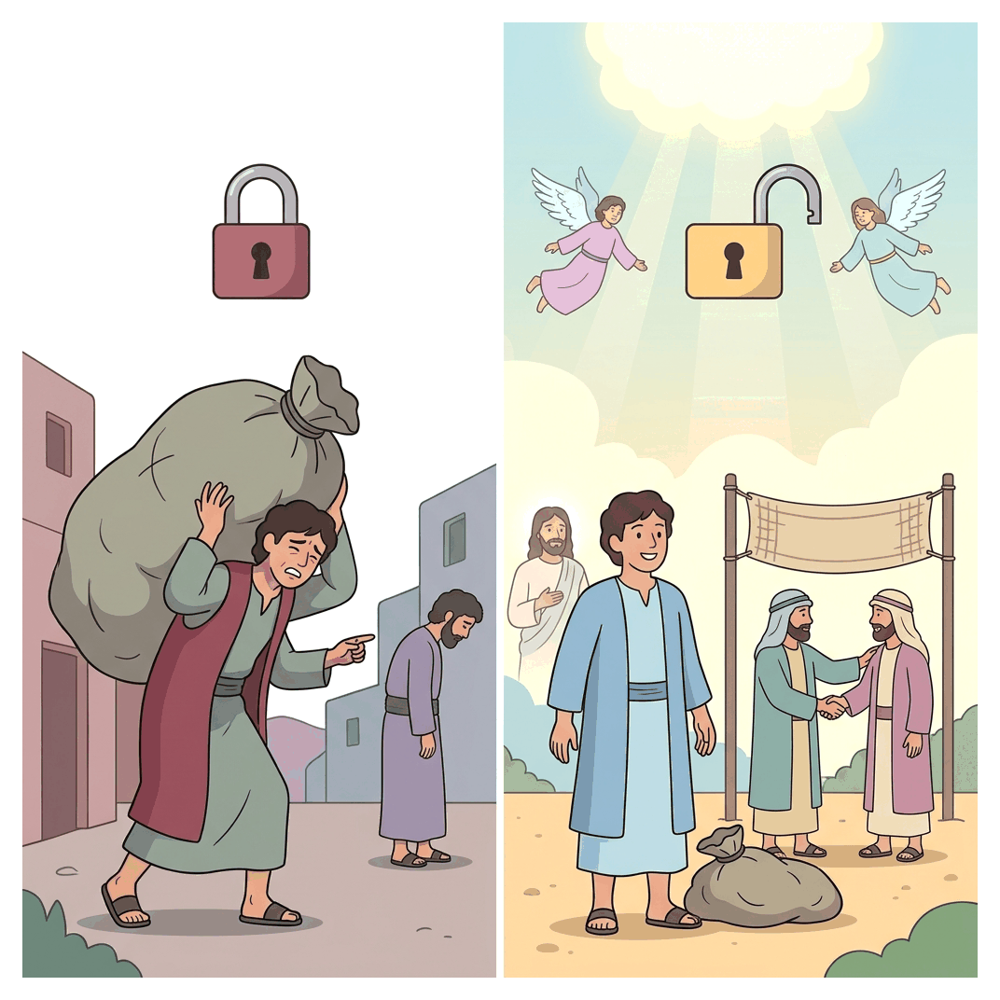

# JAMB Crk Notes: Forgiveness

## What JAMB expects

This topic is Section D, Topic 6 of the JAMB CRK syllabus: Forgiveness. 

It covers the following passages:
* Philemon
* II Cor. 2:5-11
* Matt. 7;14-15

By the end of these notes, you should be able to:
1. Analyse Paul's teaching on forgiveness.
2. Assess the benefits of forgiveness.
3. Recognize the need to forgive others.

**Note on the syllabus wording:** The syllabus lists "Matt. 7;14-15" as a reference. This is almost certainly a typographical error in the official JAMB syllabus. Matthew 7:14-15 talks about the narrow gate and false prophets ("Beware of false prophets..."). The correct passage where Jesus teaches on forgiveness is **Matthew 6:14-15**. These notes will cover both what the printed text literally says and what the intended teaching on forgiveness is, so you are fully prepared for the exam.

## The Epistle to Philemon

**Content: Philemon**

The Book of Philemon is a short, personal letter written by the Apostle Paul while he was in prison (likely in Rome). It is a practical example of forgiveness and reconciliation in action. 

### The Background Story
Philemon was a wealthy Christian who lived in the city of Colossae. Paul had preached to him, and Philemon had become a Christian. Philemon hosted a church in his house.

Philemon had a slave named **Onesimus**. Onesimus stole from his master and ran away, which was a serious crime in the Roman Empire, often punishable by death. 

Onesimus fled to Rome, where he somehow met Paul in prison. Through Paul's preaching, Onesimus became a Christian. He stayed with Paul and became very useful to him, serving him in his imprisonment. 

### Paul's Request to Philemon
Even though Paul wanted to keep Onesimus with him, he knew it was legally and morally right to send him back to his master, Philemon, to make things right. Paul wrote this letter and sent it back with Onesimus.

In the letter, Paul makes a passionate plea for forgiveness:
1. **Appeal based on love, not authority:** Paul points out that as an apostle, he could order Philemon to do the right thing, but he prefers to appeal to him on the basis of Christian love (Philemon 1:8-9).
2. **A changed man:** Paul plays on Onesimus's name (which means "useful"). He tells Philemon that Onesimus was once "unprofitable" (useless) to him, but is now "profitable" (useful) to both Philemon and Paul.
3. **No longer just a slave:** Paul asks Philemon to receive Onesimus back, not as a runaway slave to be punished, but as a **"brother beloved"** in Christ. 
4. **Paying the debt:** In a beautiful picture of what Jesus did for sinners, Paul offers to pay whatever Onesimus owes. Paul writes, *"If he hath wronged thee, or oweth thee ought, put that on mine account"* (Philemon 1:18). 
5. **Divine providence:** Paul suggests that perhaps God allowed Onesimus to run away for a short time so that Philemon could have him back forever as a Christian brother.

## Second Corinthians 2:5-11

**Content: II Cor. 2:5-11**

In his first letter to the Corinthians, Paul had commanded the church to discipline a member who was living in severe, unrepentant sin. The church obeyed and punished the man (likely by excommunicating him, removing him from their fellowship).

By the time Paul wrote 2 Corinthians, this discipline had worked. The man had repented and changed his ways. However, the church was now refusing to forgive him and let him back in. 

### Paul's Instructions to the Church
Paul steps in to teach the church about the boundaries of discipline and the necessity of forgiveness:

1. **The punishment is sufficient:** Paul says the punishment inflicted by the majority of the church was enough for the offender. 
2. **Forgive and comfort:** Paul commands the church to now do the opposite of punishing: *"ye ought rather to forgive him, and comfort him"* (2 Corinthians 2:7). 
3. **Danger of extreme sorrow:** If they do not forgive the man, Paul warns that he might be *"swallowed up with overmuch sorrow"* (he might fall into deep depression, despair, or leave the faith entirely).
4. **Reaffirm love:** Paul urges the church to publicly confirm their love for the repentant man.
5. **Defeating Satan's plans:** Paul explains a major spiritual reason for forgiveness. He says that if the church forgives the man, he also forgives him, *"Lest Satan should get an advantage of us: for we are not ignorant of his devices"* (2 Corinthians 2:11). 

Satan uses two "devices" (tricks) when Christians refuse to forgive: he causes division and bitterness in the church, and he pushes the repentant sinner into despair. Forgiveness defeats the devil.

## Matthew 7:14-15 and 6:14-15

**Content: Matt. 7;14-15**

### The Printed Syllabus Text: Matthew 7:14-15
If JAMB asks you exactly what is in Matthew 7:14-15, you must know what the verses actually say:
* **Verse 14:** *"Because strait is the gate, and narrow is the way, which leadeth unto life, and few there be that find it."* (Jesus teaching that the path to eternal life is difficult and requires deliberate choice).
* **Verse 15:** *"Beware of false prophets, which come to you in sheep's clothing, but inwardly they are ravening wolves."* (Jesus warning against fake religious leaders).

*Exam Tip:* While you should know these verses, they do not teach about forgiveness. JAMB almost certainly intended for you to study Matthew 6:14-15.

### The Intended Text: Matthew 6:14-15
Immediately after teaching the disciples the Lord's Prayer (which includes the line "And forgive us our debts, as we forgive our debtors"), Jesus lays down a strict spiritual rule regarding forgiveness:

> *"For if ye forgive men their trespasses, your heavenly Father will also forgive you: But if ye forgive not men their trespasses, neither will your Father forgive your trespasses."* (Matthew 6:14-15)

**The core teaching:**
God's forgiveness of our sins is directly tied to our willingness to forgive those who offend us. 
* **Reciprocal action:** If we hold onto bitterness and refuse to pardon those who wrong us (our friends, family members, or people in our community), we block God's mercy from our own lives.
* **A mark of true salvation:** Christians believe that a person who has truly experienced God's massive forgiveness for their own sins will naturally be willing to forgive the smaller offenses of others.

## Analyse Paul's teaching on forgiveness

**Objective i: analyse Paul’s teaching on forgiveness.**

Based on his letters to Philemon and the Corinthians, Paul's teaching on forgiveness can be analysed into several key principles:

| Principle of Forgiveness | How Paul demonstrated or taught it |
| :--- | :--- |
| **It restores equality** | Paul asked Philemon to receive Onesimus not as property, but as a "beloved brother." Forgiveness removes the "master-slave" or "victim-oppressor" dynamic and makes us equal before God. |
| **It must be voluntary** | Paul refused to force Philemon to forgive, saying his good deed should not be "as it were of necessity, but willingly." True forgiveness cannot be forced; it must come from the heart. |
| **It requires taking on a cost** | Forgiveness often costs the forgiver something (pride, money, or the right to revenge). Paul offered to personally pay Onesimus's debt to make forgiveness easier for Philemon. |
| **It has limits on punishment** | Paul taught the Corinthians that once a sinner repents, punishment must stop. Continued punishment becomes cruelty. |
| **It involves emotional healing** | It is not enough to just say "I forgive you." Paul told the Corinthians to actively "comfort" the offender and "confirm your love toward him." |
| **It is spiritual warfare** | Paul taught that holding onto unforgiveness is a trap. It gives Satan an "advantage" to destroy the church through division and the sinner through excessive sorrow. |

## Assess the benefits of forgiveness

**Objective ii: assess the benefits of forgiveness.**

Forgiveness produces powerful positive results for the forgiver, the offender, and the community. 

1. **Spiritual benefits (Divine forgiveness):** As Jesus taught in Matthew 6, the primary benefit of forgiving others is that it ensures we receive forgiveness from God. It keeps a Christian's relationship with God open and their prayers unhindered.
2. **Emotional healing for the forgiver:** Holding onto anger, grudges, and the desire for revenge is like drinking poison and expecting the other person to die. Forgiveness frees the victim's mind from bitterness, hatred, and emotional stress.
3. **Rescue of the offender:** As Paul noted in 2 Corinthians, true forgiveness comforts the person who did wrong. It lifts the heavy burden of guilt and prevents them from being "swallowed up by overmuch sorrow" (despair).
4. **Reconciliation of relationships:** Forgiveness fixes broken bonds. It turns a runaway slave into a beloved brother, and it brings a disciplined church member back into the family of God.
5. **Defeating evil:** It stops Satan from getting an advantage. It prevents the devil from using human mistakes to destroy churches and families.
6. **Promotes social peace:** In Nigerian society, where communal clashes, political anger, and family disputes over land or money are common, practicing forgiveness breaks the endless cycle of retaliation and revenge, leading to national peace.

## Recognize the need to forgive others

**Objective iii: recognize the need to forgive others.**

Understanding the teachings of Jesus and Paul highlights why it is absolutely necessary to forgive others, no matter how hard it is.

1. **We are all offenders:** Every human being has sinned against God. If God, who is perfectly holy, is willing to forgive our massive debts (sins), we must recognize the need to forgive the smaller offenses people commit against us. 
2. **It is a command, not a suggestion:** Jesus did not present forgiveness as an optional good deed. He made it a strict condition: *"If ye forgive not men their trespasses, neither will your Father forgive your trespasses."*
3. **To prevent the escalation of conflict:** If no one is willing to forgive, minor offenses grow into major wars. In schools, offices, and communities, recognizing the need to let go of an offense is the only way to stop minor insults from turning into physical fights.
4. **To maintain Christian witness:** The world expects people to seek revenge. When a Christian forgives a deep wrong—just as Philemon was asked to forgive a slave who stole from him—it provides a powerful, practical testimony of God's love to unbelievers. 

## Key terms

| Term | Meaning |
| :--- | :--- |
| **Forgiveness** | The intentional decision to let go of resentment and the desire for revenge against a person who has wronged you. |
| **Reconciliation** | The restoration of friendly relations; bringing two arguing or separated parties back together in peace. |
| **Philemon** | A wealthy Christian in Colossae to whom Paul wrote a letter urging him to forgive his runaway slave. |
| **Onesimus** | Philemon's slave who ran away, met Paul, became a Christian, and was sent back to his master. |
| **Trespass** | A sin, offense, or wrongdoing committed against someone. |
| **Overmuch sorrow** | The extreme grief or despair Paul warned would happen to the disciplined man in Corinth if the church refused to forgive him. |
| **Satan's devices** | The tricks and strategies the devil uses to cause harm, such as using unforgiveness to create division and despair. |

## Exam tips and common mistakes

* **Remember who is who:** Onesimus is the *slave*, Philemon is the *master*, and Paul is the *mediator*. 
* **Do not confuse the letters:** The story of the disciplined church member who needed forgiveness is in **2 Corinthians** (specifically chapter 2), not 1 Corinthians.
* **Memorize the consequence in Matthew:** If you do not forgive others, God will not forgive you (Matt. 6:15).
* **The printed error:** If a JAMB question specifically asks what Matthew 7:14-15 says, remember it talks about the narrow gate and false prophets ("wolves in sheep's clothing"). But if they ask about Jesus' teaching on forgiveness in Matthew, apply the rule from Matthew 6:14-15.
* **Paul's offer:** Be ready to answer *how* Paul showed his willingness to help reconcile Philemon and Onesimus—he offered to personally pay any debt Onesimus owed.

## Quick summary

1. Paul wrote to Philemon, a Christian master, asking him to forgive his runaway slave, Onesimus, and accept him back as a Christian brother.
2. Paul did not command Philemon using apostolic authority but appealed to him out of Christian love, even offering to pay Onesimus's debt.
3. In 2 Corinthians 2, Paul urged the church to forgive and comfort a repentant man they had previously disciplined, to save him from extreme despair.
4. Paul warned that unforgiveness gives Satan an advantage by causing bitterness and division.
5. Jesus taught that our receiving of God's forgiveness is conditional; if we do not forgive others, God will not forgive us (Matthew 6:14-15).
6. The benefits of forgiveness include spiritual peace, emotional healing, reconciliation of relationships, and defeating evil.
7. We must recognize the need to forgive because we ourselves are sinners in need of God's daily mercy.

## Practice questions

**1. According to Paul’s letter to Philemon, Onesimus was previously**
- A. a loyal servant who was kidnapped.
- B. a fellow prisoner with Paul in Rome.
- C. a runaway slave who was unprofitable to his master.
- D. a church leader in Colossae who fell into sin.

**Answer: C.** Onesimus was Philemon's runaway slave. Paul notes that he was once "unprofitable" (useless) but had now become useful (Philemon 1:11).

**2. Why did Paul write to the Corinthian church asking them to forgive the man they had punished?**
- A. Because the man was actually innocent.
- B. Because the man had repented and the punishment was sufficient.
- C. Because the Roman authorities ordered them to stop.
- D. Because Paul realized he had made a mistake in judging the man.

**Answer: B.** The church's discipline had worked, the man had repented, and Paul said the punishment by the majority was sufficient (2 Cor. 2:6-7).

**3. According to Paul in 2 Corinthians, what is a major danger of refusing to forgive a repentant person?**
- A. The person might take the church to court.
- B. The un-forgiving church members will lose their wealth.
- C. The person might be swallowed up with overmuch sorrow.
- D. The Roman government will arrest the church leaders.

**Answer: C.** Paul urges them to comfort the man so that he would not be "swallowed up with overmuch sorrow" (2 Cor. 2:7).

**4. In his appeal to Philemon, Paul demonstrated the cost of forgiveness by**
- A. agreeing to stay in prison in place of Onesimus.
- B. offering to pay whatever debt Onesimus owed.
- C. giving Philemon a large sum of money from the church.
- D. fasting for forty days.

**Answer: B.** Paul wrote, "If he hath wronged thee, or oweth thee ought, put that on mine account" (Philemon 1:18).

**5. According to Jesus' teaching in Matthew, what happens if a Christian refuses to forgive those who offend them?**
- A. They will be punished by the church elders.
- B. Their heavenly Father will not forgive their trespasses.
- C. They will lose their wealth and property on earth.
- D. They must offer a sacrifice at the temple.

**Answer: B.** Jesus explicitly taught, "But if ye forgive not men their trespasses, neither will your Father forgive your trespasses" (Matt. 6:15).

**6. Paul warned the Corinthians that failing to forgive could give an advantage to**
- A. the Pharisees.
- B. the Roman Emperor.
- C. Satan.
- D. false prophets.

**Answer: C.** Paul states in 2 Corinthians 2:11 that they must forgive "Lest Satan should get an advantage of us: for we are not ignorant of his devices."

**7. How did Paul want Philemon to receive Onesimus?**
- A. As a slave paying off a heavy debt.
- B. As a hired servant who would earn his freedom.
- C. As a brother beloved in the Lord.
- D. As a prisoner to be disciplined gently.

**Answer: C.** Paul asked Philemon to receive him "Not now as a servant, but above a servant, a brother beloved" (Philemon 1:16).

**8. Which of the following is a primary spiritual benefit of forgiving others?**
- A. It guarantees physical healing from sickness.
- B. It ensures our own sins are forgiven by God.
- C. It brings immediate financial prosperity.
- D. It makes our enemies apologize to us.

**Answer: B.** The primary spiritual benefit, taught by Jesus, is that God will forgive us if we forgive others.

**9. Based on the exact printed syllabus text of Matthew 7:15, what did Jesus warn the people to beware of?**
- A. The leaven of the Pharisees.
- B. Unforgiving servants.
- C. False prophets in sheep's clothing.
- D. The broad way that leads to destruction.

**Answer: C.** Matthew 7:15 says, "Beware of false prophets, which come to you in sheep's clothing, but inwardly they are ravening wolves." (Remember, the syllabus intended Matt 6:14-15 for the forgiveness topic, but this is what 7:15 actually states).

**10. Paul's approach to Philemon teaches that true forgiveness and reconciliation should be**
- A. forced by apostolic command.
- B. done willingly and out of love.
- C. decided by a church council.
- D. delayed until the offender proves himself for a year.

**Answer: B.** Paul refused to command Philemon, preferring to appeal for love's sake so that Philemon's good deed would be voluntary and not forced (Philemon 1:8-14).

<!-- COVERAGE
Philemon | ## The Epistle to Philemon
obj i | ## Analyse Paul's teaching on forgiveness
obj ii | ## Assess the benefits of forgiveness
obj iii | ## Recognize the need to forgive others
-->
