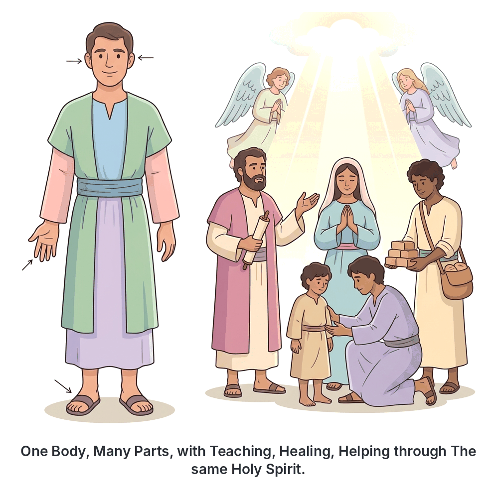
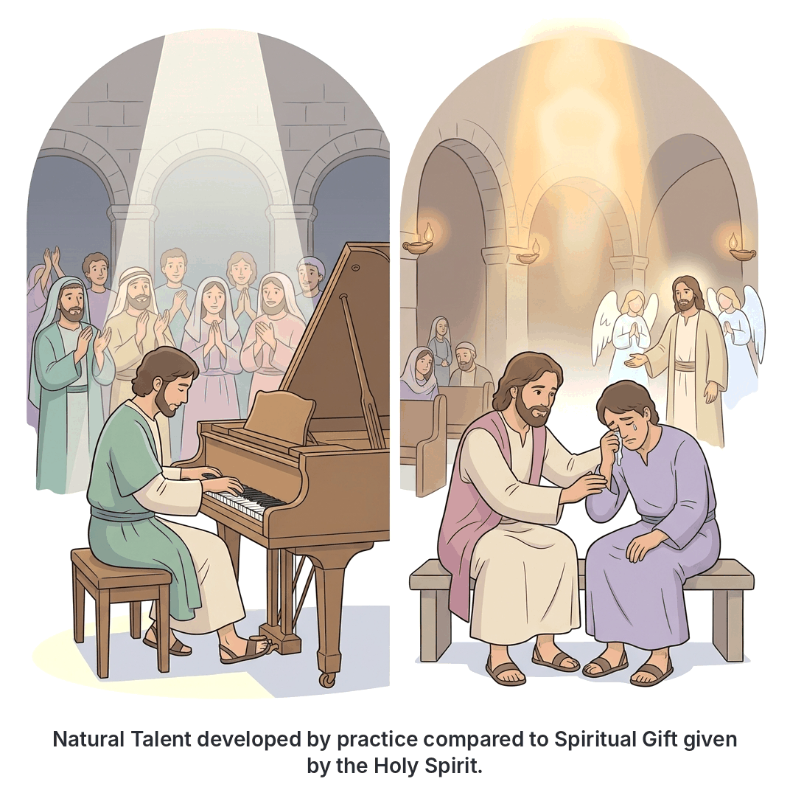

# JAMB Crk Notes: Spiritual Gifts

## What JAMB expects

This topic is Section D, Topic 7 of the JAMB CRK syllabus: Spiritual Gifts. It covers the following content:

* (I Cor. 12; Rom. 12:3-18; I Cor. 14)

By the end of these notes, you should be able to:

1. identify the different spiritual gifts;
2. analyse the benefits of spiritual gifts to the individual and the church;
3. differentiate between spiritual gifts and talents.

## Understanding Spiritual Gifts

In the early Christian church, the Holy Spirit gave special abilities to believers to help them serve God and each other. These are called **spiritual gifts** (from the Greek word *charisma*, meaning a gift of grace). 

The Apostle Paul wrote extensively about these gifts, especially to the churches in Corinth and Rome. The church in Corinth had a lot of spiritual gifts, but they were misusing them. Some members were showing off, causing disorder during worship, and fighting over whose gift was the most important. Paul wrote **1 Corinthians 12 and 14** to correct them, and he gave similar teachings in **Romans 12:3-18**.

## Objective i: Identify the different spiritual gifts

**Content covered: I Cor. 12; Rom. 12:3-18; I Cor. 14**

The Bible lists various spiritual gifts across different passages. While the lists overlap, each passage highlights different types of gifts and teachings.

### 1. Spiritual gifts in 1 Corinthians 12

In 1 Corinthians 12, Paul teaches that while there are many different gifts, they all come from the **same Holy Spirit**, serve the **same Lord** (Jesus), and are empowered by the **same God**. 

Paul lists nine specific spiritual gifts in 1 Corinthians 12:8-10. Christians generally group these nine gifts into three categories:

**A. Gifts of Revelation (Knowing)**
1. **The Word of Wisdom:** The supernatural ability to make wise decisions and apply God's knowledge to specific situations.
2. **The Word of Knowledge:** The supernatural ability to know facts or information about a person or situation that could not be known by natural means.
3. **Discerning of Spirits (Distinguishing between spirits):** The ability to recognize whether a message, behaviour, or spiritual manifestation comes from the Holy Spirit, a human spirit, or an evil spirit.

**B. Gifts of Power (Doing)**
4. **Faith:** A supernatural, deep confidence and trust in God that He will do something extraordinary, beyond normal saving faith.
5. **Gifts of Healing:** The ability to serve as a human instrument through whom God cures illnesses and restores health without natural means.
6. **Working of Miracles:** The ability to perform supernatural acts that go against the laws of nature, demonstrating God's power.

**C. Gifts of Utterance (Speaking)**
7. **Prophecy:** The ability to receive and communicate a direct message from God to encourage, comfort, or warn the church.
8. **Speaking in different kinds of Tongues:** The ability to speak a language one has never learned. This can be a human language or a heavenly one, used for prayer or giving a public message.
9. **Interpretation of Tongues:** The ability to translate and explain the meaning of a message spoken in tongues so that the listeners can understand it.

#### The Analogy of the Human Body
To explain how these gifts should work together, Paul uses the illustration of the **human body** (1 Corinthians 12:12-27). 
* Just as a human body has many parts (eyes, ears, hands, feet), the Church (the Body of Christ) has many members with different gifts.
* No part can say to another, "I don't need you." The eye cannot do the work of the ear.
* Even the parts of the body that seem weaker or less honourable are completely necessary. 
* Therefore, no believer should feel useless because they do not have a certain gift, and no believer should feel proud because of the gift they have. 

### 2. Spiritual gifts in Romans 12:3-18

In Romans 12, Paul repeats the teaching that the Church is one body with many members, and he urges believers to use their gifts with **humility**. He tells them not to think of themselves more highly than they ought to, but to think with "sober judgment."

He lists seven practical and motivational gifts here (Romans 12:6-8):
1. **Prophecy:** To be used in proportion to the person's faith.
2. **Ministry (Serving):** The drive to serve others and meet practical needs in the church.
3. **Teaching:** The ability to explain and apply the truths of God's word clearly.
4. **Exhortation (Encouraging):** The ability to comfort, encourage, and motivate others to live faithfully.
5. **Giving:** The ability to share wealth and resources generously and cheerfully.
6. **Leadership (Ruling/Administration):** The ability to lead, organize, and govern others diligently.
7. **Mercy:** The ability to show deep compassion and kindness to those who are suffering, doing it with cheerfulness.

In verses 9-18, Paul adds that all these gifts must be exercised with **sincere love**. Believers must hate evil, love one another, be patient in trouble, share with those in need, practice hospitality, bless those who persecute them, and live peaceably with everyone.

### 3. Spiritual gifts and order in 1 Corinthians 14

The Corinthian church was highly gifted but very chaotic. During their worship services, many people were speaking in tongues at the same time, making the service noisy and confusing. 

In 1 Corinthians 14, Paul compares **Prophecy** and **Speaking in Tongues**:
* **Prophecy is greater for public worship:** Paul says believers should eagerly desire spiritual gifts, especially prophecy. Why? Because when a person prophesies, everyone understands it, and the whole church is comforted and built up.
* **Tongues require interpretation:** Speaking in tongues is a genuine gift, but if someone speaks in a tongue in church without an interpreter, nobody else understands it. The speaker is just speaking to God and themselves. 
* **The rule for public worship:** Paul says, "Let all things be done decently and in order" (1 Corinthians 14:40). If anyone speaks in a tongue, there must be only two or three at most, they must take turns, and someone **must** interpret. If there is no interpreter, they should keep quiet in the church. Similarly, prophets should speak two or three at a time, and others should weigh what is said. 

## Objective ii: Analyse the benefits of spiritual gifts to the individual and the church

Spiritual gifts are not given for entertainment or for believers to show off. The Bible outlines specific benefits of these gifts for both the individual and the whole Christian community.

### Benefits to the Church
1. **Edification (Building up):** This is the main purpose of spiritual gifts in public worship. Gifts like prophecy, teaching, and exhortation strengthen the faith of other believers, comfort them, and help them grow in maturity. 
2. **Promoting Unity in Diversity:** Because different people have different gifts (like the parts of a body), believers are forced to rely on one another. This prevents division (schism) and fosters a sense of teamwork and mutual care.
3. **Equipping the Church for Ministry:** Practical gifts like serving, giving, and leadership ensure that the church runs smoothly, the poor are taken care of, and the community is well-managed.
4. **Demonstrating God's Power:** Gifts of miracles, healing, and faith act as signs to unbelievers that God is real and active among His people. Paul notes that if an unbeliever comes into a service and hears a true prophecy revealing the secrets of their heart, they will fall down and worship God.
5. **Maintaining Order and Truth:** The gift of discerning of spirits protects the church from false prophets and evil spiritual influences, ensuring the church follows the true Holy Spirit.

### Benefits to the Individual Believer
1. **Personal Edification:** While most gifts are for the church, Paul specifically mentions that "He that speaketh in an unknown tongue edifieth himself" (1 Corinthians 14:4). Praying in tongues helps the individual build up their own spirit and commune deeply with God.
2. **Sense of Purpose and Belonging:** When an individual discovers and uses their gift, they realize they have a vital role in the Body of Christ. This removes feelings of worthlessness (the "foot" cannot say it does not belong because it is not a "hand").
3. **Spiritual Growth:** Using gifts like faith and giving requires a person to trust God more deeply, which matures their personal walk with God.
4. **Experiencing God's Grace:** Exercising a spiritual gift allows the individual to experience the power of the Holy Spirit flowing through them to help someone else.

## Objective iii: Differentiate between spiritual gifts and talents

A common mistake is confusing natural human talents with spiritual gifts. While both are ultimately given by God and can be used to serve Him, they are different in their nature, source, and purpose.

The syllabus requires you to **differentiate** between them, which is best seen in a comparison table:

| Feature | Natural Talents | Spiritual Gifts |
| :--- | :--- | :--- |
| **Source** | Inherited through genetics, natural birth, or acquired through training and practice. | Given directly by the Holy Spirit. |
| **Who has them?** | All human beings (both Christians and non-Christians) possess natural talents. | Only Christians (believers who have the Holy Spirit) possess spiritual gifts. |
| **When are they given?** | At natural birth or developed during a person's physical life. | At spiritual birth (salvation) or as the Holy Spirit distributes them later. |
| **Primary Purpose** | Can be used for personal benefit, entertainment, making a living (career), or general societal good. | Specifically meant to edify (build up) the Church and glorify God. |
| **Examples** | Athletic ability, musical talent (singing, playing instruments), mathematical skill, painting, writing. | Prophecy, healing, speaking in tongues, word of wisdom, discerning of spirits. |
| **Nature** | Natural abilities that operate on a physical or intellectual level. | Supernatural abilities that operate on a spiritual level. |

### How they work together
Sometimes, a natural talent and a spiritual gift can overlap or work together. For example, a person might have a **natural talent** for public speaking. However, when they become a Christian, the Holy Spirit might give them the **spiritual gift** of teaching or prophecy. Their natural talent for speaking becomes a vehicle for the supernatural power of the Holy Spirit to change people's hearts.

Similarly, in Nigeria, many people are naturally talented singers or instrumentalists. However, musical talent alone is not a spiritual gift (music is not listed in Romans 12 or 1 Corinthians 12). A talented musician only builds up the church spiritually if they also operate with spiritual gifts like exhortation or prophecy while they sing.

## Key terms

| Term | Meaning |
| :--- | :--- |
| **Spiritual Gift (Charisma)** | A special, supernatural ability given by the Holy Spirit to a believer for the benefit of the church. |
| **Edification** | The act of building up, improving, or strengthening someone spiritually. |
| **Prophecy** | Receiving and speaking a message from God to comfort, encourage, or warn the church. |
| **Tongues** | The spiritual gift of speaking in a language unknown to the speaker, used for prayer or public messaging. |
| **Discerning of Spirits** | The ability to tell whether a message or action comes from God, a human, or an evil spirit. |
| **Schism** | Division or separation within a group; Paul taught that spiritual gifts should prevent schism in the Body of Christ. |
| **Word of Wisdom** | A supernatural gift providing God's practical guidance for a specific situation. |

## Exam tips and common mistakes

* **Learn the distinct lists:** Know which gifts are mentioned in 1 Corinthians 12 (the supernatural/power ones like healing, miracles, tongues) versus Romans 12 (the practical/motivational ones like serving, giving, mercy). JAMB often asks "Which of the following is in Paul's list to the Romans?"
* **The Body of Christ:** Always remember that Paul's main analogy for spiritual gifts is the **human body**. Just as a body has different parts that must work together, the church has different gifts.
* **Tongues vs. Prophecy:** In 1 Corinthians 14, Paul prefers **prophecy** over uninterpreted tongues for public worship because prophecy edifies the whole church, while uninterpreted tongues only edify the speaker.
* **Talent vs. Gift:** If a question asks what distinguishes a talent from a gift, remember that talents are given at natural birth to everyone, while spiritual gifts are given by the Holy Spirit only to believers.
* **Love is the foundation:** Though not explicitly listed in the syllabus topics, remember that Paul places 1 Corinthians 13 (the chapter on Love) right between 12 and 14 to prove that gifts without love are useless.
* **Order in the Church:** "Let all things be done decently and in order" (1 Cor 14:40) is Paul's primary rule for using gifts like tongues and prophecy during worship services.

## Quick summary

1. Spiritual gifts are supernatural abilities given by the Holy Spirit to Christians to help them serve God and edify the Church.
2. In 1 Corinthians 12, Paul lists nine gifts, including the word of wisdom, healing, miracles, prophecy, and tongues, and compares the Church to a human body with many necessary parts.
3. In Romans 12, Paul lists practical gifts like serving, teaching, giving, and showing mercy, urging believers to use them with humility and sincere love.
4. In 1 Corinthians 14, Paul teaches that prophecy is better than uninterpreted tongues in public worship because it builds up the whole congregation, whereas tongues only build up the individual.
5. All spiritual gifts must be used decently and in order during church gatherings.
6. The main benefit of spiritual gifts to the church is edification, promoting unity, and equipping believers for ministry.
7. Spiritual gifts differ from natural talents: talents are natural abilities given to all people at physical birth, while spiritual gifts are supernatural abilities given by the Holy Spirit at spiritual birth.

## Practice questions

**1. According to Paul in 1 Corinthians 12, the various spiritual gifts in the church are given by**
- A. the apostles and prophets
- B. the same Holy Spirit
- C. natural inheritance
- D. diligent fasting and prayer

**Answer: B.** Paul emphasizes in 1 Cor 12:4-11 that though there are varieties of gifts, they are all distributed by the same Holy Spirit as He wills.

**2. Which of the following best describes the difference between a spiritual gift and a natural talent?**
- A. A talent is used for singing, while a spiritual gift is used for dancing.
- B. A talent is given to believers only, while a spiritual gift is given to everyone.
- C. A talent is acquired at natural birth, while a spiritual gift is given by the Holy Spirit.
- D. A talent is supernatural, while a spiritual gift is intellectual.

**Answer: C.** Natural talents are possessed by all human beings from birth or through training, whereas spiritual gifts are supernatural abilities given exclusively by the Holy Spirit to believers.

**3. In 1 Corinthians 14, Paul states that he who speaks in an unknown tongue edifies**
- A. the whole church
- B. the unbelievers
- C. the prophets
- D. himself

**Answer: D.** 1 Corinthians 14:4 says, "He that speaketh in an unknown tongue edifieth himself; but he that prophesieth edifieth the church."

**4. To explain how spiritual gifts should function together in unity, Paul compares the church to**
- A. a flourishing vineyard
- B. a building with a strong foundation
- C. the human body
- D. a flock of sheep

**Answer: C.** In 1 Cor 12, Paul uses the analogy of the human body, with its different parts (eyes, hands, feet), to show how believers with different gifts must work together.

**5. Which of the following gifts is specifically mentioned in Paul's list in Romans 12?**
- A. Working of miracles
- B. Interpretation of tongues
- C. Showing mercy
- D. Discerning of spirits

**Answer: C.** The gifts in Romans 12:6-8 include prophecy, ministry (serving), teaching, exhortation, giving, leadership, and showing mercy. Miracles, interpretation, and discernment are in 1 Corinthians 12.

**6. According to Paul's teaching on public worship in 1 Corinthians 14, if someone speaks in a tongue, there must be**
- A. an altar call immediately after
- B. someone to interpret the message
- C. a word of wisdom to confirm it
- D. a time of silent meditation

**Answer: B.** Paul commands that if tongues are spoken in the church, someone must interpret. If there is no interpreter, the speaker should keep silent in the church (1 Cor 14:27-28).

**7. The spiritual gift of discerning of spirits is primarily the ability to**
- A. cast out demons from possessed people
- B. recognize whether a spirit or message is from God, humans, or the devil
- C. predict the future accurately
- D. speak in heavenly languages

**Answer: B.** Discerning of spirits is the supernatural ability to distinguish the true source of a spiritual manifestation.

**8. Paul prefers prophecy over speaking in tongues in public worship because prophecy**
- A. is an older gift than tongues
- B. edifies and builds up the whole church
- C. proves that a person is filled with the Holy Spirit
- D. is a natural talent rather than a spiritual one

**Answer: B.** Paul argues in 1 Cor 14 that prophecy is greater because it speaks to people for their strengthening, encouragement, and comfort, building up the entire congregation.

**9. "Let all things be done decently and in order." This instruction was given by Paul to correct the misuse of spiritual gifts in the church at**
- A. Rome
- B. Ephesus
- C. Corinth
- D. Galatia

**Answer: C.** The instruction is found in 1 Corinthians 14:40, addressing the chaotic and disorderly worship practices in the Corinthian church.

**10. Which of the following is a primary benefit of spiritual gifts to the church?**
- A. Making the church wealthy
- B. Entertaining unbelievers
- C. Fostering unity and mutual dependence among members
- D. Elevating church leaders above the members

**Answer: C.** Spiritual gifts ensure that no member is useless and no member is entirely independent. They force believers to rely on each other, promoting unity in the body of Christ.

<!-- COVERAGE
obj i | Objective i: Identify the different spiritual gifts
obj ii | Objective ii: Analyse the benefits of spiritual gifts to the individual and the church
obj iii | Objective iii: Differentiate between spiritual gifts and talents
I Cor. 12 | Objective i: Identify the different spiritual gifts
-->
