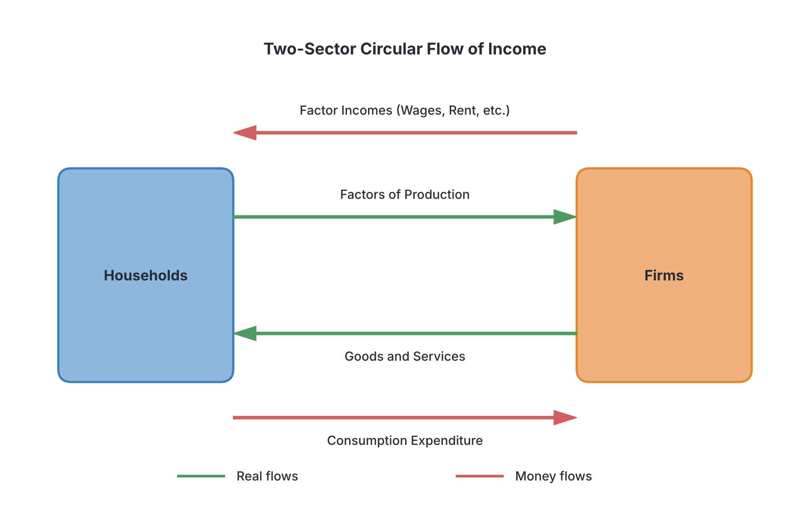

# JAMB Economics Notes: National Income

## What JAMB expects

This topic is Section A, Topic 11 of the JAMB Economics syllabus: National Income. 

This file covers the following content items:
* a. The Concepts of GNP, GDP, NI, NNP
* b. National Income measurements and their problems
* c. Uses and limitations of national income estimates
* d. The circular flow of income (two and three-sector models)
* e. The concepts of consumption, investment and savings
* f. The multiplier and its effects
* g. Elementary theory of income determination and equilibrium national income.

By the end of these notes, you should be able to:
1. (i) identify the major concepts in national income;
2. (ii) compare the different ways of measuring national income;
3. (iii) examine their problems;
4. (iv) determine the uses and limitations of national income estimates;
5. (v) interpret the circular flow of income using the two and three-sector models;
6. (vi) calculate the various multipliers;
7. (vii) evaluate their effects on equilibrium national income;
8. (viii) explain the concepts of consumption, investment and savings.

**Note on the syllabus wording:** In the JAMB syllabus, Objective (vii) says "evaluate their effects on equilibrium national income" and Content (f) reads "The multiplier and it effects". The word "it" is a typographical error for "its". These notes correct this to "its effects".

## The Concepts of GNP, GDP, NI, NNP

**Content a: The Concepts of GNP, GDP, NI, NNP**
**Objective i: identify the major concepts in national income.**

**National Income** is a measure of the total monetary value of all final goods and services produced in an economy over a given period, usually one year. Because an economy is complex, economists use several specific concepts to measure different aspects of this income. 

### 1. Gross Domestic Product (GDP)
GDP is the total monetary value of all **final goods and services produced within the borders of a country** in a given year, regardless of who owns the resources. 
* "Domestic" means it focuses on location. For example, the oil pumped by a foreign company like Shell in the Niger Delta is included in Nigeria's GDP because it was produced *inside* Nigeria.
* Similarly, goods produced by a Nigerian factory in Ghana are *not* part of Nigeria's GDP.

### 2. Gross National Product (GNP)
GNP is the total monetary value of all final goods and services produced by the **citizens (nationals) of a country**, whether they are located inside the country or abroad.
* "National" focuses on ownership. To move from GDP to GNP, we must adjust for money crossing borders.
* We add income earned by Nigerians abroad (e.g., Aliko Dangote's cement plant profits in Senegal sent back to Nigeria) and subtract income earned by foreigners in Nigeria (e.g., MTN sending profits back to South Africa).
* This adjustment is called **Net Factor Income from Abroad (NFIA)**.
* **Formula:** $GNP = GDP + NFIA$
* *Note:* In Nigeria and many developing countries, GDP is usually greater than GNP because foreign investments in the country (which send profits outward) exceed the country's investments abroad.

### 3. Net National Product (NNP)
During the production of goods, machinery and equipment wear out. This wear and tear is called **Depreciation** or **Capital Consumption Allowance**. If we subtract depreciation from the Gross National Product, we get the Net National Product.
* **Formula:** $NNP = GNP - \text{Depreciation}$

### 4. National Income (NI) at Factor Cost
When people buy goods, they pay the **Market Price**. Market prices include indirect taxes (like Value Added Tax, VAT) which make goods more expensive, and may be reduced by government subsidies (like fertilizer subsidies for farmers) which make goods cheaper.
However, to know what the *factors of production* (land, labour, capital, entrepreneur) actually earned, we must adjust the NNP at Market Price to get the **National Income at Factor Cost**.
* **Formula:** $NI = NNP_{\text{Market Price}} - \text{Indirect Taxes} + \text{Subsidies}$
* Strictly speaking, when economists use the simple term "National Income", they are referring to $NNP$ at factor cost.

### Other Important Income Concepts
* **Personal Income:** The total income actually received by individuals and households before paying personal income tax. It excludes corporate retained earnings and corporate taxes but includes **Transfer Payments** (money received without providing any current good or service, e.g., pensions, NYSC allowance, gifts, unemployment benefits).
* **Disposable Income:** The income individuals have left to spend or save *after* paying direct personal taxes (like Pay-As-You-Earn or PAYE). 
  * **Formula:** $\text{Disposable Income} = \text{Personal Income} - \text{Personal Income Tax}$
* **Per Capita Income:** The average income per person in a country. It is used as a rough indicator of the standard of living.
  * **Formula:** $\text{Per Capita Income} = \frac{\text{Total National Income}}{\text{Total Population}}$

## Measuring National Income

**Content b: National Income measurements...**
**Objective ii: compare the different ways of measuring national income.**

There are three ways to measure National Income. In a perfectly recorded economy, all three methods will give the exact same total because **Production = Income = Expenditure**.

### 1. The Output (or Product/Value Added) Approach
This approach calculates the total market value of all final goods and services produced in the various sectors of the economy (agriculture, manufacturing, services, mining, etc.). 
* To avoid **double counting** (counting the same product multiple times), we must either count *only final goods* (e.g., a loaf of bread, not the flour used to make it) or use the **Value Added Method**.
* **Value Added** is the value of a firm's output minus the value of the intermediate goods it bought from other firms.

### 2. The Income Approach
This approach measures National Income by adding up all the incomes earned by the factors of production that contributed to producing the national output. 
* **Formula:** $Y = \text{Wages} + \text{Rent} + \text{Interest} + \text{Profit}$
* **What is excluded?** Transfer payments (pensions, student bursaries, dashing a friend ₦2000) are excluded because they do not represent payment for currently produced goods or services. Illegal incomes and windfalls (like winning NaijaBet) are also excluded.

### 3. The Expenditure Approach
This approach adds up all the expenditures made on final goods and services by the four sectors of the economy: Households, Firms, Government, and the Foreign sector.
* **Formula:** $Y = C + I + G + (X - M)$
* Where:
  * $C =$ **Consumption Expenditure** by households (e.g., buying food, clothes).
  * $I =$ **Investment Expenditure** by firms (e.g., buying machinery, building factories).
  * $G =$ **Government Expenditure** (e.g., building roads, paying teachers).
  * $X =$ **Exports** (money spent by foreigners on our goods).
  * $M =$ **Imports** (money we spend on foreign goods).
  * $(X - M)$ is known as **Net Exports**.

### Comparison Table: Approaches to Measuring National Income

| Feature | Output Approach | Income Approach | Expenditure Approach |
| :--- | :--- | :--- | :--- |
| **What it measures** | Total value of goods and services produced | Total factor incomes earned | Total spending on final goods |
| **Key Components** | Agriculture, Industry, Services (Value Added) | Wages, Rent, Interest, Profit | Consumption ($C$), Investment ($I$), Govt ($G$), Net Exports ($X-M$) |
| **Main challenge** | Double counting intermediate goods | Identifying and excluding transfer payments | Excluding spending on second-hand goods and imports |

#### Calculation Example (Expenditure Approach to NI)
Suppose an economy has the following data:
* Consumption ($C$) = ₦200 million
* Investment ($I$) = ₦50 million
* Government Spending ($G$) = ₦100 million
* Exports ($X$) = ₦40 million
* Imports ($M$) = ₦60 million
* Net Factor Income from Abroad = -₦10 million
* Depreciation = ₦20 million
* Indirect Taxes = ₦30 million
* Subsidies = ₦10 million

**Step 1:** Calculate GDP
$GDP = C + I + G + (X - M)$
$GDP = 200 + 50 + 100 + (40 - 60) = 350 + (-20) = \text{₦330 million}$

**Step 2:** Calculate GNP
$GNP = GDP + \text{Net Factor Income from Abroad}$
$GNP = 330 + (-10) = \text{₦320 million}$

**Step 3:** Calculate NNP
$NNP = GNP - \text{Depreciation}$
$NNP = 320 - 20 = \text{₦300 million}$

**Step 4:** Calculate National Income (at Factor Cost)
$NI = NNP - \text{Indirect Taxes} + \text{Subsidies}$
$NI = 300 - 30 + 10 = \text{₦280 million}$

## Problems of Measuring National Income

**Content b: ...and their problems**
**Objective iii: examine their problems.**

Accurately measuring National Income is very difficult, especially in developing countries like Nigeria. The major problems include:

1. **Double Counting:** This is the most common error in the output approach. It happens when the value of an intermediate good (like cocoa) and the final good (like chocolate) are both added, thereby counting the cocoa twice.
2. **Subsistence Production:** In Nigeria, many rural farmers produce food (like yam or cassava) purely to feed their families, not for sale. Because this food never enters the market, its value is difficult to estimate and is often left out, making the national income seem lower than it actually is.
3. **Inadequate Statistics and Data:** Poor record-keeping, illiteracy, and a lack of data infrastructure mean that millions of daily transactions are never recorded. 
4. **The Informal Sector:** A huge portion of Nigeria's economy is informal (street hawkers, artisans, un-registered businesses). Their output is extremely hard to track and measure.
5. **Illegal Activities:** Income generated from smuggling (e.g., moving rice illegally across the Seme border), illegal oil bunkering, or gambling are not included in official figures, even though wealth is created or exchanged.
6. **Difficulty in Estimating Depreciation:** It is hard to accurately determine how much value a piece of machinery has lost in a single year. Different accounting methods yield different depreciation values.
7. **Unpaid Domestic Work:** The labor of housewives and individuals doing DIY (do-it-yourself) repairs at home generates immense value but is not paid for, hence it is excluded from National Income.

## Uses and Limitations of National Income Estimates

**Content c: Uses and limitations of national income estimates**
**Objective iv: determine the uses and limitations of national income estimates.**

### Uses of National Income Estimates
1. **Economic Planning and Forecasting:** Governments use National Income data to formulate budgets, set tax policies, and plan for future infrastructure.
2. **Measuring Standard of Living:** Per Capita Income (Total Income / Population) is a primary tool used to estimate the average standard of living in a country.
3. **Comparing Sectors:** By breaking down the data, policymakers can see which sectors (e.g., agriculture vs. telecommunications) are growing or lagging behind.
4. **International Comparison:** It allows international bodies like the World Bank and IMF to compare Nigeria's economic performance with that of other nations (e.g., comparing Nigeria's GDP to South Africa's).
5. **Assessing Economic Growth:** By comparing the Real GDP of the current year with the previous year, a country can tell if its economy is growing or in a recession.

### Limitations of National Income Estimates
While National Income figures are useful, they have significant flaws, especially when used to measure human well-being:
1. **Ignores Income Distribution:** A high per capita income does not mean everyone is well-off. The national wealth might be concentrated in the hands of a few billionaires while the majority live in poverty.
2. **Changes in the Price Level (Inflation):** If prices double but actual physical production remains the same, the *Nominal GDP* will double. This makes it look like the economy grew, but it didn't. To fix this, economists must use *Real GDP* (adjusted for inflation).
3. **Ignores Quality of Life and Leisure:** If everyone in a country works 16 hours a day with no weekends, GDP will be very high, but the citizens will be exhausted and unhappy.
4. **Ignores Environmental Degradation:** A country might achieve high GDP by cutting down all its forests and heavily polluting its rivers (like oil spills in the Niger Delta). National income accounting does not subtract the costs of environmental destruction.
5. **Differences in Non-Market Activities:** Comparing two countries is flawed if one relies heavily on market transactions (eating at restaurants) and the other relies on non-market transactions (cooking at home).

## The Circular Flow of Income

**Content d: The circular flow of income (two and three-sector models)**
**Objective v: interpret the circular flow of income using the two and three-sector models.**

The **circular flow of income** is an economic model that shows how money, goods, and services move through an economy.

### The Two-Sector Model
The two-sector model assumes a simple economy with only two actors: **Households** and **Firms**. There is no government, no foreign trade, and no savings.
* **Households** own the factors of production (land, labour, capital, entrepreneurship). They supply these to firms.
* **Firms** use these factors to produce goods and services.
* In return for the factors, firms pay **Factor Incomes** (wages, rent, interest, profit) to households.
* Households use all this income to buy the goods and services produced by firms. This is **Consumption Expenditure**.

### The Three-Sector Model
The three-sector model introduces the **Government** into the flow. It also introduces the concepts of **Injections** and **Leakages** (Withdrawals).
* **Households** now save part of their income (Leakage) and pay Taxes to the government (Leakage).
* **Firms** may borrow money to buy machinery, which is Investment (Injection).
* **Government** collects taxes but also spends money on public goods, like building roads or paying civil servants. This is Government Spending (Injection).

[IMAGE: A diagram showing the Three-Sector Circular Flow. The basic loop between Households and Firms is present. In the center is a box labelled "Government". Arrows pointing to the Government from Households and Firms are labelled "Taxes (T)". Arrows pointing from Government to Firms and Households are labelled "Government Spending (G)". At the bottom, a box labelled "Financial Sector (Banks)". An arrow points from Households to the Financial Sector labelled "Savings (S)". An arrow points from the Financial Sector to Firms labelled "Investment (I)". Style: clean flat textbook illustration, white background.]

### Injections and Leakages (Withdrawals)
In any realistic economy (including the foreign sector/four-sector model):
* **Injections (J)** are additions to the circular flow of income. They increase the flow of money. The three injections are: **Investment ($I$)**, **Government Spending ($G$)**, and **Exports ($X$)**.
* **Leakages/Withdrawals (W)** are deductions from the circular flow. They reduce the flow of money. The three leakages are: **Savings ($S$)**, **Taxes ($T$)**, and **Imports ($M$)**.

**Equilibrium condition:** The economy is in equilibrium when total Injections equal total Leakages:
$$I + G + X = S + T + M$$

## Consumption, Investment and Savings

**Content e: The concepts of consumption, investment and savings**
**Objective viii: explain the concepts of consumption, investment and savings.**

### 1. Consumption ($C$)
Consumption is the total amount spent by households on goods and services to satisfy their current wants. The level of consumption mainly depends on **disposable income**.
The consumption function is generally written as:
$$C = a + bY$$
* $a$ = **Autonomous Consumption:** This is the amount of consumption that occurs even when income is zero ($Y=0$). People must eat, so if they earn nothing, they will borrow or use past savings to consume.
* $bY$ = **Induced Consumption:** This is the portion of consumption that rises as income rises.
* $b$ is the **Marginal Propensity to Consume (MPC):** This measures the fraction of an extra Naira of income that is spent on consumption. 
  * $MPC = \frac{\text{Change in Consumption}}{\text{Change in Income}} = \frac{\Delta C}{\Delta Y}$
* **Average Propensity to Consume (APC):** This is the fraction of total income spent on consumption. 
  * $APC = \frac{C}{Y}$

### 2. Savings ($S$)
Savings is the portion of disposable income that is *not* consumed. 
$$S = Y - C$$
Since $Y = C + S$, whatever is earned must either be spent or saved.
* **Marginal Propensity to Save (MPS):** The fraction of an extra Naira of income that is saved.
  * $MPS = \frac{\Delta S}{\Delta Y}$
* **Average Propensity to Save (APS):** The fraction of total income saved.
  * $APS = \frac{S}{Y}$

**Crucial Economic Identities:**
Because every additional Naira of income must be either consumed or saved, the marginal propensities must add up to 1:
$$MPC + MPS = 1$$
Similarly:
$$APC + APS = 1$$

### 3. Investment ($I$)
In economics, investment does not mean buying shares or putting money in a bank. **Investment** is the purchase of capital goods (machinery, factory buildings, equipment, inventory) by firms to produce other goods. 
* Investment is considered an *injection* into the circular flow.
* In elementary models, investment is often considered **autonomous**, meaning it is fixed at a certain level ($I_0$) regardless of the level of national income.

## Elementary Theory of Income Determination and Equilibrium

**Content g: Elementary theory of income determination and equilibrium national income.**
**Objective vii: evaluate their effects on equilibrium national income.**

In a simple Keynesian model, the equilibrium level of National Income ($Y$) is determined where **Aggregate Demand (AD)** equals **Aggregate Supply (AS)**. 
* **Aggregate Supply (AS)** is simply the total output or National Income ($Y$).
* **Aggregate Demand (AD)** is the total planned spending. In a two-sector model, $AD = C + I$.
So, equilibrium occurs where:
$$Y = C + I$$
Alternatively, from the leakages and injections perspective, a two-sector economy is in equilibrium when planned savings equals planned investment:
$$S = I$$

### Calculating Equilibrium National Income
Suppose in a two-sector economy:
* Consumption function: $C = 100 + 0.5Y$
* Autonomous Investment: $I = 50$

To find the equilibrium National Income ($Y$):
1. State the equilibrium condition: $Y = C + I$
2. Substitute the given values: $Y = (100 + 0.5Y) + 50$
3. Group the like terms: $Y - 0.5Y = 150$
4. Solve for $Y$: $0.5Y = 150 \implies Y = \frac{150}{0.5}$
5. $Y = 300$.
The equilibrium National Income is 300.

## The Multiplier and its Effects

**Content f: The multiplier and its effects**
**Objective vi: calculate the various multipliers.**
**Objective vii: evaluate their effects on equilibrium national income.**

### What is the Multiplier?
The **Multiplier ($k$)** refers to the number of times an initial change in spending (like investment or government spending) multiplies itself to generate a much larger final change in the equilibrium national income.

For example, if the government decides to spend ₦1 billion building a bridge, that ₦1 billion becomes income for construction workers. The workers will save a little and spend the rest (say, ₦800 million) buying food and clothes. The food and clothes sellers receive that ₦800 million as income, save a little, and spend the rest. This chain reaction continues, meaning the final increase in National Income will be far greater than the initial ₦1 billion.

### Calculating the Multiplier
The size of the multiplier depends entirely on the **Marginal Propensity to Consume (MPC)** or the **Marginal Propensity to Save (MPS)**. If people consume a lot (high MPC), the multiplier is large. If they save a lot (high MPS), the leakages are high, and the multiplier is small.

**Multiplier Formulas:**
$$k = \frac{1}{1 - MPC}$$
Since $1 - MPC = MPS$, we can also write:
$$k = \frac{1}{MPS}$$

To find the final change in National Income ($\Delta Y$) resulting from an initial change in Investment ($\Delta I$):
$$\Delta Y = k \times \Delta I$$

*(Note: The government expenditure multiplier uses the exact same formula. $k = 1 / MPS$.)*

### Multiplier Calculation Example
Assume an economy has a Marginal Propensity to Consume (MPC) of 0.8. If firms decide to increase their investment by ₦10 million, calculate:
1. The size of the multiplier ($k$).
2. The final increase in equilibrium National Income ($\Delta Y$).

**Step 1: Calculate the multiplier.**
$MPC = 0.8$
$k = \frac{1}{1 - MPC} = \frac{1}{1 - 0.8} = \frac{1}{0.2}$
$k = 5$
The multiplier is 5.

**Step 2: Calculate the change in National Income.**
$\Delta Y = k \times \Delta I$
$\Delta Y = 5 \times 10\text{ million}$
$\Delta Y = \text{₦50 million}$

**Evaluating the effect:** An initial injection of just ₦10 million triggered a chain of spending that expanded the economy by ₦50 million. The multiplier powerfully magnifies the effect of injections on equilibrium income.

## Key terms

| Term | Meaning |
| :--- | :--- |
| **Gross Domestic Product (GDP)** | The total value of all final goods and services produced within a country in a year. |
| **Gross National Product (GNP)** | The total value of all final goods and services produced by citizens of a country, regardless of location. |
| **Depreciation** | The loss in value of capital goods (machinery) due to wear and tear. Also called Capital Consumption Allowance. |
| **Value Added** | The value of output minus the value of intermediate goods used in production. |
| **Transfer Payment** | A payment made where no goods or services are provided in return (e.g., pensions, dashed money). Excluded from National Income. |
| **Injections** | Additions to the circular flow of income (Investment, Government Spending, Exports). |
| **Leakages (Withdrawals)** | Deductions from the circular flow of income (Savings, Taxes, Imports). |
| **Autonomous Consumption** | The level of consumption when income is zero; sustained by borrowing or past savings. |
| **Marginal Propensity to Consume (MPC)** | The fraction of an additional unit of income that is spent on consumption ($\Delta C / \Delta Y$). |
| **The Multiplier ($k$)** | The ratio of the change in national income to the initial change in spending that caused it. |

## Exam tips and common mistakes

* **GDP vs. GNP:** The defining difference is **Net Factor Income from Abroad (NFIA)**. If a question mentions citizens abroad sending money home, think GNP. If it focuses on the geographic boundary, think GDP.
* **Gross vs. Net:** Whenever you see "Net" in a national income term, remember that **Depreciation** must have been subtracted from the "Gross".
* **Market Price vs. Factor Cost:** To convert from market price to factor cost, subtract indirect taxes and add subsidies.
* **Avoiding Double Counting:** Remember that only *final* goods (or the value added at each stage) are counted in the Output approach. Intermediate goods are excluded.
* **Transfer Payments:** They are *never* included in the Income approach. JAMB frequently uses pensions, student allowances, or gifts as distractors. 
* **Multiplier Math Error:** A common mistake is using APC instead of MPC to calculate the multiplier. Always use the marginal propensities. Remember that $k = 1 / MPS$.
* **Leakages vs. Injections:** Memorize the abbreviations: Injections = $I, G, X$. Leakages = $S, T, M$.

## Quick summary

1. National income represents the total monetary value of final goods and services produced by a country.
2. The three methods of measuring national income are the Output approach, Income approach, and Expenditure approach.
3. GDP measures production within geographic borders, while GNP measures production by citizens everywhere. NNP is GNP minus depreciation.
4. Measuring national income is plagued by problems like double counting, inadequate statistics, and the exclusion of subsistence farming and illegal activities.
5. In the circular flow, Investment, Government Spending, and Exports are injections, while Savings, Taxes, and Imports are leakages.
6. Consumption consists of autonomous and induced consumption. MPC and MPS always sum up to 1.
7. Equilibrium national income occurs where Aggregate Demand equals Aggregate Supply ($Y = C + I$), or where Injections equal Leakages ($S = I$).
8. The Multiplier ($k = 1/MPS$) shows how an initial change in investment or government spending leads to a much larger final change in national income.

## Practice questions

**1. The problem of double counting in national income measurement is avoided by using the**
- A. Income approach
- B. Value added approach
- C. Expenditure approach
- D. Factor cost approach

**Answer: B.** The value added approach (or focusing only on final goods) ensures that the value of intermediate goods is not counted multiple times as a product moves through the stages of production.

**2. If the Marginal Propensity to Consume (MPC) is 0.75, what is the Marginal Propensity to Save (MPS)?**
- A. 0.25
- B. 0.75
- C. 1.00
- D. 1.33

**Answer: A.** Since all additional income is either consumed or saved, $MPC + MPS = 1$. Therefore, $MPS = 1 - 0.75 = 0.25$. 

**3. In a closed economy, the Marginal Propensity to Consume is 0.8. If autonomous investment increases by ₦20 million, the equilibrium national income will increase by**
- A. ₦16 million
- B. ₦25 million
- C. ₦80 million
- D. ₦100 million

**Answer: D.** First, calculate the multiplier: $k = 1 / (1 - MPC) = 1 / (1 - 0.8) = 1 / 0.2 = 5$. The increase in income ($\Delta Y$) is $k \times \Delta I = 5 \times 20 = 100$. The most tempting wrong option is 80 (calculating 20 / 0.25 by mistakenly treating 0.8 as giving a multiplier of 4).

**4. The difference between Gross Domestic Product (GDP) and Gross National Product (GNP) is**
- A. depreciation
- B. indirect taxes
- C. net factor income from abroad
- D. government expenditure

**Answer: C.** GDP only counts output within the country's borders. GNP adjusts this by adding income earned by citizens abroad and subtracting income earned by foreigners inside the country. This adjustment is the net factor income from abroad.

**5. Which of the following is a leakage from the circular flow of income?**
- A. Investment
- B. Government spending
- C. Exports
- D. Savings

**Answer: D.** Savings, Taxes, and Imports are leakages (withdrawals) because they remove money from the direct cycle between households and firms. Investment, government spending, and exports are injections.

**6. National income at factor cost is equal to**
- A. Net National Product at market price minus indirect taxes plus subsidies
- B. Gross Domestic Product at market price minus depreciation
- C. Gross National Product at market price plus indirect taxes minus subsidies
- D. Net National Product at market price plus indirect taxes minus subsidies

**Answer: A.** Market prices include indirect taxes (which do not go to the factors of production) and exclude subsidies (which do). To find factor cost, we reverse this: $NNP - \text{Indirect Taxes} + \text{Subsidies}$. 

**7. Which of the following is strictly excluded when computing national income by the income approach?**
- A. Rent received by landlords
- B. Dividends paid to shareholders
- C. Old-age pensions paid by the government
- D. Wages paid to civil servants

**Answer: C.** Pensions are a transfer payment. They are given out of social welfare, not in exchange for any current productive economic activity.

**8. Given the consumption function $C = 100 + 0.5Y$ and autonomous investment $I = 50$, calculate the equilibrium level of national income.**
- A. 150
- B. 200
- C. 300
- D. 450

**Answer: C.** At equilibrium, $Y = C + I$. Substituting the values: $Y = 100 + 0.5Y + 50$. Grouping terms: $Y - 0.5Y = 150 \implies 0.5Y = 150$. Therefore, $Y = 150 / 0.5 = 300$. The wrong option A (150) simply adds 100 and 50 but forgets to solve for Y.

**9. One major limitation of using Per Capita Income to compare standard of living is that it**
- A. measures the exact amount of money in every citizen's bank account
- B. ignores the distribution of income among the population
- C. includes the value of leisure and rest time
- D. is purely based on the industrial sector's output

**Answer: B.** Per capita income is an average. It does not show income distribution. A country could have a high average income, but the wealth might be owned by 1% of the population while the rest live in extreme poverty.

**10. The level of consumption that takes place even when disposable income is zero is called**
- A. induced consumption
- B. absolute consumption
- C. autonomous consumption
- D. relative consumption

**Answer: C.** Autonomous consumption is the basic survival spending that happens when a person earns nothing. It is funded by borrowing or using up past savings.
