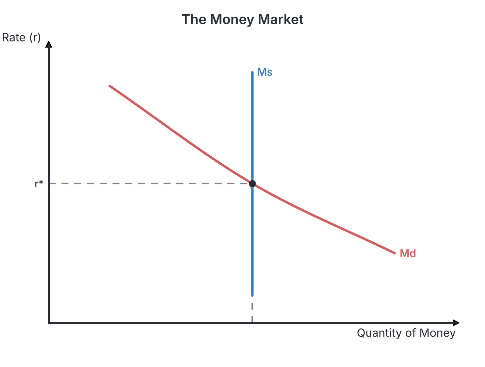
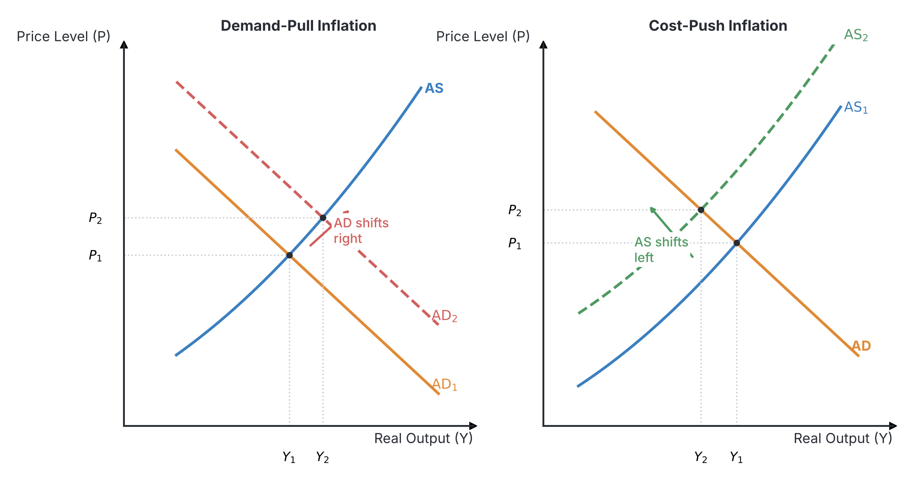

# JAMB Economics Notes: Money and Inflation

## What JAMB expects

This topic is Section A, Topic 12 of the JAMB Economics syllabus: Money and Inflation. It covers the fundamental concepts of money, how its value is determined, and the general price level in an economy.

**This file covers:**
* **a.** Types, characteristics and functions of money
* **b.** Demand for money and the supply of money
* **c.** Quantity Theory of money (Fisher equation)
* **d.** The value of money and the price level
* **e.** Inflation: Types, measurements, effects and control
* **f.** Deflation: Measurements, effects and control.

**By the end of these notes, you should be able to:**
1. explain between the types, characteristics and functions of money;
2. identify the factors affecting the demand for and the supply of money;
3. examine the relationship between the value of money and the price level;
4. identify the components in the quantity theory of money;
5. examine the causes and effects of inflation;
6. calculate the consumer price index;
7. interpret the consumer price index;
8. examine ways of controlling inflation;
9. examine the causes, measurement, effects and control of deflation.

**Note on the syllabus wording:** In Objective (i), the syllabus says to "explain between the types". This is grammatically unclear; it likely meant you should be able to *distinguish* between the different types, characteristics, and functions of money.

## Types, characteristics and functions of money

Before money was invented, people exchanged goods for goods in a system called **trade by barter**. For example, a yam farmer would trade yams directly for a hunter's meat. However, barter had severe problems, most notably the **double coincidence of wants** (finding someone who has exactly what you want and wants exactly what you have), difficulty in storing wealth, and the lack of a common measure of value. To solve these problems, money was created.

### What is money?
Money is anything that is **generally acceptable** in a particular society as a means of payment for goods, services, and the settlement of debts. 

### Functions of money
Money performs four major functions in an economy, effectively solving the problems of the barter system:
1. **Medium of exchange:** This is the most important function. Money acts as an intermediary, meaning you no longer need to find someone who wants what you have. You simply sell your goods for money and use the money to buy what you want.
2. **Unit of account (Measure of value):** Money provides a common standard to measure and compare the value of all goods and services. Instead of saying "one cow equals fifty yams", everything is priced uniformly in Naira and Kobo.
3. **Store of value:** Unlike yams or tomatoes that rot, money can be kept for a long time to be spent in the future. It allows people to save wealth.
4. **Standard of deferred payment:** Money allows people to enter into contracts for future payments (buying on credit or taking loans). You can borrow today and agree to pay back a specific amount of money later.

### Characteristics of money
For a commodity to serve effectively as money, it must possess certain qualities (attributes):
* **General Acceptability:** Everyone in the society must be willing to accept it as payment. If people reject it, it ceases to be money.
* **Portability:** It must be easy to carry around for daily transactions. Heavy stones would fail this test.
* **Durability:** It must not wear out, tear, or spoil quickly. It should withstand repeated handling.
* **Homogeneity:** Every unit of the money must be identical to another of the same denomination (one ₦500 note must look exactly like another true ₦500 note).
* **Divisibility:** It must be capable of being broken down into smaller units (denominations) so that cheap items can be bought without needing exact change.
* **Scarcity (Limited supply):** It must be relatively scarce to maintain its value. If it is too abundant (like ordinary sand or leaves), it becomes worthless.
* **Recognisability:** It must be easy to identify and difficult to counterfeit (forge).

### Types of money
There are various forms of money, categorized by what backs them and how they are used:

| Type of Money | Meaning and Examples |
| --- | --- |
| **Commodity money** | Items that have intrinsic value (value as a commodity) and are used as money. Examples from Nigeria's history: cowrie shells, manillas, salt, and beads. |
| **Metallic money (Coins)** | Money made of metal, often stamped with a fixed value. Today, they are mostly "token coins" because the metal in them is worth less than their face value. |
| **Paper money (Banknotes)** | Paper notes issued by a country's central bank (e.g., the Central Bank of Nigeria, CBN). |
| **Bank money (Demand deposits)** | Money held in current accounts in commercial banks that can be withdrawn or transferred using a **cheque**. (Note: A cheque itself is not money; it is an order to the bank to transfer money). |
| **Fiat money** | Money that has value solely because the government has declared it as "legal tender". It is not backed by physical gold or silver. The Nigerian Naira is fiat money. |
| **Fiduciary issue** | The portion of a country's paper currency that is not backed by gold reserves, but rather by government securities (trust). |
| **Near money** | Financial assets that are not cash but can be very quickly and easily converted into cash. Examples: Treasury bills, savings account deposits, and bonds. |

## Factors affecting the demand for and the supply of money

### Demand for money (Liquidity Preference)
The "demand for money" refers to the desire of individuals and firms to hold their wealth in liquid form (as cash) rather than tying it up in assets like land or bonds. The famous economist **John Maynard Keynes** called this **Liquidity Preference**, and he identified three motives for holding money:

1. **Transactions motive:** People hold cash to meet their daily, day-to-day expenses (buying food, paying transport).
2. **Precautionary motive:** People hold cash for unforeseen emergencies (sudden illness, unexpected car repairs).
3. **Speculative motive:** People hold cash to take advantage of future investment opportunities. For instance, if you expect the price of bonds to fall (meaning interest rates will rise), you will hold cash now to buy the bonds later when they are cheaper.

*Note:* The Transactions and Precautionary motives depend mainly on a person's **level of income**. The Speculative motive depends on the **rate of interest** (there is an inverse relationship: when interest rates are high, speculative demand for cash is low because people prefer to invest their money to earn interest).

**Factors affecting the demand for money:**
* **Income level:** Higher income leads to a higher demand for holding money for transactions.
* **Interest rates:** Higher interest rates reduce the demand for holding cash (people prefer to invest or save).
* **Frequency of wage payment:** If you are paid daily, you need to hold less cash at once than if you are paid monthly.
* **General price level:** If prices of goods go up, you will need more cash in your pocket just to buy the same items.

### Supply of money
The supply of money refers to the total amount of money in circulation in an economy at a given time. This is primarily controlled by the Central Bank of Nigeria (CBN).

**Textbook variation:** Different central banks and economists classify the money supply in slightly different ways, but standard UTME Economics defines them as:
* **M1 (Narrow Money):** This is the total of physical currency (notes and coins) outside the banking system plus all demand deposits (current accounts) in commercial banks.
* **M2 (Broad Money):** This includes M1 plus savings and time (fixed) deposits in commercial banks.
* **M3 (Extended Broad Money):** This includes M2 plus deposits in other specialized financial institutions.

**Factors affecting the supply of money:**
* **Bank rate (Discount rate):** The interest rate the CBN charges commercial banks. A high rate discourages banks from borrowing, reducing money supply.
* **Open Market Operations (OMO):** The buying and selling of government securities (like Treasury bills) by the Central Bank. Selling securities *reduces* the money supply (takes cash out of the public's hands).
* **Cash Reserve Ratio (CRR):** The percentage of deposits commercial banks must keep in cash. A higher CRR means banks have less money to lend, reducing the money supply.
* **Government borrowing and printing money:** If the government prints more money to fund its budget deficit, the money supply increases.

## Relationship between the value of money and the price level

The **value of money** does not refer to the paper it is printed on; it refers to its **purchasing power**—the quantity of goods and services that one unit of money (e.g., ₦1) can buy.

The **general price level** is the average price of goods and services in the economy.

There is a strict **inverse (opposite) relationship** between the value of money and the general price level.
* When the general price level **increases** (inflation), the value of money **decreases** because your money can now buy fewer goods.
* When the general price level **decreases** (deflation), the value of money **increases** because your money can now buy more goods.

Mathematically, if $V$ is the value of money and $P$ is the price level:
$$V = \frac{1}{P}$$

## Components of the Quantity Theory of money

The Quantity Theory of Money, popularized by the economist **Irving Fisher**, explains the relationship between the money supply and the general price level. It states that, assuming the velocity of circulation and the volume of transactions remain constant, **the general price level is directly proportional to the money supply**. If you double the amount of money in circulation, prices will double.

### The Equation of Exchange
Fisher expressed this theory using the following equation:
$$MV = PT$$

**Components of the equation:**
* **$M$ = Money Supply:** The total amount of money in circulation.
* **$V$ = Velocity of Circulation:** The average number of times a single unit of money changes hands during a specific period.
* **$P$ = General Price Level:** The average price of goods and services.
* **$T$ = Volume of Transactions:** The total number of goods and services exchanged (often referred to as Output or $Q$, making the equation $MV = PQ$).

**Example calculation:**
If the money supply ($M$) is ₦10,000, the velocity of circulation ($V$) is 4, and the total volume of transactions ($T$) is 500 units, what is the price level ($P$)?
$$MV = PT$$
$$10,000 \times 4 = P \times 500$$
$$40,000 = 500P$$
$$P = \frac{40,000}{500} = 80$$
The price level is ₦80 per unit.
*(If the Central Bank decides to print more money and $M$ rises to ₦20,000, while $V$ and $T$ stay the same, $P$ will exactly double to ₦160. This is the core argument of the Quantity Theory).*

## Types of inflation

Inflation is defined as a **continuous, persistent, and appreciable rise** in the general price level of goods and services in a country over time. Note that a one-off increase in prices is not inflation; it must be persistent. 

There are several types of inflation:

1. **Demand-pull inflation:** This occurs when total demand for goods and services exceeds total supply. Simply put, "too much money is chasing too few goods".
2. **Cost-push inflation:** This occurs when the cost of production (e.g., wages, raw materials, fuel) increases, and producers pass these extra costs onto consumers by raising prices. A classic Nigerian example is the rise in transportation and food prices following the removal of fuel subsidies.
3. **Hyperinflation (Galloping inflation):** A very rapid and uncontrollable rise in prices where money quickly loses almost all its value (e.g., Zimbabwe in the late 2000s).
4. **Creeping (Mild) inflation:** A slow, single-digit rate of inflation (e.g., 2% to 4% per year). A little creeping inflation is actually considered healthy because it encourages producers to produce more, expecting higher profits.
5. **Imported inflation:** This occurs when a country imports goods from countries experiencing inflation, or when a country's currency depreciates, making all imported goods much more expensive in local currency.

## Causes and effects of inflation

### Causes of inflation
* **Excessive money supply:** Printing too much money, often to finance government budget deficits, leads directly to demand-pull inflation.
* **Increase in wages:** If workers demand higher wages without producing correspondingly more goods, production costs rise (cost-push inflation).
* **High population growth:** Rapidly growing populations demand more food and housing, driving prices up if supply cannot keep pace.
* **Low agricultural/industrial output:** Poor harvests, bad weather, or poor infrastructure reduce the supply of goods.
* **Currency depreciation:** When the Naira falls in value against major foreign currencies, it costs more Naira to import machinery and consumer goods, driving up domestic prices.

### Effects of inflation
Inflation affects different groups of people in different ways, creating "winners" and "losers".

| Winners (Those who gain) | Losers (Those who suffer) |
| --- | --- |
| **Debtors (Borrowers):** They borrow money when it has high purchasing power and pay it back when the money is worth less. | **Creditors (Lenders):** They lend out valuable money but get paid back in money that cannot buy as much. |
| **Business owners (Profit earners):** Prices of goods rise faster than wages, so their profit margins increase. | **Fixed-income earners:** Pensioners and civil servants on fixed salaries find that their income buys fewer goods. |
| **Property owners:** The value of physical assets like land and houses rises rapidly during inflation. | **Savers:** Money kept in a bank loses its real value over time if the interest rate is lower than the inflation rate. |

**Other economic effects:**
* It worsens a country's **Balance of Payments**: Domestic goods become too expensive for foreigners to buy (exports fall), while citizens might prefer foreign goods.
* It decreases the general standard of living.
* It creates uncertainty, discouraging long-term business investments.

## Calculating the Consumer Price Index

To measure inflation, statisticians use an index number called the **Consumer Price Index (CPI)**. The CPI measures changes in the price of a "basket" of goods and services typically bought by an average household.

### Step-by-step Calculation
1. **Select a base year:** Choose a normal year where prices were relatively stable. The index for the base year is always set at **100**.
2. **Select a basket of goods:** Choose common items (e.g., food, rent, transport).
3. **Assign weights ($W$):** Assign a weight to each item based on its importance in the household budget. (People spend a larger share of their income on food than on transport, so food gets a higher weight).
4. **Find current prices:** Record the new prices of those items in the current year.
5. **Use the formula:**
   $$\text{CPI} = \frac{\sum (\text{Current Price} \times \text{Weight})}{\sum (\text{Base Price} \times \text{Weight})} \times 100$$
   *(Where $\sum$ means "sum of")*

**Calculation Example:**
Let us calculate the CPI for Year 2, using Year 1 as the Base Year.

| Item | Weight ($W$) | Base Year 1 Price ($P_0$) | Current Year 2 Price ($P_1$) | Base Year Cost ($P_0 \times W$) | Current Year Cost ($P_1 \times W$) |
| --- | --- | --- | --- | --- | --- |
| Food | 5 | ₦20 | ₦30 | 100 | 150 |
| Rent | 3 | ₦50 | ₦60 | 150 | 180 |
| Transport | 2 | ₦25 | ₦30 | 50 | 60 |
| **Total** | **10** | | | **300** | **390** |

* **Total cost in Base Year** = 300
* **Total cost in Current Year** = 390
* **CPI Calculation:** $\frac{390}{300} \times 100 = 1.3 \times 100 = \mathbf{130}$

## Interpreting the Consumer Price Index

Once you have calculated the CPI, interpreting it tells you the inflation rate.
To find the inflation rate, you subtract the base year index (which is always 100) from the current CPI.
* In our calculation above, the CPI is **130**.
* **Interpretation:** The general price level has increased by **30%** (130 - 100) since the base year. The purchasing power of money has fallen. A basket of goods that cost ₦100 in the base year now costs ₦130.

## Ways of controlling inflation

Inflation can be managed using three main types of policies depending on what is causing it:

1. **Monetary Policy (Contractionary):** Handled by the Central Bank to reduce the money supply.
   * Increase the **Bank rate** (making borrowing expensive for commercial banks).
   * Increase the **Cash Reserve Ratio (CRR)**.
   * Sell government securities in **Open Market Operations (OMO)** to mop up excess cash from the public.
2. **Fiscal Policy:** Handled by the Government.
   * **Increase taxes:** This reduces the disposable income of citizens, lowering aggregate demand.
   * **Reduce government spending:** Creating a surplus budget (spending less than the government collects).
3. **Direct (Physical) Controls:**
   * **Price controls:** Setting maximum price limits for essential goods.
   * **Wage freezes:** Stopping trade unions from negotiating higher salaries to prevent cost-push inflation.
   * **Subsidies:** Providing support to farmers or manufacturers to lower their cost of production.

## Causes, measurement, effects and control of deflation

### What is deflation?
Deflation is a **continuous and persistent decrease** in the general price level of goods and services in a country. During deflation, the value of money *increases* (you can buy more goods with the exact same amount of money).

### Measurement of deflation
Deflation is measured using the exact same tool as inflation—the Consumer Price Index (CPI).
* If the CPI drops below 100 (or if the index drops relative to the previous year, say from 120 down to 110), it indicates prices are falling.
* The inflation rate is represented as a **negative percentage** (e.g., -5%).

### Causes of deflation
* **Decrease in the money supply:** A harsh contractionary monetary policy taking too much money out of circulation.
* **Overproduction:** Total supply of goods heavily exceeds total demand (aggregate supply > aggregate demand).
* **High taxation:** The government taking too much money from citizens, leaving them with no disposable income to buy goods.
* **High interest rates:** Encouraging people to save heavily rather than spend, drying up demand.

### Effects of deflation
* **Winners and Losers are reversed:** Creditors (lenders) gain because the money paid back is worth more in real terms. Debtors suffer because the real burden of their debt increases. Fixed-income earners gain as their salaries buy more goods.
* **Falling profits and unemployment:** Because prices keep dropping, producers make losses. They respond by cutting production, closing factories, and laying off workers, leading to massive unemployment and economic depression.
* **Delayed spending:** Consumers stop buying things today because they expect prices to be even cheaper tomorrow, worsening the economic slowdown.

### Control of deflation
To cure deflation, the government and central bank must inject money into the economy and boost aggregate demand (Expansionary policies).
* **Expansionary Monetary Policy:** Lower the bank rate, lower the Cash Reserve Ratio, and buy securities in the open market to increase the money supply.
* **Expansionary Fiscal Policy:** Reduce taxes to give people more disposable income, and increase government spending (deficit financing) to create jobs and demand.
* **Increase wages:** Boosting workers' pay to stimulate aggregate demand.

## Key terms

| Term | Meaning |
| --- | --- |
| **Trade by barter** | The direct exchange of goods for goods without the use of money. |
| **Legal tender** | Money that is legally recognized by the government as a valid means of payment. |
| **Fiat money** | Money that is not backed by a physical commodity like gold, but by government decree. |
| **Fiduciary issue** | The portion of paper money backed by government securities, not gold. |
| **Liquidity preference** | The desire of individuals to hold their wealth as liquid cash instead of assets. |
| **Velocity of circulation** | The average number of times a unit of currency changes hands over a given period. |
| **Inflation** | A persistent and continuous increase in the general price level. |
| **Deflation** | A persistent and continuous decrease in the general price level. |
| **Disinflation** | A slowdown in the *rate* of inflation (prices are still rising, but slower). |
| **Consumer Price Index (CPI)** | An index used to measure changes in the price level of a weighted basket of consumer goods. |

## Exam tips and common mistakes

* **Money Value vs. Price Level:** A very common mistake is thinking that "high inflation" means "money has high value". It is the exact **opposite**. When prices go up, the value of money goes **down**.
* **Deflation vs. Disinflation:** Do not confuse these! If inflation falls from 15% to 5%, that is *disinflation* (prices are still going up, just slower). If inflation is -2%, that is *deflation* (prices are actually dropping).
* **Winners and Losers of Inflation:** Students often wrongly assume lenders (creditors) win during inflation because they are "rich". Lenders **lose** during inflation because the money they get back has lost its purchasing power. Borrowers (debtors) **win**.
* **Fisher's Equation Variables:** Remember that $M$ stands for Money Supply, not "multiplier" or "marginal". $V$ is Velocity, $P$ is Price level, and $T$ is Transactions.
* **Central Bank Policies:** If a question asks how to control inflation, look for options that **reduce** money supply (e.g., *increase* bank rate, *sell* securities, *increase* CRR).

## Quick summary

1. Money was created to solve the problems of trade by barter (like the double coincidence of wants). Its primary function is serving as a medium of exchange.
2. For something to be money, it must be generally acceptable, portable, divisible, scarce, and durable. The Naira is a fiat money (backed by the government, not gold).
3. Keynes identified three motives for demanding money: transactions, precautionary, and speculative. Speculative demand falls as interest rates rise.
4. The value of money is its purchasing power, which has an inverse relationship with the general price level (as prices rise, money value falls).
5. Fisher's Quantity Theory ($MV = PT$) shows that if velocity and transactions are constant, an increase in money supply leads directly to a proportional increase in prices.
6. Inflation is a continuous rise in prices caused by excess demand (demand-pull) or rising costs (cost-push). Debtors and business owners gain, while fixed-income earners and creditors lose.
7. The Consumer Price Index (CPI) measures inflation. An index of 140 means prices have increased by 40% relative to the base year (which is always 100).
8. Deflation is a continuous drop in prices. While it makes things cheaper, it destroys business profits, discourages investment, and leads to massive unemployment.

## Practice questions

**1. The primary problem of the barter system that money was invented to solve is the:**
- A. lack of a central banking system
- B. double coincidence of wants
- C. difficulty in dividing goods into smaller units
- D. absence of fiat money

**Answer: B.** double coincidence of wants.
Explanation: The most severe limitation of barter is finding someone who has exactly what you want and is willing to accept exactly what you have. Money acts as a universally accepted medium of exchange to bypass this.

**2. Which of the motives for holding money is most directly influenced by changes in the interest rate?**
- A. Transactions motive
- B. Precautionary motive
- C. Speculative motive
- D. Exchange motive

**Answer: C.** Speculative motive.
Explanation: According to Keynes' liquidity preference theory, speculative demand for money depends inversely on the interest rate. Transactions and precautionary motives depend mostly on the level of income. *Common mistake:* Choosing A; transactions depend on income, not interest rates.

**3. According to the Quantity Theory of Money (MV = PT), if the money supply ($M$) is ₦8,000, the velocity of circulation ($V$) is 5, and the volume of transactions ($T$) is 400 units, what is the general price level ($P$)?**
- A. ₦20
- B. ₦50
- C. ₦100
- D. ₦250

**Answer: C.** ₦100.
Explanation: Substitute the values into $MV = PT$. $8,000 \times 5 = P \times 400$. This gives $40,000 = 400P$. Divide both sides by 400: $P = \frac{40,000}{400} = 100$. The price level is ₦100.

**4. If the general price level in an economy doubles, what happens to the value of money?**
- A. It also doubles
- B. It increases by 50%
- C. It is reduced by half
- D. It remains constant

**Answer: C.** It is reduced by half.
Explanation: There is an inverse relationship between the general price level and the value of money ($V = \frac{1}{P}$). If prices double, a single unit of money buys exactly half of what it used to buy.

**5. During a period of rapid inflation, who among the following is most likely to gain?**
- A. A pensioner on a fixed monthly income
- B. A creditor who lent out money a year ago
- C. A debtor who borrowed money a year ago
- D. A civil servant with a fixed salary

**Answer: C.** A debtor who borrowed money a year ago.
Explanation: During inflation, the purchasing power of money falls. The debtor pays back the loan using money that is now worth less in real terms, making the debt practically easier to clear. *Common mistake:* Choosing B; creditors lose because the money they get back has lost value.

**6. In 2020 (Base Year), the total cost of a weighted basket of consumer goods was ₦400. In 2023, the cost of the exact same basket of goods rose to ₦560. What is the Consumer Price Index for 2023?**
- A. 40
- B. 120
- C. 140
- D. 160

**Answer: C.** 140.
Explanation: $\text{CPI} = \frac{\text{Current Year Cost}}{\text{Base Year Cost}} \times 100$. So, $\frac{560}{400} \times 100 = 1.4 \times 100 = 140$. This means there has been a 40% inflation rate.

**7. An increase in the price of petroleum products leading to a general rise in the prices of goods and services is an example of:**
- A. Demand-pull inflation
- B. Cost-push inflation
- C. Hyperinflation
- D. Deflation

**Answer: B.** Cost-push inflation.
Explanation: Cost-push inflation occurs when the cost of production (like transport and energy costs driven by fuel prices) increases, and producers pass this cost on to consumers as higher prices.

**8. Which of the following is a contractionary monetary policy used by the Central Bank to control inflation?**
- A. Buying government securities in the open market
- B. Reducing the Cash Reserve Ratio
- C. Increasing taxes on individuals
- D. Selling treasury bills in the open market

**Answer: D.** Selling treasury bills in the open market.
Explanation: Selling securities via Open Market Operations (OMO) withdraws cash from the economy, reducing the money supply and curbing inflation. *Common mistake:* Choosing C; taxation is a fiscal policy, not a monetary policy.

**9. Deflation is highly detrimental to an economy primarily because it:**
- A. Increases the cost of living excessively
- B. Causes the currency to lose all its value
- C. Discourages production and leads to high unemployment
- D. Benefits creditors at the expense of pensioners

**Answer: C.** Discourages production and leads to high unemployment.
Explanation: When prices continuously fall, business profits shrink. Producers react by reducing output, closing factories, and laying off workers, dragging the economy into a depression.

**10. Paper currency that is not backed by gold reserves, but is made legal tender by a government decree is known as:**
- A. Commodity money
- B. Near money
- C. Fiat money
- D. Fiduciary money

**Answer: C.** Fiat money.
Explanation: Fiat money (like the Naira) is legal tender solely because the government declares it to be so, regardless of physical backing. (Fiduciary issue refers specifically to the unbacked portion of notes in a gold-standard system, whereas fiat money has no intrinsic value and derives its status entirely from government order).
