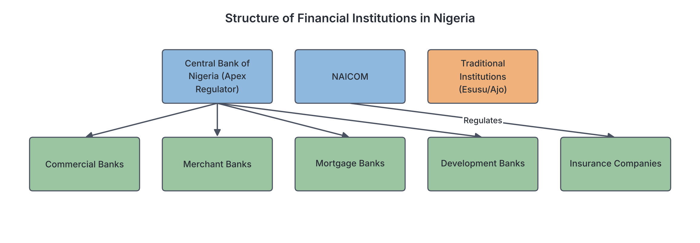
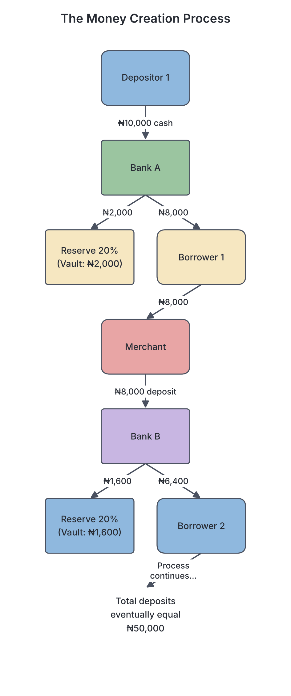

# JAMB Economics Notes: Financial Institutions

## What JAMB expects

This topic is Section A, Topic 13 of the JAMB Economics syllabus: Financial Institutions. It covers the various organizations that manage money, credit, and financial transactions in the economy.

The syllabus includes the following content items:
* a. Types and functions of financial institutions (traditional, central bank, mortgage banks, merchant banks, insurance companies, building societies)
* b. The role of financial institutions in economic development
* c. Money and capital markets
* d. Financial sector regulations
* e. Deposit money banks and the creation of money
* f. Monetary policy and its instruments
* g. Challenges facing financial institutions in Nigeria.

By the end of these notes, you should be able to:
1. (i) identify the types and functions of financial institutions;
2. (ii) explain the roles of financial institutions in economic development;
3. (iii) distinguish between the money and capital markets;
4. (iv) identify the various financial sector regulators and their functions;
5. (v) explain the money creation process and its challenges;
6. (vi) examine the various monetary policy instruments and their effects;
7. (vii) appraise the challenges facing the financial institutions in Nigeria.

---

## Types and functions of financial institutions

**Objective i & Content a: identify the types and functions of financial institutions.**

**Financial institutions** are organizations that provide financial services to their clients or members. They act as intermediaries (middlemen) between surplus units (those who have money to save) and deficit units (those who need to borrow money). 

In Nigeria, financial institutions are broadly divided into traditional and modern types.

### 1. Traditional Financial Institutions
Before modern banking began, Nigerians had indigenous ways of saving and borrowing money. These systems are still very popular today, especially in the informal sector and rural areas.

*   **Esusu / Ajo (Yoruba), Adashe (Hausa), Isusu (Igbo):** These are Rotating Savings and Credit Associations (ROSCAs). A group of people agree to contribute a fixed amount of money daily, weekly, or monthly. The total collection for each period is given to one member at a time in rotation, until everyone has received a lump sum.
*   **Functions:**
    *   They encourage a culture of savings among low-income earners, market women, and artisans.
    *   They provide easy and quick access to credit without the need for collateral.
*   **Disadvantages:** They lack legal backing, so there is a high risk of fraud or default by members who collect their share early and refuse to continue contributing. The funds mobilized are also usually too small for major investments.

### 2. The Central Bank
The Central Bank is the apex (highest) financial institution in a country, established by the government to manage, control, and regulate the entire financial system. In Nigeria, this is the **Central Bank of Nigeria (CBN)**, which was established in 1958 and began operations in 1959.

**Functions of the Central Bank:**
*   **Issuance of Currency:** It has the sole legal right to print and issue the national currency (Naira and Kobo).
*   **Banker to the Government:** It keeps the government's accounts (such as the Treasury Single Account, TSA), receives revenue on its behalf, and advises the government on economic matters.
*   **Banker's Bank:** Commercial banks keep a portion of their deposits with the Central Bank (Cash Reserve).
*   **Lender of Last Resort:** If a commercial bank is running out of cash and cannot borrow anywhere else, the Central Bank will lend it money to prevent a total collapse and protect the banking system.
*   **Formulation of Monetary Policy:** It controls the money supply and interest rates to manage inflation and promote economic growth.
*   **Foreign Exchange Management:** It manages the country's foreign reserves and regulates the exchange rate of the Naira against foreign currencies.

### 3. Commercial Banks (Deposit Money Banks)
Though the syllabus specifically mentions deposit money banks in a later section, they are the most common type of financial institution. They are modern, profit-seeking businesses that deal directly with the general public. Examples in Nigeria include First Bank, Zenith Bank, and Guaranty Trust Bank (GTBank).

**Functions:**
*   Accepting deposits (savings, current, and fixed deposit accounts).
*   Granting loans and overdrafts to individuals and businesses.
*   Safekeeping of valuables (documents, jewelry) in safe deposit boxes.
*   Facilitating local and international trade (e.g., issuing letters of credit).

### 4. Merchant Banks
Merchant banks are wholesale banks that cater mainly to large corporations, government agencies, and wealthy individuals, rather than the general public. You cannot easily walk into a merchant bank to open a standard savings account. An example in Nigeria is FSDH Merchant Bank.

**Functions:**
*   **Corporate Finance:** They provide long-term loans for large industrial projects.
*   **Issuing House Duties:** They help companies raise capital by managing the issuance of new shares to the public.
*   **Equipment Leasing:** They buy expensive machinery and lease it to companies.
*   **Mergers and Acquisitions:** They advise companies on how to merge with or buy other companies.

### 5. Mortgage Banks and Building Societies
**Mortgage Banks** (or Primary Mortgage Institutions in Nigeria) specialize in granting long-term loans for building, buying, or renovating houses. The loan itself is called a mortgage, and the house serves as collateral. The apex institution for this in Nigeria is the **Federal Mortgage Bank of Nigeria (FMBN)**, which manages the National Housing Fund (NHF).

**Building Societies** are a similar concept, historically common in the UK. They are financial institutions owned by their members as a mutual organization, offering banking and related financial services, especially mortgage lending.

**Functions:**
*   They accept long-term deposits from the public.
*   They grant long-term housing and real estate loans.
*   They promote home ownership in the economy.

### 6. Insurance Companies
Insurance companies collect small, regular payments called **premiums** from many people to create a large pool of funds. Out of this pool, they pay compensation to the few who suffer a specified loss or risk (such as a fire, accident, or death). Examples include Leadway Assurance and AIICO Insurance.

**Functions:**
*   **Risk Bearing:** They provide financial protection against unforeseen disasters.
*   **Mobilization of Savings:** Especially through life assurance policies, they encourage long-term savings.
*   **Investment:** Because claims are not made every day, insurance companies accumulate huge funds. They act as financial intermediaries by investing these funds in the capital market, financing long-term government and corporate projects.

---

## The role of financial institutions in economic development

**Objective ii & Content b: explain the roles of financial institutions in economic development.**

Financial institutions are the engine of a modern economy. They accelerate economic development through the following roles:

1. **Mobilization of Savings:** They collect small amounts of idle money from millions of individuals and pool it into massive funds. This turns unproductive cash into usable financial resources.
2. **Capital Formation and Investment:** By lending pooled savings to entrepreneurs and the government, financial institutions fund the building of factories, roads, schools, and infrastructure. This increases the productive capacity (capital formation) of the economy.
3. **Facilitation of Trade:** They make buying and selling easy and safe. Through cheques, mobile transfers, and letters of credit, businesses can trade locally (within Nigeria) and internationally without carrying large sums of physical cash.
4. **Employment Generation:** The financial sector directly employs hundreds of thousands of Nigerians (bankers, analysts, customer service agents). Indirectly, the loans they give to businesses create millions of jobs in agriculture, manufacturing, and services.
5. **Implementation of Economic Policies:** The government uses financial institutions to carry out its policies. For example, if the government wants to boost agriculture, the Central Bank can direct commercial banks to grant loans to farmers at lower interest rates.

---

## Money and capital markets

**Objective iii & Content c: distinguish between the money and capital markets.**

The financial system is divided into two broad markets based on the *duration* (tenor) of the funds being traded.

### The Money Market
The money market is a market for **short-term** loans and investments. "Short-term" means the money is borrowed or invested for a period of a few days up to one year. It provides working capital for businesses and the government.

*   **Major Institutions:** Central Bank, Commercial Banks, Discount Houses.
*   **Major Instruments (Documents of value):**
    *   **Treasury Bills:** Short-term government debt (usually 91, 182, or 364 days). They are very safe.
    *   **Commercial Papers:** Short-term unsecured promissory notes issued by large, reputable companies to raise funds.
    *   **Call Money:** Money lent by one bank to another, repayable strictly "on demand" (often overnight).

### The Capital Market
The capital market is a market for **medium-term and long-term** loans and investments. Funds here are borrowed for several years or permanently. It is used to finance long-term projects like buying machinery, expanding businesses, or building infrastructure.

*   **Major Institutions:** The Stock Exchange (e.g., Nigerian Exchange Group - NGX), Issuing Houses, Stockbrokers, Insurance Companies, and the Securities and Exchange Commission (SEC).
*   **Major Instruments:**
    *   **Shares (Equities):** Units of ownership in a company.
    *   **Government Bonds:** Long-term debt issued by federal or state governments (e.g., FGN Bonds).
    *   **Debentures:** Long-term loans raised by companies from the public at a fixed interest rate.

### Comparison Table: Money Market vs. Capital Market

| Feature | Money Market | Capital Market |
| :--- | :--- | :--- |
| **Duration of funds** | Short-term (under 1 year) | Medium to long-term (over 1 year) |
| **Purpose** | To provide working capital (day-to-day running) | To provide fixed capital (expansion, heavy machinery) |
| **Risk level** | Generally lower risk | Generally higher risk (e.g., shares can lose value) |
| **Key Instruments** | Treasury Bills, Commercial Papers, Call Money | Shares, Government Bonds, Debentures |
| **Key Regulators** | Central Bank of Nigeria (CBN) | Securities and Exchange Commission (SEC) |

---

## Financial sector regulations

**Objective iv & Content d: identify the various financial sector regulators and their functions.**

To protect citizens' money and ensure the economy runs smoothly, the financial sector is heavily regulated by specific government agencies.

1. **Central Bank of Nigeria (CBN)**
   *   *Sector:* The overall money market and banking sector.
   *   *Functions:* It issues licenses to banks, monitors their activities, sets interest and reserve rates, and can penalize or close down banks that break the rules.
2. **Nigeria Deposit Insurance Corporation (NDIC)**
   *   *Sector:* Bank deposits.
   *   *Functions:* The NDIC insures the money you keep in the bank. If a commercial bank fails or goes bankrupt, the NDIC guarantees that depositors will get their money back up to a certain maximum limit. They also help liquidate (sell off the assets of) failed banks.
3. **Securities and Exchange Commission (SEC)**
   *   *Sector:* The capital market.
   *   *Functions:* It is the apex regulator of the capital market. It protects investors from fraud, regulates the Nigerian Stock Exchange, and approves all new public share issues.
4. **National Insurance Commission (NAICOM)**
   *   *Sector:* The insurance industry.
   *   *Functions:* It regulates all insurance companies in Nigeria, ensuring they have enough funds to pay claims to policyholders and that they play by the rules.
5. **National Pension Commission (PenCom)**
   *   *Sector:* Pension funds.
   *   *Functions:* It regulates the Contributory Pension Scheme, ensuring that workers' retirement savings are safely managed by Pension Fund Administrators (PFAs).

---

## Deposit money banks and the creation of money

**Objective v & Content e: explain the money creation process and its challenges.**

One of the most powerful functions of Deposit Money Banks (Commercial Banks) is their ability to "create money." They do not print physical cash—only the Central Bank can do that. Instead, they create **bank money (credit)** by multiplying the deposits they receive.

### How Money Creation Works (The Multiplier Effect)
When a customer deposits cash into a bank (a **primary deposit**), the bank knows that not all customers will come to withdraw their money on the same day. Therefore, the Central Bank requires the bank to keep only a small percentage of the deposit in reserve as a safeguard. This percentage is called the **Cash Reserve Ratio (CRR)**. 

The bank is allowed to lend out the remaining money. When this loaned money is spent, it eventually finds its way back into the banking system as another deposit (a **derivative deposit**). A portion of this new deposit is held back as a reserve, and the rest is lent out again. This cycle continues, expanding the total money supply.

**The Formula:**
The total amount of money the banking system can create depends on the **Money Multiplier ($m$)**.
$$m = \frac{1}{\text{Cash Reserve Ratio (CRR)}}$$

$$\text{Total Money Supply} = \text{Initial Deposit} \times \frac{1}{\text{CRR}}$$

**Example Calculation:**
Suppose the CBN sets the Cash Reserve Ratio at 20% (or 0.2).
If a customer makes an initial primary deposit of ₦10,000, let us trace the credit creation:

*   **Step 1:** Bank A receives ₦10,000. It keeps 20% (₦2,000) in reserve and loans out ₦8,000.
*   **Step 2:** The borrower spends the ₦8,000, which is deposited into Bank B. Bank B keeps 20% (₦1,600) and loans out ₦6,400.
*   **Step 3:** The ₦6,400 is deposited into Bank C. Bank C keeps 20% (₦1,280) and loans out ₦5,120.

If this process continues indefinitely:
*   Multiplier ($m$) = $1 \div 0.2 = 5$
*   **Total Deposit Created** = ₦10,000 $\times$ 5 = **₦50,000**
*   **New Credit Created** (Total deposit minus initial deposit) = ₦50,000 - ₦10,000 = **₦40,000**.

### Challenges to Money Creation
Banks cannot create money infinitely. Several factors limit their ability:
1. **Cash Drain (Leakage):** If people decide to keep cash under their mattresses instead of returning it to the banking system, the cycle stops.
2. **Central Bank Policies:** If the CBN raises the Cash Reserve Ratio (e.g., from 20% to 30%), the money multiplier shrinks, and banks can create less money.
3. **Lack of Collateral:** If there are no credit-worthy borrowers with good collateral, banks will not lend the excess reserves.
4. **Banks' Willingness to Lend:** In times of economic crisis, banks may choose to hold extra reserves rather than risk giving out bad loans.

---

## Monetary policy and its instruments

**Objective vi & Content f: examine the various monetary policy instruments and their effects.**

**Monetary policy** refers to the actions taken by the Central Bank to control the money supply and interest rates in order to achieve economic goals like price stability (low inflation), full employment, and economic growth.

*   **Expansionary Monetary Policy:** Used during a recession. The Central Bank takes steps to *increase* the money supply, lower interest rates, and encourage borrowing and spending.
*   **Contractionary Monetary Policy:** Used during high inflation. The Central Bank takes steps to *reduce* the money supply, raise interest rates, and discourage borrowing.

### Instruments of Monetary Policy

1. **Open Market Operations (OMO):** 
   This is the buying and selling of government securities (like Treasury Bills) by the Central Bank to the public and commercial banks.
   *   *To fight inflation (contractionary):* The CBN **sells** securities. Buyers pay the CBN, drawing money *out* of the commercial banks, reducing the money supply.
   *   *To fight recession (expansionary):* The CBN **buys** securities. The CBN pays the public, injecting money *into* the banking system.
2. **Bank Rate (Discount Rate):**
   This is the interest rate the Central Bank charges commercial banks when they borrow money. 
   *   If the CBN **raises** the bank rate, commercial banks will also raise their lending rates to the public. Borrowing becomes expensive, and the money supply shrinks.
   *   If the CBN **lowers** the rate, borrowing becomes cheaper, and the money supply grows.
3. **Cash Reserve Ratio (CRR):**
   The percentage of a commercial bank's total deposits that must be kept as cash with the Central Bank.
   *   **Raising** the CRR reduces the amount of money banks can lend out (contractionary).
   *   **Lowering** the CRR increases the money available for lending (expansionary).
4. **Liquidity Ratio:**
   The percentage of a bank's total assets that must be kept in highly liquid forms (like physical cash, treasury bills) within the bank itself. Raising it reduces lending; lowering it increases lending.
5. **Special Deposits:**
   The Central Bank may order commercial banks to deposit a specific extra amount of their funds with it. This freezes those funds, reducing the banks' ability to grant loans.
6. **Moral Suasion:**
   This is a non-forceful method. The Central Bank governor simply appeals to, or persuades, commercial banks to restrict or expand their lending in the interest of the national economy.
7. **Special Directives (Credit Guidelines):**
   The CBN can issue mandatory rules directing commercial banks to lend a certain percentage of their loans to specific priority sectors, like agriculture or manufacturing, rather than just profitable sectors like importing.

---

## Challenges facing financial institutions in Nigeria

**Objective vii & Content g: appraise the challenges facing the financial institutions in Nigeria.**

Despite their crucial role, Nigerian financial institutions face severe challenges:

1. **High Rate of Non-Performing Loans (Bad Debts):** Many borrowers default on their loans due to economic hardship, poor business management, or outright fraud. This reduces the capital base of banks and can lead to bankruptcy.
2. **Infrastructural Deficits:** Poor power supply and unreliable internet connectivity significantly increase the operating costs of banks and disrupt electronic banking services (causing failed transactions).
3. **Fraud and Cybersecurity Threats:** Insider abuse (bank staff stealing funds) and external cyber-attacks (hackers and internet fraudsters, locally called "yahoo boys") cause massive financial losses and reduce public trust in the system.
4. **Policy Inconsistencies:** Frequent changes in government regulations or CBN policies (e.g., sudden changes to foreign exchange rules or cash withdrawal limits) make long-term planning difficult for financial institutions.
5. **Low Financial Inclusion:** A large percentage of Nigeria’s population, especially in rural areas, remains unbanked. They rely strictly on cash and traditional institutions, limiting the amount of funds modern banks can mobilize.
6. **Capital Inadequacy:** Some smaller financial institutions, especially microfinance and primary mortgage banks, struggle to maintain the minimum capital required by the Central Bank to absorb financial shocks.

---

## Key terms

| Term | Meaning |
| :--- | :--- |
| **Financial Institution** | An organization that acts as a middleman between savers (surplus units) and borrowers (deficit units). |
| **Central Bank** | The apex financial institution that regulates the financial system, issues currency, and implements monetary policy. |
| **Commercial Bank** | A profit-seeking bank that accepts deposits from the public, grants loans, and facilitates payments. |
| **Merchant Bank** | A wholesale bank dealing mainly with corporate bodies for large-scale loans and capital market activities. |
| **Money Market** | The market for short-term financial instruments (under one year). |
| **Capital Market** | The market for long-term financial instruments (over one year). |
| **Treasury Bill** | A short-term debt instrument issued by the government to borrow money from the money market. |
| **Cash Reserve Ratio (CRR)** | The percentage of a bank's total deposits that must be held in reserve with the Central Bank. |
| **Money Multiplier** | The formula ($1 \div \text{CRR}$) used to determine how much new money the banking system can create from an initial deposit. |
| **Open Market Operations (OMO)** | The buying or selling of government securities by the Central Bank to regulate the money supply. |
| **Monetary Policy** | Central Bank actions to influence the economy by controlling the money supply and interest rates. |

## Exam tips and common mistakes

*   **Money Market vs. Capital Market:** A very common JAMB trap. Remember: *Money Market* = Short-term (Treasury bills, Commercial papers). *Capital Market* = Long-term (Shares, Bonds).
*   **Expansionary vs. Contractionary OMO:** If you want to *reduce* inflation, you must *reduce* the money supply. The CBN achieves this by **selling** securities (so buyers give their cash to the CBN). Students often wrongly assume that "selling" means expanding.
*   **Commercial vs. Merchant Banks:** Commercial banks serve the general public (retail). Merchant banks serve large corporations and government entities (wholesale).
*   **Money Creation Calculation:** If asked for "Total money supply created", use: $\text{Initial Deposit} \times (1 \div \text{CRR})$. If asked for "New credit created", subtract the initial deposit from the total money supply. Ensure you convert the CRR percentage to a decimal before dividing.
*   **NDIC vs. CBN:** Both regulate banks, but only the NDIC **insures** customer deposits against bank failure.

## Quick summary

1. Financial institutions act as middlemen, mobilizing savings from those who have extra and lending to those who need funds.
2. The Central Bank of Nigeria (CBN) is the apex regulator. It issues currency, acts as a banker to the government, and controls the money supply.
3. The Money Market deals in short-term funds (e.g., Treasury Bills), while the Capital Market deals in long-term funds (e.g., Shares and Bonds).
4. Major regulators include the CBN (money market), SEC (capital market), NDIC (deposit insurance), NAICOM (insurance), and PenCom (pensions).
5. Deposit Money Banks create money through the multiplier effect, lending out portions of deposits while keeping a required Cash Reserve Ratio (CRR).
6. The CBN uses monetary policy instruments like Open Market Operations (OMO), Bank Rate, and CRR to expand or contract the money supply.
7. Nigerian financial institutions face challenges such as bad debts (non-performing loans), cyber fraud, poor infrastructure, and policy inconsistencies.

## Practice questions

**1. A major difference between a commercial bank and a merchant bank is that a merchant bank**
- A. is owned by the Central Bank, while commercial banks are privately owned.
- B. deals mainly with large corporate organizations, while commercial banks deal directly with the general public.
- C. can print currency, while commercial banks cannot.
- D. provides short-term loans, while commercial banks only provide long-term loans.

**Answer: B.** Merchant banks practice wholesale banking, focusing on corporate finance, issuing shares, and large-scale deposits, whereas commercial banks are retail banks that deal with everyday individuals.

**2. Which of the following is a capital market instrument?**
- A. Treasury Bill
- B. Call Money
- C. Commercial Paper
- D. Government Bond

**Answer: D.** A Government Bond is a long-term debt instrument traded in the capital market. The others (Treasury Bill, Call Money, and Commercial Paper) are short-term instruments traded in the money market.

**3. In order to reduce the amount of money in circulation and combat inflation, the Central Bank will most likely**
- A. lower the Cash Reserve Ratio.
- B. lower the Bank Rate.
- C. sell government securities in the open market.
- D. buy government securities in the open market.

**Answer: C.** Selling government securities forces commercial banks and the public to pay for them, thereby withdrawing cash from circulation (contractionary policy). The common mistake is choosing D; buying securities actually injects money into the economy.

**4. Assume the Cash Reserve Ratio set by the Central Bank is 25%. If an initial deposit of ₦20,000 is made into the banking system, what is the maximum total deposit that can be created?**
- A. ₦5,000
- B. ₦80,000
- C. ₦100,000
- D. ₦25,000

**Answer: B.** The money multiplier is $1 \div 0.25 = 4$. The total deposit created is the initial deposit multiplied by the multiplier: ₦20,000 × 4 = ₦80,000. 

**5. The government agency responsible for protecting investors and regulating the activities of the Nigerian Stock Exchange is the**
- A. Central Bank of Nigeria (CBN)
- B. Nigeria Deposit Insurance Corporation (NDIC)
- C. Securities and Exchange Commission (SEC)
- D. National Insurance Commission (NAICOM)

**Answer: C.** The Securities and Exchange Commission (SEC) is the apex regulatory body for the capital market, which includes the stock exchange.

**6. Which of the following is NOT a function of the Central Bank?**
- A. Lender of last resort
- B. Banker to the government
- C. Acceptance of deposits from the general public
- D. Implementation of monetary policy

**Answer: C.** The Central Bank does not deal directly with the general public; it is a banker to the government and to commercial banks.

**7. A significant limitation to the ability of commercial banks to create money is**
- A. a low Cash Reserve Ratio.
- B. high demand for loans by creditworthy borrowers.
- C. cash leakages or drains from the banking system.
- D. an expansionary monetary policy by the Central Bank.

**Answer: C.** If the public decides to hold cash outside the banking system (cash drain/leakage), the money is not redeposited, which stops the credit creation cycle. Options A, B, and D all actually increase the ability to create money.

**8. Which traditional financial institution operates primarily by pooling members' periodic contributions and giving the lump sum to members in rotation?**
- A. Mortgage Banks
- B. Esusu / Ajo
- C. Development Banks
- D. Discount Houses

**Answer: B.** Esusu (or Ajo/Adashe) is a traditional Rotating Savings and Credit Association (ROSCA) widely used in Nigeria. 

**9. The use of persuasion by the Central Bank Governor to influence the lending policies of commercial banks is known as**
- A. open market operations.
- B. special directives.
- C. moral suasion.
- D. liquidity ratio control.

**Answer: C.** Moral suasion is a non-statutory, persuasive approach used by the Central Bank to get commercial banks to cooperate with its monetary policies.

**10. How do insurance companies primarily contribute to the capital market?**
- A. By acting as the lender of last resort to failed banks.
- B. By printing new currency to cover large claims.
- C. By pooling premiums and investing them in long-term securities like shares and bonds.
- D. By providing short-term call money to commercial banks.

**Answer: C.** Insurance companies accumulate massive funds through the premiums they collect. Since they do not have to pay out all these funds immediately, they act as major institutional investors in the capital market, buying long-term assets.
