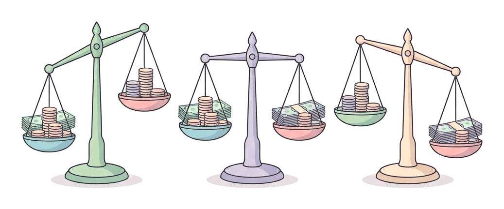

# JAMB Economics Notes: Public Finance

## What JAMB expects

This topic is Topic 14 of the JAMB UTME Economics syllabus: Public Finance. It covers how the government raises money, how it spends it, and how it manages the economy through its budget. 

This file covers the following content items:
* a. Meaning and objectives
* b. Fiscal policy and its instruments
* c. Sources of government revenue (taxes, royalties, rents, grants and aids)
* d. Principles of taxation
* e. Tax incidence and its effects
* f. The effects of public expenditure
* g. Government budget and public debts
* h. Revenue allocation and resource control in Nigeria.

By the end of these notes, you should be able to:
1. Identify the objectives of public finance (Objective i)
2. Explain fiscal policy and its instruments (Objective ii)
3. Compare the various sources of government revenue (Objective iii)
4. Analyse the principles of taxation (Objective iv)
5. Analyse the incidence of taxation and its effects (Objective v)
6. Examine the effects of public expenditure on the economy (Objective vi)
7. Examine the types and effects of budgets (Objective vii)
8. Highlight the criteria for revenue allocation in Nigeria and their impact (Objective viii)

**Note on the syllabus wording:** In Content item c, the syllabus lists "taxes royalties". This is a typing error missing a comma; it should read "taxes, royalties", as these are two distinct sources of revenue.

---

## Meaning of Public Finance

Public finance is the branch of economics that studies the financial activities of the government. It involves how the government generates revenue (income), how it spends that revenue (expenditure), and how it manages its debts and financial administration to achieve economic goals. 

In Nigeria, public finance covers the financial activities of all three tiers of government: the Federal Government, State Governments, and Local Governments.

The main components of public finance are:
1. **Public Revenue:** How the government raises money (e.g., through taxes, selling crude oil).
2. **Public Expenditure:** How the government spends money (e.g., building roads, paying teachers' salaries).
3. **Public Debt:** How the government borrows money when its revenue is not enough to cover its expenditure.
4. **Financial Administration:** The preparation, passing, and implementation of the government budget.

### Objectives of public finance

**Objective i: identify the objectives of public finance.**

Governments do not collect and spend money just for the sake of it. Public finance aims to achieve specific macroeconomic goals:

1. **Allocation of Resources:** The free market often fails to provide essential goods like national defence, streetlights, and public roads (public goods) because they are not profitable for private businesses. Public finance ensures that resources are allocated to provide these essential services.
2. **Redistribution of Income and Wealth:** In a capitalist or mixed economy, wealth can become concentrated in the hands of a few. The government uses public finance (specifically progressive taxation and public spending on social welfare, education, and healthcare) to bridge the gap between the rich and the poor.
3. **Economic Stabilization:** The economy goes through cycles of booms (high inflation) and recessions (high unemployment). The government uses public finance to stabilize prices and maintain a high level of employment.
4. **Economic Growth and Development:** By spending on infrastructure (like power grids, railways, and bridges in Nigeria) and providing grants to key industries like agriculture, public finance stimulates long-term economic growth.
5. **Job Creation:** Direct government spending on public works, agriculture, and industrialization creates employment opportunities for citizens.
6. **Balance of Payments Equilibrium:** The government can use tariffs (taxes on imports) and export subsidies to reduce imports and encourage exports, thereby correcting deficits in its international trade balance.

---

## Fiscal policy and its instruments

**Content b and Objective ii: explain fiscal policy and its instruments.**

**Fiscal policy** is the use of government revenue collection (taxation) and expenditure (spending) to influence the economy. It is the main tool of public finance. 

Do not confuse fiscal policy with **monetary policy**. Monetary policy is controlled by the Central Bank of Nigeria (CBN) and involves managing the money supply and interest rates (covered in `A12-money-and-inflation.md`). Fiscal policy is controlled by the executive and legislative arms of government through the Ministry of Finance.

### Types of Fiscal Policy
1. **Expansionary Fiscal Policy:** Used during an economic recession or depression to stimulate the economy. The government does this by **decreasing taxes** and/or **increasing government spending**. This puts more money in the hands of consumers and businesses, boosting aggregate demand and creating jobs.
2. **Contractionary Fiscal Policy:** Used during an economic boom to control high inflation. The government does this by **increasing taxes** and/or **decreasing government spending**. This removes money from the economy, lowering aggregate demand and cooling down prices.

### Instruments of Fiscal Policy
The government uses the following instruments (tools) to carry out its fiscal policy:

1. **Taxation:** Taxes can be raised or lowered to control inflation, redistribute income, or influence consumption (e.g., taxing harmful goods like tobacco).
2. **Government Expenditure:** The government can increase spending on public projects to inject money into the economy and create jobs, or cut spending to reduce the amount of money in circulation.
3. **Public Debt (Borrowing):** When the government wants to reduce money in circulation, it can borrow from the public by selling treasury bills and bonds. When it wants to increase money in circulation, it can pay back its debts.
4. **The Budget:** The annual financial plan of the government (budget surplus, deficit, or balanced budget) is the overall framework that combines taxation, spending, and borrowing to achieve fiscal goals.

---

## Sources of government revenue

**Content c: Sources of government revenue (taxes, royalties, rents, grants and aids).**

Government revenue is the total amount of money the government receives from all sources. In Nigeria, revenue is broadly classified into **oil revenue** (from crude oil) and **non-oil revenue** (from taxes, agriculture, manufacturing, etc.).

The sources can also be classified into **tax revenue** and **non-tax revenue**:

1. **Taxes:** Compulsory payments levied by the government on individuals and corporate bodies. Examples include Personal Income Tax (PIT), Company Income Tax (CIT), and Value Added Tax (VAT).
2. **Royalties:** Payments made to the government by companies for the right to extract natural resources from its land. For example, multinational oil companies (like Shell or Chevron) pay royalties to the Nigerian government for the crude oil they extract from the Niger Delta.
3. **Rents and Rates:** Income generated from leasing government properties, lands, and buildings. Local governments also collect rates on market stalls and motor parks.
4. **Grants and Aids:** Financial assistance received from other countries or international organizations (like the World Bank or the UN). **Grants** are free and do not have to be repaid, while **aids** can be financial, technical, or material assistance during emergencies.
5. **Fees, Fines, and Licenses:** Money collected for specific services or penalties. Examples include court fines, traffic fines (e.g., by FRSC or LASTMA), vehicle registration fees, and passport fees.
6. **Profits from Public Enterprises:** Dividends and profits earned by government-owned businesses and agencies, such as the Nigerian National Petroleum Corporation (NNPC) or the Nigerian Ports Authority (NPA).
7. **Loans (Borrowing):** Though technically creating debt, borrowed funds form a part of the money the government uses to finance its activities in a given year.

### Comparing the various sources of government revenue

**Objective iii: compare the various sources of government revenue.**

Different sources of revenue serve different purposes and have distinct characteristics. The table below compares the major sources:

| Feature | Taxes | Royalties & Rents | Grants and Aids | Fees, Fines & Licenses |
| :--- | :--- | :--- | :--- | :--- |
| **Nature of payment** | Compulsory for all who fall into the tax bracket. No direct benefit in return (quid pro quo). | Contractual payment for the use of state-owned land or natural resources. | Voluntary assistance from foreign countries or institutions. | Payments for specific government services or penalties for breaking laws. |
| **Reliability** | Highly reliable and predictable. The core of most modern governments' revenue. | Fluctuates based on global resource prices (e.g., global oil price crashes heavily affect Nigeria). | Highly unpredictable and unreliable. Depends on the goodwill of donors. | Moderately reliable but makes up a very small percentage of total revenue. |
| **Impact on citizens** | Reduces the disposable income of citizens. Can cause inflation if indirect taxes are high. | Does not directly reduce citizens' disposable income; paid mostly by extraction companies. | Does not burden citizens. Can come with strict conditions from donors. | Affects only those who use the specific service or commit the offence. |

---

## Principles of taxation

**Content d: Principles of taxation.**

**Taxation** is the compulsory levy imposed by the government on the income, wealth, or consumption of individuals and corporate organizations. 

The **principles of taxation** (also known as the canons of taxation) are the rules or criteria that a good tax system should follow. The first four principles were developed by the classical economist **Adam Smith** in his 1776 book, *The Wealth of Nations*.

### Analysis of the Principles of Taxation

**Objective iv: analyse the principles of taxation.**

1. **Principle of Equity (Fairness):** The tax burden should be distributed fairly among citizens based on their ability to pay. 
   * *Horizontal equity* means people earning the same income should pay the same tax.
   * *Vertical equity* means those earning higher incomes should pay more than those earning lower incomes (this justifies a progressive tax system).
2. **Principle of Certainty:** Taxpayers should know exactly what they have to pay, when they have to pay it, and how to pay it. The tax rules should be clear and not left to the arbitrary decisions of tax collectors.
3. **Principle of Convenience:** The method and timing of tax payment should be convenient for the taxpayer. For example, Pay-As-You-Earn (PAYE) is convenient because the tax is deducted directly from a worker's monthly salary before they receive it.
4. **Principle of Economy:** The cost of collecting the tax should be very low compared to the revenue generated. If the government spends ₦800,000 to collect ₦1,000,000 in taxes, the tax system is uneconomical.

Modern economists have added other principles to Adam Smith's original four:

5. **Principle of Flexibility:** The tax system should easily adjust to changes in the economic environment. During a boom, the tax system should automatically generate more revenue without needing new laws.
6. **Principle of Simplicity:** The tax laws and calculations should be easy to understand by the average citizen, preventing confusion and tax evasion.
7. **Principle of Productivity (Yield):** The tax system should be able to generate enough revenue to meet the government's financial needs.

---

## Tax incidence and its effects

**Content e: Tax incidence and its effects.**

Before looking at tax incidence, we must understand how taxes are classified. Taxes are grouped based on the **burden of payment** (Direct vs Indirect) and the **tax structure** (Progressive, Proportional, Regressive).

### Types of Taxes (Burden of Payment)

1. **Direct Taxes:** These are taxes levied directly on the income and wealth of individuals and companies. The burden of a direct tax cannot be shifted to another person.
   * *Examples in Nigeria:* Personal Income Tax (PIT), Company Income Tax (CIT), Capital Gains Tax, Education Tax.
2. **Indirect Taxes:** These are taxes levied on goods and services. They are initially paid by the producer or importer, but the burden is fully or partially shifted to the final consumer in the form of higher prices.
   * *Examples in Nigeria:* Value Added Tax (VAT - currently 7.5%), Customs duties (tariffs on imports/exports), Excise duties (taxes on locally manufactured goods like beer).

**Comparison of Direct and Indirect Taxes**

| Feature | Direct Taxes | Indirect Taxes |
| :--- | :--- | :--- |
| **Incidence** | The impact (initial payer) and incidence (final burden) fall on the same person. Cannot be shifted. | The impact falls on the producer/seller, but the incidence is shifted to the consumer. |
| **Levied on** | Income, wealth, and profits. | Goods and services. |
| **Evasion** | Easy to evade if citizens hide their true income. | Difficult to evade because the tax is hidden in the price of the goods bought. |
| **Effect on prices** | Does not directly increase the prices of goods. | Directly increases the prices of goods, which can cause inflation. |
| **Equity** | Usually progressive and equitable (the rich pay more). | Usually regressive (the poor pay a larger percentage of their income than the rich). |

### Tax Structures (Based on Rate)

1. **Progressive Tax:** The tax rate (percentage) increases as income increases. It takes a larger percentage from high-income earners.
   * *Calculation Example:* 10% on the first ₦100,000, 20% on the next ₦100,000, and 30% on anything above ₦200,000. If someone earns ₦250,000, they pay ₦10,000 (first block) + ₦20,000 (second block) + ₦15,000 (30% of the remaining ₦50,000) = ₦45,000 total tax.
2. **Proportional Tax:** The tax rate remains the same (constant) regardless of the income level. If the rate is 10%, a person earning ₦10,000 pays ₦1,000, and a person earning ₦100,000 pays ₦10,000.
3. **Regressive Tax:** The tax rate decreases as income increases. Indirect taxes like VAT are effectively regressive because a fixed amount of tax takes up a larger percentage of a poor person's income compared to a rich person's income.

### Analysis of Tax Incidence and its Effects

**Objective v: analyse the incidence of taxation and its effects.**

**Tax incidence** refers to who finally bears the burden of a tax. In public finance, we distinguish between:
* **Impact (Formal Incidence):** The person or firm legally responsible for paying the tax to the government initially.
* **Effective (Economic) Incidence:** The person who ultimately feels the pinch or bears the final burden of the tax.

For direct taxes, impact and incidence fall on the same person. For indirect taxes, the incidence depends strictly on the **price elasticity of demand and supply** for the product.

**The Elasticity Rule of Tax Incidence:**
When the government imposes an indirect tax (like an excise duty) on a good, the supply curve shifts to the left, raising the price. The burden is shared between the producer and the consumer based on elasticity:
1. **Demand is highly inelastic (e.g., salt, petrol):** Consumers cannot easily stop buying the good. The seller can pass most of the tax on to the buyer by raising the price. **Consumer bears most of the burden.**
2. **Demand is highly elastic (e.g., luxury cars, biscuits):** Consumers will stop buying if the price rises too much. The seller is forced to absorb the tax. **Producer bears most of the burden.**
3. **Perfectly inelastic demand ($E_d = 0$):** Consumer bears the **entire** burden.
4. **Perfectly elastic demand ($E_d = \infty$):** Producer bears the **entire** burden.
5. **Unitary elastic demand ($E_d = 1$):** The burden is shared **equally** between consumer and producer (if supply is also unitary).

[IMAGE: Two side-by-side graphs showing the incidence of an indirect tax. Panel A (Inelastic Demand): A steep demand curve and normal supply curve. Supply shifts upward by the tax amount. The new equilibrium shows a large price increase. A large shaded rectangle represents the consumer's tax burden, and a small rectangle below it represents the producer's burden. Panel B (Elastic Demand): A flat demand curve and normal supply curve. Supply shifts upward. The price rises very little. A small shaded rectangle represents the consumer's burden, and a much larger rectangle below represents the producer's burden. Labels to include: "Price", "Quantity", "D", "S1", "S2 (with tax)", "Consumer's burden", "Producer's burden". Clean flat textbook style, white background.]

### General Effects of Taxation
1. **On Production:** High corporate taxes can reduce business profits and discourage investment, slowing down production. High taxes on raw materials increase production costs.
2. **On Effort to Work:** Extremely high progressive income taxes may discourage people from working hard or seeking promotion because the extra income goes to the government (disincentive to work).
3. **On Resource Allocation:** Taxes can direct resources away from harmful goods (like cigarettes) and toward beneficial ones, altering the pattern of production in the economy.
4. **On Income Distribution:** Progressive direct taxes reduce inequality by transferring wealth from the rich to the poor (through government spending).

---

## The effects of public expenditure

**Content f and Objective vi: examine the effects of public expenditure on the economy.**

**Public expenditure** is the money spent by the government on providing public goods, administration, and social welfare. It is divided into two main categories:

1. **Capital Expenditure:** Money spent on permanent, long-lasting projects that increase the productive capacity of the economy. Examples: building hospitals, constructing the Lagos-Ibadan railway, purchasing military hardware, and building dams.
2. **Recurrent Expenditure:** Money spent on the day-to-day running of the government, which is consumed within the current year. Examples: salaries of civil servants, stationeries for ministries, maintenance of government vehicles, and payment of interest on debts.

### Economic Effects of Public Expenditure
Government spending has powerful multiplier effects on the economy:

1. **Effect on Employment:** Massive government spending on public works (e.g., road construction) creates direct jobs for engineers and labourers, and indirect jobs for suppliers of cement and tools.
2. **Effect on Production and Economic Growth:** Capital expenditure on infrastructure (electricity, roads, broadband internet) lowers the cost of doing business for private companies, stimulating mass production and economic growth.
3. **Effect on Income Distribution:** Government expenditure on free education, subsidized healthcare, and social welfare schemes transfers real income to the poor, reducing poverty and inequality.
4. **Effect on Price Level (Inflation):** If the government increases recurrent expenditure excessively without a matching increase in the supply of goods (e.g., massive salary hikes for civil servants), it puts too much money in circulation, leading to **demand-pull inflation**.
5. **Resource Allocation:** By giving subsidies and grants, public expenditure can shift resources toward strategic sectors. For instance, agricultural subsidies in Nigeria draw more labour and capital into farming.

---

## Government budget and public debts

**Content g: Government budget and public debts.**

### Types and Effects of Budgets

**Objective vii: examine the types and effects of budgets.**

The **government budget** is an official financial document showing the estimated revenue and proposed expenditure of the government for a coming financial year (usually January 1 to December 31).

A budget can be classified into three types based on the relationship between estimated revenue and proposed expenditure:

#### 1. Balanced Budget
A budget is balanced when the estimated revenue is **exactly equal** to the proposed expenditure. 
* **Effect:** It is neutral. It neither expands nor contracts the economy. While classical economists loved balanced budgets, modern governments rarely achieve them because needs usually outgrow available revenues.

#### 2. Surplus Budget
A budget is a surplus when the estimated revenue is **greater than** the proposed expenditure. The government plans to collect more money from the economy than it pumps back in.
* **Effect (Inflation Control):** A surplus budget is used as a contractionary fiscal tool to fight inflation during an economic boom. It reduces aggregate demand and cools down prices.
* **Effect (Debt Reduction):** The excess money generated can be used to pay off accumulated national debts or saved in special sovereign wealth funds (like the Excess Crude Account in Nigeria).

#### 3. Deficit Budget
A budget is a deficit when the proposed expenditure is **greater than** the estimated revenue. The government plans to spend more money than it earns, usually making up the difference by borrowing.
* **Effect (Stimulating the Economy):** A deficit budget is an expansionary fiscal tool used to cure unemployment and pull an economy out of a recession. By pumping borrowed money into public projects, it boosts aggregate demand.
* **Effect (Inflation Risk):** If the deficit is financed by printing more money (via the Central Bank) or heavy borrowing during normal times, it can cause severe inflation and increase the national debt burden.

### Public Debts
When a government runs a deficit budget, it must borrow to finance the gap. **Public debt** (or national debt) is the total amount of money owed by the government to individuals, institutions, and other countries.

**Classification of Public Debt:**
1. **Internal Debt:** Money borrowed from citizens and institutions within the country. The government issues securities like Treasury Bills (short-term) and Government Bonds (long-term) through the Central Bank or the Debt Management Office (DMO).
2. **External Debt:** Money borrowed from foreign governments, international financial institutions (like the World Bank, IMF, African Development Bank), or foreign private investors (e.g., Eurobonds). External debt must be paid back in foreign currency, which can strain a country's exchange rate.

**Types of Debt based on usage:**
* **Productive Debt:** Borrowed money used to finance capital projects (e.g., railways, power plants) that will generate income in the future to pay off the debt.
* **Deadweight (Unproductive) Debt:** Borrowed money used to finance wars, pay salaries, or fund recurrent expenditures. It generates no future income to repay itself, becoming a heavy burden on future generations.

**Reasons for Borrowing:**
1. To finance a deficit budget.
2. To finance large-scale capital projects that current revenue cannot cover.
3. To meet emergencies (e.g., natural disasters, pandemics, or wars).
4. To address balance of payments deficits (by borrowing foreign exchange).

**Effects of Public Debt:**
While productive borrowing promotes economic growth, excessive borrowing—especially external deadweight debt—has negative effects. The government is forced to allocate a huge portion of its yearly budget to **debt servicing** (paying interest and principal). This diverts funds away from critical sectors like education and health. If a country defaults on external loans, its international credit rating drops, making future borrowing difficult or very expensive.

---

## Revenue allocation and resource control in Nigeria

**Content h: Revenue allocation and resource control in Nigeria.**

Because Nigeria operates a federal system of government, the revenues collected nationally (especially from crude oil sales, custom duties, and corporate taxes) are pooled into a central account called the **Federation Account**. 

**Revenue allocation** is the mechanism or formula used for sharing the money in the Federation Account among the three tiers of government (Federal, State, and Local).

* **Vertical Allocation:** Sharing revenue among the Federal, State, and Local governments.
* **Horizontal Allocation:** Sharing the State governments' portion among the 36 states, and the Local governments' portion among the 774 local government areas.

In Nigeria, the **Revenue Mobilization Allocation and Fiscal Commission (RMAFC)** is the body responsible for reviewing and recommending the revenue allocation formula.

### Criteria for Revenue Allocation and their Impact

**Objective viii: highlight the criteria for revenue allocation in Nigeria and their impact.**

Over the years, several principles have been used to ensure fair sharing of the national wealth among the states:

1. **Derivation Principle:**
   * **Meaning:** A proportion of the revenue generated from a specific natural resource is returned to the state where the resource was extracted.
   * **Impact:** In Nigeria, the Constitution guarantees a minimum of **13% derivation** for natural resources. This heavily benefits the oil-producing states of the Niger Delta (like Delta, Rivers, Bayelsa, and Akwa Ibom). It provides them with massive funds for development but causes friction with non-oil-producing states who feel short-changed.
2. **Principle of Need (Population):**
   * **Meaning:** Revenue is shared based on the population size of the state. States with more people need more money to provide schools, hospitals, and water.
   * **Impact:** Highly populated states like Kano and Lagos receive larger allocations. This often leads to intense political disputes and controversies during national census exercises, as states may try to inflate their figures to get more money.
3. **Equality of States:**
   * **Meaning:** A certain percentage of the revenue is shared equally among all 36 states, regardless of their size, population, or economic output.
   * **Impact:** This ensures that even the smallest or poorest states have enough funds to run their government administration and pay civil servants. It promotes national unity but can make states lazy regarding internal revenue generation.
4. **Landmass and Terrain:**
   * **Meaning:** States with large land areas or difficult physical environments (e.g., deep swamps, vast deserts) require more money to build infrastructure like roads and power lines.
   * **Impact:** Large states (mostly in Northern Nigeria like Niger and Borno) benefit from this criterion. It helps offset the high cost of geographical development.
5. **Internal Revenue Generation (IGR) Effort:**
   * **Meaning:** States that make a visible effort to generate their own internal revenue (through local taxes) are rewarded with extra allocation from the center.
   * **Impact:** This encourages states to become self-reliant and expand their local economies rather than just waiting for monthly "federal allocations" from oil money. Lagos State is the highest internally generating state in Nigeria.

**The Resource Control Debate:**
Closely tied to revenue allocation is the issue of **resource control**. Leaders in the Niger Delta have historically argued that states should own, manage, and control the natural resources (crude oil) on their land, and merely pay taxes to the Federal Government. This contrasts with current Nigerian law, where the Federal Government owns all underground mineral resources. The debate centers on environmental degradation, the high poverty rate in oil-producing communities, and true federalism.

---

## Key terms

| Term | Meaning |
| :--- | :--- |
| **Public Finance** | The branch of economics dealing with government revenue, expenditure, and debt. |
| **Fiscal Policy** | The use of government taxation and expenditure to influence the economy. |
| **Direct Tax** | A tax levied directly on income or wealth, whose burden cannot be shifted (e.g., PIT, CIT). |
| **Indirect Tax** | A tax levied on goods and services, whose burden can be shifted to the final consumer (e.g., VAT). |
| **Progressive Tax** | A tax system where the tax rate increases as the taxpayer's income increases. |
| **Tax Incidence** | The point where the ultimate burden of a tax rests (who effectively pays for it). |
| **Capital Expenditure** | Government spending on permanent, wealth-creating infrastructure like roads and hospitals. |
| **Deficit Budget** | A budget in which proposed expenditure is greater than estimated revenue. |
| **Public Debt** | The total amount of money owed by the government to local and foreign creditors. |
| **Derivation Principle** | A revenue allocation formula where a percentage (e.g., 13%) of revenue is returned to the state from which the resource was extracted. |

---

## Exam tips and common mistakes

* **Fiscal vs Monetary:** Remember that *fiscal policy* is about taxes and government spending (Budget). *Monetary policy* is about interest rates and the money supply (Central Bank). Do not mix them up!
* **Tax Incidence:** Understand the elasticity rule. If demand is *inelastic* (hard to stop buying), the *consumer* bears the burden. If demand is *elastic* (easy to stop buying), the *producer* bears the burden.
* **Incidence vs Impact:** The *impact* is who pays the tax *initially* to the tax authority. The *incidence* is who *finally* suffers the loss of money.
* **Regressive Taxes:** A common mistake is thinking a regressive tax means paying a smaller *amount* of money. It means paying a smaller *percentage* of income. Because VAT is a flat rate on goods, it takes a larger percentage of a poor person's income, making it mathematically regressive.
* **Deficit Budgets:** Students often think "deficit" is always bad. In economics, a deficit budget is a powerful tool used to cure unemployment and stimulate growth during a recession.
* **Derivation:** In Nigerian revenue allocation questions, 13% is the magic number for the constitutional derivation fund for oil-producing states.

---

## Quick summary

1. Public finance studies government revenue, expenditure, debts, and budgeting, aiming to allocate resources, redistribute income, stabilize the economy, and promote growth.
2. Fiscal policy uses taxation and government spending to control the economy. Expansionary policy fights recession; contractionary policy fights inflation.
3. Government revenue comes from taxes, royalties, rents, grants, and fees. Direct taxes (like income tax) cannot be shifted, while indirect taxes (like VAT) can be shifted to consumers.
4. Adam Smith's canons of taxation are equity, certainty, convenience, and economy.
5. The incidence of an indirect tax depends on elasticity: the burden falls more on the consumer if demand is inelastic, and more on the producer if demand is elastic.
6. Public expenditure is either recurrent (day-to-day running) or capital (long-term infrastructure) and creates multiplier effects on employment and growth.
7. A government budget can be balanced, surplus (controls inflation), or deficit (stimulates the economy but increases national debt).
8. In Nigeria, the Federation Account is shared using criteria like derivation (13%), population, equality of states, landmass, and internal revenue generation effort.

---

## Practice questions

**1. The primary objective of public finance is to:**
- A. maximize the profit of public corporations.
- B. ensure the welfare of the citizens and stabilize the economy.
- C. increase the cost of imported goods.
- D. increase the circulation of paper money.

**Answer: B.** The main goal of public finance is macroeconomic stability, equitable distribution of wealth, and general economic welfare. Maximizing profit is for private businesses, not public finance.

**2. Which of the following is an instrument of fiscal policy?**
- A. Open market operations
- B. Bank rate
- C. Government expenditure
- D. Cash reserve ratio

**Answer: C.** Government expenditure and taxation are the main tools of fiscal policy. The other three options (Open market operations, Bank rate, Cash reserve ratio) are instruments of monetary policy controlled by the Central Bank.

**3. A tax whose burden can be easily shifted in full or in part to the final consumer is:**
- A. a progressive tax
- B. an indirect tax
- C. a direct tax
- D. a capital gains tax

**Answer: B.** Indirect taxes (like VAT and excise duties) are levied on goods and services, allowing the producer to shift the burden to the consumer through higher prices. Direct taxes cannot be shifted.

**4. According to Adam Smith, the canon of taxation which states that the cost of collecting a tax should be minimal is the principle of:**
- A. Certainty
- B. Convenience
- C. Economy
- D. Equity

**Answer: C.** The principle of economy states that the administrative cost of collecting a tax should be small compared to the revenue generated. 

**5. If the demand for a product is perfectly inelastic, the incidence of an indirect tax placed on it will fall entirely on the:**
- A. producer
- B. government
- C. retailer
- D. consumer

**Answer: D.** If demand is perfectly inelastic ($E_d = 0$), consumers will not reduce their quantity demanded regardless of the price increase. The producer can safely pass 100% of the tax burden to the consumer.

**6. Government spending on the construction of a new hydroelectric dam is classified as:**
- A. Recurrent expenditure
- B. Capital expenditure
- C. Transfer payment
- D. Administrative expenditure

**Answer: B.** Capital expenditure involves spending on permanent, wealth-creating infrastructure like dams, roads, and machinery. Recurrent expenditure is for consumables and daily running costs (like salaries).

**7. A deficit budget is most appropriate when an economy is experiencing:**
- A. hyperinflation
- B. an economic boom
- C. severe recession and high unemployment
- D. high prices of export goods

**Answer: C.** During a recession, a deficit budget pumps more money into the economy through government spending, which boosts aggregate demand, creates jobs, and stimulates economic recovery.

**8. Which of the following is a source of internal public debt?**
- A. International Monetary Fund (IMF)
- B. The Paris Club
- C. Treasury Bills
- D. Foreign Direct Investment

**Answer: C.** Treasury Bills and government bonds sold to citizens and local banks are internal debts. Loans from the IMF or Paris Club are external debts.

**9. In Nigeria's revenue allocation formula, the principle that compensates states where mineral resources are extracted is known as:**
- A. Equality of states
- B. Internal revenue effort
- C. Population need
- D. Derivation

**Answer: D.** The derivation principle ensures that a proportion (currently at least 13%) of the revenue from natural resources is given back to the specific states where the resources were extracted.

**10. Mr. Ade earns ₦100,000 and pays ₦10,000 as tax. Mr. Musa earns ₦500,000 and pays ₦50,000 as tax. This tax structure is:**
- A. Progressive
- B. Proportional
- C. Regressive
- D. Discriminatory

**Answer: B.** A proportional tax takes the same percentage regardless of income. Ade pays 10% (10,000 / 100,000). Musa pays 10% (50,000 / 500,000). Since the rate remains 10%, it is a proportional tax. It is a common mistake to think that because Musa pays a larger *amount*, it is progressive; progressive requires the *percentage rate* to increase.
