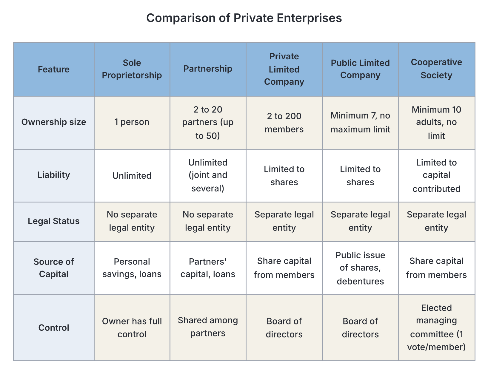
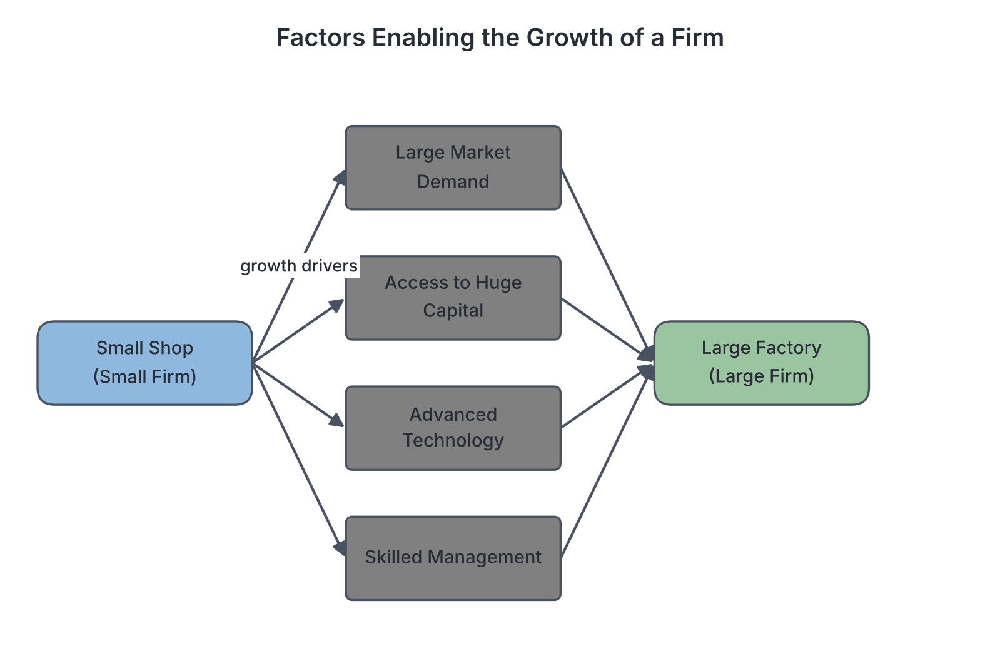

# JAMB Economics Notes: Business Organizations

## What JAMB expects

This topic is Topic 19 of the JAMB Economics syllabus: Business Organizations. It covers the different ways businesses are owned, funded, and managed, with a special focus on the Nigerian economy.

It covers the following content items:
* a. Private enterprises (e.g., sole-proprietorship, partnership, limited liability companies and cooperative societies)
* b. Problems of private enterprises;
* c. Public enterprises and their problems;
* d. Funding and management of business organizations;
* e. Factors determining the size of firms;
* f. Privatization and Commercialization as solutions to the problems of public enterprises.

By the end of these notes, you should be able to:
1. (i) compare the types and basic features of private business organization;
2. (ii) appreciate the financing and management problems of business organizations;
3. (iii) identify the features of public enterprises;
4. (iv) identify the factors determining the size of firms;
5. (v) differentiate between privatization and commercialization;
6. (vi) compare the advantages and disadvantages of privatization and commercialization.

---

## Private enterprises

**Content item a: Private enterprises (e.g., sole-proprietorship, partnership, limited liability companies and cooperative societies)**

A **private enterprise** is a business owned, managed, and controlled by private individuals or groups of individuals, rather than by the government. The primary motive of a private enterprise is usually to make a **profit**. In Nigeria, the private sector includes everything from the local garri seller in the market to massive corporations like Dangote Group and Globacom.

There are four main types of private business organizations:
1. Sole Proprietorship
2. Partnership
3. Limited Liability Companies
4. Cooperative Societies

### Comparison of private business organizations

**Objective (i): compare the types and basic features of private business organization**

To properly compare these organizations, we must first look at their individual features, advantages, and disadvantages.

#### 1. Sole Proprietorship (One-Man Business)
A sole proprietorship is a business owned, financed, and managed by one person. It is the oldest and most common form of business in Nigeria. Examples include local tailors, mechanics, patent medicine stores, and market traders.

*   **Features:** Owned by one person. The owner has **unlimited liability** (if the business owes money and fails, the owner's personal properties, like their car or house, can be sold to pay the debt). It is not a separate legal entity from the owner.
*   **Advantages:** It is easy and cheap to set up. The owner takes all the profits. Decision-making is very fast. The owner enjoys complete privacy.
*   **Disadvantages:** Capital is limited to what one person can raise. Unlimited liability is a huge risk. The business lacks continuity (if the owner dies, the business often dies). The owner bears all the risks alone.

#### 2. Partnership
A partnership is a legal relationship between two or more persons carrying on a business with the aim of making a profit. Traditional textbooks and the old Nigerian Companies and Allied Matters Act (CAMA) state a partnership must have between **2 and 20 members** (with exceptions for professional firms like lawyers or accountants). *Note: The updated CAMA 2020 introduced Limited Liability Partnerships, but for JAMB purposes, stick to the standard 2 to 20 rule unless specified otherwise.*

Partners usually sign a document called a **Deed of Partnership**, which outlines how profits are shared, the capital contributed by each, and the rules of the business. 
*   **Types of partners:**
    *   **Active partner:** Contributes capital and helps manage the business.
    *   **Sleeping (dormant) partner:** Contributes capital and shares in profit but does not participate in management.
    *   **Nominal partner:** Does not contribute capital but allows the firm to use their famous name.
*   **Advantages:** More capital can be raised than in a sole proprietorship. Partners can share the workload and combine different skills. Risks are shared.
*   **Disadvantages:** Most partners have **unlimited liability**. Disagreements between partners can destroy the business. Profits must be shared.

#### 3. Limited Liability Companies
A company is an artificial person created by law. It has a separate legal identity from its owners (shareholders). This means the company can sue, be sued, and own property in its own name. Most importantly, the owners have **limited liability**: if the company fails, they only lose the money they paid for their shares; their personal assets are safe.

There are two main types:
*   **Private Limited Liability Company (Ltd):**
    *   Owned by **2 to 50 shareholders** (though CAMA 2020 now allows a single-member private company, JAMB traditionally uses 2-50).
    *   Cannot sell its shares to the general public.
    *   Shares cannot be easily transferred without the permission of other shareholders.
    *   Example: A family-owned pure water manufacturing factory, e.g., *Ojo & Sons Nig. Ltd*.
*   **Public Limited Liability Company (Plc):**
    *   Owned by a minimum of **7 shareholders**, with **no maximum limit**.
    *   Can sell shares to the general public through the Stock Exchange (e.g., Nigerian Exchange Group).
    *   Shares are freely transferable.
    *   Example: *Dangote Cement Plc*, *Zenith Bank Plc*.

#### 4. Cooperative Societies
A cooperative society is a voluntary association of individuals with common interests who pool their resources together to promote their mutual economic welfare, rather than just to make a maximum profit. They are common among farmers, traders, and workers in Nigeria.
*   **Types:** Consumer cooperatives (buy goods in bulk to sell cheaply to members), Producer cooperatives (farmers pooling resources), Thrift and Credit cooperatives (saving money together to give loans to members).
*   **Features:** Governed by democratic principles (**"One man, one vote"** regardless of how much capital you contributed). Profits are distributed based on a member's participation, known as a **patronage dividend**.

**Summary Comparison Table of Private Enterprises**

| Feature | Sole Proprietorship | Partnership | Private Limited Co. (Ltd) | Public Limited Co. (Plc) | Cooperative Society |
| :--- | :--- | :--- | :--- | :--- | :--- |
| **Ownership** | 1 person | 2 to 20 persons | 2 to 50 persons | 7 to infinity | Minimum of 10 persons |
| **Liability** | Unlimited | Unlimited (usually) | Limited | Limited | Limited |
| **Capital Source**| Personal savings, family loans | Partners' contributions | Shares sold privately | Shares sold to the general public | Members' shares and dues |
| **Legal Status** | Not a separate legal entity | Not a separate legal entity | Separate legal entity | Separate legal entity | Separate legal entity |
| **Control** | Owner decides everything | Partners make decisions together | Board of Directors | Board of Directors | Democratic (1 member, 1 vote) |
| **Profit Sharing**| Takes all | Shared according to the Deed | Dividends based on shares | Dividends based on shares | Patronage dividend |

---

## Problems of private enterprises

**Content item b: Problems of private enterprises**

Despite driving economic growth, private businesses in Nigeria face numerous challenges that limit their expansion and survival.

1. **Infrastructural Deficit:** Poor electricity supply (forcing reliance on expensive diesel generators), bad roads, and inadequate water supply heavily increase the cost of doing business.
2. **Multiple Taxation:** Businesses are often forced to pay various overlapping taxes, levies, and fees to local, state, and federal governments, which eats into their profits.
3. **Inconsistent Government Policies:** Sudden bans on imports, changes in foreign exchange rules, or shifting regulatory requirements can ruin business plans overnight.
4. **Fierce Competition:** Small private enterprises often struggle to compete with large multinational corporations that enjoy economies of scale and better technology.

---

## Funding and management of business organizations

**Content item d: Funding and management of business organizations**

To operate and expand, businesses require funds (capital) and effective management structures. 

### Sources of Funding
Funds can be classified into internal and external sources, or by their duration (short, medium, and long-term).
*   **Shares (Equity):** Companies raise capital by selling portions of ownership (shares) to investors. Shareholders receive a portion of profits called a **dividend**.
*   **Debentures (Debt):** A debenture is a document acknowledging a long-term loan to a company. Debenture holders are creditors, not owners. They receive a fixed rate of **interest**, whether the company makes a profit or not.
*   **Bank Loans and Overdrafts:** Borrowing from commercial banks. An overdraft is a short-term facility allowing a business to withdraw more than it has in its account.
*   **Trade Credit:** Buying raw materials from suppliers and paying for them at a later date.
*   **Retained Earnings:** Reinvesting the profits made in previous years back into the business (also known as ploughing back profit).

### Management Structures
*   In small firms (sole proprietorships), ownership and management are the same. The owner makes all decisions.
*   In companies, there is a **separation of ownership and control**. The shareholders own the company, but they elect a **Board of Directors** to manage it on their behalf. The board hires a Managing Director (MD) or CEO to run the day-to-day operations.

### Financing and management problems of business organizations

**Objective (ii): appreciate the financing and management problems of business organizations**

Acquiring funds and managing operations is rarely smooth. Businesses face specific problems in these two areas:

**Financing Problems:**
1. **Lack of Collateral Security:** Banks require valuable assets (like land or buildings) as a guarantee before giving loans. Most small business owners lack this collateral.
2. **High Interest Rates:** In Nigeria, the cost of borrowing from commercial banks is very high. High interest rates discourage businesses from taking loans for expansion.
3. **Under-capitalization:** Many businesses start with too little capital and struggle to buy adequate stock or equipment, stunting their growth.
4. **Poor Credit Worthiness:** Because many small businesses lack proper accounting records, banks find it risky to lend to them.

**Management Problems:**
1. **Lack of Managerial Skill:** A good mechanic does not automatically make a good business manager. Many sole proprietors lack training in accounting, marketing, and human resources.
2. **The Principal-Agent Problem:** In large companies, a conflict of interest can arise between the owners (principals) and the managers (agents). Managers might pursue higher salaries or prestigious projects rather than maximizing profits for shareholders.
3. **Succession Problems:** In sole proprietorships and partnerships, if the key founder dies or falls ill, there is often no trained successor to take over, leading to the collapse of the firm.
4. **Poor Record Keeping:** Failure to keep accurate financial records leads to poor decision-making and invites problems with tax authorities.

---

## Public enterprises and their problems

**Content item c: Public enterprises and their problems**

A **public enterprise** (or public corporation) is a business organization established, owned, fully financed, and controlled by the government (federal, state, or local). 

*Nigerian Examples:* The Nigerian National Petroleum Corporation (NNPC - historically, though now transitioning to a limited company), Nigerian Railway Corporation (NRC), Nigerian Postal Service (NIPOST), and the old National Electric Power Authority (NEPA).

Governments create public enterprises for several reasons: to provide essential services cheaply, to prevent private monopolies in vital sectors (like water or electricity), to undertake massive projects that require more capital than private citizens have, and for national security reasons (e.g., defense industries).

### Identifying the features of public enterprises

**Objective (iii): identify the features of public enterprises**

You can easily distinguish a public enterprise from a private one by looking out for these specific features:
1. **State Ownership:** They are 100% owned by the government on behalf of the citizens.
2. **Statutory Creation:** They are usually created by a special Act of Parliament or government decree, which defines their powers and duties.
3. **Financed by the Taxpayer:** Their initial capital and regular subsidies come from the government budget (public funds).
4. **Service Motive:** Unlike private firms that exist to maximize profit, the primary aim of a traditional public enterprise is to provide essential services to the public at an affordable price, and to maximize social welfare.
5. **Government Monopoly:** They often operate as legal monopolies in their sector (e.g., only the NRC is allowed to operate national railways).
6. **Managed by a Board of Directors:** The government (usually through a minister) appoints a board of directors to manage the corporation.

**Problems of Public Enterprises:**
Despite their good intentions, public enterprises in Nigeria and globally have faced severe problems:
*   **Inefficiency and Mismanagement:** Because they do not face competition and are not strictly chasing profit, they often become bloated, slow, and inefficient.
*   **Political Interference:** Government officials frequently interfere in the day-to-day running, forcing the enterprise to hire unqualified political loyalists or dictating where projects should be located.
*   **Corruption and Embezzlement:** Public funds meant for the enterprise are often looted by management or politicians.
*   **Red Tape (Bureaucracy):** Decision-making is extremely slow because everything must pass through multiple government ministries for approval.
*   **Overstaffing:** Governments often use public enterprises as a tool to create jobs, leading to too many workers doing too little work.

---

## Factors determining the size of firms

**Content item e: Factors determining the size of firms**

Why are some businesses as massive as multinational oil companies, while others remain small corner shops for decades? In economics, the "size" of a firm can be measured by its number of employees, the amount of capital it uses, its market share, or its total output. The size a firm ultimately reaches is not random; it is determined by specific constraints and opportunities.

### Identifying the factors determining the size of firms

**Objective (iv): identify the factors determining the size of firms**

The size of any firm is constrained or expanded by the following factors:

1. **Size of the Market (Extent of Demand):** This is the most crucial factor. A firm can only grow as large as the demand for its products. If a firm sells a highly specialized product with few buyers, it will remain small. If it sells a daily necessity to millions of people (like cement or sugar), it can grow very large.
2. **Amount of Capital Available:** A firm needs money to buy machines, build factories, and hire workers. A sole proprietor limited to personal savings will remain small, whereas a Plc that can raise billions on the stock market can grow into a massive enterprise.
3. **Nature of the Business (Type of Product):** The technical requirements of the industry matter. You cannot build a "small" commercial aircraft factory or a "small" oil refinery; the minimum efficient scale requires huge size. Conversely, personal services like barbing salons or fashion design naturally remain small because they require personal attention.
4. **Entrepreneurial and Managerial Skill:** A business can only grow to the limit of its manager's ability to control it. Some entrepreneurs are brilliant at running a single shop but lack the administrative skill (or refuse to delegate authority) to manage a chain of 50 stores. When management is weak, firms stay small to avoid chaos.
5. **Risk and Uncertainty:** Expanding a business is risky. If the economic environment is unstable (high inflation, unpredictable government policies), owners may choose to keep their businesses small to limit their exposure to potential losses.
6. **Level of Technology:** Access to advanced technology allows a firm to mass-produce goods and expand. Firms relying on manual labor are usually constrained in size compared to automated factories.

---

## Privatization and Commercialization

**Content item f: Privatization and Commercialization as solutions to the problems of public enterprises.**

Because public enterprises in Nigeria (like NITEL, NEPA, and Nigerian Airways) became heavily indebted, inefficient, and a massive drain on the national budget, the government adopted new economic policies in the late 1980s (under the Structural Adjustment Programme) to reform them. The two main policies used to solve the problems of public enterprises are **Privatization** and **Commercialization**. 

In Nigeria, these processes are managed by the **Bureau of Public Enterprises (BPE)**.

### Differentiating between privatization and commercialization

**Objective (v): differentiate between privatization and commercialization**

Students often confuse these two terms. Here is the strict difference:

**Privatization** is the transfer of ownership, control, and management of a public enterprise from the government to private individuals or companies. The government sells its shares and steps away. 
*   *Example:* The government sold NITEL and majority stakes in the electricity distribution companies (DisCos) to private investors (the 2013 power sector sale). The government no longer wholly owns them.

**Commercialization** is the reorganization of a public enterprise so that it operates as a profit-making commercial venture, **without changing ownership**. The government still owns the enterprise, but stops giving it subsidies. The enterprise must now charge market prices, survive on its own revenues, and aim to make a profit just like a private company.
*   *Example:* The Nigerian Television Authority (NTA) and the Federal Radio Corporation of Nigeria (FRCN) were commercialized. The government still owns them, but they now aggressively seek paid advertisements to survive.

**Comparison Table: Privatization vs Commercialization**

| Feature | Privatization | Commercialization |
| :--- | :--- | :--- |
| **Ownership** | Transferred from government to private individuals. | Remains with the government. |
| **Control** | Controlled by private owners/shareholders. | Controlled by a government-appointed board, but run like a business. |
| **Motive** | Solely to maximize profit for the private owners. | To make a profit and become self-sustaining, reducing the burden on government. |
| **Subsidies** | Government completely stops funding. | Government stops or heavily reduces subsidies; enterprise must fund itself. |

### Advantages and disadvantages of privatization and commercialization

**Objective (vi): compare the advantages and disadvantages of privatization and commercialization**

Both policies have brought benefits but also severe social and economic pains.

#### Advantages of Privatization
1. **Increased Efficiency:** Private owners introduce better management, modern technology, and eliminate waste because their money is at stake.
2. **Generates Revenue for Government:** The government makes money from selling its shares in these enterprises.
3. **Reduces Government Burden:** The government stops wasting the national budget on subsidizing failing businesses and can spend that money on roads, schools, and hospitals.
4. **Encourages Investment:** It attracts foreign and local investors into the economy, boosting industrial growth.

#### Disadvantages of Privatization
1. **Mass Unemployment (Retrenchment):** The first thing private owners do to cut costs is to fire excess workers. Privatization has led to massive job losses in Nigeria.
2. **Creation of Private Monopolies:** A state monopoly might just be replaced by a private monopoly owned by a few rich individuals, concentrating wealth in the hands of a few.
3. **High Prices:** Private owners will increase tariffs and prices to maximize profit, making essential services (like electricity) too expensive for the poor.
4. **Loss of National Control:** Selling strategic assets (like telecommunications or power) to foreign private investors can be a security risk for the country.

#### Advantages of Commercialization
1. **Financial Independence:** The enterprise learns to stand on its own feet and stops relying on taxpayers' money.
2. **Better Quality of Service:** To survive and attract paying customers, the enterprise is forced to improve the quality of its services.
3. **Retained Government Ownership:** Strategic industries remain in the hands of the state, ensuring that national interests are still protected.

#### Disadvantages of Commercialization
1. **Neglect of Social Welfare:** By forcing public enterprises to chase profit, they may stop providing services to rural or poor areas that are not profitable.
2. **High Tariffs:** To make a profit without government subsidies, commercialized enterprises aggressively increase the prices of their services.
3. **Political Interference Persists:** Because the government still owns the enterprise, politicians may still interfere with board appointments and management decisions, preventing true efficiency.

---

## Key terms

| Term | Meaning |
| :--- | :--- |
| **Sole Proprietorship** | A one-man business where the owner provides capital, manages it, and bears all risks. |
| **Partnership** | A business owned by 2 to 20 people who agree to share profits and risks. |
| **Limited Liability** | A legal protection where owners only lose the money they invested if the business fails; personal assets are safe. |
| **Unlimited Liability** | The owner's personal assets can be seized and sold to pay off the debts of the business. |
| **Debenture** | A document representing a long-term loan given to a company, earning a fixed rate of interest. |
| **Share (Equity)** | A unit of ownership in a company. Holders receive a portion of profits called dividends. |
| **Public Enterprise** | A business organization wholly owned and financed by the government to provide public services. |
| **Privatization** | The sale of government-owned enterprises to private individuals or companies. |
| **Commercialization** | Restructuring a government-owned enterprise to operate for profit, without selling the ownership. |
| **Patronage Dividend** | The profit shared among members of a cooperative society based on how much they traded with or used the society. |

---

## Exam tips and common mistakes

*   **Public Limited Company vs Public Enterprise:** This is the most common student mistake. A **Public Limited Company (Plc)** is a *private* business owned by private shareholders who bought shares on the stock exchange (e.g., Dangote Plc, Zenith Bank Plc). A **Public Enterprise** is owned by the *government* (e.g., NRC, NIPOST). Do not confuse them!
*   **Shares vs Debentures:** Shareholders are owners who receive *dividends* (which vary depending on profit). Debenture holders are lenders/creditors who receive *interest* (which is fixed and must be paid even if the company makes a loss).
*   **Liability:** Sole proprietors and ordinary partners have *unlimited* liability. Shareholders in a company have *limited* liability.
*   **Privatization vs Commercialization:** Remember the key difference is **ownership**. In privatization, ownership changes hands (Govt to Private). In commercialization, ownership stays with the government, but the business starts chasing profit.

---

## Quick summary

1. Private enterprises (sole proprietorships, partnerships, companies, and cooperatives) are owned by private individuals, mainly to make a profit or promote mutual welfare.
2. Limited liability companies protect their owners' personal assets if the business fails, whereas sole proprietors and most partners have unlimited liability.
3. Private businesses in Nigeria struggle with poor infrastructure, multiple taxation, lack of managerial skill, and difficulty securing loans due to a lack of collateral.
4. Firms raise capital through internal means (retained earnings) or external means like selling shares (equity) or issuing debentures and taking bank loans (debt).
5. Public enterprises are owned and funded by the government primarily to provide affordable essential services, but they suffer from inefficiency, corruption, and political interference.
6. The size of a firm is primarily determined by the size of the market (demand), available capital, managerial skill, and the nature of the industry.
7. To fix public enterprises, the government uses Privatization (selling them to private owners) and Commercialization (making them operate for profit without selling them).
8. While privatization improves efficiency and stops the waste of government funds, it often leads to mass unemployment, high prices, and private monopolies.

---

## Practice questions

**1. A business organization where the owners are protected from losing their personal properties to pay business debts is said to have:**
- A. Unlimited liability
- B. Limited liability
- C. Legal monopoly
- D. Statutory protection

**Answer: B.** Limited liability means the owners' responsibility for debts is limited to the amount they invested in the shares of the company. Their personal assets are protected.

**2. Which of the following forms of business is entirely owned and financed by the government?**
- A. Public Limited Company
- B. Partnership
- C. Public Enterprise
- D. Cooperative Society

**Answer: C.** A public enterprise (or public corporation) is owned and financed by the government. A Public Limited Company (Plc) is owned by private shareholders. This is a common trap in JAMB.

**3. In a public limited liability company, the return given to shareholders out of the profits is called a:**
- A. Wage
- B. Interest
- C. Rent
- D. Dividend

**Answer: D.** Shareholders receive dividends as a reward for investing in the company's shares. Interest is paid to lenders like debenture holders.

**4. A major factor that determines how large a firm can grow is the:**
- A. Personal wealth of the local government chairman
- B. Size of the market for its products
- C. Number of trade unions in the country
- D. Proximity to the stock exchange

**Answer: B.** The extent of demand (market size) is a primary factor. A firm cannot grow beyond the demand for the goods or services it produces.

**5. The policy of reorganizing a government-owned enterprise to operate purely as a profit-making venture without transferring ownership to private individuals is:**
- A. Indigenization
- B. Nationalization
- C. Privatization
- D. Commercialization

**Answer: D.** Commercialization means making the enterprise operate commercially for profit while the government retains ownership. Privatization would mean transferring the ownership.

**6. Which of the following is a major disadvantage of privatizing a public enterprise?**
- A. It reduces government expenditure
- B. It leads to improved technology
- C. It often results in the retrenchment of workers
- D. It generates revenue for the government

**Answer: C.** Retrenchment (mass firing of workers) is a major disadvantage. Private owners immediately cut costs to maximize profits, which usually means laying off excess staff hired by the government. The other options are advantages.

**7. In a cooperative society, the principle of control is based on:**
- A. The number of shares owned by a member
- B. One man, one vote
- C. The age of the members
- D. Government directives

**Answer: B.** Cooperative societies operate on democratic principles where every member has equal voting rights ("one man, one vote"), regardless of how much capital they contributed.

**8. One of the main reasons why small businesses find it difficult to secure loans from commercial banks is:**
- A. They make too much profit
- B. The banks do not like sole proprietors
- C. Lack of adequate collateral security
- D. They do not pay taxes to the government

**Answer: C.** Commercial banks require valuable assets (collateral) to back up loans. Small business owners usually lack properties like land or buildings to use as collateral.

**9. A debenture holder in a company is a:**
- A. Part-owner of the company
- B. Customer of the company
- C. Creditor to the company
- D. Director of the company

**Answer: C.** A debenture is a document acknowledging a loan. Therefore, a debenture holder is a creditor (lender) to the company, not an owner, and receives fixed interest.

**10. Which of the following problems is unique to a sole proprietorship compared to a limited liability company?**
- A. Lack of continuity in the event of the owner's death
- B. Payment of multiple taxes
- C. Difficulty in keeping accurate records
- D. Inability to advertise products

**Answer: A.** A sole proprietorship is not a separate legal entity. When the owner dies, the business often dies (lack of continuity). A limited liability company enjoys perpetual succession and continues to exist even if shareholders die.
