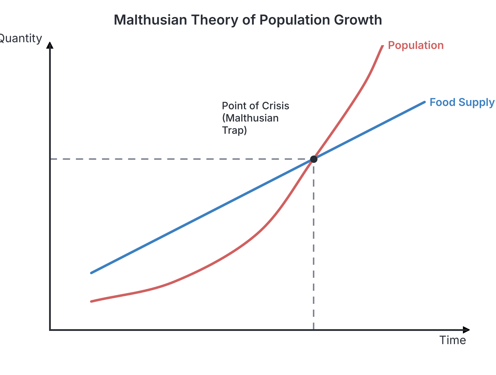
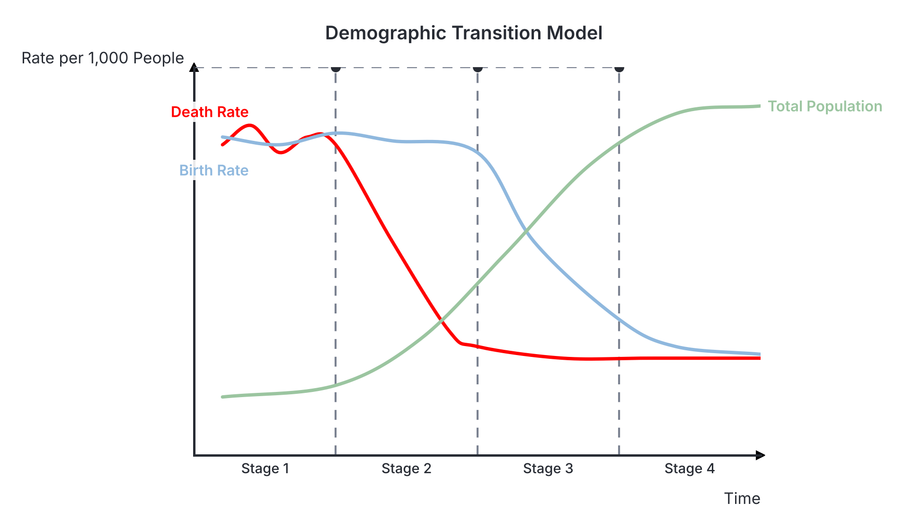
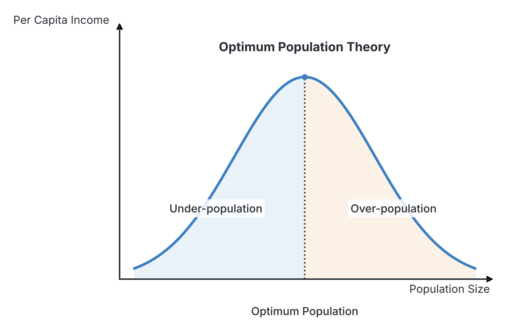
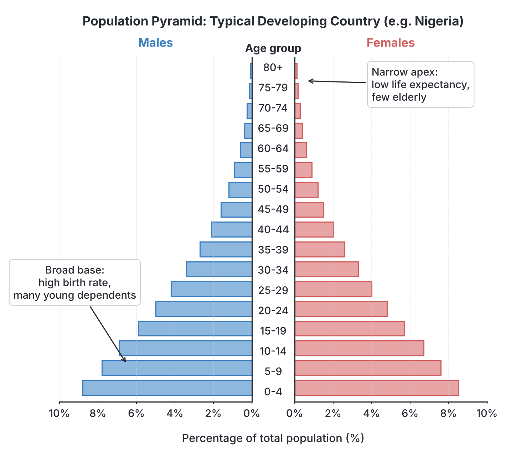

# JAMB Economics Notes: Population

## What JAMB expects

This topic is Section A, Topic 20 of the JAMB Economics syllabus: Population. It covers the following content items:
* a. Meaning and theories;
* b. Census: importance and problems.
* c. Size and growth: over-population, under-population and optimum population.
* d. Structure and distribution; 
* e. Population policy and economic development.

By the end of these notes, you should be able to:
1. Analyse some population theories
2. Examine the relevance of the theories to Nigeria
3. Examine the uses and limitations of census data
4. Identify determinants of the size, composition and growth of population
5. Analyse the structure and distribution of population
6. Appraise government population policy in Nigeria

## Meaning and theories

In economics, **population** refers to the total number of people living in a particular geographical area or country at a specific point in time. Because human beings are both the producers of wealth (as labour) and the consumers of wealth, studying population is central to economics.

### Analyse some population theories

Economists and sociologists have developed several theories to explain how populations grow and the impact of this growth on society. The two most important theories for your JAMB exam are the Malthusian Theory and the Demographic Transition Theory.

#### 1. The Malthusian Theory of Population
Reverend Thomas Robert Malthus, a British clergyman and economist, published his famous "Essay on the Principle of Population" in 1798. He observed the rapid population growth in England and warned that it would eventually lead to disaster.

**Core ideas of the theory:**
1. **Geometric population growth:** Malthus argued that human population grows in a **geometric progression** (1, 2, 4, 8, 16, 32...) if left unchecked.
2. **Arithmetic food growth:** He argued that the food supply only grows in an **arithmetic progression** (1, 2, 3, 4, 5, 6...) due to the law of diminishing returns on land.
3. **The Malthusian Trap:** Because population grows much faster than food production, the population will eventually outgrow the available food supply. This crossing point leads to starvation, poverty, and misery.
4. **Preventive checks:** To avoid this disaster, Malthus suggested humans should voluntarily use "preventive checks" to lower the birth rate. Because he was a clergyman, he opposed artificial birth control and instead suggested late marriage, moral restraint, and sexual abstinence.
5. **Positive checks:** If people fail to use preventive checks, nature will impose "positive checks." These are natural disasters, famines, wars, and diseases that drastically increase the death rate, forcefully killing off the excess population until it matches the food supply again.

**Common mistake:** Students often mix up how population and food grow in this theory. Remember: Population = **Geometric** (explodes quickly), Food = **Arithmetic** (grows steadily).

#### 2. The Demographic Transition Theory
Unlike Malthus, who predicted doom, the Demographic Transition Theory is based on actual historical data. It explains how population growth rates change as a country develops economically and technologically, passing through four distinct stages.

| Stage | Name | Birth Rate | Death Rate | Total Population Growth | Typical Countries |
| --- | --- | --- | --- | --- | --- |
| **Stage 1** | Pre-industrial | **High** | **High** | Stable and low (slow growth) | Isolated tribes, historical societies before modern medicine. |
| **Stage 2** | Early expanding | **High** | **Falling rapidly** | **Rapid growth (Population explosion)** | Nigeria, most of Sub-Saharan Africa. Improved healthcare lowers death rates, but cultural desire for large families keeps birth rates high. |
| **Stage 3** | Late expanding | **Falling** | **Low** | Growth slows down | India, Brazil, South Africa. Urbanization and education of women reduce the birth rate. |
| **Stage 4** | Low stationary | **Low** | **Low** | Stable and high (zero growth) | USA, UK, Japan. Advanced economies where small families are the norm. |

*(Note: Some modern textbooks include a **Stage 5** (Declining), where the birth rate falls below the death rate, causing the population to shrink, as seen in Germany and Italy).*

### Examine the relevance of the theories to Nigeria

**Relevance of the Malthusian Theory:**
- **Why it is relevant:** Nigeria faces rapid population growth that puts severe pressure on housing, schools, healthcare, and jobs. High levels of poverty, hunger, and unemployment in the country mirror the "misery" Malthus predicted.
- **Why it is not strictly true for the modern world:** Malthus failed to foresee massive advancements in agricultural technology (the Green Revolution, fertilizers, tractors) which increased food production much faster than arithmetic progression. He also did not anticipate modern family planning (contraceptives) and international trade, which allows Nigeria to import food it cannot grow.

**Relevance of the Demographic Transition Theory:**
- The theory accurately describes Nigeria's current demographic situation. Nigeria is firmly in **Stage 2** (transitioning slowly to Stage 3). The introduction of modern medicine, immunisation, and sanitation has significantly lowered the death rate compared to a century ago. However, cultural, religious, and economic factors keep the birth rate very high. As a result, Nigeria is experiencing a population explosion.

## Census: importance and problems

A **population census** is the official, periodic, and simultaneous counting of all the people living in a country at a specific time. It is usually carried out by the government at regular intervals (typically every 10 years). In Nigeria, the body responsible for this is the National Population Commission (NPC).

**Types of Census:**
1. **De facto census:** People are counted wherever they are physically found on the day of the census, regardless of where they usually live. It is faster and cheaper but may count temporary visitors and miss residents who travelled.
2. **De jure census:** People are counted based on their permanent place of residence, even if they are not home on census day. It gives a more accurate picture of permanent populations but is difficult and expensive to conduct.

### Examine the uses and limitations of census data

**Importance and uses of census data:**
1. **Economic planning:** Governments use the data to plan the provision of social amenities like schools, hospitals, housing, and roads based on where people live.
2. **Revenue allocation:** In Nigeria, population size is a major criterion used by the Federation Account Allocation Committee (FAAC) to share revenue among federal, state, and local governments.
3. **Political representation:** Census figures are used to create electoral constituencies and determine the number of seats a state gets in the House of Representatives.
4. **Determining standard of living:** By dividing the national income by the total population, the government can calculate the per capita income.
5. **Investment decisions:** Businesses use population data to know the size of potential markets, the available labour force, and where to locate industries.

**Problems and limitations of census in Nigeria:**
1. **Politicisation and inflation of figures:** Because population size determines revenue sharing and political power, states and communities often deliberately inflate their numbers. This makes the data unreliable.
2. **Poor transportation and difficult terrain:** Inadequate road networks and difficult terrains (like the riverine areas of the Niger Delta or remote mountainous regions) make it difficult for enumerators to reach everyone.
3. **High rate of illiteracy:** Many people do not know their exact age or date of birth, leading to inaccurate age distributions.
4. **Cultural and religious beliefs:** Practices such as the *Purdah* system in Northern Nigeria restrict male enumerators from entering homes to count women. Additionally, some cultures superstitiously believe that counting children invites bad luck or death, so parents hide them.
5. **Inadequate funding and personnel:** Conducting a credible census requires billions of naira and thousands of trained staff, which are often lacking. Nigeria's last widely recognised census was in 2006.

## Size and growth: over-population, under-population and optimum population

### Identify determinants of the size, composition and growth of population

The population size of any country is constantly changing. This change is driven by three main demographic factors: birth rate, death rate, and migration.

#### 1. Birth Rate (Natality)
The **Crude Birth Rate** is the number of live births per 1,000 people in a year. 
**Determinants of high birth rate in Nigeria:**
- **Early marriages:** Gives women a longer reproductive window to have more children.
- **Cultural and religious beliefs:** The desire for large families and the strong preference for male children.
- **High infant mortality:** Parents have many children hoping some will survive to adulthood.
- **Polygamy:** One man marrying multiple wives often increases the number of children in a household.
- **Low levels of female education:** Less educated women generally have poorer access to family planning and enter the workforce less often.

#### 2. Death Rate (Mortality)
The **Crude Death Rate** is the number of deaths per 1,000 people in a year.
**Determinants of death rate:**
- Quality of healthcare facilities, medical personnel, and vaccination programmes.
- Levels of public sanitation and access to clean drinking water.
- Nutrition and food security.
- Outbreaks of diseases, wars, and natural disasters.

#### 3. Migration
Migration is the movement of people across borders. 
- **Immigration:** People moving *into* a country.
- **Emigration:** People moving *out* of a country (e.g., the recent wave of Nigerians moving abroad for better opportunities).
- **Net Migration:** The difference between immigrants and emigrants.

**Calculating Population Growth Rate:**
To find out how fast a population is growing, economists use this formula:
$$ \text{Natural Growth Rate} = \text{Birth Rate} - \text{Death Rate} $$
$$ \text{Population Growth Rate} = \text{Natural Growth Rate} + \text{Net Migration Rate} $$

*(Note: These rates are usually given per 1,000. To convert to a percentage, you divide the result by 10).*

**Example Calculation:**
If a country has a birth rate of $40$ per $1,000$, a death rate of $15$ per $1,000$, and a net migration rate of $5$ per $1,000$, calculate the population growth rate as a percentage.
- **Step 1:** Calculate total change per thousand: $(40 - 15) + 5 = 30$ per $1,000$.
- **Step 2:** Convert to percentage: $\frac{30}{1000} \times 100 = 3\%$.
The population is growing at $3\%$ annually.

---

### Concepts of Population Size

Economists judge whether a population is "too big" or "too small" not by the mere number of people, but by comparing the population size to the **available resources** (like land, capital, and technology).

#### 1. Optimum Population
Optimum population is the ideal population size that, when combined with the country's available resources and technology, yields the **maximum per capita income** (highest standard of living). At this point, the workforce is perfectly matched with resources, yielding the highest possible average output per person.

#### 2. Over-population vs Under-population

| Feature | Over-population | Under-population |
| --- | --- | --- |
| **Meaning** | The population has exceeded the optimum level. There are too many people for the available resources. | The population is below the optimum level. There are not enough people to fully utilize the available resources. |
| **Effect on Income** | An increase in population leads to a **fall** in per capita income (diminishing returns). | An increase in population would lead to a **rise** in per capita income (increasing returns). |
| **Characteristics** | High unemployment, congestion, pressure on social amenities, high crime rate, low standard of living. | Shortage of labour, underutilization of land and resources, high wages but low total national output. |
| **Examples** | Nigeria, India, Bangladesh, China. | Canada, Australia, Namibia. |

**Common mistake:** Do not confuse a "large population" with "over-population." The United States has over 330 million people (a very large population), but because its resources and economy are massive, it is not considered over-populated. Over-population is strictly an economic concept about the ratio of people to resources.

## Structure and distribution

### Analyse the structure and distribution of population

Population structure (or composition) looks at how the total population is divided into different categories, such as age, sex, and occupation.

#### 1. Age Distribution and the Dependency Ratio
Age distribution categorizes the population into three major groups:
- **Children / Young dependents (0–14 years)**
- **Working population / Active labour force (15–64 years)**
- **Elderly dependents (65 years and above)**

The relationship between these groups is measured by the **Dependency Ratio**. This ratio shows the burden placed on the working population to support those who are too young or too old to work.

$$ \text{Dependency Ratio} = \frac{\text{Children (0-14)} + \text{Elderly (65+)}}{\text{Working Population (15-64)}} \times 100\% $$

**Common mistake:** When calculating the dependency ratio, make sure to divide by the **working population**, not the total population. 

**Example Calculation:**
If a country has a total population of $100$ million, with $40$ million children and $10$ million elderly people, what is the dependency ratio?
- **Dependent population:** $40 \text{ million} + 10 \text{ million} = 50 \text{ million}$.
- **Working population:** $100 \text{ million} - 50 \text{ million} = 50 \text{ million}$.
- **Dependency Ratio:** $\frac{50}{50} \times 100\% = 100\%$.

*Meaning:* A ratio of $100\%$ means that for every $1$ worker, there is exactly $1$ dependent to support. Developing countries like Nigeria have very high dependency ratios mainly because of high birth rates creating millions of young dependents.

#### 2. The Population Pyramid
A population pyramid is a bar chart that visually represents the age and sex distribution of a country. 
- **Males** are typically on the left, **Females** on the right.
- **Age groups** are stacked vertically (youngest at the base, oldest at the top).
- **Developing countries (like Nigeria):** Have an **expansive** pyramid with a very **broad base** (indicating high birth rates and a young population) and a narrow top (indicating low life expectancy).
- **Developed countries (like Germany):** Have a **constrictive** or stationary pyramid that is narrow at the base and bulges in the middle, indicating low birth rates and an aging population.

#### 3. Sex and Occupational Distribution
- **Sex distribution:** The ratio of males to females in the population. It helps governments plan for gender-specific needs (e.g., maternal healthcare, girls' education).
- **Occupational distribution:** Shows how the workforce is spread across economic sectors. In Nigeria, the majority of the population is engaged in the **Primary sector** (agriculture, mining, fishing). In developed countries, the majority are in the **Tertiary sector** (services, banking, tech).

#### 4. Geographical / Spatial Distribution
This shows how people are spread across the land area of a country. Population in Nigeria is unevenly distributed:
- **Densely populated areas:** Lagos, Kano, and states in the South-East (e.g., Anambra, Imo). People cluster here due to job opportunities, industries, historical factors, and better infrastructure.
- **Sparsely populated areas:** Borno, Taraba, and Niger states. People avoid these areas due to harsh climates, difficult terrain, or insecurity.
- **Rural-Urban Migration:** The rapid movement of youth from villages to cities looking for white-collar jobs is severely altering geographical distribution, leading to urban congestion and rural depopulation (which harms agricultural output).

## Population policy and economic development

### Appraise government population policy in Nigeria

A **population policy** is a deliberate set of guidelines and measures created by a government to influence the size, growth rate, and distribution of its population to achieve sustainable economic development.
- **Pro-natalist policies:** Encourage citizens to have more children. These are used by under-populated or rapidly aging countries.
- **Anti-natalist policies:** Encourage citizens to have fewer children. These are used by over-populated countries to curb explosive growth.

**Nigeria's Population Policy:**
To address the severe economic challenges of rapid population growth, the Nigerian government launched the **National Policy on Population (NPP)** in 1988. It famously aimed to encourage families to have a maximum of "four children per woman." It was later revised in 2004 as the National Policy on Population for Sustainable Development. 

**Objectives of the policy:**
1. To reduce the annual population growth rate.
2. To improve maternal and child health and reduce infant mortality.
3. To provide universal access to family planning and reproductive health education.
4. To reduce the rate of rural-urban migration by developing rural areas.

**Appraisal (Successes and Failures):**
- **Successes:** The policy successfully raised public awareness about the dangers of over-population. It increased the use of modern contraceptives and improved child immunization programs, which significantly reduced infant deaths. It also helped integrate demographic data into national economic planning.
- **Failures:** Despite the policy, Nigeria's birth rate and overall growth rate remain extremely high. The policy has largely struggled due to cultural and religious resistance to birth control, widespread rural poverty, high illiteracy rates, and poor funding and implementation by successive governments.

## Key terms

| Term | Meaning |
| --- | --- |
| **Population** | The total number of people living in a particular area at a specific time. |
| **De facto census** | Counting people wherever they are physically found on census day. |
| **De jure census** | Counting people based on their permanent place of residence. |
| **Optimum population** | The population size that yields the highest per capita income given available resources. |
| **Over-population** | A situation where population exceeds available resources, lowering living standards. |
| **Under-population** | A situation where population is too small to fully utilize available resources. |
| **Dependency ratio** | The ratio of dependents (children and elderly) to the working population. |
| **Crude birth rate** | The number of live births per 1,000 people in a given year. |
| **Net migration** | The difference between the number of immigrants and emigrants. |
| **Population pyramid** | A bar chart showing the age and sex distribution of a population. |

## Exam tips and common mistakes

- **Large population vs Over-population:** Never assume a country is over-populated just because it has millions of people. Over-population strictly means the population is too large for the *available resources*.
- **Malthusian variables:** Remember the exact match: Population grows **geometrically**, Food grows **arithmetically**. Mixing these up is the most common student mistake on Malthusian questions.
- **Optimum Population outcome:** Optimum population maximizes **per capita income**, NOT total national income. A larger population might yield a higher total income, but the wealth per person will drop.
- **Dependency ratio formula:** When calculating the dependency ratio, the denominator is the **working population (15-64)**, not the total population.
- **Pyramid base:** A broad base on a population pyramid always indicates a high birth rate (a large number of children).

## Quick summary

1. Malthus warned that population grows geometrically while food grows arithmetically, leading to a crisis unless preventive or positive checks occur.
2. The Demographic Transition Theory places developing countries like Nigeria in Stage 2, characterized by a high birth rate, a rapidly falling death rate, and explosive population growth.
3. A population census is crucial for economic planning and revenue allocation, but in Nigeria, it is plagued by politicisation, difficult terrains, and illiteracy.
4. Population size is determined by birth rates, death rates, and net migration.
5. Optimum population yields the highest per capita income; exceeding it causes over-population, while falling short is under-population.
6. The dependency ratio measures the financial burden of children and the elderly on the working-age population. Nigeria has a very high dependency ratio.
7. Nigeria's population pyramid has a broad base, showing a high proportion of young people due to high birth rates.
8. Nigeria's population policy aims to reduce the growth rate and improve maternal health through family planning, though cultural factors hinder its success.

## Practice questions

**1. According to Thomas Malthus, population increases in a ________ progression, while food supply increases in an ________ progression.**

- A. geometric; arithmetic
- B. arithmetic; geometric
- C. harmonic; linear
- D. static; exponential

**Answer: A.** Malthus argued that population grows geometrically (1, 2, 4, 8) while food supply grows arithmetically (1, 2, 3, 4). Mistake for B: Reversing the two concepts is a classic trap.

**2. A population census where people are counted based on where they are physically present on the day of the enumeration is called a**

- A. de jure census
- B. de facto census
- C. sample survey
- D. vital registration

**Answer: B.** A de facto census counts people where they are found on the day, not where they permanently live. Mistake for A: Confusing it with a de jure census, which counts by permanent legal residence.

**3. A country has a crude birth rate of 45 per 1,000 and a crude death rate of 15 per 1,000. If its net migration rate is 2 per 1,000, what is the annual population growth rate?**

- A. 3.0%
- B. 3.2%
- C. 6.2%
- D. 2.8%

**Answer: B.** Growth Rate = (Birth Rate - Death Rate) + Net Migration = (45 - 15) + 2 = 32 per 1,000. To convert to a percentage, divide by 10, which gives 3.2%. Mistake for A: Ignoring the net migration rate to only calculate the natural growth rate.

**4. If a country has a total population of 100 million, with 40 million children under 15 years and 10 million elderly people over 65 years, the dependency ratio is**

- A. 50%
- B. 100%
- C. 40%
- D. 200%

**Answer: B.** Dependent population = 40 + 10 = 50 million. Working population = 100 - 50 = 50 million. Dependency Ratio = (50 / 50) * 100% = 100%. Mistake for A: Dividing dependents by the total population (50 / 100) instead of dividing by the working population.

**5. In the demographic transition theory, Stage 2 (which describes many developing countries like Nigeria) is characterized by**

- A. low birth rate and low death rate
- B. high birth rate and high death rate
- C. high birth rate and rapidly falling death rate
- D. falling birth rate and rising death rate

**Answer: C.** In Stage 2, modern medicine drastically lowers the death rate, but cultural factors keep the birth rate high, leading to a population explosion. Mistake for B: Choosing Stage 1 (pre-industrial) instead of Stage 2.

**6. Optimum population is defined as the population size that**

- A. has an equal number of males and females
- B. produces the maximum total national income
- C. yields the highest per capita income given available resources
- D. eliminates unemployment completely

**Answer: C.** Optimum population matches people perfectly to resources to produce the highest possible output per head (per capita income). Mistake for B: Confusing maximum total income with maximum per capita income; a larger population might produce more overall, but less wealth per person.

**7. A population pyramid with a very broad base and a narrow top indicates**

- A. a high proportion of elderly dependents
- B. a high birth rate and a young population
- C. a low death rate and an aging population
- D. a high life expectancy

**Answer: B.** The base of the pyramid represents the youngest age groups. A broad base means many children are being born. Mistake for A: Misinterpreting the narrow top, which actually means few people survive to old age.

**8. Which of the following strongly encourages the politicisation and inflation of census figures in Nigeria?**

- A. The need to impress international organizations
- B. The use of population size for revenue allocation and political representation
- C. The high rate of illiteracy in rural areas
- D. The cultural belief that counting children causes death

**Answer: B.** Because federal revenue and seats in the House of Representatives are shared based on population size, states have a direct economic and political incentive to inflate their numbers. Mistake for C: Illiteracy causes accidental inaccuracies with ages, but revenue allocation drives deliberate inflation.

**9. A country is said to be under-populated when**

- A. its total population is less than 10 million
- B. it has a low birth rate
- C. an increase in population would lead to an increase in per capita income
- D. its resources are fully exhausted

**Answer: C.** Under-population means resources are idle because there are not enough people. Therefore, adding more people will increase efficiency and raise per capita income. Mistake for A: Defining it by an absolute number, ignoring that under-population is an economic concept relating people to resources.

**10. A major objective of government population policy in Nigeria is to**

- A. increase the rural-urban migration rate
- B. reduce the rate of population growth through family planning
- C. encourage large family sizes to increase the labour force
- D. deport foreign immigrants to create jobs

**Answer: B.** The National Policy on Population aims to slow down the rapid growth rate by educating the public and providing access to modern family planning. Mistake for C: Assuming developing countries want more people for labour, whereas Nigeria's policy actually aims to control growth to reduce poverty and unemployment.
