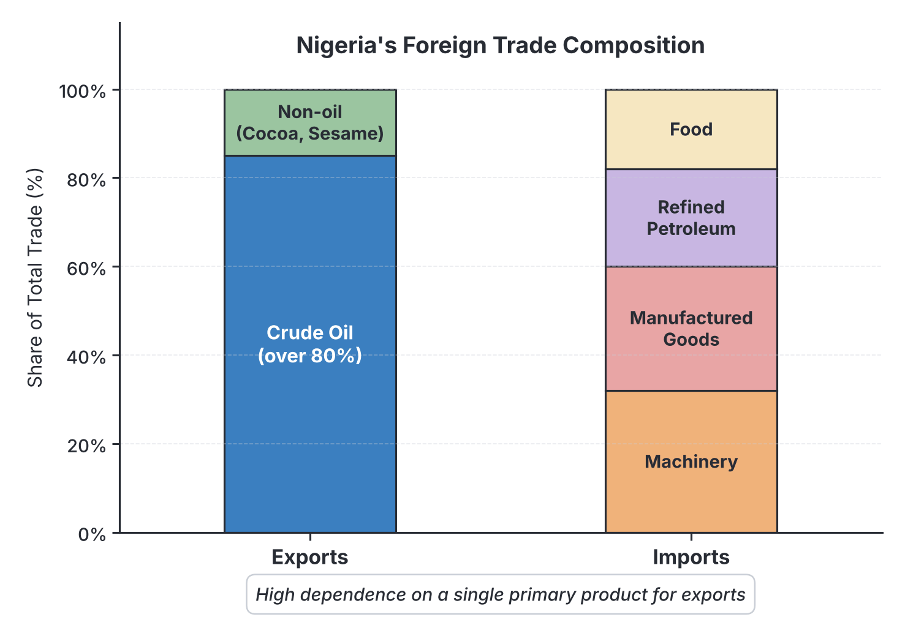
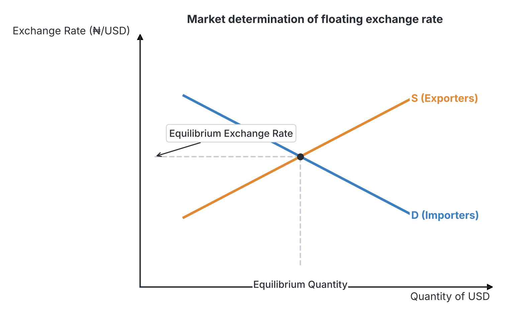

# JAMB Economics Notes: International Trade

## What JAMB expects

This topic is Section A, Topic 21 of the JAMB UTME Economics syllabus. It covers the fundamental principles that govern how and why countries trade with one another, how this trade is recorded, and how currencies are exchanged. 

This file covers the following content items from the syllabus:
- **a.** Meaning and basis for international trade (absolute and comparative costs etc.)
- **b.** Balance of trade and balance of payments: problems and corrective measures;
- **c.** Composition and direction of Nigeria’s foreign trade;
- **d.** Exchange rate: meaning, types and determination.

By the end of these notes, you should be able to:
1. Examine the basis for international trade.
2. Differentiate between absolute and comparative advantages.
3. Distinguish between balance of trade and balance of payments and their corrective measures.
4. Highlight the problems of balance of payments and their corrective measures.
5. Examine the composition and direction of Nigeria’s foreign trade.
6. Identify the types of exchange rates.
7. Examine how exchange rates are determined.

## Meaning and basis for international trade

**International trade** (also known as foreign trade or external trade) is the exchange of goods, services, and capital across international borders or territories. It involves transactions between the residents, businesses, or governments of one country and those of another. 

When a country sells goods to another country, it is called an **export**. When a country buys goods from another country, it is called an **import**. 

Before diving into why countries trade, it is important to understand how international trade differs from domestic trade (trade within the borders of a single country, like transporting yams from Benue to Lagos).

### Domestic vs. International Trade

While both involve buying and selling, they differ significantly in their execution and complexity.

| Feature | Domestic (Internal) Trade | International (External) Trade |
| :--- | :--- | :--- |
| **Boundaries** | Takes place within the geographical boundaries of one country. | Takes place across the borders of two or more countries. |
| **Currency** | Uses a single domestic currency (e.g., only the Naira is used across Nigeria). | Involves multiple currencies, requiring foreign exchange (e.g., changing Naira to US Dollars or Chinese Yuan). |
| **Mobility of Factors** | Factors of production (labour and capital) move freely within the country. | Mobility of labour and capital is restricted by immigration laws, visas, and capital controls. |
| **Legal and Tax Systems** | Subject to one set of commercial laws and internal taxes. | Subject to different legal systems, international laws, import duties (tariffs), and quotas. |
| **Language and Culture** | Usually conducted in a shared language or familiar cultural context. | Often involves overcoming language barriers and differing business cultures. |
| **Transport Costs** | Generally lower, as distances are shorter and involve roads or domestic rail. | Generally higher, involving international shipping lines, air freight, and complex logistics. |

### Examine the basis for international trade

No single country in the world can produce everything its citizens need to survive and thrive. A completely closed economy that does not trade with anyone is called an **autarky**. Today, autarky is virtually impossible. The reasons why countries engage in international trade are known as the **basis for international trade**. They include:

1. **Unequal Distribution of Natural Resources:** 
   Nature has not distributed resources evenly. Some countries are blessed with abundant mineral resources, while others have none. For example, Nigeria has vast reserves of crude oil in the Niger Delta but lacks natural deposits of copper. Japan has very few natural resources but requires huge amounts of oil to power its industries. Therefore, Nigeria exports oil to resource-poor industrial nations.
2. **Climatic and Soil Differences:**
   Agricultural products depend heavily on climate and soil types. Tropical crops like cocoa, rubber, and palm produce thrive in the hot, humid climate of West Africa (Nigeria, Ghana, Côte d'Ivoire). Temperate crops like wheat and apples grow better in cooler climates like Europe or North America. Trade allows Nigerians to eat imported apples and Europeans to consume chocolate made from West African cocoa.
3. **Differences in Technology and Skills:**
   Some countries have advanced technological know-how and a highly skilled workforce capable of producing complex machinery, aircraft, and electronics. Countries like the United States, Germany, and South Korea export heavy machinery, vehicles, and electronics to developing nations, while importing primary agricultural or mineral products in return.
4. **Differences in Capital Availability:**
   Capital-intensive production requires massive financial investment. Developed countries with large pools of capital can easily produce capital-intensive goods (like automobiles and pharmaceuticals), whereas developing countries with less capital might focus on labour-intensive goods (like textiles or simple assembly) because labour is cheaper and more abundant there.
5. **Differences in Cost of Production:**
   Because of the factors listed above, the cost of producing a specific good varies from country to country. A country will choose to buy a product from abroad if it is significantly cheaper to import it than to produce it at home. This leads us directly to the theories of absolute and comparative advantage.

### Differentiate between absolute and comparative advantages

To explain mathematically why trade benefits everyone, economists developed two foundational theories. 

#### 1. The Theory of Absolute Advantage
This theory was propounded by the Scottish economist **Adam Smith** in his famous 1776 book, *The Wealth of Nations*. 

**Absolute advantage** occurs when a country can produce a given quantity of a good using **fewer resources** (or at a lower cost) than another country, or when it can produce **more output** with the same amount of resources. 

Adam Smith argued that a country should specialize in producing the good in which it has an absolute advantage and trade it for the good in which the other country has an absolute advantage.

**Example of Absolute Advantage:**
Let us look at the daily output of one worker in Country A and Country B, producing two goods: Cocoa and Laptops.

| Country | Cocoa (units per worker per day) | Laptops (units per worker per day) |
| :--- | :--- | :--- |
| **Country A (e.g., Nigeria)** | **20** | 5 |
| **Country B (e.g., Japan)** | 5 | **20** |

- **Country A** can produce 20 units of Cocoa per day, while Country B can only produce 5. Country A has an **absolute advantage** in Cocoa.
- **Country B** can produce 20 Laptops per day, while Country A can only produce 5. Country B has an **absolute advantage** in Laptops.
- **Conclusion:** Adam Smith's theory states that Country A should specialize entirely in Cocoa, Country B should specialize entirely in Laptops, and they should trade with each other. Both countries will end up with more Cocoa and more Laptops than if they tried to produce both themselves.

#### 2. The Theory of Comparative Advantage (Comparative Cost)
In 1817, another classical economist, **David Ricardo**, noticed a flaw in Adam Smith’s theory. What if one country is better at producing *everything*? If Country A has an absolute advantage in both Cocoa and Laptops, should trade still happen?

Ricardo introduced the **Theory of Comparative Advantage**, which states that trade is still mutually beneficial if countries specialize in producing the goods where they have a **lower opportunity cost**, regardless of absolute advantage.

**Opportunity cost** is the value of the next best alternative forgone. In international trade, the opportunity cost of producing one good is the amount of the *other* good you must give up to produce it.

**Example of Comparative Advantage:**
Let us look at a new table showing the daily output of one worker in Country X and Country Y, producing Wheat and Cars.

| Country | Wheat (units per worker per day) | Cars (units per worker per day) |
| :--- | :--- | :--- |
| **Country X** | **100** | **50** |
| **Country Y** | 40 | 10 |

*Notice that Country X has an absolute advantage in BOTH Wheat (100 > 40) and Cars (50 > 10).* 

To find out who should produce what, we must calculate the **opportunity cost** for each product in each country. The formula is:

$$Opportunity\ Cost = \frac{Alternative\ Output\ Given\ Up}{Target\ Output\ Gained}$$

**Step 1: Calculate the opportunity cost of producing 1 unit of Cars.**
- In **Country X**: To produce 50 Cars, they give up 100 Wheat. 
  Opportunity cost of 1 Car = $100 / 50$ = **2 units of Wheat**.
- In **Country Y**: To produce 10 Cars, they give up 40 Wheat. 
  Opportunity cost of 1 Car = $40 / 10$ = **4 units of Wheat**.
- **Decision:** Country X gives up fewer units of Wheat (2) than Country Y (4) to produce one Car. Therefore, **Country X has a comparative advantage in Cars**.

**Step 2: Calculate the opportunity cost of producing 1 unit of Wheat.**
- In **Country X**: To produce 100 Wheat, they give up 50 Cars. 
  Opportunity cost of 1 Wheat = $50 / 100$ = **0.5 units of Cars**.
- In **Country Y**: To produce 40 Wheat, they give up 10 Cars. 
  Opportunity cost of 1 Wheat = $10 / 40$ = **0.25 units of Cars**.
- **Decision:** Country Y gives up fewer Cars (0.25) than Country X (0.5) to produce one Wheat. Therefore, **Country Y has a comparative advantage in Wheat**.

**Conclusion:** Even though Country X is better at producing both, it should specialize in Cars (where its advantage is greatest), and Country Y should specialize in Wheat (where its disadvantage is least). If they trade based on this, global production increases, and both countries benefit.

#### Assumptions of the Comparative Cost Theory
David Ricardo’s model was theoretical and relied on several simplifying assumptions that JAMB often tests:
1. There are only **two countries** involved in trade.
2. There are only **two commodities** being produced and traded.
3. Labour is the only factor of production, and its cost determines the value of goods (Labour Theory of Value).
4. Factors of production are perfectly mobile *within* a country but completely immobile *between* countries.
5. There are **no transport costs** or trade barriers (like tariffs).
6. There is perfect competition in the market.

#### Differentiating Absolute and Comparative Advantages

| Feature | Absolute Advantage (Adam Smith) | Comparative Advantage (David Ricardo) |
| :--- | :--- | :--- |
| **Core Concept** | Producing a good using fewer resources or at a lower direct cost than another country. | Producing a good at a lower **opportunity cost** than another country. |
| **Decision Rule** | Specialize in what you are absolutely best at. | Specialize in what you are relatively better at (lowest opportunity cost). |
| **Trade Scenario** | Cannot explain trade if one country is better at producing everything. | Explains how trade benefits both countries even if one country is superior in producing everything. |

## Balance of trade and balance of payments

When a country trades with the rest of the world, it must keep a record of its transactions. These records are the Balance of Trade and the Balance of Payments. Students frequently confuse the two, but they measure different things.

### Distinguish between balance of trade and balance of payments and their corrective measures

#### 1. Balance of Trade (BOT)
The **Balance of Trade** is the difference between the monetary value of a country's **visible exports** and its **visible imports** over a given period, usually one year. 

- **Visible Goods:** These are physical, tangible goods that can be seen, touched, and counted as they cross the border at seaports or airports. Examples include crude oil, cocoa, machinery, vehicles, and electronics.
- **Favourable (Active) Balance of Trade:** Occurs when the value of visible exports is strictly greater than the value of visible imports. The country earns more from selling physical goods than it spends buying them.
- **Unfavourable (Passive) Balance of Trade:** Occurs when the value of visible imports is greater than the value of visible exports.

#### 2. Balance of Payments (BOP)
The **Balance of Payments** is a broader, comprehensive statement that records **all economic transactions** (both visible and invisible) between the residents of a country and the rest of the world over a given period, usually a year. 

Because it is based on the accounting principle of double-entry bookkeeping, the BOP as an accounting statement always balances (total debits equal total credits). However, in economic terms, a country can have a BOP surplus or deficit.

The Balance of Payments is divided into three main accounts:
1. **The Current Account:** This is the most important section for exams. It records:
   - *Visible Trade:* Exports and imports of physical goods (this is the BOT).
   - *Invisible Trade:* Exports and imports of **services**. If a Nigerian flies on British Airways (a UK company), Nigeria is importing a transport service. Other invisibles include tourism, banking, insurance, and shipping.
   - *Income:* Profits, dividends, and interest payments sent into or out of the country by investors.
   - *Unilateral Transfers:* One-way transfers of money with nothing given in return. A major example for Nigeria is **remittances** (money sent home by Nigerians living in the diaspora) and foreign aid or grants.
2. **The Capital Account:** Records transactions involving capital transfers and the acquisition or disposal of non-produced, non-financial assets (like land for embassies).
3. **The Financial Account (formerly part of the Capital Account):** Records foreign direct investments (FDI), portfolio investments (buying shares in foreign stock markets), and borrowing/lending by the government or private sector.

*Official Reserves Account:* This acts as the balancing item. It shows the changes in the Central Bank's holdings of foreign currencies, gold, and Special Drawing Rights (SDRs).

#### Differences between Balance of Trade and Balance of Payments

| Feature | Balance of Trade (BOT) | Balance of Payments (BOP) |
| :--- | :--- | :--- |
| **Scope** | Narrow scope. It is just one component of the BOP. | Broad scope. It includes the BOT and much more. |
| **Items Included** | Only includes **visible** (tangible physical) goods. | Includes both **visible** goods, **invisible** services, capital transfers, and financial flows. |
| **Economic Indicator** | Gives a partial view of the country's economic relationship with the world. | Gives a complete and true picture of the country's international financial position. |

### Highlight the problems of balance of payments and their corrective measures

A country is said to have an **Adverse (Deficit) Balance of Payments** when its total international expenditures (money flowing out for imports, services, and capital flight) exceed its total international receipts (money flowing in from exports, services, and investments). 

#### Problems of an Adverse Balance of Payments
Persistent BOP deficits are dangerous for an economy like Nigeria for several reasons:
1. **Depletion of Foreign Reserves:** To pay for the excess imports, the Central Bank must spend its saved foreign currency (like US Dollars). If the deficit continues, the country will run out of reserves.
2. **Depreciation of the Currency:** High demand for foreign goods means high demand for foreign currency. This causes the local currency (e.g., the Naira) to lose value against foreign currencies, making life harder for citizens.
3. **Imported Inflation:** As the local currency depreciates, the cost of importing essential goods (like medicine or machinery) skyrockets, leading to general price increases within the country.
4. **Mounting External Debt:** To survive the deficit without emptying reserves, the government may be forced to borrow heavily from international bodies like the IMF or World Bank, leading to a severe debt burden for future generations.
5. **Loss of Economic Sovereignty:** Severe deficits often force countries to accept harsh economic conditions dictated by foreign lenders.

#### Corrective Measures for Adverse Balance of Payments
To correct a BOP deficit, a government must implement policies to reduce imports and increase exports. These are heavily tested in exams.

**1. Tariffs (Import Duties):**
A tariff is a tax placed on imported goods. By taxing imports, their prices in the local market increase. This discourages citizens from buying foreign goods and encourages them to buy cheaper locally made alternatives, reducing the outflow of money.

**2. Import Quotas:**
A quota is a physical limit placed by the government on the quantity of a specific good that can be imported over a period. For instance, the government might declare that only 10,000 foreign cars can be imported this year. Once the limit is reached, no more money leaves the country for cars.

**3. Exchange Control:**
The Central Bank can restrict access to foreign exchange. If an importer wants to buy foreign luxury goods, the Central Bank simply refuses to sell them US Dollars. This forcibly reduces imports because traders cannot pay their foreign suppliers. 

**4. Devaluation of the Currency:**
**Devaluation** is the deliberate, official reduction in the value of a country's currency relative to foreign currencies by the government (in a fixed exchange rate system). 
- *How it works:* If the Naira is devalued, Nigerian exports become cheaper and more attractive to foreigners (increasing export revenue). Simultaneously, foreign imports become very expensive for Nigerians, forcing them to buy local goods (decreasing import expenditure).
- *Exam Tip:* Devaluation only works if the demand for exports and imports is **price elastic**. This is known as the **Marshall-Lerner condition**. If a country imports essential goods that it cannot produce (like fuel in Nigeria), people will keep buying them even when prices rise, and devaluation will just cause inflation without fixing the BOP deficit.

**5. Export Promotion:**
The government can encourage local industries to produce for foreign markets by granting them tax holidays, export subsidies, or providing cheap credit. More exports mean more foreign currency flowing into the country.

**6. Import Substitution:**
This is a long-term industrialization strategy where a country starts producing the goods it used to import. For example, instead of importing refined petroleum, building local oil refineries substitutes the imports, saving massive amounts of foreign exchange.

**7. Deflationary Policies (Expenditure-reducing):**
The government can use tight monetary policy (raising interest rates) or tight fiscal policy (increasing taxes and cutting government spending) to reduce the total amount of money in citizens' pockets. If citizens are poorer, aggregate demand falls, which automatically reduces their demand for imported goods.

## Composition and direction of Nigeria's foreign trade

To understand Nigeria's role in the global economy, we must look at what the country trades (composition) and who it trades with (direction). 

### Examine the composition and direction of Nigeria's foreign trade

#### 1. Composition of Nigeria's Foreign Trade
**Composition of trade** refers to the physical makeup or the types of goods and services a country exports and imports. 

*   **Exports (What Nigeria sells):**
    Historically (before the 1970s), Nigeria’s exports were dominated by agricultural cash crops like cocoa, groundnut, palm oil, and rubber. 
    Today, Nigeria's export composition is highly undiversified. **Crude oil and petroleum gas (hydrocarbons)** account for the vast majority (often between 80% to 90%) of the country's total export earnings. Because of this, the Nigerian economy is highly vulnerable to shocks in the global oil market.
    **Non-oil exports** make up a small fraction of trade and include agricultural products like cocoa beans, sesame seeds, cashew nuts, and solid minerals like tin and columbite. Notice that Nigeria primarily exports **primary products** (raw materials with no value added).
*   **Imports (What Nigeria buys):**
    Nigeria relies heavily on the importation of **secondary (manufactured) products**. The major imports include heavy machinery, mechanical appliances, electrical equipment, motor vehicles, and chemicals. 
    Ironically, despite being a massive exporter of crude oil, one of Nigeria's largest import expenses for decades has been **refined petroleum products** (PMS/petrol, diesel), because of inadequate domestic refining capacity. Nigeria also imports significant amounts of food items (like wheat and, historically, rice).

#### 2. Direction of Nigeria's Foreign Trade
**Direction of trade** refers to the countries that a nation trades with—its trading partners.

*   **Pre-Independence and Post-Independence (The Colonial Legacy):** Up until the late 20th century, the direction of Nigeria's trade was heavily skewed towards the **United Kingdom** and Western Europe due to historical colonial ties. 
*   **Modern Shift to Asia:** In recent decades, the direction of Nigeria’s trade has shifted dramatically towards Asia. **China** is now one of Nigeria’s largest trading partners, completely dominating the origin of Nigeria's imports (machinery, electronics, textiles). **India** has become one of the top destinations for Nigeria's crude oil exports. 
*   **Other Major Partners:** The United States and the European Union (Netherlands, Spain, France) remain significant buyers of Nigerian oil and suppliers of capital goods.
*   **Intra-African Trade:** Despite the existence of the Economic Community of West African States (ECOWAS) and the African Continental Free Trade Area (AfCFTA), Nigeria's trade with other African nations remains surprisingly low compared to its trade with Europe and Asia. This is because many African nations produce similar primary agricultural goods and lack the industrial base to supply the manufactured goods Nigeria needs.

## Exchange rate: meaning, types and determination

Because different countries use different currencies, international trade requires a mechanism to translate the value of one currency into another. 

**Meaning of Exchange Rate:** 
The exchange rate is the price of one country's currency expressed in terms of another country's currency. For example, if the exchange rate is 1 USD = ₦800, it means you must pay 800 Naira to purchase one US Dollar. 

### Identify the types of exchange rates

Different countries use different systems to manage how their currency is valued against others. 

1. **Fixed (Pegged) Exchange Rate:**
   In a fixed system, the government or the Central Bank officially determines the exchange rate and legally pegs it to a major world currency (like the US Dollar) or a basket of currencies. The Central Bank promises to buy and sell foreign exchange at this exact rate. 
   - *Advantage:* Provides stability and certainty for international traders and investors. 
   - *Disadvantage:* The Central Bank must hold massive foreign reserves to defend the fixed rate. If they run out of reserves, the system collapses.
2. **Floating (Flexible) Exchange Rate:**
   In a pure floating system, the government does not interfere. The exchange rate is determined entirely by the free market forces of **demand and supply** for the currency in the foreign exchange (forex) market.
   - *Advantage:* It automatically corrects balance of payments deficits. The Central Bank does not need to waste its reserves defending the currency.
   - *Disadvantage:* It can lead to extreme volatility and uncertainty, making it hard for businesses to plan long-term.
3. **Managed Floating (Dirty Float) Exchange Rate:**
   This is a hybrid of fixed and floating systems and is the most common system in the world today. The exchange rate is generally allowed to float and be determined by market forces. However, the Central Bank will intervene (by buying or selling foreign currency) if the exchange rate fluctuates too wildly or moves in a direction that harms the economy. 
4. **Multiple Exchange Rates:**
   This occurs when a country operates different official exchange rates for different types of transactions. For example, the government might provide a cheaper, subsidized exchange rate for importing essential medicines, while using a higher, market-driven rate for general businesses or tourists. Historically, Nigeria has frequently operated multiple exchange rate windows.

### Examine how exchange rates are determined

While fixed rates are determined by government decree, floating exchange rates are determined in the foreign exchange market by the interaction of **Demand and Supply**. Let us look at the market for US Dollars in Nigeria.

**1. The Demand for Foreign Exchange (US Dollars):**
Who in Nigeria wants to buy US Dollars? 
- Importers who need to pay foreign suppliers for goods (cars, machinery).
- Nigerians traveling abroad for tourism, medical treatment, or education.
- Foreign investors taking their profits out of Nigeria (capital flight).
- The demand curve for dollars slopes downwards. If the exchange rate is high (e.g., ₦1500/USD), imports are too expensive, so the demand for dollars is low. If the exchange rate falls (e.g., ₦500/USD), imports become cheap, and the demand for dollars increases.

**2. The Supply of Foreign Exchange (US Dollars):**
Who brings US Dollars into Nigeria?
- Exporters selling crude oil or cocoa to foreign buyers.
- Nigerians in the diaspora sending remittances home.
- Foreign investors bringing capital to start businesses or buy Nigerian bonds.
- The supply curve for dollars slopes upwards. If the exchange rate is high, exporters get more Naira for their dollars, encouraging them to sell more goods abroad, increasing the supply of dollars.

**Equilibrium Exchange Rate:**
The exchange rate is determined at the point where the quantity of dollars demanded equals the quantity of dollars supplied. This is the **equilibrium point**.

- **Depreciation:** If the demand for dollars rises (e.g., Nigerians want to import more) and supply remains the same, the price of the dollar will go up. The Naira has *depreciated*. Note the terminology: "Depreciation" is used in a floating system, while "Devaluation" is a deliberate government action in a fixed system.
- **Appreciation:** If the supply of dollars increases (e.g., global oil prices rise, bringing more dollars into Nigeria), the price of the dollar falls relative to the Naira. The Naira has *appreciated*.

## Key terms

| Term | Meaning |
| :--- | :--- |
| **International Trade** | The exchange of goods, services, and capital across international borders. |
| **Absolute Advantage** | When a country can produce a good using fewer resources or at a lower cost than another country. |
| **Comparative Advantage** | When a country can produce a good at a lower opportunity cost than another country. |
| **Opportunity Cost** | The value of the next best alternative forgone; calculated as (Alternative Output / Target Output). |
| **Visible Trade** | The import and export of tangible, physical goods (e.g., oil, cars). |
| **Invisible Trade** | The import and export of services (e.g., shipping, tourism, education). |
| **Balance of Trade (BOT)** | The difference between the value of a country's visible exports and visible imports. |
| **Balance of Payments (BOP)** | A comprehensive record of all economic transactions between a country and the rest of the world over a year. |
| **Current Account** | The part of the BOP that records visible trade, invisible trade, income, and unilateral transfers. |
| **Tariff** | A tax imposed by the government on imported goods. |
| **Quota** | A physical limit placed on the quantity of a good that can be imported. |
| **Devaluation** | The deliberate reduction in the value of a currency by the government in a fixed exchange rate system. |
| **Exchange Rate** | The price of one currency expressed in terms of another currency. |
| **Remittances** | Money sent home by citizens working and living abroad. |

## Exam tips and common mistakes

- **Absolute vs. Comparative:** Adam Smith = Absolute Advantage. David Ricardo = Comparative Advantage. Look out for the phrase "opportunity cost" to identify Ricardo's theory in multiple-choice questions.
- **Visible vs. Invisible:** When a JAMB question asks which item is "invisible," look for services. A Nigerian student paying school fees in Canada is importing an invisible service. 
- **Devaluation vs. Depreciation:** Devaluation is done by the *government* (fixed rate). Depreciation happens by *market forces* (floating rate). 
- **BOT vs. BOP:** BOT is narrow (only physical goods). BOP is broad (everything). A country can have a favourable BOT but an adverse BOP if it spends too much on invisible services or suffers massive capital flight.
- **Calculating Opportunity Cost:** When given a table of output, to find the opportunity cost of Good A, divide the maximum production of Good B by the maximum production of Good A. The country with the smaller resulting number has the comparative advantage.
- **Marshall-Lerner Condition:** Remember that devaluation only successfully corrects a BOP deficit if the combined price elasticities of demand for exports and imports are greater than one (elastic).

## Quick summary

1. International trade occurs due to differences in natural resources, climate, technology, capital, and production costs.
2. The Theory of Absolute Advantage states countries should specialize in what they produce cheapest. The Theory of Comparative Advantage states they should specialize in what they produce with the lowest opportunity cost.
3. The Balance of Trade records only physical goods, while the Balance of Payments is a comprehensive record of all financial flows including goods, services, income, and capital.
4. An adverse (deficit) balance of payments drains a country's reserves and depreciates its currency. It can be corrected using tariffs, quotas, exchange controls, devaluation, or export promotion.
5. Nigeria's export composition is heavily dominated by a single primary product (crude oil), while its imports consist largely of manufactured goods and refined petroleum.
6. The direction of Nigeria's trade has shifted from its former colonial masters (UK/Europe) toward Asian economies, primarily China and India.
7. Exchange rates can be fixed by the government or left to float, where they are determined by the demand (by importers) and supply (from exporters) of foreign currency in the free market.

## Practice questions

**1. A major difference between domestic trade and international trade is that international trade involves:**
- A. buyers and sellers in the same market
- B. the use of multiple currencies
- C. the free mobility of labour and capital
- D. uniform commercial laws

**Answer: B.** International trade crosses borders, meaning traders must convert their local currency into foreign exchange to complete transactions. 

**2. According to David Ricardo, international trade is mutually beneficial if countries specialize in goods where they possess:**
- A. an absolute advantage
- B. equal production costs
- C. a comparative advantage
- D. abundant labour

**Answer: C.** David Ricardo introduced the theory of comparative advantage, arguing that trade benefits all if countries specialize in producing goods where they have the lowest opportunity cost.

**3. Study the table showing daily output per worker:**
Country X: 40 Radios, 20 TVs.
Country Y: 30 Radios, 10 TVs.
**Based on the theory of comparative advantage, Country X should specialize in producing:**
- A. Radios because its opportunity cost is lower
- B. TVs because its opportunity cost is lower
- C. Both goods because it has absolute advantage
- D. Neither of the goods

**Answer: B.** Let's calculate the opportunity cost of 1 TV. For X: 40/20 = 2 Radios. For Y: 30/10 = 3 Radios. Since Country X gives up fewer radios (2 is less than 3) to make a TV, it has a lower opportunity cost and should specialize in TVs. The common mistake is picking C just because X can produce more of both (absolute advantage).

**4. Which of the following is recorded in the invisible section of the current account in a country's balance of payments?**
- A. Export of crude oil
- B. Import of industrial machinery
- C. Payment of school fees abroad
- D. Sale of a government bond to a foreigner

**Answer: C.** Payment of school fees is an import of an education *service*, which is an invisible item. Oil and machinery are visible goods. Bonds go into the financial account.

**5. A physical limit placed by the government on the quantity of a specific good that can be imported is known as:**
- A. an import tariff
- B. an import quota
- C. exchange control
- D. devaluation

**Answer: B.** A quota is a physical, numerical limit on import volume. A tariff is a tax. 

**6. Which of the following is a primary cause of an adverse balance of payments?**
- A. Increase in foreign direct investment
- B. High export revenues
- C. Excessive importation of consumer goods
- D. Reduction in government expenditure

**Answer: C.** An adverse (deficit) BOP happens when money flowing out of the country exceeds money flowing in. Excessive importation causes massive outflows of foreign exchange.

**7. For the devaluation of a currency to successfully correct a balance of payments deficit, the demand for exports and imports must be:**
- A. perfectly inelastic
- B. perfectly elastic
- C. price elastic
- D. price inelastic

**Answer: C.** This refers to the Marshall-Lerner condition. Demand must be price elastic so that the change in price caused by devaluation actually leads to a significant change in the quantity of goods demanded. If demand is inelastic, citizens will keep importing despite the higher prices, worsening the deficit.

**8. Over the last few decades, the direction of Nigeria's foreign trade has shifted significantly towards:**
- A. other ECOWAS countries
- B. Eastern Europe
- C. Asian countries like China and India
- D. South America

**Answer: C.** While historically tied to the UK and Europe, Nigeria's major trading partners today are China (for imports) and India (for crude oil exports). Trade within ECOWAS remains very low.

**9. The price of one currency expressed in terms of another currency is the:**
- A. terms of trade
- B. exchange rate
- C. purchasing power parity
- D. balance of trade

**Answer: B.** The exchange rate is exactly defined as the value of one currency in terms of another, such as ₦800 to 1 USD.

**10. In a floating exchange rate system, if Nigerian exporters sell more goods abroad, the supply of foreign exchange will:**
- A. increase, leading to an appreciation of the Naira
- B. decrease, leading to a depreciation of the Naira
- C. increase, leading to a depreciation of the Naira
- D. remain constant, while the Naira appreciates

**Answer: A.** When exporters sell goods abroad, they earn foreign currency (like US Dollars) and bring it into Nigeria's forex market. This increases the supply of foreign exchange. An increase in supply lowers the price of the foreign currency, meaning the Naira gains value (appreciates).
