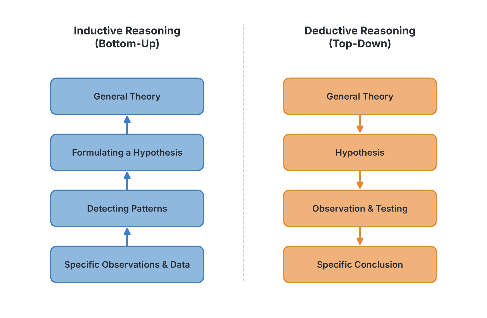
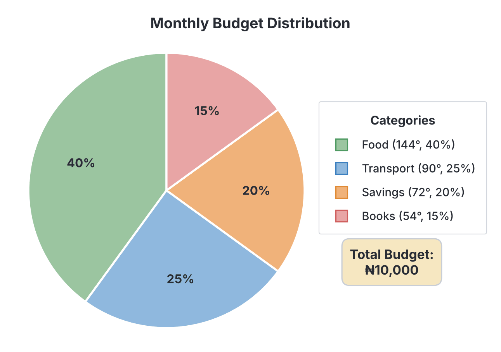
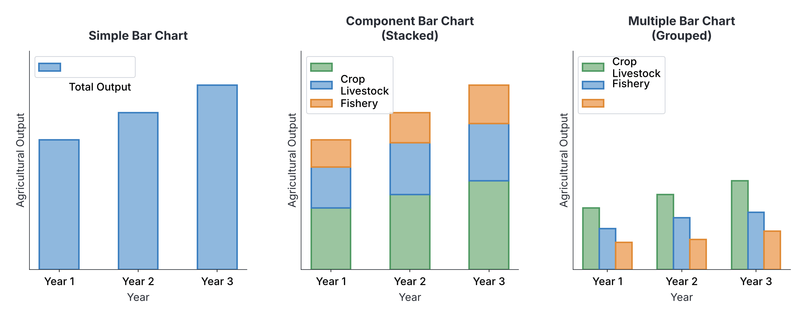
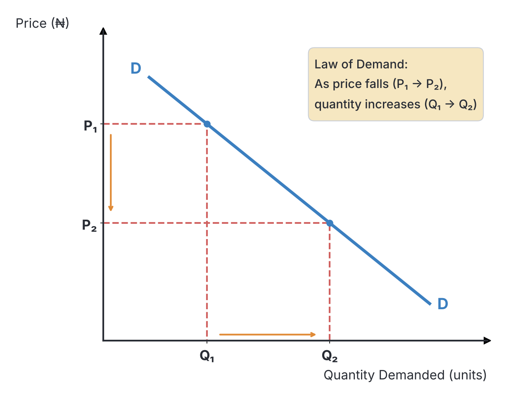

# JAMB Economics Notes: Methods and Tools of Economic Analysis

## What JAMB expects

This topic is Section A, Topic 3 of the JAMB Economics syllabus: Methods and Tools of Economic Analysis. It covers the following content items:

- **a. Scientific Approach:**
  - i. inductive and deductive methods
  - ii. positive and normative reasoning
- **b. Basic Tools:**
  - i. tables, charts and graphs
  - ii. measures of central tendency: mean, median and mode, and their applications.
  - iii. measures of dispersion; variance, standard deviation, range and their applications;
  - iv. merits and demerits of the tools.

By the end of these notes, you should be able to:

1. distinguish between the various forms of reasoning;
2. apply these forms of reasoning to real life situations;
3. use the tools to interpret economic data;
4. analyse economic data using the tools;
5. understand the merits and demerits of the tools.

## The Scientific Approach

Even though economics studies human behaviour, which can be unpredictable, it is classified as a social science. This is because economists use the **scientific method** to build theories. They do not just guess; they collect facts (data), observe patterns, formulate hypotheses (tentative explanations), and test these hypotheses against reality to create established economic laws. 

In Nigeria, institutions like the **National Bureau of Statistics (NBS)** and the **Central Bank of Nigeria (CBN)** collect massive amounts of economic data every day. Economists use specific forms of reasoning to make sense of this data and guide government policies. 

### Inductive and Deductive Methods

Economists use two main directions of logic to arrive at conclusions. Think of them as two different roads leading to an understanding of how the economy works.

1. **Inductive Method:** This is the "bottom-up" approach. You start by observing specific, real-world facts and data. By looking at these specific cases, you notice a pattern, which allows you to build a general theory. 
2. **Deductive Method:** This is the "top-down" approach. You start with a general, established theory or premise. From that general rule, you apply logic to predict what will happen in a specific, new situation.

### Positive and Normative Reasoning

When economists talk about the economy or advise the government, they make two different types of statements. 

1. **Positive Reasoning:** This deals with facts, cause-and-effect relationships, and objective reality. It focuses on **"what is"**, **"what was"**, or **"what will be"**. A positive statement can be tested and proven true or false by looking at data.
2. **Normative Reasoning:** This deals with values, ethics, and opinions. It focuses on **"what ought to be"** or **"what should be"**. A normative statement cannot be tested scientifically because it depends on personal feelings about what is fair or right.

## Distinguish Between Forms of Reasoning

**Objective i: distinguish between the various forms of reasoning.**

To perform well in your exams, you must be able to sharply contrast these forms of reasoning. The tables below outline their core differences.

### Comparing Inductive and Deductive Methods

| Feature | Inductive Method | Deductive Method |
| --- | --- | --- |
| **Direction of Logic** | Bottom-Up: from specific facts to general theories. | Top-Down: from general theories to specific conclusions. |
| **Starting Point** | Real-world observations, surveys, and data collection. | Established laws, theories, or logical assumptions. |
| **Process** | Observation $\rightarrow$ Pattern $\rightarrow$ Hypothesis $\rightarrow$ General Theory | General Theory $\rightarrow$ Hypothesis $\rightarrow$ Observation $\rightarrow$ Specific Conclusion |
| **Certainty** | Conclusions are *probable* based on the evidence seen so far. | Conclusions are *certain* as long as the starting theory is correct. |

### Comparing Positive and Normative Reasoning

| Feature | Positive Reasoning | Normative Reasoning |
| --- | --- | --- |
| **Core Focus** | Explains "what actually is" and factual relationships. | Focuses on "what ought to be" or "what should be done". |
| **Nature** | Objective and scientific. | Subjective, based on personal values and ethics. |
| **Testability** | Can be tested, verified, or proven false using data. | Cannot be tested or proven scientifically; it is a matter of opinion. |
| **Keywords to look for** | "Is", "will", "causes", "leads to", "was". | "Ought to", "should", "fair", "unfair", "better", "worse". |

## Apply Forms of Reasoning to Real-Life Situations

**Objective ii: apply these forms of reasoning to real life situations.**

Let us look at how these forms of reasoning apply to everyday Nigerian economic issues.

**Applying Inductive Reasoning:**
Imagine an economist visits markets in Lagos, Kano, and Onitsha. In every market, she observes that whenever the price of garri increases, buyers purchase fewer measuring bowls (mudus). From these specific observations across different markets, she builds a general rule: *"An increase in the price of a commodity leads to a decrease in the quantity demanded."* She has used inductive reasoning to discover the Law of Demand.

**Applying Deductive Reasoning:**
Now, another economist who already knows the general Law of Demand hears that the government is about to increase the tariff on imported foreign rice. Using deductive reasoning, he immediately concludes: *"Because the general law states that higher prices reduce demand, this specific tariff increase will cause Nigerians to buy less foreign rice."* He moved from a general law to a specific prediction.

**Applying Positive Reasoning:**
Consider the removal of the fuel subsidy in Nigeria. A positive statement about this event would be: *"The removal of the fuel subsidy caused the price of Premium Motor Spirit (PMS) to rise from ₦195 to over ₦600 per litre, which led to a 20% increase in transport costs."* Notice that there is no emotion here. Even if the statement is factually wrong (e.g., if transport actually rose by 30%), it remains a positive statement because we can check the real data to prove it true or false.

**Applying Normative Reasoning:**
A normative statement about the same event would be: *"The government should not have removed the fuel subsidy because it is unfair to poor Nigerians who are already suffering."* Notice the words "should not" and "unfair". This is an opinion. You cannot use a calculator or data to prove what is "fair"—it is a moral judgement.

## Basic Tools of Economic Analysis

Economics relies heavily on data. However, raw data is usually chaotic and hard to understand. To make sense of millions of prices, incomes, and population figures, economists use **basic tools of economic analysis**. 

These tools are broadly divided into two categories:
1. **Visual Tools:** Tables, charts, and graphs used to organize and display data.
2. **Statistical and Mathematical Tools:** Measures of central tendency (averages) and measures of dispersion (spread) used to calculate precise values from the data.

## Interpret Economic Data Using the Tools

**Objective iii: use the tools to interpret economic data.**

To "interpret" data means to look at a visual representation and understand the story it tells without necessarily doing deep mathematics. Here is how we read and interpret the primary visual tools.

### 1. Tables
A table presents data systematically in rows (horizontal) and columns (vertical). Every good table has a clear title, column headings, and units of measurement. 
By reading a table, you can quickly find exact values. For example, a "Demand Schedule" is a table showing different prices and the exact quantity of goods a consumer is willing to buy at those prices.

### 2. Charts
Charts use shapes to represent data visually. 
- **Pie Chart:** A circle divided into sectors. The whole circle represents the total amount (360° or 100%), and each sector's angle represents its share.
- **Bar Chart:** Uses rectangular bars where the length or height of the bar represents the value. 
  - *Simple bar chart:* Compares a single category over time.
  - *Component (stacked) bar chart:* A single bar is broken down into smaller coloured sections to show the parts making up a whole.
  - *Multiple (grouped) bar chart:* Several thin bars stand side-by-side to compare different variables in the same period.

**How to Interpret a Pie Chart (with calculation):**
Suppose a Nigerian university student receives a monthly allowance of ₦10,000 and spends it as follows: Food (₦4,000), Transport (₦2,500), Savings (₦2,000), and Books (₦1,500). 
To draw or interpret this on a pie chart, we convert the amounts into degrees of a circle. 
Formula: $Sector Angle = \frac{Value of Item}{Total Value} \times 360^\circ$
- Food: $\frac{4,000}{10,000} \times 360^\circ = 144^\circ$
- Transport: $\frac{2,500}{10,000} \times 360^\circ = 90^\circ$
- Savings: $\frac{2,000}{10,000} \times 360^\circ = 72^\circ$
- Books: $\frac{1,500}{10,000} \times 360^\circ = 54^\circ$
*(Check: $144 + 90 + 72 + 54 = 360^\circ$)*

### 3. Graphs
Graphs use a Cartesian coordinate system (an X-axis and a Y-axis) to show the relationship between two variables. Points are plotted and connected with a line or curve. 
- A **positive relationship** is shown by an upward-sloping line (as one variable goes up, the other goes up, like the Supply curve).
- A **negative relationship** is shown by a downward-sloping line (as one variable goes up, the other goes down, like the Demand curve).

**Textbook Variation & Essential Rule:** In standard mathematics, the independent variable (the cause) is placed on the horizontal X-axis, and the dependent variable (the effect) is on the vertical Y-axis. However, in economics, due to a tradition started by the famous economist Alfred Marshall, **Price (the independent variable) is always plotted on the Y-axis**, and **Quantity (the dependent variable) is plotted on the X-axis**. You must follow this rule in your exams.

## Analyse Economic Data Using the Tools

**Objective iv: analyse economic data using the tools.**

To "analyse" means to process raw data using mathematical formulas to uncover hidden insights. We do this using measures of central tendency and measures of dispersion. 

For all calculations below, let us use the following dataset representing the prices (in Naira) of 10 different loaves of bread in a local market: 
**Dataset ($X$):** ₦10, ₦15, ₦15, ₦20, ₦25, ₦35, ₦40, ₦40, ₦40, ₦50. 
Total number of items ($N$) = 10.

### Measures of Central Tendency

These measures help us find the "center" or "average" of a dataset, giving us a single number that represents the whole group.

#### 1. The Mean (Arithmetic Mean)
The mean is the sum of all values divided by the total number of values. 
**Formula:** 
$$
\bar{X} = \frac{\sum X}{N}
$$
(Where $\bar{X}$ is the mean, $\sum X$ is the sum of all items, and $N$ is the number of items).
**Calculation:** 
Sum = $10 + 15 + 15 + 20 + 25 + 35 + 40 + 40 + 40 + 50 = 290$
$\bar{X} = \frac{290}{10} = 29$.
**Application:** Economists use the mean to calculate Per Capita Income (total national income divided by population) to measure standard of living.

#### 2. The Median
The median is the exact middle value when the data is arranged in ascending (smallest to largest) or descending order. If $N$ is an odd number, there is one middle number. If $N$ is an even number, you find the mean of the two middle numbers.
**Calculation:** 
Our data is already sorted: 10, 15, 15, 20, **25**, **35**, 40, 40, 40, 50.
Because $N=10$ (even), we take the 5th and 6th values: 25 and 35.
Median = $\frac{25 + 35}{2} = \frac{60}{2} = 30$.
**Application:** The median is used to find the typical wage of workers because, unlike the mean, it is not distorted if a few billionaires are added to the dataset.

#### 3. The Mode
The mode is the value that appears most frequently in a dataset. 
**Calculation:** 
In our dataset, ₦40 appears three times, which is more than any other number. 
Mode = 40.
**Application:** A shoe manufacturer uses the mode to know the most popular shoe size to produce, or a retailer uses it to stock the most demanded brand of soap.

### Measures of Dispersion

While central tendency tells us the middle, dispersion tells us how spread out or scattered the data is around that middle. High dispersion means high inequality or high risk.

#### 1. The Range
The range is the simplest measure of dispersion. It is the difference between the highest value and the lowest value.
**Calculation:** 
Highest price = ₦50. Lowest price = ₦10.
Range = $50 - 10 = 40$.
**Application:** Used to quickly understand the daily price fluctuation of a stock on the Nigerian Exchange Group (NGX).

#### 2. Variance
Variance measures the average of the squared differences from the Mean. 
**Formula:** 
$$
Variance = \frac{\sum (X - \bar{X})^2}{N}
$$

**Step-by-step Calculation (Mean = 29, N = 10):**

| $X$ (Price in ₦) | $X - \bar{X}$ (Deviation from Mean) | $(X - \bar{X})^2$ (Squared Deviation) |
| --- | --- | --- |
| 10 | $10 - 29 = -19$ | $(-19)^2 = 361$ |
| 15 | $15 - 29 = -14$ | $(-14)^2 = 196$ |
| 15 | $15 - 29 = -14$ | $(-14)^2 = 196$ |
| 20 | $20 - 29 = -9$ | $(-9)^2 = 81$ |
| 25 | $25 - 29 = -4$ | $(-4)^2 = 16$ |
| 35 | $35 - 29 = 6$ | $(6)^2 = 36$ |
| 40 | $40 - 29 = 11$ | $(11)^2 = 121$ |
| 40 | $40 - 29 = 11$ | $(11)^2 = 121$ |
| 40 | $40 - 29 = 11$ | $(11)^2 = 121$ |
| 50 | $50 - 29 = 21$ | $(21)^2 = 441$ |
| **Sum ($\sum$)** | **0** (Deviations always sum to 0) | **1690** |

$Variance = \frac{1690}{10} = 169$.

*(Note: In some advanced statistics textbooks, variance for a sample divides by $N-1$. For JAMB and basic economics, we use the population variance formula, dividing by $N$.)*

#### 3. Standard Deviation
Standard deviation is simply the square root of the variance. It returns the spread to the original units (Naira, rather than "squared Naira").
**Formula:**
$$
SD = \sqrt{\frac{\sum (X - \bar{X})^2}{N}}
$$
**Calculation:** 
$SD = \sqrt{169} = 13$.
The standard deviation is ₦13.
**Application:** Used extensively in finance to measure investment risk, and in macroeconomics to measure income inequality across a population.

## Understand the Merits and Demerits of the Tools

**Objective v: understand the merits and demerits of the tools.**

Every tool has strengths and weaknesses. A good economist knows which tool to use depending on the situation.

| Tool | Merits (Advantages) | Demerits (Disadvantages) |
| --- | --- | --- |
| **Tables** | Provides exact, precise numbers. Organises large amounts of data neatly. | Hard to see trends instantly. Can be boring and overwhelming to non-experts. |
| **Charts and Graphs** | Highly visual. Makes it very easy to spot trends, highs, and lows instantly. Accessible to the general public. | Can easily be drawn to mislead people (e.g., by altering the scale). Exact numbers are hard to read. |
| **Arithmetic Mean** | Uses every single piece of data in its calculation. Mathematically sound and used for further statistics. | Highly distorted by extreme values (outliers). For example, one billionaire can make a poor town's average income look huge. |
| **Median** | Completely unaffected by extreme values (outliers). Represents the true "middle" experience. | Ignores the exact values of all other items. Cannot easily be used for further algebraic calculations. |
| **Mode** | Very easy to find just by looking. Unaffected by extreme values. Identifies the most typical case, useful in retail. | A dataset might not have a mode, or it might have multiple (which is confusing). Does not use all the data. |
| **Range** | Extremely simple and quick to calculate. | Completely ignores all middle values. Highly sensitive to extreme values. |
| **Variance and Standard Deviation** | The most accurate measures of spread because they use every single data point. Mathematically robust. | Calculations are tedious and time-consuming without a calculator. Because deviations are squared, extreme values still carry a heavy weight. |

## Key terms

| Term | Meaning |
| --- | --- |
| **Inductive reasoning** | Moving from specific observations to formulate a general theory (bottom-up). |
| **Deductive reasoning** | Applying a general theory to predict a specific outcome (top-down). |
| **Positive statement** | An objective, factual economic statement about "what is"; it can be tested. |
| **Normative statement** | A subjective economic statement based on values and opinions about "what ought to be". |
| **Pie chart** | A circular chart divided into sectors representing percentages or proportions of a total (360°). |
| **Component bar chart** | A single bar divided into smaller coloured sections to show how a total is made up of different parts. |
| **Mean (Arithmetic)** | The sum of all values divided by the total number of items. |
| **Median** | The middle value of a dataset when arranged in order of size. |
| **Mode** | The value that occurs most frequently in a dataset. |
| **Range** | The difference between the highest and lowest values in a dataset. |
| **Variance** | The average of the squared deviations from the mean; a measure of data spread. |
| **Standard deviation** | The square root of the variance, used to measure risk or data spread in the same units as the data. |

## Exam tips and common mistakes

- **Confusing positive and normative:** Remember, "positive" does not mean "good or happy". It means "factual and testable". A positive statement can describe a terrible situation (e.g., "Inflation is at a record high"), but because it is a testable fact, it is positive. Look for words like "should" or "ought" to identify normative statements.
- **Forgetting to sort for the median:** A very common mistake is finding the middle number of unsorted data. The median of 8, 2, 10 is NOT 2. You must sort it first (2, 8, 10). The median is 8.
- **Confusing Variance and Standard Deviation:** Variance is the squared deviations. Standard Deviation is the square root of the variance. Don't forget the final square root step!
- **Marshall's graph convention:** Never forget that in economics, contrary to standard math, Price goes on the vertical Y-axis and Quantity goes on the horizontal X-axis. 
- **Pie chart angle formula:** Always remember to multiply the fraction by 360° (not 100) when calculating angles.

## Quick summary

1. Economics uses a scientific approach involving data collection, hypothesis formulation, and testing.
2. Inductive reasoning builds general theories from specific facts, while deductive reasoning applies general theories to specific cases.
3. Positive economics deals with testable facts ("what is"), whereas normative economics deals with subjective opinions ("what should be").
4. Visual tools like tables, pie charts, and bar charts help summarize and present economic data clearly, though they can sometimes hide exact numbers or mislead the viewer.
5. Measures of central tendency (mean, median, mode) summarize a dataset into a single typical value. The mean uses all data but is distorted by outliers, while the median ignores outliers.
6. Measures of dispersion (range, variance, standard deviation) measure how scattered the data is. The range is simple but ignores middle values; standard deviation is accurate but complex to calculate.
7. In economic graphing, price is conventionally placed on the vertical Y-axis and quantity on the horizontal X-axis.

## Practice questions

**1. An economist notices that the price of garri increased in three different markets and buyers bought less in all three. From this, she formulates the general Law of Demand. This form of reasoning is**
- A. Deductive
- B. Normative
- C. Inductive
- D. Positive

**Answer: C.** Inductive reasoning involves starting from specific observations (looking at three markets) and building up to a broad general theory (the Law of Demand). 

**2. Which of the following is an example of a normative economic statement?**
- A. Nigeria's population is over 200 million.
- B. An increase in money supply causes inflation.
- C. The government should reduce taxes to help the poor.
- D. The price of crude oil fell in 2020.

**Answer: C.** The word "should" makes it a normative statement based on opinion and values about what is fair, rather than a testable fact.

**3. A student's total monthly budget is ₦20,000. If ₦5,000 is spent on textbooks, what is the angle of the sector for textbooks when represented on a pie chart?**
- A. 45°
- B. 90°
- C. 120°
- D. 180°

**Answer: B.** The angle is calculated as $\frac{5,000}{20,000} \times 360^\circ = \frac{1}{4} \times 360^\circ = 90^\circ$.

**4. Find the median of the following test scores: 8, 3, 5, 9, 2.**
- A. 3
- B. 5
- C. 5.4
- D. 8

**Answer: B.** First, you must arrange the numbers in order: 2, 3, 5, 8, 9. The middle number is 5. Option C is a trap for students who calculate the mean instead of the median.

**5. Find the arithmetic mean of the following ages: 14, 16, 15, 17, 18.**
- A. 15
- B. 16
- C. 17
- D. 18

**Answer: B.** The sum of the ages is $14 + 16 + 15 + 17 + 18 = 80$. There are 5 items. Mean = $\frac{80}{5} = 16$.

**6. In economics, unlike standard mathematics, when plotting a demand or supply curve, where is the price conventionally placed?**
- A. On the horizontal X-axis
- B. On the vertical Y-axis
- C. Outside the Cartesian plane
- D. At the origin

**Answer: B.** By convention (established by Alfred Marshall), economists always plot Price (the independent variable) on the vertical Y-axis.

**7. Which of the following is a major demerit of the arithmetic mean as a tool of economic analysis?**
- A. It is very difficult to calculate
- B. It ignores all the middle values in a dataset
- C. It is heavily distorted by extreme values (outliers)
- D. It cannot be used for further statistical calculations

**Answer: C.** The mean includes every value, so one extremely high or low number (an outlier) will pull the mean away from the true center, giving a distorted picture.

**8. The measure of dispersion that simply subtracts the lowest value from the highest value in a distribution is the**
- A. Variance
- B. Mean deviation
- C. Standard deviation
- D. Range

**Answer: D.** The range is defined exactly as the difference between the maximum and minimum values in a dataset.

**9. A graphical tool consisting of a single rectangular bar that is divided into smaller coloured sections to represent the different parts of a total value is called a**
- A. Multiple bar chart
- B. Component bar chart
- C. Simple bar chart
- D. Line graph

**Answer: B.** A component bar chart (or stacked bar chart) shows how a whole total is broken down into parts by dividing a single bar.

**10. Which of the following equations correctly represents the standard deviation of a dataset?**
- A. The square of the variance
- B. The square root of the variance
- C. The mean of the variance
- D. The range divided by two

**Answer: B.** Standard deviation is mathematically defined as the square root of the variance, returning the measurement to the original units of the data.
