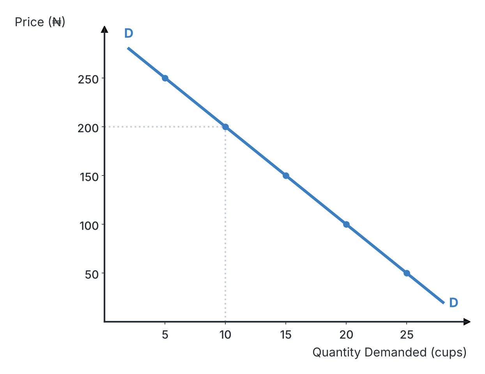
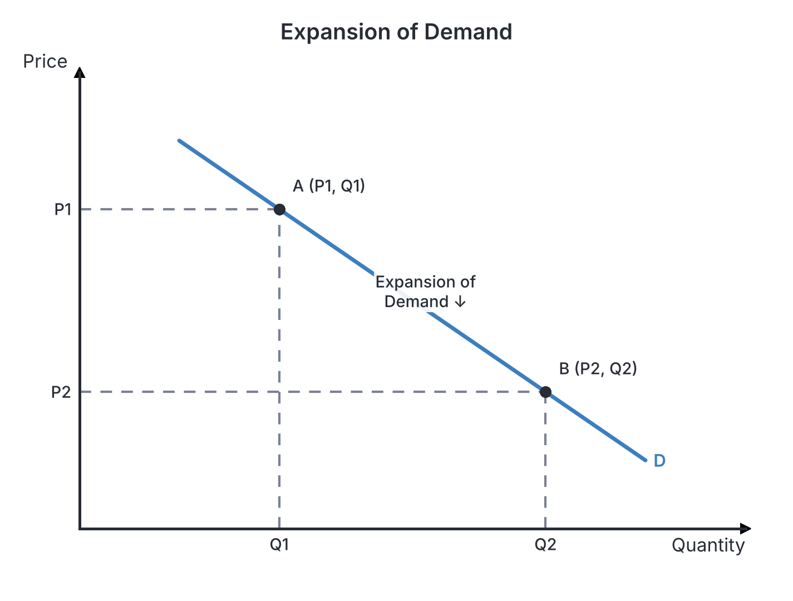
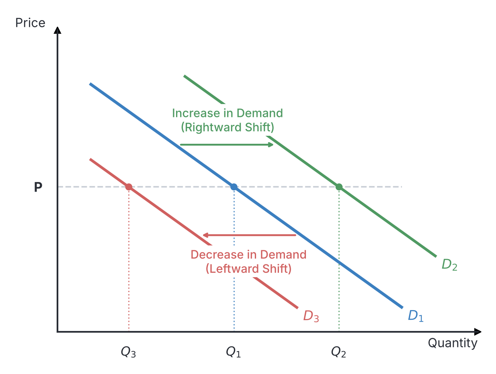
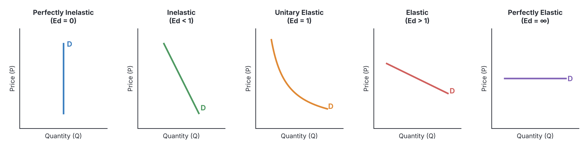

# JAMB Economics Notes: The Theory of Demand

## What JAMB expects

This topic is Section A, Topic 4 of the JAMB Economics syllabus: The Theory of Demand. It covers:

*   **a.** Meaning and determinants of demand; demand schedules and curves; the distinction between change in quantity demanded and change in demand.
*   **b.** Types of demand: Composite, derived, competitive and joint demand.
*   **c.** Types, nature and determinants of elasticity and their measurement - price, income and cross elasticity of demand.
*   **d.** Importance of elasticity of demand to consumers, producers and government.

By the end of these notes, you should be able to:
1.  identify the factors determining demand;
2.  interpret demand curves from demand schedules;
3.  differentiate between change in quantity demanded and change in demand;
4.  compare the various types of demand and their interrelationships;
5.  relate the determinants to the nature of elasticity;
6.  compute elasticities;
7.  interpret elasticity coefficients in relation to real life situations.

---

## Meaning, schedules and changes in demand

This section introduces the foundational concepts of demand in economics, exploring what it means, how it is mapped on tables and graphs, and how and why demand changes in a market. 

In ordinary everyday language, "demand" might simply mean wanting or asking for something. However, in economics, a mere wish, want or desire is not demand. You might strongly desire a private jet, but if you do not have the money to pay for it, your desire has no economic impact on the market for private jets. 

**Demand** (often specified as **effective demand**) is defined as the quantity of a commodity that a consumer is **willing and able** to buy at a given price and at a particular period of time. 

For demand to exist in an economic sense, three elements must be present simultaneously:
1.  **Willingness:** A desire to possess the commodity.
2.  **Ability:** The purchasing power (money) to pay for it.
3.  **Context:** A specific price and a specific time period.

### The Law of Demand
The fundamental rule governing consumer behaviour is the **Law of Demand**. The law states that, all other things being equal (*ceteris paribus*), **the higher the price, the lower the quantity demanded, and the lower the price, the higher the quantity demanded.** 

This means there is an **inverse (or negative) relationship** between the price of a commodity and the quantity demanded of it. If a loaf of bread in Lagos jumps from ₦500 to ₦1,500, fewer people will buy it. If the price falls to ₦200, more people will be willing and able to buy it.

#### Exceptions to the Law of Demand (Abnormal Demand)
Sometimes, the law of demand does not hold, meaning people might buy more when the price rises, or buy less when the price falls. This creates an abnormal demand curve that slopes upwards. This happens in cases of:
*   **Articles of ostentation (Veblen goods):** Luxury items like designer clothes or diamond rings. Rich consumers buy more when the price is very high because the high price creates a "snob appeal" or status symbol.
*   **Giffen goods:** Highly inferior staple foods consumed by very poor people. If the price of poor-quality garri (a Giffen good) rises, poor families cannot afford better alternatives like meat or rice at all, so they must spend all their money buying *more* of the garri to survive.
*   **Expectation of future price changes:** If consumers expect the price of petrol to double next week, they will buy much more of it today even if the price has just gone up slightly.

### Factors determining demand

**Objective (i): identify the factors determining demand**

Why does a consumer decide to buy 5 mudus of rice instead of 2? Several variables (determinants) influence the quantity of a commodity consumers will buy. JAMB tests your understanding of these factors frequently.

1.  **Price of the commodity itself:** This is the most direct determinant. According to the law of demand, a high price decreases the quantity demanded, while a low price increases it.
2.  **Income of the consumer:** A consumer's purchasing power directly affects demand.
    *   For most goods (**Normal goods**), an increase in income leads to an increase in demand. When you get a better-paying job, you buy more clothes.
    *   For low-quality goods (**Inferior goods**), an increase in income causes a *decrease* in demand. As people get richer, they stop buying cheap, poor-quality goods and switch to better substitutes.
3.  **Prices of related commodities:** The demand for one good often depends on the prices of other goods.
    *   **Substitutes:** These are goods used in place of one another (e.g., Bournvita and Milo). If the price of Bournvita rises sharply, consumers will abandon it and demand more Milo, because Milo is now relatively cheaper.
    *   **Complements:** These are goods consumed together (e.g., cars and petrol). If the price of cars rises, fewer cars will be bought, and consequently, the demand for petrol will fall.
4.  **Changes in taste, habit and fashion:** Consumer preferences shape demand heavily. If wearing Ankara fabrics becomes a trending fashion across Nigeria, the demand for Ankara will rise rapidly regardless of the price. Conversely, if a good goes out of fashion, its demand drops.
5.  **Population and number of buyers:** An increase in population, or an influx of people into a city like Abuja or Port Harcourt, means there are more mouths to feed and bodies to clothe. This leads to a higher total market demand for goods and services.
6.  **Weather and seasons:** Demand fluctuates with seasons. The demand for umbrellas, raincoats, and sweaters is very high during the rainy and cold seasons but very low during the dry season.
7.  **Government policy (Taxation and Subsidies):** 
    *   An increase in personal income tax reduces a consumer's **disposable income** (take-home pay), which reduces their overall demand for goods.
    *   Subsidies can lower the price of goods, increasing the quantity demanded (a movement along the demand curve).
8.  **Credit facilities:** If banks offer easy loans or credit cards to consumers, their ability to pay increases, raising the demand for expensive goods like cars and houses.

### Interpreting demand curves from demand schedules

**Objective (ii): interpret demand curves from demand schedules**

To analyze demand scientifically, economists organize the relationship between price and quantity using tables (schedules) and graphs (curves).

#### The Demand Schedule
A **demand schedule** is a table that shows the different quantities of a commodity that a consumer (or all consumers in a market) will buy at various prices at a specific time.

There are two types of demand schedules:
1.  **Individual demand schedule:** Shows the quantity demanded by a single consumer.
2.  **Market demand schedule:** Shows the total quantity demanded by all consumers in the market. It is derived by adding together the quantities demanded by all individuals at each price (horizontal summation).

**Table 1: Market Demand Schedule for Rice in a local market**

| Price per cup (₦) | Quantity Demanded by Amina | Quantity Demanded by Emeka | Quantity Demanded by Bola | Total Market Demand (cups) |
| :--- | :--- | :--- | :--- | :--- |
| 250 | 2 | 3 | 0 | **5** |
| 200 | 4 | 5 | 1 | **10** |
| 150 | 6 | 7 | 2 | **15** |
| 100 | 8 | 9 | 3 | **20** |
| 50 | 10 | 11 | 4 | **25** |

*Interpretation:* Look at the outer columns. When the price is high (₦250), the total market demand is very low (5 cups). As the price steadily falls down to ₦50, the total market demand steadily rises to 25 cups. This perfectly illustrates the Law of Demand.

#### The Demand Curve
A **demand curve** is the graphical representation of a demand schedule. It plots the data from the table onto a graph to create a visual picture of consumer behaviour.

**How to interpret and plot the curve:**
1.  **Price (P)** is always plotted on the **vertical axis (y-axis)**.
2.  **Quantity Demanded (Q)** is always plotted on the **horizontal axis (x-axis)**.
3.  Each row on the schedule becomes a coordinate point on the graph. For instance, at ₦200, the market quantity is 10. You find 200 on the vertical axis, 10 on the horizontal axis, and mark a point where they meet.
4.  Connecting all these points forms the demand curve.

Because of the inverse relationship between price and quantity, a normal demand curve **slopes downwards from left to right**. 

*Why does it slope downwards?*
1.  **Income effect:** As the price falls, the consumer's real income (purchasing power) increases, allowing them to buy more.
2.  **Substitution effect:** As the price falls, the good becomes cheaper relative to its substitutes, so consumers switch to it.
3.  **Law of Diminishing Marginal Utility:** As you consume more of a good, the extra satisfaction you get from each additional unit drops, so you will only buy more if the price is lowered.

### Differentiating between change in quantity demanded and change in demand

**Objective (iii): differentiate between change in quantity demanded and change in demand**

This distinction is one of the most frequently tested concepts in JAMB Economics. You must never confuse a "change in quantity demanded" with a "change in demand". They mean entirely different things and look completely different on a graph.

#### 1. Change in Quantity Demanded (Movement along the curve)
A **change in quantity demanded** occurs when the amount bought changes **solely because of a change in the price of the commodity itself**, while all other factors (like income, taste, weather) remain constant. 

*   On a graph, this is shown as a **movement along the exact same demand curve** from one point to another. 
*   **Expansion (Extension) of demand:** When the price falls, consumers buy more. The point moves downward along the curve.
*   **Contraction of demand:** When the price rises, consumers buy less. The point moves upward along the curve.

#### 2. Change in Demand (Shift of the curve)
A **change in demand** occurs when the amount bought changes **because of a change in any of the other determinants** (like income, population, or taste), while the **price of the commodity itself remains constant**.

*   On a graph, this is shown as a **shift of the entire demand curve** to a completely new position.
*   **Increase in demand (Rightward shift):** At the exact same old price, consumers now want to buy *more*. The entire curve shifts to the **right** (from $D_1$ to $D_2$). This can be caused by:
    *   An increase in consumers' income.
    *   An increase in the price of a substitute (e.g., Milo becomes expensive, so more Bournvita is demanded).
    *   A decrease in the price of a complement.
    *   Favourable changes in taste/fashion.
    *   An increase in population.
*   **Decrease in demand (Leftward shift):** At the exact same old price, consumers now want to buy *less*. The entire curve shifts to the **left** (from $D_1$ to $D_3$). This can be caused by:
    *   A decrease in income.
    *   A decrease in the price of a substitute.
    *   An increase in the price of a complement (e.g., petrol becomes too expensive, reducing demand for cars).
    *   The good going out of fashion.

**Table 2: Comparing the two concepts**

| Feature | Change in Quantity Demanded | Change in Demand |
| :--- | :--- | :--- |
| **Primary Cause** | Change in the **price** of the good itself. | Change in **other factors** (income, taste, population), while price is constant. |
| **Graphical effect** | **Movement along** the existing demand curve. | **Shift** of the entire demand curve to the left or right. |
| **Terms used** | Expansion (increase in qty) or Contraction (decrease in qty). | Increase (shift right) or Decrease (shift left). |

*Common Mistake:* When a JAMB question says "an increase in consumers' income will cause...", the answer is a *shift of the demand curve to the right*, not a movement along it! Always check the cause: is it the price of the good itself, or something else?

## Types of demand

In a real economy, goods are not demanded in isolation. The demand for one good often interacts with the demand for another. 

### Comparing the various types of demand and their interrelationships

**Objective (iv): compare the various types of demand and their interrelationships**

JAMB expects you to identify and differentiate four specific types of demand, recognize their Nigerian examples, and understand how they relate to one another.

**Table 3: Types of Demand**

| Type of Demand | Definition and Interrelationship | Real-Life Nigerian Examples |
| :--- | :--- | :--- |
| **1. Joint (Complementary) demand** | Occurs when two or more commodities are **demanded together** to satisfy a single want. You cannot easily use one without the other. **Interrelationship:** They have a negative relationship. An increase in the price of Good A leads to a decrease in the demand for Good B. | - Motor cars and petrol (PMS) - Torchlights and batteries - Bread and butter - Mobile phones and airtime (recharge cards) - Tea and sugar |
| **2. Competitive (Substitute) demand** | Occurs when two or more commodities serve the **exact same purpose**. A consumer will choose one *or* the other, but rarely both simultaneously. **Interrelationship:** They have a positive relationship. An increase in the price of Good A leads to an increase in the demand for Good B, as consumers switch. | - Milo and Bournvita - MTN and Airtel SIM cards - Beef and fish - Coca-Cola and Pepsi - Peak Milk and Three Crowns Milk |
| **3. Derived demand** | Occurs when a commodity is demanded not for direct consumption, but **because it is needed to produce another good or service**. All factors of production fall into this category. **Interrelationship:** The demand for the input is completely dependent on the demand for the final product. If demand for houses increases, the derived demand for bricks increases. | - **Labour** (Workers are demanded to produce goods) - Flour (Demanded to bake bread) - Cement and blocks (To build houses) - Cocoa beans (To manufacture chocolate) |
| **4. Composite demand** | Occurs when one single commodity is demanded for **several different, independent uses**. **Interrelationship:** An increase in demand for the commodity in one use leaves less available for other uses, potentially driving up its price across the board. | - **Crude oil** (Refined for petrol, kerosene, diesel, aviation fuel, and plastics) - **Electricity** (Used for lighting, ironing, cooling, and running factory machines) - **Timber** (Used for furniture, building, paper, and firewood) - **Land** (Used for agriculture, building houses, and mining) |

## Elasticity of demand

In economics, the Law of Demand tells us the *direction* of change (if price rises, demand falls). However, it does not tell us the *magnitude* or size of that change. If price rises by 10%, will demand fall by 2% or 50%? This is where elasticity comes in.

**Elasticity of demand** measures the degree of responsiveness of the quantity demanded of a commodity to a change in any of its determinants (like price, income, or the prices of other goods). 

There are three major types of elasticity of demand:
1.  Price Elasticity of Demand (PED)
2.  Income Elasticity of Demand (YED)
3.  Cross Elasticity of Demand (XED)

### Relating determinants to the nature of elasticity

**Objective (v): relate the determinants to the nature of elasticity**

Not all goods respond to price changes in the same way. The demand for a luxury car might crash if the price rises slightly (elastic), while the demand for salt will hardly change at all (inelastic). Why is this? The nature of a good's price elasticity is determined by several factors:

1.  **Availability of close substitutes:** This is the most important determinant. Goods with many close substitutes (like Milo, Bournvita, Ovaltine) have highly **elastic** demand. If Milo becomes slightly more expensive, people easily switch to Bournvita. Goods with no substitutes (like electricity from the national grid) have highly **inelastic** demand because consumers have no choice but to pay.
2.  **Nature of the commodity (Necessity vs. Luxury):** Basic necessities essential for survival (like salt, water, basic foodstuffs, life-saving drugs) have **inelastic** demand. Luxuries (like gold jewelry, designer shoes, vacations) have **elastic** demand because consumers can easily do without them if prices rise.
3.  **Proportion of income spent on the good:** If a good takes up a tiny fraction of a consumer's income (like matches, toothpicks, or salt), its demand will be **inelastic**. A doubling of the price of matches from ₦20 to ₦40 won't ruin a budget. Conversely, goods that take up a huge portion of income (like buying a car or renting a house) have highly **elastic** demand.
4.  **Habit and Addiction:** Goods that are habit-forming or addictive (like cigarettes, alcohol, or kolanut) have highly **inelastic** demand. Addicted consumers will continue buying them almost regardless of price hikes.
5.  **Time period:** Demand is usually more **inelastic in the short run** because it takes time for consumers to adjust their habits and find alternatives. In the **long run**, demand becomes more **elastic** as consumers discover substitutes.
6.  **Number of uses of the commodity:** A good with multiple uses (composite demand, like electricity) generally has a more **elastic** demand overall, because if the price rises strongly, consumers will stop using it for less important tasks (like leaving lights on) even if they still use it for essential tasks.

### Computing elasticities

**Objective (vi): compute elasticities**

JAMB frequently requires you to calculate elasticity using basic data. You must memorize the formulas and understand the signs.

#### 1. Price Elasticity of Demand (PED)
PED measures how sensitive quantity demanded is to a change in the price of the commodity itself.

**Formula:**
$$E_d = \frac{\text{Percentage change in Quantity Demanded}}{\text{Percentage change in Price}}$$

Using symbols, we calculate percentage change as $(\text{New} - \text{Old}) / \text{Old} \times 100$. The formula expands to:
$$E_d = \frac{\frac{Q_2 - Q_1}{Q_1} \times 100}{\frac{P_2 - P_1}{P_1} \times 100}$$

Which simplifies nicely to:
$$E_d = \frac{\Delta Q}{\Delta P} \times \frac{P_1}{Q_1}$$
*(Where $P_1$ = old price, $P_2$ = new price, $\Delta P$ = change in price; $Q_1$ = old quantity, $Q_2$ = new quantity, $\Delta Q$ = change in quantity).*

**Example Calculation:**
A local baker sells loaves of bread. When the price of a loaf was ₦50, consumers bought 200 loaves. When the baker increased the price to ₦60, consumers bought only 100 loaves. Calculate the price elasticity of demand.

*   $P_1 = 50$, $P_2 = 60$ $\rightarrow \Delta P = 60 - 50 = +10$
*   $Q_1 = 200$, $Q_2 = 100$ $\rightarrow \Delta Q = 100 - 200 = -100$

$$E_d = \frac{-100}{10} \times \frac{50}{200} = -10 \times 0.25 = -2.5$$

*Note on the Negative Sign:* Because price and quantity move in opposite directions (Law of Demand), PED is almost always a negative number. However, economists generally ignore the negative sign and take the **absolute value** (so $-2.5$ becomes $2.5$) when determining the type of elasticity.

**Types (Degrees) of Price Elasticity of Demand**
Based on the absolute numerical value of $E_d$, we classify demand into five categories:
1.  **Perfectly inelastic demand ($E_d = 0$):** A change in price causes zero change in quantity demanded. Consumers buy the exact same amount regardless of price. The demand curve is a **vertical straight line**. Example: Essential life-saving drugs.
2.  **Inelastic demand ($E_d < 1$):** A large percentage change in price causes a smaller percentage change in quantity demanded. (e.g., price rises by 50%, demand falls by only 10%). The curve is **steep**. Example: Basic necessities like salt.
3.  **Unitary elastic demand ($E_d = 1$):** A percentage change in price causes an exactly equal percentage change in quantity demanded. The curve is a **rectangular hyperbola**. 
4.  **Elastic demand ($E_d > 1$):** A small percentage change in price causes a much larger percentage change in quantity demanded. (e.g., price rises by 10%, demand falls by 40%). The curve is **gentle/flat**. Example: Luxury goods.
5.  **Perfectly elastic demand ($E_d = \infty$):** At a specific prevailing price, consumers will buy an infinite amount, but if the price is raised even slightly, demand drops instantly to zero. The curve is a **horizontal straight line**. Occurs theoretically in perfect competition.

#### 2. Income Elasticity of Demand (YED)
YED measures how responsive quantity demanded is to a change in consumers' **income** ($Y$).

**Formula:**
$$E_y = \frac{\text{Percentage change in Quantity Demanded}}{\text{Percentage change in Income}}$$

**Interpretation of the Sign (Very Important!):**
For Income Elasticity, we DO NOT ignore the negative sign. The sign tells us what type of good it is.
*   **Positive YED ($>0$):** This indicates a **Normal Good**. As income rises, people buy more. If $0 < E_y < 1$, it is a necessity. If $E_y > 1$, it is a luxury.
*   **Negative YED ($<0$):** This indicates an **Inferior Good**. As income rises, people buy less of it (e.g., a worker gets a raise and stops buying poor-quality garri to buy rice instead).
*   **Zero YED ($=0$):** Demand does not change at all with income changes (e.g., salt).

**Example Calculation:**
A clerk's salary increased from ₦20,000 to ₦30,000. As a result, his monthly demand for evaporated milk increased from 10 tins to 18 tins. Calculate his income elasticity of demand.
*   $\% \Delta \text{Income} = \frac{30,000 - 20,000}{20,000} \times 100 = \frac{10,000}{20,000} \times 100 = +50\%$
*   $\% \Delta \text{Quantity} = \frac{18 - 10}{10} \times 100 = \frac{8}{10} \times 100 = +80\%$
*   $$E_y = \frac{+80\%}{+50\%} = +1.6$$ 
*(Since the answer is $+1.6$, it is positive and greater than 1, meaning evaporated milk is a normal luxury good for him).*

#### 3. Cross Elasticity of Demand (XED)
XED measures how responsive the quantity demanded of **Commodity X** is to a change in the price of a related **Commodity Y**.

**Formula:**
$$E_{xy} = \frac{\text{Percentage change in Quantity of X}}{\text{Percentage change in Price of Y}}$$

**Interpretation of the Sign (Very Important!):**
*   **Positive XED ($>0$):** The goods are **Substitutes** (e.g., Bournvita and Milo). If Milo's price rises, people flee Milo and demand for Bournvita rises. They move in the same direction.
*   **Negative XED ($<0$):** The goods are **Complements** (e.g., Cars and Petrol). If Petrol's price rises severely, people stop driving, so demand for Cars falls. They move in opposite directions.
*   **Zero XED ($=0$):** The goods are **Independent / Unrelated** (e.g., Shoes and Salt).

**Example Calculation:**
When the price of Milo ($Y$) increased from ₦500 to ₦600, the quantity of Bournvita ($X$) demanded by shoppers increased from 1,000 units to 1,500 units.
*   $\% \Delta P_y (\text{Milo}) = \frac{600 - 500}{500} \times 100 = +20\%$
*   $\% \Delta Q_x (\text{Bournvita}) = \frac{1500 - 1000}{1000} \times 100 = +50\%$
*   $$E_{xy} = \frac{+50\%}{+20\%} = +2.5$$
*(The positive sign proves that Milo and Bournvita are substitutes).*

## Importance of elasticity of demand to consumers, producers and government

### Interpreting elasticity coefficients in relation to real life situations

**Objective (vii): interpret elasticity coefficients in relation to real life situations**

Why do economists and businesses bother calculating these elasticity coefficients? Because knowing whether demand is elastic or inelastic has massive real-world implications.

#### 1. Importance to Producers (Firms)
Producers use Price Elasticity of Demand to determine their **pricing policy** in order to maximize **Total Revenue (TR)**. Total Revenue is Price $\times$ Quantity.
*   If a product has an **elastic demand ($E_d > 1$)**, consumers are very sensitive. If the producer raises the price, they will lose many customers, and Total Revenue will fall. Therefore, to maximize revenue, the producer should **reduce the price**. The massive influx of new customers will outweigh the small loss in price margin.
*   If a product has an **inelastic demand ($E_d < 1$)**, consumers are insensitive (perhaps it's a necessity or habit). If the producer lowers the price, they won't gain many new customers, so revenue falls. To maximize revenue, the producer should **increase the price**. Consumers will grumble but still buy it, driving up Total Revenue.

#### 2. Importance to Government
The government relies heavily on elasticity concepts for formulating economic policies.
*   **Taxation and Incidence of Tax:** When the government needs to raise large sums of revenue through indirect taxes (like excise duties or VAT), it places heavy taxes on goods with **inelastic demand** (like cigarettes, alcohol, and petrol). Because consumers are addicted or rely heavily on these goods, they will continue buying them even when the tax pushes the price up, ensuring high tax revenue. 
    *   *Tax Incidence:* Furthermore, if demand is inelastic, the producer can easily pass the burden (incidence) of the tax onto the consumer. If demand is highly elastic, the producer must bear most of the tax burden to avoid losing all their customers.
*   **Devaluation of Currency:** A country might deliberately devalue its currency (make the Naira cheaper relative to the Dollar) to make its exports cheaper abroad and imports more expensive at home. However, this will only improve the country's Balance of Payments if the foreign demand for its exports and the domestic demand for imports are **elastic**. (This is known in advanced economics as the Marshall-Lerner condition).
*   **Granting Subsidies:** Governments grant subsidies mostly to essential goods (inelastic demand) like agriculture and healthcare to ensure they remain affordable for the masses.

#### 3. Importance to Consumers
While everyday consumers do not walk into a market calculating elasticity formulas, the intuitive concept helps them in **budget allocation**. A consumer allocates the bulk of their fixed income to necessities (highly inelastic goods like food and rent). They understand that purchases of luxury items (highly elastic goods like electronics or jewelry) can be easily postponed or substituted when their prices rise too high.

---

## Key terms

| Term | Meaning |
| :--- | :--- |
| **Effective demand** | The willingness and ability to buy a given quantity of a commodity at a given price and at a particular time. |
| **Demand Schedule** | A tabular representation showing the relationship between price and the quantity demanded. |
| **Law of Demand** | States that, all things being equal, higher prices lead to lower quantities demanded, and lower prices lead to higher quantities demanded. |
| **Derived demand** | The demand for a commodity not for its own direct consumption, but to serve as an input to produce something else (e.g., labour, flour, raw materials). |
| **Composite demand** | The demand for a single commodity that has several different and independent uses (e.g., crude oil, land, electricity). |
| **Joint (Complementary) demand** | The demand for two or more goods that must be used together to satisfy a single want (e.g., cars and petrol). |
| **Competitive (Substitute) demand** | The demand for goods that serve the same purpose and are in competition with one another (e.g., Milo and Bournvita). |
| **Price Elasticity of Demand (PED)** | The measure of responsiveness of the quantity demanded of a good to a change in its own price. |
| **Normal good** | A good whose demand increases when consumer income increases (It has a Positive YED). |
| **Inferior good** | A good whose demand decreases when consumer income increases (It has a Negative YED). |
| **Giffen good** | A highly inferior good where an increase in price causes an increase in quantity demanded (an exception to the law of demand). |

## Exam tips and common mistakes

*   **Movement vs. Shift:** This is the #1 trick in JAMB questions. If the question states that the *price of the commodity itself* changed, the answer is a **movement along the curve** (expansion or contraction). If *any other factor* (income, population, fashion, price of substitute) changed, the answer is a **shift of the entire curve** (increase or decrease in demand).
*   **Absolute values in PED:** If you calculate Price Elasticity of Demand and get $-2.5$, remember that we use the absolute value ($2.5$) to classify it. Because $2.5 > 1$, the demand is elastic. Do not mistake the mathematical negative sign for meaning the value is "less than 1".
*   **Cross Elasticity Signs:** Always remember the signs for XED: **Positive = Substitutes**, **Negative = Complements**. A quick trick: Think of cars and petrol. If petrol price goes *up* (+), car sales go *down* (-). Opposite directions equal negative (Complements).
*   **Derived vs. Composite:** Do not mix these up. Derived demand is about *factors of production* (e.g., labour, land) needed to make an end product. Composite demand is about *one raw material having multiple end uses* (e.g., timber, crude oil).
*   **Revenue maximization:** Remember that higher prices do not always mean higher profits! If demand is elastic, raising the price will crash sales and reduce total revenue.

## Quick summary

1.  Demand in economics means effective demand: the willingness and ability to buy a commodity at a particular price and time.
2.  The Law of Demand states that price and quantity demanded are inversely related, which is why the normal demand curve slopes downwards from left to right.
3.  A change in the commodity's own price causes a movement along the demand curve (expansion/contraction). A change in other determinants (like income or population) causes a complete shift of the demand curve (increase/decrease).
4.  Goods interrelate differently: Complements have joint demand, substitutes have competitive demand, inputs have derived demand, and multi-use goods have composite demand.
5.  Price elasticity of demand (PED) measures responsiveness to a price change. Goods with many substitutes are elastic; necessities with no substitutes are inelastic.
6.  Firms use PED to set prices for maximum revenue (lower prices if elastic, raise prices if inelastic), while governments use it to tax goods effectively (taxing inelastic goods yields high revenue).
7.  Income elasticity of demand (YED) determines if a good is normal (positive) or inferior (negative). Cross elasticity of demand (XED) determines if two goods are substitutes (positive) or complements (negative).

## Practice questions

**1. Effective demand for a commodity implies the**
- A. strong desire of a consumer to own the commodity
- B. willingness and ability to pay for the commodity at a given price
- C. total amount of money a consumer has in their bank account
- D. total quantity of goods produced and supplied in the market

**Answer: B.** Effective demand must be backed up by purchasing power (the ability to pay) and a willingness to buy at that specific price and time. Desire alone is not demand.

**2. A rightward shift of the demand curve indicates**
- A. an expansion of quantity demanded due to a fall in price
- B. a decrease in demand
- C. an increase in demand due to factors other than price
- D. a contraction of demand

**Answer: C.** A rightward shift represents a complete increase in demand. Shifts are always caused by factors *other* than the price of the commodity itself (e.g., higher income, favorable fashion, or increase in population). Option A describes a movement along the curve.

**3. If the price of a commodity increases from ₦100 to ₦120, and as a result, the quantity demanded falls from 50 units to 40 units, the price elasticity of demand is**
- A. 0.5
- B. 1.0
- C. 1.5
- D. 2.0

**Answer: B.** First, find percentage change in price: $((120 - 100) / 100) \times 100 = 20\%$. Next, find percentage change in quantity: $((40 - 50) / 50) \times 100 = -20\%$. Then divide: $-20\% / 20\% = -1.0$. Taking the absolute value gives 1.0, which means the demand is unitary elastic. 

**4. The demand for flour by a large bakery for the purpose of producing bread is an example of**
- A. composite demand
- B. joint demand
- C. competitive demand
- D. derived demand

**Answer: D.** Derived demand occurs when a good or factor of production (like flour or labour) is demanded not for direct consumption, but as an input needed to produce another final good (bread). 

**5. Which of the following commodities is most likely to have a perfectly inelastic demand?**
- A. Luxury sports cars
- B. Carbonated soft drinks
- C. Life-saving medical drugs
- D. Designer shoes

**Answer: C.** Perfectly inelastic demand means consumers will buy the exact same amount no matter how high the price goes. A life-saving drug fits this perfectly because the consumer absolutely needs it to survive and has no alternative.

**6. A worker's monthly income increases from ₦10,000 to ₦15,000. As a result, his demand for a particular cheap grade of garri falls from 40 mudus to 30 mudus. The income elasticity of demand is**
- A. -0.5
- B. +0.5
- C. -2.0
- D. +2.0

**Answer: A.** $\% \Delta \text{Income} = ((15,000 - 10,000) / 10,000) \times 100 = +50\%$. $\% \Delta \text{Quantity} = ((30 - 40) / 40) \times 100 = -25\%$. YED = $\% \Delta Q / \% \Delta Y = -25\% / +50\% = -0.5$. The negative sign correctly indicates it is an inferior good. A common mistake is flipping the formula to Income over Quantity, which would wrongly yield -2.0.

**7. If the cross elasticity of demand between Good X and Good Y is a negative value, it strongly implies that the two goods are**
- A. substitutes
- B. complements
- C. unrelated
- D. inferior

**Answer: B.** A negative cross elasticity means that as the price of Good Y increases, the quantity demanded of Good X falls. This opposite reaction happens with complementary goods (joint demand), like petrol and cars. If they were substitutes, the value would be positive.

**8. If the government wishes to raise maximum revenue through indirect taxes, it should heavily tax commodities with**
- A. highly elastic demand
- B. highly inelastic demand
- C. unitary elastic demand
- D. perfectly elastic demand

**Answer: B.** If the government taxes goods with highly inelastic demand (like cigarettes or petrol), the resulting price increase will not significantly reduce the quantity bought by consumers, thereby generating massive and steady tax revenue. 

**9. Crude oil is demanded to be refined into petrol, kerosene, diesel, and plastics. This is an example of**
- A. derived demand
- B. joint demand
- C. competitive demand
- D. composite demand

**Answer: D.** Composite demand refers to a single commodity that has several different, distinct, and independent end uses. If more crude oil is used for plastics, less is available for petrol.

**10. If a manufacturing firm discovers that the demand for its main product is highly elastic, what pricing strategy should it adopt to increase its total revenue?**
- A. Increase the price
- B. Decrease the price
- C. Keep the price perfectly constant
- D. Fluctuate the price randomly from month to month

**Answer: B.** When demand is elastic ($E_d > 1$), consumers are highly sensitive to price. A small decrease in price leads to a proportionately much larger increase in the quantity demanded. The massive increase in sales volume brings in more total revenue than what was lost from the price cut.
