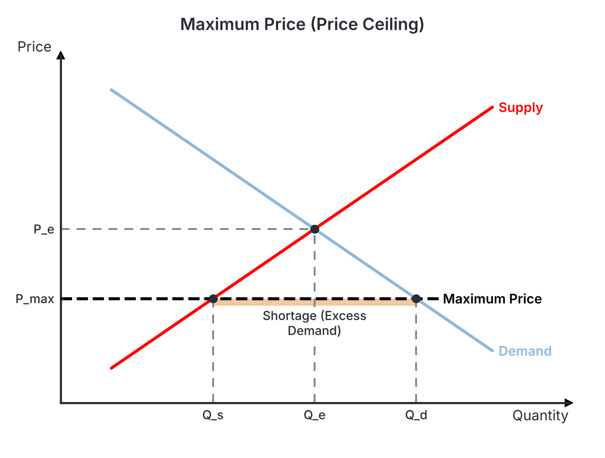
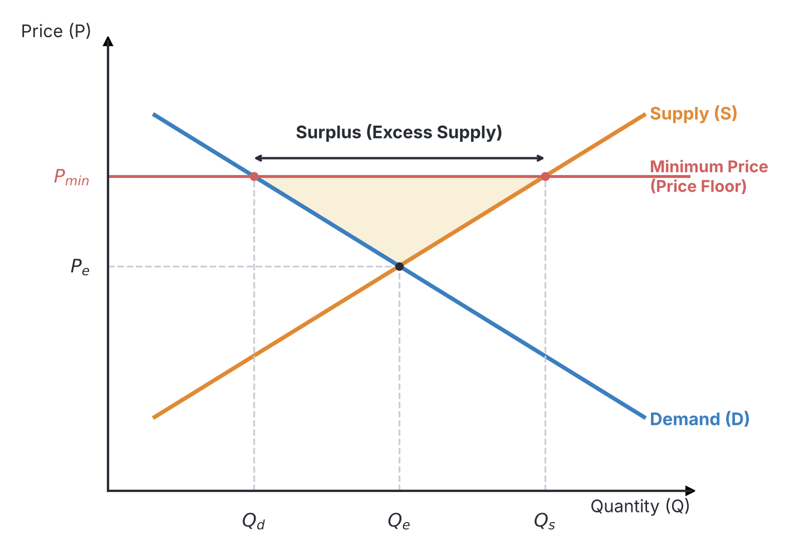
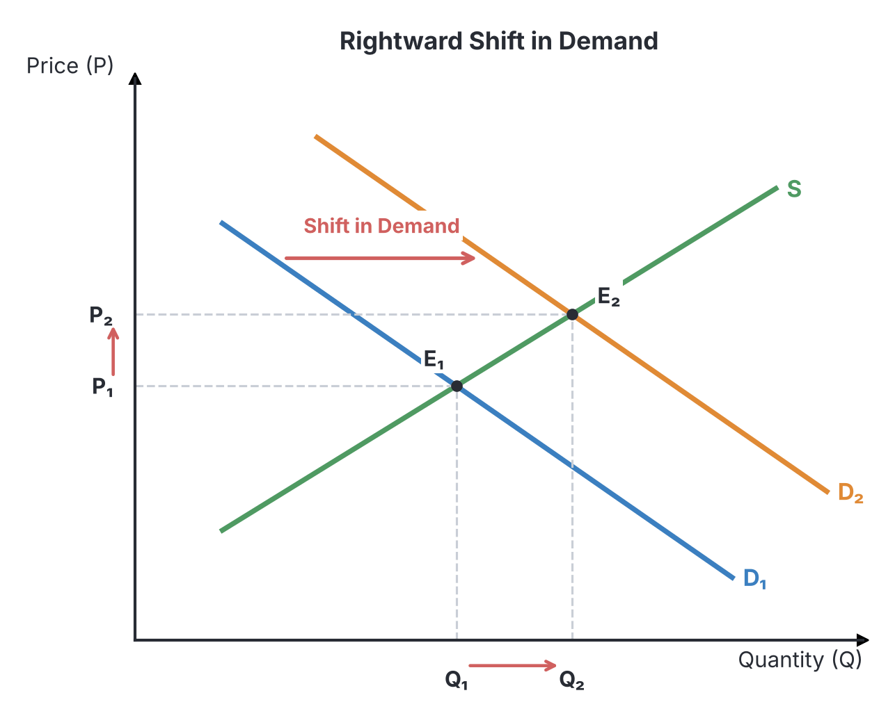

# JAMB Economics Notes: The Theory of Price Determination

## What JAMB expects

This topic is Section A, Topic 7 of the JAMB Economics syllabus: The Theory of Price Determination. It covers how prices are set in a free market through the interaction of buyers and sellers, and what happens when the government steps in to control prices.

The syllabus lists the following content items:
* a. The concepts of market and price
* b. Functions of the price system
* c. i. Equilibrium price and quantity in product and factor markets; iii. Price legislation and its effects
* d. The effects of changes in supply and demand on equilibrium price and quantity.
* e. Simple linear equation of demand and supply

By the end of these notes, you should be able to:
1. explain the concepts of market and price;
2. examine the functions of the price system;
3. evaluate the effects of government interference with the price system;
4. differentiate between minimum and maximum price legislation;
5. interpret the effects of changes in supply and demand on equilibrium price and quantity;
6. determine the equilibrium value of price and quantity.

**Note on the syllabus wording:** In the JAMB syllabus, the numbering under content item "c" jumps from `i.` directly to `iii.`, skipping `ii.`. This is a typing error in the original syllabus document. These notes cover all the listed items completely.

## The concepts of market and price

**Objective i: explain the concepts of market and price; Content a: The concepts of market and price.**

To understand how prices are determined in an economy, we must first define what economists mean when they use the words "market" and "price".

### What is a market?

In everyday language, a market is a physical place where people go to buy and sell goods—like the Onitsha Main Market in Anambra, Kurmi Market in Kano, or Balogun Market in Lagos. However, in Economics, the definition is much broader and is not limited to a physical location.

A **market** is any arrangement, system, or mechanism that brings buyers and sellers into contact to exchange goods, services, or resources. 

A market can be a telephone network, a website, a mobile app, or a global computer network. For example, e-commerce platforms like Jumia and Konga are virtual product markets. The Nigerian Stock Exchange is a market for company shares, and the foreign exchange (FX) market operates largely through computer networks between commercial banks and the Central Bank of Nigeria (CBN). As long as buyers (who create demand) and sellers (who create supply) can communicate and agree on a trade, a market exists.

### What is price?

**Price** is the exchange value of a good or service, usually expressed in terms of money. It is the amount of money a buyer must give up to acquire one unit of a commodity from a seller. 

In a free market system (capitalist economy), price is not dictated by the government. Instead, it is determined by the interaction of the forces of demand and supply. The price naturally settles at a point where the amount buyers are willing to buy equals the amount sellers are willing to sell. 

## Functions of the price system

**Objective ii: examine the functions of the price system; Content b: Functions of the price system.**

The **price system** (also known as the price mechanism) is the way in which the prices of goods and services determine how resources are allocated in a free market economy. The classical economist Adam Smith referred to this as the "invisible hand" that automatically guides the decisions of millions of independent consumers and producers.

The price system performs several vital functions in an economy:

1. **Signaling function (Information):** Prices act as signals to both producers and consumers. If consumers suddenly demand more yams, the price of yam will rise. This higher price signals to farmers that yam is currently highly valued, telling them they should plant more. If a price falls, it signals that a good is losing popularity.
2. **Incentive function (Motivation):** A rising price provides an incentive (motivation) for profit-seeking firms to produce more of a good. Because higher prices usually mean higher profits, producers are motivated to supply more. Conversely, a falling price warns firms to cut back on production because making the good is becoming less profitable.
3. **Rationing function (Distribution):** Because resources are scarce, not everyone can have everything they want. The price system rations scarce goods to those who are willing and able to pay for them. If a good becomes very scarce (like tomatoes during a bad harvest season), its price shoots up, restricting its consumption only to those who can afford it.
4. **Resource allocation function:** The price system answers the fundamental economic questions of *what to produce*, *how to produce*, and *for whom to produce*. It directs the factors of production (land, labour, capital) away from markets where prices and profits are low, and pulls them towards markets where prices and profits are high.
5. **Determination of incomes:** In the factor market, the prices of the factors of production (wages for labour, rent for land, interest for capital) determine the incomes of households. People with highly demanded skills receive a higher "price" (wage) for their labour, which gives them a higher income.

## Equilibrium and price legislation

**Content c: i. Equilibrium price and quantity in product and factor markets; iii. Price legislation and its effects.**

This section explores how markets naturally find a resting point (equilibrium) and how governments sometimes pass laws to disrupt this resting point if they believe it is unfair. 

### Equilibrium price and quantity

**Objective vi: determine the equilibrium value of price and quantity.**

**Equilibrium** means a state of balance or rest. In economics, market equilibrium occurs when the quantity demanded of a commodity by buyers exactly equals the quantity supplied by sellers at a particular price. 

*   **Equilibrium Price:** This is the price at which the quantity demanded equals the quantity supplied. It is also called the **market-clearing price** because at this price, the market is "cleared" of any excess goods. Every buyer who wants to buy at this price can find a seller, and every seller who wants to sell can find a buyer.
*   **Equilibrium Quantity:** This is the specific amount of the good that is bought and sold at the equilibrium price.

If the market price is accidentally set **above** the equilibrium price, sellers will want to supply more than buyers want to demand. This creates a **surplus** (excess supply). To get rid of their unsold goods, sellers will be forced to reduce their prices until the price falls back to equilibrium.
If the market price is **below** the equilibrium price, buyers will demand more than sellers are willing to supply, creating a **shortage** (excess demand). Buyers will compete for the scarce goods by offering higher prices, driving the price back up to equilibrium.

#### Product markets versus factor markets

The concept of equilibrium applies to two main types of markets:

1.  **Product markets:** These are markets where finished goods and services are bought and sold. Examples include the market for shoes, rice, haircuts, and cars. In the product market, **households are the buyers** (creating demand) and **firms are the sellers** (creating supply). The equilibrium price is the price of the final good (e.g., ₦1,500 for a loaf of bread).
2.  **Factor markets:** These are markets where the factors of production (land, labour, capital, and entrepreneurship) are bought and sold. In the factor market, the roles are reversed: **households are the sellers** (supplying their labour, land, or capital) and **firms are the buyers** (demanding labour to produce goods). The equilibrium price here is the reward for the factor, such as the wage rate for labour or the rent for land.

### Evaluating the effects of government interference

**Objective iii: evaluate the effects of government interference with the price system.**

In a purely free market, the forces of demand and supply are allowed to set the price without any outside help. However, the equilibrium price determined by the market might sometimes be considered socially unfair or harmful. 

For instance, the market-clearing price for essential food items might be so high that poor citizens starve. Alternatively, the equilibrium market wage for uneducated labour might be so low that workers cannot afford basic survival. When this happens, the government interferes by artificially fixing prices through **price legislation** (also known as price control).

**General effects of government interference:**
When the government interferes with the price system, it prevents the market from reaching equilibrium. This creates a permanent state of disequilibrium. 
1.  **Distortion of the rationing function:** The price mechanism can no longer ration goods effectively, leading to either permanent shortages or permanent surpluses.
2.  **Inefficiency:** Resources are no longer allocated to their most valued uses.
3.  **Emergence of illegal markets:** Because the official market is blocked from clearing, buyers and sellers often turn to secret, illegal trades to satisfy their needs.

### Minimum and maximum price legislation

**Objective iv: differentiate between minimum and maximum price legislation.**

There are two distinct types of price controls a government can use: Maximum price legislation and Minimum price legislation. It is crucial to understand the difference, as JAMB frequently tests this concept.

#### Maximum price legislation (Price ceiling)

A **maximum price** (or price ceiling) is a legal limit set by the government stating that a commodity cannot be sold above a certain price. 
*   **Purpose:** It is usually enacted to **protect consumers** from being exploited by high prices, ensuring that essential goods (like housing, fuel, or basic food) remain affordable. 
*   **Rule for effectiveness:** For a maximum price to have any real effect (to be "binding"), it must be set **below** the normal equilibrium price. (If it is set above equilibrium, the market just ignores it and trades at the normal, lower equilibrium price).
*   **Immediate Effect:** Because the price is forced artificially low, the quantity demanded by consumers rises while the quantity supplied by producers falls. This creates a severe **shortage** (excess demand).
*   **Consequences of the shortage:**
    1.  **Black markets (Parallel markets):** Goods are sold illegally at prices much higher than the government's maximum price because desperate buyers are willing to pay more.
    2.  **Hoarding:** Sellers hide goods, creating artificial scarcity, hoping the government will remove the price control soon.
    3.  **Non-price rationing:** Because there is not enough of the good to go around, sellers might ration goods through long queues (first-come, first-served) or favouritism (selling only to family and friends).
*   **Nigerian example:** The regulation of Premium Motor Spirit (PMS/petrol) prices in Nigeria for many years. The government set a maximum pump price below the true market price, paying subsidies to cover the difference. When this system failed, it resulted in fuel scarcity, long queues at filling stations, and black marketers selling petrol in jerrycans at highly inflated prices. Rent control laws in cities like Lagos are another example.

#### Minimum price legislation (Price floor)

A **minimum price** (or price floor) is a legal limit set by the government stating that a commodity or service cannot be sold below a certain price.
*   **Purpose:** It is usually enacted to **protect producers or suppliers**. It ensures farmers get a fair, high income for their crops, or that workers receive a decent living wage.
*   **Rule for effectiveness:** For a minimum price to be effective (binding), it must be set **above** the normal equilibrium price.
*   **Immediate Effect:** Because the price is forced artificially high, the quantity supplied increases (producers want to sell more) while the quantity demanded falls (buyers want to buy less). This creates a **surplus** (excess supply).
*   **Consequences of the surplus:**
    1.  **In product markets (Agriculture):** Farmers produce more crops than consumers want to buy at that high price. To prevent the price from collapsing, the government often has to step in and buy up the surplus, storing it (e.g., using agricultural marketing boards) or destroying it.
    2.  **In factor markets (Minimum Wage):** If the government sets a National Minimum Wage higher than the equilibrium wage for unskilled labour, more people want to work (higher supply of labour). However, firms want to hire fewer workers because labour is now more expensive (lower demand for labour). This surplus of labour results in **unemployment**.

#### Comparison Table: Maximum vs. Minimum Price

| Feature | Maximum Price (Price Ceiling) | Minimum Price (Price Floor) |
| :--- | :--- | :--- |
| **Meaning** | Highest legal price allowed | Lowest legal price allowed |
| **Placement on graph** | Set **below** equilibrium | Set **above** equilibrium |
| **Main beneficiary** | Consumers / Buyers | Producers / Workers (Sellers) |
| **Market situation created** | Shortage ($Q_d > Q_s$) | Surplus ($Q_s > Q_d$) |
| **Side effects** | Black markets, queues, hoarding | Government buying surplus, unemployment |
| **Common Examples** | Rent control, fuel price caps | Minimum wage laws, agricultural price supports |

## The effects of changes in supply and demand

**Objective v: interpret the effects of changes in supply and demand on equilibrium price and quantity; Content d: The effects of changes in supply and demand on equilibrium price and quantity.**

A change in the price of the commodity itself causes a *movement along* the existing demand or supply curves. However, a change in any non-price factor (like consumer income, tastes, weather, or technology) causes the entire demand or supply curve to *shift*. When a curve shifts, it disrupts the old equilibrium and the market must settle at a completely new equilibrium price and quantity.

### 1. Increase in Demand
When demand increases (due to higher consumer incomes, successful advertising, or a rise in the price of a substitute good), the demand curve shifts to the **right**.
*   At the original price, there is now a shortage because buyers suddenly want more than sellers are offering.
*   Buyers bid the price up to get the goods.
*   **Result:** The new Equilibrium Price **increases** and Equilibrium Quantity **increases**.

### 2. Decrease in Demand
When demand decreases (due to falling incomes or a change in tastes away from the product), the demand curve shifts to the **left**.
*   At the original price, sellers cannot sell all their goods, resulting in a surplus.
*   Sellers must reduce prices to clear the surplus.
*   **Result:** Equilibrium Price **decreases** and Equilibrium Quantity **decreases**.

### 3. Increase in Supply
When supply increases (due to better technology, lower costs of raw materials, or good weather for agriculture), the supply curve shifts to the **right**.
*   At the original price, sellers bring more to the market than buyers currently want, creating a surplus.
*   Sellers must lower the price to encourage buyers to buy the extra goods.
*   **Result:** Equilibrium Price **decreases** and Equilibrium Quantity **increases**.

### 4. Decrease in Supply
When supply decreases (due to increased taxes, high cost of raw materials, or bad weather destroying crops), the supply curve shifts to the **left**.
*   At the original price, less is supplied than demanded, creating a shortage.
*   Buyers bid the price up to get the limited available goods.
*   **Result:** Equilibrium Price **increases** and Equilibrium Quantity **decreases**.

### Summary of shifts

| Shift | Effect on Equilibrium Price | Effect on Equilibrium Quantity |
| :--- | :--- | :--- |
| **Demand increases** (shifts right) | Increases | Increases |
| **Demand decreases** (shifts left) | Decreases | Decreases |
| **Supply increases** (shifts right) | Decreases | Increases |
| **Supply decreases** (shifts left) | Increases | Decreases |

*Exam tip:* Sometimes questions ask what happens if *both* demand and supply shift at the same time. If both increase, we know quantity will definitely increase, but the effect on price is *indeterminate* (uncertain) unless we know which shift was bigger.

## Determining equilibrium using simple linear equations

**Content e: Simple linear equation of demand and supply.**

JAMB often tests your ability to calculate the exact equilibrium price and quantity using algebraic equations. 

A simple linear demand equation looks like $Q_d = a - bP$. The negative sign in front of the $P$ represents the Law of Demand: as price ($P$) increases, quantity demanded ($Q_d$) falls. 
A simple linear supply equation looks like $Q_s = c + dP$. The positive sign in front of the $P$ represents the Law of Supply: as price ($P$) increases, quantity supplied ($Q_s$) rises.

**Step-by-step example:**
Suppose the demand for bags of rice in a local market is given by the equation:
$$Q_d = 100 - 2P$$
And the supply of bags of rice is given by the equation:
$$Q_s = 10 + 4P$$
*(Where $P$ is the price in thousands of Naira, and $Q$ is the quantity in thousands of bags).*

**Step 1: Set quantity demanded equal to quantity supplied.**
We know that at equilibrium, the market clears, meaning $Q_d = Q_s$.
Therefore, set the two equations equal to each other:
$$100 - 2P = 10 + 4P$$

**Step 2: Solve for the equilibrium price ($P$).**
Group the like terms by moving all $P$ terms to one side and all ordinary numbers to the other side. Remember that when a term crosses the equals sign, its sign changes.
Move $+10$ to the left to become $-10$, and move $-2P$ to the right to become $+2P$:
$$100 - 10 = 4P + 2P$$
$$90 = 6P$$
Divide both sides by 6 to isolate $P$:
$$P = \frac{90}{6}$$
$$P = 15$$
The equilibrium price is **₦15,000**.

**Step 3: Solve for the equilibrium quantity ($Q$).**
Substitute the equilibrium price ($P = 15$) back into *either* the demand equation or the supply equation. (Using either one will give the same answer, which is a great way to check your work in an exam).

Using the demand equation:
$$Q_d = 100 - 2(15)$$
$$Q_d = 100 - 30 = 70$$

Using the supply equation:
$$Q_s = 10 + 4(15)$$
$$Q_s = 10 + 60 = 70$$

Because both give $70$, we know our math is correct. The equilibrium quantity is **70,000 bags**.

## Key terms

| Term | Meaning |
| :--- | :--- |
| Market | Any arrangement that allows buyers and sellers to exchange goods or services. |
| Price | The exchange value of a good or service expressed in terms of money. |
| Price system | The mechanism in a free market where prices guide resource allocation. |
| Equilibrium price | The price at which quantity demanded exactly equals quantity supplied. |
| Market-clearing price | Another name for equilibrium price, where no surpluses or shortages exist. |
| Product market | A market where final goods and services are exchanged (e.g., a bread market). |
| Factor market | A market where the factors of production (e.g., labour, land) are exchanged. |
| Maximum price (Ceiling) | A government-imposed legal limit on how high a price can be charged (must be set below equilibrium to work). |
| Minimum price (Floor) | A government-imposed legal limit on how low a price can be charged (must be set above equilibrium to work). |
| Black market | An illegal market where goods are sold at prices higher than the government's maximum price. |

## Exam tips and common mistakes

*   **Solving linear equations:** A very common mistake is confusing the signs when moving terms across the equals sign. Remember, when you move a negative term (like $-2P$) to the other side, it becomes positive ($+2P$). Always write down your steps to avoid careless errors.
*   **Check your math:** Once you find the equilibrium price, ALWAYS substitute it back into both equations. If $Q_d$ does not equal $Q_s$, your calculated price is wrong.
*   **Maximum vs Minimum Price placement:** Students often assume a "maximum" price is drawn *above* equilibrium and a "minimum" price is drawn *below* it because of the English words. This is **WRONG**. To be effective, a maximum price (a ceiling) stops prices from rising, so it must be placed **below** the normal resting place. A minimum price (a floor) stops prices from falling, so it must be placed **above** the normal resting place.
*   **Effect of price controls:** Remember that a maximum price causes a **shortage** (and black markets), while a minimum price causes a **surplus** (or unemployment).
*   **Movements vs Shifts:** Changes in the price of the good itself *never* cause a shift in the curve; they cause a movement along the curve. Only outside factors (like income) shift the curve and change the equilibrium.

## Quick summary

1. A market is any mechanism bringing buyers and sellers together, and price is the monetary value agreed upon for exchange.
2. The price system performs crucial functions: signaling information, providing incentives, rationing scarce goods, and allocating resources efficiently.
3. Market equilibrium is reached when quantity demanded equals quantity supplied; at this point, the market clears with no shortage or surplus.
4. The government interferes with the price system through price legislation to protect either consumers or producers from extreme market prices.
5. Maximum price legislation (set below equilibrium) protects consumers but leads to shortages, queues, and black markets. 
6. Minimum price legislation (set above equilibrium) protects producers or workers but leads to surpluses and unemployment.
7. An increase in demand raises both price and quantity, while an increase in supply lowers price but raises quantity.
8. Equilibrium can be calculated algebraically by setting the demand equation equal to the supply equation, solving for Price ($P$), then substituting $P$ back to find Quantity ($Q$).

## Practice questions

**1. In economics, a market is best described as**
- A. a geographical location where goods are stored
- B. a place where only physical goods are exchanged for cash
- C. any arrangement that brings buyers and sellers together to transact business
- D. a government-regulated trading center for basic commodities

**Answer: C.** A market does not need to be a physical place; it is any arrangement (like the internet, an app, or a stock exchange) that allows buyers and sellers to interact and trade.

**2. Which of the following is a key function of the price system in a free market economy?**
- A. Ensuring equal distribution of wealth among citizens
- B. Acting as a signal for the allocation of resources
- C. Eliminating the need for competition among firms
- D. Allowing the government to plan total national output

**Answer: B.** The price system acts as a signal, guiding resources to where they are most highly valued by consumers, and motivating producers through the prospect of profits.

**3. Given the demand function $Q_d = 80 - 4P$ and supply function $Q_s = 20 + 2P$, what is the equilibrium price?**
- A. ₦30
- B. ₦20
- C. ₦16.67
- D. ₦10

**Answer: D.** At equilibrium, $Q_d = Q_s$. So, $80 - 4P = 20 + 2P$. Rearranging gives $80 - 20 = 2P + 4P$, which simplifies to $60 = 6P$. Dividing both sides by 6 gives $P = 10$. 
*(Mistake behind option A: Moving the P terms across the equals sign incorrectly and ending up with $60 = 2P$ instead of $60 = 6P$, which gives $P = 30$.)*

**4. When the government fixes the price of a commodity strictly below the equilibrium price, it creates**
- A. a surplus of the commodity
- B. an equilibrium in the market
- C. a shortage of the commodity
- D. a decrease in demand

**Answer: C.** Fixing the price below equilibrium is a maximum price (price ceiling). At this artificially low price, consumers demand more than producers are willing to supply, resulting in a shortage.

**5. Suppose the demand for a product increases while supply remains constant. What will happen to the equilibrium price and quantity?**
- A. Price will decrease and quantity will increase
- B. Price will increase and quantity will decrease
- C. Both price and quantity will decrease
- D. Both price and quantity will increase

**Answer: D.** An increase in demand shifts the demand curve to the right. This causes buyers to bid against each other, driving the price up and encouraging producers to supply a larger quantity.

**6. The imposition of a minimum wage law above the equilibrium wage rate in the labour market will most likely lead to**
- A. a shortage of labour
- B. an increase in employment
- C. unemployment
- D. lower wages for unskilled workers

**Answer: C.** A minimum wage is a price floor in the factor market. Because the wage is forced higher than equilibrium, more people want to work (high supply) but firms want to hire fewer workers (low demand). This results in a surplus of labour, which is unemployment.

**7. Which of the following conditions is necessary for a maximum price legislation to be effective?**
- A. It must be set above the equilibrium price
- B. It must be set below the equilibrium price
- C. It must be equal to the equilibrium price
- D. It must be applied only to luxury goods

**Answer: B.** For a maximum price (price ceiling) to actually constrain the market and keep prices low, it must be legally set below the natural equilibrium resting point. If it is set above, the market simply ignores it and settles at the lower equilibrium.

**8. Black markets (parallel markets) usually emerge as a direct consequence of**
- A. minimum price legislation
- B. a rightward shift in supply
- C. maximum price legislation
- D. equilibrium pricing

**Answer: C.** Maximum price legislation creates a severe shortage. Because demand exceeds supply at the legally capped price, buyers are willing to pay more secretly to get the good, giving rise to illegal black markets.

**9. In a product market, the sellers are represented by**
- A. households
- B. the government
- C. firms
- D. foreign investors

**Answer: C.** In the product market, firms supply the finished goods and services, while households demand them. (In the factor market, the roles reverse: households supply the resources and firms demand them).

**10. If the demand equation is $Q_d = 150 - 3P$ and the supply equation is $Q_s = 30 + 5P$, what is the equilibrium quantity?**
- A. 15
- B. 60
- C. 105
- D. -30

**Answer: C.** First, find equilibrium price: $150 - 3P = 30 + 5P \Rightarrow 120 = 8P \Rightarrow P = 15$. Next, find equilibrium quantity by substituting P into either equation: $Q_d = 150 - 3(15) = 150 - 45 = 105$. 
*(Mistake behind option A: Finding the price ($P=15$) and mistakenly selecting it, forgetting the question specifically asked for the equilibrium quantity).*
