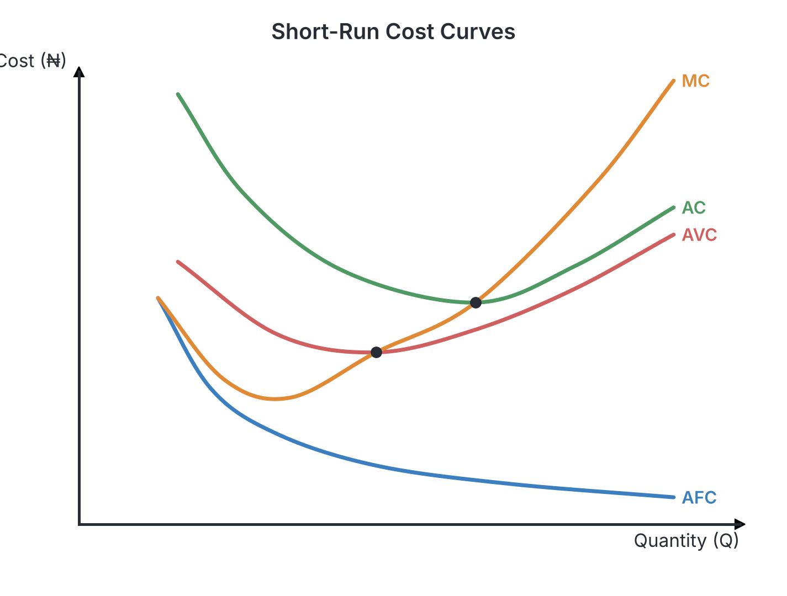
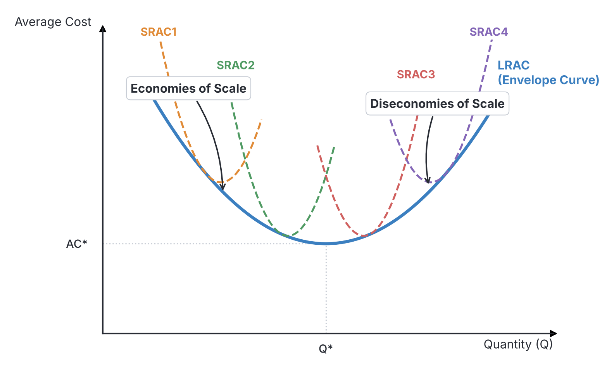
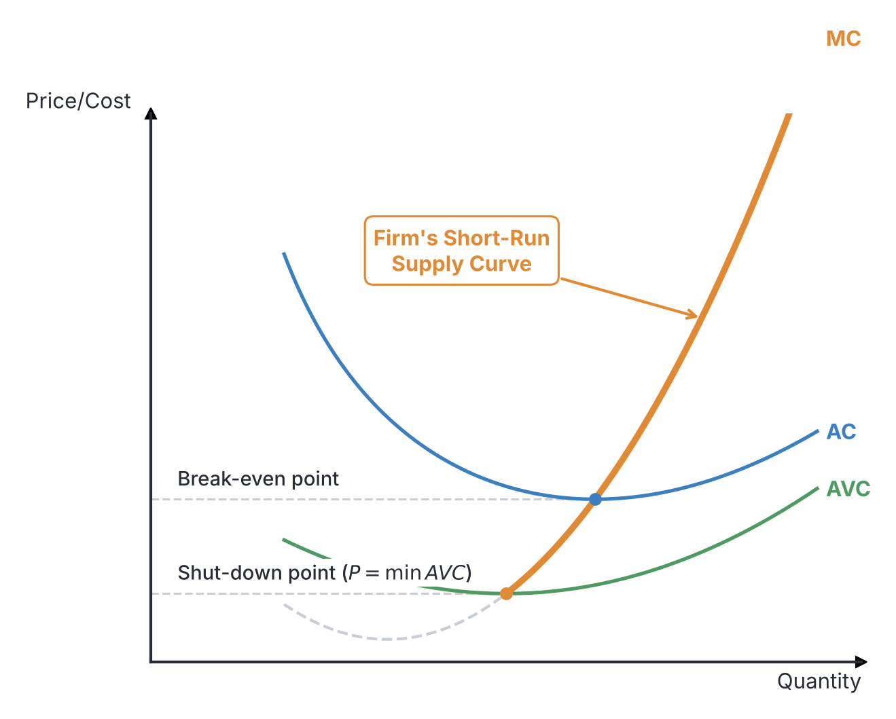
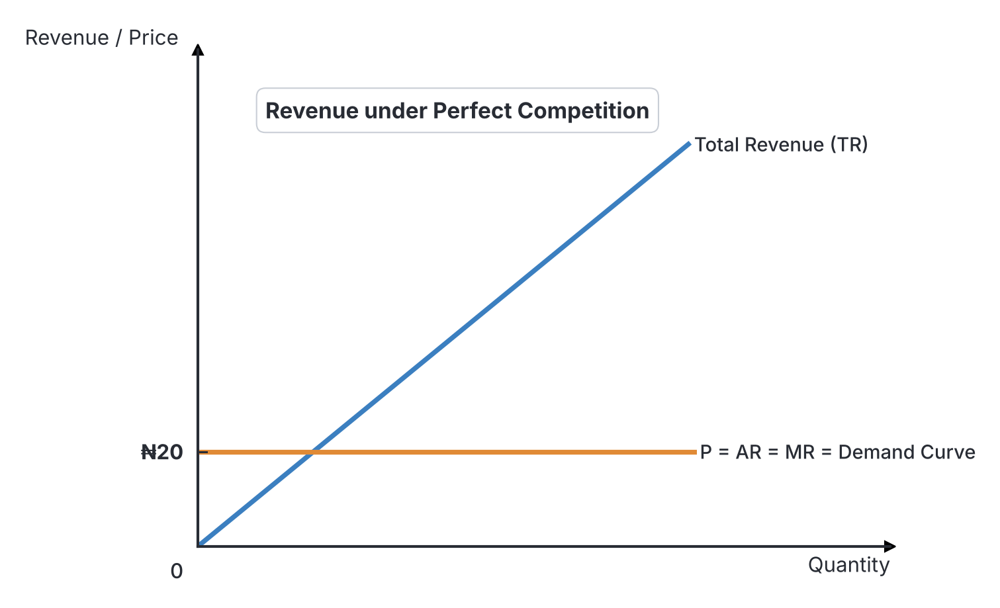
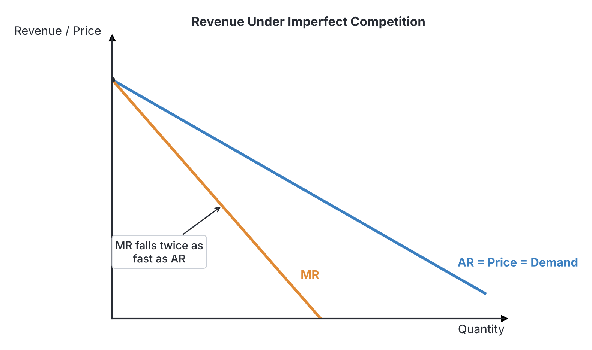

# JAMB Economics Notes: Theory of Costs and Revenue

## What JAMB expects

This topic is Section A, Topic 9 of the JAMB Economics syllabus: Theory of Costs and Revenue. It covers the following content items:

* a. The concepts of cost: Fixed, Variable, Total, Average and Marginal
* b. The concepts of revenue: Total, Average and Marginal revenue
* c. Accountants’ and Economists’ notions of cost
* d. Short-run and long-run costs
* e. The marginal cost and the supply curve of firm.

By the end of these notes, you should be able to:

1. explain the various cost concepts (Objective i)
2. differentiate between accountants’ and economists’ notions of costs (Objective ii)
3. interpret the short-run and long-run costs curves (Objective iii)
4. establish the relationship between marginal cost and supply curve (Objective iv)
5. explain the various revenue concepts (Objective v)

**Note on the syllabus wording:** In the syllabus under content item (a), it reads "Total Average and Marginal". This is a typing error that misses a comma; it should mean "Total, Average and Marginal". These notes will cover all three as distinct but closely related concepts.

## The concepts of cost

In economics, production is the process of converting inputs (factors of production) into outputs (goods and services). This transformation process is not free; it requires resources, and the monetary value of these resources is what we call a **cost of production**. To analyze how firms make decisions about how much to produce, economists break down these costs into several distinct categories based on how they behave when the quantity of output changes.

### Explaining the various cost concepts

The costs of production are broadly divided into fixed costs and variable costs. Together, they make up total costs. From these, we can calculate average and marginal costs. 

#### 1. Fixed Cost (FC) or Total Fixed Cost (TFC)
**Fixed costs** are the costs of production that do not change as the level of output changes, at least in the short run. Whether a firm produces zero units, a hundred units, or a million units, its fixed costs remain exactly the same. Because they are incurred even when output is zero, they are sometimes called "overhead costs," "unavoidable costs," or "sunk costs."

* **Nigerian Examples:** Consider a businesswoman who rents a bakery space in Ikeja for ₦1,200,000 a year. Whether she bakes 500 loaves of bread a day, or she locks up the shop for a month and bakes zero loaves, she still owes the landlord that exact amount. Other examples include the salaries of top administrative staff (who are paid a fixed monthly salary regardless of daily sales), interest payments on bank loans, depreciation of heavy machinery, and insurance premiums. 

#### 2. Variable Cost (VC) or Total Variable Cost (TVC)
**Variable costs** are the costs of production that change directly with the level of output. If the firm increases its production, variable costs go up. If the firm decreases production, variable costs go down. If the firm completely stops production (output is zero), its variable costs become zero. These are sometimes called "prime costs" or "direct costs."

* **Nigerian Examples:** For the same bakery in Ikeja, variable costs would include the cost of purchasing bags of flour, sugar, and yeast. The more bread she wants to bake, the more flour she must buy. Other examples include the wages paid to casual, daily-paid factory workers (if you produce more, you hire more hands for the day), the cost of packaging materials, and the cost of diesel used to power the generator during production hours.

#### 3. Total Cost (TC)
**Total Cost** is the sum of all costs incurred by a firm in the production of a certain level of output. It is simply the addition of Total Fixed Cost and Total Variable Cost.
* **Formula:** $TC = TFC + TVC$
* **Key takeaway:** Even if output is zero, Total Cost is not zero. At zero output, $TC = TFC$ because variable costs are zero.

#### 4. Average Costs
Average cost looks at production from a "per unit" perspective. How much does it cost, on average, to produce a single unit of the product? Because Total Cost is made of fixed and variable parts, we can also divide average cost into three components:

* **Average Fixed Cost (AFC):** This is the total fixed cost divided by the quantity of output produced. 
  * **Formula:** $AFC = \frac{TFC}{Q}$
  * **Behavior:** As output ($Q$) increases, AFC continuously falls. This is because a constant fixed amount (e.g., ₦1,200,000 rent) is being shared among a larger and larger number of loaves of bread. 

* **Average Variable Cost (AVC):** This is the total variable cost divided by the quantity of output produced.
  * **Formula:** $AVC = \frac{TVC}{Q}$
  * **Behavior:** AVC usually falls initially as the firm benefits from efficiency and specialization, reaches a minimum point, and then begins to rise due to the law of diminishing returns.

* **Average Total Cost (ATC or AC):** This is the total cost divided by the quantity produced. It can also be found by adding AFC and AVC. 
  * **Formula:** $ATC = \frac{TC}{Q}$ or $ATC = AFC + AVC$
  * **Behavior:** Like AVC, the AC curve is generally U-shaped. It falls, hits a minimum, and then rises. 

#### 5. Marginal Cost (MC)
**Marginal Cost** is the additional cost incurred by producing *exactly one extra unit* of output. It measures the change in Total Cost that comes from a one-unit change in output. 
* **Formula:** $MC = \frac{\Delta TC}{\Delta Q}$ (where $\Delta$ means "change in")
* **Alternative Formula:** $MC_n = TC_n - TC_{n-1}$ (The Total Cost of producing $n$ units minus the Total Cost of producing $n-1$ units).
* **Important Note:** Because Fixed Costs never change when output changes, any change in Total Cost must be coming entirely from a change in Variable Cost. Therefore, Marginal Cost can also be calculated as the change in Total Variable Cost: $MC = \frac{\Delta TVC}{\Delta Q}$.

### A Comprehensive Cost Schedule
To fully understand how these figures interact, let us look at a hypothetical schedule for a firm producing units of output, assuming the Total Fixed Cost is ₦120.

| Quantity ($Q$) | TFC (₦) | TVC (₦) | TC (₦) | AFC (₦) | AVC (₦) | ATC (₦) | MC (₦) |
| :--- | :--- | :--- | :--- | :--- | :--- | :--- | :--- |
| 0 | 120 | 0 | 120 | - | - | - | - |
| 1 | 120 | 50 | 170 | 120.00 | 50.00 | 170.00 | 50 |
| 2 | 120 | 90 | 210 | 60.00 | 45.00 | 105.00 | 40 |
| 3 | 120 | 140 | 260 | 40.00 | 46.67 | 86.67 | 50 |
| 4 | 120 | 210 | 330 | 30.00 | 52.50 | 82.50 | 70 |
| 5 | 120 | 300 | 420 | 24.00 | 60.00 | 84.00 | 90 |

**Working out the math:**
* At $Q = 3$, $TC = TFC + TVC = 120 + 140 = 260$.
* At $Q = 3$, $AFC = TFC / Q = 120 / 3 = 40$.
* At $Q = 3$, $AVC = TVC / Q = 140 / 3 = 46.67$.
* At $Q = 3$, $ATC = TC / Q = 260 / 3 = 86.67$ (or $AFC + AVC = 40 + 46.67 = 86.67$).
* At $Q = 3$, $MC = TC_3 - TC_2 = 260 - 210 = 50$.

## Accountants' and economists' notions of cost

When we use the word "cost" in daily conversation, we almost always mean it the way an accountant means it. However, the economic theory of the firm relies on a fundamentally different, much broader view of cost. The primary difference lies in the concept of **opportunity cost**.

### Differentiating between accountants' and economists' notions of costs

To see why economists and accountants calculate costs and profits differently, we must divide all business costs into two categories: explicit costs and implicit costs.

#### 1. Explicit Costs
Explicit costs are the actual out-of-pocket money payments a firm makes to outsiders to purchase or hire resources it does not already own. Money physically leaves the firm's bank account.
* **Examples:** Paying wages to workers, buying diesel, paying electricity bills to IBEDC, paying rent to a landlord, or buying raw materials. 
* **Who uses them?** Both accountants and economists include explicit costs in their calculations.

#### 2. Implicit Costs
Implicit costs are the opportunity costs of the resources that the firm's owner *already owns* and uses in the business. No money actually changes hands, and no invoice is generated, but a sacrifice is still being made. The owner is giving up the income they could have earned if they had employed those resources elsewhere.
* **Examples:** 
  * **Forgone Salary:** If Mr. Abubakar quits a banking job paying him ₦3,000,000 a year to run his own supermarket, that ₦3,000,000 is an implicit cost. He sacrificed it to run his business.
  * **Forgone Rent:** If Mrs. Okoro uses a shop she owns in Aba to sell clothes instead of renting it out to someone else for ₦800,000 a year, the forgone rent is an implicit cost.
  * **Forgone Interest:** If a founder uses ₦5,000,000 of their own personal savings to start a business instead of leaving it in a Zenith Bank fixed deposit account earning 10% interest (₦500,000), that forgone interest is an implicit cost.
* **Who uses them?** Only economists include implicit costs. Accountants ignore them entirely because they do not involve cash outflows or taxable transactions.

#### The Difference in Profit Calculations

Because they measure cost differently, accountants and economists also arrive at completely different profit figures. Profit is generally calculated as Total Revenue minus Costs.

* **Accounting Cost** = Explicit Costs
* **Economic Cost** = Explicit Costs + Implicit Costs

Therefore:
* **Accounting Profit** = Total Revenue $-$ Explicit Costs
* **Economic Profit** = Total Revenue $-$ (Explicit Costs + Implicit Costs)

**A Practical Nigerian Example:**
Imagine Chinedu runs a poultry farm. Over a year, he sells chickens and eggs for a Total Revenue of ₦10,000,000. He paid ₦6,000,000 for chicken feed, veterinary drugs, and hired labourers (Explicit Costs). Chinedu also used his own land which he could have rented out to a telecom company for a mast at ₦1,500,000 a year, and he quit a teaching job where he was earning ₦1,000,000 a year (Implicit Costs).

* **The Accountant's View:** 
  * Costs = ₦6,000,000
  * Accounting Profit = ₦10,000,000 - ₦6,000,000 = **₦4,000,000**.
  * The accountant congratulates Chinedu on a highly profitable year.

* **The Economist's View:**
  * Explicit Costs (₦6m) + Implicit Costs (₦1.5m + ₦1m) = Total Economic Cost = ₦8,500,000.
  * Economic Profit = ₦10,000,000 - ₦8,500,000 = **₦1,500,000**.
  * The economist says the business is profitable, but the true wealth created is only ₦1.5 million above what he could have achieved elsewhere.

#### Normal Profit vs. Abnormal Profit
Economists classify the state of a firm's profitability based on its Economic Profit:
1. **Normal Profit:** This occurs when **Economic Profit is exactly zero**. Total Revenue equals Total Economic Cost. This sounds bad, but it isn't! A zero economic profit means the firm's revenue is perfectly covering all explicit costs *and* completely covering the owner's implicit costs (their forgone salary, rent, etc.). It is the minimum amount of profit necessary to keep the entrepreneur in their current business. In economics, normal profit is actually considered a cost of production (a return for entrepreneurship).
2. **Abnormal (Supernormal) Profit:** This occurs when **Economic Profit is greater than zero**. Total Revenue is greater than Total Economic Cost. The entrepreneur is earning more than they could in their next best alternative.
3. **Economic Loss:** This occurs when **Economic Profit is negative**. The entrepreneur would be better off closing the business and returning to their previous job or renting out their assets.

| Feature | Accountant's Notion of Cost | Economist's Notion of Cost |
| :--- | :--- | :--- |
| **Main purpose** | Tracking money flowing in and out for tax compliance, shareholders, and financial reporting. | Evaluating resource allocation, decision-making, and true opportunity costs. |
| **Types of costs included** | Explicit (out-of-pocket) costs only. | Both Explicit and Implicit costs. |
| **Size of total cost** | Always smaller (because implicit costs are ignored). | Always larger (because all opportunity costs are included). |
| **Profit calculation** | TR $-$ Explicit Costs. | TR $-$ (Explicit Costs + Implicit Costs). |
| **Resulting profit size** | Accounting profit is generally larger. | Economic profit is generally smaller. |

## Short-run and long-run costs

In economics, the concepts of "short run" and "long run" are not measured in fixed amounts of time like days, weeks, or years. Instead, they are defined by a firm's ability to adjust its **factors of production** (inputs like land, labor, capital, and entrepreneurship). 

* **The Short Run:** A period during which at least one factor of production is fixed. Usually, capital (like factory buildings and heavy machinery) and land are fixed. The firm can only increase its output by changing its variable inputs, such as hiring more labor or buying more raw materials.
* **The Long Run:** A period long enough for the firm to change *all* its factors of production. There are no fixed factors in the long run. If a firm wants to expand, it doesn't just hire more workers; it can build entirely new factories and buy completely new production lines. 

Because the constraints are different, the cost curves behave very differently in the short run compared to the long run.

### Interpreting the short-run and long-run costs curves

#### The Short-Run Cost Curves and the Law of Diminishing Returns

In the short run, the shape of a firm's cost curves is governed entirely by the **Law of Variable Proportions**, better known as the **Law of Diminishing Returns**. 

Imagine a fixed plot of farmland in Kano. One farmer works on it and produces 10 bags of maize. If you add a second farmer, they can specialize (one clears, one plants), and total output jumps to 25 bags (the marginal product of the 2nd farmer is 15). But if you keep adding more and more farmers to that exact same fixed plot of land, eventually they will start getting in each other's way. The extra output (marginal product) generated by each additional farmer will start to fall. 
Because each new worker adds less and less to output, the firm has to spend more and more money just to get one extra unit of output. **As marginal product falls, marginal cost rises.**

If we plot the short-run costs from our schedule onto a graph, they form very specific, universally recognized shapes:

1. **Average Fixed Cost (AFC) Curve:** It slopes downwards continuously from left to right. Because AFC = TFC / Q, as Q gets larger, AFC gets smaller. It approaches the horizontal axis but never touches it (mathematically, it is a **rectangular hyperbola**). 
2. **Average Variable Cost (AVC) Curve:** It is broadly **U-shaped**. It falls initially due to rising efficiency, reaches a minimum point, and then rises sharply because of the Law of Diminishing Returns.
3. **Average Total Cost (AC or ATC) Curve:** It is also **U-shaped** and lies entirely above the AVC curve. The vertical distance between the AC curve and the AVC curve represents the Average Fixed Cost. Because AFC gets continuously smaller, the AC and AVC curves get closer and closer together as output increases, but they never touch.
4. **Marginal Cost (MC) Curve:** It resembles a **J-shape or a tick mark**. It falls sharply at first, reaches a minimum, and then rises steeply. 

**The Golden Rule of Cost Intersections:**
The most frequently tested concept in JAMB Economics regarding costs is the mathematical relationship between the Marginal Cost (MC) curve and the Average curves (AC and AVC). 
* **The MC curve MUST intersect both the AVC curve and the AC curve precisely at their lowest (minimum) points, cutting them from below.**

Why? Think of your Grade Point Average (GPA). If your newest test score (your *Marginal* score) is lower than your average, your average gets pulled down. If your newest test score is higher than your average, your average is pulled up. Therefore:
* Whenever $MC < AC$, the AC curve is falling.
* Whenever $MC > AC$, the AC curve is rising.
* Consequently, the exact point where AC switches from falling to rising (its lowest point) must be exactly where $MC = AC$.

#### The Long-Run Cost Curves and Economies of Scale

In the long run, the firm can change the size of its factory. There are no fixed costs. If demand increases permanently, the firm won't just squeeze more workers into its old factory; it will build a bigger, better factory.

The firm faces a series of different short-run average cost (SRAC) curves, each representing a different scale of plant (factory size). The **Long-Run Average Cost (LRAC) curve** is formed by drawing a smooth line that tangentially touches the lowest possible points of all the various SRAC curves. Because it encompasses or wraps around all the short-run curves from below, economists frequently call the LRAC curve the **Envelope Curve** or the Planning Curve.

Like the short-run AC curve, the long-run LRAC curve is broadly **U-shaped** (or saucer-shaped), but for a completely different reason. It is shaped by **Economies and Diseconomies of Scale**.

1. **Economies of Scale (The downward slope):** As a firm expands its scale of production, its long-run average costs fall. It becomes more efficient simply because it is larger.
   * **Technical economies:** A massive firm like Dangote Cement can afford huge, fully automated, highly efficient machinery that a small firm cannot.
   * **Purchasing/Commercial economies:** Large firms buy raw materials in massive bulk quantities, earning huge discounts.
   * **Financial economies:** Big firms are seen as less risky, so banks (like Zenith or GTBank) lend to them at lower interest rates.
   * **Managerial economies:** Large firms can afford highly specialized experts (e.g., full-time IT managers, HR directors) rather than having one person juggle everything.
2. **Diseconomies of Scale (The upward slope):** If a firm grows *too* large, it becomes clumsy. Long-run average costs start to rise.
   * **Managerial diseconomies:** Communication breaks down, bureaucracy increases, and it takes too long to make decisions in a massive organization.
   * **Labor diseconomies:** Workers in massive factories may feel alienated, leading to low morale, laziness, and frequent strikes.

## The marginal cost and the supply curve of a firm

The ultimate goal of analyzing costs is to understand how much a firm is willing to produce and supply to the market at various prices. 

### Establishing the relationship between marginal cost and supply curve

Firms exist to maximize profit. The golden rule for profit maximization for any firm, regardless of market structure, is to keep producing until **Marginal Revenue (MR) exactly equals Marginal Cost (MC)**. 
* If $MR > MC$, producing one more unit brings in more money than it costs to make. The firm should produce it.
* If $MR < MC$, producing one more unit costs more than it brings in. The firm is losing money on that unit and should not produce it.
* Therefore, profits are highest at the exact quantity where $MR = MC$.

In a Perfectly Competitive market, the firm is a price taker. The market dictates the price, and the firm's Marginal Revenue is exactly equal to that market Price ($P = MR$). Because the firm maximizes profit where $MR = MC$, and $P = MR$, a perfectly competitive firm will always adjust its output so that **$P = MC$**.

This means that as the market price rises, the firm simply looks at its Marginal Cost curve to decide how much to produce. The MC curve *becomes* the firm's supply curve. 

#### The Shut-Down Point
However, there is a limit. The firm will not follow its MC curve all the way down to zero. 
In the short run, a firm has fixed costs (like rent) that it must pay even if it produces zero units. 
* If the market price falls below the firm's Average Total Cost (AC) but is still above its Average Variable Cost (AVC), the firm is making a loss. However, it will **continue to produce**. Why? Because the price is high enough to pay for all the variable costs (raw materials, workers) and still have a little bit left over to pay *some* of the fixed costs. 
* If the market price falls below the **minimum Average Variable Cost (AVC)**, the firm cannot even afford to pay its daily workers or buy raw materials. If it produces, it loses its fixed costs *plus* more money on variable costs. At this point, the firm will immediately shut down (Output = 0).

The exact point where Price equals the minimum point of the AVC curve is called the **Shut-Down Point**. 
The exact point where Price equals the minimum point of the AC curve is called the **Break-Even Point** (where the firm makes normal profit).

**Conclusion:**
Because the firm produces zero when the price is below AVC, **the short-run supply curve of a perfectly competitive firm is only the portion of its Marginal Cost (MC) curve that lies entirely above the minimum point of its Average Variable Cost (AVC) curve.**

## The concepts of revenue

Revenue is the total income a firm receives from selling its goods or services. Just as we analyzed costs, economists analyze revenue in total, average, and marginal terms.

### Explaining the various revenue concepts

#### 1. Total Revenue (TR)
Total Revenue is the total amount of money a firm makes from selling a specific quantity of a product. It is calculated by multiplying the price of the product by the quantity sold.
* **Formula:** $TR = Price \times Quantity$ (or $TR = P \times Q$)
* **Example:** If a farmer sells 50 tubers of yam at ₦1,000 each, $TR = 1000 \times 50 = ₦50,000$.

#### 2. Average Revenue (AR)
Average Revenue is the revenue earned per unit of output sold. It is found by dividing total revenue by the quantity sold. 
* **Formula:** $AR = \frac{TR}{Q}$
* **The AR Identity:** Because $TR = P \times Q$, if we substitute this into the formula, we get $AR = \frac{P \times Q}{Q} = P$. Therefore, mathematically, **Average Revenue is always exactly equal to the Price of the product ($AR = P$)**. Because the AR curve shows the relationship between price and quantity, the AR curve is identically the firm's **Demand Curve**.

#### 3. Marginal Revenue (MR)
Marginal Revenue is the extra revenue earned by a firm when it sells *one additional unit* of output. 
* **Formula:** $MR = \frac{\Delta TR}{\Delta Q}$
* **Alternative Formula:** $MR_n = TR_n - TR_{n-1}$

How these three revenue concepts behave depends entirely on the type of market structure the firm is operating in.

#### Revenue under Perfect Competition
In a perfectly competitive market, there are many buyers and sellers, and products are identical. The individual firm is a **price taker**. It is so small that it cannot influence the market price. It can sell as much or as little as it wants at the prevailing market price. 

Because the price is perfectly constant, every single extra unit sold brings in exactly the same amount of money.

| Quantity Sold ($Q$) | Price ($P$) | Total Revenue ($TR$) | Average Revenue ($AR = TR/Q$) | Marginal Revenue ($MR$) |
| :--- | :--- | :--- | :--- | :--- |
| 1 | ₦20 | ₦20 | ₦20 | ₦20 |
| 2 | ₦20 | ₦40 | ₦20 | ₦20 |
| 3 | ₦20 | ₦60 | ₦20 | ₦20 |
| 4 | ₦20 | ₦80 | ₦20 | ₦20 |

* **Notice:** Under perfect competition, $Price = AR = MR$. If drawn on a graph, the firm's AR and MR curves merge into a single, perfectly horizontal straight line at the market price level. 

#### Revenue under Imperfect Competition (Monopoly)
In an imperfect market, such as a monopoly or monopolistic competition, the firm is a **price maker**. However, it still faces the law of demand. To sell a larger quantity of goods, the firm must lower its price. 

| Quantity Sold ($Q$) | Price ($P = AR$) | Total Revenue ($TR$) | Marginal Revenue ($MR$) |
| :--- | :--- | :--- | :--- |
| 1 | ₦100 | ₦100 | ₦100 |
| 2 | ₦90 | ₦180 | ₦80 |
| 3 | ₦80 | ₦240 | ₦60 |
| 4 | ₦70 | ₦280 | ₦40 |
| 5 | ₦60 | ₦300 | ₦20 |

* **Notice:** To sell the second unit, the firm had to lower the price from ₦100 to ₦90. It doesn't just sell the second unit for ₦90; it has to sell *both* units for ₦90. The TR went from 100 to 180, so the extra revenue (MR) is only 80, which is less than the price of 90. 
* **Conclusion:** Under imperfect competition, the **MR curve is always below the AR (Price) curve**. Both slope downwards from left to right. For a straight-line demand curve, the MR curve falls twice as fast as the AR curve (it sits exactly halfway between the vertical axis and the AR curve).

#### A Note on Marginal Revenue and Price Elasticity of Demand
There is a profound mathematical relationship between Marginal Revenue and the Price Elasticity of Demand ($e$).
* If demand is **elastic** (price drops lead to massive surges in quantity demanded), Total Revenue rises, which means **MR is positive**.
* If demand is **unitary elastic**, Total Revenue is maximized and stops growing, which means **MR is exactly zero**.
* If demand is **inelastic** (price drops only cause tiny increases in quantity demanded), Total Revenue falls, which means **MR is negative**.

## Key terms

| Term | Meaning |
| :--- | :--- |
| **Explicit Cost** | Actual out-of-pocket money payments made by a firm to purchase or hire resources it doesn't own. |
| **Implicit Cost** | The opportunity cost of resources already owned and used by the firm's owner (e.g., forgone salary). |
| **Economic Profit** | Total Revenue minus the sum of explicit and implicit costs. |
| **Normal Profit** | A situation where economic profit is exactly zero; the firm just covers all explicit and implicit costs. |
| **Fixed Cost (FC)** | Costs that do not vary with the level of output (e.g., rent, insurance). |
| **Variable Cost (VC)** | Costs that change directly with the level of output (e.g., raw materials, daily wages). |
| **Average Cost (AC)** | Total cost divided by quantity produced; the cost per unit. |
| **Marginal Cost (MC)** | The additional cost of producing exactly one more unit of output. |
| **Envelope Curve** | Another name for the Long-Run Average Cost (LRAC) curve because it completely encloses all short-run AC curves from below. |
| **Economies of Scale** | Advantages a firm gains by expanding its scale of production, causing long-run average costs to fall. |
| **Shut-Down Point** | The point where price exactly equals minimum Average Variable Cost; below this price, the firm stops producing. |
| **Average Revenue (AR)** | Revenue per unit sold, which is mathematically always equal to Price. |
| **Marginal Revenue (MR)** | The extra revenue earned by selling one additional unit of output. |

## Exam tips and common mistakes

* **Mistaking Accounting Profit for Economic Profit:** Remember that Economic Profit is ALWAYS smaller than Accounting Profit because economists subtract implicit (opportunity) costs as well. If a question gives you a salary the owner "gave up," you must subtract it to find economic profit.
* **The MC Intersection Rule:** JAMB tests this constantly. The MC curve ALWAYS cuts the AC and AVC curves at their exact **minimum (lowest) points** from below. Never pick an option that says it cuts them at their maximum or at random points.
* **AR = Price:** Never forget that Average Revenue ($AR$) is exactly the same thing as Price ($P$) in all markets. The AR curve is always the firm's demand curve.
* **The Supply Curve Identity:** When JAMB asks what represents a firm's short-run supply curve, look for the option that says "The marginal cost curve above the average variable cost curve." Do not select "the whole marginal cost curve," because the firm produces nothing below the shut-down point.
* **U-Shape Origins:** The short-run AC curve is U-shaped because of the **Law of Diminishing Returns** (or law of variable proportions). The long-run AC curve is U-shaped because of **Economies and Diseconomies of Scale**. Examiners frequently try to trick students into mixing these two up.

## Quick summary

1. Economists measure true costs by including both explicit (out-of-pocket) and implicit (opportunity) costs. A firm earns normal profit when its economic profit is exactly zero.
2. Total Cost is the sum of Fixed Cost (which doesn't change with output, like rent) and Variable Cost (which changes directly with output, like raw materials).
3. As output rises, Average Fixed Cost falls continuously, forming a rectangular hyperbola on a graph.
4. Due to the Law of Diminishing Returns, the short-run Average Cost and Average Variable Cost curves are U-shaped. The Marginal Cost curve cuts both at their lowest points.
5. In the long run, all costs are variable. The long-run average cost (LRAC) curve is U-shaped because of economies and diseconomies of scale.
6. A firm maximizes profit where Marginal Revenue equals Marginal Cost ($MR = MC$). In the short run, the firm's supply curve is the portion of its Marginal Cost curve that lies above its Average Variable Cost curve.
7. In perfect competition, the firm is a price taker, so Price = AR = MR. In an imperfect market (monopoly), the firm is a price maker, and the MR curve lies below the AR curve.

## Practice questions

**1. An economist’s measurement of cost differs from an accountant’s primarily because the economist includes:**
- A. only variable costs.
- B. both explicit and implicit costs.
- C. taxes and royalties.
- D. only fixed costs.

**Answer: B.** Economists include the implicit (opportunity) costs of resources owned by the firm (like the owner's forgone salary), whereas accountants only include explicit (out-of-pocket) money payments. 

**2. A woman quits her teaching job earning ₦1,200,000 a year to start a bakery. Her total revenue for the first year is ₦5,000,000. She paid ₦3,000,000 for flour, wages, and electricity. What is her economic profit?**
- A. ₦2,000,000
- B. ₦800,000
- C. ₦1,800,000
- D. ₦3,800,000

**Answer: B.** Economic profit = Total Revenue - (Explicit Costs + Implicit Costs). Her explicit costs are ₦3,000,000 and her implicit cost (forgone salary) is ₦1,200,000. Total Economic Cost = ₦4,200,000. Economic profit = ₦5,000,000 - ₦4,200,000 = ₦800,000. The common mistake is Option A, which is the accounting profit.

**3. The short-run supply curve of a perfectly competitive firm is perfectly represented by the:**
- A. average total cost curve.
- B. marginal cost curve above the average variable cost curve.
- C. downward sloping part of the marginal cost curve.
- D. marginal revenue curve above the average cost curve.

**Answer: B.** The firm maximizes profit where $P = MC$. However, if the price drops below the minimum Average Variable Cost (AVC), the firm cannot cover its variable expenses and will shut down (producing zero). Therefore, the supply curve is only the portion of the MC curve above the minimum AVC point.

**4. In the short run, the Average Cost (AC) curve is U-shaped due to the:**
- A. law of diminishing returns.
- B. economies and diseconomies of scale.
- C. continuous fall in total fixed cost.
- D. law of demand.

**Answer: A.** In the short run, at least one factor of production is fixed. Adding more variable factors to a fixed factor eventually leads to diminishing marginal returns, causing average costs to eventually rise. Option B is wrong because economies of scale explain the shape of the *long-run* average cost curve, not the short-run curve.

**5. Which of the following cost curves continues to fall as output increases, approaching the horizontal axis but never touching it?**
- A. Average variable cost curve
- B. Marginal cost curve
- C. Average fixed cost curve
- D. Total cost curve

**Answer: C.** Average Fixed Cost (AFC) is Total Fixed Cost divided by the quantity produced. Since TFC is a constant number (e.g., rent), dividing it by an ever-increasing quantity yields a continuously smaller number. The curve forms a rectangular hyperbola.

**6. If a firm’s Total Cost is ₦200 when producing 4 units and ₦260 when producing 5 units, what is the Marginal Cost of the 5th unit?**
- A. ₦40
- B. ₦52
- C. ₦60
- D. ₦260

**Answer: C.** Marginal cost is the change in total cost resulting from producing exactly one extra unit. $MC = TC_5 - TC_4 = 260 - 200 = 60$. Option B (52) is a common mistake; it is the Average Total Cost of the 5th unit ($260/5$), not the marginal cost.

**7. A firm's Total Revenue increases from ₦500 to ₦528 when its output increases from 10 units to 11 units. What is the Marginal Revenue of the 11th unit?**
- A. ₦28
- B. ₦48
- C. ₦50
- D. ₦52.8

**Answer: A.** Marginal Revenue is the change in Total Revenue when output increases by one unit. $MR = TR_{11} - TR_{10} = 528 - 500 = 28$. 

**8. The long-run average cost (LRAC) curve is often called the envelope curve because it:**
- A. diminishes marginal utility.
- B. acts as a perfectly competitive demand curve.
- C. encloses all the short-run average cost curves from below.
- D. increases marginal returns over time.

**Answer: C.** The LRAC curve is called the envelope curve or planning curve because it touches the lowest points of a series of short-run average cost curves, effectively wrapping or "enveloping" them from underneath. 

**9. In a perfectly competitive market, the firm's Marginal Revenue (MR) curve is:**
- A. perfectly horizontal and equal to Average Revenue.
- B. downward sloping and lies below the Average Revenue curve.
- C. upward sloping and exactly equal to Marginal Cost.
- D. completely vertical.

**Answer: A.** In perfect competition, the firm is a price taker. Because the price is constant for all units sold, $Price = Average Revenue = Marginal Revenue$. This results in a perfectly horizontal line. Option B describes a monopoly or imperfect competition.

**10. At the exact point where a firm's Marginal Cost (MC) curve intersects its Average Total Cost (AC) curve:**
- A. average total cost is at its maximum point.
- B. average total cost is exactly equal to average variable cost.
- C. average total cost is at its minimum (lowest) point.
- D. average fixed cost is zero.

**Answer: C.** The mathematical relationship between marginal and average values dictates that the Marginal Cost curve must cross the Average Total Cost curve exactly at the lowest point of the AC curve, cutting it from below.
